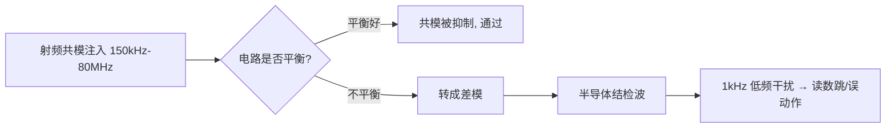

# PCB 时钟、复位与启动模块（分卷 01）

本分卷承接汇总稿 `硬件/PCB/时钟复位与启动模块.md`，事实来源沿用 frontmatter 中列出的原始资料。

## 模块目标
- 时钟网络要在所有工作电压、温度和负载条件下稳定起振并满足抖动、占空比和时序裕量。
- 复位网络要使器件仅在电源和时钟有效后退出复位，并能在掉电、看门狗和外部按键事件下可靠恢复。
- 启动配置脚必须在采样窗口内处于确定电平，且不与调试器、外设或量产夹具冲突。

## 晶体与振荡器布局
- 晶体、负载电容和 MCU 时钟脚构成最小闭环，元件贴近芯片、走线短且对称；避免过孔、跨参考面和靠近开关节点。
- 晶体下方的铺地、护环和禁布要求必须以芯片手册为准。某些振荡器需要连续地参考，另一些则禁止晶体下方铺铜以降低寄生电容。
- 远离 DC/DC 电感、SW 节点、高电流回路、连接器和高速数据线；这些区域的电场、磁场与地弹会降低起振裕量或引入周期抖动。
- 选择低电容探头或有源探头测量振荡节点。普通 10:1 探头和长地线可能改变负载、导致不起振或测得不存在的振铃。

## 参数计算与选型
- Pierce 振荡器的负载电容近似为 `CL = (C1*C2)/(C1+C2) + Cstray`。`Cstray` 包含芯片脚、焊盘、走线和封装寄生，C1/C2 应与晶体的标称 CL 一起计算。
- C1/C2 取相同值有利于布局对称；如芯片手册要求补偿驱动端与输入端的寄生差异，则按其推荐比值设置。
- 过大的负载电容会增加驱动负担和起振时间，过小会使频偏、杂散和外界干扰敏感性变差。不能只以“能起振”判断参数正确。
- 同时核对频率、ESR、允许驱动功率、频率容差、温漂、老化、封装和可采购性。低功耗 MCU 的内部振荡器驱动能力有限，ESR 裕量尤其重要。
- 有源振荡器还应核对供电范围、输出标准、使能脚默认状态、稳定时间、相位噪声和周期抖动；其电源去耦贴近器件，不能借用长而细的数字地回流。

## 时钟树与端接
- 单负载时钟按高速单端线处理：定义参考面、阻抗和最长线长，避免无意的测试支路和换层。
- 多负载时钟优先使用专用缓冲器或扇出器件；每个分支明确长度、输入电容、端接方式和允许 skew，不随意从长主干做 T 形分叉。
- 源端串联端接靠近驱动端，阻值由驱动器输出阻抗、线阻抗、负载数量和实测波形共同确定。并联端接或 AC 端接必须核对静态功耗与默认状态。
- 经过连接器、层切换或不同区域时，检查参考面连续性、过孔 stub、相邻噪声线和回流通道；换层信号过孔旁布置参考地过孔。
- 验证时观察负载端的过冲、下冲、振铃、上升/下降沿、占空比和周期抖动。频率计读数正常不等于接收端阈值裕量充足。

## 复位网络
- 复位源可能包括上电复位、监控器、看门狗、调试器、外部按键和外部模块。逐一确认极性、输出类型、默认态、线与关系和电平兼容性。
- 复位释放必须晚于所有相关电源达到阈值、时钟稳定和关键外设初始化。多电源芯片需要核对上升顺序、单调性、最低斜率与掉电顺序。
- RC 复位的延时受输入阈值、漏电、R/C 容差、温度、按键并联路径和调试器驱动影响；复杂电源树优先使用带阈值和延时保证的复位监控器。
- 开漏输出可以线与，但应核对上拉电压及每个接收端的绝对最大额定值；推挽输出不得直接并联，需要通过开漏缓冲、逻辑门或隔离网络合成。
- 长外部复位线配置 ESD、限流和去抖，并远离时钟与高阻模拟节点。复位 RC 的慢边沿如未经过施密特输入，可能在阈值附近反复触发。

## 启动脚与调试接口
- 启动脚使用明确上拉或下拉，核对内部电阻、采样时刻、默认模式及与 JTAG/SWD/下载接口的复用关系。
- 外部模块不得在启动采样窗口内与配置电阻冲突。LED、电平转换器、传感器、连接器和调试夹具均可能通过 ESD 二极管或上电时序反向驱动启动脚。
- 配置电阻尽量靠近芯片；测试焊盘可便于测量，但不能形成长 stub。量产模式与正常模式应有明确、可控且可追溯的切换方法。
- 对 Boot、复位、时钟和调试信号预留低侵入测试位置，标明默认装配状态与可选电阻位，避免调试时临时飞线破坏高速或敏感网络。

## 上板排障顺序
1. 测量输入、电源轨和静态电流，确认器件已满足最低工作电压。
2. 测量复位脚，确认其极性、脉宽和释放时刻符合手册。
3. 使用合适探头检查晶体或外部时钟是否稳定；必要时切换已知正常外部时钟。
4. 读取启动脚和调试接口电平，暂时断开可疑外设，排除外部冲突。
5. 在掉电再上电、缓慢上电、看门狗复位和调试器连接状态下重复验证，记录波形与板号。

## 评审与测试清单
- [ ] 晶体封装、频率、CL、ESR、驱动功率及 C1/C2 的计算值和实装值已记录。
- [ ] 时钟拓扑、端接、参考面、换层和每路 skew 预算已复核。
- [ ] 各电源斜率、复位时序和时钟/PLL 稳定时间已用示波器验证。
- [ ] 启动脚默认电平、外部冲突和量产模式已检查。
- [ ] 空板、外设全接、调试器连接、掉电再上电四种状态均可稳定启动。

+### 时钟复位与启动知识条目 1
CS（Conducted Susceptibility，传导抗扰度，IEC 61000-4-6）模拟的场景是：**在 150kHz～80MHz 频段，外界电磁场在线缆上感应出共模电压，顺着线缆灌进设备**。

为什么是这个频段？因为 80MHz 以下，波长（>3.75m）远大于普通设备尺寸，机壳不能有效接收电磁波，但**线缆长度接近 $\lambda/4$，成了高效接收天线**。80MHz 以上则改用辐射抗扰（RS，IEC 61000-4-3）直接照射。

测试等级：Level 1 = 1V、Level 2 = 3V、Level 3 = 10V（rms，未调制载波），实测时用 **1kHz 正弦、80% AM 调幅**，扫频步进 1%，每点驻留 ≥0.5s。

🔬 **深入原理**

注入方式三种：

| 方式 | 器件 | 特点 |
|---|---|---|
| CDN（耦合去耦网络） | CDN-M2/M3、AF、T2 等 | 首选，阻抗标准 150Ω |
| EM-Clamp（电磁钳） | 钳夹线缆 | 无法用 CDN 时（如屏蔽线） |
| 直接注入（BCI/直接耦合） | 100Ω 电阻注入 | 同轴/单线场合 |

**150Ω 共模阻抗**是这个标准的核心参数——它代表人体/线缆对地的典型共模阻抗。CDN 保证注入点看到 150Ω。

设备内部为什么会误动作？共模电压 $V_{CM}$ 通过**不平衡**转成差模干扰：

$$V_{DM}=V_{CM}\cdot\frac{\Delta Z}{Z}$$

$\Delta Z/Z$ 就是电路的不平衡度。差分接收电路（RS-485、以太网）平衡好，抗扰强；单端信号（UART、GPIO、模拟采样）平衡差，容易被击穿。

此外 80MHz 以下的干扰还会被半导体结**检波（rectification）**——PN 结的非线性把射频包络解调出来，变成 1kHz 的低频干扰，直接叠加到运放/ADC 输入，表现为读数跳动。这就是为什么调制是 80% AM 1kHz：**它专门检验解调敏感度**。

🛠 **设计实例/操作**

*例1：模拟采样口被干扰。* 4-20mA 输入在 20MHz 附近读数跳 ±5%。整改：
- 输入端加 **RC 低通**（如 100Ω + 1nF，$f_c=1.6\text{MHz}$）；
- 运放输入引脚就近加 10～100pF 到地（射频旁路）；
- 差分走线，增加共模抑制；
- 线缆入口加 CMC 或磁环。

*例2：I/O 口复位。* 长线 GPIO 在 5MHz 处触发复位。整改：GPIO 加 TVS + 串 100Ω + 1nF 对地；软件加去抖与看门狗；PCB 上把该信号的地回流路径缩短。



⚠️ **常见误区**

1. 只在软件上打补丁（滤波算法）。射频检波产生的是真实模拟量，软件无法完全消除。
2. 在信号线上加大电容却忽略上升沿要求，导致通信速率不达标。要按 $f_c$ 与信号带宽折中。
3. 认为屏蔽线一定好。屏蔽层若**只单端接地或接地阻抗高**，反而成为共模注入通道。高频应 360° 环接。
4. 忘记电源端口也要做 CS。DC 电源输入端同样需要 CMC + Y 电容。
5. 把 CS 与 EFT/Surge 混淆。CS 是持续射频，EFT 是脉冲群，Surge 是大能量单脉冲，防护器件完全不同。

📌 **要点速记**

- CS = IEC 61000-4-6，150kHz～80MHz，共模注入，150Ω 标准阻抗。
- 用 1kHz/80% AM 调制，专门考核半导体结的检波敏感度。
- 不平衡度决定共模→差模转换，平衡设计是根本。
- 端口整改套路：CMC/磁环 + RC 低通 + 就近射频旁路电容 + TVS。
- 屏蔽层需 360° 低阻接地才有效。


---
### 时钟复位与启动知识条目 2
核心对照表（记住波形与能量量级，选型就不会错）：

| 实验 | 标准 | 波形 | 重复率 | 能量 | 典型防护 |
|---|---|---|---|---|---|
| EFT 脉冲群 | 61000-4-4 | 5/50 ns | 5 或 100 kHz 突发 | 小（能量低、频谱宽到几百 MHz） | Y 电容、CMC、TVS、缩短地路径 |
| Surge 浪涌 | 61000-4-5 | 1.2/50 μs 电压，8/20 μs 电流 | 单次，正负各 5 次 | **大**（可达数百 A） | GDT + 压敏 + TVS 三级配合 |
| RS 辐射抗扰 | 61000-4-3 | 80MHz～1/6GHz，3～10 V/m | 扫频 | — | 屏蔽、滤波、平衡设计 |
| DIP 电压跌落 | 61000-4-11 | 0%/40%/70% 跌落 | — | — | 大容量输入电容、掉电检测 |
| PFMF 工频磁场 | 61000-4-8 | 50Hz，30～100 A/m | 持续 | — | 远离、屏蔽（高导磁材料）、减小环路 |

🔬 **深入原理**

**EFT 的本质**：5ns 上升沿意味着频谱延伸到 $0.35/5\text{ns}=70\text{MHz}$ 甚至更高，且是**共模**注入（通过容性耦合夹或耦合网络）。它能量不大，但频率高，专挑寄生电容与地环路的漏洞。**EFT 整改的关键是"给共模电流一条尽量短的返回路径"**——所以 Y 电容、机壳搭接、屏蔽层接地至关重要。

**Surge 的本质**：1.2/50μs 波形，开路电压 $U_{oc}$、短路电流 $I_{sc}$，源阻抗 2Ω（线对线）或 12Ω（线对地）。2kV/2Ω = 1000A 峰值。这么大的能量，**必须靠能量泄放器件而不是滤波**。

三级防护配合的关键是**能量配合**（用阻抗梯度）：

```
 线路 ──[GDT 气体放电管]──/\/\/── [MOV 压敏]──/\/\/── [TVS]── 内部电路
        （kA 级, 响应 μs）  退耦   （几百A, 响应 ns）  退耦   （几十A, 响应 ps）
                        电感/PTC/电阻          小电阻
```

没有中间退耦阻抗，后级 TVS 会先动作被烧毁。TVS 选型三要素：
- $V_{RWM}$（反向工作电压）> 电路最高工作电压；
- $V_{BR}$（击穿电压）留 10% 余量；
- $V_{C}$（钳位电压）< 被保护器件耐压；
- $P_{PP}$ 峰值功率满足波形要求（10/1000μs 与 8/20μs 的额定不同，别混用）。

**电压跌落**：设计要点是输入储能电容能撑过跌落时间：

$$C\ge\frac{2P\cdot t_{hold}}{V_{nom}^2-V_{min}^2}$$

🛠 **设计实例/操作**

*例1：以太网口浪涌 ±2kV 共模。* 变压器（隔离）+ Bob Smith 电路（4×75Ω 汇到 1000pF/2kV 电容到机壳）+ 中心抽头对机壳的高压电容。若是 PoE，还要加 GDT。切忌把 Bob Smith 的地直接连数字地。

*例2：EFT ±2kV 电源口导致 MCU 复位。* 排查顺序：
1. 复位引脚是否有 0.1μF 电容和上拉；
2. 晶振布线是否远离电源入口；
3. 输入端 Y 电容到机壳的路径是否够短；
4. 机壳与 PCB 地的搭接是否多点低阻；
5. 长线 I/O 是否加了共模磁环。

*例3：工频磁场。* 霍尔传感器/互感器附近别放变压器；敏感回路面积最小化；必要时用**坡莫合金/硅钢**做磁屏蔽（铝铜屏蔽对 50Hz 磁场几乎无效）。

⚠️ **常见误区**

1. 用 TVS 直接扛 Surge。单个小封装 TVS（SMAJ）在 2kV/2Ω 下会炸；必须前级泄放。
2. 把 8/20μs 与 10/1000μs 的额定功率混用，选型偏小。
3. 认为 ESD 器件能兼做浪涌。ESD 器件电容小但能量小；浪涌器件能量大但电容大，高速口要权衡。
4. EFT 整改只想着加电容，忽略机壳搭接与地设计。
5. 抗扰测试时把 EUT 悬空放置。测试布置（10cm 绝缘垫、参考接地板、线缆长度）严重影响结果。

📌 **要点速记**

- EFT 频谱宽、能量小 → 治共模路径；Surge 能量大 → 三级泄放 + 阻抗退耦。
- TVS 选型看 $V_{RWM}/V_{BR}/V_C/P_{PP}$，注意波形定义。
- 保护器件动作顺序靠退耦阻抗保证。
- 工频磁场只能用高导磁材料屏蔽，铝/铜无效。
- 抗扰失败先查"地"与"搭接"，再查器件。


---
### 时钟复位与启动知识条目 3
辐射发射（RE）测的是设备向空间辐射的电磁场强度，频段 30MHz～1GHz（有高频时钟的要测到 6GHz）。3m 法或 10m 法半电波暗室，天线在 1～4m 高度扫描，EUT 转台 360° 旋转，水平/垂直双极化，取最大值。

**最关键的认知**：在 30MHz～1GHz 频段，PCB 本身尺寸（10cm 量级）对应 $\lambda/4$ 约在 750MHz 才谐振，所以**1GHz 以下的辐射，主要天线是线缆和机壳缝隙，而不是 PCB 走线本身**。PCB 的作用是"驱动源"——它把共模电压加到了线缆上。

$$\text{PCB 共模噪声} \xrightarrow{\text{驱动}} \text{线缆(天线)} \xrightarrow{} \text{辐射超标}$$

🔬 **深入原理**

**两种辐射模型**：

差模（环路天线）：
$$E_{DM}=1.32\times10^{-14}\frac{f^2 A I_{DM}}{r}\ \text{V/m}$$

共模（单极子天线）：
$$E_{CM}=1.26\times10^{-6}\frac{f L I_{CM}}{r}\ \text{V/m}$$

**谐振长度**：线缆长度 $L=\lambda/4$ 时辐射效率最高。

$$f_{res}=\frac{c}{4L}\Rightarrow L=1\text{m}\to 75\text{MHz};\ L=0.5\text{m}\to150\text{MHz}$$

看到 75MHz、150MHz、300MHz 附近的宽峰，先怀疑线缆。

**缝隙泄漏**：屏蔽罩缝隙长度 $\ell$ 的屏蔽效能

$$SE(\text{dB})\approx 20\log_{10}\frac{\lambda}{2\ell}$$

$\ell=\lambda/2$ 时 SE=0，完全不屏蔽。所以设计规则：**最长缝隙 < $\lambda_{min}/20$**。1GHz（λ=300mm）→ 缝隙 <15mm；缝合过孔间距同理。

**PCB边缘辐射：** 电源/地平面对的边缘场可能参与辐射。20H内缩与地孔围栏只能作为特定结构的初始经验，不能保证EMC改善；需检查实际参考面、目标频率、回流与孔电感，并仿真/测量。固定100–200 mil或λ/20不是通用放行门限。

🛠 **设计实例/操作**

*例1：定位超标源。* 用近场探头（H 场环 + E 场棒）在板上扫，配合频谱仪：
- 时钟晶振周围强 → 晶振布局/屏蔽/串阻；
- DC-DC 开关节点强 → 缩小 SW 铜皮、加输入环路电容、加 RC 缓冲；
- 连接器处强 → 共模问题，加 CMC/磁环；
- 用手捏/拔线缆后读数大变 → 确认线缆是天线。

*例2：整改优先级（成本从低到高）。*
1. 改布局布线（缩小环路、完整参考面、换层伴地孔）——免费
2. 时钟串阻 22～33Ω、展频 SSC（±1% 可降 6～10dB）——几分钱
3. 接口加共模磁环/CMC——几毛钱
4. 加屏蔽罩/导电泡棉/铜箔——几元
5. 改叠层/改板——重新打样

*例3：SSC 展频。* 把 100MHz 时钟以 30kHz 三角波调制 ±0.5%，能量被摊到更宽频带，QP 读数可降 6～12dB。注意：**USB/以太网/DDR 有各自对 SSC 的容忍规范，不能乱开**（如 USB3 支持 −0.5% 下展）。

⚠️ **常见误区**

1. 只盯着 PCB 走线，忘了线缆才是主天线。
2. 屏蔽罩接地只焊四个角。应沿边多点焊接，间距 < $\lambda/20$。
3. 开孔散热用大方孔。应改成**多个小圆孔阵列**（同样开孔率，屏蔽效能高很多）。
4. 用展频掩盖问题。SSC 降的是"测量读数"，实际峰值能量还在，对邻近敏感电路照样干扰。
5. 忽略 1GHz 以上。有 DDR4/USB3/HDMI 的产品必须测到 3～6GHz，此时 PCB 走线本身就能辐射。

📌 **要点速记**

- 1GHz 以下辐射的主天线是线缆与缝隙，PCB 提供共模驱动源。
- 共模辐射 $\propto f L I_{CM}$，差模辐射 $\propto f^2 A I_{DM}$。
- $\lambda/4$ 谐振：1m 线 → 75MHz，重点排查。
- 缝隙/缝合孔间距 < $\lambda_{min}/20$；散热孔用小圆孔阵列。
- 整改按"布局→串阻/展频→磁环→屏蔽"的成本顺序推进。


---

## 相关入口

- [[硬件/PCB/时钟复位与启动模块|分类稿汇总目录]]
- [[wiki/来源映射|Wiki 来源映射]]
- [[wiki/概览|Wiki 概览]]
