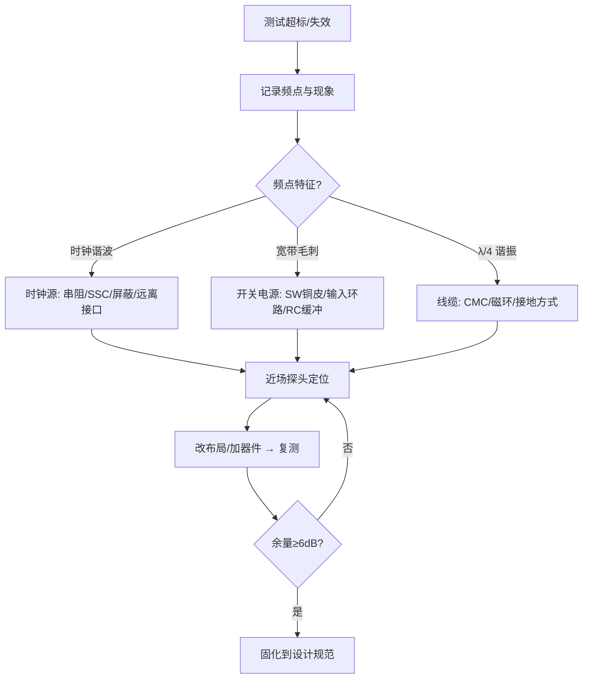

# PCB 时钟、复位与启动模块（分卷 02）

本分卷承接汇总稿 `硬件/PCB/时钟复位与启动模块.md`，事实来源沿用 frontmatter 中列出的原始资料。

## 评审与测试清单
### 时钟复位与启动知识条目 4
🔬 **深入原理：一张总表**

| 实验 | 频段/波形 | 主因 | 首选整改 | 备选 |
|---|---|---|---|---|
| CE 传导 | 150k～30MHz | 低频段差模、高频段共模 | X/Y 电容、CMC、减小 $dv/dt$ | 变压器屏蔽层、磁环、RC 缓冲 |
| RE 辐射 | 30M～1/6GHz | 线缆共模、缝隙泄漏、平面边缘 | 缩小环路、串阻、CMC/磁环 | 屏蔽罩、SSC、改叠层 |
| ESD | <1ns, 30A | 高频路径电感、接地不良 | TVS 靠连接器、地路径最短 | 结构泄放、导电泡棉、软件容错 |
| EFT | 5/50ns 突发 | 共模、地环路 | Y 电容、CMC、机壳多点搭接 | TVS、缩短复位/晶振路径 |
| Surge | 8/20μs, 数百A | 能量泄放不足 | GDT+MOV+TVS 三级 | 退耦电感/PTC、隔离变压器 |
| CS | 150k～80MHz | 电路不平衡、结检波 | 平衡设计、RC 低通、射频旁路 | CMC、屏蔽层 360° 接地 |
| RS | 80M～6GHz | 同 CS + 直接场耦合 | 屏蔽、滤波、缩小敏感环路 | 器件重选、软件滤波 |
| DIP | 电压跌落 | 储能不足 | 加大输入电容、掉电检测 | 宽输入范围电源 |

**通用排查流程：**



🛠 **设计实例/操作**

*例1：把 EMC 前移到设计阶段的 Checklist（板级）。*

1. 叠层：至少一个完整 GND 平面，高速层紧邻 GND，PWR/GND 相邻薄介质。
2. 分区：接口区 / 数字区 / 模拟区 / 电源区物理分开，接口区靠板边集中。
3. 回流：不跨分割，换层伴地孔，排针按 1:3 配地。
4. 时钟：最短、包地、串阻、远离板边与接口 ≥ 300mil。
5. 接口：TVS 靠连接器、CMC 在其后、走线不回穿数字区。
6. 电源：去耦贴引脚、DC-DC 输入环路最小、SW 铜皮最小。
7. 板边：缝合地过孔间距 ≤200mil，20H 规则。
8. 结构：屏蔽罩多点接地、缝隙 <λ/20、螺柱接地。

*例2：整改的"经济学"。* 同样 10dB 的改善：
- 改布线：0 元/台，但需要重新打样（一次性成本）
- 串阻 + 磁环：约 0.2 元/台 × 10 万台 = 2 万元
- 屏蔽罩：约 3 元/台 × 10 万台 = 30 万元

所以**设计阶段多花两天做 EMC 评审，可能省下几十万**。

⚠️ **常见误区**

1. "试错法"整改：随机加电容磁环，改好了也不知道为什么，量产一致性差。
2. 不做近场定位就动手。定位是整改效率的关键。
3. 只解决超标频点，不看整体余量趋势。
4. 整改方案不固化。同一个坑在下一个项目再踩一遍。
5. 忽视测试布置差异。同一台机器在不同实验室差 3～5dB 很正常。

📌 **要点速记**

- 每个实验都有典型主因与首选手段，先按表定位再动手。
- 排查顺序：记录频点 → 判断特征 → 近场定位 → 整改 → 复测。
- 板级 8 条 Checklist 能挡掉大部分问题。
- 整改成本随阶段推后指数上升，前移设计最划算。
- 留 6dB 余量，把有效方案固化为公司设计规范。


---
### 时钟复位与启动知识条目 5
以太网第二部分，聚焦**电源/时钟/EMC/调试**这些"配套但决定成败"的内容。

🔬 **深入原理**

**1）PHY 的电源与时钟**

PHY 通常有多组电源：AVDD（模拟，供 MDI 驱动器）、DVDD（数字核）、VDDIO（接口）。噪声敏感度：AVDD ≫ DVDD。

- AVDD 用 **LDO 单独供电**优于直接从 DC-DC 取；若必须用 DC-DC，则加 **π 型 LC 滤波（磁珠 + 10μF + 100nF）**，并注意磁珠谐振要加阻尼。
- 每个电源引脚就近 100nF，整体加 10μF。
- **参考电阻（RBIAS/RSET，如 12.4kΩ 1%）** 必须紧靠 PHY，走线短，下方地完整——它决定 MDI 输出电流幅度，走线长会导致幅度漂移、链路距离缩短。

**2）时钟（25MHz 晶振）**

- 晶振紧靠 PHY（<10mm），负载电容按 $C_L=\frac{C_1C_2}{C_1+C_2}+C_{stray}$ 计算，$C_{stray}$ 取 3～5pF；
- 晶振下方**铺地并打过孔**，禁止走任何信号；
- 25MHz 的谐波（75/125/175/225MHz）正好落在 RE 敏感频段，晶振是辐射主源之一；
- 若用外部时钟输入，串 22～33Ω。

**3）指示灯（LED）**

LED 走线从 PHY 一路走到面板，**长度往往是全板最长的线**，且直连外部——它是典型的"辐射天线 + ESD 入口"：
- 每根 LED 线串 **100Ω～1kΩ 电阻 + 对地 10～100pF 电容**（RC 滤波）；
- LED 线不得跨越隔离沟（若 LED 在 RJ45 内置，需按变压器隔离侧处理）；
- 走线远离 MDI 与晶振。

**4）PoE（若支持）**

- 中间抽头取电，需 GDT/TVS 做浪涌防护（PoE 端口浪涌等级更高）；
- 隔离电源（Flyback）的 Y 电容与变压器屏蔽层要处理好，否则 CE/RE 双超标。

**5）EMC 常见超标点与对策**

| 现象 | 可能原因 | 对策 |
|---|---|---|
| 100/125MHz 峰 | 晶振谐波、RGMII 时钟 | 串阻、包地、屏蔽、缩短走线 |
| 网线插上就超标 | 共模经网线辐射 | Bob Smith、变压器共模抑制、加 CMC |
| ESD 打网口死机 | 隔离不足、地跳变 | 增大爬电距离、TVS、软件复位恢复 |
| 浪涌击穿 PHY | 无防护或防护不足 | GDT + TVS，加大隔离间距 |

🛠 **设计实例/操作**

*例1：隔离沟设计。* 隔离沟宽度按安规爬电距离取，一般 **≥2mm（PoE 建议 ≥3.2mm）**，且**所有层都要挖空**（包括电源层、内层），不能只挖表层。变压器本体尽量骑在隔离沟上。

*例2：链路调试三板斧。*
1. **读 PHY 寄存器**：BMSR（链路状态、自协商）、PHY ID、错误计数器（CRC error、symbol error）。
2. **回环测试**：PHY 近端/远端回环，区分是 MAC-PHY 问题还是 MDI 问题。
3. **换短网线 / 换千兆为百兆**：若百兆稳定千兆不稳，90% 是 RGMII 延时或等长问题。

*例3：布局顺序。* RJ45 靠板边 → 变压器紧邻 → PHY 紧邻变压器 → 晶振紧邻 PHY → 电源滤波在 PHY 另一侧。整条链路成"一"字形，不要 U 形折返（折返会让输入输出靠近，造成耦合）。

⚠️ **常见误区**

1. RBIAS 电阻放远或走线细长，导致链路距离缩短、误码率高。
2. LED 线不加滤波，成为辐射天线。
3. 隔离沟只挖表层，内层电源/地依然连通。
4. AVDD 与数字电源共用且无滤波，MDI 眼图恶化。
5. 变压器选型忽略共模抑制比（CMRR）与隔离耐压等级。
6. 认为"通了就没问题"。必须看错误计数器与长距离（100m）实测。

📌 **要点速记**

- AVDD 单独 LDO 或 π 型滤波；RBIAS 精密电阻必须紧靠 PHY。
- 25MHz 晶振靠 PHY、下方铺地、禁止走线，是 RE 主源。
- LED 线必须 RC 滤波，否则变天线兼 ESD 入口。
- 隔离沟 ≥2mm 且全层挖空，PoE 需更宽。
- 调试三板斧：读寄存器、回环、降速对比。


---
### 时钟复位与启动知识条目 6
DDR 设计的第一集：**信号分类与总体架构**。想做好 DDR，第一步不是画线，而是把上百根信号分成几类，因为**不同类的规则完全不同**。

DDR 信号三大类：

| 类别 | 信号 | 特点 | 参考时钟 |
|---|---|---|---|
| **数据组（Byte Lane）** | DQ[7:0]、DQS±、DQM/DM | 双向，**源同步**，按字节分组 | DQS（该组自己的选通） |
| **地址/命令/控制** | A[]、BA[]、RAS#、CAS#、WE#、CS#、CKE、ODT | 单向（控制器→颗粒） | CK± |
| **时钟** | CK±、CK#（差分） | 差分，最关键 | — |

**核心规则**：**等长是"组内相对"的，不是"全部一样长"。**

- DQ0～DQ7、DM0 相对 **DQS0±** 等长（组内 ±10～25mil）
- DQ8～DQ15、DM1 相对 **DQS1±** 等长
- 所有地址/命令/控制相对 **CK±** 等长（±25～50mil）
- **DQS 组之间不需要互相等长**（DDR3 支持 write leveling / read leveling 自动校准）
- CK 通常做成"最长"，地址组略短于 CK（Flight time 匹配）

🔬 **深入原理**

**为什么源同步能跑这么快？** 传统共同时钟（Common Clock）架构下，时序裕量要扣掉时钟树偏斜、板级延时等一大堆；源同步把**选通信号 DQS 与数据一起发送**，接收端用 DQS 采数据，两者共同经历同样的板级延时，**延时被抵消**，只剩下 skew。

写时序（Write）中 DQS 与 DQ 是**边沿对齐（DDR3 为中心对齐由控制器移相 90°）**；读时序（Read）中颗粒输出 DQS 与 DQ 边沿对齐，控制器内部延时 90° 再采样。

时序裕量：

$$t_{margin}=\frac{UI}{2}-t_{setup}-t_{hold}-t_{skew}-t_{jitter}-t_{ISI}-t_{xtalk}$$

DDR3-1600：数据率 1600MT/s，$UI=625\text{ps}$，半个 UI 只有 312ps。扣掉颗粒 setup/hold（各约 50～100ps）、时钟抖动、串扰，留给 PCB skew 的往往只有 **50～100ps**。按 6mil/ps 算，就是 **300～600mil** 的总预算——听起来宽，但要扣掉封装内部走线（package skew）与过孔差异，实际给布线的通常按 ±25mil 控制。

**关键概念：Flight Time 与过孔延时。** 现代做法不是"物理等长"而是"**时延等长（tuned by delay）**"：
- 表层微带线速度 ≈ 7 mil/ps（$\varepsilon_{eff}$ 较小）
- 内层带状线速度 ≈ 6 mil/ps
- **两者速度不同！** 同样 1000mil，微带比带状快约 20ps。所以**同一组信号应尽量走同一层**，或用 EDA 的"时延等长"模式而非"长度等长"。
- 过孔也有延时，1.6mm 板厚过孔约 10～15ps，等长时应计入。

🛠 **设计实例/操作**

*例1：分组示例（DDR3 x16 单颗粒）。*

```
 组1: DQ0-7   + DM0 + DQS0± → 相对 DQS0 等长 ±25mil
 组2: DQ8-15  + DM1 + DQS1± → 相对 DQS1 等长 ±25mil
 组3: A0-14, BA0-2, RAS,CAS,WE,CS,CKE,ODT → 相对 CK± 等长 ±50mil
 组4: CK± 差分, 对内 ±5mil, 100Ω 差分
 组间: 组1 与 组2 无需等长；地址组通常比 CK 短 0~200mil
```

*例2：叠层与阻抗。* DDR 推荐 **6 层以上**：
```
 L1 SIG (DQ组1)      ← 参考 L2
 L2 GND ★完整
 L3 SIG (地址/命令)   ← 参考 L2/L4
 L4 PWR (VDD/VDDQ)
 L5 GND ★
 L6 SIG (DQ组2)      ← 参考 L5
```
单端 40～50Ω（DDR3 常用 40Ω 或 50Ω，按控制器要求），差分 80～100Ω。

⚠️ **常见误区**

1. **把所有 DDR 信号等长到同一个值**。这不但没必要，还会让绕线爆炸、串扰增加。
2. 用"长度等长"跨层混走。微带与带状速度不同，必须用时延等长或统一走线层。
3. 忘记算过孔延时和封装内 skew（高端 SoC 的 package skew 表必须查）。
4. DQ 与地址线混在一起走，互相串扰。
5. 认为 DDR3 有校准就可以随便画。校准能补偿的是**固定偏移**，补不了串扰、反射和抖动。

📌 **要点速记**

- DDR 信号分三类：数据组（参考 DQS）、地址命令（参考 CK）、时钟（差分）。
- 等长是"组内相对参考信号"，组间不必等长。
- 源同步架构靠 DQS 抵消板级延时。
- 微带 7mil/ps、带状 6mil/ps，速度不同 → 用时延等长。
- 过孔延时与封装 skew 必须计入预算。


---

## 相关入口

- [[硬件/PCB/时钟复位与启动模块|分类稿汇总目录]]
- [[wiki/来源映射|Wiki 来源映射]]
- [[wiki/概览|Wiki 概览]]
