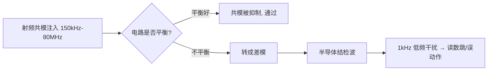

# PCB 模拟与采集模块（分卷 01）

本分卷承接汇总稿 `硬件/PCB/模拟与采集模块.md`，事实来源沿用 frontmatter 中列出的原始资料。

## 信号链与误差预算
- 按“输入/传感器、保护、滤波、增益或偏置、ADC/比较器、数字处理”分级，并为每级记录范围、源阻抗、共模、增益、带宽、噪声、过载和失效状态。
- 总误差不只由 ADC 位数决定，还包含传感器、分压比、放大器失调与偏置、基准、量化、温漂、布局泄漏和校准残差。先给误差分配，再选择器件精度与 PCB 隔离级别。
- 动态范围检查正常信号、故障峰值、共模摆幅和输入保护后的残余电压。保证放大器、ADC 和基准均不越过绝对最大值或线性工作范围。

## 输入保护与滤波
- 串联电阻限制故障和采样瞬态电流；TVS、钳位二极管或保护阵列按钳位电压、漏电、结电容、功耗和正常带宽联合选择。
- 抗混叠滤波的截止频率、阶数、通带误差和阻带衰减按采样率与目标频段确定。仅放一个 RC 不能自动解决所有混叠问题。
- SAR ADC 的采样电容会在采样瞬间拉取电荷；驱动器的输出阻抗、串联电阻和 RC 时间常数必须满足采样窗口内的建立时间，必要时使用缓冲运放。
- 高阻输入特别关注阻焊污染、潮湿、助焊剂残留、保护器件漏电和输入偏置电流。可采用守护环、清洁工艺、低漏电器件和更低阻抗的前级拓扑。

## 布局分区与回流
- 传感器/接口入口、模拟前端、ADC 与数字处理按信号流排列，小信号和高阻节点紧贴相关引脚，远离晶振、DDR、SW 节点、电感和高电流回路。
- 模拟与数字地的核心是控制回流。优先完整连续地平面，通过器件布局和高噪声电流回路限制耦合；随意切割地平面常使 ADC 回流绕行并增加辐射。
- 差分输入的走线、串联元件、过孔和邻近铜环境保持对称，避免一侧临近噪声源或跨越平面边界造成共模转差模。
- 低电平节点避免长距离平行于时钟或开关电源线。不可避免相交时优先垂直跨层并保持完整参考面。

## 电源、基准与去耦
- 模拟电源、数字电源和基准按芯片手册配置去耦与滤波，避免模拟前端和高 di/dt 数字负载共享狭窄供电颈部。
- 基准源输出电容的容量、ESR、稳定性、负载和回流必须满足数据手册；基准走线短、远离开关节点，且不承载其他大电流回流。
- ADC 的 AVDD、DVDD、REF 和 AGND/DGND 引脚按器件推荐拓扑连接。不要仅凭名称将地分成孤岛，而要从采样瞬态和数字回流路径判断。
- 对模拟电源纹波，应测量频谱及其与采样时钟、DC/DC 开关频率和工频的关系；一个标称低噪声 LDO 不能替代实际布局和去耦验证。

## 调试与故障定位
1. 用短接、精密源或替代负载隔离传感器、输入网络、放大器和 ADC，确认噪声与误差来自哪一级。
2. 以时域统计和频谱区分工频、开关纹波、固定时钟干扰、随机噪声和数据处理伪影；记录带宽、探头、接地和采样设置。
3. 检查零点、满量程、温漂、输入开短路、过压和 ESD 后恢复，避免仅在室温单一点做校准。
4. 改变探头地线、屏蔽或电源路径后必须重复对照测试，先排除测量回路耦合再判断电路性能。

## 评审与测试清单
- [ ] 输入范围、共模、电源范围、增益、带宽与 ADC 满量程匹配。
- [ ] 滤波、驱动阻抗和采样建立时间已计算并含器件容差。
- [ ] 保护器件的钳位、漏电、电容、故障功耗和正常精度均已核对。
- [ ] 模拟电源、基准、地与采样瞬态回流按信号链审查。
- [ ] 输入、基准、输出和安静地均有不破坏性能的测试位置。

+### 模拟与采集知识条目 1
CS（Conducted Susceptibility，传导抗扰度，IEC 61000-4-6）模拟的场景是：**在 150kHz～80MHz 频段，外界电磁场在线缆上感应出共模电压，顺着线缆灌进设备**。

为什么是这个频段？因为 80MHz 以下，波长（>3.75m）远大于普通设备尺寸，机壳不能有效接收电磁波，但**线缆长度接近 $\lambda/4$，成了高效接收天线**。80MHz 以上则改用辐射抗扰（RS，IEC 61000-4-3）直接照射。

测试等级：Level 1 = 1V、Level 2 = 3V、Level 3 = 10V（rms，未调制载波），实测时用 **1kHz 正弦、80% AM 调幅**，扫频步进 1%，每点驻留 ≥0.5s。

🔬 **深入原理**

注入方式三种：

| 方式 | 器件 | 特点 |
|---|---|---|
| CDN（耦合去耦网络） | CDN-M2/M3、AF、T2 等 | 首选，阻抗标准 150Ω |
| EM-Clamp（电磁钳） | 钳夹线缆 | 无法用 CDN 时（如屏蔽线） |
| 直接注入（BCI/直接耦合） | 100Ω 电阻注入 | 同轴/单线场合 |

**150Ω 共模阻抗**是这个标准的核心参数——它代表人体/线缆对地的典型共模阻抗。CDN 保证注入点看到 150Ω。

设备内部为什么会误动作？共模电压 $V_{CM}$ 通过**不平衡**转成差模干扰：

$$V_{DM}=V_{CM}\cdot\frac{\Delta Z}{Z}$$

$\Delta Z/Z$ 就是电路的不平衡度。差分接收电路（RS-485、以太网）平衡好，抗扰强；单端信号（UART、GPIO、模拟采样）平衡差，容易被击穿。

此外 80MHz 以下的干扰还会被半导体结**检波（rectification）**——PN 结的非线性把射频包络解调出来，变成 1kHz 的低频干扰，直接叠加到运放/ADC 输入，表现为读数跳动。这就是为什么调制是 80% AM 1kHz：**它专门检验解调敏感度**。

🛠 **设计实例/操作**

*例1：模拟采样口被干扰。* 4-20mA 输入在 20MHz 附近读数跳 ±5%。整改：
- 输入端加 **RC 低通**（如 100Ω + 1nF，$f_c=1.6\text{MHz}$）；
- 运放输入引脚就近加 10～100pF 到地（射频旁路）；
- 差分走线，增加共模抑制；
- 线缆入口加 CMC 或磁环。

*例2：I/O 口复位。* 长线 GPIO 在 5MHz 处触发复位。整改：GPIO 加 TVS + 串 100Ω + 1nF 对地；软件加去抖与看门狗；PCB 上把该信号的地回流路径缩短。



⚠️ **常见误区**

1. 只在软件上打补丁（滤波算法）。射频检波产生的是真实模拟量，软件无法完全消除。
2. 在信号线上加大电容却忽略上升沿要求，导致通信速率不达标。要按 $f_c$ 与信号带宽折中。
3. 认为屏蔽线一定好。屏蔽层若**只单端接地或接地阻抗高**，反而成为共模注入通道。高频应 360° 环接。
4. 忘记电源端口也要做 CS。DC 电源输入端同样需要 CMC + Y 电容。
5. 把 CS 与 EFT/Surge 混淆。CS 是持续射频，EFT 是脉冲群，Surge 是大能量单脉冲，防护器件完全不同。

📌 **要点速记**

- CS = IEC 61000-4-6，150kHz～80MHz，共模注入，150Ω 标准阻抗。
- 用 1kHz/80% AM 调制，专门考核半导体结的检波敏感度。
- 不平衡度决定共模→差模转换，平衡设计是根本。
- 端口整改套路：CMC/磁环 + RC 低通 + 就近射频旁路电容 + TVS。
- 屏蔽层需 360° 低阻接地才有效。


---
### 模拟与采集知识条目 2
以太网接口的第一部分：**架构与信号链路**。

一个典型的百兆/千兆以太网口链路：

```
 MAC(SoC/MCU) ──MII/RMII/RGMII/SGMII── PHY ──MDI(差分)── 变压器 ── RJ45 ── 网线
                （数字并行/串行接口）        （模拟差分）  （隔离）
```

两大部分要分开理解：
- **MAC↔PHY 侧**：数字接口，单端或差分，关注时序与等长。
- **PHY↔RJ45 侧（MDI）**：模拟差分，100Ω，关注阻抗、对称、隔离与 EMC。

MAC-PHY 接口对比：

| 接口 | 引脚数 | 时钟 | 速率 | 等长要求 |
|---|---|---|---|---|
| MII | 16 | 25MHz | 100M | 宽松 |
| RMII | 8 | 50MHz | 100M | ±0.5 inch |
| RGMII | 12 | 125MHz DDR | 1000M | **±10～25mil，需 skew 处理** |
| SGMII | 4（2 对差分） | 625MHz | 1000M | 100Ω 差分，严格 |
| RGMII-ID | 12 | 内部延时 | 1000M | 由 PHY 内部补偿 2ns |

🔬 **深入原理**

**RGMII 的 2ns 延时问题**是千兆以太网最经典的坑。RGMII 规范要求时钟相对数据有 **1.5～2.0ns 的延时**（数据在时钟边沿附近变化时无法采样）。实现方式三选一：

1. **PCB 延时**：把 TXC/RXC 走线加长约 **2ns × 6mil/ps = 12000mil ≈ 305mm**——显然不现实；
2. **PHY 内部延时（RGMII-ID）**：通过寄存器或引脚配置，PHY 内部加 2ns，**推荐做法**；
3. **MAC 内部延时**：SoC 侧配置。

**注意：MAC 和 PHY 两边不能都开延时，也不能都不开。**这是千兆网口"能通但丢包/只能跑百兆"的头号原因。

**MDI 差分**：1000Base-T 使用 4 对线全双工，每对 250Mbps，采用 PAM-5 编码，实际符号率 125MBaud。差分阻抗 **100Ω ±10%**。

**变压器的作用**：
1. **电气隔离**（1500Vrms 耐压，安规要求）；
2. **阻抗匹配与共模抑制**；
3. **隔断直流与地环路**。

**Bob Smith 电路**（共模端接）：

$$Z_{CM}=\frac{Z_{diff}}{4}\Rightarrow \text{每线 } 75Ω \text{ 汇合后经 1000pF/2kV 接机壳地}$$

原因：4 根线并联的共模阻抗应为 $300/4=75Ω$，实际用 4 个 75Ω 汇到一点，再经高压电容到机壳，把线缆上的共模噪声导走。

🛠 **设计实例/操作**

*例1：RGMII 布线。*
- TXD[3:0]+TX_CTL+TXC 一组，RXD[3:0]+RX_CTL+RXC 一组，**组内等长 ±25mil（严格些 ±10mil）**；
- 两组之间不必等长；
- 时钟线 TXC/RXC 单独包地，串阻 22Ω；
- 每根信号串 22～33Ω（靠驱动端），抑制过冲和 EMI；
- 走线尽量短（<15cm），50Ω 单端阻抗控制。

*例2：MDI 与变压器布局。*

```
  PHY ──差分100Ω，短且对称── 变压器 ──短── RJ45
        │                       ║隔离沟║
      数字地                    ║(挖空)║   机壳地/隔离地
        │                       ║      ║       │
   [中心抽头 → 电源+电容到地]    ║      ║  [Bob Smith 75Ω×4 + 1nF/2kV]
```

要点：
- PHY 到变压器走线 **<25mm，越短越好**；
- 变压器到 RJ45 **<25mm**；
- **变压器下方及 RJ45 侧的地平面必须挖空（隔离沟，宽度 ≥2mm）**，把"网口侧"与"数字侧"隔开，这是极少数**应该分割地**的场景；
- 隔离沟上**绝不允许任何走线跨越**；
- PHY 侧中心抽头接 PHY 电源（按数据手册）并加去耦电容；
- RJ45 屏蔽壳接机壳地（或经 1nF/2kV + 1MΩ）。

⚠️ **常见误区**

1. RGMII 延时两边都开或都不开 → 千兆不稳定。
2. 变压器下方地平面不挖空，隔离失效，共模噪声直接进数字地，RE 超标。
3. 隔离沟被走线跨越（尤其是 LED 指示灯的线），前功尽弃。
4. MDI 走线过长或绕弯，损耗与不对称增加。
5. 把 Bob Smith 的公共点接到数字地，而不是机壳地。
6. 变压器摆放方向错误，导致差分线交叉绕行。

📌 **要点速记**

- 链路分两段：MAC-PHY（数字）与 MDI（模拟差分 100Ω）。
- RGMII 需 2ns 延时，优先用 PHY 内部 ID 模式，两边只能开一次。
- RGMII 组内等长 ±25mil，时钟包地串阻。
- 变压器下方必须挖空隔离，且不得有任何走线跨越。
- Bob Smith 75Ω×4 + 1nF/2kV 接机壳地，用于共模端接。


---
### 模拟与采集知识条目 3
DDR 设计的第一集：**信号分类与总体架构**。想做好 DDR，第一步不是画线，而是把上百根信号分成几类，因为**不同类的规则完全不同**。

DDR 信号三大类：

| 类别 | 信号 | 特点 | 参考时钟 |
|---|---|---|---|
| **数据组（Byte Lane）** | DQ[7:0]、DQS±、DQM/DM | 双向，**源同步**，按字节分组 | DQS（该组自己的选通） |
| **地址/命令/控制** | A[]、BA[]、RAS#、CAS#、WE#、CS#、CKE、ODT | 单向（控制器→颗粒） | CK± |
| **时钟** | CK±、CK#（差分） | 差分，最关键 | — |

**核心规则**：**等长是"组内相对"的，不是"全部一样长"。**

- DQ0～DQ7、DM0 相对 **DQS0±** 等长（组内 ±10～25mil）
- DQ8～DQ15、DM1 相对 **DQS1±** 等长
- 所有地址/命令/控制相对 **CK±** 等长（±25～50mil）
- **DQS 组之间不需要互相等长**（DDR3 支持 write leveling / read leveling 自动校准）
- CK 通常做成"最长"，地址组略短于 CK（Flight time 匹配）

🔬 **深入原理**

**为什么源同步能跑这么快？** 传统共同时钟（Common Clock）架构下，时序裕量要扣掉时钟树偏斜、板级延时等一大堆；源同步把**选通信号 DQS 与数据一起发送**，接收端用 DQS 采数据，两者共同经历同样的板级延时，**延时被抵消**，只剩下 skew。

写时序（Write）中 DQS 与 DQ 是**边沿对齐（DDR3 为中心对齐由控制器移相 90°）**；读时序（Read）中颗粒输出 DQS 与 DQ 边沿对齐，控制器内部延时 90° 再采样。

时序裕量：

$$t_{margin}=\frac{UI}{2}-t_{setup}-t_{hold}-t_{skew}-t_{jitter}-t_{ISI}-t_{xtalk}$$

DDR3-1600：数据率 1600MT/s，$UI=625\text{ps}$，半个 UI 只有 312ps。扣掉颗粒 setup/hold（各约 50～100ps）、时钟抖动、串扰，留给 PCB skew 的往往只有 **50～100ps**。按 6mil/ps 算，就是 **300～600mil** 的总预算——听起来宽，但要扣掉封装内部走线（package skew）与过孔差异，实际给布线的通常按 ±25mil 控制。

**关键概念：Flight Time 与过孔延时。** 现代做法不是"物理等长"而是"**时延等长（tuned by delay）**"：
- 表层微带线速度 ≈ 7 mil/ps（$\varepsilon_{eff}$ 较小）
- 内层带状线速度 ≈ 6 mil/ps
- **两者速度不同！** 同样 1000mil，微带比带状快约 20ps。所以**同一组信号应尽量走同一层**，或用 EDA 的"时延等长"模式而非"长度等长"。
- 过孔也有延时，1.6mm 板厚过孔约 10～15ps，等长时应计入。

🛠 **设计实例/操作**

*例1：分组示例（DDR3 x16 单颗粒）。*

```
 组1: DQ0-7   + DM0 + DQS0± → 相对 DQS0 等长 ±25mil
 组2: DQ8-15  + DM1 + DQS1± → 相对 DQS1 等长 ±25mil
 组3: A0-14, BA0-2, RAS,CAS,WE,CS,CKE,ODT → 相对 CK± 等长 ±50mil
 组4: CK± 差分, 对内 ±5mil, 100Ω 差分
 组间: 组1 与 组2 无需等长；地址组通常比 CK 短 0~200mil
```

*例2：叠层与阻抗。* DDR 推荐 **6 层以上**：
```
 L1 SIG (DQ组1)      ← 参考 L2
 L2 GND ★完整
 L3 SIG (地址/命令)   ← 参考 L2/L4
 L4 PWR (VDD/VDDQ)
 L5 GND ★
 L6 SIG (DQ组2)      ← 参考 L5
```
单端 40～50Ω（DDR3 常用 40Ω 或 50Ω，按控制器要求），差分 80～100Ω。

⚠️ **常见误区**

1. **把所有 DDR 信号等长到同一个值**。这不但没必要，还会让绕线爆炸、串扰增加。
2. 用"长度等长"跨层混走。微带与带状速度不同，必须用时延等长或统一走线层。
3. 忘记算过孔延时和封装内 skew（高端 SoC 的 package skew 表必须查）。
4. DQ 与地址线混在一起走，互相串扰。
5. 认为 DDR3 有校准就可以随便画。校准能补偿的是**固定偏移**，补不了串扰、反射和抖动。

📌 **要点速记**

- DDR 信号分三类：数据组（参考 DQS）、地址命令（参考 CK）、时钟（差分）。
- 等长是"组内相对参考信号"，组间不必等长。
- 源同步架构靠 DQS 抵消板级延时。
- 微带 7mil/ps、带状 6mil/ps，速度不同 → 用时延等长。
- 过孔延时与封装 skew 必须计入预算。


---

## 相关入口

- [[硬件/PCB/模拟与采集模块|分类稿汇总目录]]
- [[wiki/来源映射|Wiki 来源映射]]
- [[wiki/概览|Wiki 概览]]
