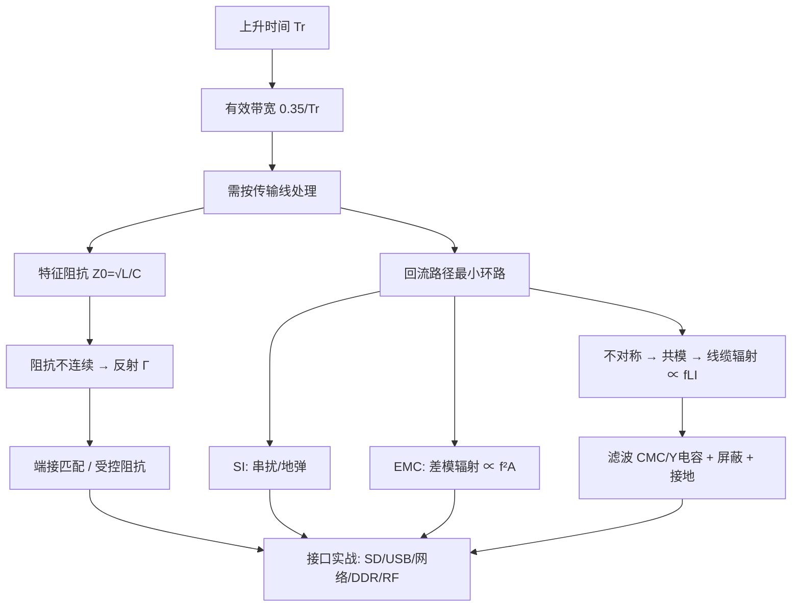

# PCB 电源模块（分卷 03）

本分卷承接汇总稿 `硬件/PCB/电源模块.md`，事实来源沿用 frontmatter 中列出的原始资料。

## 测量与故障定位
### 电源模块知识条目 7
GNSS（GPS/北斗/GLONASS/Galileo）设计的核心矛盾只有一个：**卫星信号极其微弱**。

到达地面的 GPS L1 信号功率约 **−130 dBm**（有些资料给 −128～−133 dBm），而典型接收机灵敏度要求 −160 dBm（跟踪）。这个量级比热噪声底还低——GPS 靠扩频增益（CDMA 相关处理，约 43dB）才能解调出来。

对比一下：手机 4G 发射功率 +23 dBm。**同一块板上，干扰源比有用信号强 150dB 以上（10¹⁵ 倍）**。所以 GNSS 设计 = 噪声抑制的极限工程。

频段：
| 系统 | 频段 |
|---|---|
| GPS L1 | 1575.42 MHz |
| 北斗 B1I / B1C | 1561.098 / 1575.42 MHz |
| GLONASS L1 | 1598～1606 MHz |
| GPS L5 / 北斗 B2a | 1176.45 MHz |

🔬 **深入原理**

**级联噪声系数（Friis 公式）**决定了 LNA 的位置：

$$NF_{total}=NF_1+\frac{NF_2-1}{G_1}+\frac{NF_3-1}{G_1G_2}+\cdots$$

（线性量）关键结论：**第一级的噪声系数与增益决定全局**。所以：
- **LNA 必须放在最靠近天线的位置**，前面的损耗（走线、连接器、滤波器）会 1:1 地加到 NF 上；
- 从天线到 LNA 之间每 1dB 损耗 = 灵敏度直接损失 1dB。

灵敏度公式：

$$P_{min}=-174\ \text{dBm/Hz}+10\log_{10}(B)+NF+SNR_{min}$$

**为什么要用有源天线？** 有源天线把 LNA 集成在天线里，避免馈线损耗。代价是需要通过同轴馈线供电（Bias-Tee）：

```
 天线(含LNA) ──同轴── [隔直电容 100pF] ── GNSS 模块 RF_IN
                  │
              [电感 27~47nH（射频扼流）] ── 3.3V ── [100nF] ── GND
   电感在 1.575GHz 呈高阻，隔断射频；电容隔直流
```

**接收带内干扰**：任何落在 1559～1610MHz 的谐波都是致命的。常见凶手：
- **DC-DC 开关频率的高次谐波**（1MHz 开关 → 第 1575 次谐波理论存在，但更常见的是宽带噪声）；
- **DDR 时钟谐波**（800MHz × 2 = 1600MHz！正好落在 GLONASS 带内）；
- **USB3.0 的宽带噪声**（5Gbps 的谐波与展频噪声覆盖 1.5～2.5GHz，是著名的 GPS 杀手，Intel 有专门白皮书）；
- **摄像头 MIPI、LCD 时钟**。

🛠 **设计实例/操作**

*例1：RF 走线设计。*
- 用 **50Ω 共面波导接地（GCPW）** 或微带线；
- 走线**短、直、无过孔**（必须换层时，过孔周围环绕 ≥4 个 GND 过孔）；
- 走线两侧**缝合地过孔，间距 ≤ λ/20**。1.575GHz 在 FR-4 中 $\lambda_g\approx 95\text{mm}$，λ/20 ≈ 4.75mm，工程取 **2～3mm**；
- RF 走线下方**参考面绝对完整**，不允许任何走线穿过；
- 阻抗 50Ω，需与板厂确认叠层。

*例2：布局隔离。*
```
  ┌────────────────────────────────────┐
  │ [GNSS天线]                          │
  │    │ 短RF线                          │
  │ [Bias-T][SAW][GNSS模块]  ← 独立区域  │
  │ ─────── 屏蔽罩 + 缝合地孔 ───────    │
  │                                     │
  │  [DDR]   [USB3]   [DC-DC]  ← 干扰源 │
  │   保持 ≥20mm 距离，最好不同侧        │
  └────────────────────────────────────┘
```
- GNSS 模块加**金属屏蔽罩**，多点接地；
- 与 USB3/DDR/DC-DC 距离 **≥15～20mm**，且不在其上下层正对位置；
- 电源用 **LDO 单独供电**（DC-DC 的噪声很难滤干净），或 DC-DC + LDO 两级；
- 模块的 UART/I2C 信号线加 RC 滤波或磁珠，防止把噪声"带进"屏蔽区。

*例3：天线选型与摆放。*
- 陶瓷贴片天线需要**足够的地平面**（典型 ≥50×50mm），地小则增益和方向图变差；
- 天线上方 **不能有金属遮挡**，正上方需净空；
- 若用外置有源天线，注意馈线损耗（RG-174 在 1.5GHz 约 1dB/m）。

⚠️ **常见误区**

1. RF 走线上加过孔换层而不做地过孔包围，损耗与失配剧增。
2. 把 GNSS 模块放在 DC-DC 或 USB3 连接器旁边。
3. 用 DC-DC 直接给 GNSS 供电，噪底抬高十几 dB。
4. 陶瓷天线下方铺地不足或被挖空。
5. 忽略 USB3.0——插上 U 盘就搜不到星是典型症状，需在 USB3 连接器加屏蔽、缩短走线、必要时加接地隔离。
6. 认为"能定位就行"。要看 **C/N₀（载噪比）**，好的设计冷启动时可见星 C/N₀ 应 >40 dB-Hz，<35 就说明噪底偏高。

📌 **要点速记**

- GNSS 信号 ≈ −130dBm，噪声抑制是唯一主题。
- Friis 公式：第一级 NF 决定全局 → LNA/有源天线尽量靠前。
- RF 走线 50Ω、短直无过孔、两侧缝合地孔间距 2～3mm。
- 与 DDR/USB3/DC-DC 隔离 ≥15～20mm，独立 LDO 供电 + 屏蔽罩。
- 用 C/N₀ 评估设计好坏，>40 dB-Hz 为佳。

+### 电源模块进阶知识条目 1
1. **信号怎么走**（阻抗、反射、匹配）——传输线理论；
2. **电流怎么回**（回流路径、地设计、共模/差模）——回路思维；
3. **能量怎么跑掉/进来**（EMC 发射与抗扰）——耦合与屏蔽。

而这三件事本质上都指向同一句话：**高速设计的核心不是"画线"，而是"管理电磁场与电流回路"**。

🔬 **深入原理：知识地图**



**贯穿全课的 5 个数字**：

| 数字 | 含义 |
|---|---|
| **6 mil/ps** | FR-4 内层传播速度（微带约 7） |
| **0.35 / Tr** | 有效带宽（拐点频率） |
| **±3H** | 80% 回流集中范围 |
| **1 nH/mm** | 普通走线/引线电感估算 |
| **λ/20** | 缝隙、缝合孔、地线过孔的间距上限 |

🛠 **设计实例/操作：完整设计流程与自检清单**

**阶段一：原理图/选型**
- [ ] 确认各接口速率、上升时间、阻抗规范（USB 90Ω、以太网/LVDS 100Ω、单端 50Ω、DDR 40/50Ω）
- [ ] 时钟源选型（是否需要 SSC）、串阻位置预留
- [ ] ESD/TVS 选型（结电容匹配速率）、CMC、滤波元件预留
- [ ] 电源架构：噪声敏感模块（GNSS/RF/ADC/PHY-AVDD）用 LDO 或加滤波
- [ ] 预留 π 型匹配、测试点（低速）、调试接口

**阶段二：叠层与阻抗**
- [ ] 每个信号层紧邻完整参考平面
- [ ] PWR 与 GND 平面相邻，介质尽量薄
- [ ] 找板厂确认叠层与 Dk/Df，算准线宽线距
- [ ] 高速差分优先内层带状线（FEXT≈0）

**阶段三：布局**
- [ ] 分区：接口区/数字区/模拟区/电源区/RF 区
- [ ] 接口靠板边集中，走线不回穿数字区
- [ ] 高速链路"一"字排开，不折返
- [ ] 去耦电容贴引脚，DC-DC 输入环路最小
- [ ] 晶振靠芯片、下方铺地
- [ ] 天线净空区、变压器隔离沟先划出

**阶段四：布线**
- [ ] 不跨分割；换层伴地孔（<100～200mil）
- [ ] 3W/4W/5W 间距规则按等级执行
- [ ] 差分：等长、等距、对称，就近补偿
- [ ] DDR：按组等长（时延模式），VTT 在最远端
- [ ] RF：短直无过孔、两侧缝合地孔
- [ ] 时钟包地且地线两端+中间打孔

**阶段五：EMC 加固**
- [ ] 板边缝合地过孔 ≤200mil，20H 规则
- [ ] 排针/连接器按 1:3 配地
- [ ] 屏蔽罩多点接地，缝隙 <λ/20
- [ ] 机壳地与信号地 1nF/2kV + 1MΩ 连接
- [ ] 长线 I/O 预留磁环/CMC 位置

**阶段六：验证**
- [ ] SI 仿真（眼图、串扰、过冲）
- [ ] PDN 阻抗仿真（$Z<Z_{target}$）
- [ ] 功能 + 压力 + 高低温测试
- [ ] EMC 预测试（近场探头 + 简易暗室）
- [ ] 留 6dB 余量再送正式认证

⚠️ **常见误区（全课总结）**

1. **用频率而非上升时间判断高速**——第一原则性错误。
2. **只画线不想回流**——所有 SI/EMC 问题的共同根源。
3. **等长绝对化**——该松的地方过度绕线，反而增加串扰。
4. **EMC 后置**——测试超标才整改，成本高十倍。
5. **迷信单一手段**——屏蔽罩/磁环/展频都不是万能药。
6. **不留余量**——刚好合格 = 量产必炸。
7. **不做定位就整改**——盲目试错，改好了也复现不了。

📌 **要点速记**

- 高速设计三主线：信号路径、回流路径、耦合路径。
- 五个关键数字：6mil/ps、0.35/Tr、±3H、1nH/mm、λ/20。
- 流程六阶段：选型 → 叠层 → 布局 → 布线 → EMC 加固 → 验证。
- 80% 的结果在布局阶段就已决定。
- 一切规则的目的都是：**让电流走最小的环路**。


---
### 电源模块进阶知识条目 2
- **建立"传输线思维"**：判断是否高速看上升时间 $T_r$ 而非时钟频率，掌握 $L_{crit}\approx T_r v/6$ 与 $f_{knee}=0.35/T_r$。
- **吃透阻抗与反射**：$Z_0=\sqrt{L_0/C_0}$、$\Gamma=(Z_2-Z_1)/(Z_2+Z_1)$、弹跳图与振铃频率 $1/4T_d$，能定量估算过冲与定位问题线长。
- **掌握端接选型**：源端串阻（零功耗、点对点首选）、并联/戴维南、AC 端接、片内 ODT 的适用边界与参数计算。
- **确立"回流路径"世界观**：高频回流紧贴信号线（±3H 内 80%），不跨分割、换层伴地孔，这是 SI 与 EMC 的共同命门。
- **区分共模与差模**：理解共模辐射效率远高于差模，掌握不对称→模式转换的机理与 skew 控制要求。
- **建立完整 EMC 框架**：EMI（CE/RE）+ EMS（ESD/EFT/Surge/CS/RS/DIP）的标准、限值、测试布置与整改优先级。
- **熟练使用 dB 语言**：功率 10log / 场量 20log、dBμV=dBm+107、余量与整改目标（超标量 +6dB）的换算。
- **形成滤波与防护方法论**：阻抗失配原则、X/Y 电容与 CMC 分工、TVS 三级配合与能量退耦、ESD "1nH=30V" 的布局铁律。
- **掌握电源完整性基础**：$Z_{target}$ 计算、电容 SRF 与反谐振、去耦"位置优先于容值"、DC-DC 与 PDN 布局要点。
- **打通主流接口 Layout 实战**：SD 卡串阻与 ESD、USB 90Ω 与 AC 耦合、以太网 RGMII 延时与变压器隔离沟、DDR 分组等长与 VREF/VTT、GNSS 噪声隔离、无线天线净空与共存。
- **具备系统化排查能力**：从"记录频点 → 特征判断 → 近场定位 → 整改 → 复测 → 固化规范"的闭环流程。
- **形成可复用的自检清单**：从选型、叠层、布局、布线、EMC 加固到验证的六阶段 checklist，把经验沉淀为标准动作。
### 电源模块进阶知识条目 3
本项目的目标板是"逻辑派 FPGA-G1 开发板"——一块以 FPGA 为核心、外挂 DDR3 内存、带 HDMI 输出、带 MCU 协处理、带 TF 卡与各类排针外设、由多路 DC-DC/LDO 供电的开发板。这种板子有三个典型特征：**BGA 封装（引脚在芯片底下，出不来线）**、**DDR3 高速并行总线（几百 Mbps~1.6Gbps 每根线，要等长）**、**HDMI 高速差分（Gbps 级，要阻抗控制）**。这三条任意一条，都足以让双面板"做不出来"。

所谓"全链路"，指的是下面这条不可跳步的流水线：

```
原理图分析 → 电源树梳理 → 网表/器件导入 → 板框结构导入 → 环境与快捷键
   → 模块抓取/接口定位 → 模块化预布局 → 3D 结构校验
   → 层数分析与叠层设置 → 阻抗理解与计算 → 规则（线宽/间距/过孔/网络类/差分）
   → BGA 扇孔 → 分模块布线 → 电源连通性 → 布线优化 → 时序等长
   → 缝合地过孔 → DRC → 丝印/LOGO → 生产资料输出 → 下单
```
### 电源模块进阶知识条目 4
开工前建议先建立工程目录，把整个项目的"资产"归位：

| 目录 | 内容 | 作用 |
|---|---|---|
| `01_原理图` | SCH 源文件、PDF | 布局布线时随时查 |
| `02_数据手册` | FPGA/DDR3/HDMI/DCDC 的 Datasheet | 查 pinout、封装、布线要求 |
| `03_结构` | 板框 DXF、3D STEP | 导入板框、装配校验 |
| `04_PCB` | PCB 工程 + 版本备份 | 每完成一个阶段存一版 |
| `05_生产资料` | Gerber/钻孔/坐标/BOM | 最后打包下单 |

**例：先确认三条"硬约束"。** ①板框尺寸与安装孔位置（决定布局边界）；②接口器件位置（HDMI、TF、USB、电源座、排针必须落在指定边缘）；③BGA pitch（决定过孔工艺与最小线宽）。这三条一旦后期变更，布局布线基本要推倒重来。
### 电源模块进阶知识条目 5
这一讲教你**怎么"读"一张开发板原理图**。很多人打开原理图只会看"这里连那里"，正确做法是先做**功能分块**，再做**信号流梳理**，最后落到**物理约束**。

逻辑派 FPGA-G1 的原理图通常按页组织，典型分页如下：

| 页面 | 模块 | 关键关注点 |
|---|---|---|
| P1 | 封面/框图 | 系统总览、模块间接口 |
| P2 | FPGA 核心（BANK0~BANK7） | 每个 BANK 的电平标准与 VCCIO |
| P3 | 配置电路（FLASH/JTAG） | 配置模式引脚、上下拉 |
| P4 | DDR3 | 数据/地址/控制分组、VREF、端接 |
| P5 | HDMI | TMDS 差分对、ESD、DDC |
| P6 | MCU | 晶振、下载口、与 FPGA 的通信 |
| P7 | 外设（TF、LED、按键、排针） | IO 归属哪个 BANK |
| P8 | 电源 | DC-DC / LDO / 上电时序 |

读图的正确顺序是：**先看电源 → 再看时钟 → 再看总线 → 最后看杂散 IO**。因为电源决定布局重心，时钟决定关键路径，总线决定等长分组。
### 电源模块进阶知识条目 6
这一讲做一件极其重要但常被跳过的事：**画出这块板的电源树（Power Tree）**。电源树就是"电从哪来 → 经过谁 → 到谁去 → 要多大电流"的一张图。它同时决定了三件事：DC-DC 模块放哪、电源平面怎么分割、铜皮/过孔要多粗。

一块 FPGA 开发板的典型电源树（数值为示例量级，实际以原理图与器件手册为准）：

```
DC 5V 输入 (Type-C / DC 座)
   |
   +-- DCDC1 --> 1.0V / 1.2V  VCCINT   (FPGA 内核, 电流最大, 1~3A)
   |
   +-- DCDC2 --> 1.5V         VCCIO_DDR + DDR3 VDD/VDDQ (0.5~1.5A)
   |                  |
   |                  +-- 分压/专用芯片 --> 0.75V VREF (小电流, mA 级)
   |
   +-- DCDC3 --> 3.3V         VCCIO(3.3V BANK) / MCU / HDMI 5V逻辑周边 (1~2A)
   |                  |
   |                  +-- LDO --> 2.5V / 1.8V  VCCAUX 等 (低噪声小电流)
   |
   +-- 直通 --> HDMI +5V (给 HDMI 连接器 5V 供电, 需限流/ESD)
```
### 电源模块进阶知识条目 7
**为什么必须先画电源树？** 因为电源决定了 PCB 的"重量分布"：

1. **DC-DC 是噪声源**，其开关节点（SW）是 dv/dt 极高的地方，必须远离 HDMI、DDR3、晶振等敏感区；
2. **VCCINT 电流最大**，铜皮宽度与过孔数量要按电流算；
3. **上电时序**：FPGA 通常要求内核电压先于 IO 电压建立（或有特定顺序），这决定了要不要加使能链、要不要 RC 延时；
4. **去耦网络**决定 PDN（电源分配网络）阻抗，是高速板成败的一半。

铜皮载流可用 IPC-2152 的工程近似（外层 1oz，温升 10℃）：

$$I \approx 0.0647 \cdot \Delta T^{0.4281} \cdot A^{0.6732}$$

其中 $A$ 为截面积（mil²），$\Delta T$ 为温升（℃）。工程上更常用的速记是：**外层 1oz 铜，10mil 线宽 ≈ 1A（温升 10℃）；内层 0.5oz，同宽度按一半估**。

过孔载流速记：**0.3mm 孔径的过孔约 1A**，所以 3A 的 VCCINT 换层至少要 4~6 个过孔并联（并留裕量）。

去耦电容的作用可以用阻抗理解，电容的自谐振频率：

$$f_{SRF}=\frac{1}{2\pi\sqrt{L_{ESL}C}}$$

超过 $f_{SRF}$ 后电容呈感性、失去去耦作用，所以要用 **10µF（低频）+ 0.1µF（中频）+ 0.01µF/1nF（高频）** 的组合，且高频小电容必须**离引脚最近**。

## 相关入口

- [[硬件/PCB/电源模块|分类稿汇总目录]]
- [[wiki/来源映射|Wiki 来源映射]]
- [[wiki/概览|Wiki 概览]]
