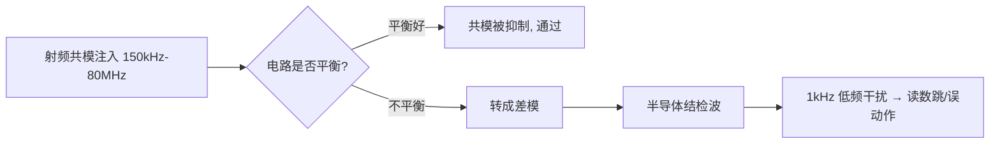

# PCB 高速接口模块（分卷 02）

本分卷承接汇总稿 `硬件/PCB/高速接口模块.md`，事实来源沿用 frontmatter 中列出的原始资料。

## 评审与测试清单
### 高速接口知识条目 4
初学者最容易忽略的一句话：**电流永远走回路，没有回路就没有电流**。你在 PCB 上画的那根信号线只是"去路"，还有一条看不见的"回路"，它走在参考平面上。

低频时，回流走**电阻最小**的路径——也就是在平面上大面积铺开、直奔电源地。但高频时，回流走**电感最小（阻抗最小）**的路径——它会紧紧贴着信号线的正下方回来，形成尽可能小的环路面积。

这个"高频回流紧贴信号线"的规律，是理解**串扰、EMI 辐射、地弹、参考面分割危害**的总钥匙。

🔬 **深入原理**

回流路径宽度近似满足：距信号线中心 $x$ 处的回流电流密度

$$i(x)=\frac{I_0}{\pi H}\cdot\frac{1}{1+(x/H)^2}$$

其中 $H$ 是信号线到参考面的高度。积分可知，**约 80% 回流集中在 $\pm 3H$ 范围内，97% 在 $\pm 20H$ 内**。$H=4\text{mil}$ 时，回流基本挤在信号线两侧 12mil 内——这就是"参考面只要在信号线正下方完整就行"的物理依据，也是**为什么跨分割如此致命**。

环路面积决定辐射。差模辐射远场公式（自由空间）：

$$E=1.32\times10^{-14}\cdot\frac{f^2\,A\,I}{r}\quad (\text{V/m})$$

其中 $f$ 单位 Hz，$A$ 为环路面积（m²），$I$ 为电流（A），$r$ 为距离（m）。**辐射正比于 $f^2$ 和环路面积 $A$**——把 $A$ 从 100mm² 降到 10mm²，辐射直接降 20dB。这是 EMC 设计里最便宜的 20dB。

换层带来的回流断点：信号从 L1（参考 L2-GND）换到 L4（参考 L3-GND），回流必须从 L2 跳到 L3。若附近没有 GND 过孔，回流被迫绕远路，环路面积暴增，等效串入电感：

$$L_{via}\approx 5.08h\left[\ln\frac{4h}{d}+1\right]\ \text{(nH, h/d 单位 inch)}$$

典型 1.6mm 板厚过孔约 1～1.5nH。

🛠 **设计实例/操作**

*例1：换层必伴地孔。* 高速信号每一个换层过孔，**在 100～200mil 内放 1～2 个 GND 过孔**（差分对可共用，放在对的两侧）。若两个参考面电压不同（GND↔PWR），则需在换层处放 0.01～0.1μF 去耦电容作为高频回流桥——但电容+过孔约 1～2nH，效果远不如 GND 过孔，能不跨就不跨。

*例2：绝不跨分割。* 下图左是灾难，右是正确做法：

```
 ✗ 错误：信号跨越平面缝隙            ✓ 正确：绕行或改参考面
  ┌──────────┬──────────┐            ┌──────────┬──────────┐
  │  GND     │  VCC     │            │  GND     │  VCC     │
  │   ───────┼──────▶   │            │  ──┐     │          │
  │          │          │            │    └───▶ │          │
  └──────────┴──────────┘            └──────────┴──────────┘
   回流被迫绕缝隙一圈                 回流始终在同一平面下方
   环路面积↑↑ → 辐射↑↑、串扰↑↑
```

*例3：接口区域。* USB/网口/HDMI 的走线下方参考面必须完整无缝，且不要有其它电源平面的"孤岛"横穿。

⚠️ **常见误区**

1. 以为"地就是地，到处都一样"。平面上不同点在高频下电位差可达几百 mV（地弹）。
2. 在平面上"挖槽"分割数字地/模拟地却让信号横穿槽——这是 90% EMC 超标案例的根因。
3. 认为电源平面不能当参考面。可以，只要电源平面完整且有足够去耦电容与地平面高频短接。
4. 只在信号过孔"附近某处"放地孔。要放在**紧邻（<100mil）**，距离越远等效电感越大。
5. 忽视连接器/排针区。排针一排全信号没有地针，回流无路可走，是辐射天线的经典成因——**每 2～4 根信号配 1 根地**。

📌 **要点速记**

- 高频回流紧贴信号线正下方，80% 集中在 ±3H 内。
- 辐射 $\propto f^2 \times$ 环路面积，最小化环路是最廉价的 EMC 手段。
- 换层必伴地孔（<100～200mil）；跨分割是大忌。
- 参考面变换（GND→PWR）需靠去耦电容做高频桥，效果不如同层 GND。
- 连接器/排针必须按比例配地针。


---
### 高速接口知识条目 5
两根线上的电流，可以分解成两个"视角"：

- **差模（Differential Mode, DM）**：两根线电流大小相等、方向相反。这是我们**想要**的信号形式。去和回的磁场互相抵消，环路小，辐射低。
- **共模（Common Mode, CM）**：两根线电流大小相等、方向相同，回流通过大地/机壳/线缆寄生电容回来。这是我们**不想要**的，环路巨大，是辐射超标的头号元凶。

一句话记住：**差模是信号，共模是麻烦**。

🔬 **深入原理**

数学分解：设两根线电压 $V_1$、$V_2$

$$V_{DM}=V_1-V_2,\qquad V_{CM}=\frac{V_1+V_2}{2}$$

电流：$I_{DM}=\dfrac{I_1-I_2}{2}$，$I_{CM}=I_1+I_2$

**关键的量级对比**：共模辐射远比差模可怕。共模辐射（单极子/线缆天线模型）：

$$E_{CM}=1.26\times10^{-6}\cdot\frac{f\,L\,I_{CM}}{r}\quad(\text{V/m})$$

对比差模式 $E_{DM}\propto f^2 A I_{DM}$。做个数值对比：3m 处、100MHz、线缆长 1m：产生 $30\ \mu V/m$ 只需 **8nA** 共模电流；而要靠差模达到同样场强，在 10cm² 环路里需要约 **200μA**。**共模电流的"辐射效率"高出四个数量级**——所以 EMC 整改 80% 的功夫都在压共模。

共模是怎么产生的？三大来源：

1. **不对称/不平衡**：差分对两根线长度不等（skew）、耦合不均、一根跨了分割 → 差模转共模（mode conversion）。$S_{cd21}$ 就是衡量这个的 S 参数。
2. **地电位差**：板内地弹、地阻抗压降驱动线缆共模。
3. **公共阻抗耦合**：多个电路共用一段地走线。

差模→共模转换与 skew 的关系（近似）：

$$V_{CM}\approx \frac{\Delta T_{skew}}{T_r}\cdot\frac{V_{DM}}{2}$$

所以差分对内**skew 必须远小于上升时间**，工程上常要求 $<5\%\,T_r$（USB3 要求 <5ps，DDR 差分 <2mil 长度差）。

🛠 **设计实例/操作**

*例1：共模扼流圈（CMC）选型。* USB2.0 用 90Ω@100MHz CMC，以太网用 100～200Ω CMC。原理：对差模磁通抵消、呈现极低阻抗（不影响信号）；对共模磁通叠加、呈现高阻抗（阻断噪声）。注意 CMC 本身不对称也会引入模式转换，高速链路要选低 $S_{cd21}$ 的型号。

*例2：差分对布线三原则。*
- **等长**：对内 skew 严控，蛇形补偿要靠近失配处补。
- **等距**：全程保持恒定间距，避免间距忽宽忽窄造成阻抗起伏。
- **对称**：换层同时换、过孔对称、绕线尽量对内自补偿而非单边绕。

```
差模 vs 共模 电流方向
   差模（好）              共模（坏）
  ──▶──── 线1            ──▶──── 线1
  ◀────── 线2            ──▶──── 线2
   磁场抵消，环路小        回流经机壳/大地，环路巨大
   辐射低                  辐射高（线缆变天线）
```

⚠️ **常见误区**

1. 认为"用了差分就一定抗干扰"。差分抗扰的前提是**平衡**，一旦不对称就退化。
2. 差分对内为补长度画大蛇形而在一根上绕、离失配点很远——中间那段变成了单端，反而制造共模。
3. 把差分对当成"两根普通线，间距远点也无所谓"。间距变化会改变差分阻抗。
4. 在差分线上一根加电阻/测试点另一根不加，人为制造不对称。
5. CMC 放的位置不对。应**紧靠连接器**，在 ESD 器件之后、走线进板之前。

📌 **要点速记**

- 差模是信号，共模是辐射元凶；共模辐射效率高出差模数个数量级。
- 共模三大来源：不对称、地电位差、公共阻抗耦合。
- 对内 skew 应 $<5\%\,T_r$，就近补偿。
- CMC 对差模低阻、对共模高阻，紧靠连接器放置。
- 差分布线三原则：等长、等距、对称。


---
### 高速接口知识条目 6
CS（Conducted Susceptibility，传导抗扰度，IEC 61000-4-6）模拟的场景是：**在 150kHz～80MHz 频段，外界电磁场在线缆上感应出共模电压，顺着线缆灌进设备**。

为什么是这个频段？因为 80MHz 以下，波长（>3.75m）远大于普通设备尺寸，机壳不能有效接收电磁波，但**线缆长度接近 $\lambda/4$，成了高效接收天线**。80MHz 以上则改用辐射抗扰（RS，IEC 61000-4-3）直接照射。

测试等级：Level 1 = 1V、Level 2 = 3V、Level 3 = 10V（rms，未调制载波），实测时用 **1kHz 正弦、80% AM 调幅**，扫频步进 1%，每点驻留 ≥0.5s。

🔬 **深入原理**

注入方式三种：

| 方式 | 器件 | 特点 |
|---|---|---|
| CDN（耦合去耦网络） | CDN-M2/M3、AF、T2 等 | 首选，阻抗标准 150Ω |
| EM-Clamp（电磁钳） | 钳夹线缆 | 无法用 CDN 时（如屏蔽线） |
| 直接注入（BCI/直接耦合） | 100Ω 电阻注入 | 同轴/单线场合 |

**150Ω 共模阻抗**是这个标准的核心参数——它代表人体/线缆对地的典型共模阻抗。CDN 保证注入点看到 150Ω。

设备内部为什么会误动作？共模电压 $V_{CM}$ 通过**不平衡**转成差模干扰：

$$V_{DM}=V_{CM}\cdot\frac{\Delta Z}{Z}$$

$\Delta Z/Z$ 就是电路的不平衡度。差分接收电路（RS-485、以太网）平衡好，抗扰强；单端信号（UART、GPIO、模拟采样）平衡差，容易被击穿。

此外 80MHz 以下的干扰还会被半导体结**检波（rectification）**——PN 结的非线性把射频包络解调出来，变成 1kHz 的低频干扰，直接叠加到运放/ADC 输入，表现为读数跳动。这就是为什么调制是 80% AM 1kHz：**它专门检验解调敏感度**。

🛠 **设计实例/操作**

*例1：模拟采样口被干扰。* 4-20mA 输入在 20MHz 附近读数跳 ±5%。整改：
- 输入端加 **RC 低通**（如 100Ω + 1nF，$f_c=1.6\text{MHz}$）；
- 运放输入引脚就近加 10～100pF 到地（射频旁路）；
- 差分走线，增加共模抑制；
- 线缆入口加 CMC 或磁环。

*例2：I/O 口复位。* 长线 GPIO 在 5MHz 处触发复位。整改：GPIO 加 TVS + 串 100Ω + 1nF 对地；软件加去抖与看门狗；PCB 上把该信号的地回流路径缩短。



⚠️ **常见误区**

1. 只在软件上打补丁（滤波算法）。射频检波产生的是真实模拟量，软件无法完全消除。
2. 在信号线上加大电容却忽略上升沿要求，导致通信速率不达标。要按 $f_c$ 与信号带宽折中。
3. 认为屏蔽线一定好。屏蔽层若**只单端接地或接地阻抗高**，反而成为共模注入通道。高频应 360° 环接。
4. 忘记电源端口也要做 CS。DC 电源输入端同样需要 CMC + Y 电容。
5. 把 CS 与 EFT/Surge 混淆。CS 是持续射频，EFT 是脉冲群，Surge 是大能量单脉冲，防护器件完全不同。

📌 **要点速记**

- CS = IEC 61000-4-6，150kHz～80MHz，共模注入，150Ω 标准阻抗。
- 用 1kHz/80% AM 调制，专门考核半导体结的检波敏感度。
- 不平衡度决定共模→差模转换，平衡设计是根本。
- 端口整改套路：CMC/磁环 + RC 低通 + 就近射频旁路电容 + TVS。
- 屏蔽层需 360° 低阻接地才有效。


---

## 相关入口

- [[硬件/PCB/高速接口模块|分类稿汇总目录]]
- [[wiki/来源映射|Wiki 来源映射]]
- [[wiki/概览|Wiki 概览]]
