[编号 ODCC-2022-03006] 

# 112G 高速互连白皮书

011010010101101101101101101101101101101101 

开放数据中心标准推进委员会 

2022-09 发布 

## 版权声明

ODCC（开放数据中心委员会）发布的各项成果，受《著作权法》保护，编制单位共同享有著作权。 

转载、摘编或利用其它方式使用 ODCC 成果中的文字或者观点的，应注明来源：“开放数据中心委员会 ODCC”。 

对于未经著作权人书面同意而实施的剽窃、复制、修改、销售、改编、汇编和翻译出版等侵权行为，ODCC及有关单位将追究其法律责任，感谢各单位的配合与支持。 

www.ODCC.org.cn 

## 编制说明

本报告在撰写过程中得到了多家单位的大力支持，在此特别感谢以下参编单位和参编人员： 

参编单位（排名不分先后）： 

中国信息通信研究院（云大所）、腾讯、阿里巴巴、Keysight、锐捷网络、立讯技术、Amphenol、深南电路、中航光电、Credo、H3C、Broadcom、Nvidia、兆龙互联、FIT 

参编人员（排名不分先后）： 

沈大勇、孙安兵、廖栽宜、吴季元、蒋修国、李智、朱朋、袁双峰、罗振、鲁中原、梁勇、Vincent Tsai、崔朋、陈亮、程传胜、韩燕、何宗应、胡新毅、李凯、李娜、刘超、刘维纲、Sandeep Shah、万川、王建、康浩浩、杨光、张灿、汪超、朱峰峰、曾照龙、郝豫鲁、金晓光、杨简、王春霞、王少鹏、孙聪 

www.ODCC.org.cn 

## 前言

在当前信息技术快速发展的背景下，数据中心做为算力承载的物理实体，其需求是反映人类社会信息化、智能化的持续趋势。为了满足这种强大的数据需求，数据中心网络需要更大的带宽，提升物理层单链路的速率成为一个最重要的提升带宽的方法，这也是推动数据中心网络高速发展的原始动力。随着物理层单链路达到112Gbps，数据中心网络将会在络系统设计、设备整机设计、关键组件设计多个方面面临巨大的信号完整性的挑战。 

ODCC 网络工作组 2021 年 12 月正式启动《112G 高速互连白皮书》项目开发工作。项目主要围绕基于 112Gbps SerDes 下的网络设备高速系统设计、系统测试方案及方法研究、高速互连系统仿真、对新一代系统设备的印刷电路板、高速背板连接器与 IO 连接器、高速铜缆设计与应用这些方面阐述 112G 高速系统设计的方法，推动基于 112G SerDes 的网络设备开发技术上达成广泛一致的设计方法和目标。 

www.ODCC.org.cn 

## 目录

版权声明....1
编制说明....11
前言....111
一、背景介绍....9
二、112G 高速互连系统设计....10
（一）互连设计方案....10
1. 高速互连通用形式....10
2. 板内中短距芯片方案....10
3. 跨背板长距芯片方案....11
（二）芯片到光模块方案....11
1. 共封装方案 CPO....11
2. 近芯片 NPO 方案....12
3. 传统可插拔方案....13
（三）高速互连的设计关键....14
1. 高速通道特性....14
2. 大电流电源设计....16
3. 互连成本....16
（四）112G 收发器（SerDes）....16
1. 通道损耗对信号的劣化....17
2. PAM4、FEC、误码传播....19
3. 架构特性....21 

三、112G 高速互连系统测试技术.... 21 （一）测试背景与需求解析.... 21 1. 测试环境说明.... 23 （二）发射机测试项目.... 25 1. 电发射机测试.... 25 2. 光发射机测试.... 26 （三）接收机测试项目.... 27 1. 电接收机测试.... 27 2. 光接收机测试.... 28 3. FEC 性能测试.... 29 （四）线缆及 PCB 背板通道测试项目.... 30 1. 无源及有源铜缆（DAC 及 AEC）测试.... 30 2. PCB 背板测试.... 30 四、112G 高速互连系统仿真技术.... 31 （一）典型的链路拓扑.... 31 （二）无源仿真.... 32 1. 封装仿真.... 32 2. 过孔仿真.... 33 3. 连接器和线缆仿真.... 35 4. 无源链路仿真拓扑.... 36 （三）有源仿真.... 36 （四）仿真结果的评估.... 37 1. 无源仿真结果.... 37

2. COM 仿真结果 ..... 38 3. PAM4 模型仿真结果 ..... 39 4. 光电联合仿真（EOE 仿真） ..... 40 五、112G 高速互连 PCB 技术 ..... 41 （一）高速系统 PCB 技术需求概述 ..... 41 （二）112G 高速互连系统 PCB 板材需求 ..... 42 1. PCB 板材的玻璃布技术趋势及要求 ..... 42 2. PCB 板材的铜箔技术趋势及要求 ..... 43 （三）112G 高速互连 PCB 信号完整性要求 ..... 44 1. 信号完整性关键控制点 ..... 45 2. PCB 信号完整性测试建议 ..... 47 3. PCB 关键技术规格设计建议 ..... 48 六、112G 高速互连背板连接器技术 ..... 49 （一）Backplane/B2B 连接器介绍及应用概况 ..... 49 1. Backplane/B2B 连接器简介 ..... 49 2. Backplane/B2B 连接器应用概览 ..... 50 （二）连接器 SI 评估条件要求 ..... 53 （三）连接器 SI 指标 ..... 54 （四）连接器机械/电气/环境评估条件要求 ..... 58 七、112G 高速互连 IO 连接器技术 ..... 63 （一）112G 高速 IO 连接器介绍及应用概况 ..... 63 1. 112G 高速 I/O 连接器简介 ..... 63 2. 112G 高速 I/O 连接器应用概览 ..... 64

（二）112G 高速 I/O 连接器接口类型....64
（三）112G 高速 I/O 连接器设计....65
（四）结构设计（以 QSFP112 为例）....67
（五）电气性能要求....68
1. 测试方法（以 QSFP112 为例）....68
2. 测试报告参考模板（以 QSFP112 为例）....74
3. 高速 SI 规格相关测试方法补充....75
112G 高速互连高速铜缆技术....79
（一）高速铜缆介绍及运用概况....79
1. 高速铜缆简介....79
2. 高速铜缆运用概况....80
（二）112G 系列高速铜缆接口类型....82
（三）高速铜缆设计....83
1. 铜缆结构设计....83
2. 铜缆电路设计....83
3. 管理界面标准....84
（四）高速铜缆的测试和认证....87
1. 信号完整性测试项目要求及方法....87
2. 电气可靠性测试要求....88
3. 机械可靠性测试要求....88
4. 环境可靠性测试要求....89
5. 液冷兼容性测试要求....89
6. 测试报告参考模板....90 

112G 高速互连高液冷技术....90
(一) 浸没式液冷环境下高速传输技术介绍及应用概况....90
1. 浸没式液冷环境简介及应用概况....90
2. 浸没式液冷环境对高速传输技术的影响....91
(二) 浸没式液冷环境下高速连接器及线缆设计....91
1. 结构设计....92
2. SI 设计....92
(三) 浸没式液冷环境下高速无源器件测试和认证....97
1. 测试项目要求及方法....97
2. 可靠性测试要求....98 

www.ODCC.org.cn 

## 一、背景介绍

数据中心作为新基建的重要 “底座”，是助推数字经济发展的重要力量。在国家战略的指引下，推进数据中心产业高质量发展，成为全行业 “十四五” 

随着人工智能、大数据、分布式存储以及边缘计算等技术的发展及广泛应用，数据中心对高吞吐和大带宽的需求越发迫切，除了需要处理指数级增长的数据量和分布式低延迟处理之外，在超大规模数据中心内，硬件加速器和深度学习功能的集成也正在以更高的功率消耗来获取更高的带宽，对数据中心的建设也带来了更高的挑战和要求。 

网络硬件作为数据中心的基础构成，物理层网络链路也应该遵循简单、高可靠以及高性能这一原则来进行设计和应用。以太网速度已经从 25G/50G 增长到如今的 400G/800G，并有望很快达到 1.6T。作为超大规模数据中心不可或缺的一部分，交换机支持的带宽从 12.8Tb/s、25.6Tb/s 增长到如今的 51.2Tb/s，芯片将需要 512 个 SerDes 通道，每个通道以 100Gb/s 速度运行。在可提供 100G、200G、400G、800G 等不同链路带宽的同时，匹配不同 IDC 部署环境和不同业务需求，带来了物理链路的方案多样性、个性化的需求，这对网络物理链路带来了非常大的挑战。 

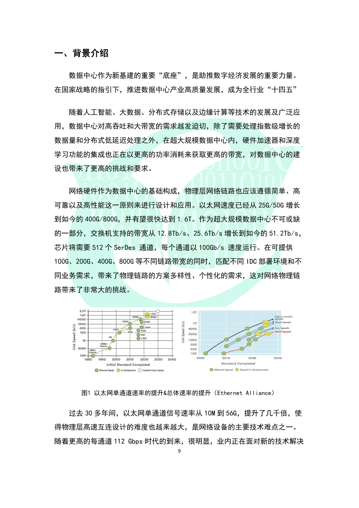

图1 以太网单通道速率的提升&总体速率的提升（Ethernet Alliance）

过去 30 多年间，以太网单通道信号速率从 10M 到 56G，提升了几千倍，使得物理层高速互连设计的难度也越来越大，是网络设备的主要技术难点之一。随着更高的每通道 112 Gbps 时代的到来，很明显，业内正在面对新的技术解决 方案的挑战。本文讨论和介绍可能的系统互连硬件实现方案和设计关键，这些应用方案可能在 112G 系统开发中得到广泛的应用。 

## 二、112G 高速互连系统设计

## （一）互连设计方案

## 1. 高速互连通用形式

在一个典型的系统中芯片对芯片、芯片对光模块、光模块对光模块之间的连接，通过连接器、PCB传输线、铜电缆或者光纤互连。这些互连可以是单向的或双向的、光的或电的，并且可以支持一定范围的数据速率，通常他们各自需要满足对应的接口标准。 

对于每个互连形式，设计中的考虑因素包括：链路性能、成本、工作温度、可加工可装配性、长期可靠性等。 

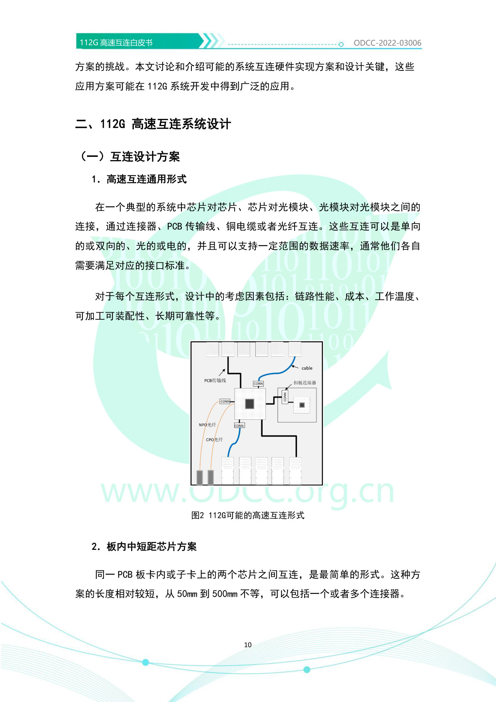

图2 112G可能的高速互连形式

## 2. 板内中短距芯片方案

同一 PCB 板卡内或子卡上的两个芯片之间互连，是最简单的形式。这种方案的长度相对较短，从 50mm 到 500mm 不等，可以包括一个或者多个连接器。 

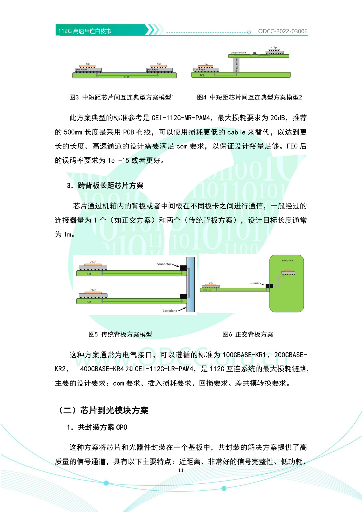

图3 中短距芯片间互连典型方案模型1

图4 中短距芯片间互连典型方案模型2

此方案典型的标准参考是 CEI-112G-MR-PAM4，最大损耗要求为 20dB，推荐的 500mm 长度是采用 PCB 布线，可以使用损耗更低的 cable 来替代，以达到更长的长度。高速通道的设计需要满足 com 要求，以保证设计裕量足够。FEC 后的误码率要求为 1e-15 或者更好。 

## 3. 跨背板长距芯片方案

芯片通过机箱内的背板或者中间板在不同板卡之间进行通信，一般经过的连接器量为 1 个（如正交方案）和两个（传统背板方案），设计目标长度通常为 1m。 

图5 传统背板方案模型

图6 正交背板方案

这种方案通常为电气接口，可以遵循的标准为 100GBASE-KR1、200GBASE-KR2、400GBASE-KR4 和 CEI-112G-LR-PAM4，是 112G 互连系统的最大损耗链路，主要的设计要求：com 要求、插入损耗要求、回损要求、差共模转换要求。 

## （二）芯片到光模块方案

## 1. 共封装方案 CPO

这种方案将芯片和光器件封装在一个基板中，共封装的解决方案提供了高质量的信号通道，具有以下主要特点：近距离、非常好的信号完整性、低功耗、 低成本、可实现光器件的无 DSP 方案；更适合多通道、无需解决传统可插拔光模块的散热。当前的缺点是可维护性差，且不利于产业合作。 

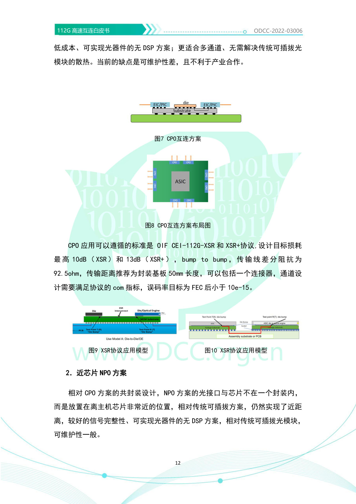

图7 CPO互连方案

图8 CPO互连方案布局图

CPO 应用可以遵循的标准是 OIF CEI-112G-XSR 和 XSR+协议, 设计目标损耗最高 10dB（XSR）和 13dB（XSR+），bump to bump，传输线差分阻抗为 92.5ohm，传输距离推荐为封装基板 50mm 长度，可以包括一个连接器，通道设计需要满足协议的 com 指标，误码率目标为 FEC 后小于 10e-15。 

图9 XSR协议应用模型

图10 XSR协议应用模型

## 2. 近芯片NPO方案

相对 CPO 方案的共封装设计，NPO 方案的光接口与芯片不在一个封装内，而是放置在离主机芯片非常近的位置，相对传统可插拔方案，仍然实现了近距离，较好的信号完整性、可实现光器件的无 DSP 方案，相对传统可插拔光模块，可维护性一般。 

图11 NPO互连方案

图12 NPO互连方案布局图

NPO 应用可以遵循的标准是 CEI-112G-XSR+ 和 CEI-112G-LINEAR 协议，其中 CEI-112G-LINEAR 设计目标 host 侧最大损耗 7dB，传输线差分阻抗为 92.5ohm，可通过封装基板（推荐 50mm 长度）或者 PCB 实现传输，可以包括一个连接器，通道设计需要满足协议的 com 指标，误码率目标为 FEC 后小于 10e-15。 

图13 linear标准要求

## 3. 传统可插拔方案

截止到现在，在设备的前面板上支持可插拔模块是应用最广泛的方案。 

图14 传统可插拔方案

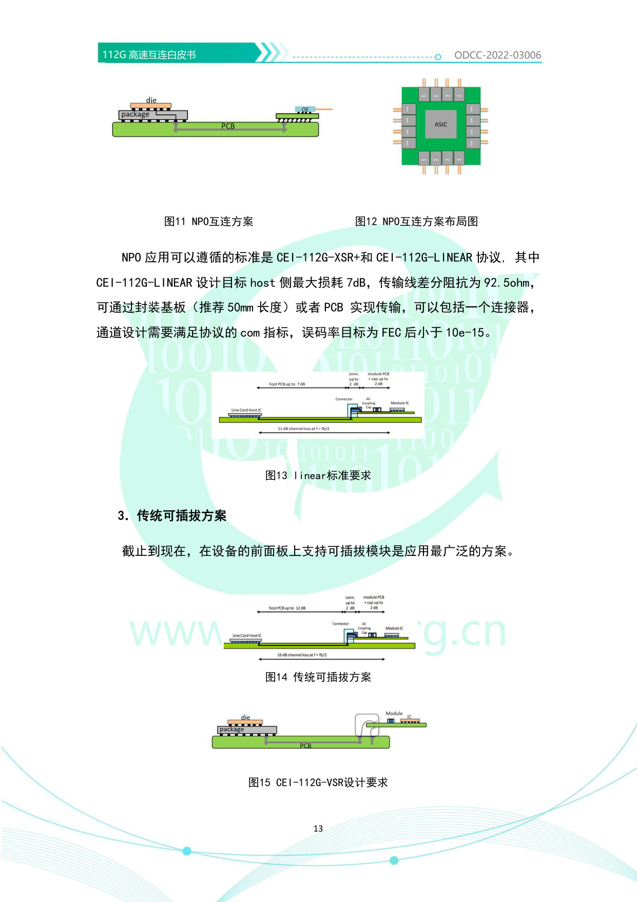

图15 CEI-112G-VSR设计要求

这种方案是工程师最熟悉的设计，可以遵循标准为 CEI-112G-LINEAR，CEI-112G-VSR 和 IEEE 100GAUI-1C2M，IEEE 200GAUI-2C2M，IEEE 400GAUI-4C2M 标准。 

当需要支持外接 cable 应用时，可遵循标准 100GBASE-CR1，200GBASE-CR2 和 400GBASE-CR4。设计中可以包含至少 200mm 长度的 PCB 布线长度，一个连接器以及光模块上的电容。 

设备侧可以达到的最大设计长度与采用的链路材料强相关，以下表 21 为当前常用材料的理论最大长度预估，实际设计时需综合考虑其他设计因素如过孔损耗等。 

表1 CEI-112G-VSR协议可支持的设备侧长度分析

<table><tr><td>链路材料</td><td>损耗(dB/inch)</td><td>设备最大设计长度</td></tr><tr><td>低损耗板材</td><td>1.3</td><td>9.2inch</td></tr><tr><td>超低损耗板材</td><td>1</td><td>12inch</td></tr><tr><td>极低损耗板材</td><td>0.7</td><td>17inch</td></tr><tr><td>线缆cable</td><td>0.5</td><td>24inch</td></tr></table>

## （三）高速互连的设计关键

行业目前有 10Gb/s、25Gb/s 和 56Gb/s 的电气接口可供使用，目前正在进行 112Gb/s 的开发工作，以满足更高的数据速率需求。然而，传统铜互连的带宽受到严重限制，使用高速通道的设计越来越困难。同时，芯片功耗的剧烈上升，使得互连设计中电源通道设计的挑战成倍增加。 

## 1. 高速通道特性

高速通道的实现由可支撑的损耗预算决定损耗由链路长度、板材、连接器、过孔等无源损耗节点决定。 

## 112G 高速互连白皮书

在网络设备中，前面区域通常由用于系统间通信的光模块占据，而系统内的板卡通信通过背板/中板连接。为了支持合理的系统尺寸，系统背板/中面板长距离连接通常需要达到1m的距离。在112Gb/s的电气串行速率下，达到这种距离已经需要使用先进的低损耗电路材料和高性能连接器来满足损耗预算。芯片基片和印刷电路板（PCB）材料（介质和导体）影响总损耗。下图是对56G和112G主流板材损耗分析，PCB板材性能改善提升了30%左右，详细内容参考第五章高速互连PCB内容。 

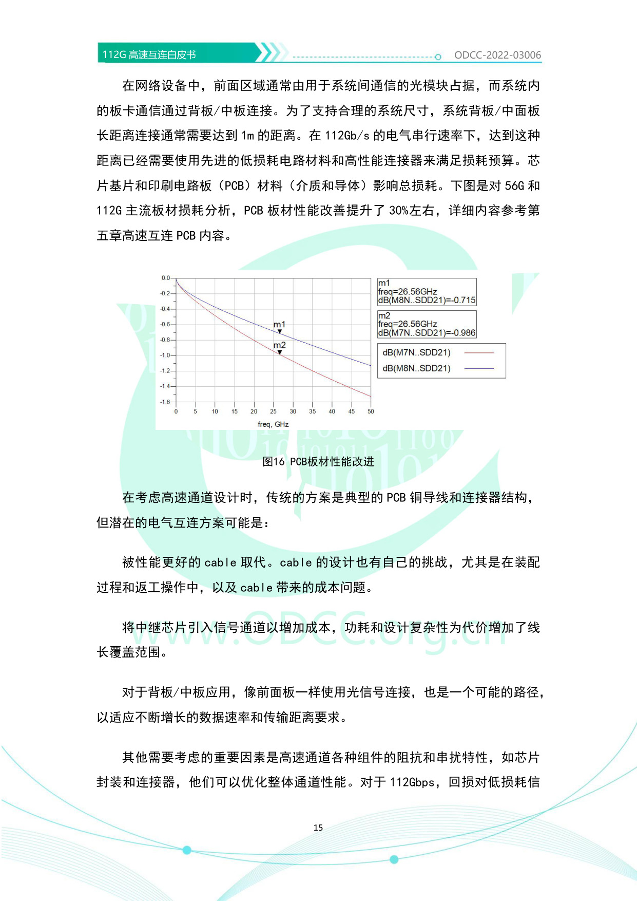

图16 PCB板材性能改进

在考虑高速通道设计时，传统的方案是典型的 PCB 铜导线和连接器结构，但潜在的电气互连方案可能是： 

被性能更好的 cable 取代。cable 的设计也有自己的挑战，尤其是在装配过程和返工操作中，以及 cable 带来的成本问题。 

将中继芯片引入信号通道以增加成本，功耗和设计复杂性为代价增加了线长覆盖范围。 

对于背板/中板应用，像前面板一样使用光信号连接，也是一个可能的路径，以适应不断增长的数据速率和传输距离要求。 

其他需要考虑的重要因素是高速通道各种组件的阻抗和串扰特性，如芯片封装和连接器，他们可以优化整体通道性能。对于 112Gbps，回损对低损耗信 道的影响变得很明显。基于这一认识，112Gbps的应用将需要更多的权衡插入损耗以外因素的影响。 

## 2. 大电流电源设计

随着电源电流的成倍增加，电源通道设计面临挑战，ASIC 的低压电源、纳米技术的趋势以及更高集成度的影响使得设备总功率显著增加，这实际上需要极高的电流通流和电压稳定性，必须控制在几个 mv 的公差范围内，这需要更严苛的电源设计来满足要求。 

表2 芯片电流随信号速率增长的典型数据

<table><tr><td>信号速率</td><td>25Gbps</td><td>56Gbps</td><td>112Gbps</td></tr><tr><td>单芯片最大电流</td><td>200~400A</td><td>400~800A</td><td>700A~1000A</td></tr><tr><td>PCB 功耗</td><td>20~30W</td><td>30~40W</td><td>50~60W</td></tr><tr><td>电源压差要求</td><td>±10mv</td><td>±8mv</td><td>±4mv</td></tr><tr><td>需要的 2oz 层数</td><td>2</td><td>4</td><td>6</td></tr></table>

## 3. 互连成本

信号速率翻倍至 112 Gbps，以损耗为代表的的高速通道困难也会变得难以克服，使得高速互连工程师倾向采用最先进的印刷电路板或电缆技术等各种新方案，这必然带来成本的上升甚至翻倍，如何平衡性能需求和成本管控，需要全面评估后的谨慎选择。 

## （四）112G 收发器（SerDes）

高速信号在无源通道传播中会产生畸变，造成接收端信号信噪比（S/N）恶化，形成误码。系统实现中，通道造成的畸变不可避免，要求 SerDes 具有信号恢复的能力。 

无源通道对信号的影响通常分为：损耗（Loss）、反射（Reflection）和串扰（Crosstalk）。串扰影响是不确定性（Un-Deterministic），不能被纠正（Corrected）；损耗和反射影响是确定性的（Deterministic），理论上可纠正，反射噪声通过 SerDes 恢复较为困难。SerDes 能力主要表现为对损耗造成 畸变的恢复，因此通常采用信号通过“最大通道损耗”且能恢复来简单表征SerDes能力。 

## 1. 通道损耗对信号的劣化

频域上看，无源通道衰减呈低通特性，低频损耗小，高频损耗大，造成信号幅度变小和畸变；从时域上看，高频衰减使得信号上升下降沿变缓，单位间隔（UI）内的信号能量扩张到相邻 UI 中，形成码间串扰（ISI）噪声（ $N_{ISI}$ ）。无源通道时域冲激函数和频域传递函数分别为： $h_{ch}(t)$ 和 $H_{ch}(s)$ 。 

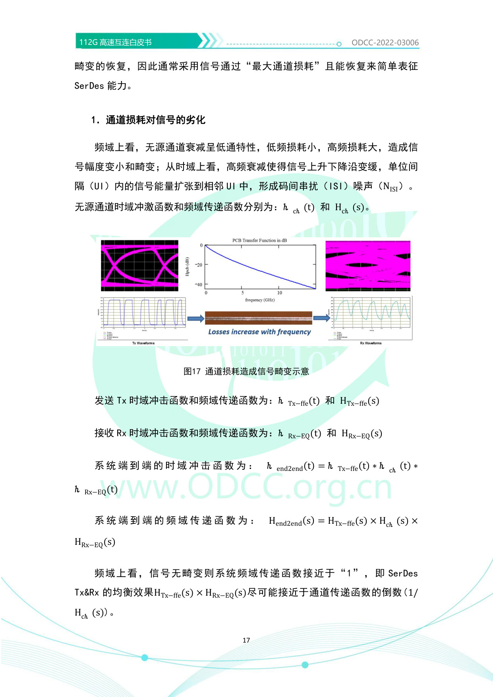

图17 通道损耗造成信号畸变示意

发送 Tx 时域冲击函数和频域传递函数为： $h_{\mathrm{Tx-ffe}}(t)$ 和 $H_{\mathrm{Tx-ffe}}(s)$ 

接收 Rx 时域冲击函数和频域传递函数为： $h_{\mathrm{Rx-EQ}}(t)$ 和 $H_{\mathrm{Rx-EQ}}(s)$ 

系统端到端的时域冲击函数为： $h_{\mathrm{end2end}}(t) = h_{\mathrm{Tx - ffe}}(t)*h_{ch}(t)*$ $h_{\mathrm{Rx - EQ}}(t)$ www.ODCC.org.cn 

系统端到端的频域传递函数为： $\mathrm{H}_{\mathrm{end2end}}(s) = \mathrm{H}_{\mathrm{Tx - ffe}}(s)\times \mathrm{H}_{ch}(s)\times$ $\mathrm{H_{Rx - EQ}(s)}$ 

频域上看，信号无畸变则系统频域传递函数接近于“1”，即SerDes Tx&Rx的均衡效果 $H_{Tx-ffe}(s)\times H_{Rx-EQ}(s)$ 尽可能接近于通道传递函数的倒数(1/ $H_{ch}(s)$ )。 

时域上看，消除码间串扰(ISI)，即把被通道损耗展宽的冲击响应（Pulse response）通过均衡压缩，除了信号采样时刻（Ts）外，其余UI的采样时刻均尽量接近零。 

线性均衡（CTLE）、FFE 和 DFE 为常见 SerDes 均衡方式。其中 CTLE 和 DFE 位于接收侧，FFE 可位于接收和发送侧，在发送侧通常称为 FIR（Finite Impulse Response）滤波器。如下图，3 阶 FIR 滤波器传递函数为高通滤波器，在 Nyquist 频点的幅度为 1，在直流的幅度为 (Main-pre-post)/(Main+pre+post)；过 3 阶的 FIR 滤波器从时域卷积波形进行设计。FFE 没有信号增益，通过压低信号的低频形成高通滤波器，因此 FFE 会压缩信号的摆幅，消除 ISI 同时降低了信噪比（S/N）。 

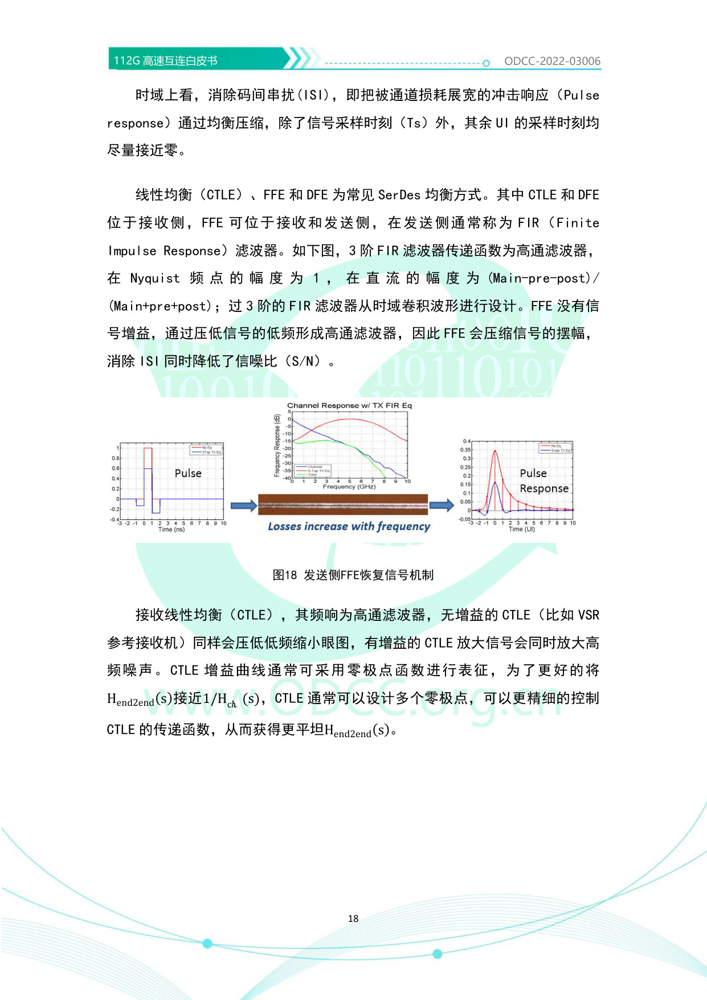

图18 发送侧FFE恢复信号机制

接收线性均衡（CTLE），其频响为高通滤波器，无增益的 CTLE（比如 VSR 参考接收机）同样会压低低频缩小眼图，有增益的 CTLE 放大信号会同时放大高频噪声。CTLE 增益曲线通常可采用零极点函数进行表征，为了更好的将 $H_{\text{end2end}}(s)$ 接近 $1/H_{ch}(s)$ ，CTLE 通常可以设计多个零极点，可以更精细的控制 CTLE 的传递函数，从而获得更平坦 $H_{\text{end2end}}(s)$ 。 

图19 无源CTLE电路和频域相应曲线

DFE（Decision feedback EQ），时域上，ISI能量会渗入相邻通道中且比例是确定的，DFE直接将这部分能量通过加法器扣除；DFE不会降低信号幅度或放大噪声，仅对信号对应tap采样时刻有效，是负反馈系统；负反馈可能会造成系统的不稳定，即误码传播，DFE的反馈系数(系数和)越大则误码传播可能性越大。FFE（Feed Forward EQ），类似发送FIR，模拟FFE会造成信号幅度下降；通过对模拟信号进行AD采样，采用DSP进行多阶的FFE有效的信号恢复；FFE没有负反馈机制，不会造成误码传播，适合于有误码系统。 

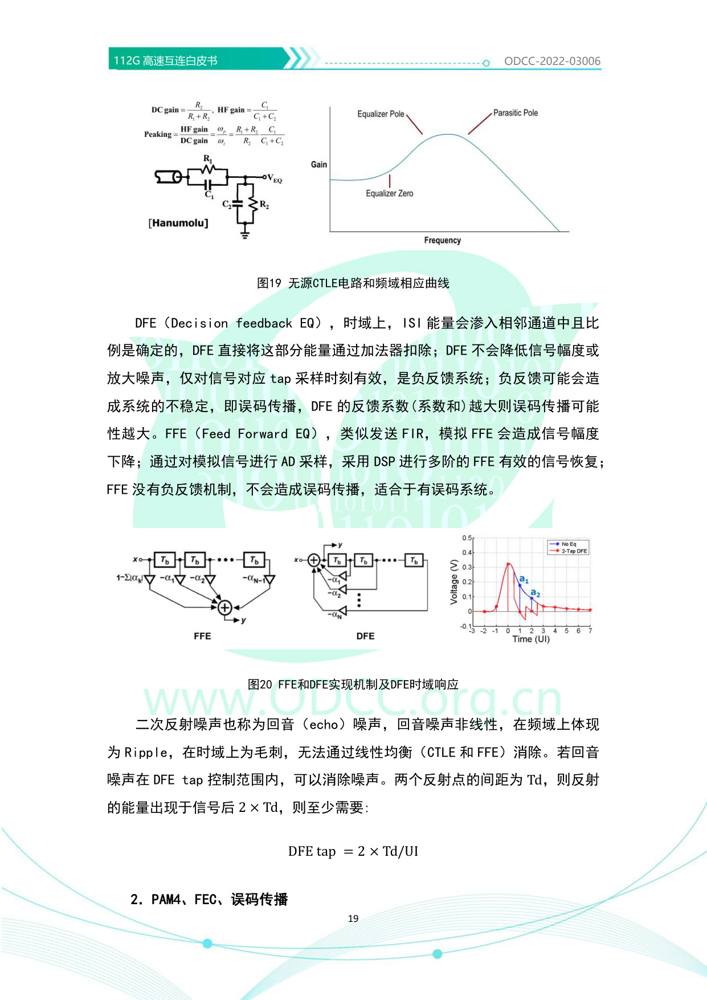

图20 FFE和DFE实现机制及DFE时域响应

二次反射噪声也称为回音（echo）噪声，回音噪声非线性，在频域上体现为 Ripple，在时域上为毛刺，无法通过线性均衡（CTLE 和 FFE）消除。若回音噪声在 DFE tap 控制范围内，可以消除噪声。两个反射点的间距为 Td，则反射的能量出现于信号后 $2 \times Td$ ，则至少需要： 

$$
\mathrm{DFE} \mathrm{tap} = 2 \times \mathrm{Td} / \mathrm{UI}
$$

## 2. PAM4、FEC、误码传播

编码从 NRZ 变为 PAM4 保持波特率不变，提高一倍，代价为信号综合的信噪比 (SNR) 代价约为 11dB。PAM4 系统的信噪比不能维持系统 <1e-15 量级的误码率，需要通过 FEC（Forward Error Correction）进行纠错，把误码率降低到 1e-15 以下。 

FEC 通过在 k 比特有效载荷中加入冗余的（n-k）比特检错码，形成 n 比特的数据包进行发送和传输。常用的 FEC 编码为 Reed Solomon 编码，可纠正（n-k）/2 比特的误码。比如，100G-KR4 背板采用 RS（514, 544, 15）编码，最多可纠正一个数据包中 15 比特的误码。 

FEC 编码会加入额外的数据冗余，同时 FEC 编解码带来一定的功耗代价和延时（latency）。FEC 有效的降低误码率，如下图所示不同 RS-FEC 编码纠后误码率和信噪比的关系。 

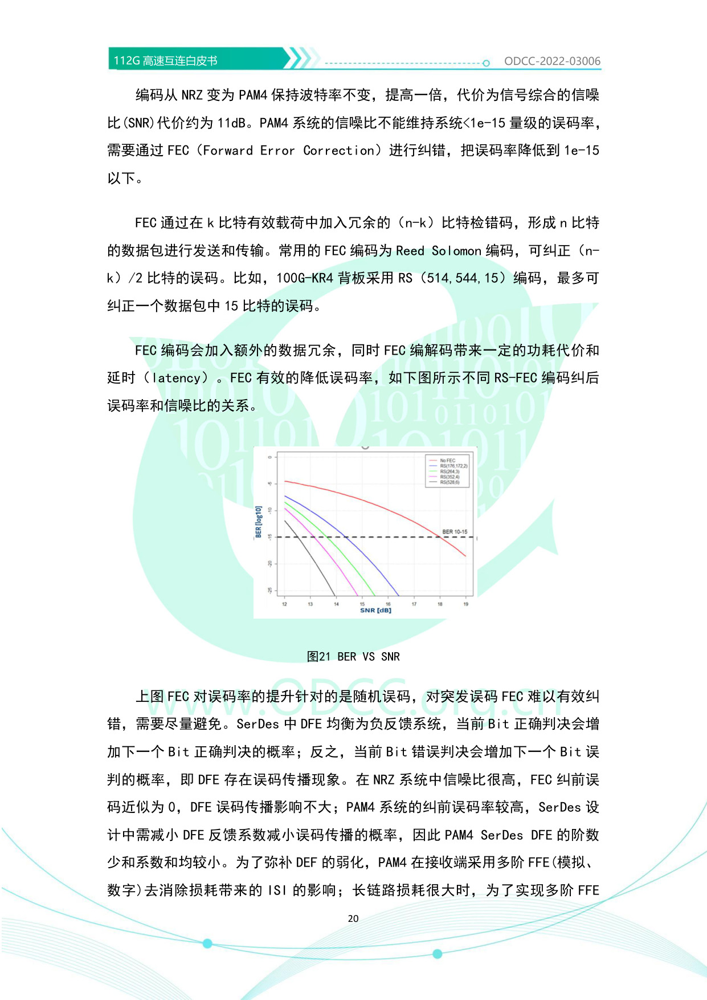

图21 BER VS SNR

上图 FEC 对误码率的提升针对的是随机误码，对突发误码 FEC 难以有效纠错，需要尽量避免。SerDes 中 DFE 均衡为负反馈系统，当前 Bit 正确判决会增加下一个 Bit 正确判决的概率；反之，当前 Bit 错误判决会增加下一个 Bit 误判的概率，即 DFE 存在误码传播现象。在 NRZ 系统中信噪比很高，FEC 纠前误码近似为 0，DFE 误码传播影响不大；PAM4 系统的纠前误码率较高，SerDes 设计中需减小 DFE 反馈系数减小误码传播的概率，因此 PAM4 SerDes DFE 的阶数少和系数和均较小。为了弥补 DEF 的弱化，PAM4 在接收端采用多阶 FFE（模拟、数字）去消除损耗带来的 ISI 的影响；长链路损耗很大时，为了实现多阶 FFE 

（10-30 阶），很多厂家采用 DSP 架构，先对信号进行模数转换，采用 DSP 进行多阶 FFE 的处理。 

## 3. 架构特性

112G 为 PAM4 编码，波特率为 56Gbps，UI≈18ps。112G 信号恢复难度极大，对损耗较大的链路，纯模拟架构难以保证误码率，几乎所有的长链路 112G SerDes 均为模拟和数字混合架构。 

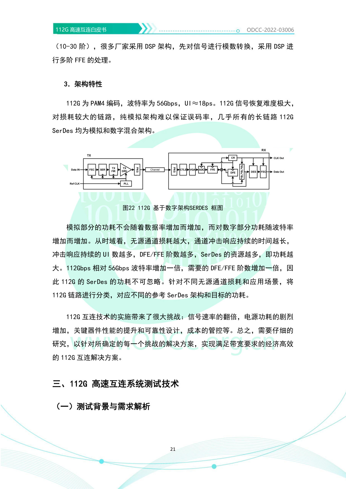

图22 112G 基于数字架构SERDES 框图

模拟部分的功耗不会随着数据率增加而增加，而对数字部分功耗随波特率增加而增加。从时域看，无源通道损耗越大，通道冲击响应持续的时间越长，冲击响应持续的 UI 数越多，DFE/FFE 阶数越多，SerDes 的资源越多，即功耗越大。112Gbps 相对 56Gbps 波特率增加一倍，需要的 DFE/FFE 阶数增加一倍，因此 112G 的 SerDes 的功耗不可忽略。针对不同无源通道损耗和应用场景，将 112G 链路进行分类，对应不同的参考 SerDes 架构和目标的功耗。 

112G 互连技术的实施带来了很大挑战：信号速率的翻倍，电源功耗的剧烈增加，关键器件性能的提升和可靠性设计，成本的管控等。总之，需要仔细的研究，以针对所确定的每一个挑战的解决方案，实现满足带宽要求的经济高效的 112G 互连解决方案。 

## 三、112G 高速互连系统测试技术

## （一）测试背景与需求解析

数据中心网络带宽的提升需求促进网络接口速率的不断提升。当前主流的400G和800G接口单路速率为100Gbps以上，物理层信号速率达到106-112Gbps，信号格式为53-56 GBaud的PAM4信号。为了保证网络通信更高的传输速率稳定性和兼容性，需要对传输链路中的发射机、接收机、及传输通道进行测试。从产品形态分类，包含主机端口、光模块、线缆、背板等种类，每种产品分别对应不同的测试项目。 

表3 不同产品对应的测试项目

<table><tr><td></td><td>交换机/线路卡</td><td>光模块</td><td>有源光缆</td><td>无源铜缆/有源铜缆</td><td>背板</td></tr><tr><td>电发射机测试</td><td>√</td><td>√</td><td>√</td><td></td><td></td></tr><tr><td>光发射机测试</td><td></td><td>√</td><td></td><td></td><td></td></tr><tr><td>电接收机测试</td><td>√</td><td>√</td><td>√</td><td></td><td></td></tr><tr><td>光接收机测试</td><td></td><td>√</td><td></td><td></td><td></td></tr><tr><td>通道测试</td><td></td><td></td><td></td><td>√</td><td>√</td></tr></table>

112G 电接口和光接口的测试规范，行业参照的规范包括 IEEE 802.3bs/cd/ck，OIF-CEI 112G VSR/MR/LR 等。规范中对于测试项目、测试方法和指标要求有详细定义，可以作为测试依据的参考。IEEE 规范和 OIF-CEI 规范作为非强制要求的规范，应该看作互连接口的基础要求。数据中心用户可以根据行业规范，制定符合自己要求的需求指标。 

表4 行业规范说明

<table><tr><td>规范名称</td><td>线速率</td><td>说明</td></tr><tr><td>IEEE 802.3ck</td><td>106 Gbps</td><td>Electrical C2M &amp; C2C &amp; CR1 &amp; KR1</td></tr><tr><td>IEEE 802.3cu</td><td>106 Gbps</td><td>10Km, Single-Mode Optical Fiber at 106 Gbps per λ</td></tr><tr><td>IEEE 802.3db</td><td>106 Gbps</td><td>50M, Multimode Optical Fiber at 106Gbps per Fiber</td></tr><tr><td>IEEE 802.3ct</td><td>106 Gbps</td><td>10Km, DWDM (dense wavelength division multiplexing)</td></tr><tr><td>OIF CEI-112G VSR</td><td>72-116 Gbps</td><td>up to 12-16 dB loss at the Nyquist frequency, including one connector</td></tr><tr><td>OIF CEI-112G MR</td><td>72-116 Gbps</td><td>up to 20 dB loss at the Nyquist frequency, including one connector</td></tr><tr><td>OIF CEI-112G LR</td><td>72-116 Gbps</td><td>up to 28-30 dB loss at the Nyquist frequency, including two connectors</td></tr></table>

## 1. 测试环境说明

以 IEEE 802.3ck 规范中 100GAUI-1 C2M 接口定义为例，host 主机端发射机和接收机测试组网图： 

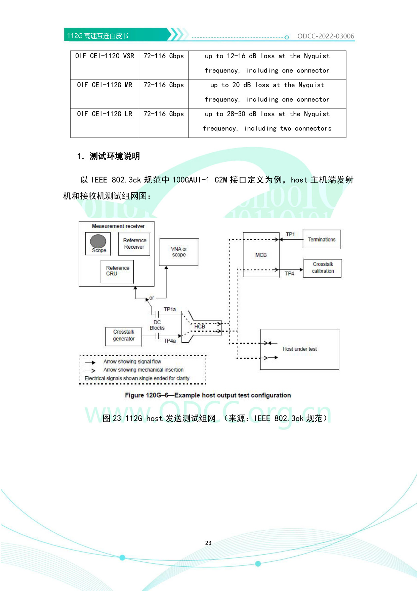

Figure 120G-6—Example host output test configuration

图23 112G host 发送测试组网（来源：IEEE802.3ck规范） 

Figure 120G-9—Example host stressed input test

图24 112G host接收测试组网 （来源：IEEE 802.3ck规范）

对电口发射机和接收机进行测试时，测试组网需要使用夹具将被测端口转接到测试仪表。通常使用示波器作为参考接收机，误码仪或码型发生器作为参考发射机进行测试。标准的模块接口可以使用商用的 HCB/MCB 夹具进行测试，例如 QSFPDD 和 OSFP 等类型。对于 PCB 测试或非标准连接器接口，则需要定制转接到标准同轴接口的夹具。 

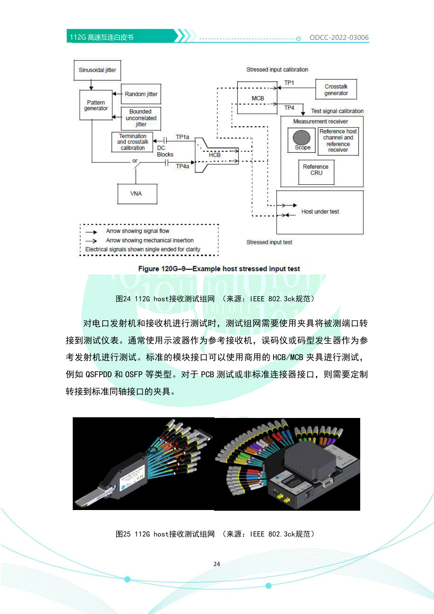

图25 112G host接收测试组网 （来源：IEEE 802.3ck规范）

## （二）发射机测试项目

## 1. 电发射机测试

主要测试项目：眼高、垂直眼图闭合（VEC）、转换时间、有效回波损耗（ERL）。 

电口发射机的主要测试项目由示波器进行，通过设置被测发射机输出标准测试码型，例如 PRBS13Q，由示波器采集眼图和波形进行参数分析。在测试前需要先调节电发射机的预加重参数，以及标准接机的均衡参数，包括 CTLE 均衡和 DFE 均衡。通过调节发端与收端设置使眼图张开度达到最大以后，再进行其他参数的测量。下图为电眼图测试与转换时间测试的示例图。 

图26 均衡后的106G电眼图

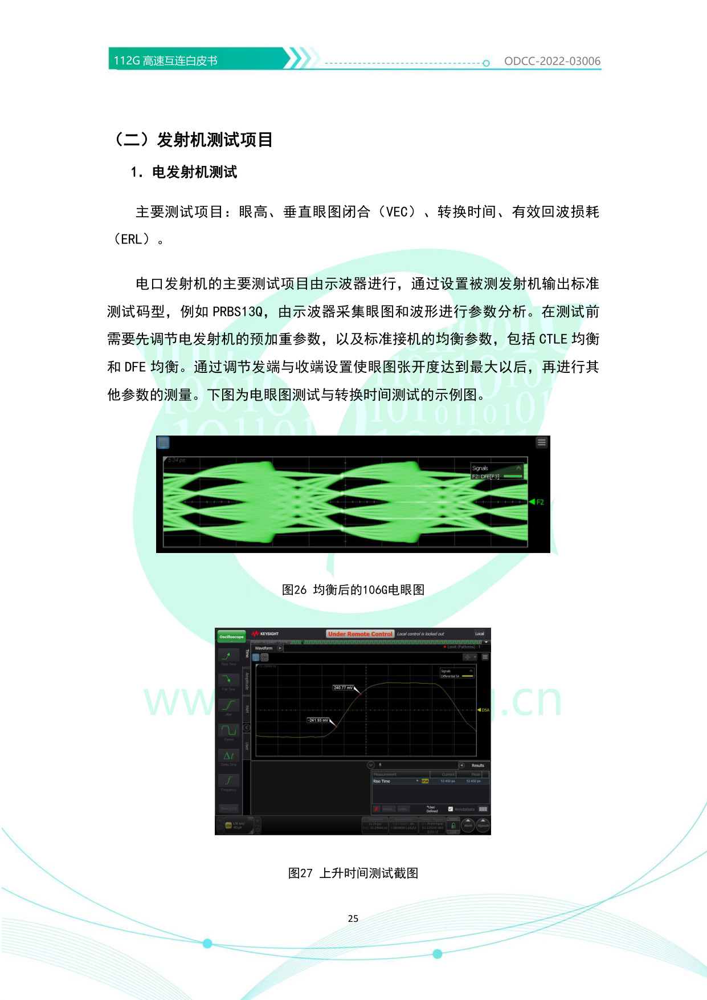

图27 上升时间测试截图

对于 ERL 有效回波损耗测试项，需要获得被测发射机端口的回波损耗参数，一般使用矢量网络分析仪进行反射 S 参数的测试提取数据。将反射 S 参数文件输入一致性测试软件的 ERL 分析功能中，可以计算出被测发射机的 ERL 数值。 

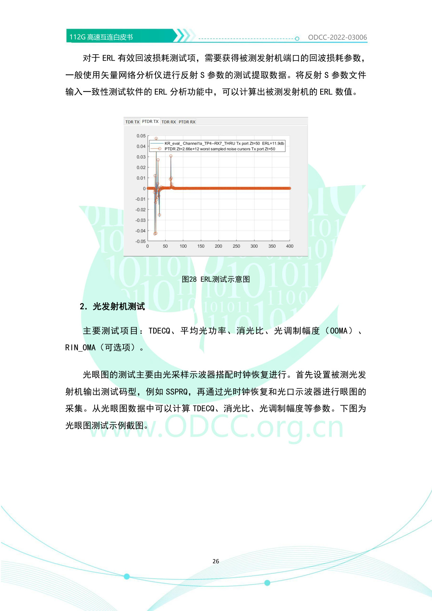

图28 ERL测试示意图

## 2. 光发射机测试

主要测试项目：TDECQ、平均光功率、消光比、光调制幅度（OOMA）、RIN_OMA（可选项）。 

光眼图的测试主要由光采样示波器搭配时钟恢复进行。首先设置被测光发射机输出测试码型，例如 SSPRQ，再通过光时钟恢复和光口示波器进行眼图的采集。从光眼图数据中可以计算 TDECQ、消光比、光调制幅度等参数。下图为光眼图测试示例截图。 

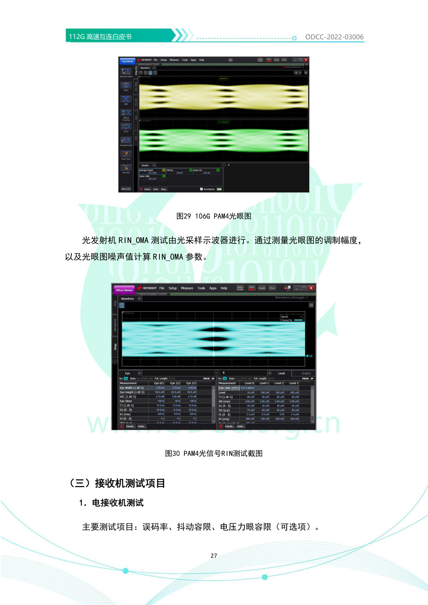

图29 106G PAM4光眼图

光发射机 RIN_OMA 测试由光采样示波器进行。通过测量光眼图的调制幅度，以及光眼图噪声值计算 RIN_OMA 参数。 

图30 PAM4光信号RIN测试截图

## （三）接收机测试项目

## 1. 电接收机测试

主要测试项目：误码率、抖动容限、电压力眼容限（可选项）。 

电接收机测试主要由误码仪进行，通过配置被测接收机进入环回模式，将误码仪输入接收机的信号环回到误码检测端，进行接收机误码率和抖动容限的测试。调节输入被测接收机的信号幅度、抖动幅度和抖动频率，可以测量接收机对信号灵敏度和抖动的容限能力。 

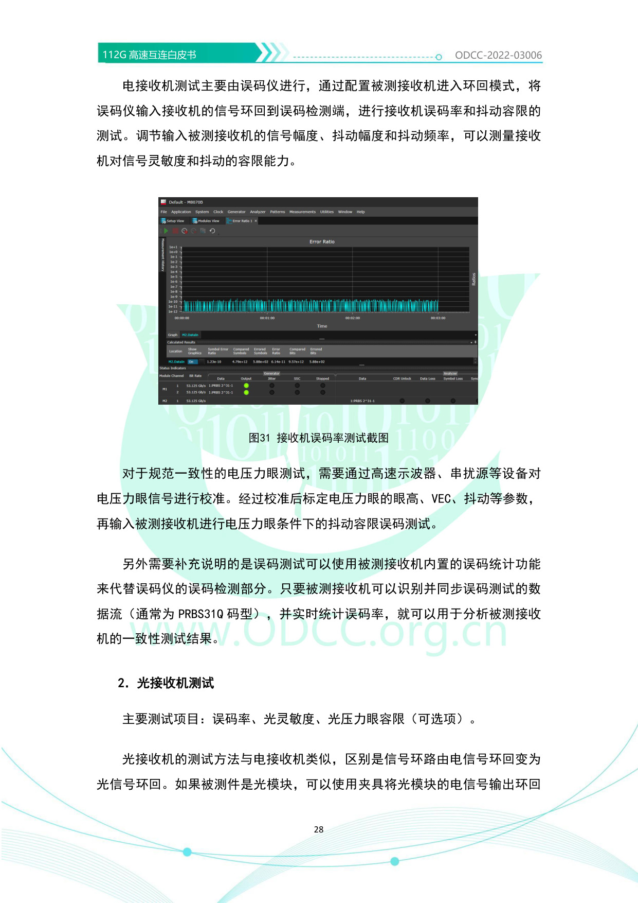

图31 接收机误码率测试截图

对于规范一致性的电压力眼测试，需要通过高速示波器、串扰源等设备对电压力眼信号进行校准。经过校准后标定电压力眼的眼高、VEC、抖动等参数，再输入被测接收机进行电压力眼条件下的抖动容限误码测试。 

另外需要补充说明的是误码测试可以使用被测接收机内置的误码统计功能来代替误码仪的误码检测部分。只要被测接收机可以识别并同步误码测试的数据流（通常为 PRBS31Q 码型），并实时统计误码率，就可以用于分析被测接收机的一致性测试结果。 

## 2. 光接收机测试

主要测试项目：误码率、光灵敏度、光压力眼容限（可选项）。 

光接收机的测试方法与电接收机类似，区别是信号环路由电信号环回变为光信号环回。如果被测件是光模块，可以使用夹具将光模块的电信号输出环回 到误码仪误码检测端进行测试；如果被测件是主机上的光口，可以选择通过光口环回数据后转为电信号，或通过主机内部的误码统计功能进行分析。 

光压力眼的测试步骤相对复杂，需要通过标准光发射机仪表产生光压力眼信号，并通过光采样示波器进行压力眼的校准。经过校准后的光压力眼信号通过光衰减器输入被测接收机，调节衰减值测试被测接收机压力眼灵敏度参数。具体的校准和测试步骤可以参考 802.3bs/cd 规范中的定义。下图为光压力眼校准结果的示意图。 

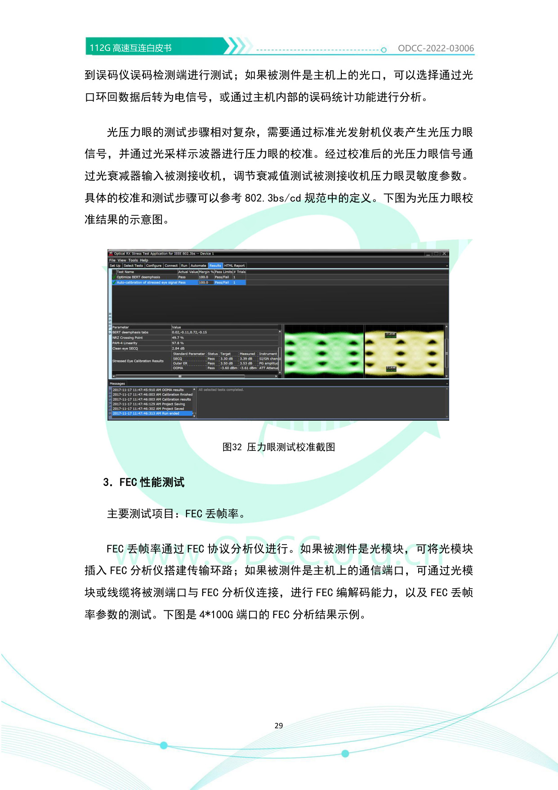

图32 压力眼测试校准截图

## 3. FEC 性能测试

主要测试项目：FEC 丢帧率。 

FEC 丢帧率通过 FEC 协议分析仪进行。如果被测件是光模块，可将光模块插入 FEC 分析仪搭建传输环路；如果被测件是主机上的通信端口，可通过光模块或线缆将被测端口与 FEC 分析仪连接，进行 FEC 编解码能力，以及 FEC 丢帧率参数的测试。下图是 4*100G 端口的 FEC 分析结果示例。 

<table><tr><td></td><td>1.1 100GE [-]</td><td>1.2 100GE [-]</td><td>1.3 100GE [-]</td><td>1.4 100GE [-]</td></tr><tr><td>FEC Total Bit Errors</td><td>1,129,501,359</td><td>1,128,217,015</td><td>1,159,344,513</td><td>138,238,007,519</td></tr><tr><td>FEC Max Symbol Errors</td><td>4</td><td>4</td><td>4</td><td>13</td></tr><tr><td>FEC Corrected Codewords</td><td>1,127,810,451</td><td>1,126,539,299</td><td>1,157,561,981</td><td>128,090,866,748</td></tr><tr><td>FEC Total Codewords</td><td>1,299,941,977,582</td><td>1,299,941,977,582</td><td>1,299,941,977,582</td><td>1,299,941,977,582</td></tr><tr><td>FEC Frame Loss Ratio</td><td>0.00e+00</td><td>0.00e+00</td><td>0.00e+00</td><td>0.00e+00</td></tr><tr><td>preFEC Bit Error Ratio</td><td>1.60e-07</td><td>1.60e-07</td><td>1.64e-07</td><td>1.95e-05</td></tr><tr><td>FEC RX Clock PPM Offset</td><td>0.000</td><td>0.000</td><td>0.000</td><td>0.000</td></tr><tr><td>FEC RX Link Loss</td><td>0</td><td>0</td><td>0</td><td>0</td></tr><tr><td>FEC Codewords with 0 Symbol Errors</td><td>1,298,814,167,131</td><td>1,298,815,438,283</td><td>1,298,784,415,601</td><td>1,171,851,110,834</td></tr><tr><td>FEC Codewords with 1 Symbol Errors</td><td>1,126,146,329</td><td>1,124,910,518</td><td>1,155,771,133</td><td>119,071,170,280</td></tr><tr><td>FEC Codewords with 2 Symbol Errors</td><td>1,662,814</td><td>1,627,593</td><td>1,789,373</td><td>8,388,993,559</td></tr><tr><td>FEC Codewords with 3 Symbol Errors</td><td>1,262</td><td>1,151</td><td>1,393</td><td>579,783,078</td></tr><tr><td>FEC Codewords with 4 Symbol Errors</td><td>46</td><td>37</td><td>82</td><td>46,130,748</td></tr><tr><td>FEC Codewords with 5 Symbol Errors</td><td>0</td><td>0</td><td>0</td><td>4,256,355</td></tr><tr><td>FEC Codewords with 6 Symbol Errors</td><td>0</td><td>0</td><td>0</td><td>466,256</td></tr><tr><td>FEC Codewords with 7 Symbol Errors</td><td>0</td><td>0</td><td>0</td><td>57,009</td></tr><tr><td>FEC Codewords with 8 Symbol Errors</td><td>0</td><td>0</td><td>0</td><td>7,974</td></tr><tr><td>FEC Codewords with 9 Symbol Errors</td><td>0</td><td>0</td><td>0</td><td>1,234</td></tr><tr><td>FEC Codewords with 10 Symbol Errors</td><td>0</td><td>0</td><td>0</td><td>221</td></tr><tr><td>FEC Codewords with 11 Symbol Errors</td><td>0</td><td>0</td><td>0</td><td>26</td></tr><tr><td>FEC Codewords with 12 Symbol Errors</td><td>0</td><td>0</td><td>0</td><td>5</td></tr><tr><td>FEC Codewords with 13 Symbol Errors</td><td>0</td><td>0</td><td>0</td><td>3</td></tr><tr><td>FEC Codewords with 14 Symbol Errors</td><td>0</td><td>0</td><td>0</td><td>0</td></tr><tr><td>FEC Codewords with 15 Symbol Errors</td><td>0</td><td>0</td><td>0</td><td>0</td></tr><tr><td>FEC Uncorrectable Codewords</td><td>0</td><td>0</td><td>0</td><td>0</td></tr></table>

图33 EC测试结果示例

## （四）线缆及PCB背板通道测试项目

## 1. 无源及有源铜缆（DAC 及 AEC）测试

主要测试项目：差模插入损耗（ILdd）、有效回波损耗（ERL）、模式转换回损（RLcd）、模式转换插损（ILcd）、通道工作裕量（COM）（可选项）。 

## 2. PCB 背板测试

主要测试项目：差模插入损耗（ILdd）、有效回波损耗（ERL）、模式转换回损（RLcd）、模式转换插损（ILcd）、通道工作裕量（COM）（可选项）。 

对于无源铜缆、有源铜缆、PCB背板通道的测试，标准测试由矢量网络分析仪进行。通过校准后的网络分析仪测量提取被测通道的差分S参数，计算出插入损耗、回波损耗、模式转换损耗等参数。 

通道工作裕量 COM 是 IEEE 802.3 中定义的测试参数，通过测量被测通道以及串扰通道（如果为并行多通道接口，则需要测量相邻串扰通道）的 S 参数，输入规范提供的 COM 分析软件进行通道工作裕量参数的计算。 

图34 COM测试结果示例

四、112G 高速互连系统仿真技术

## （一）典型的链路拓扑

112G 属于传统的 SerDes 的链路，其链路包括了发送端/接收端的芯片、芯片封装、PCB 板、过孔、连接器、背板、线缆和封装等等。如下图所示： 

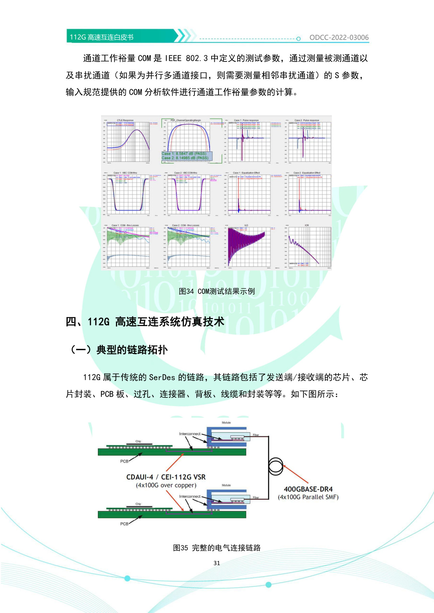

图35 完整的电气连接链路

## （二）无源仿真

无源链路包括了发送端/接收端芯片的封装、PCB板、过孔、连接器、背板、线缆和封装等等。在进行系统设计时，需要针对主要的组件进行仿真。接下来对封装、过孔、连接器的仿真做简要介绍。 

## 1. 封装仿真

通常，SerDes 信号网络的封装会比较大，而且，112G 信号网络的信号频率非常高，所以封装对信号的影响也非常大。对于封装，一般关注的是其无源特性，包括其插入损耗、回波损耗、串扰、阻抗、模式转换等等。如下图所示为某芯片的模型封装： 

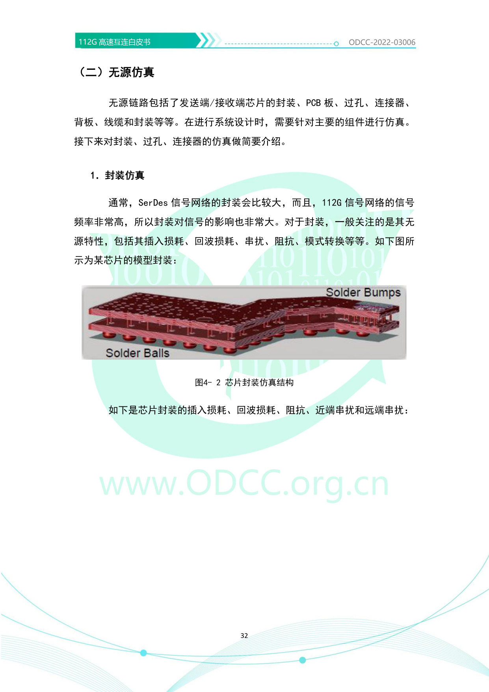

图4-2 芯片封装仿真结构

如下是芯片封装的插入损耗、回波损耗、阻抗、近端串扰和远端串扰：

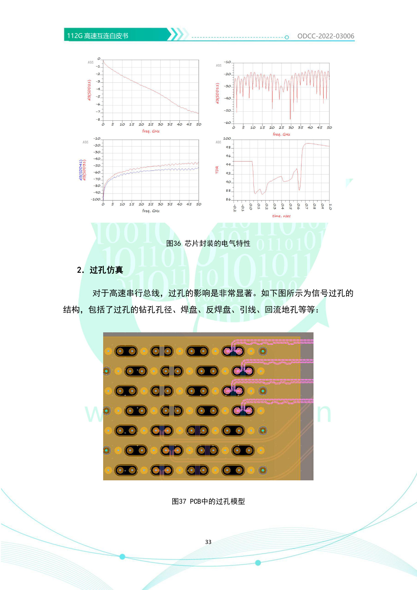

图36 芯片封装的电气特性

## 2. 过孔仿真

对于高速串行总线，过孔的影响是非常显著。如下图所示为信号过孔的结构，包括了过孔的钻孔孔径、焊盘、反焊盘、引线、回流地孔等等： 

图37 PCB中的过孔模型

过孔中的每一个部分都或多或少的对信号的性能有影响。在设计时，建议对每一种不同类型的过孔都进行仿真，其仿真流程如下图所示： 

- 确定过孔的层叠 

- 确定过孔的结构以及各项参数 

- 确定是否有stub或者背钻 

- 确定是否有回流地孔以及数量和位置 

- 确定连接过孔的传输线结构或者同轴结构 

- 确定过孔仿真扫描的频率范围或者参数变量 

- 建模仿真并分析仿真结果 

- 输出仿真结果或者模型 

图38 过孔仿真流程 

下图所示为仿真不同过孔孔径结构的结果对比图： 

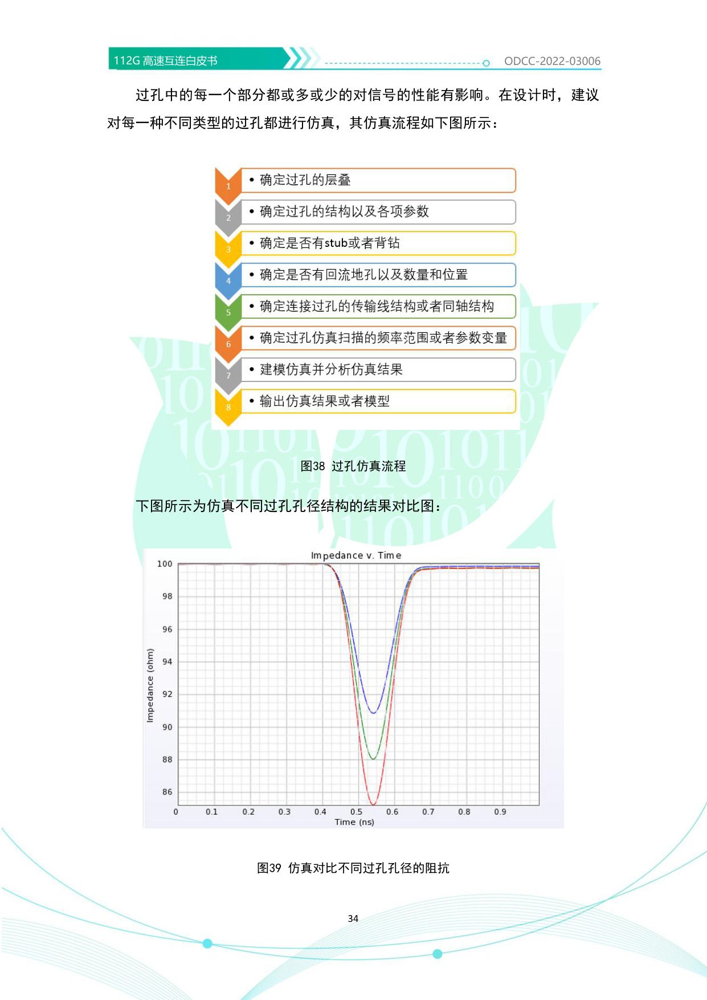

图39 仿真对比不同过孔孔径的阻抗

在 112G 的设计中，传输链路的阻抗一致性非常重要，任何较大的阻抗不均匀性都会导致潜在的信号完整性问题。所以在设计的时候要非常重视过孔的设计。 

## 3. 连接器和线缆仿真

连接器和线缆是 112G 系统中不可或缺的组件，112G 系统中的连接器类型包括 10、背板或者板对板的连接器。不管是哪一种类型的连接器，其仿真分析都是类似的，都是在三维电磁场软件中提取其电磁模型，即 S 参数。如下是 QSFP-DD 连接器的设计结构： 

图40 QSFP-DD连接器仿真3D结构

下图所示为连接器仿真的结果如下图所示： 

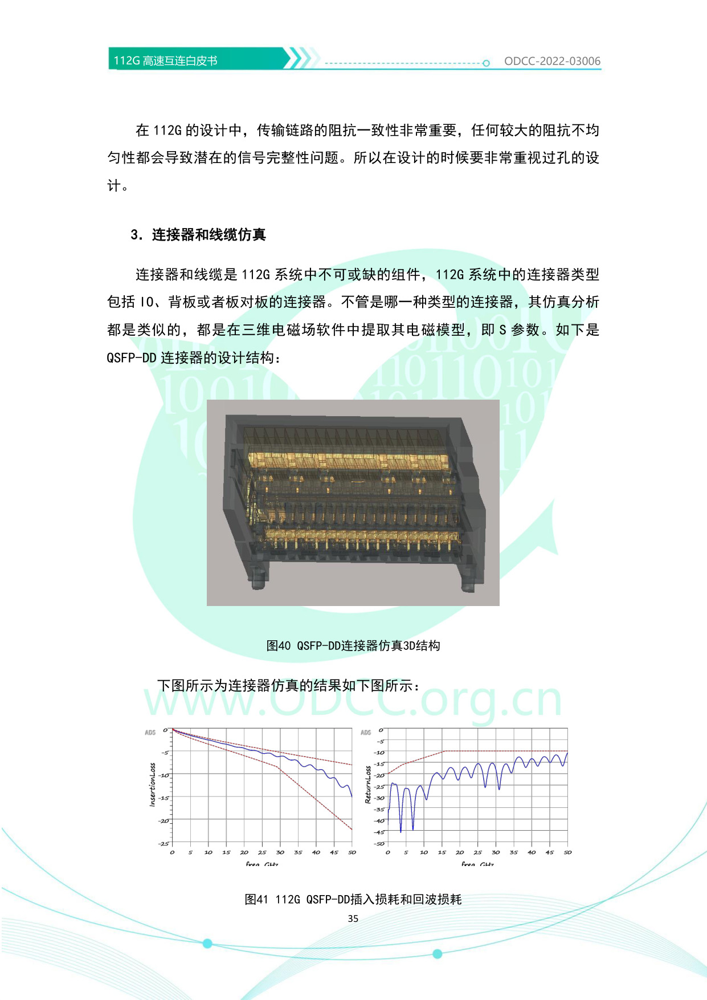

图41 112G QSFP-DD插入损耗和回波损耗

按照规范的要求，评估连接器是否满足规范协议的要求。 

## 4. 无源链路仿真拓扑

在前面我们介绍了，无源链路包括了发送端芯片的封装、PCB板、过孔、连接器、背板和封装。在链路中，它们都是相互连接在一起的，但是在实际的应用中，很多时候时都无法把所有器件都连接在一起仿真，所以一般在仿真时，就把各个部分连接在一起，其链路如下图所示： 

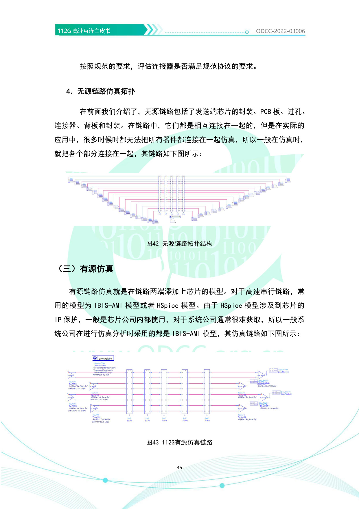

图42 无源链路拓扑结构

## （三）有源仿真

有源链路仿真就是在链路两端添加上芯片的模型。对于高速串行链路，常用的模型为 IBIS-AMI 模型或者 HSpice 模型。由于 HSpice 模型涉及到芯片的 IP 保护，一般是芯片公司内部使用，对于系统公司通常很难获取，所以一般系统公司在进行仿真分析时采用的都是 IBIS-AMI 模型，其仿真链路如下图所示： 

图43 112G有源仿真链路

## （四）仿真结果的评估

由于 IEEE802.3ck 和 CEI-112G 都对 112G 的系统做了相应的电气性能指标的规定，包括了无源指标和有源指标。下图所示为 CEI-112G VSR 端到端的插入损耗要求： 

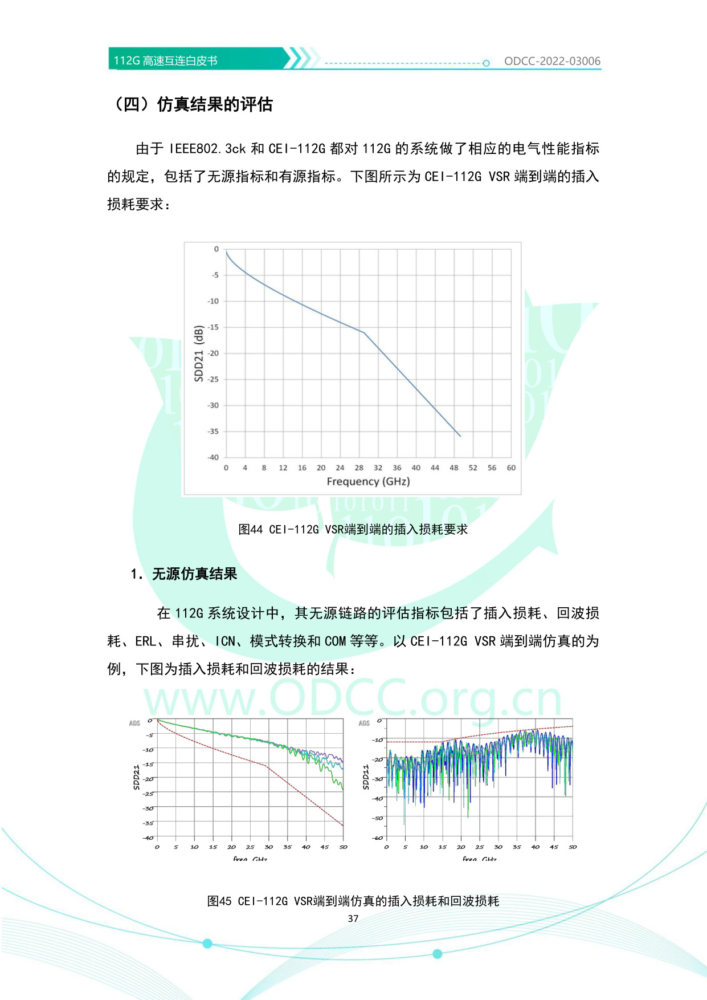

图44 CEI-112G VSR端到端的插入损耗要求

## 1. 无源仿真结果

在 112G 系统设计中，其无源链路的评估指标包括了插入损耗、回波损耗、ERL、串扰、ICN、模式转换和 COM 等等。以 CEI-112G VSR 端到端仿真的为例，下图为插入损耗和回波损耗的结果： 

图45 CEI-112G VSR端到端仿真的插入损耗和回波损耗

## 2. COM 仿真结果

Channel Operating Margin 简称为 COM，考察的是通道的信噪比。在设计线缆、PCB、连接器时可以通过 COM 分析其是否满足规范的要求。 

图46 COM定义示意图和计算式

COM 仿真示意图如下图所示: 

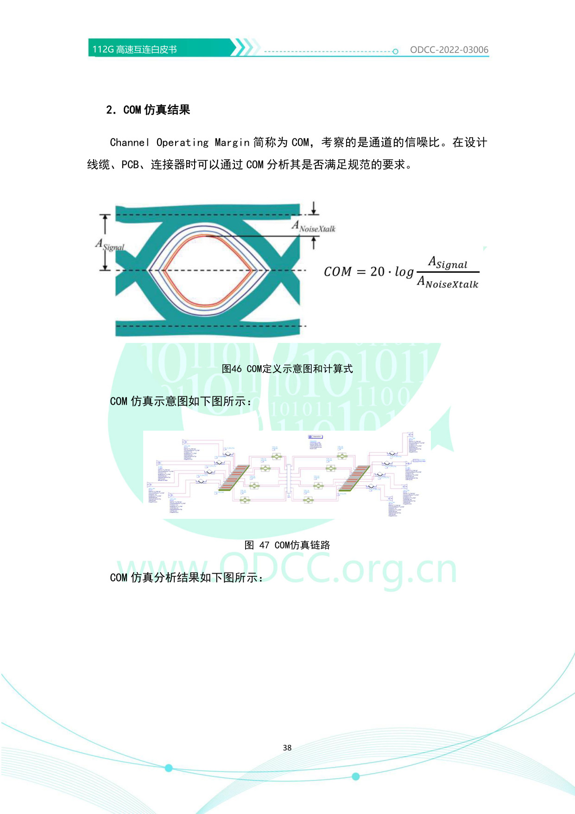

图47 COM仿真链路

COM 仿真分析结果如下图所示：

图48 COM仿真结果

## 3. PAM4 模型仿真结果

由于 112G 使用的是 PAM4 的调制方式，PAM4 的仿真流程与 NRZ 的仿真流程大致上是一致的，只是在仿真时模型处理不一样，在 IBIS-AMI 模型中有一个调制模式的选择。 

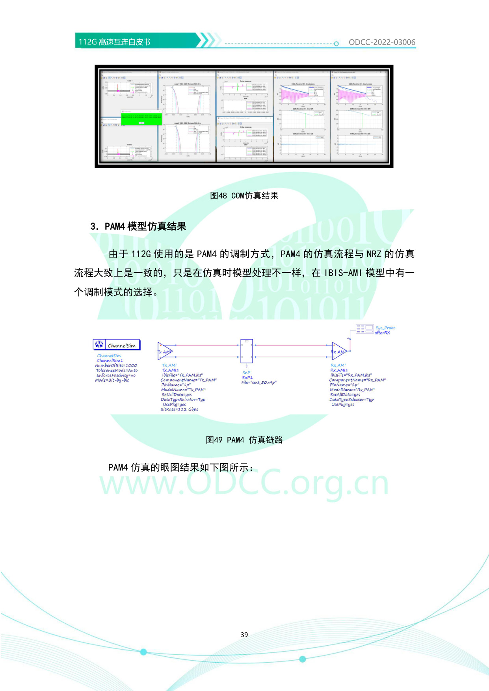

图49 PAM4 仿真链路

PAM4 仿真的眼图结果如下图所示:

图50 PAM4 眼图

## 4. 光电联合仿真（EOE 仿真）

当链路中有光链路时，可以进行光电联合仿真，即在链路中可以分析电的部分，还可以分析到光器件的影响。简单的链路连接如下图所示： 

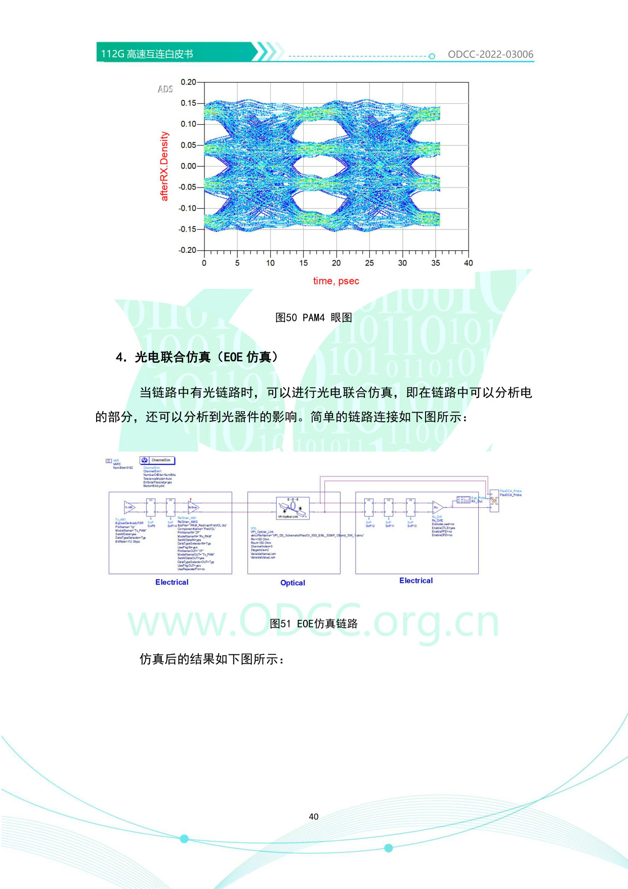

图51 EOE仿真链路

仿真后的结果如下图所示： 

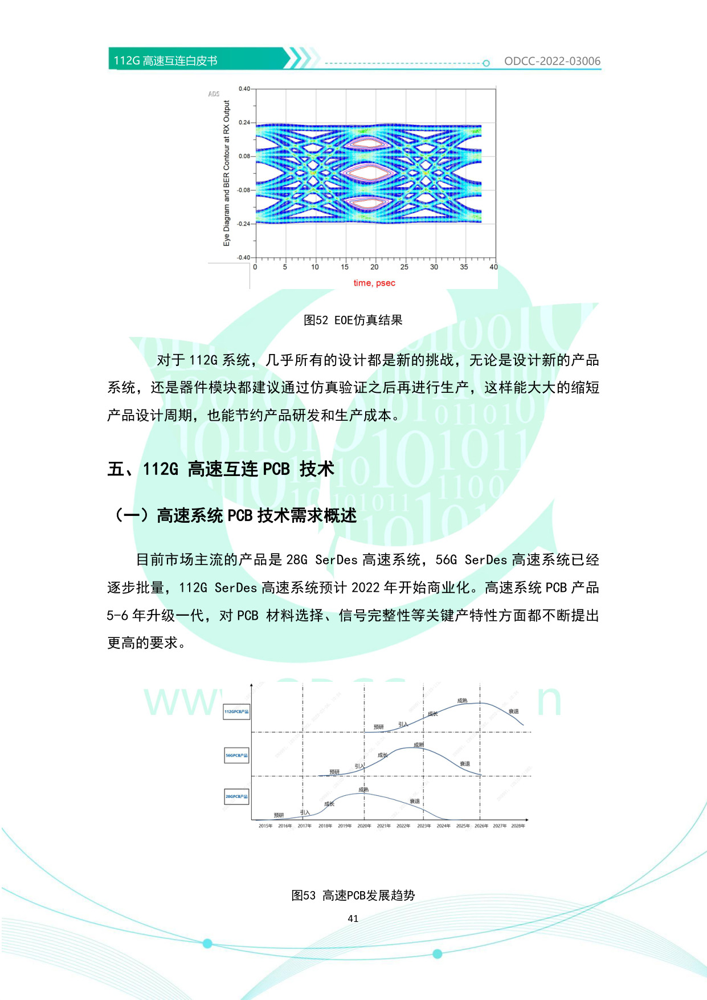

图52 EOE仿真结果

对于 112G 系统，几乎所有的设计都是新的挑战，无论是设计新的产品系统，还是器件模块都建议通过仿真验证之后再进行生产，这样能大大的缩短产品设计周期，也能节约产品研发和生产成本。 

## 五、112G 高速互连 PCB 技术

## （一）高速系统PCB技术需求概述

目前市场主流的产品是 28G SerDes 高速系统，56G SerDes 高速系统已经逐步批量，112G SerDes 高速系统预计 2022 年开始商业化。高速系统 PCB 产品 5-6 年升级一代，对 PCB 材料选择、信号完整性等关键产特性方面都不断提出更高的要求。 

图53 高速PCB发展趋势

112G SerDes 高速系统具有更高速率、更大带宽、更低延时和高信号完整性系统特点。28G SerDes 高速系统的基频从 12.89GHZ 上升到 56GSerDes 高速系统的 13.28GHZ，基频变化很小。因此从 28G SerDes 高速系统 PCB 产品较为平滑过渡到 56G SerDes 高速系统 PCB 产品，除了材料的变化，对高速系统 PCB 其余的关键技术规格要求并无显著的变化。但是由于 112G SerDes 高速系统的基频上升到 26.5GHZ，其基频增加了一倍，对 PCB 的信号完整性相关技术规格提出了更为严苛的要求。因此对于 112G SerDes 高速系统 PCB 产品，除了需要满足高密大容量的需求而增加的 PCB 层次、板厚、尺寸和厚径比的技术要求，更重要的是需要满足信号完整性方面相关的 PCB 技术要求。 

## （二）112G 高速互连系统 PCB 板材需求

随着高速传输速率越来越高的需求，PCB所使用的绝缘材料必须要符合高速高频的特性，才能确保信号的稳定性与完整性。传统FR4等级的覆铜板材料是以环氧树脂为主体，但是在高速高频工作的环境之下会造成更高的信号损失（>0.02），因此无法满足高速高频信号传输的要求。覆铜板是PCB的材料核心，它是由树脂、玻璃布和金属铜箔三者结合而成，所以树脂含量及种类都会影响覆铜板的电气特性。 

## 1. PCB板材的玻璃布技术趋势及要求

覆铜板是由树脂、玻璃布、铜箔等压合而成，玻璃布编号是按照经纬纱粗细、经纬纱密度、经纬纱重量等进行编号定义的。玻璃布对信号的影响，主要来自于Df。112G SerDes高速系统PCB覆铜板使用到的玻璃布由之前常用的E-glass、Low DK-Glass转换为Ultra Low Df Glass及Quartz Glass，Df由之前的0.004降低到0.002甚至0.001，相较于Low Dk Glass，SI提升 $10\% @20\mathrm{GHz}$ 。目前行业内使用到的Ultra Low Df Glass、Quartz Glass主要由Asahi、Nittobo两家供应。 

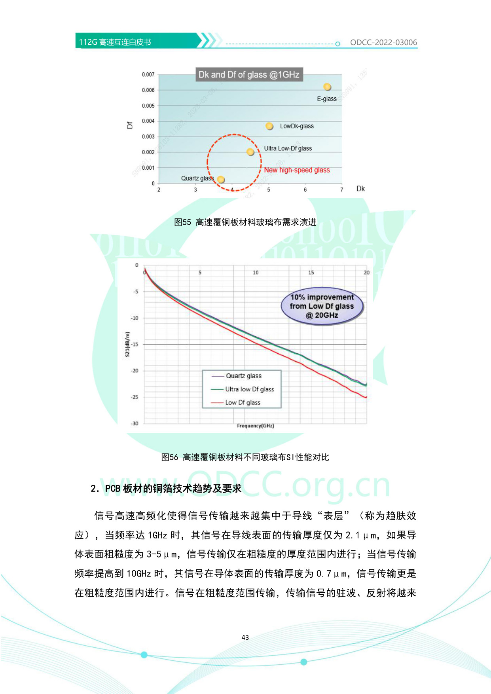

图55 高速覆铜板材料玻璃布需求演进

图56 高速覆铜板材料不同玻璃布SI性能对比

## 2. PCB 板材的铜箔技术趋势及要求

信号高速高频化使得信号传输越来越集中于导线“表层”（称为趋肤效应），当频率达1GHz时，其信号在导线表面的传输厚度仅为2.1μm，如果导体表面粗糙度为3-5μm，信号传输仅在粗糙度的厚度范围内进行；当信号传输频率提高到10GHz时，其信号在导体表面的传输厚度为0.7μm，信号传输更是在粗糙度范围内进行。信号在粗糙度范围传输，传输信号的驻波、反射将越来 越严重，并导致信号传输路径变长，损耗增加。因此铜箔的发展，一直在于追求越来越低的粗糙度，以降低信号在金属导体中的损耗。 

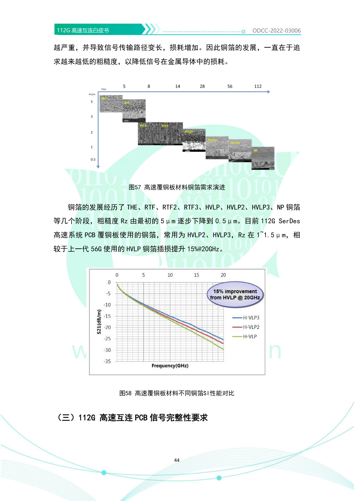

图57 高速覆铜板材料铜箔需求演进

铜箔的发展经历了THE、RTF、RTF2、RTF3、HVLP、HVLP2、HVLP3、NP铜箔等几个阶段，粗糙度Rz由最初的5μm逐步下降到0.5μm。目前112G SerDes高速系统PCB覆铜板使用的铜箔，常用为HVLP2、HVLP3，Rz在1~1.5μm，相较于上一代56G使用的HVLP铜箔插损提升15%@20GHz。 

图58 高速覆铜板材料不同铜箔SI性能对比

## （三）112G 高速互连 PCB 信号完整性要求

对于 112G SerDes 高速系统信号传输的无源链路、插损、回损、串扰都是影响信号完整性的关键指标。插损、回损、串扰影响因子众多，但主要取决于设计。对于插损，主要取决于材料选择，叠层设计；对于回损，主要取决于过孔优化设计；对于串扰，主要取决于间距，GND 隔离等。但对于 PCB 加工而言，插损的变化主要来源于制程对铜箔粗糙度的影响。而回损最关键的控制点在背钻 stub 长度的管控及走线阻抗控制。而层偏则是影响层间串扰的关键因子。 

## 1. 信号完整性关键控制点

PCB 设计信号完整性控制。112Gbps SerDes 高速系统，支持 PAM4 编码。如此高的速率，使得在整个系统中实现高速信号布线会面临许多设计难题。过去通常只是在组件级进行设计考量，而新一代多 Gbps 设计需要对信号通道路径进行整体分析。通道中的每个组件都包含一些设计变量，其会影响通道中其他组件的性能。必须考虑插入损耗、回波损耗、串扰、阻抗等连接器变量。PCB 设计决策包括布局、布线、泪滴的添加优化、匹配的材料/层压材料选择、迹线长度与阻抗匹配、旋转走线或者拼板旋转，它们都能够提高或降低高速串行通道的性能。 

PCB 制程的损耗控制。112G SerDes 高速系统设计一般为内层走线，在加工制程中，内层走线的损耗控制关键在于铜箔粗糙度的控制。而棕化流程是对铜箔进行表面处理的最后一步，是对铜箔粗糙度影响的关键步骤。棕化流程通过对铜箔表面的咬蚀增加铜箔粗糙度，通过增加铜箔粗糙度来增加 PP 与铜箔的结合力，保证可靠性，然而该做法必然导致损耗的增加。这对 112G SerDes 高速系统 PCB 是必须解决的一个矛盾。所以棕化工艺对此的发展趋势是增加化学结合力，减少对铜箔粗糙度的增加。新一代及下一代的棕化药水会在铜箔表面形成一层有机膜，有机膜通过化学键与 PP 结合，增加结合力，同时对铜面的粗化效果更小，在保证可靠性的情况下保障插损能力的提升。不同的棕化药水对插损的影响如下图所示，目前业界较为成熟的是 Bondfilm 级别的棕化药水，Glicap 与 Novabond IT 为下一代棕化药水。 

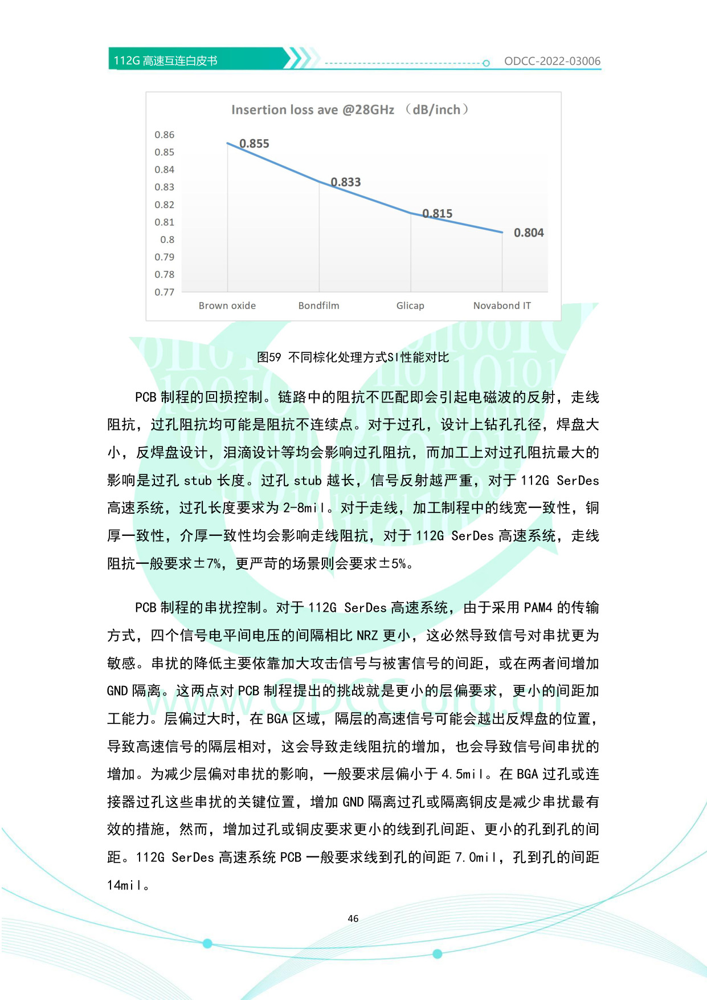

图59 不同棕化处理方式SI性能对比

PCB 制程的回损控制。链路中的阻抗不匹配即会引起电磁波的反射，走线阻抗，过孔阻抗均可能是阻抗不连续点。对于过孔，设计上钻孔孔径，焊盘大小，反焊盘设计，泪滴设计等均会影响过孔阻抗，而加工上对过孔阻抗最大的影响是过孔 stub 长度。过孔 stub 越长，信号反射越严重，对于 112G SerDes 高速系统，过孔长度要求为 2-8mil。对于走线，加工制程中的线宽一致性，铜厚一致性，介厚一致性均会影响走线阻抗，对于 112G SerDes 高速系统，走线阻抗一般要求 ±7%，更严苛的场景则会要求 ±5%。 

PCB 制程的串扰控制。对于 112G SerDes 高速系统，由于采用 PAM4 的传输方式，四个信号电平间电压的间隔相比 NRZ 更小，这必然导致信号对串扰更为敏感。串扰的降低主要依靠加大攻击信号与被害信号的间距，或在两者间增加 GND 隔离。这两点对 PCB 制程提出的挑战就是更小的层偏要求，更小的间距加工能力。层偏过大时，在 BGA 区域，隔层的高速信号可能会越出反焊盘的位置，导致高速信号的隔层相对，这会导致走线阻抗的增加，也会导致信号间串扰的增加。为减少层偏对串扰的影响，一般要求层偏小于 4.5mil。在 BGA 过孔或连接器过孔这些串扰的关键位置，增加 GND 隔离过孔或隔离铜皮是减少串扰最有效的措施，然而，增加过孔或铜皮要求更小的线到孔间距、更小的孔到孔的间距。112G SerDes 高速系统 PCB 一般要求线到孔的间距 7.0mil，孔到孔的间距 14mil。 

## 2. PCB 信号完整性测试建议

因损耗在 112G SerDes 高速系统中对信号完整性起关键性的影响，故通常通过设计损耗科邦的方式进行 PCB 走线的损耗监控。目前 PCB 行业内存在的插损测试方法根据测试设备可以分为矢量网络分析仪 VNA（Vector Network Analyzer）测试和时域反射 / 传输计 TDR/TDT（Time Domain Reflectometry/Transmission）测试两种。时域反射技术（TDR）其主要原理是通过高阶脉冲信号输入传输线结构，通过抓取其反射波幅度等信息形成输出波形，最终通过傅里叶转换将时域参数变换为频域参数，其中典型代表测试方法为 SPP（Short Pulse Propagation）、Set2dil 等。由于 TDR 测试仪器带宽的限制，对于 112G SerDes 高速系统，时域反射/传输计已经完全不能满足测试频段的要求。 

而 VNA 设备应用比较广泛，测试带宽极高，67GHz、甚至 112GHz 网络分析仪已有很多厂家进行了配备。可以满足 112GHz 甚至未来 224GHz 的信号测试需求。除此之外。其测试精度高、算法简单。其主要实现方式是提取多端口散射参数（S parameter），之后通过数据阵列转换输出相应的电性能指标，其中最具代表性的就是 AFR（Auto Fixture Removal）、Delta_L 等测试方法。 

Delta L 测试方法常用于服务器类产品，该方法测试设备使用 VNA，通过测试不同长度走线的 S 参数，通过矩阵运算的方式进行去嵌，然后对去嵌完得到的 S 参数的损耗曲线进行拟合，最后得出传输线的插入损耗。其算法可支撑 40GHz 的测试及去嵌。Delta L 测试方法特点是包含 Difference, Uncertainty, Cut off Freq 等指标用来辅助判断测试的可靠性及加工的一致性，其测试探头为手持式探头，探头带宽 40GHz，测试效率相对较低。 

AFR 同样是使用 VNA 进行测试。通过测试不同长度的 S 参数，使用是德科技的 Automatic Fixture Removal 去嵌算法进行去嵌。业界使用 AFR 方法进行插损测试时，一般使用 SMA 作为连接器，SMA 带宽可以达到 20GHz、40GHz，甚至 110GHz。相比 Delta L 探头这种探针式的接触，SMA 通过螺钉把紧固，与 PCB 焊盘进行接触，触点接触更可靠，测试稳定性更好。然而使用螺钉紧固时， 其测试效率极低，不适合大批量的监控。因此，业界使用 AFR 方法时，往往会设计夹具来应对大批量的插损测试需求。设计夹具后，AFR 方法测试效率约为 Delta L 方法的 4 倍左右。 

## 3. PCB 关键技术规格设计建议

为了满足 112G SerDes 高速系统信号传输的要求，同时兼顾 PCB 的可制造性，通过 112G SerDes 高速系统设计及综合 PCB 行业主流制造商的工艺能力水平，建议 112G SerDes 高速系统 PCB 关键技术规格按如下范围控制。 

表5 112G SerDes高速系统PCB关键技术规格

<table><tr><td>关键技术规格</td><td>建议设计值</td><td>极限设计值</td><td>备注:</td></tr><tr><td>损耗偏差</td><td>单板偏差&lt;12%@26.5GHz中值偏差&lt;8%@26.5GHz</td><td>单板偏差&lt;12%@26.5GHz中值偏差&lt;8%@26.5GHz</td><td>单板偏差:定义相同设计的任意两个单板损耗偏差比例计算式=2X(单板测试损耗-B单板测试损耗)/(A单板测试损耗+B单板测试损耗)中值偏差:定义为任意单板损耗与预估中值损耗的偏差比例计算式=(单板测试损耗-预估中值)/预估中值</td></tr><tr><td>内层非电镀层阻抗@0.50Z</td><td>≤±7%</td><td>±5%</td><td>阻抗线线宽精度±0.4mil</td></tr><tr><td>内层非电镀层阻抗@1.00Z</td><td>≤±7%</td><td>±5%</td><td>阻抗线线宽精度±0.5mil</td></tr><tr><td>Core厚度公差</td><td>±10%且|公差|≤±0.5mil</td><td>±10%且|公差|≤±0.5mil</td><td>2*1035和2*1078结构</td></tr><tr><td>PP含胶量公差</td><td>±1.5%</td><td>±1.5%</td><td>1035、1078类型</td></tr><tr><td>一次压合整体层偏</td><td>≤5.0mil @ 36inch≤4.5mil @24.25inch</td><td>≤4.5mil @ 36inch≤4.0mil @24.25inch</td><td>PCB所有层相对钻孔偏移量最大值</td></tr><tr><td>相邻层偏</td><td>≤4.0mil @ 36inch≤3.5mil @24.25inch</td><td>≤3.5mil @ 36inch≤3.0mil @24.25inch</td><td>相邻两张Core上的相邻两层图形的相对偏移量</td></tr><tr><td>同core层偏</td><td>≤2.0mil @ 36inch≤1.5mil @24.25inch</td><td>≤1.6mil @ 36inch≤1.0mil @24.25inch</td><td>同一张Core板两侧图形层的相对偏移量</td></tr><tr><td>背钻Stub值</td><td>H≤50mil: 2-6mil;H≤100mil: 2-8milH≤180mil: 2-10mil</td><td>H≤50mil: 2-6mil;H≤100mil: 2-8milH≤180mil: 2-8mil</td><td>/</td></tr><tr><td>背钻区域设计反焊盘直径</td><td>D+17mil @0.50ZD+17mil@1.00ZD+18mil@2.00Z</td><td>D+17mil @0.50ZD+17mil@1.00ZD+18mil@2.00Z</td><td>1、D=钻通孔直径、2、对应多次层压单板,表格中反焊盘直径+2mil</td></tr><tr><td>最小钻孔孔径</td><td>7.9mil&amp;8.9mil</td><td>7.9mil&amp;8.9mil</td><td>不同成孔直径的过孔必须指定对应钻头直径</td></tr><tr><td>厚径比(7.9mil&amp;8.9 drill)</td><td>AR≤21: 1</td><td>AR≤23: 1</td><td>/</td></tr><tr><td>压接孔孔径公差</td><td>±0.04mm</td><td>±0.04mm</td><td>/</td></tr><tr><td>压接孔孔位公差</td><td>±2mil</td><td>±2mil</td><td>/</td></tr></table>

## 六、112G 高速互连背板连接器技术

## （一）Backplane/B2B 连接器介绍及应用概况

## 1. Backplane/B2B 连接器简介

Backplane/B2B 连接器是连接母板与子板的连接器，它是大型通讯设备、超高性能服务器、交换机和巨型计算机、工业计算机、高端存储设备常用的一类连接器。Backplane/B2B 连接器的主要作用是连接单板和背板，单板和背板间成 90 度垂直或者 180 度平行结构，传递高速差分信号或单端信号以及传递大电流。由于通信技术的发展，信号传输速度越来越高，所以需要解决由于高频信号高速传输带来的分布电容和电感等而发生的干扰、串音，以及阻抗不匹配造成的衰减、反射等。 

随着人工智能计算、云计算、自动驾驶、5G/6G数据流量和应用、元宇宙等技术的发展，对数据流量的传输提出了更高的要求，所有这些激动人心的技术都将以太网传输速率推高至800G甚至更高。带有112G PAM-4接口的最新交换机处理器芯片已在市场上发布，交换机容量目标高达51.2T。而Backplane/B2B连接器作为整体互连功能的元件，在高速数据传输的应用中扮演着不可或缺的角色，行业技术在现有高速连接器的基础上，Backplane/B2B连接器重点向112G/224G以及下一代PAM4传输技术等方面发展，匹配各种应用场景下的高速互连要求。 

## 2. Backplane/B2B 连接器应用概览

Backplane/B2B 连接器是传输设备中重要的组成部分，主要应用在两大领域，分别是通信领域和数据领域。其中通信领域包含交换机、路由器、数据库、集线器、无线通讯、电信和数据通讯等七大细分领域；而数据领域又包含机架安装式服务器、刀片式服务器、存储服务器、数据中心、路由器和服务器、外置存储系统、超级计算机等 7 大细分领域。 

应用方式：Backplane/B2B 连接器根据不同的应用场景，提供了非常丰富的应用方式，主要包含四大种类。如下图所示，种类一是传统的背板和平行板方式；种类二是正交；种类三是板对板，还有一种是线缆。其中平行板又包含正向平行和反向平行，正交又包含 $90^{\circ}$ 正交和 $270^{\circ}$ 两种应用方式。那么哪种应用方式是最优和最好的解决方案呢？答应是每种应用方式都有各自的优势和 长处，需要结合具体应用场景来选择最优的解决方案。下面将列举实例来对不同的应用方式进行展示。 

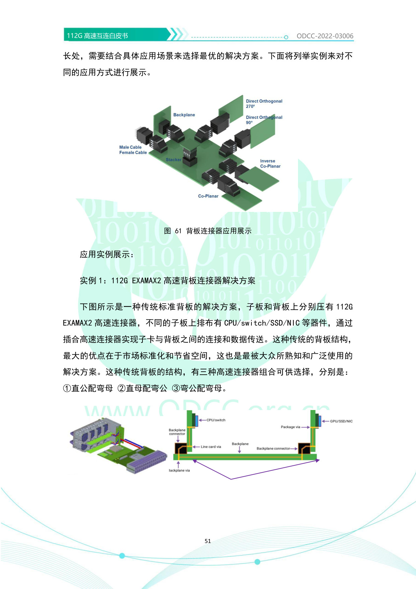

图 61 背板连接器应用展示

应用实例展示: 

实例 1：112G EXAMAX2 高速背板连接器解决方案 

下图所示是一种传统标准背板的解决方案，子板和背板上分别压有112G EXAMAX2高速连接器，不同的子板上排布有CPU/switch/SSD/NIC等器件，通过插合高速连接器实现子卡与背板之间的连接和数据传送。这种传统的背板结构，最大的优点在于市场标准化和节省空间，这也是最被大众所熟知和广泛使用的解决方案。这种传统背板的结构，有三种高速连接器组合可供选择，分别是：①直公配弯母 ②直母配弯公 ③弯公配弯母。 

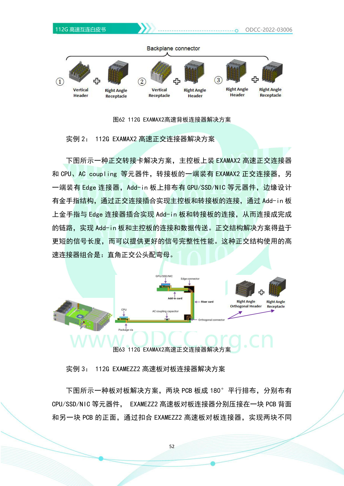

图62 112G EXAMAX2高速背板连接器解决方案

实例 2：112G EXAMAX2 高速正交连接器解决方案

下图所示一种正交转接卡解决方案，主控板上装 EXAMAX2 高速正交连接器和 CPU、AC coupling 等元器件，转接板的一端装有 EXAMAX2 正交连接器，另一端装有 Edge 连接器，Add-in 板上排布有 GPU/SSD/NIC 等元器件，边缘设计有金手指结构，通过正交连接插合实现主控板和转接板的连接，通过 Add-in 板上金手指与 Edge 连接器插合实现 Add-in 板和转接板的连接，从而连接成完成的链路，实现 Add-in 板和主控板的连接和数据传送。正交结构解决方案得益于更短的信号长度，而可以提供更好的信号完整性性能。这种正交结构使用的高速连接器组合是：直角正交公头配弯母。 

图63 112G EXAMAX2高速正交连接器解决方案

实例 3：112G EXAMEZZ2 高速板对板连接器解决方案

下图所示一种板对板解决方案，两块 PCB 板成 $180^{\circ}$ 平行排布，分别布有 CPU/SSD/NIC 等元器件，EXAMEZZ2 高速板对板连接器分别压接在一块 PCB 背面和另一块 PCB 的正面，通过扣合 EXAMEZZ2 高速板对板连接器，实现两块不同 

PCB 板的连接和数据传送。这种板对板结构的优点在于灵活的定制化，是当前 112G 和未来 224G 最热门的解决方案之一。 

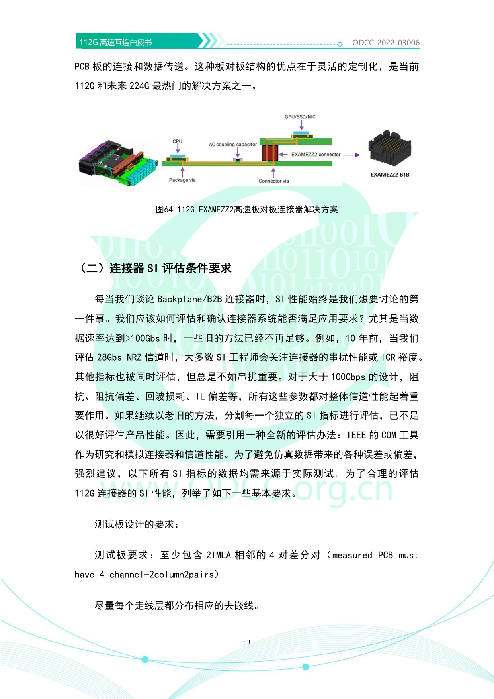

图64 112G EXAMEZZ2高速板对板连接器解决方案

## （二）连接器 SI 评估条件要求

每当我们谈论 Backplane/B2B 连接器时，SI 性能始终是我们想要讨论的第一件事。我们应该如何评估和确认连接器系统能否满足应用要求？尤其是当数据速率达到>100Gbs 时，一些旧的方法已经不再足够。例如，10 年前，当我们评估 28Gbs NRZ 信道时，大多数 SI 工程师会关注连接器的串扰性能或 ICR 裕度。其他指标也被同时评估，但总是不如串扰重要。对于大于 100Gbps 的设计，阻抗、阻抗偏差、回波损耗、IL 偏差等，所有这些参数都对整体信道性能起着重要作用。如果继续以老旧的方法，分割每一个独立的 SI 指标进行评估，已不足以很好评估产品性能。因此，需要引用一种全新的评估办法：IEEE 的 COM 工具作为研究和模拟连接器和信道性能。为了避免仿真数据带来的各种误差或偏差，强烈建议，以下所有 SI 指标的数据均需来源于实际测试。为了合理的评估 112G 连接器的 SI 性能，列举了如下一些基本要求。 

测试板设计的要求： 

测试板要求：至少包含 2IMLA 相邻的 4 对差分对（measured PCB must have 4 channel-2column2pairs） 

尽量每个走线层都分布相应的去嵌线。 

测试去嵌后包含：100mil 走线+封装+连接器+封装+100mil 走线 

测试仪器和方法的要求： 

测试仪器：需要支持从 DC 到 50GHz 以上的 PNA。 

min: 10MHz; max: ≥50GHz; step: 10Mz; max-IF bandwidth: ≤1kHz 

## （三）连接器 SI 指标

以下列举了评估一款高速连接器的常用的 SI 指标。 

差分信号最大可支持速率（Max support speed）：112GPMA4 

差分阻抗值（impedance） 

表6 差分阻抗值

<table><tr><td rowspan="2">扣板</td><td>87-98ohm</td><td>fullmate</td></tr><tr><td>87-98ohm</td><td>1mm demate</td></tr><tr><td rowspan="2">背板</td><td>87-98ohm</td><td>fullmate</td></tr><tr><td>87-100ohm</td><td>1.5mm demate</td></tr></table>

注：建议直接读取 PNA 未去嵌的 TDR 值。若是使用别的软件，建议 risetime=10ps(20%-80%)；包含连接器封装区域 

插入损耗（DDIL） 

## 表7 插入损耗

org.cn 

<table><tr><td>扣板</td><td>&lt;-1dB, f&lt;13.28GHz&lt;-1.5dB, 13.28GHz≤f&lt;26.56GHz&lt;-3dB, 26.56GHz≤f≤40GHz</td></tr><tr><td>背板</td><td>&lt;-3dB, f&lt;13.28GHz&lt;-5dB, 13.28GHz≤f&lt;26.56GHz</td></tr><tr><td></td><td>&lt;-10dB, 26.56GHz≤f≤40GHz</td></tr></table>

注：扣板包含 1mm-demate 的应用和背板包含 1.5mm-demate 的应用。 

图 65 扣板包含1mm-demate的应用

图 66 背板包含1.5mm-demate的应用

插入损耗波动（DDIL Deviation） 

## 表8 插入损耗波动

<table><tr><td rowspan="3">abs (ILD)</td><td>&lt;0.5dB, f&lt;13.28GHz</td></tr><tr><td>&lt;1dB, 13.28GHz≤f&lt;26.56GHz</td></tr><tr><td>&lt;2dB, 26.56GHz≤f≤40GHz</td></tr></table>

注：扣板包含 1mm-demate 的应用和背板包含 1.5mm-demate 的应用；不区分扣板和背板 

注：扣板包含 1mm-demate 的应用和背板包含 1.5mm-demate 的应用 

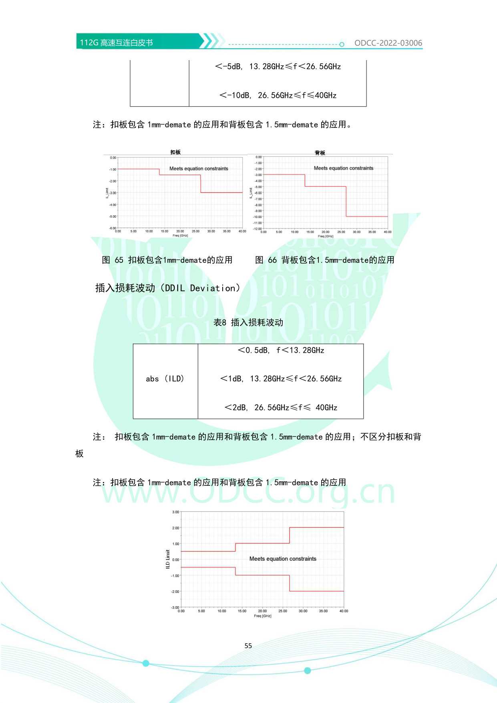

图 67 扣板包含1mm-demate的应用和背板包含1.5mm-demate的应用 

回波损耗（DD return loss） 

表9 回波损耗

<table><tr><td>Return Loss</td><td>&lt;-15dB, f&lt;13.28GHz&lt;-12dB, 13.28GHz≤f≤26.56GHz</td></tr></table>

注：扣板包含 1mm-demate 的应用和背板包含 1.5mm-demate 的应用；不区分扣板和背板 

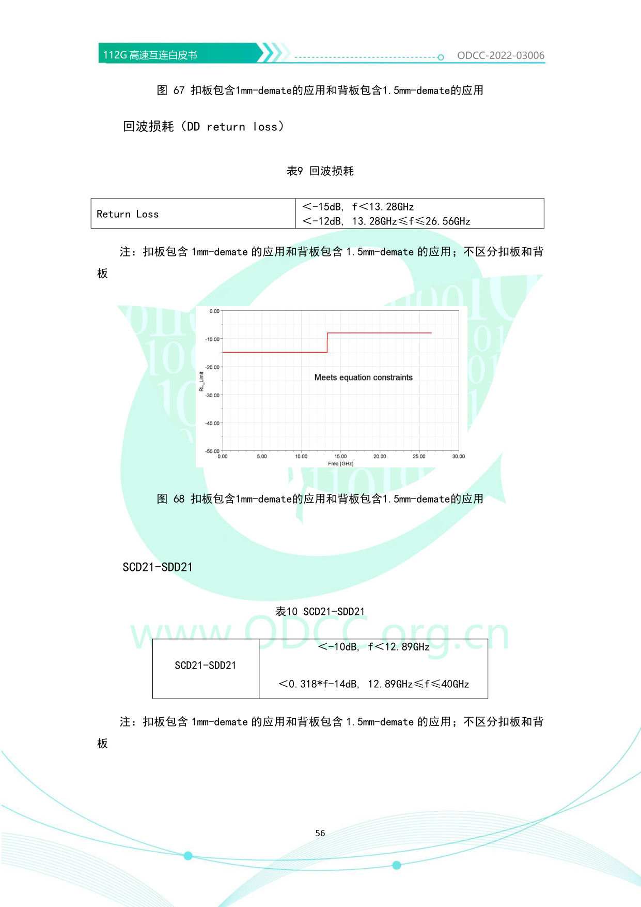

图 68 扣板包含1mm-demate的应用和背板包含1.5mm-demate的应用

SCD21-SDD21 

表10 SCD21-SDD21

<table><tr><td>SCD21-SDD21</td><td>&lt;-10dB, f&lt;12.89GHz&lt;0.318*f-14dB, 12.89GHz≤f≤40GHz</td></tr></table>

注：扣板包含 1mm-demate 的应用和背板包含 1.5mm-demate 的应用；不区分扣板和背板 

图 69 扣板包含1mm-demate的应用和背板包含1.5mm-demate的应用

串扰 crosstalk

远端串扰 FEXT 

表11 远端串扰FEXT

<table><tr><td>扣板</td><td>&lt;-45dB, f&lt;13.28GHz&lt;-40dB, 13.28GHz≤f&lt;26.56GHz&lt;-35dB, 26.56GHz≤f≤40GHz</td></tr><tr><td>背板</td><td>&lt;-45dB, f&lt;13.28GHz&lt;-45dB, 13.28GHz≤f&lt;26.56GHz&lt;-35dB, 26.56GHz≤f≤40GHz</td></tr></table>

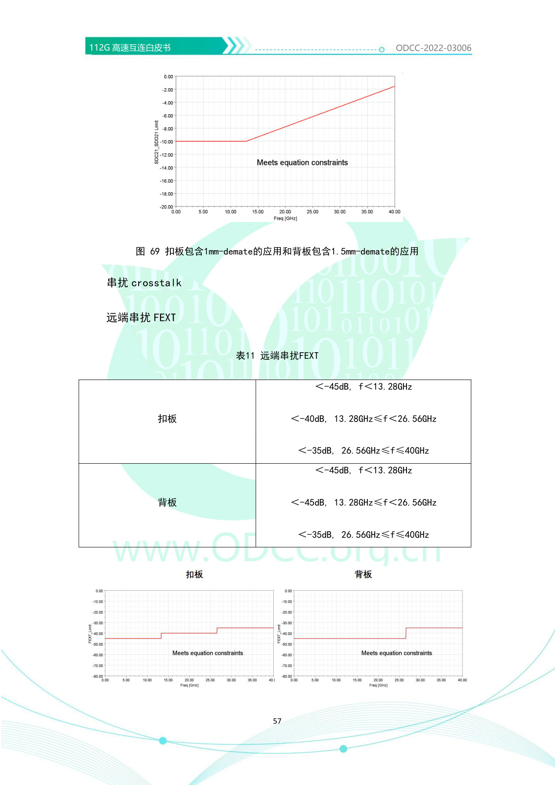

图70 扣板包含1mm-demate的应用和背板包含1.5mm-demate的应用 

注：扣板包含 1mm-demate 的应用和背板包含 1.5mm-demate 的应用 

近端串扰 NEXT 

表12 近端串扰NEXT

<table><tr><td>扣板</td><td>&lt;-50dB, f&lt;13.28GHz&lt;-40dB, 13.28GHz≤f&lt;26.56GHz&lt;-35dB, 26.56GHz≤f≤40GHz</td></tr><tr><td>背板</td><td>&lt;-50dB, f&lt;13.28GHz&lt;-45dB, 13.28GHz≤f&lt;26.56GHz&lt;-35dB, 26.56GHz≤f≤40GHz</td></tr></table>

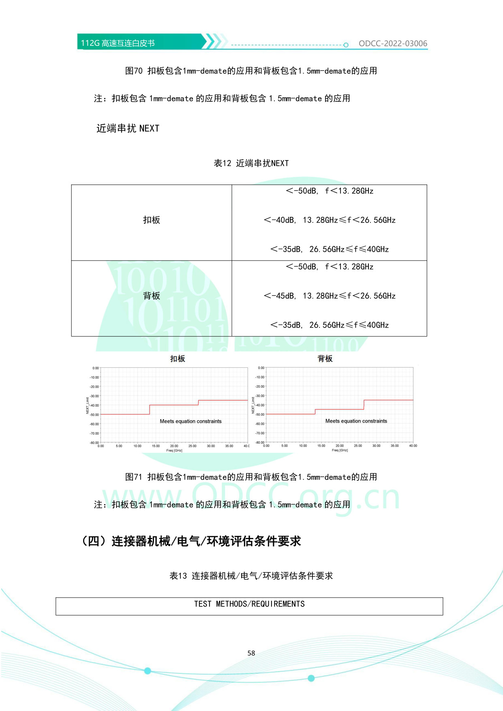

图71 扣板包含 $1\mathrm{mm}$ -demate的应用和背板包含 $1.5\mathrm{mm}$ -demate的应用

注：扣板包含 $1 \mathrm{~mm} - \mathrm{demate}$ 的应用和背板包含 $1.5 \mathrm{~mm} - \mathrm{demate}$ 的应用

## （四）连接器机械/电气/环境评估条件要求

表13 连接器机械/电气/环境评估条件要求

<table><tr><td>Contact ResistanceLow Level LLCR</td><td>EIA 364-2320mV max, 10mA max</td><td>Initial: XXmΩ (reference)△≤10mΩ</td></tr><tr><td>DESCRIPTION</td><td>Test Condition</td><td>Criteria</td></tr><tr><td>DielectricWithstandingVoltage</td><td>EIA 364-20500Vdc, 60 secondsSig-Sig &amp; Sig -Gnd Pairs withinwafer</td><td>No breakdown, arc-overLeakage current ≤ 0.5 mA</td></tr><tr><td>ELECTRICAL</td><td></td><td></td></tr><tr><td>InsulationResistance</td><td>EIA 364-21500Vdc, 60 secondsSig-Sig &amp; Sig-Gnd Pairs withinwafer</td><td>≥1000 MΩ</td></tr><tr><td>Visual Inspection</td><td>EIA-364-18B 10X</td><td>No damage</td></tr><tr><td>MECHANICAL</td><td></td><td></td></tr><tr><td>Compliant PinInsertion Force</td><td>EIA 364-051”/minute max.</td><td>25N/EON max</td></tr><tr><td>Compliant PinRetention Force</td><td>EIA 364-051”/minute max.</td><td>2.2 N/EON minimum</td></tr><tr><td>Mating / Un-matingForce</td><td>EIA 364-13Method A, 1”/minute max</td><td>Mating force: 0.45NMax/per cotactUnmating force: 0.10N/percontact</td></tr><tr><td>PCB Wall Damage</td><td>EIA-364-96Longitudinal micro-section, 0.3 mmdown from top of PCB</td><td>No Cu cracks, inter-planeorBarrel separations</td></tr><tr><td>PCBHoleHoleDeformation Radius</td><td>EIA-364-96Transverse down from top of PCB micro-section, 0.3 mm</td><td>Individual deformation ≤50 μm Ave. deformation ≤37.5 μmRemaining Cu plating ≥7.5 μm</td></tr><tr><td>ENVIRONMENTAL</td><td></td><td></td></tr><tr><td>Disturb</td><td>Telcordia GR-1217-COREUnmate approx. 0.10 mm, then re-seat</td><td>No damage</td></tr><tr><td>Durability 100-cycles</td><td>EIA 364-09127mm/min max.</td><td>No damage</td></tr><tr><td>Dust</td><td>EIA 364-91Benign dust composition #1, 1 hour</td><td>No damage</td></tr><tr><td>High TemperatureLife</td><td>EIA 364-17Method A, 500 hours @ 85°C</td><td>No damage</td></tr><tr><td>Humidity</td><td>EIA 364-31Method VI, 50 cycles</td><td>No damage</td></tr><tr><td>Mechanical Shock</td><td>EIA 364-27Test Condition H, 1⁄2 sine, 30g, 11 ms,3 shocks/direction/axis, 3 axes</td><td>No damageNo discontinuity &gt;1 μs</td></tr><tr><td>MFG</td><td>EIA 364-65Class IIa, 10 days unmated (VH's),10 days mated</td><td>No damage</td></tr><tr><td>Salt Spray</td><td>EIA-364-26B, 48 hours, unmated header pcb,Horizontal orientation, contactsfacing down,Mask back side of PCB PTH's</td><td>No damage</td></tr><tr><td>Thermal Shock</td><td>EIA 364-32-550 to +85°C, 5 cycles, 30 min.dwell</td><td>No damage</td></tr><tr><td>VibrationSinusoidal</td><td>EIA 364-28Test Condition II, Sinusoidal, 10g,10-500 Hz,15 minute cycle, 8 hours/axis, 3axes</td><td>No damageNo discontinuity &gt;1 μs</td></tr></table>

<table><tr><td>TEST GROUP ID ▶</td><td>1</td><td>2</td><td>3a</td><td>3b (5)</td><td>4(2)(5)</td><td>5</td><td>6</td></tr><tr><td>TEST DESCRIPTION</td><td>Mixed Flowing Gas</td><td>Temp Life</td><td>Thermal Shock &amp; Humidity</td><td>Thermal Shock &amp; Humidity</td><td>Vibration &amp; Mech. Shock</td><td>Press-Fit Evaluation</td><td>Salt Spray</td></tr><tr><td>Visual Inspection (6)</td><td>1, 16</td><td>1, 7</td><td>1, 11</td><td>1, 15</td><td>1, 14</td><td>1</td><td>1, 5</td></tr><tr><td>Mate Header and Receptacle</td><td>2, 8</td><td></td><td>2</td><td>2, 11</td><td>2, 8</td><td></td><td></td></tr><tr><td>Un-mate Header and Receptacle</td><td>6</td><td></td><td></td><td>9</td><td>6</td><td></td><td></td></tr><tr><td>ELECTRICAL:</td><td></td><td></td><td></td><td></td><td></td><td></td><td></td></tr><tr><td>Contact Resistance Low Level LLCR</td><td>3, 5, 9, 11, 13, 15</td><td>3, 5</td><td></td><td>3, 5, 8, 12, 14</td><td>3, 5, 9, 11, 13</td><td></td><td>2, 4</td></tr><tr><td>Insulation Resistance</td><td></td><td></td><td>3,6,9</td><td></td><td></td><td></td><td></td></tr><tr><td>Dielectric Withstanding Voltage</td><td></td><td></td><td>4,7,10</td><td></td><td></td><td></td><td></td></tr><tr><td>MECHANICAL:</td><td></td><td></td><td></td><td></td><td></td><td></td><td></td></tr><tr><td>Mating / Un-mating Force</td><td></td><td>2,6</td><td></td><td>63</td><td></td><td></td><td></td></tr><tr><td>Compliant Pin Insertion Force</td><td></td><td></td><td></td><td></td><td></td><td>2,4,6</td><td></td></tr><tr><td>Compliant Pin Retention Force</td><td></td><td></td><td></td><td></td><td></td><td>3,5,7</td><td></td></tr><tr><td>PCB Hole Deformation Radius</td><td></td><td></td><td></td><td></td><td></td><td>8</td><td></td></tr><tr><td>PCB Wall Damage</td><td></td><td></td><td></td><td></td><td></td><td>9</td><td></td></tr><tr><td>ENVIRONMENTAL:</td><td></td><td></td><td></td><td></td><td></td><td></td><td></td></tr><tr><td>Thermal Shock</td><td></td><td></td><td>5</td><td>4</td><td></td><td></td><td></td></tr><tr><td>Humidity</td><td></td><td></td><td>8</td><td>13</td><td></td><td></td><td></td></tr><tr><td>High Temperature Life</td><td></td><td>4</td><td></td><td></td><td></td><td></td><td></td></tr><tr><td>MFG, un-mated, 10-days</td><td>7</td><td></td><td></td><td></td><td></td><td></td><td></td></tr><tr><td>MFG, mated, 10 days</td><td>10</td><td></td><td></td><td></td><td></td><td></td><td></td></tr><tr><td>Salt Spray</td><td></td><td></td><td></td><td></td><td></td><td></td><td>3</td></tr><tr><td>Vibration Sinusoidal</td><td></td><td></td><td></td><td></td><td>10</td><td></td><td></td></tr><tr><td>Mechanical Shock</td><td></td><td></td><td></td><td></td><td>12</td><td></td><td></td></tr><tr><td>Durability, 100-cycles</td><td>4,14</td><td></td><td></td><td>7</td><td>4</td><td></td><td></td></tr><tr><td>Dust</td><td></td><td></td><td></td><td>10</td><td>7</td><td></td><td></td></tr><tr><td>Disturb</td><td>12</td><td></td><td></td><td></td><td></td><td></td><td></td></tr></table>

## 七、112G 高速互连 IO 连接器技术

## （一）112G 高速 IO 连接器介绍及应用概况

## 1. 112G 高速 I/O 连接器简介

连接器由塑胶零件、端子等零配件组成，是电子产品器件、组件、设备、子系统之间实现连接的功能元件，起到传输能量和交换信息的作用，可以增强电路设计和组装的灵活性，其应用领域几乎囊括所有需要电信号、光信号传输和交互的场景，是构成整机电路系统电气连接必不可少的基础元件。按照传输的介质不同，连接器可以分为电连接器、射频连接器、光连接器和流体连接器。连接器有三个基本的性能指标：机械性能、电气性能和环境性能，机械性能主要包括插拔力与机械寿命；电气性能主要包括接触电阻、绝缘电阻、抗电强度及其他电气指标；环境性能则主要指耐温、耐湿、耐盐雾、振动和冲击等指标。 

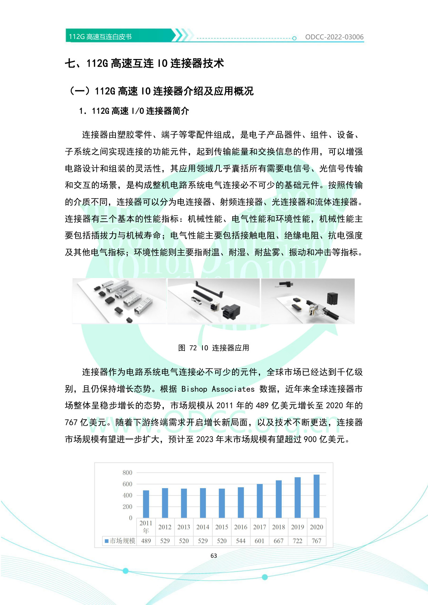

图 72 10 连接器应用

连接器作为电路系统电气连接必不可少的元件，全球市场已经达到千亿级别，且仍保持增长态势。根据 Bishop Associates 数据，近年来全球连接器市场整体呈稳步增长的态势，市场规模从 2011 年的 489 亿美元增长至 2020 年的 767 亿美元。随着下游终端需求开启增长新局面，以及技术不断更迭，连接器市场规模有望进一步扩大，预计至 2023 年末市场规模有望超过 900 亿美元。 

图73 10 2011年～2020年全球连接器市场规模（单位：亿美元） 

而通信行业是连接器第二大应用领域，通信行业对于连接器的具体需求主要是网络设备、网络基础设施、电缆设备等方面，其中网络设备应用主要包括交换机、路由器等，移动通信基础设施应用包括通信基站、基站控制器、移动交换网络、服务器等。在 5G 建设、云基建如火如荼的推动下，通信领域连接器需求旺盛。根据 Bishop Associates 的预测数据，至 2025 年全球和国内通信连接器市场规模将分别达到 215 亿美元和 95 亿美元。 

高速 I/O 连接器是通讯行业的主要组成部分，应用于高频高速、低损耗、小型化以及高密度布局的场景，相对于传统的连接器，高速 I/O 连接器更加关注信号传输的质量，伴随着人工智能、大数据，分布式存储以及边缘计算等技术的发展及广泛应用，对数据流量的传输提出了更高的要求，以太网速度已经从 25G/50G 增长到如今的 400G/800G，并有望很快达到 1.6T，而高速 I/O 连接器作为整体互连功能的元件，在数据中心的应用中扮演着不可或缺的角色，其行业技术在现有高速连接器的基础上，重点向 112G/224G 以及下一代 PAM4 传输技术等方面发展，匹配数据中心应用场景下的高速互连要求。 

## 2. 112G 高速 I/O 连接器应用概览

高速 I/O 连接器是通讯设备中的重要组成部分，从接入市场到 5G 无线市场和数据中心，从边缘计算到核心路由，均通过高速 I/O 连接器作为相互连接的接口。目前在接入市场，以 10G/25G 单通道 SFP 作为主流界面，在数据中心内部，伴随着数据流量的极速增加，已经开始逐步跨入双通道的 DSFP56/SFP-DD56，四通道的 QSFP56 以及八通道的 QSFP-DD/OSFP 的高密应用场景，而且整体的数据流量还在不断拓展，112G 的高速 I/O 连接器已经成为必然的趋势，并有望实现 224G 的应用。 

根据行业数据统计，2021年全球服务器总发货量约为1300万台，折算到高速I/O连接器整体市场发货量预计超过5000万个。 

## （二）112G 高速 I/O 连接器接口类型

多元化的高速 I/O 接口类型为不同架构层级和运用场景提供了多元化的选择。同时基于市场对高速 I/O 各类接口多年的运用经验和设计特点的积累，从而在 112G PAM4 这代形成了基于 QSFP112、QSFP-DD 800、OSFP 800 及 SFP-DD 112 的主流高速 I/O 接口，进行衍生迭代的共识。 

## （三）112G 高速 I/O 连接器设计

## 管理界面标准（以 QSFP112 为例）

QSFP112 是从 QSFP、QSFP+、QSFP28、QSFP56 演进而来。根据市场的需求，在 112G PAM4 时代已发展为 “LL” 和 “JL” 两种标准（LL type & JL type），且两种界面都向后兼容。 

图74 QSFP112 LL/JL type示意图

两者在 Module 侧 PIN 定义保持一致且向后兼容。 

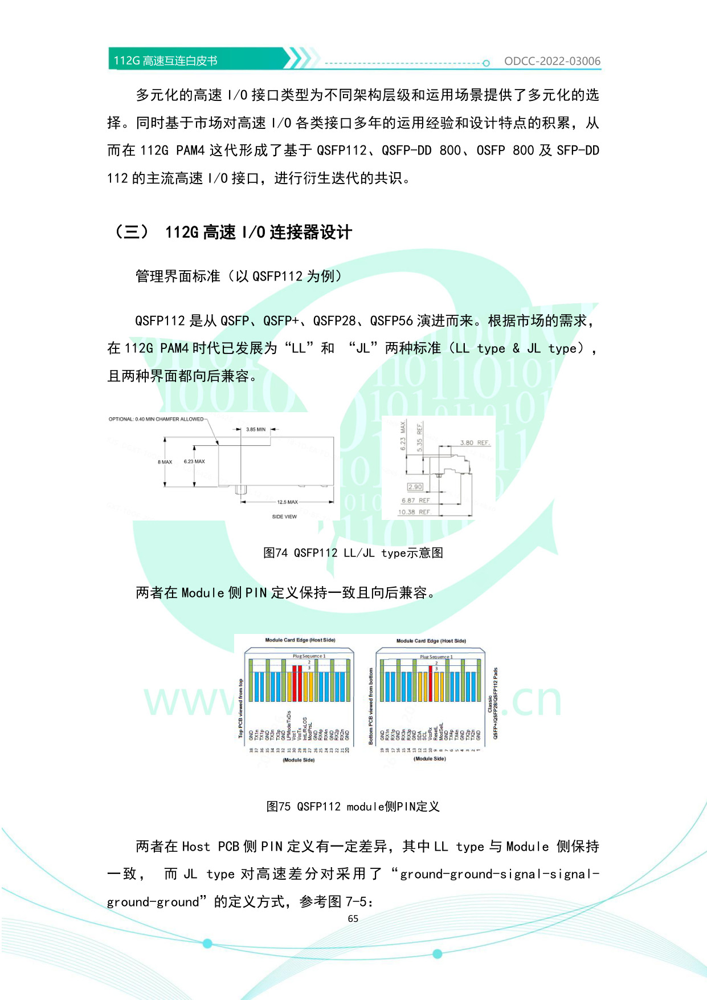

图75 QSFP112 module侧PIN定义

两者在 Host PCB 侧 PIN 定义有一定差异，其中 LL type 与 Module 侧保持一致，而 JL type 对高速差分对采用了 “ground-ground-signal-signal-ground-ground” 的定义方式，参考图 7-5： 

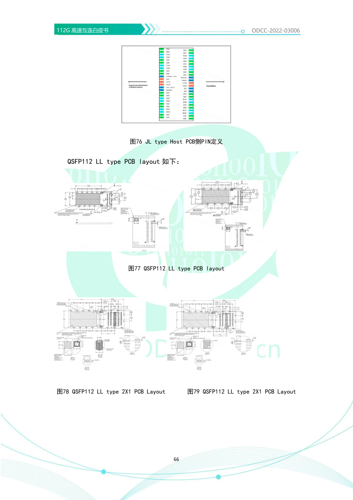

图76 JL type Host PCB侧PIN定义

QSFP112 LL type PCB layout 如下: 

图78 QSFP112 LL type 2X1 PCB Layout

图79 QSFP112 LL type 2X1 PCB Layout

图80 QSFP112 JL type 1X1 PCB Layout

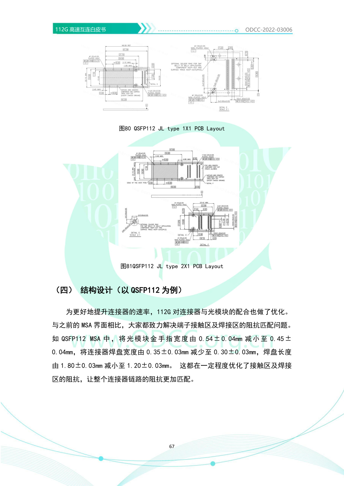

## （四）结构设计（以 QSFP112 为例）

为更好地提升连接器的速率，112G 对连接器与光模块的配合也做了优化。与之前的 MSA 界面相比，大家都致力解决端子接触区及焊接区的阻抗匹配问题。如 QSFP112 MSA 中，将光模块金手指宽度由 $0.54 \pm 0.04$ mm 减小至 $0.45 \pm 0.04$ mm，将连接器焊盘宽度由 $0.35 \pm 0.03$ mm 减少至 $0.30 \pm 0.03$ mm，焊盘长度由 $1.80 \pm 0.03$ mm 减小至 $1.20 \pm 0.03$ mm。这都在一定程度优化了接触区及焊接区的阻抗，让整个连接器链路的阻抗更加匹配。 

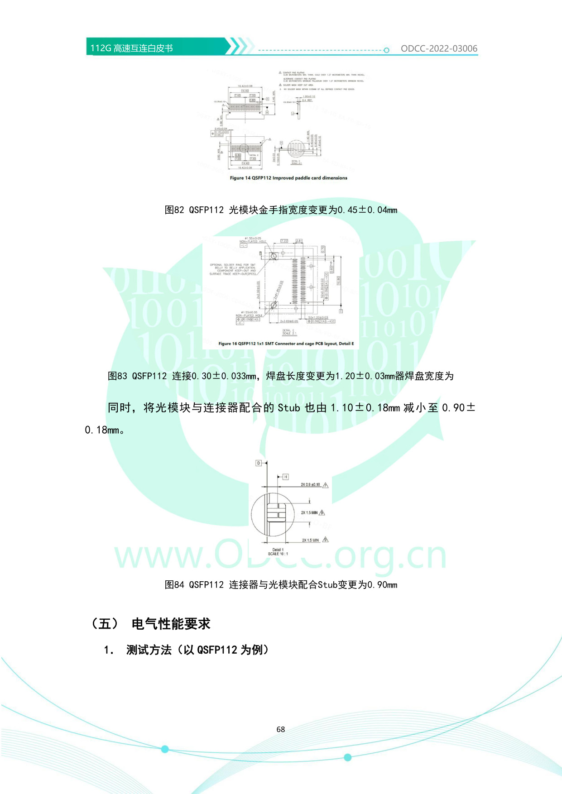

Figure 14 QSFP112 Improved paddle card dimensions

图82 QSFP112 光模块金手指宽度变更为0.45±0.04mm

图83 QSFP112 连接0.30±0.033mm，焊盘长度变更为1.20±0.03mm器焊盘宽度为

同时，将光模块与连接器配合的 Stub 也由 $1.10 \pm 0.18$ mm 减小至 $0.90 \pm 0.18$ mm。 

图84 QSFP112 连接器与光模块配合Stub变更为0.90mm

## （五）电气性能要求

## 1. 测试方法（以 QSFP112 为例）

用 HCB 和 MCB 板测试 S 参数，不去嵌从 HCB 和 MCB 两端分别查看电气性能。MCB 指板端连接器测试板，HCB 指 IO 端测试板，二者均需满足 OIF 规范要求，所有 SI 规格均需在满足 HCB 和 MCB 规格的测试板条件下测试。 

HCB 和 MCB 参考线插入损耗 

HCB 印刷电路板轨迹的参考差分插入损耗符合公式: 

$$
\text { HCB   ref   SDD21 } = 1. 0 0 * (0. 0 0 1 - 0. 2 5 0 * \sqrt {f} - 0. 0 4 6 * f) \text { dB } \quad \text { for   } 1 \text { MHZ } <   f <   5 0 \text { GHz }
$$

MCB 印刷电路板轨迹的参考差分插入损耗符合公式： 

MCB ref SDD21=1.34*(0.001-0.096*√f-0.046*f) dB for 1MHZ<f<50GHz 

HCB 和 MCB 方程如图所示: 

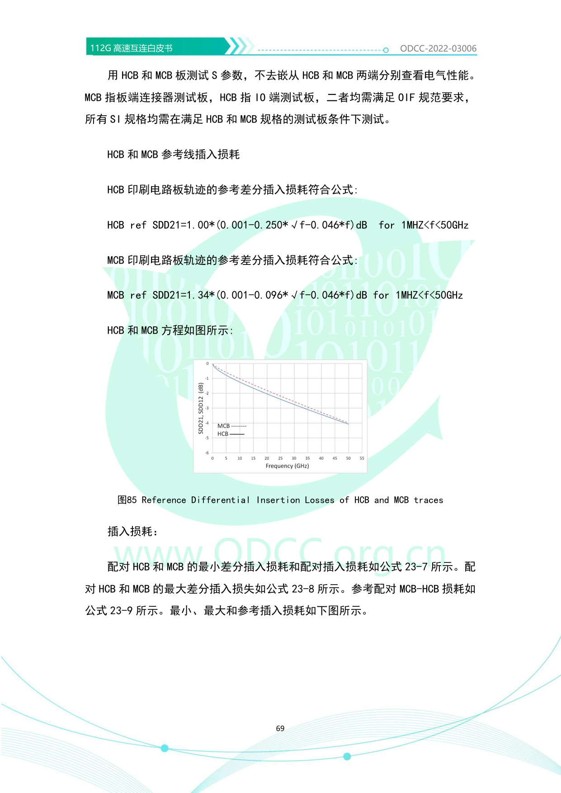

图85 Reference Differential Insertion Losses of HCB and MCB traces

插入损耗： 

配对 HCB 和 MCB 的最小差分插入损耗和配对插入损耗如公式 23-7 所示。配对 HCB 和 MCB 的最大差分插入损失如公式 23-8 所示。参考配对 MCB-HCB 损耗如公式 23-9 所示。最小、最大和参考插入损耗如下图所示。 

$$
\text { MinMated   HCB - MCB   SDD21,SDD12 } <   - 0. 3 7 8 4 \sqrt {f} - 0. 1 0 7 6 4 f \text { dB }\tag{23-7}
$$

$$
\text { Ref   SDD21,   SDD12 } = - 0. 4 2 3 \sqrt {f} - 0. 1 0 7 f - 0. 0 0 1 8 f ^ {2} \mathrm{dB}\tag{23-8}
$$

$$
\text { for } 0. 0 5 \mathrm{GHz} \leq f \leq 5 0. 0 \mathrm{GHz}, \text { where } f \text { is   frequency   in   GHz. }
$$

$$
\text { Mated   HCB - MCB   SDD21,SDD12 } > - 0. 7 1 1 4 \sqrt {f} - 0. 1 0 7 3 f - 0. 0 0 1 8 f ^ {2} \mathrm{dB}\tag{23-9}
$$

$$
\mathrm{for} f <   2 9. 0 1 \mathrm{GHz}
$$

$$
\text { Mated   HCB - MCB   SDD21,SDD12 } > - 2 4. 7 7 4 + 0. 9 \sqrt {f} + 1. 3 f - 0. 0 3 f ^ {2} \mathrm{dB}\tag{23-10}
$$

## 回波损耗：

配对的 HCB 和 MCB 有效回波损耗应使用 IEEE 802.3 第 93A 条所示的方法计算，如下表所示。 

表14 Effective Return Loss (ERL) parameters

<table><tr><td>Parameter</td><td>Symbol</td><td>Value</td><td>Units</td></tr><tr><td>Tukey (raised cosine) window</td><td>-</td><td>1</td><td>-</td></tr><tr><td>Transition time associated with a pulse</td><td><eq>{\mathrm{T}}_{\mathrm{r}}</eq></td><td>10</td><td>ps</td></tr><tr><td>Test fixture propagation delay</td><td><eq>{\mathrm{T}}_{\mathrm{{fx}}}</eq></td><td>0</td><td>ns</td></tr><tr><td>Incremental available signal loss factor</td><td>β</td><td>0</td><td>GHz</td></tr><tr><td>Permitted reflection from a transmission line external to the device under test</td><td><eq>{\rho }_{x}</eq></td><td>0.618</td><td>-</td></tr><tr><td>Length of the reflection signal for mated MCB-HCB</td><td>N</td><td>400</td><td>UI</td></tr><tr><td>Minimum ERL for mated MCB-HCB</td><td>-</td><td>10.3</td><td>dB</td></tr></table>

## 差分转共模：

配对 HCB 和 MCB 差分转共模如公式如下所示，如下图所示。 

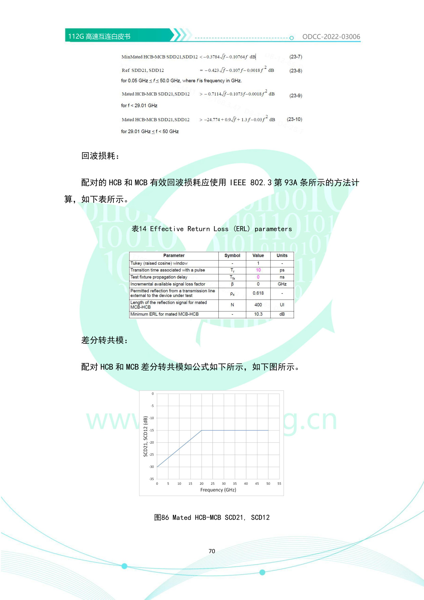

图86 Mated HCB-MCB SCD21, SCD12

Mated HCB-MCB SCD21, SCD12 ≤ -30+(21/28)*f dB for 50MHz < f < 20GHz 

$$
\text { Mated   HCB - MCB   SCD21,   SCD12 } \leqslant - 1 5 \text { dB } \quad \text { for   20GHz   <  f <   50   GHz }
$$

共模转差模和差模转共模转换： 

配对 HCB 和 MCB 的差分回波损耗应遵循如下公式，如下图所示。 

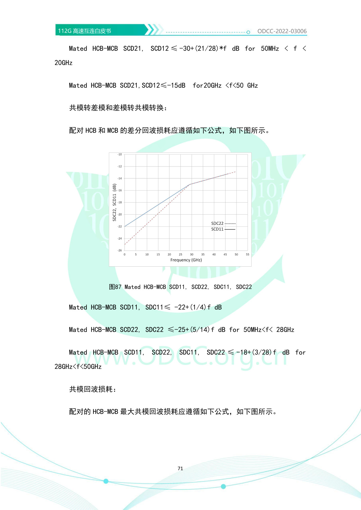

图87 Mated HCB-MCB SCD11, SCD22, SDC11, SDC22

Mated HCB-MCB SCD11, SDC11≤ -22+(1/4)f dB 

Mated HCB-MCB SCD22, SDC22 ≤-25+(5/14)f dB for 50MHz<f<28GHz 

Mated HCB-MCB SCD11, SCD22, SDC11, SDC22 $\leqslant -18 + (3 / 28)\mathrm{f}$ dB for $28\mathrm{GHz} < f < 50\mathrm{GHz}$ 

共模回波损耗： 

配对的 HCB-MCB 最大共模回波损耗应遵循如下公式，如下图所示。 

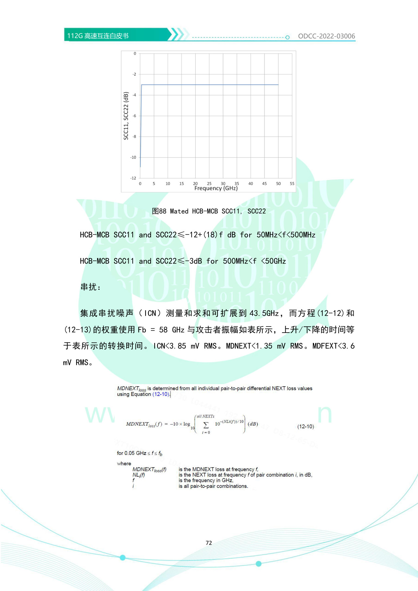

图88 Mated HCB-MCB SCC11, SCC22

$$
\text { HCB - MCB   SCC11   and   SCC22 } \leqslant - 3 \text { dB   for   } 5 0 0 \text { MHz } <   f <   5 0 \text { GHz }
$$

串扰： 

集成串扰噪声（ICN）测量和求和可扩展到 43.5GHz，而方程(12-12)和(12-13)的权重使用 Fb = 58 GHz 与攻击者振幅如表所示，上升/下降的时间等于表所示的转换时间。ICN<3.85 mV RMS。MDNEXT<1.35 mV RMS。MDFEXT<3.6 mV RMS。 

$MDNEXT_{loss}$ is determined from all individual pair-to-pair differential NEXT loss values using Equation (12-10). 

$$
M D N E X T _ {l o s s} (f) = - 1 0 \times \log_ {1 0} \left(\sum_ {i = 0} ^ {\text { all   NEXTs }} 1 0 ^ {- (N L i (f)) / 1 0}\right) (d B)\tag{12-10}
$$

$$
\begin{array}{l l} \text {for 0.05 GHz \leq f\leq f_{b}} \\ \text {where} \\ M D N E X T _ {l o s s} (f) & \text {is the MDNEXT loss at frequency f,} \\ N L _ {i} (f) & \text {is the NEXT loss at frequency f of pair combination i, in dB,} \\ f & \text {is the frequency in GHz,} \\ i & \text {is all pair-to-pair combinations.} \end{array}
$$

$MDFEXT_{loss}$ is determined from all individual pair-to-pair differential FEXT loss values using Equation (12-11). 

$$
M D F E X T _ {l o s s} (f) = - 1 0 \times \log_ {1 0} \left(\sum_ {i = 0} ^ {a l l F E X T s} 1 0 ^ {- (N L i (f)) / 1 0}\right) (d B)\tag{12-11}
$$

for 0.05 GHz ≤ f ≤ f $_{b}$ 

where 

$$
\begin{array}{l l} M D F E X T _ {l o s s} (f) & \text { is   the   MDFEXT   loss   at   frequency } f, \\ N L _ {i} (f) & \text { is   the   FEXT   loss   at   frequency } f \text { of   pair   combination } i, \text { in   dB }, \\ f & \text { is   the   frequency   in   GHz }, \\ i & \text { is   all   pair - to - pair   combinations }. \end{array}
$$

Define the weight at each frequency $f_{n}$ using Equation (12-12) and Equation (12-13). 

$$
W _ {n t} (f) = \left(A _ {n t} ^ {2} / 4 f _ {b}\right) \operatorname{sinc} ^ {2} \left(f / f _ {b}\right) \left[ \frac {1}{1 + \left(f / f _ {n t}\right) ^ {4}} \right] \left[ \frac {1}{1 + \left(f / f _ {r}\right) ^ {8}} \right]\tag{12-12}
$$

$$
W _ {f t} (f) = \left(A _ {f t} ^ {2} / 4 f _ {b}\right) \operatorname{sinc} ^ {2} \left(f / f _ {b}\right) \left[ \frac {1}{1 + \left(f / f _ {f t}\right) ^ {4}} \right] \left[ \frac {1}{1 + \left(f / f _ {r}\right) ^ {8}} \right]\tag{12-13}
$$

Note that -3 dB transmit filter bandwidths $f_{nt}$ and $f_{ft}$ are inversely proportional to the 20 to 80% rise and fall times $T_{nt}$ and $T_{ft}$ respectively. The constant of proportionality is 0.2365 (e.g. $T_{nt} f_{nt} = 0.2365$ ), where $T_{nt}$ is in nano seconds and $f_{nt}$ is in GHz. In addition, $f_{r}$ is the -3 dB reference receiver bandwidth, which should be set at 3/4 the maximum baud rate specified for the device. 

The near-end integrated crosstalk noise $\sigma_{nx}$ is calculated using Equation (12-14). 

$$
\sigma_ {n x} = \left(2 \Delta f \sum_ {n} W _ {n t} (f _ {n}) 1 0 ^ {- M D N E X T _ {l o w} (f _ {n}) / 1 0}\right) ^ {1 / 2}\tag{12-14}
$$

The far-end integrated crosstalk noise $\sigma_{fx}$ is calculated using Equation (12-15). 

$$
\sigma_ {f x} = \left(2 \Delta f \sum_ {n} W _ {f} (f _ {n}) 1 0 ^ {- M D F E X T _ {\text { loss }} (f _ {n}) / 1 0}\right) ^ {1 / 2}\tag{12-15}
$$

The total integrated crosstalk noise $\sigma_{x}$ is calculated using Equation (12-16). 

$$
\sigma_ {x} = \sqrt {\sigma_ {n x} ^ {2} + \sigma_ {f x} ^ {2}}\tag{12-16}
$$

## 表15

Table 23-3. Crosstalk parameters for host output test and module stressed input test calibration at TP4

<table><tr><td>Parameter</td><td>Target value</td><td>Unit</td><td>Conditions</td></tr><tr><td>Crosstalk Amplitude Differential Voltage pk-pk</td><td>900</td><td>mV</td><td></td></tr><tr><td>Crosstalk Slew Time (between -270 mV and +270 mV)</td><td>10</td><td>ps</td><td>See Note 1</td></tr><tr><td colspan="4">NOTES:1. See 16.C.4.1 Transition Time and Slew Time except use a Bessel-Thomson filter bandwidth of 43 GHz</td></tr></table>

## 2. 测试报告参考模板（以 QSFP112 为例）

表16 report content 

<table><tr><td colspan="4">XXXX 112G TEST REPORT</td></tr><tr><td>Applicant</td><td></td><td>Report No.</td><td></td></tr><tr><td>Part Description</td><td colspan="3"></td></tr><tr><td>Part No.</td><td></td><td>Sample No.</td><td></td></tr><tr><td>Fixture Serial No.</td><td colspan="3"></td></tr><tr><td>Test Items</td><td colspan="3">1.XXX 2.XXX 3.XXX</td></tr><tr><td>Test Methods</td><td colspan="3">Results</td></tr><tr><td></td><td rowspan="3" colspan="3"></td></tr><tr><td></td></tr><tr><td></td></tr></table>

表17 results 

<table><tr><td rowspan="3">Sample No.</td><td rowspan="3">Pair No.</td><td colspan="2">Diff Impedance</td><td rowspan="2">SDD21 d26.56GHz</td><td rowspan="2">EKL</td><td rowspan="2">SDC22</td><td rowspan="2">SCC11</td><td rowspan="2">SDD21-SDD21</td><td colspan="2">COM</td><td rowspan="3">Result</td></tr><tr><td>P1</td><td>P2</td><td>Case1</td><td>Case2</td></tr><tr><td colspan="2">ohm</td><td colspan="5">dB</td><td>dB</td><td>dB</td></tr><tr><td colspan="12">See Charts below</td></tr><tr><td rowspan="16"></td><td>TX1</td><td rowspan="16"></td><td rowspan="16"></td><td></td><td rowspan="16"></td><td rowspan="16"></td><td rowspan="16"></td><td rowspan="16"></td><td></td><td></td><td rowspan="16"></td></tr><tr><td>TX2</td><td></td><td></td><td></td></tr><tr><td>TX3</td><td></td><td></td><td></td></tr><tr><td>TX4</td><td></td><td></td><td></td></tr><tr><td>RX1</td><td></td><td></td><td></td></tr><tr><td>RX2</td><td></td><td></td><td></td></tr><tr><td>RX3</td><td></td><td></td><td></td></tr><tr><td>RX4</td><td></td><td></td><td></td></tr><tr><td>TX5</td><td></td><td></td><td></td></tr><tr><td>TX6</td><td></td><td></td><td></td></tr><tr><td>TX7</td><td></td><td></td><td></td></tr><tr><td>TX8</td><td></td><td></td><td></td></tr><tr><td>RX5</td><td></td><td></td><td></td></tr><tr><td>RX6</td><td></td><td></td><td></td></tr><tr><td>RX7</td><td></td><td></td><td></td></tr><tr><td>RX8</td><td></td><td></td><td></td></tr></table>

表18 TDD11 

表19 TDD22 

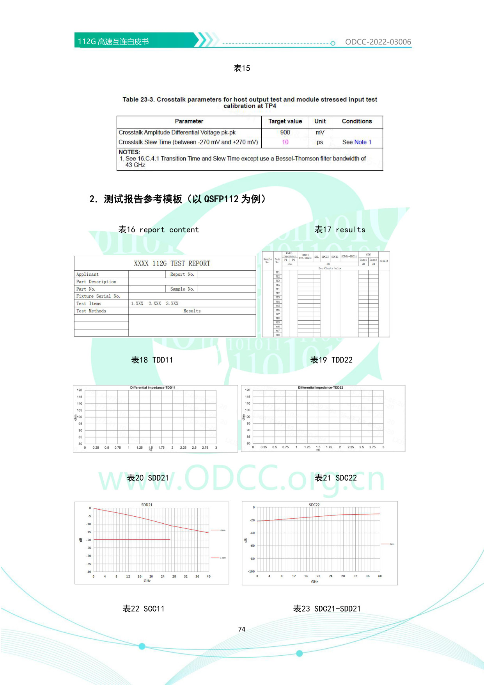

## 表20 SDD21 表21 SDG22

表22 SCC11 

表23 SDC21-SDD21 

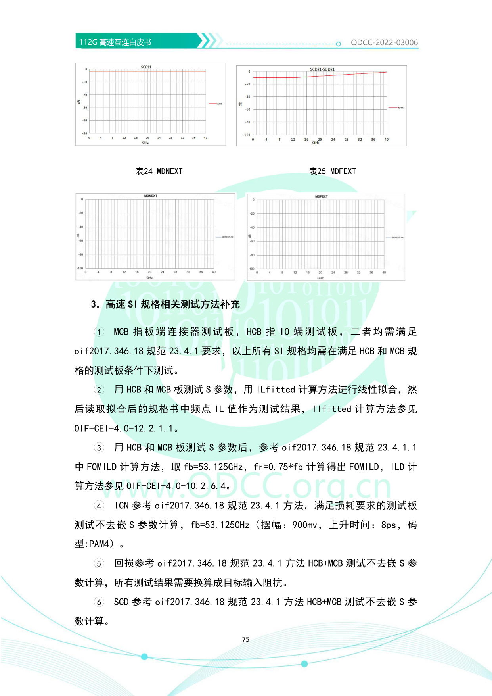

表24 MDNEXT

表25 MDFEXT

## 3. 高速 SI 规格相关测试方法补充

① MCB 指板端连接器测试板，HCB 指 10 端测试板，二者均需满足 oif2017.346.18 规范 23.4.1 要求，以上所有 SI 规格均需在满足 HCB 和 MCB 规格的测试板条件下测试。 

② 用 HCB 和 MCB 板测试 S 参数，用 ILfitted 计算方法进行线性拟合，然后读取拟合后的规格书中频点 IL 值作为测试结果，Ilfitted 计算方法参见 OIF-CEI-4.0-12.2.1.1。 

③ 用 HCB 和 MCB 板测试 S 参数后，参考 oif2017.346.18 规范 23.4.1.1 中 FOMILD 计算方法，取 fb=53.125GHz，fr=0.75*fb 计算得出 FOMILD，ILD 计算方法参见 OIF-CEI-4.0-10.2.6.4。 

④ ICN 参考 oif2017.346.18 规范 23.4.1 方法，满足损耗要求的测试板测试不去嵌 S 参数计算，fb=53.125GHz（摆幅：900mv，上升时间：8ps，码型:PAM4）。 

⑤ 回损参考 oif2017.346.18 规范 23.4.1 方法 HCB+MCB 测试不去嵌 S 参数计算，所有测试结果需要换算成目标输入阻抗。 

⑥ SCD 参考 oif2017.346.18 规范 23.4.1 方法 HCB+MCB 测试不去嵌 S 参数计算。 

我们一般使用群组测试的方式来评估连接器的可靠性，附以下 6 组常用的测试群组。 

表26 连接器可靠性测试条件1

<table><tr><td>Step</td><td>Description</td><td>Test Condition</td><td>Criteria</td></tr><tr><td>1</td><td>LLCR</td><td>EIA-364-23 (Initial)</td><td>Initial: 30mΩ△: 10mΩ</td></tr><tr><td>2</td><td>Durability (Preconditioning)</td><td>EIA-364-9100 cycles, 500±50cycles/hour</td><td>No physical damage</td></tr><tr><td>3</td><td>Temperature Life</td><td>EIA-364-17, Method A 105°C±2°C, 240 hours</td><td>No physical damage</td></tr><tr><td>4</td><td>LLCR</td><td>EIA-364-23</td><td>Initial: 30mΩ△: 10mΩ</td></tr><tr><td>5</td><td>Reseating</td><td>Manually unmate/mate the sample 1 cycle</td><td></td></tr><tr><td>6</td><td>LLCR</td><td>EIA-364-23</td><td>Initial: 30mΩ△: 10mΩ</td></tr></table>

表27 连接器可靠性测试条件2

<table><tr><td>Step</td><td>Description</td><td>Test Condition</td><td>Criteria</td></tr><tr><td>1</td><td>LLCR</td><td>EIA-364-23 (Initial)</td><td>Initial: 30mΩ△: 10mΩ</td></tr><tr><td>2</td><td>Durability (Preconditioning)</td><td>EIA-364-920 cycles, 500±50 cycles/hour</td><td>No physical damage</td></tr><tr><td>3</td><td>Thermal Shock</td><td>EIA-364-32, Method A, Test Condition VII -55°C~85°C, 5cycles</td><td>No physical damage</td></tr><tr><td>4</td><td>LLCR</td><td>EIA-364-23</td><td>Initial: 30mΩ△: 10mΩ</td></tr><tr><td>5</td><td>Humidity/Temperature cycling</td><td>EIA-364-110, Method III, Condition B, omitting 7b (Vibration) 25±2°C~65±2°C at 90~98% RH, 10 days</td><td>No physical damage</td></tr><tr><td>6</td><td>LLCR</td><td>EIA-364-23</td><td>Initial: 30mΩ△: 10mΩ</td></tr><tr><td>7</td><td>Reseating</td><td>Manually unmate/mate the sample 1 cycle</td><td></td></tr><tr><td>8</td><td>LLCR</td><td>EIA-364-23</td><td>Initial: 30mΩ△: 10mΩ</td></tr></table>

## 表28连接器可靠性测试条件3

<table><tr><td>Step</td><td>Description</td><td>Test Condition</td><td>Criteria</td></tr><tr><td>1</td><td>LLCR</td><td>EIA-364-23 (Initial)</td><td>Initial: 30mΩ△: 10mΩ</td></tr><tr><td>2</td><td>Durability (Preconditioning)</td><td>EIA-364-920 cycles, 500±50 cycles/hour</td><td>No physical damage</td></tr><tr><td>3</td><td>Temperature Life (Preconditioning)</td><td>EIA-364-17, Method A 105°C±2°C, 132Hours</td><td>No physical damage</td></tr><tr><td>4</td><td>LLCR</td><td>EIA-364-23</td><td>Initial: 30mΩ△: 10mΩ</td></tr><tr><td>5</td><td>Vibration</td><td>EIA-364-28, Test Condition VII, Level D 20~500Hz; 3.10Grms; 15min.; 3mutually perpendicular axes.</td><td>No physical damage; No interrupts greater than 1microsecond</td></tr><tr><td>6</td><td>LLCR</td><td>EIA-364-23</td><td>Initial: 30mΩ△: 10mΩ</td></tr><tr><td>7</td><td>Mechanical Shock</td><td>EIA-364-27, Method A Peak Value:50G, Duration: 11mSec. Waveform:HalfSine. Change Speed:3.44m/s; 3 Shocks/Direction(18total)</td><td>No physical damage; No interrupts greater than 1 microsecond</td></tr><tr><td>8</td><td>LLCR</td><td>EIA-364-23</td><td>Initial: 30mΩ△: 10mΩ</td></tr></table>

## 表29连接器可靠性测试条件4

<table><tr><td>Step</td><td>Description</td><td>Test Condition</td><td>Criteria</td></tr><tr><td>1</td><td>LLCR</td><td>EIA-364-23 (Initial)</td><td>Initial: 30mΩ△: 10mΩ</td></tr><tr><td>2</td><td>Durability (Preconditioning)</td><td>EIA-364-920 cycles, 500±50 cycles/hour</td><td>No physical damage</td></tr><tr><td>3</td><td>Temperature Life (Preconditioning)</td><td>EIA-364-17, Method A 105°C±2°C, 132 Hours</td><td>No physical damage</td></tr><tr><td>4</td><td>LLCR</td><td>EIA-364-23</td><td>Initial: 30mΩ△: 10mΩ</td></tr><tr><td>5</td><td>Mixed Flowing Gas Corrosion</td><td>EIA-364-65 Class IIA(4gas) one-half of the samples unmated for 7days followed by 7 days mated; Remaining one-half of the samples mated for all 14 days.</td><td>No physical damage</td></tr><tr><td>6</td><td>LLCR</td><td>EIA-364-23</td><td>Initial: 30mΩ△: 10mΩ</td></tr><tr><td>7</td><td>Reseating</td><td>Manually unmate/mate the sample 1 cycle</td><td></td></tr><tr><td>8</td><td>LLCR</td><td>EIA-364-23</td><td>Initial: 30mΩ△: 10mΩ</td></tr></table>

## 表30连接器可靠性测试条件5

<table><tr><td>Step</td><td>Description</td><td>Test Condition</td><td>Criteria</td></tr><tr><td>1</td><td>LLCR</td><td>EIA-364-23 (Initial)</td><td>Initial: 30mΩ△: 10mΩ</td></tr><tr><td>2</td><td>Durability (Preconditioning)</td><td>EIA-364-920 cycles, 500±50 cycles/hour</td><td>No physical damage</td></tr><tr><td>3</td><td>Dust</td><td>EIA-364-91Expose unmated connectors to dust contamination. 1 hour.</td><td>No physical damage</td></tr><tr><td>4</td><td>LLCR</td><td>EIA-364-23</td><td>Initial: 30mΩ△: 10mΩ</td></tr><tr><td>5</td><td>Thermal Cycling</td><td>EIA-364-110, Condition A 10cycles</td><td>No physical damage</td></tr><tr><td>6</td><td>LLCR</td><td>EIA-364-23</td><td>Initial: 30mΩ△: 10mΩ</td></tr><tr><td>7</td><td>Reseating</td><td>Manually unmate/mate the sample 1 cycle</td><td></td></tr><tr><td>8</td><td>LLCR</td><td>EIA-364-23</td><td>Initial: 30mΩ△: 10mΩ</td></tr></table>

表31 连接器可靠性测试条件6

<table><tr><td>Step</td><td>Description</td><td>Test Condition</td><td>Criteria</td></tr><tr><td>1</td><td>Withstanding Voltage</td><td>EIA-364-20300 volts AC at seal, 60seconds</td><td>No breakdown or flashover</td></tr><tr><td>2</td><td>LLCR</td><td>EIA-364-23 (Initial)</td><td>Initial: 30mΩ△: 10mΩ</td></tr><tr><td>3</td><td>Insulation Resistance</td><td>EIA-364-21100V DC, 60 seconds</td><td>1000 megohms min.</td></tr><tr><td>4</td><td>Insertion/Withdrawal Force</td><td>EIA-364-13, Method A</td><td>Insertion Force: 60N max.Withdrawal Force: 30N max.</td></tr><tr><td>5</td><td>Durability</td><td>EIA-364-9100 cycles, 500±50 cycles/hour</td><td>No physical damage</td></tr><tr><td>6</td><td>Withstanding Voltage</td><td>EIA-364-20300 volts AC at seal, 60seconds</td><td>No breakdown or flashover</td></tr><tr><td>7</td><td>LLCR</td><td>EIA-364-23</td><td>Initial: 30mΩ△: 10mΩ</td></tr><tr><td>8</td><td>InsulationResistance</td><td>EIA-364-21100V DC, 60 seconds</td><td>1000 megohms min.</td></tr><tr><td>9</td><td>Insertion/WithdrawalForce</td><td>EIA-364-13, Method A</td><td>Insertion Force:60N max.Withdrawal Force:30N max.</td></tr></table>

## 八、112G 高速互连高速铜缆技术

## （一）高速铜缆介绍及运用概况

## 1. 高速铜缆简介

高速铜缆一般指 DAC（Direct Attach Cable，简称 DAC），即直接电缆或直连铜缆，以镀银导体和发泡绝缘芯线为材料，采用线对屏蔽及总屏蔽的方式，从而构成了高速线缆。高速铜缆相比光模块而言，高速铜缆上面的连接器模块是没有昂贵的光学激光器和其他电子元件，从而在短距离应用中大大地节约了成本和功耗，作为一种替代光模块的低成本高效益的通信解决方案。 

图89 高速 DAC主要组成部分示意图

图90 QSFP112G DAC产品图片

但随着传输速率的提升，整体链路对线缆的损耗要求更加严格，常规的铜缆已经无法覆盖到数据中心机柜内的长距离应用，此时出现了有线性增益的有源铜缆 ACC（Active Copper Cable）及能力更强的带 CDR 的有源铜缆 AEC（Active Electric Cable），ACC 的原理是在线缆的接收端通过模拟的方式对高频信号增加具有一定能力的线性补偿（CTLE），从而实现铜缆应用时的高损耗补偿，满足系统的链路要求。AEC 的原理则是在线缆的两端加入 CDR（时钟数据恢复）或者加入更为复杂的数字信号处理（DSP）算法，通过对信号的输入和 输出信号进行预加重（Pre-emphasis）、去加重（De-emphasis）以及信号的重新编译处理和重新驱动，有效隔离抖动（Jitter）以及噪声（Noise），实现更高信噪比（SNR）的传输。 

图91 ACC（线性增益有源铜缆信号传输原理）

图92 AEC（CDR或者CDR+DSP有源铜缆信号传输原理）

## 2. 高速铜缆运用概况

互连网上 70% 的流量发生在数据中心内部，因此数据中心内部的互连技术要随着数据流量增加。大型互连网数据中心是这些年互连增长最快的市场，也是技术革新最快的领域。在当前比较流行的 CLOS 的数据中心网络架构下，Leaf 至 Spine 层之间采用短距至长距光模块的链路数量占比约为接入层交换机至服务器之间链路总数的三分之一左右，而对于占据主要互连用量的 Server 和 TOR 交换机，则可以通过高速铜缆（DAC/ACC/AEC）和有源光缆（AOC）进行互连，覆盖 20 米以下的距离，而无源铜缆 DAC 相比于有源光缆（AOC），具备有失效率低、功耗低以及成本低的天然优势，在现在“碳中和”的要求下，数据中心的 PUE（Power Usage Effectiveness）成为衡量数据中心运行效率的关键指标。近年来，伴随着大型/超大型数据中心的自建和新建，先进的 IDC 一体化设计大大提升了单机柜功率容量，从而有效缩小了服务器接入的垂直布线距离 

（通过调整 TOR 交换机的部署位置），随着白盒网络设备和自定计算节点的部署落地，机柜内服务器网络接入链路开始大规模的使用 DAC 或者 DAC+ACC 方案，满足高可靠性、低成本及低功耗的数据中心搭建要求。 

图94 数据中心典型网络架构2

根据行业统计数据预估，全球约有 800～1000 万根高速铜缆年发货量，约有 75%～85% 的出货是提供给海外互连网公司的数据中心部署。与此同时，国内的高速铜缆的发货量伴随着领先数据中心业主的使用与部署，在快速提升。自 2018 年开始，伴随着国内大型数据中心自建，机柜功耗密度大幅度提升；同时数据中心网络架构的升级和网络交换机白盒化，使得物理网络高速互连的设计和应用“白盒化”，以腾讯为代表的大型数据中心用户率先在新建基地中快速切入 10G/25G DAC，并已经同步延展到 56G-PAM4；以阿里巴巴为代表的大型数据中心在满足>5m 需求的场景中引入了有源铜缆 ACC 作为更长距离需求的补充。 

在 25G-NRZ 速率这一代，国内数据中心用户逐步获取了高速铜缆所带来的红利，尤其是在网络链路稳定性方面----相比 AOC，提升至少一个数量级。成本的节省和供应效率提升更是收益颇多。正是这些实实在在经过大规模部署验证过的优势，驱动着国内数据中心在现有 56G-PAM4 以及下一代 112G PAM4，坚定不移的瞄准高速铜缆作为主要的服务器网络接入方式。 

图95 某互连网数据中典型接入应用

## （二）112G系列高速铜缆接口类型

多元化的高速铜缆接口类型为不同架构层级和运用场景提供了多元化的选择。同时基于市场对高速铜缆各类接口多年的运用经验和设计特点的分析和认识的积累，从而在 112G PAM4 这代形成了基于 QSFP 400G, QSFP-DD 800G&OSFP 800G 为主流高速铜缆接口，并行的 SFP112G/SFP-DD112G/DSFP112G 一同的衍生迭代。 

表32 接口行业标准规范参考表

<table><tr><td rowspan="2">Type</td><td colspan="4">Mechanical</td><td rowspan="2">Low Speed &amp; General Electrical</td><td rowspan="2">Management Interface</td></tr><tr><td>Module</td><td>Connector</td><td>Cage (Single Port)</td><td>Cage (Ganged Port)</td></tr><tr><td>QSFP112</td><td colspan="5">QSFP112 MSA Specification</td><td>SFF-8636</td></tr><tr><td>QSFP-DD112</td><td colspan="5">QSFP-DD MSA Specification</td><td>CMIS 4.0</td></tr><tr><td>OSFP112</td><td colspan="5">OSFP MSA Specification</td><td>CMIS 4.0</td></tr><tr><td>SFP112</td><td colspan="5">SFP-DD MSA Specification</td><td>CMIS 4.0</td></tr><tr><td>SFP-DD112</td><td colspan="5">SFP-DD MSA Specification</td><td>CMIS 4.0</td></tr><tr><td>DSFP/NGSFP112</td><td colspan="5">TBD</td><td>CMIS 4.0</td></tr></table>

## （三）高速铜缆设计

112G PAM4 的高速铜缆解决方案的高度兼容性的迭代升级保证了新一代外部高速铜缆技术的稳定迁移。全新的解决方案以现有产品族群的设计要求为牵引，在结合现有结构特点做升级演进，提升速率的同时，也保证了对管理接口和 Pin 定义的延续。 

## 1. 铜缆结构设计

根据实际运用环境的不同，OSFP，QSFP-DD 产品又衍生出多种形态。多形态的设计均是基于对模块本身散热需求的考量，鉴于无源铜缆的功率非常低（毫瓦级），同时考虑到产品形态的归一化对产品和市场发展的健康促进，一般将 QSFP-DD Type1 和 OSFP Open Top 作为无源铜缆的首选型号（如下以 QSFP112G 为例）。 

表33 QSFP112尺寸参考

<table><tr><td>接口类型</td><td>接口形态</td><td>接口规范</td></tr><tr><td>QSFP112</td><td></td><td>QSFP112Specification-Rev2.0</td></tr></table>

2. 铜缆电路设计 www.ODCC.org.cn 

图97 example QSFP112 Host Board Schematic for Passive Copper Cables

## 3. 管理界面标准

## .ODCC.org.cn

## 表34 EEPROM Map参考规范

<table><tr><td>Type</td><td>Management Interface</td></tr><tr><td>QSFP112</td><td>SFF-8636, SFF-8024 or CMIS 4.0 or CMIS 5.0</td></tr><tr><td>QSFP-DD112</td><td>CMIS 4.0 or CMIS 5.0</td></tr><tr><td>OSFP112</td><td>CMIS 4.0 or CMIS 5.0</td></tr><tr><td>SFP-DD/SFP112</td><td>CMIS 4.0 or CMIS 5.0</td></tr><tr><td>DSFP (NGSFP)</td><td>CMIS 4.0 or CMIS 5.0</td></tr></table>

QSFP112 EEPROM Map 

表35

<table><tr><td>From</td><td>To</td><td>Content</td><td>No. of bytes</td><td>Type</td></tr><tr><td colspan="5">2-Wire Serial Address 1010000x</td></tr><tr><td colspan="5">Lower Page 00h</td></tr><tr><td>0</td><td>2</td><td>ID and Status</td><td>3</td><td>Read-Only</td></tr><tr><td>3</td><td>21</td><td>Interrupt Flags (Clear on read)</td><td>19</td><td>Read-Only</td></tr><tr><td>22</td><td>33</td><td>Free Side Device Monitors</td><td>12</td><td>Read-Only</td></tr><tr><td>34</td><td>81</td><td>Channel Monitors</td><td>48</td><td>Read-Only</td></tr><tr><td>82</td><td>85</td><td>Reserved</td><td>4</td><td>Read-Only</td></tr><tr><td>86</td><td>99</td><td>Control</td><td>14</td><td>Read/Write</td></tr><tr><td>100</td><td>106</td><td>Free Side Interrupt Masks</td><td>7</td><td>Read/Write</td></tr><tr><td>107</td><td>107</td><td>Reserved</td><td>1</td><td>Read/Write</td></tr><tr><td>108</td><td>110</td><td>Free Side Device Properties</td><td>3</td><td>Read-Only</td></tr><tr><td>111</td><td>112</td><td>Assigned to PCI Express</td><td>2</td><td>Read/Write</td></tr><tr><td>113</td><td>114</td><td>Free Side Device Properties</td><td>2</td><td>Read-Only</td></tr><tr><td>115</td><td>118</td><td>Reserved</td><td>4</td><td>Read/Write</td></tr><tr><td>119</td><td>122</td><td>Optional Password Change</td><td>4</td><td>Write-Only</td></tr><tr><td>123</td><td>126</td><td>Optional Password Entry</td><td>4</td><td>Write-Only</td></tr><tr><td>127</td><td>127</td><td>Page Select Byte</td><td>1</td><td>Read/Write</td></tr></table>

<table><tr><td colspan="5">Upper Page 00h</td></tr><tr><td>128</td><td>128</td><td>Identifier</td><td>1</td><td>Read-Only</td></tr><tr><td>129</td><td>191</td><td>Base ID Fields</td><td>63</td><td>Read-Only</td></tr><tr><td>192</td><td>223</td><td>Extended ID</td><td>32</td><td>Read-Only</td></tr><tr><td>224</td><td>255</td><td>Vendor Specific ID</td><td>32</td><td>Read-Only</td></tr></table>

注：QSFP112G PAM4特别标注位 

表36

<table><tr><td>ADD.</td><td>Value (hex)</td><td>Name of Field</td></tr><tr><td>139</td><td>08</td><td>Encoding 08h:PAM4</td></tr><tr><td>140</td><td>FF</td><td>BR, nominal</td></tr><tr><td>192</td><td>3F</td><td>3F:100GBASE-CR1, 200GBASE-CR2 or 400GBASE-CR4 (P802.3ck, clause 162)</td></tr><tr><td>222</td><td>D5</td><td>unit 250MBd</td></tr></table>

注：以上内容参考《SFF-8636 Management Interface for Cabled Environments Rev 2.9》

图98 CMIS Module Memory Map

## 表37

<table><tr><td>Address</td><td>Size</td><td>Subject Area</td><td>Description</td></tr><tr><td rowspan="2">0-3</td><td rowspan="2">4</td><td rowspan="2">ID and Status Area</td><td>Module ID from SFF-8024 list, version number, Type and status</td></tr><tr><td>Flat mem indication, CLEI present indicator, Maximum TWI speed, Current state of Module, Current state of the Interrupt signal</td></tr><tr><td>4-7</td><td>4</td><td>Lane Flag Summary</td><td>Flag summary of all lane flags on pages 10h-1Fh</td></tr><tr><td>8-13</td><td>6</td><td>Module-Level Flags</td><td>All flags that are not lane or data path specific</td></tr><tr><td>14-25</td><td>12</td><td>Module-Level Monitors</td><td>Monitors that are not lane or data path specific</td></tr><tr><td>26-30</td><td>5</td><td>Module Global Controls</td><td>Controls applicable to the module as a whole</td></tr><tr><td>31-36</td><td>6</td><td>Module-Level Flag Masks</td><td>Masking bits for the Module-Level flags</td></tr><tr><td>37-38</td><td>2</td><td>CDB Status Area</td><td>Status of most recent CDB command</td></tr><tr><td>39-40</td><td>2</td><td>Module Firmware Version</td><td>Module Firmware Version.</td></tr><tr><td>41-63</td><td>23</td><td>Reserved Area</td><td>Reserved for future standardization</td></tr><tr><td>64-82</td><td>19</td><td>Custom Area</td><td>Vendor or module type specific use</td></tr><tr><td>83-84</td><td>2</td><td>Inactive Firmware Version</td><td>Version Number of Inactive Firmware. Values of 00h indicates module supports only a single image.</td></tr><tr><td>85-117</td><td>33</td><td>Application Advertising</td><td>Combinations of host and media interfaces that are supported by module data path(s)</td></tr><tr><td>118-125</td><td>8</td><td>Password Entry and Change</td><td></td></tr><tr><td>126</td><td>1</td><td>Bank Select Byte</td><td>Bank address of currently visible Page</td></tr><tr><td>127</td><td>1</td><td>Page Select Byte</td><td>Page address of currently visible Page</td></tr><tr><td>Address</td><td>Size (bytes)</td><td>Name</td><td>Description</td></tr><tr><td>128</td><td>1</td><td>Identifier</td><td>Identifier Type of module</td></tr><tr><td>129-144</td><td>16</td><td>Vendor name</td><td>Vendor name (ASCII)</td></tr><tr><td>145-147</td><td>3</td><td>Vendor OUI</td><td>Vendor IEEE company ID</td></tr><tr><td>148-163</td><td>16</td><td>Vendor PN</td><td>Part number provided by vendor (ASCII)</td></tr><tr><td>164-165</td><td>2</td><td>Vendor rev</td><td>Revision level for part number provided by vendor (ASCII)</td></tr><tr><td>166-181</td><td>16</td><td>Vendor SN</td><td>Vendor Serial Number (ASCII)</td></tr><tr><td>182-189</td><td>8</td><td>Date Code</td><td></td></tr><tr><td>190-199</td><td>10</td><td>CLEI code</td><td>Common Language Equipment Identification code</td></tr><tr><td>200-201</td><td>2</td><td>Module power characteristics</td><td></td></tr><tr><td>202</td><td>1</td><td>Cable assembly length</td><td></td></tr><tr><td>203</td><td>1</td><td>Media Connector Type</td><td></td></tr><tr><td>204-209</td><td>6</td><td>Copper Cable Attenuation</td><td></td></tr><tr><td>210-211</td><td>2</td><td>Cable Assembly Lane Information</td><td></td></tr><tr><td>212</td><td>1</td><td>Media Interface Technology</td><td></td></tr><tr><td>213-220</td><td>8</td><td>Reserved</td><td></td></tr><tr><td>221</td><td>1</td><td>Custom</td><td></td></tr><tr><td>222</td><td>1</td><td>Checksum</td><td>Includes bytes 128-221</td></tr><tr><td>223-255</td><td>33</td><td>Custom Info NV</td><td></td></tr></table>

注：以上内容参考《Common Management Interface Specification Rev 4.0》 

## （四）高速铜缆的测试和认证

为保证高速线缆认证流程的统一和规范性，在基于 EIA-364 测试标准要求的前提下，结合外部高速铜缆的设计和运用特点，分别对电气，机械和环境可靠性要求。 

## 1. 信号完整性测试项目要求及方法

下面的项目为 TP1-TP4 的测试数据，含 MCB PCB 走线和连接器，如下图： 

图99

## 测试指标：

表39 SI性测试要求

<table><tr><td>项目</td><td colspan="2">要求</td><td>单位</td></tr><tr><td>最大插损@26.56GHz</td><td colspan="2">-19.75</td><td>dB</td></tr><tr><td>最小插损@26.56GHz</td><td colspan="2">-11</td><td>dB</td></tr><tr><td>最小线缆组件 ERL</td><td colspan="2">-8.25</td><td>dB</td></tr><tr><td rowspan="3">差模转共模回损 SDC22</td><td>≤-22 + 10*(f /26.56)</td><td>0.05 ≤ f &lt;26.56</td><td rowspan="3">dB</td></tr><tr><td>≤-15 + 3*(f /26.56)</td><td>26.56 ≤ f ≤40</td></tr><tr><td colspan="2">f 表示频率,单位 GHz</td></tr><tr><td rowspan="3">差模转共模转换衰减SDC21-SDD21</td><td>≤-10</td><td>0.05 ≤ f &lt;12.89</td><td rowspan="3">dB</td></tr><tr><td>≤-14 - 0.3108*f</td><td>12.89 ≤ f ≤40</td></tr><tr><td colspan="2">f 表示频率,单位 GHz</td></tr><tr><td>共模转共模回损 SCC11</td><td>≤-1.8</td><td>12.89 ≤ f ≤40</td><td>dB</td></tr><tr><td>最小 COM</td><td colspan="2">≥ 3</td><td>dB</td></tr></table>

## 2. 电气可靠性测试要求

表40 电气可靠性测试要求

<table><tr><td>项目</td><td>要求</td><td>参考</td></tr><tr><td>低阶接触阻抗(LLCR)</td><td>最大20 milliohms (MΩ)信号接触点(初始)</td><td>EIA-364-23:320 mV DC, 10 mA</td></tr><tr><td>绝缘电阻</td><td>相邻触点之间最小1e3 MΩ</td><td>EIA-364-21:100 V DC</td></tr><tr><td>耐电压</td><td>相邻触点之间无缺陷(方法B),最大漏电流为1 mA</td><td>EIA-364-20:方法B, 300 V DC持续1min</td></tr></table>

## 3. 机械可靠性测试要求

表41 机械可靠性测试要求

<table><tr><td>项目</td><td>要求</td><td>参考</td></tr><tr><td>插入力</td><td>QSFP112: 40N MAXQSFP-DD: 90N MAXOSFP: 40N MAX</td><td>EIA-364-13D</td></tr><tr><td>拔出力</td><td>QSFP112: 30N MAXQSFP-DD: 50N MAXOSFP: 30MAX</td><td>EIA-364-13D</td></tr><tr><td>耐久性</td><td>QSFP112: 250 次QSFP-DD: 50 次OSFP: 50 次</td><td>EIA-364-09C</td></tr><tr><td>机械振动</td><td>没有任何物理损伤实验结束后需要维持 SI 信号的完整</td><td>EIA-364-28F</td></tr><tr><td>机械冲击</td><td>没有任何物理损伤实验结束后需要维持 SI 信号的完整</td><td>EIA-364-27C</td></tr><tr><td>线缆组件摇摆测试</td><td>吊重1000,弯折半径最小20mm,最大5倍线径,20个循环。没有任何物理损伤实验结束后需要维持SI信号的完整</td><td>EIA-364-41D</td></tr><tr><td>线缆装接后保持力</td><td>QSFP112不小于90N,至少保持1minQSF-DD不小于125N,至少保持1minOSFP不小于125N,至少保持1min</td><td>EIA-364-38C</td></tr></table>

## 4. 环境可靠性测试要求

表42 环境可靠性测试要求

<table><tr><td>项目</td><td>要求</td><td>参考</td></tr><tr><td>冷热冲击</td><td>温度:-20°C~80°C温度转换时间:&lt;5min循环数:100次没有任何物理损伤实验结束后需要维持SI信号的完整</td><td>EIA-364-32E</td></tr><tr><td>温湿循环</td><td>温度:-20°C~85°C湿度:80%~50%驻留时间:60min温度转换时间:&lt;30min循环数:12次没有任何物理损伤实验结束后需要维持SI信号的完整</td><td>EIA-364-31B</td></tr><tr><td>恒温盐雾</td><td>试验时间:48H试验温度:35°C~47°C盐水浓度:5%没有任何物理损伤实验结束后需要维持SI信号的完整</td><td>EIA-364-26B</td></tr><tr><td>混合气体测试</td><td>Cl2浓度:0.01PPMNO2浓度:0.2PPMH2S浓度:0.01PPMSO2浓度:0.1PPM温度:30°C相对湿度:70%RH没有任何物理损伤实验结束后需要维持SI信号的完整</td><td>EIA-364-65</td></tr><tr><td>温度寿命</td><td>温度:85°C驻留时间:A:96 H B:250 H C:500 HD:1000H没有任何物理损伤实验结束后需要维持SI信号的完整</td><td>EIA-364-17B</td></tr></table>

## 5. 液冷兼容性测试要求

表43 液冷可靠性测试要求 

<table><tr><td>项目</td><td>要求</td></tr><tr><td>金属类兼容性要求</td><td>常温浸泡30天:体积无变化,重量偏差在0.1%以内,同时无表面无腐蚀和氧化现象;</td></tr><tr><td>非金属兼容性要求</td><td>常温浸泡30天:可接受重量变化5%以内,体积变化1%以内,硬度轻微有增加。不可接受:非金属结构有分解现象;不可接受:影响产品功能的化学或者物理变化;</td></tr><tr><td>电气兼容性要求</td><td>常温浸泡30天,浸泡中SI在线测试,衰减在管控频率范围内无突变;浸泡后常温晾干恢复常态,SI满足测试规范要求;</td></tr></table>

## 6. 测试报告参考模板

表44 测试报告模板

<table><tr><td>No</td><td>测试项目</td><td>测试设备及配置</td><td>测试项目描述</td><td>测试标准</td><td>单位</td><td>参考规范标准</td><td>测试结果</td><td>附件</td></tr><tr><td rowspan="7">1</td><td rowspan="7">信号完整性测试</td><td rowspan="7">43.5GHz或以上VNA</td><td>最小插损@26.56GHz</td><td>-19.75</td><td>dB</td><td rowspan="7">IEEE802.3ck</td><td>Pass Or Fail</td><td rowspan="7">测试报告</td></tr><tr><td>最小插损@26.56GHz</td><td>-11</td><td>dB</td><td>Pass Or Fail</td></tr><tr><td>最小线缆组件ERL</td><td>-8.25</td><td>dB</td><td>Pass Or Fail</td></tr><tr><td>差模转共模回损SDC22</td><td>≤-22+10*(f/26.56) 0.05≤f&lt;26.56≤-15+3*(f/26.56) 26.56≤f≤40f表示频率,单位GHz</td><td>dB</td><td>Pass Or Fail</td></tr><tr><td>差模转共模转换衰减SDC21-SDD21</td><td>≤-10 0.05≤f&lt;12.89≤-14-0.3108*f 12.89≤f≤40f表示频率,单位GHz</td><td>dB</td><td>Pass Or Fail</td></tr><tr><td>共模转共模回损SCC11</td><td>≤-1.8 12.89≤f≤40</td><td>dB</td><td>Pass Or Fail</td></tr><tr><td>最小COM</td><td>≥3</td><td>dB</td><td>Pass Or Fail</td></tr><tr><td>2</td><td>电气可靠性测试</td><td colspan="5">参考5.2《电气可靠性测试要求》</td><td>Pass Or Fail</td><td>测试报告</td></tr><tr><td>3</td><td>机械可靠性测试</td><td colspan="5">参考5.3《机械可靠性测试要求》</td><td>Pass Or Fail</td><td>测试报告</td></tr><tr><td>4</td><td>环境可靠性测试</td><td colspan="5">参考5.4《环境可靠性测试要求》</td><td>Pass Or Fail</td><td>测试报告</td></tr><tr><td>5</td><td>液冷兼容性测试</td><td colspan="5">参考5.5《液冷兼容性测试要求》</td><td>Pass Or Fail</td><td>测试报告</td></tr></table>

## 九、112G 高速互连高液冷技术

## （一）浸没式液冷环境下高速传输技术介绍及应用概况

## 1. 浸没式液冷环境简介及应用概况

20 世纪 90 年代，集成电路发展至互补金属氧化物半导体（CMOS），导致电子器件的功率及封装密度飞速增加，CMOS 运算能力远超之前的双极晶体管，高功耗和高封装密度带来了前所未有的冷却需求。在此之前，行业实践已经发现液冷是满足多芯片模块飞速增长的冷却需求的合适技术。最早的 CPU 液冷散热器利用直径 4cm 的铝制散热片，出现在 20 世纪 80 年代末 90 年代初。经过多年的探索及发展，目前实际应用于数据中心的液冷主要有 2 种方式：浸没式及冷板式。浸没式液冷将服务器里面所有硬件直接浸泡在工程液体中，依靠流动 的工程液体吸收服务器的发热量。按照工程液体散热过程中是否发生相变，可以分为单相浸没式液冷及两相浸没式液冷。 

单相浸没式液冷系统的冷却液在散热中始终维持液态，不发生相变，低温的冷却液与发热电子元器件直接接触换热，温度升高后进入板式换热器，被室外侧冷却循环冷却后重新进入液冷槽冷却服务器。整个散热过程中冷却液无挥发流失，控制简单。两相浸没式液冷中，浸泡在液冷槽冷却液中的服务器产生的热量使冷却液温度升高，当温度达到其沸点时，冷却液开始沸腾，同时产生大量气泡。气泡逃逸至液面上方，在液冷槽内形成气相区，气相区的冷却液被冷凝管冷却凝结成液体后返回液冷槽液相区。冷凝管中与冷却液换热后被加热的水由循环泵驱动进入室外散热设备进行散热，冷却后的水再次进入冷凝管进行循环。两相浸没式液冷的冷却液在散热过程中发生了相变，利用了冷却液的蒸发潜热，具有更高的传热效率，但是相变过程中存在压力波动，控制复杂。 

## 2. 浸没式液冷环境对高速传输技术的影响

无论是单相浸没式液冷还是两相浸没式液冷，都是将服务器整体浸没在冷却液中，其中，氟化液凭借其易挥发、无残留、无燃点爆点、性质长期稳定的特点，在浸没式液冷系统中得到大量应用。与普通的风冷系统或者管路式液冷系统相比，芯片、PCB、连接器等器件周边的空气介质变成了冷却液，介电常数和介质损耗因子也随之改变，导致高速链路的特性阻抗、插入损耗、回波损耗、串扰、传输时延发生改变。在系统设计时，要考虑冷却液带来的影响。 

## （二）浸没式液冷环境下高速连接器及线缆设计

本章以中航 112G 背板连接器设计为例 

图100 中航112G高速背板连接器

## 1. 结构设计

## 传输模型设计

高速连接器浸入冷却液后，原本空气介质变为冷却液，导体周边的介质介电常数的改变会导致 SI 指标受到影响。高速连接器的端子在连接器内部可尽量用塑胶包裹，仅露出一面甚至完成包裹以减少周围介质对端子的影响。高速连接器可采用宽边耦合模型，并在传输线两侧布置屏蔽片，以提供完整的回流路径，降低不同差分对之间的干扰。 

## 插合区域设计

插合区域结构设计要考虑可靠性和信号完整性。高速连接器浸没在冷却液中，接触件受力场景与空气中不同，可采用双面夹持架构提高接触可靠性。 

## 2. SI 设计

## 插入损耗设计：

插入损耗是指在信号传递过程中由于传输介质等因素导致的能量损耗。影响插损的因素包括：导体损耗、介质损耗、辐射损耗、耦合到周围导体中的能量、阻抗不连续。其中介质损耗是造成高速传输线上信号衰减的根本原因。损耗因子和介质损耗是成正比关系的，如下图所示。因此，采用低介质损耗材料，可以有效降低插损。 

图101 仿真不同氟化液DF对连接器插损的影响

通常情况下，高速连接器在浸入液体后，由于信号端子只有一面会受到氟化液的影响，受影响的程度受不同氟化液的 DK 和 DF 影响较大，所以在选取氟化液规格时，在保证其他性能均等的情况下，尽量选择低 DK 和低 DF 的氟化液。低 DF 可以更好的保证浸没液冷环境下的插损的恶化降到最小，例如 112G 高速背板连接器浸入氟化液（DK=1.9）。 

图102 112G高速背板连接器氟化液下IL测试

特性阻抗设计：

高速连接器传输线的阻抗与差分线对之间的距离、差分线到地线和地平面的距离、金属材料厚度、传输介质等有关。连接器传输线上阻抗突变点通常发生在裁连料处、四面包胶的结构位置和空气隙的插合区域。 

高速背板连接器一般情况下不存在良好的密封性，对于裸漏在空气中的部分，在浸入液体后插合区域一般会充满氟化液，此处受阻抗的影响较大，选取 

DK1.9 氟化液，连接器阻抗能降低 15～20 欧姆，所以针对氟化液使用的高速连接器可以在方案初期确定好使用场景，做好连接器裸漏在液体区域的阻抗匹配。 

图103 112G高速背板连接器氟化液下阻抗测试

例如一款 25G 高速背板连接器产品，阻抗测试对比如下图，针对氟化液下的应用场景，可以推荐该高速连接器在风冷下匹配系统阻抗 92 欧姆，在浸没液冷系统使用时推荐系统阻抗为 85 欧姆。 

图104 25G高速背板连接器氟化液下阻抗测试

回损设计：

减小高速连接器受液体的影响，降低高速连接器阻抗的突变程度，尽量选择低 DK 的氟化液，减小由于连接器所处场景不同，而造成的阻抗变化过大，以至于影响回损。 

串扰设计 

串扰是属于电磁干扰 EMI 的一种问题，特别针对于传输线与传输线之间的电磁干扰。当信号由某条传输线出发，在传输过程中，经由电磁场耦合到邻近的信号线，造成邻近的信号线接收到外界噪声的问题可以称之为串扰，简称为 Crosstalk。 

对于高速连接器为了改善串扰，主要通过采取对传输线增加屏蔽片的形式改善输线与传输线之间的电磁干扰，一般有单层屏蔽和全屏蔽两种类型。由于112G高速连接器对串扰的要求较高，一般选择全屏蔽的传输线模型，又由于对插损要求较高，所以传输模型为空气隙的全屏蔽传输结构。该情况下在浸入氟化液后会改变传输线的耦合程度，增大产品部分频段的串扰。 

图105 背板连接器信号传输形式

图106 背板连接器氟化液下串扰测试

对于 25G 速率的高速连接器，可以采用单层屏蔽和包胶的形式进行设计，传输模型示意图如下，此类产品在浸入氟化液后产品的串扰性能，能够得到保证，基本不会恶化。 

图107 25G背板连接器信号传输形式

图108 背板连接器氟化液下串扰测试

时延设计： 

信号在传输线上的传播速度并不是传输线中的电子移动的速度，而是指电磁波在传输线上的传播速度，电磁场变化的快慢决定了信号的速度，而电场和磁场变化的速度和介质材料特性和一些常量有关，可以由下式来表示： 

$$
V = \frac {1}{\sqrt {\varepsilon_ {0} \varepsilon_ {r} \mu_ {0} \mu_ {r}}}
$$

例如弯式高速背板连接器，在 wafer 内的差分对布线区域，一般差分对内侧的走线要短于外侧的走线长度，所以均需要通过改变传输线的介质来调整时延，一般有增加塑胶或者空气的形式，进行时延补偿。 

图109 弯式高速背板连接器布线形式

在正常风冷使用状态下的连接器进行时延补偿后，时延基本能调整至 1ps 以内，但在浸入液体后，由于差分对走线的的不等长的部分周围的参考介质发生变化，在液冷使用状态下，时延会受到不同程度的恶化，这是弯式高速连接器在使用过程中不可避免的情况，所以在浸没液冷环境下需要考虑好，弯式高速连接器带来的时延变化是否能在系统所容纳范围内。 

对于全屏蔽传输形式的高速连接器上，如果连接器走线区域完全浸入液体，会带来的时延约 5ps 恶化问题，对于高速率的传输系统来说，需要提前考虑风冷和液冷情况下时延的变化。 

表45 112G高速背板连接器氟化液下时延测试

<table><tr><td>差分对对内时延差(ps)</td><td>空气</td><td>浸入氟化液</td></tr><tr><td>通路1</td><td>0</td><td>5.1</td></tr><tr><td>通路2</td><td>-0.5</td><td>4.4</td></tr><tr><td>通路3</td><td>-0.7</td><td>6.2</td></tr></table>

## （三）浸没式液冷环境下高速无源器件测试和认证

## 1. 测试项目要求及方法

测试项目指标 

表46 112G高速背板连接器性能指标

<table><tr><td>指标项</td><td>性能指标(仅供参考)</td></tr><tr><td>阻抗值</td><td>Demating 0mm92ohm+/-5ohm@tr=15ps, 10~90%</td></tr><tr><td>插入损耗</td><td>不大于4.0dB@28GHz (3.5mm孔长+连接器+3.5mm孔长,板材:M8级别)</td></tr><tr><td>插入损耗偏离度</td><td>ILD小于1dB@0-25GHz; ILD小于1.5dB@25-35GHz; ILD小于2.5dB@35-42GHz;(其中ILDrm小于0.2dB@0-42GHz)</td></tr><tr><td>回波损耗</td><td>≤-12dB@0-14GHz; ≤-6dB@14-28GHz; ≤-3dB@28-42GHz;</td></tr><tr><td>近端串扰(单路)</td><td>≤-50dB@0-20GHz; ≤-45dB@20-30GHz; ≤-35dB@30-42GHz;</td></tr><tr><td>远端串扰(单路)</td><td>≤-50dB@0-20GHz; ≤-45dB@20-30GHz; ≤-35dB@30-42GHz;</td></tr><tr><td>Skew</td><td>&lt;1ps</td></tr></table>

## 测试夹具

通过针对不同连接形式的连接器制定密封夹具，把氟化液密封在固定空间内，以使连接器以及 PCB 封装完全浸没在液体中，从而评估器件在氟化液中的性能，保证器件评估的准确性。 

图110测试情况

测试方法 

## ① 测试设备

频域下测试的设备主要是矢量网络分析仪，这也是测量高速连接器最常用的设备。 

## ② 测试方法和步骤

按照下图将被测样品接入测试系统中，a1、a2、a3、a4 为一条通路，b1、b2、b3、b4 为一条通路，两条通路构成一条差分传输线，差分传输线连接到设备的信号输出端。 

图111 测试连接图

确定被测样品的近端和远端，测试夹具分布在被测样品的两端，和测试设备的信号输出端直接相连的一端为近端，另一端为远端，检测被测样品的插入损耗时需将近端和测试设备的信号输出端相连，将远端和测试设备的信号接收端相连。 

检测被测样品的串扰时需将近端和测试设备的信号输出端相连，和信号输出端相连的差分对被称为“干扰线”，将另一端差分对的近端（或远端）和测试设备的信号接收端相连，和信号接收端相连的差分对被称之为“被干扰线”，其可以分别测试近端串扰（或远端串扰）。 

## 2. 可靠性测试要求

通常，温度、振动、湿度和粉尘是造成电子设备故障的主要因素。浸没式液冷可使电子设备始终工作在适宜的温度，浸没环境有效避免了湿度（空气中的水 会造成元器件的锈蚀，而冷却液可以保护设备）、灰尘等对设备的不良影响。此外，因服务器和机房不再需要风扇，从而有效解决了噪音和振动问题。因此，浸没式液冷环境下连接器具有更高的可靠性。结合常规高速连接器的可靠性测试项目，对连接器的电气性能、机械性能、环境性能等方面进行测试验证，下面结合112G高速连接器的结构特点给出了目前可靠性项目以及对应的测试标准、通用的测试条件要求。 

表47 可靠性测试要求

<table><tr><td>项目</td><td>试验条件</td><td>试验要求</td><td>参考标准</td></tr><tr><td>耐电压</td><td>250V 2S</td><td>漏电流小于0.5mA</td><td>EIA-364-20</td></tr><tr><td>绝缘电阻</td><td>常温:250V DC环境试验后:100V DC</td><td><eq>\geqslant 1000M\Omega</eq><eq>\geqslant 20M\Omega</eq></td><td>EIA-364-21</td></tr><tr><td>低电平接触电阻</td><td>初始<eq>\leqslant 75m\Omega</eq>,机械和环境试验后变化量小于10mΩ</td><td>符合要求</td><td>EIA-364-06</td></tr></table>

表48 环境可靠性测试要求

<table><tr><td>项目</td><td>试验条件</td><td>试验方法</td><td>参考标准</td></tr><tr><td>温度冲击</td><td>温度范围-55°C~105°C,温度转换时间:5 minutes,高低温停滞时间30 minutes,插合连接器,提供合适的检测电路检测有无大于1us的瞬断</td><td>连接器零件应无变形、裂纹、保护层起泡、脱落等损伤,电气中断持续时间不大于1us;试验前后接触电阻符合规定</td><td>EIA- 364-32</td></tr><tr><td>湿热循环</td><td>温度范围(25±2)°C~(65±3)°C,对湿度80%~98%RH,插合连接器;试样应进行连续21次循环</td><td>连接器零件应无变形、裂纹、保护层起泡、脱落等损伤;低电平接触电阻、耐电压应满足规定。</td><td>EIA 364-31</td></tr><tr><td>盐雾</td><td>温度范围:(35±2)°C,PH值:6.5~7.2,盐浓度的溶度:(5±1)%浓度的中性盐雾实验,试验时间:48 hours</td><td>试验结束后接触区域镀层无腐蚀、龟裂、鼓包、起皮等</td><td>EIA-364-26</td></tr><tr><td>温度寿命</td><td>温度125°C、345 hours</td><td>连接器零件应无变形、裂纹、保护层起泡、脱落等损伤,低电平接触电阻、连接器保持力满足规定</td><td>EIA 364-17</td></tr></table>

表49 机械可靠性测试要求

<table><tr><td>项目</td><td>试验条件</td><td>试验方法</td><td>参考标准</td></tr><tr><td>接触件插拔力</td><td>插入力:信号:≤0.75N/pin接地:≤1N/pin保持力:信号:≥0.15N/pin接地:≥0.15N/pin环境试验后保持力:信号:≥0.12N/pin接地:≥0.12N/pin</td><td>符合要求</td><td>GJB1217A-2009</td></tr><tr><td>正弦振动</td><td>频率10-500-10Hz,扫频正弦波振动,加速度幅值为98m/S2(10G);X、Y、Z3个轴向,从10 Hz-500 Hz再回到10 Hz的整个频率范围历时15 min,每个方向2 hours;瞬断仪的精度要求达到0.1us;</td><td>外观无损伤,瞬断无异常</td><td>EIA -364-28</td></tr><tr><td>冲击</td><td>冲击加速度490m/S2(50G),冲击时间11ms,波形为半正弦波,速度变化3.44m/s沿着三条相互垂直轴线,每一条轴线的两个方向各冲击3次,总共冲击18次;瞬断仪的精度要求达到0.1us</td><td>外观无损伤,瞬断无异常</td><td>EIA 364-27</td></tr><tr><td>机械寿命</td><td>插头与插座连接和分开一次为一个周期,在Offset为0.2mm下进行插拔,用专用试验工具或手工进行。插拔速度为600次/H,共200次。</td><td>试验后连接器应无机械损伤,但金属零件磨擦表面允许有轻微磨损;插针、插孔接触表面不允许镀层大块脱落</td><td>EIA364-09C</td></tr></table>

www.ODCC.org.cn 

ODCC服务号 

ODCC订阅号 