> 图像回补：缺图位置按正文前后锚点接入原版 [[硬件/原始备份/PCB设计秘籍.pdf|PCB设计秘籍.pdf]] 完整页面；跨页位置保留相邻页面，同页重复处提供页码链接。页面截图用于回看原图与上下文，不表示逐图编号或电路参数已独立核验。旧行号及原图名见 [[audit/图片修复明细.csv|图片修复明细]]。


# 《PCB设计秘籍》

ADI智库出品—— 

## 简介

PCB (Printed Circuit Board)，中文名称为印制电路板，是电子元器件的支撑体，是电 子元器件电气连接的载体。被称为“电子航母”，广泛应用于通讯、消费电子、计算 机、汽车电子、工业控制、医疗器械、国防及航空航天等领域。同时 PCB 设计作为 硬件电路设计的基础，亦是电子工程师之本，夯实基础才有起高楼的能力。 

本《PCB 设计秘籍》工具书共包含 17 个章节，以 ADI（亚德诺半导体）公司官方 网站、ADI 中文技术论坛、亚德诺半导体官方微信公众号的 PCB 设计内容资料为 基础资料来源，按 PCB 布局布线、散热技巧、接地指导、抗扰度等角度进行分类 整理，针对在各种器件、应用环境下，提供了一些实用的 PCB 设计指导以及常见 问题解答。 

作为 ADI 独创的一本电子工具书，《PCB 设计秘籍》致力于为工程师、科研机构、 电子工程相关学科的学子们提供参考，激励并帮助大家实现更完善的硬件设计。由于 PCB 电路千差万别，有些经验和方法难免可能出现不适用之处，或有值得商榷和改 进之处，我们呼吁读者能够积极参与其中，积极及时反馈您的建议和意见，共同不断 修订和完善此工具书，使之更好地服务于工程社群。 

## ADI智库 一站式电子技术宝库

ADI 智库是 ADI 公司面向中国工程师打造的一站式资源分 享平台，除了汇聚 ADI 官网的海量技术资料、视频外， 还有大量首发的、免费的培训课程、视频直播等。九大 领域、十项技术，加入 ADI 智库，您可以尽情的浏览收 藏、下载相关资源。此外，您还可一键报名线上线下会 议活动，更有参会提醒等贴心服务。 

## 目录

第一章 印刷电路发展史....3<br>第二章 良好接地指导原则....7<br>第三章 高速 ADC PCB 布局布线规则....24<br>第一部分....24<br>第二部分....25<br>第三部分....25<br>第四部分....26<br>第四章 高速 ADC PCB 布局布线技巧....27<br>第五章 非隔离式开关电源的 PCB 布局考虑....36<br>第六章 关于在开关模式电源印刷电路板上放置电感的指南....43<br>第七章 差分滤波器布局八大考虑因素....46<br>第八章 电路散热设计技巧....49<br>第九章 降压调节器的 PCB 布局布线指南....61<br>第十章 开关稳压器的接地处理....68<br>第十一章 在密集 PCB 布局中最大限度降低多个 isoPower 器件的辐射....70<br>第十二章 高温环境下的封装考虑因素....73<br>第十三章 实现数据转换器的最佳接地....78<br>第十四章 用于测量环境温度的正确 PCB 布局....82<br>第十五章 最大程度提高 PCB 对电源变化抗扰度....86<br>第十六章 从 PCB 移除引线框芯片级封装的正确方法....89<br>第十七章 PBGA 封装的建议返修程序....92

## 第一章 印刷电路发展史

## 印刷电路的发明

现在，通信产品、计算机和其他几乎全部的电子产品，都使用了印刷电路。印刷电路 技术的发展和完善，为改变世界面貌的发明——集成电路的问世，创造了条件。随着 科学技术的发展，印刷电路板被广泛应用于军工、通讯、医疗、电力、汽车、工业控 制、智能手机、可穿戴等高新技术领域。 

印刷电路时奥地利电气工程师保•艾斯勒于 20 世界 30 年代中期发明的。艾斯勒早年 在维也纳工程学院学习电气工程，1930 年毕业后，曾学习过印刷技术。他在对电子 线路板进行研究时，他经常到图书馆查阅有关印刷技术方面的书刊。 

经过认真思考，他萌发出一个念头：要是像印刷书籍或报纸一样，把电子设备的电路 一次印刷在线路板上，就不需要用手工一块一块地制作线路板，线路也不用由人一根 一根地焊接了，就可以大大提高电子产品的生产效率和可靠性。 

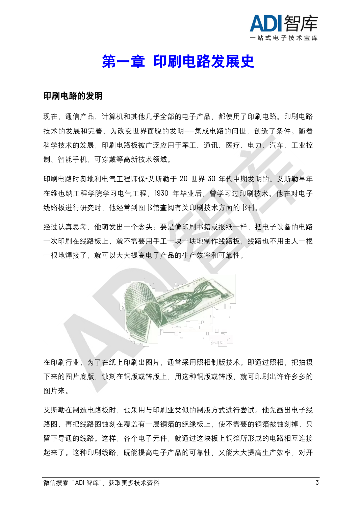


在印刷行业，为了在纸上印刷出图片，通常采用照相制版技术。即通过照相，把拍摄 下来的图片底版，蚀刻在铜版或锌版上，用这种铜版或锌版，就可印刷出许许多多的 图片来。 

艾斯勒在制造电路板时，也采用与印刷业类似的制版方式进行尝试。他先画出电子线 路图，再把线路图蚀刻在覆盖有一层铜箔的绝缘板上，使不需要的铜箔被蚀刻掉，只 留下导通的线路。这样，各个电子元件，就通过这块板上铜箔所形成的电路相互连接 起来了。这种印刷线路，既能提高电子产品的可靠性，又能大大提高生产效率，对开 

发电子新产品有极大的价值和潜力。 

采用印刷电路技术，使电子设备的批量生产变得简单易行，为电子产品的机械化、自 动化生产奠定了基础。20 世纪 50 年代以来，包括通信设备在内的各种电子产品取得 的大幅度进展都与采用印刷电路工艺密不可分。 

随着印刷电路制造水平的不断提高，制作出的印刷电路可达到很高的精度，从而把电 路板的生产制造推向一个崭新的阶段。在印刷行业进行制版时，通过拍摄可以将一幅 很大的图片缩小到一定的尺寸。 

在制造印刷电路时，同样也可以把电子线路图缩小制版，使之成为面积很小，线路复 杂而可靠性却又很高的电子线路板。这种印刷电路板，对于线路复杂、可靠性要求很 高的通信设备和计算机来说，是十分适用的。印刷电路技术的发展，为随后集成电路 的发明，奠定了必要的技术基础。 

线路板从发明至今，其历史 60 余年。历史表明：没有线路板，没有电子线路，飞 行、交通、原子能、计算机、宇航、通信、家电……这一切都无法实现。道理是容易 理解的。芯片 IC 是电子信息工业的粮食，半导体技术体现了一个国家的工业现代化 水平，引导电子信息产业的发展，而半导体（集成电路、IC）的电气互连和装配必须 靠线路板。 

## 印刷电路板的种类

实际电子产品中使用的印刷电路板千差万别，根据不同的标准印刷电路板有不同 的分类。 

## 按印刷电路的分布分类

按印制电路约分布可将印制电路板分为单面板、双面板、多层板3种 

##  单面板

单面板是在厚度为 0.2—5mm 的绝缘基板上，只有一个表面敷有铜箔，通过印制和腐 蚀的方法在基板上形成印制电路。单面板制造简单，装配方便，适用于一放电路要 求，如收音机、电视机等；不适用于要求高组装密度或复杂电路的场合。 

##  双面板

双面板是在厚度为 0.2—5mm 的绝缘基板两面均印制电路。它适用于一般要求的电子 产品，如电子计算机、电子仪器和仪表等。由于双面板印制电路的布线密度较单面板 高，所以能减小设备的体积。 

##  多层板

在绝缘基板上印制 3 层以上印制电路的印制板称为多层板。它是由几层较薄的单面 板或双面板教和而成，其厚度一般为 1.2—2.5mm。为了把夹在绝缘基板中间的电路 引出，多层板上安装元件的孔需要金属化，即在小孔内表面涂效金属层，使之与夹在 绝缘基板中间的印制电路接通。 

下图是多层板结构示意固，多层板所用的元件多为贴片式元件，其特点是： 

1. 与集成电路配合使用，可使整机小型化，减少整机重量； 

2. 提高了布线密度，缩小了元器件的间距，缩短了信号的传输路径； 

3. 减少了元器件焊接点，降低了故障率； 

4. 增设了屏蔽层，电路的信号失真减少； 

5. 引入了接地散热层，可减少局部过热现象，提高整机工作的可靠性。 

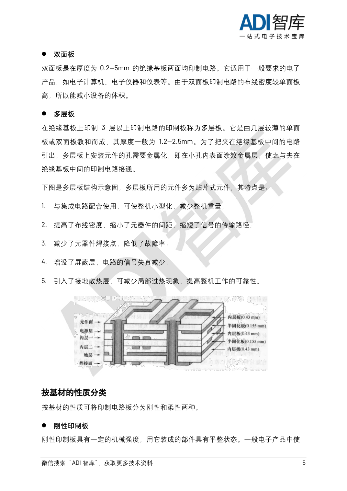


## 按基材的性质分类

按基材的性质可将印制电路板分为刚性和柔性两种。 

##  刚性印制板

刚性印制板具有一定的机械强度，用它装成的部件具有平整状态。一般电子产品中使 

用的都是刚性印制板。 

##  柔性印制板

柔性印制板是以软层状塑料或其他软质绝缘材料为基材而制成。它所制成的部件可以 弯曲和伸缩，在使用时可根据安装要求将其弯曲。柔性印制板一般用于特殊场合，如 某些数字万用表的显示屏是可以旋转的，其内部往往采用柔性印制板；手机的显示 屏、按键等。 

下图为手机柔性印制板，它的基材采用聚酰亚胺，并且对表面进行了防氧化处理，最 小线宽线距设为 0.1mm。柔性印制板的突出特点是能弯曲、卷曲、折叠，能连接刚 性印制板及活动部件，从而能立体布线，实现三维空间互连，它的体积小、重量轻、 装配方便，适用于空间小、组装密度高的电子产品。 

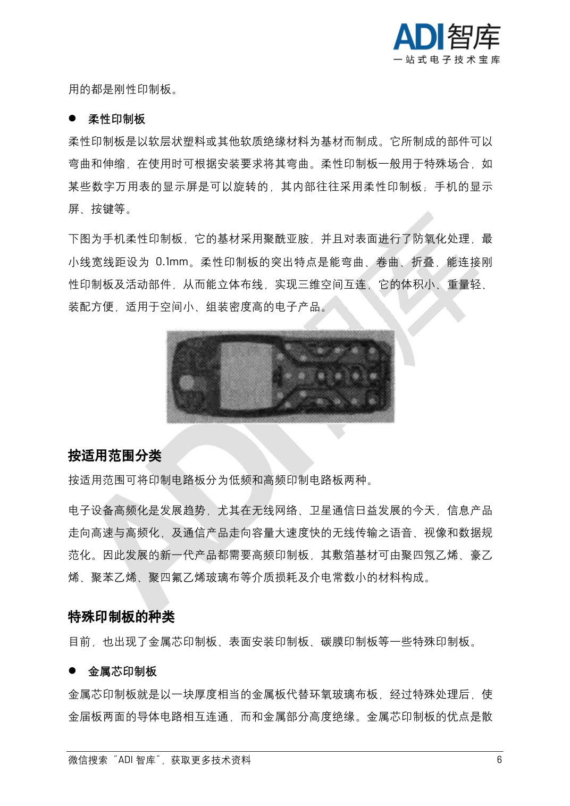


## 按适用范围分类

按适用范围可将印制电路板分为低频和高频印制电路板两种。 

电子设备高频化是发展趋势，尤其在无线网络、卫星通信日益发展的今天，信息产品 走向高速与高频化，及通信产品走向容量大速度快的无线传输之语音、视像和数据规 范化。因此发展的新一代产品都需要高频印制板，其敷箔基材可由聚四氖乙烯、豪乙 烯、聚苯乙烯、聚四氟乙烯玻璃布等介质损耗及介电常数小的材料构成。 

## 特殊印制板的种类

目前，也出现了金属芯印制板、表面安装印制板、碳膜印制板等一些特殊印制板。 

##  金属芯印制板

金属芯印制板就是以一块厚度相当的金属板代替环氧玻璃布板，经过特殊处理后，使 金届板两面的导体电路相互连通，而和金属部分高度绝缘。金属芯印制板的优点是散 热性及尺寸稳定性好，这是因为铝、铁等磁性材料有屏蔽作用，可以防止互相干扰。 

##  表面安装印制板

表面安装印制板是为了满足电子产品“轻、薄、短、小”的需要，配合管脚密度岗、 成本低的表面贴装器件的安装工艺而开发的印制扳。该印制板有孔径小、线宽及间距 小、精度高、基板要求高等特点。 

##  碳膜印制板

碳膜印制板是在镀铜箔板上制成导体图形后，再印制一层碳膜形成触点或跨接线（电 阻值符合规定要求）的印制板。其特点是生产工艺简单、成本低、周期短，具有良好 的耐磨性、导电性，能使单面板实现高密度化，产品小型化、轻量化，适用于电视 机、电话机、录像机及电子琴等产品。 

## 第二章 良好接地指导原则

接地无疑是系统设计中最为棘手的问题之一。尽管它的概念相对比较简单，实施起来 却很复杂，遗憾的是，它没有一个简明扼要可以用详细步骤描述的方法来保证取得良 好效果，但如果在某些细节上处理不当，可能会导致令人头痛的问题。 

对于线性系统而言，“地”是信号的基准点。遗憾的是，在单极性电源系统中，它还 成为电源电流的回路。接地策略应用不当，可能严重损害高精度线性系统的性能。 

对于所有模拟设计而言，接地都是一个不容忽视的问题，而在基于 PCB 的电路中， 适当实施接地也具有同等重要的意义。幸运的是，某些高质量接地原理，特别是接地 层的使用，对于 PCB 环境是固有不变的。由于这一因素是基于 PCB 的模拟设计的显 著优势之一，我们将在本文中对其进行重点讨论。 

我们必须对接地的其他一些方面进行管理，包括控制可能导致性能降低的杂散接地和 信号返回电压。这些电压可能是由于外部信号耦合、公共电流导致的，或者只是由于 接地导线中的过度 IR 压降导致的。适当地布线、布线的尺寸，以及差分信号处理和 接地隔离技术，使得我们能够控制此类寄生电压。 

我们将要讨论的一个重要主题是适用于模拟/数字混合信号环境的接地技术。事实 

上，高质量接地这个问题可以也必然影响到混合信号 PCB 设计的整个布局原则。 

目前的信号处理系统一般需要混合信号器件，例如模数转换器 (ADC)、数模转换器 (DAC) 和快速数字信号处理器 (DSP)。由于需要处理宽动态范围的模拟信号，因此必 须使用高性能 ADC 和 DAC。在恶劣的数字环境内，能否保持宽动态范围和低噪声与 采用良好的高速电路设计技术密切相关，包括适当的信号布线、去耦和接地。 

过去，一般认为“高精度、低速”电路与所谓的“高速”电路有所不同。对于 ADC 和 DAC，采样（或更新）频率一般用作区分速度标准。不过，以下两个示例显示， 实际操作中，目前大多数信号处理 IC 真正实现了“高速” ，因此必须作为此类器件 来对待，才能保持高性能。DSP、ADC和DAC均是如此。 

所有适合信号处理应用的采样 ADC（内置采样保持电路的 ADC）均采用具有快速上 升和下降时间（一般为数纳秒）的高速时钟工作，即使吞吐量看似较低也必须视为高 速器件。例如，中速12位逐次逼近型 (SAR)ADC可采用 10 MHz内部时钟工作，而采 样速率仅为 500 kSPS。 

Σ-Δ型ADC具有高过采样比，因此还需要高速时钟。即使是高分辨率的所谓“低频”工 业测量 ADC（例如 AD77xx-系列）吞吐速率达到 10 Hz 至 7.5 kHz，也采用 5 MHz 或更高 时钟频率工作，并且提供高达 24 位的分辨率。 

更复杂的是，混合信号 IC 具有模拟和数字两种端口，因此如何使用适当的接地技 术就显示更加错综复杂。此外，某些混合信号 IC 具有相对较低的数字电流，而另 一些具有高数字电流。很多情况下，这两种类型的 IC 需要不同的处理，以实现最 佳接地。 

数字和模拟设计工程师倾向于从不同角度考察混合信号器件，本文旨在说明适用于大 多数混合信号器件的一般接地原则，而不必了解内部电路的具体细节。 

通过以上内容，显然接地问题没有一本快速手册。遗憾的是，我们并不能提供可以保 证接地成功的技术列表。我们只能说忽视一些事情，可能会导致一些问题。在某一个 频率范围内行之有效的方法，在另一个频率范围内可能行不通。另外还有一些相互冲 突的要求。处理接地问题的关键在于理解电流的流动方式。 

## 星型接地

“星型”接地的理论基础是电路中总有一个点是所有电压的参考点，称为“星型接地” 点。我们可以通过一个形象的比喻更好地加以理解，多条导线从一个共同接地点呈辐射 状扩展，类似一颗星。星型点并不一定在外表上类似一颗星，它可能是接地层上的一个 点，但星型接地系统上的一个关键特性是：所有电压都是相对于接地网上的某个特定点 测量的，而不是相对于一个不确定的“地”（无论我们在何处放置探头）。 

虽然在理论上非常合理，但星型接地原理却很难在实际中实施。举例来说，如果系统 采用星型接地设计，而且绘制的所有信号路径都能使信号间的干扰最小并可尽量避免 高阻抗信号或接地路径的影响，实施问题便随之而来。在电路图中加入电源时，电源 就会增加不良的接地路径，或者流入现有接地路径的电源电流相当大和/或具有高噪 声，从而破坏信号传输。为电路的不同部分单独提供电源（因而具有单独的接地回 路）通常可以避免这个问题。例如，在混合信号应用中，通常要将模拟电源和数字电 

## 单独的模拟地和数字地

事实上，数字电路具有噪声。饱和逻辑（例如 TTL 和 CMOS）在开关过程中会短暂地 从电源吸入大电流。但由于逻辑级的抗扰度可达数百毫伏以上，因而通常对电源去耦 的要求不高。相反，模拟电路非常容易受噪声影响，包括在电源轨和接地轨上，因 此，为了防止数字噪声影响模拟性能，应该把模拟电路和数字电路分开。这种分离涉 及到接地回路和电源轨的分开，对混合信号系统而言可能比较麻烦。 

然而，如果高精度混合信号系统要充分发挥性能，则必须具有单独的模拟地和数字地 以及单独电源，这一点至关重要。事实上，虽然有些模拟电路采用+5 V 单电源供电 运行，但并不意味着该电路可以与微处理器、动态 RAM、电扇或其他高电流设备共 用相同+5 V 高噪声电源。模拟部分必须使用此类电源以最高性能运行，而不只是保 持运行。这一差别必然要求我们对电源轨和接地接口给予高度注意。 

请注意，系统中的模拟地和数字地必须在某个点相连，以便让信号都参考相同的电 位。这个星点（也称为模拟/数字公共点）要精心选择，确保数字电流不会流入系统 模拟部分的地。在电源处设置公共点通常比较便利。 

许多 ADC 和 DAC 都有单独的“模拟地”(AGND) 和“数字地”(DGND) 引脚。在设备 数据手册上，通常建议用户在器件封装处将这些引脚连在一起。这点似乎与要求在电 源处连接模拟地和数字地的建议相冲突；如果系统具有多个转换器，这点似乎与要求 在单点处连接模拟地和数字地的建议相冲突。 

其实并不存在冲突。这些引脚的“模拟地”和“数字地”标记是指引脚所连接到的转 换器内部部分，而不是引脚必须连接到的系统地。对于 ADC，这两个引脚通常应该 连在一起，然后连接到系统的模拟地。由于转换器的模拟部分无法耐受数字电流经由 焊线流至芯片时产生的压降，因此无法在 IC 封装内部将二者连接起来。但它们可以 在外部连在一起。 

图 1 显示了 ADC 的接地连接这一概念。这样的引脚接法会在一定程度上降低转换器 的数字噪声抗扰度，降幅等于系统数字地和模拟地之间的共模噪声量。但是，由于数 字噪声抗扰度经常在数百或数千毫伏水平，因此一般不太可能有问题。 

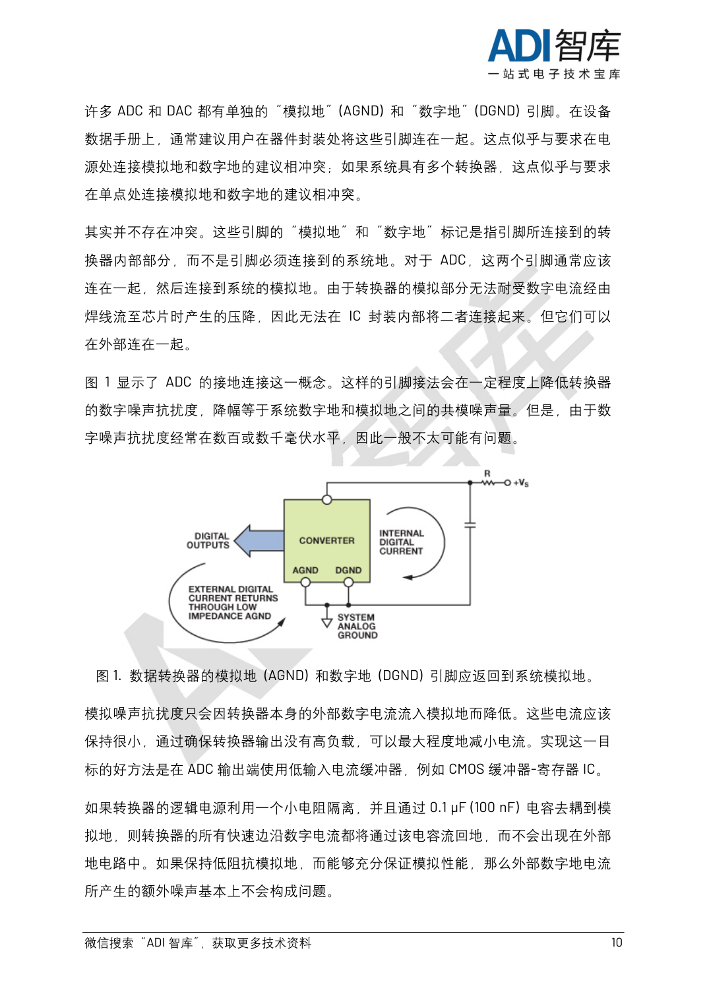


图1. 数据转换器的模拟地 (AGND) 和数字地 (DGND) 引脚应返回到系统模拟地。


模拟噪声抗扰度只会因转换器本身的外部数字电流流入模拟地而降低。这些电流应该 保持很小，通过确保转换器输出没有高负载，可以最大程度地减小电流。实现这一目 标的好方法是在ADC输出端使用低输入电流缓冲器，例如 CMOS 缓冲器-寄存器IC。 

如果转换器的逻辑电源利用一个小电阻隔离，并且通过 0.1 μF (100 nF) 电容去耦到模 拟地，则转换器的所有快速边沿数字电流都将通过该电容流回地，而不会出现在外部 地电路中。如果保持低阻抗模拟地，而能够充分保证模拟性能，那么外部数字地电流 所产生的额外噪声基本上不会构成问题。 

## 接地层

接地层的使用与上文讨论的星型接地系统相关。为了实施接地层，双面 PCB（或多 层 PCB 的一层）的一面由连续铜制造，而且用作地。其理论基础是大量金属具有可 能最低的电阻。由于使用大型扁平导体，它也具有可能最低的电感。因而，它提供了 最佳导电性能，包括最大程度地降低导电平面之间的杂散接地差异电压。 

请注意，接地层概念还可以延伸，包括电压层。电压层提供类似于接地层的优势，极 低阻抗的导体，但只用于一个（或多个）系统电源电压。因此，系统可能具有多个电 压层以及接地层。 

虽然接地层可以解决很多地阻抗问题，但它们并非灵丹妙药。即使是一片连续的铜箔， 也会有残留电阻和电感；在特定情况下，这些就足以妨碍电路正常工作。设计人员应该 注意不要在接地层注入很高电流，因为这样可能产生压降，从而干扰敏感电路。 

保持低阻抗大面积接地层对目前所有模拟电路都很重要。接地层不仅用作去耦高频电 流（源于快速数字逻辑）的低阻抗返回路径，还能将 EMI/RFI 辐射降至最低。由于接 地层的屏蔽作用，电路受外部 EMI/RFI 的影响也会降低。 

接地层还允许使用传输线路技术（微带线或带状线）传输高速数字或模拟信号，此类 技术需要可控阻抗。 

由于“总线 (bus wire)”在大多数逻辑转换等效频率下具有阻抗，将其用作“地”完 全不能接受。例如，#22 标准导线具有约 20 nH/in 的电感。由逻辑信号产生的压摆 率为 10 mA/ns 的瞬态电流，流经 1 英寸该导线时将形成 200 mV 的无用压降： 

$$
\Delta \mathrm{v} = \mathrm{L} \frac {\Delta \mathrm{i}}{\Delta \mathrm{t}} = 2 0 \mathrm{nH} \times \frac {1 0 \mathrm{mA}}{\mathrm{ns}} = 2 0 0 \mathrm{mV}
$$

对于具有2 V 峰峰值范围的信号，此压降会转化为大约200 mV 或10%的误差（大约 “3.5 位精度”）。即使在全数字电路中，该误差也会大幅降低逻辑噪声裕量。 

图 2 显示数字返回电流调制模拟返回电流的情况（顶图）。接地返回导线电感和电 阻由模拟和数字电路共享，这会造成相互影响，最终产生误差。一个可能的解决方案 是让数字返回电流路径直接流向 GND REF，如底图所示。这显示了“星型”或单点 接地系统的基本概念。在包含多个高频返回路径的系统中很难实现真正的单点接地。 因为各返回电流导线的物理长度将引入寄生电阻和电感，所以获得低阻抗高频接地就 很困难。实际操作中，电流回路必须由大面积接地层组成，以便获取高频电流下的低 阻抗。如果无低阻抗接地层，则几乎不可能避免上述共享阻抗，特别是在高频下。 

所有集成电路接地引脚应直接焊接到低阻抗接地层，从而将串联电感和电阻降至最 低。对于高速器件，不推荐使用传统 IC 插槽。即使是“小尺寸”插槽，额外电感和 电容也可能引入无用的共享路径，从而破坏器件性能。如果插槽必须配合 DIP 封装使 用，例如在制作原型时，个别“引脚插槽”或“笼式插座” 可以接受的。以上引脚 插槽提供封盖和无封盖两种版本。由于使用弹簧加载金触点， IC 引脚具有良 好的电气和机械连接。不过，反复插拔可能降低其性能。 

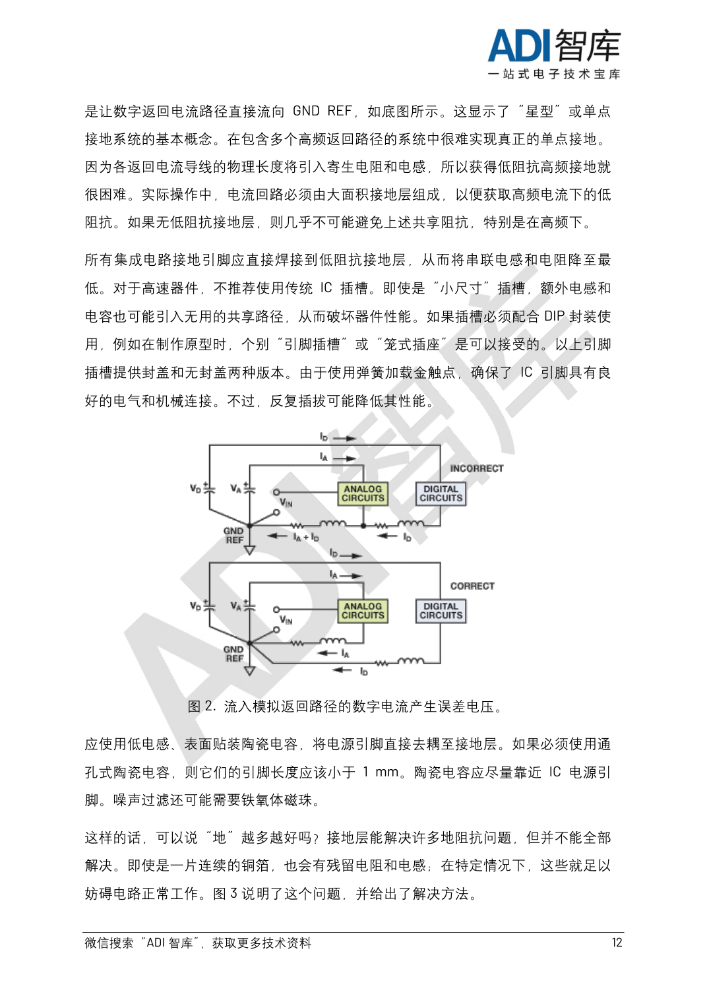


图2. 流入模拟返回路径的数字电流产生误差电压。


应使用低电感、表面贴装陶瓷电容，将电源引脚直接去耦至接地层。如果必须使用通 孔式陶瓷电容，则它们的引脚长度应该小于 1 mm。陶瓷电容应尽量靠近 IC 电源引 脚。噪声过滤还可能需要铁氧体磁珠。 

这样的话，可以说“地”越多越好吗？接地层能解决许多地阻抗问题，但并不能全部 解决。即使是一片连续的铜箔，也会有残留电阻和电感；在特定情况下，这些就足以 妨碍电路正常工作。图3 说明了这个问题，并给出了解决方法。 

[[硬件/原始备份/PCB设计秘籍.pdf#page=13|原版PDF第13页整页回看（前文已展示）]]

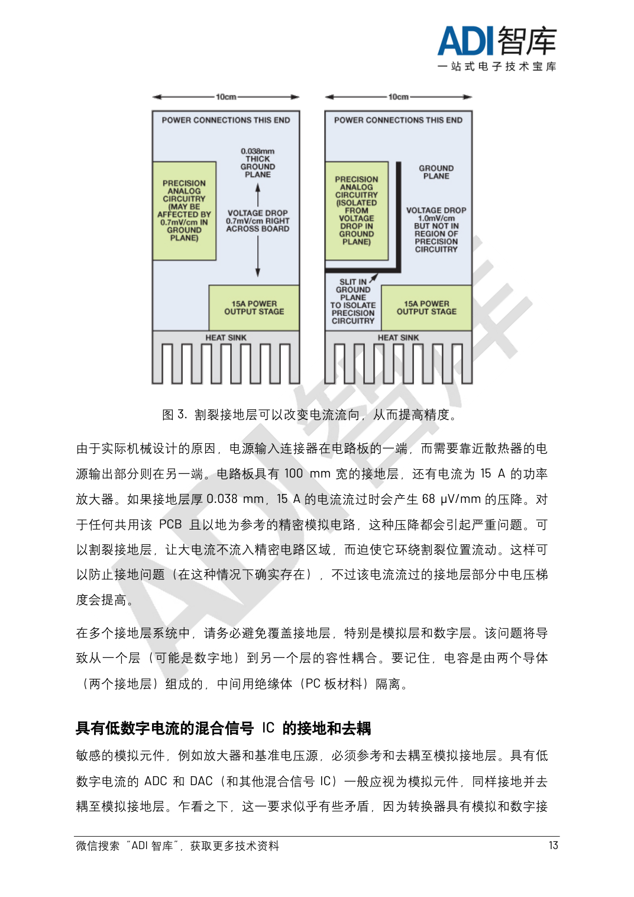


图3. 割裂接地层可以改变电流流向，从而提高精度。


由于实际机械设计的原因，电源输入连接器在电路板的一端，而需要靠近散热器的电 源输出部分则在另一端。电路板具有 100 mm 宽的接地层，还有电流为 15 A 的功率 放大器。如果接地层厚 0.038 mm，15 A的电流流过时会产生68 μV/mm的压降。对 于任何共用该 PCB 且以地为参考的精密模拟电路，这种压降都会引起严重问题。可 以割裂接地层，让大电流不流入精密电路区域，而迫使它环绕割裂位置流动。这样可 以防止接地问题（在这种情况下确实存在），不过该电流流过的接地层部分中电压梯 度会提高。 

在多个接地层系统中，请务必避免覆盖接地层，特别是模拟层和数字层。该问题将导 致从一个层（可能是数字地）到另一个层的容性耦合。要记住，电容是由两个导体 （两个接地层）组成的，中间用绝缘体（PC 板材料）隔离。 

## 具有低数字电流的混合信号 IC 的接地和去耦

敏感的模拟元件，例如放大器和基准电压源，必须参考和去耦至模拟接地层。具有低 数字电流的 ADC 和 DAC（和其他混合信号 IC）一般应视为模拟元件，同样接地并去 耦至模拟接地层。乍看之下，这一要求似乎有些矛盾，因为转换器具有模拟和数字接 口，且通常有指定为模拟接地 (AGND) 和数字接地 (DGND) 的引脚。图 4 有助于解 释这一两难问题。 

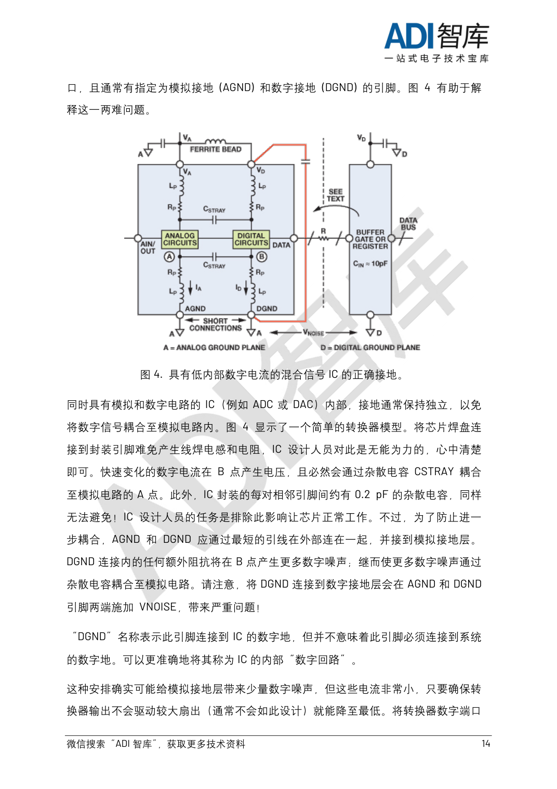


图 4. 具有低内部数字电流的混合信号 IC 的正确接地。


同时具有模拟和数字电路的 IC（例如 ADC 或 DAC）内部，接地通常保持独立，以免 将数字信号耦合至模拟电 个简单的转换器模型。将芯片焊盘连 接到封装引脚难免产生线焊电感和电阻，IC 设计人员对此是无能为力的，心中清楚 即可。快速变化的数字电流在 B 点产生电压，且必然会通过杂散电容 CSTRAY 耦合 至模拟电路的 A 点。此外，IC 封装的每对相邻引脚间约有 0.2 pF 的杂散电容，同样 无法避免！IC 设计人员的任务是排除此影响让芯片正常工作。不过，为了防止进一 步耦合，AGND 和 DGND 应通过最短的引线在外部连在一起，并接到模拟接地层。 DGND 连接内的任何额外阻抗将在 B 点产生更多数字噪声；继而使更多数字噪声通过 杂散电容耦合至模拟电路。请注意，将 DGND 连接到数字接地层会在 AGND 和 DGND 引脚两端施加 VNOISE，带来严重问题！ 

“DGND”名称表示此引脚连接到 IC 的数字地，但并不意味着此引脚必须连接到系统 的数字地。可以更准确地将其称为IC的内部“数字回路”。 

这种安排确实可能给模拟接地层带来少量数字噪声，但这些电流非常小，只要确保转 换器输出不会驱动较大扇出（通常不会如此设计）就能降至最低。将转换器数字端口 上的扇出降至最低（也意味着电流更低），还能让转换器逻辑转换波形少受振铃影 响，尽可能减少数字开关电流，从而减少至转换器模拟端口的耦合。通过插入小型有 损铁氧体磁珠，如图 4 所示，逻辑电源引脚 pin (VD) 可进一步与模拟电源隔离。转 换器的内部瞬态数字电流将在小环路内流动，从 VD 经去耦电容到达 DGND（此路径 用图中红线表示）。因此瞬态数字电流不会出现在外部模拟接地层上，而是局限于环 路内。VD 引脚去耦电容应尽可能靠近转换器安装，以便将寄生电感降至最低。去耦 电容应为低电感陶瓷型，通常介于 0.01 μF (10 nF) 和 0.1 μF (100 nF) 之间。 

再强调一次，没有任何一种接地方案适用于所有应用。但是，通过了解各个选项和提 前进行规则，可以最大程度地减少问题。 

## 小心处理 ADC 数字输出

将数据缓冲器放置在转换器旁不失为好办法，可将数字输出与数据总线噪声隔离开 （如图 4 所示）。数据缓冲器也有助于将转换器数字输出上的负载降至最低，同时 态输出/输入，但这些寄存器仍然在芯片上；它们使数据引脚信号能够耦合到敏感区 域，因而隔离缓冲区依然是一种良好的设计方式。某些情况下，甚至需要在模拟接地 层上紧靠转换器输出提供额外的数据缓冲器，以提供更好的隔离。 

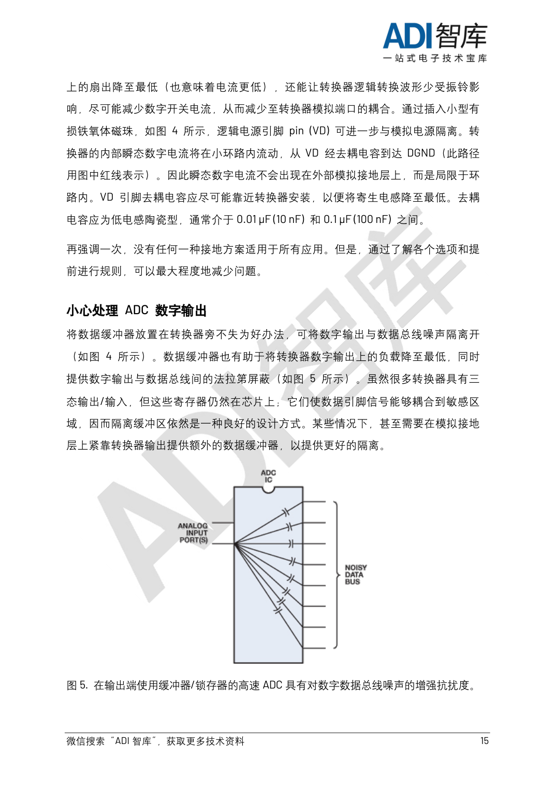


图5. 在输出端使用缓冲器/锁存器的高速ADC具有对数字数据总线噪声的增强抗扰度。


ADC 输出与缓冲寄存器输入间的串联电阻（图 4 中标示为“R”）有助于将数字瞬态 电流降至最低，这些电流可能影响转换器性能。电阻可将数字输出驱动器与缓冲寄存 器输入的电容隔离开。此外，由串联电阻和缓冲寄存器输入电容构成的 RC 网络用作 低通滤波器，以减缓快速边沿。 

典型 CMOS 栅极与 PCB 走线和通孔结合在一起，将产生约 10 pF 的负载。如果无隔 离电阻，1 V/ns的逻辑输出压摆率将产生10 mA的动态电流： 

$$
\Delta \mathrm{i} = \mathrm{C} \frac {\Delta \mathrm{v}}{\Delta \mathrm{t}} = 1 0 \mathrm{pF} \times \frac {1 \mathrm{V}}{\mathrm{ns}} = 1 0 \mathrm{mA}
$$

驱动10 pF 的寄存器输入电容时，500 Ω串联电阻可将瞬态输出电流降至最低，并产 生约11 ns的上升和下降时间： 

$$
\mathrm{t} _ {\mathrm{r}} = 2. 2 \times \mathrm{t} = 2. 2 \times \mathrm{R} \times \mathrm{C} = 2. 2 \times 5 0 0 \Omega \times 1 0 \mathrm{pF} = 1 1 \mathrm{ns}
$$

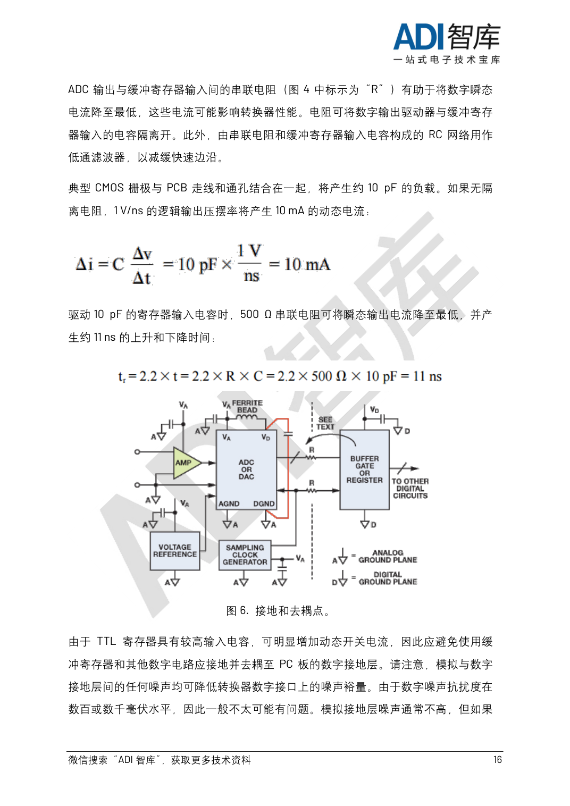


图6. 接地和去耦点。


由于 TTL 寄存器具有较高输入电容，可明显增加动态开关电流，因此应避免使用缓 冲寄存器和其他数字电路应接地并去耦至 PC 板的数字接地层。请注意，模拟与数字 接地层间的任何噪声均可降低转换器数字接口上的噪声裕量。由于数字噪声抗扰度在 数百或数千毫伏水平，因此一般不太可能有问题。模拟接地层噪声通常不高，但如果 数字接地层上的噪声（相对于模拟接地层）超过数百毫伏，则应采取措施减小数字接 地层阻抗，以将数字噪声裕量保持在可接受的水平。任何情况下，两个接地层之间的 电压不得超过300 mV，否则IC可能受损。 

最好提供针对模拟电路和数字电路的独立电源。模拟电源应当用于为转换器供电。如 果转换器具有指定的数字电源引脚 (VD)，应采用独立模拟电源供电，或者如图 6 所 示进行滤波。所有转换器电源引脚应去耦至模拟接地层，所有逻辑电路电源引脚应去 耦至数字接地层，如图 6 所示。如果数字电源相对安静，则可以使用它为模拟电路 供电，但要特别小心。 

某些情况下，不可能将 VD 连接到模拟电源。一些高速 IC 可能采用+5 V 电源为其模 拟电路供电，而采用+3.3 V 或更小电源为数字接口供电，以便与外部逻辑接口。这种 情况下，IC的+3.3 V 引脚应直接去耦至模拟接地层。另外建议将铁氧体磁珠与电源走 线串联，以便将引脚连接到+3.3 V 数字逻辑电源。 

采样时钟产生电路应与模拟电路同样对待，也接地并深度去耦至模拟接地层。采样时 钟上的相位噪声会降低系统信噪比 (SNR)；我们将稍后对此进行讨论。 

## 采样时钟考量

在高性能采样数据系统中，应使用低相位噪声晶体振荡器产生 ADC（或 DAC）采样 时钟，因为采样时钟抖动会调制模拟输入/输出信号，并提高噪声和失真底。采样时 钟发生器应与高噪声数字电路隔离开，同时接地并去耦至模拟接地层，与处理运算放 大器和ADC一样。 

采样时钟抖动对ADC信噪比 (SNR) 的影响可用以下公式4近似计算： 

$$
\mathrm{SNR} = 2 0 \log_ {1 0} \left[ \frac {1}{2 \pi \mathrm{ft} _ {\mathrm{j}}} \right]
$$

其中，f 为模拟输入频率，SNR 为完美无限分辨率 ADC 的 SNR，此时唯一的噪声源 来自 rms 采样时钟抖动 tj。通过简单示例可知，如果 tj = 50 ps (rms)，f = 100 kHz， 则 SNR = 90 dB，相当于约 15 位的动态范围。 

应注意，以上示例中的 tj 实际上是外部时钟抖动和内部 ADC 时钟抖动（称为孔径抖 动）的方和根 (rss) 值。不过，在大多数高性能 ADC 中，内部孔径抖动与采样时钟 上的抖动相比可以忽略。 

由于信噪比 (SNR) 降低主要是由于外部时钟抖动导致的，因而必须采取措施，使采样 时钟尽量无噪声，仅具有可能最低的相位抖动。这就要求必须使用晶体振荡器。有多 家制造商提供小型晶体振荡器，可产生低抖动（小于 5 ps rms）的 CMOS 兼容输出。 

理想情况下，采样时钟晶体振荡器应参考分离接地系统中的模拟接地层。但是，系统 限制可能导致这一点无法实现。许多情况下，采样时钟必须从数字接地层上产生的更 高频率、多用途系统时钟获得，接着必须从数字接地层上的原点传递至模拟接地层上 的 ADC。两层之间的接地噪声直接添加到时钟信号，并产生过度抖动。抖动可造成 信噪比降低，还会产生干扰谐波。 

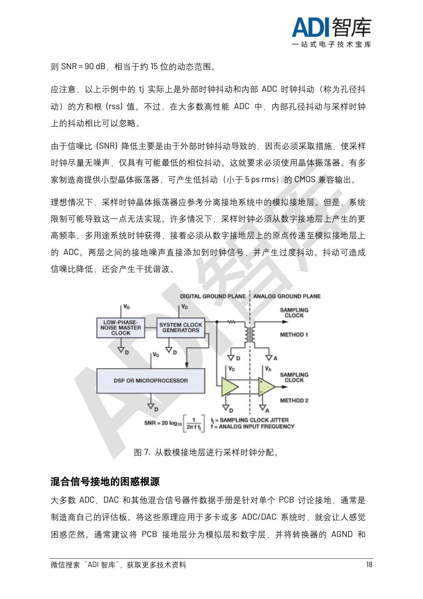


图7. 从数模接地层进行采样时钟分配。


## 混合信号接地的困惑根源

大多数 ADC、DAC 和其他混合信号器件数据手册是针对单个 PCB 讨论接地，通常是 制造商自己的评估板。将这些原理应用于多卡或多 ADC/DAC 系统时，就会让人感觉 困惑茫然。通常建议将 PCB 接地层分为模拟层和数字层，并将转换器的 AGND 和 

DGND 引脚连接在一起，并且在同一点连接模拟接地层和数字接地层，如图 8 所示。 这样就基本在混合信号器件上产生了系统“星型”接地。所有高噪声数字电流通过数 字电源流入数字接地层，再返回数字电源；与电路板敏感的模拟部分隔离开。系统星 型接地结构出现在混合信号器件中模拟和数字接地层连接在一起的位置。 

该方法一般用于具有单个 PCB 和单个 ADC/DAC 的简单系统，不适合多卡混合信号系 统。在不同 PCB（甚至在相同 PCB 上）上具有数个 ADC 或 DAC 的系统中，模拟和 数字接地层在多个点连接，使得建立接地环路成为可能，而单点“星型”接地系统则 不可能。鉴于以上原因，此接地方法不适用于多卡系统，上述方法应当用于具有低数 字电流的混合信号 IC。 

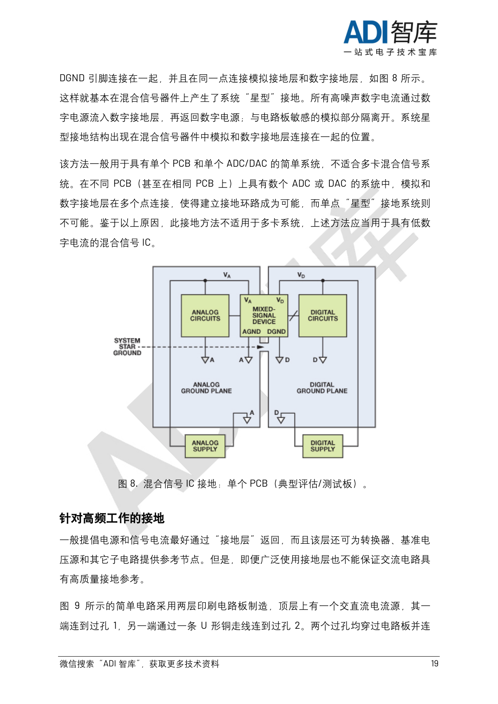


图8. 混合信号IC接地：单个PCB（典型评估/测试板）。


## 针对高频工作的接地

一般提倡电源和信号电流最好通过“接地层”返回，而且该层还可为转换器、基准电 压源和其它子电路提供参考节点。但是，即便广泛使用接地层也不能保证交流电路具 有高质量接地参考。 

图 9 所示的简单电路采用两层印刷电路板制造，顶层上有一个交直流电流源，其一 端连到过孔 1，另一端通过一条 U 形铜走线连到过孔 2。两个过孔均穿过电路板并连 到接地层。理想情况下，顶端连接器以及过孔 1 和过孔 2 之间的接地回路中的阻抗为 零，电流源上的电压为零。 

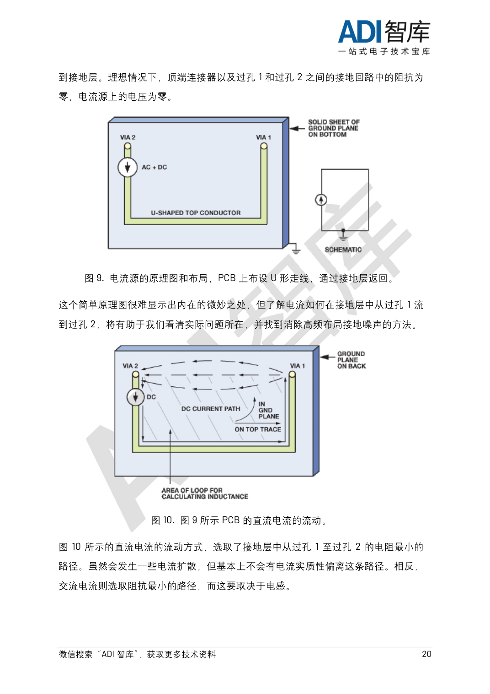


图9. 电流源的原理图和布局，PCB上布设 U 形走线，通过接地层返回。


这个简单原理图很难显示出内在的微妙之处，但了解电流如何在接地层中从过孔 1 流 到过孔 2，将有助于我们看清实际问题所在，并找到消除高频布局接地噪声的方法。 

[[硬件/原始备份/PCB设计秘籍.pdf#page=21|原版PDF第21页整页回看（前文已展示）]]


图10. 图9所示 PCB 的直流电流的流动。


图 10 所示的直流电流的流动方式，选取了接地层中从过孔 1 至过孔 2 的电阻最小的 路径。虽然会发生一些电流扩散，但基本上不会有电流实质性偏离这条路径。相反， 交流电流则选取阻抗最小的路径，而这要取决于电感。 

[[硬件/原始备份/PCB设计秘籍.pdf#page=21|原版PDF第21页整页回看（前文已展示）]]

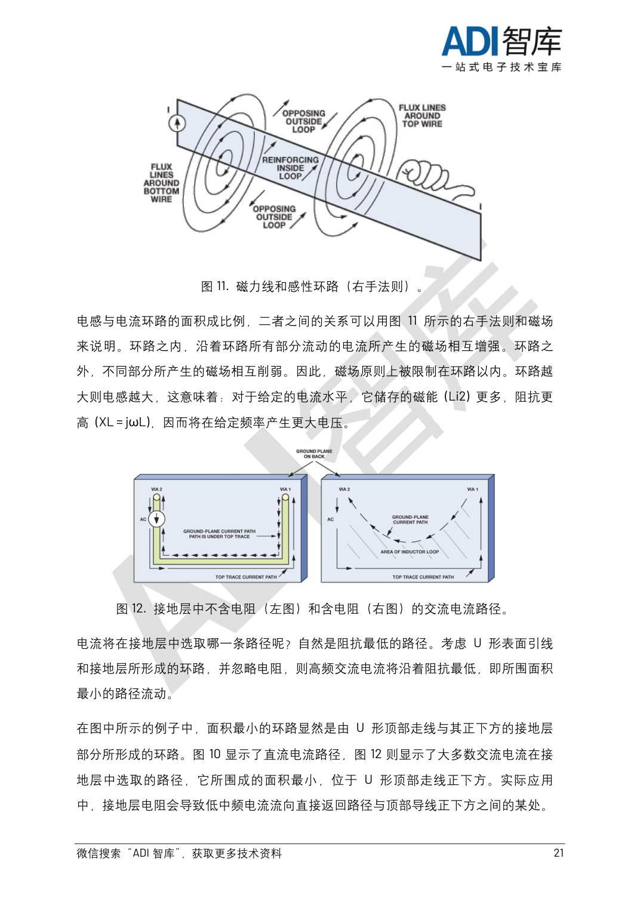


图 11. 磁力线和感性环路（右手法则）


电感与电流环路的面积成比例，二者之间的关系可以用图 11 所示的右手法则和磁场 来说明。环路之内，沿着环路所有部分流动的电流所产生的磁场相互增强。环路之 外，不同部分所产生的磁场相互削弱。因此，磁场原则上被限制在环路以内。环路越 大则电感越大，这意味着：对于给定的电流水平，它储存的磁能 (Li2) 更多，阻抗更 高 (XL = jωL)，因而将在给定频率产生更大电压。 

[[硬件/原始备份/PCB设计秘籍.pdf#page=22|原版PDF第22页整页回看（前文已展示）]]


图12. 接地层中不含电阻（左图）和含电阻（右图）的交流电流路径。


电流将在接地层中选取哪一条路径呢？自然是阻抗最低的路径。考虑 U 形表面引线 和接地层所形成的环路，并忽略电阻，则高频交流电流将沿着阻抗最低，即所围面积 最小的路径流动。 

在图中所示的例子中，面积最小的环路显然是由 U 形顶部走线与其正下方的接地层 部分所形成的环路。图 10 显示了直流电流路径，图 12 则显示了大多数交流电流在接 地层中选取的路径，它所围成的面积最小，位于 U 形顶部走线正下方。实际应用 中，接地层电阻会导致低中频电流流向直接返回路径与顶部导线正下方之间的某处。 

不过，即使频率低至1 MHz或2 MHz，返回路径也是接近顶部走线的下方。 

## 小心接地层割裂

如果导线下方的接地层上有割裂，接地层返回电流必须环绕裂缝流动。这会导致电路 电感增加，而且电路也更容易受到外部场的影响。图 13 显示了这一情况，其中的导 线A和导线B必须相互穿过。 

当割裂是为了使两根垂直导线交叉时，如果通过飞线将第二根信号线跨接在第一根信 号线和接地层上方，则效果更佳。此时，接地层用作两个信号线之间的天然屏蔽体， 而由于集肤效应，两路地返回电流会在接地层的上下表面各自流动，互不干扰。 

多层板能够同时支持信号线交叉和连续接地层，而无需考虑线链路问题。虽然多层板 价格较高，而且不如简单的双面电路板调试方便，但是屏蔽效果更好，信号路由更 佳。相关原理仍然保持不变，但布局布线选项更多。 

对于高性能混合信号电路而言，使用至少具有一个连续接地层的双面或多层 PCB 无 疑是最成功的设计方法之一。通常，此类接地层的阻抗足够低，允许系统的模拟和数 字部分共用一个接地层。但是，这一点能否实现，要取决于系统中的分辨率和带宽要 求以及数字噪声量。 

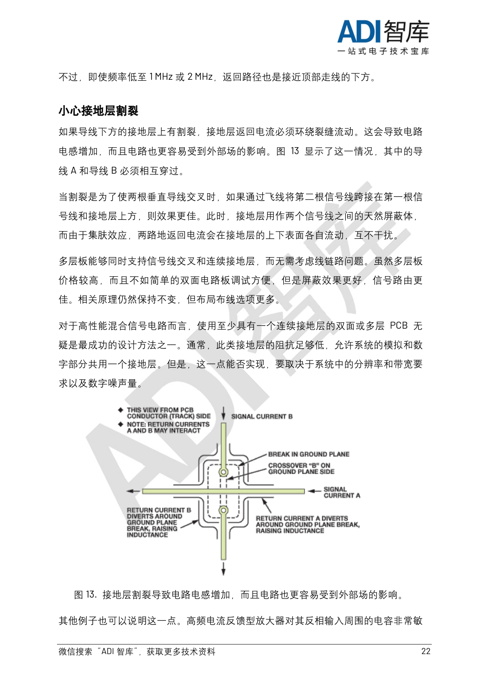


图13. 接地层割裂导致电路电感增加，而且电路也更容易受到外部场的影响。


其他例子也可以说明这一点。高频电流反馈型放大器对其反相输入周围的电容非常敏 感。接地层旁的输入走线可能具有能够导致问题的那一类电容。要记住，电容是由两 个导体（走线和接地层）组成的，中间用绝缘体（板和可能的阻焊膜）隔离。在这一 方面，接地层应与输入引脚分隔开，如图 14 所示，它是 AD8001 高速电流反馈型放 大器的评估板。小电容对电流反馈型放大器的影响如图 15 所示。请注意输出上的响 铃振荡。 

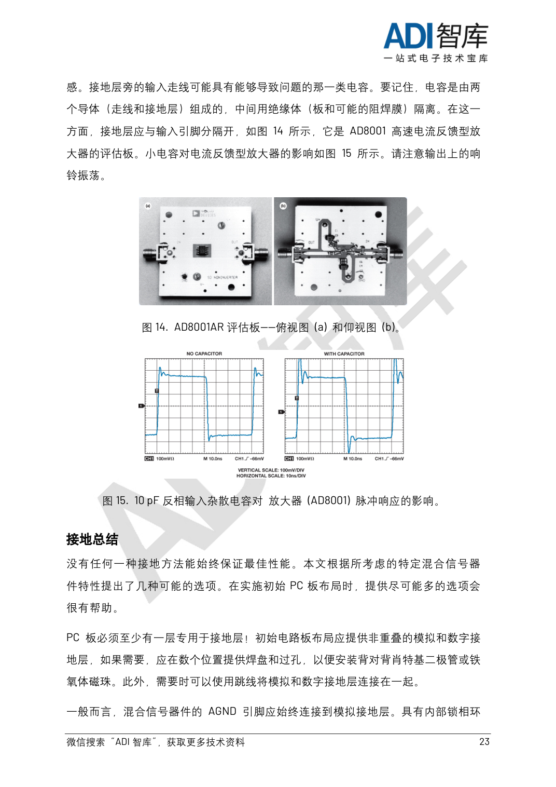


图 14. AD8001AR 评估板——俯视图 (a) 和仰视图 (b)。


[[硬件/原始备份/PCB设计秘籍.pdf#page=24|原版PDF第24页整页回看（前文已展示）]]


图15. 10 pF 反相输入杂散电容对 放大器 (AD8001) 脉冲响应的影响。


## 接地总结

没有任何一种接地方法能始终保证最佳性能。本文根据所考虑的特定混合信号器 件特性提出了几种可能的选项。在实施初始 PC 板布局时，提供尽可能多的选项会 很有帮助。 

PC 板必须至少有一层专用于接地层！初始电路板布局应提供非重叠的模拟和数字接 地层，如果需要，应在数个位置提供焊盘和过孔，以便安装背对背肖特基二极管或铁 氧体磁珠。此外，需要时可以使用跳线将模拟和数字接地层连接在一起。 

一般而言，混合信号器件的 AGND 引脚应始终连接到模拟接地层。具有内部锁相环 (PLL) 的 DSP 是一个例外，例如 ADSP-21160 SHARC®处理器。PLL 的接地引脚是标 记的AGND，但直接连接到DSP的数字接地层。 

## 第三章 高速 ADC PCB 布局布线规则

## 第一部分

为了确保设计性能达到数据手册的技术规格，使用高速转换器时，必须遵守一些指导 是：视情况而定。 

详细回答则是：通常不分离。因为在大多数情况下，分离接地层只会增加返回电流的 电感，它所带来的坏处大于好处。从公式 V = L (di/dt) 可以看出，随着电感增加，电 压噪声会提高。而随着开关电流增大（因为转换器采样速率提高），电压噪声同样会 提高。因此，接地层应当连在一起。 

一个例子是，在一些应用中，为了符合传统设计要求，必须将脏乱的总线电源或数字 电路放在某些区域，同时还受尺寸限制的影响，使得电路板无法实现良好的布局分 割，在这种情况下，分离接地层是实现良好性能的关键。然而，为使整体设计有效， 必须在电路板的某个地方通过一个电桥或连接点将这些接地层连在一起。因此，应将 连接点均匀地分布在分离的接地层上。最终，PCB 上往往会有一个连接点成为返回 电流通过而不会导致性能降低的最佳位置。此连接点通常位于转换器附近或下方。 

设计电源层时，应使用这些层可以使用的所有铜线。如果可能，请勿让这些层共用 走线，因为额外的走线和过孔会将电源层分割成较小的碎块，从而迅速损害电源 层。由此产生的稀疏电源层可以将电流路径挤压到最需要这些路径的地方，即转换 器的电源引脚。挤压过孔与走线之间的电流会提高电阻，导致转换器的电源引脚发 生轻微的压降。 

最后，电源层的放置至关重要，切勿将高噪声的数字电源层叠放在模拟电源层上，否 则二者虽然位于不同的层，但仍有可能耦合。为将系统性能下降的风险降至最低，设 计中应尽可能将这些类型的层隔开而不是叠加在一起。 

第二部分将讨论电源输送和高速转换器的去耦，敬请期待。 

## 第二部分

第一部分讨论了为什么 AGND 和 DGND 接地层未必一定分离，除非设计的具体情况 要求您必须这么做。这部分讨论印刷电路板 (PCB) 的输电系统 (PDS) 设计，这一任 务常被忽视，但对于系统级模拟和数字设计人员却至关重要。 

PDS 的设计目标是将响应电源电流需求而产生的电压纹波降至最低。所有电路都需 要电流，有些电路需求量较大，有些电路则需要以较快的速率提供电流。采用充分去 耦的低阻抗电源层或接地层以及良好的 PCB 层叠，可以将因电路的电流需求而产生 的电压纹波降至最低。例如，如果设计的开关电流为 1A，PDS 的阻抗为 10mΩ，则最 大电压纹波为10mV。 

首先，应当设计一个支持较大层电容的 PCB 层叠结构。例如，六层堆叠可能包含顶 部信号层、第一接地层、第一电源层、第二电源层、第二接地层和底部信号层。规定 第一接地层和第一电源层在层叠结构中彼此靠近，这两层间距为 2 到 3 密尔，形成 一个固有层电容。此电容的最大优点是它是免费的，只需在 PCB 制造笔记中注明。 如果必须分割电源层，同一层上有多个 VDD 电源轨，则应使用尽可能大的电源层。 不要留下空洞，同时也应注意敏感电路。这将使该 VDD 层的电容最大。如果设计允 许存在额外的层（本例中是从六层变为八层），则应将两个额外的接地层放在第一和 第二电源层之间。在核心间距同样为 2 到 3 密尔的情况下，此时层叠结构的固有电 容将加倍。 

对于理想的 PCB 层叠，电源层起始入口点和 DUT 周围均应使用去耦电容，这将确保 PDS 阻抗在整个频率范围内均较低。使用若干 0.001μF 至 100μF 的电容有助于覆盖 该范围。没有必要各处都配置电容；电容正对着 DUT 对接会破坏所有的制造规则。 如果需要这种严厉的措施，则说明电路存在其它问题。 

## 第三部分

第一部分讨论了为什么 AGND 和 DGND 接地层未必一定分离，除非设计的具体情况 要求您必须这么做。第二部分讨论了输电系统 (PDS)，以及电源层和接地层挤压在一 起如何能提供额外的电容。第三部分将讨论裸露焊盘 (E-Pad)，这是一个容易忽视的 方面，但它对于实现 PCB设计的最佳性能和散热至关重要。 

裸露焊盘（引脚 0）指的是大多数现代高速 IC 下方的一个焊盘，它是一个重要的连 接，芯片的所有内部接地都是通过它连接到器件下方的中心点。裸露焊盘的存在使许 多转换器和放大器可以省去接地引脚。关键是将该焊盘焊接到 PCB 时，要形成稳定 可靠的电气连接和散热连接，否则系统可能会遭到严重破坏。 

通过以下三个步骤，可以实现裸露焊盘的最佳电气和散热连接。首先，在可能的情况 下，应在各 PCB 层上复制裸露焊盘，这将为所有接地提供较厚的散热连接，从而快 速散热，对于高功耗器件尤其重要。在电气方面，这将为所有接地层提供良好的等电 位连接。在底层上复制裸露焊盘时，它可以用作去耦接地点和安装散热器的地方。 

其次，将裸露焊盘分割成多个相同的部分。以棋盘状最佳，可以通过丝网交叉格栅或 焊罩来实现。在回流焊组装过程中，无法决定焊膏如何流动以建立器件与 PCB 的连 接，因此连接可能存在，但分布不均，更糟糕的情况是连接很小并且位于拐角处。将 裸露焊盘分割为若干较小的部分可以使各个区域都有一个连接点，从而确保器件与 PCB 之间形成可靠、均匀的连接。 

最后，应当确保各部分都有过孔连接到地。各区域通常都很大，足以放置多个过孔。 组装之前，务必用焊膏或环氧树脂填充每个过孔，这一步非常重要，这样才能确保裸 露焊盘焊膏不会回流到过孔空洞中，否则会降低正确连接的机率。 

## 第四部分

本系列的第一部分讨论了为什么 AGND 和 DGND 接地层未必一定分离，除非设计的 具体情况要求您必须这么做。第二部分讨论了电源系统 (PDS) 的设计，以及电源层 和接地层挤压在一起如何能提供额外的电容。第三部分讨论了如何通过巧妙的裸露焊 盘 (E-Pad) 设计实现信号链设计的最佳性能和散热效果。第四部分将讨论 PCB 中各 层面之间交叉耦合的问题，这点是不容忽视的。 

在 PCB 设计中，一些高速转换器的布局布线不可避免地会出现一个电路层与另一个 交叠的情况。某些情况下，敏感的模拟层（电源、接地或信号）可能就在高噪声数字 层的正上方。大多数设计人员认为这无关紧要，因为这些层面位于不同的层。是否如 此呢？我们来看一个简单的测试。 

选择相邻层中的一层，并在该层面注入信号。然后，将交叉耦合层连接到一个频谱分 析仪。可以看到，耦合到相邻层的信号非常多。即使间距 40 密尔，某种意义上相邻 层仍会形成一个电容，因此在某些频率下，信号仍会从一个层耦合到另一个层。 

假设某层上的高噪声数字部分具有高速开关的 1V 信号，层间隔离为 60dB 时，非受 驱层将看到从受驱层耦合而来的 1mV 信号。对于 2Vp-p 满量程摆幅的 12 位模数转换 器 (ADC) 而言，这意味着 2LSB（最低有效位）的耦合。对于特定的系统，这可能不 成问题，但应注意，当分辨率从 12 位提高到 14 位时，灵敏度会提高四倍，因而误差 将增大到8LSB。 

忽略交叉面/交叉层耦合可能不会导致系统设计失败，或者削弱设计，但必须保持警 惕，因为两个层面之间的耦合可能比想象的要多。 

在目标频谱内发现噪声杂散耦合时，应注意这一点。有时候，布局布线会导致非预期信 号或层交叉耦合至不同层。调试敏感系统时请记住这一点：问题可能出在下面一层。 

## 第四章 高速 ADC PCB 布局布线技巧

## 简介

在当今的工业领域，系统电路板布局已成为设计本身的一个组成部分。因此，设计工 程师必须了解影响高速信号链设计性能的机制。 

在高速模拟信号链设计中，印刷电路板 (PCB) 布局布线需要考虑许多选项，有些选 项比其它选项更重要，有些选项则取决于应用。最终的答案各不相同，但在所有情况 下，设计工程师都应尽量消除最佳做法的误差，而不要过分计较布局布线的每一个细 节。本应用笔记提供的信息对设计工程师的下一个高速设计项目会有所帮助。 

## 裸露焊盘

裸露焊盘 (EPAD) 有时会被忽视，但它对充分发挥信号链的性能以及器件充分散热非 

常重要。 

裸露焊盘，ADI 公司称之为引脚 0，是目前大多数器件下方的焊盘。它是一个重要的 连接，芯片的所有内部接地都是通过它连接到器件下方的中心点。不知您是否注意 到，目前许多转换器和放大器中缺少接地引脚，原因就在于裸露焊盘。 

关键是将此引脚妥善固定（即焊接）至 PCB，实现牢靠的电气和热连接。如果此连 接不牢固，就会发生混乱，换言之，设计可能无效。 

## 实现最佳连接

利用裸露焊盘实现最佳电气和热连接有三个步骤。首先，在可能的情况下，应在各 PCB 层上复制裸露焊盘，这样做的目的是为了与所有接地和接地层形成密集的热连 接，从而快速散热。此步骤与高功耗器件及具有高通道数的应用相关。在电气方面， 这将为所有接地层提供良好的等电位连接。 

甚至可以在底层复制裸露焊盘（见图 1），它可以用作去耦散热接地点和安装底侧散 热器的地方。 

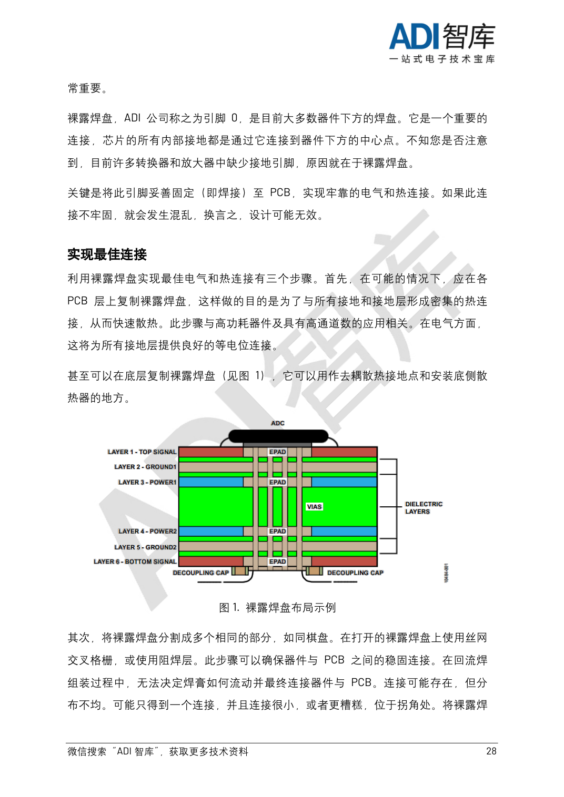


图1. 裸露焊盘布局示例


其次，将裸露焊盘分割成多个相同的部分，如同棋盘。在打开的裸露焊盘上使用丝网 交叉格栅，或使用阻焊层。此步骤可以确保器件与 PCB 之间的稳固连接。在回流焊 组装过程中，无法决定焊膏如何流动并最终连接器件与 PCB。连接可能存在，但分 布不均。可能只得到一个连接，并且连接很小，或者更糟糕，位于拐角处。将裸露焊 盘分割为较小的部分可以确保各个区域都有一个连接点，实现更牢靠、均匀连接的裸 露焊盘（见图2和图3）。 

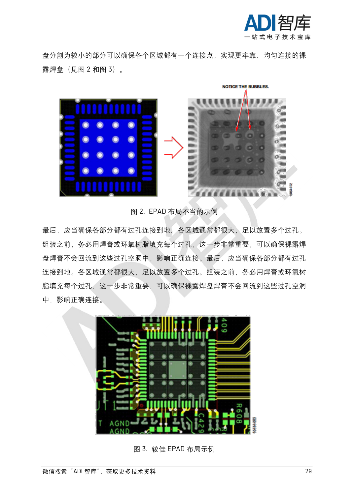


图 2. EPAD 布局不当的示例


最后，应当确保各部分都有过孔连接到地。各区域通常都很大，足以放置多个过孔。 组装之前，务必用焊膏或环氧树脂填充每个过孔，这一步非常重要，可以确保裸露焊 盘焊膏不会回流到这些过孔空洞中，影响正确连接。最后，应当确保各部分都有过孔 连接到地。各区域通常都很大，足以放置多个过孔。组装之前，务必用焊膏或环氧树 脂填充每个过孔，这一步非常重要，可以确保裸露焊盘焊膏不会回流到这些过孔空洞 中，影响正确连接。 

[[硬件/原始备份/PCB设计秘籍.pdf#page=30|原版PDF第30页整页回看（前文已展示）]]


图3. 较佳EPAD 布局示例


## 去耦和层电容

有时工程师会忽略使用去耦的目的，仅仅在电路板上分散大小不同的许多电容，使较 低阻抗电源连接到地。但问题依旧：需要多少电容？许多相关文献表明，必须使用大 小不同的许多电容来降低功率传输系统 (PDS) 的阻抗，但这并不完全正确。相反， 仅需选择正确大小和正确种类的电容就能降低 PDS 阻抗。 

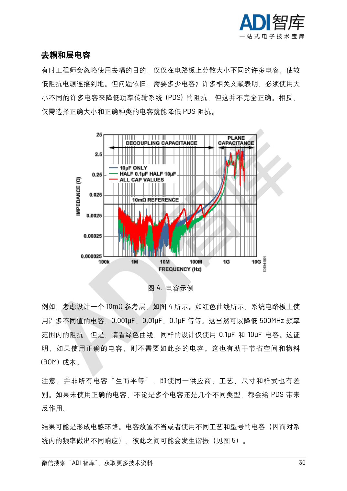


图 4. 电容示例


例如，考虑设计一个 10mΩ 参考层，如图 4 所示。如红色曲线所示，系统电路板上使 用许多不同值的电容，0.001μF、0.01μF、0.1μF 等等。这当然可以降低 500MHz 频率 范围内的阻抗，但是，请看绿色曲线，同样的设计仅使用 0.1μF 和 10μF 电容。这证 明，如果使用正确的电容，则不需要如此多的电容。这也有助于节省空间和物料 (BOM) 成本。 

注意，并非所有电容“生而平等”，即使同一供应商，工艺、尺寸和样式也有差 别。如果未使用正确的电容，不论是多个电容还是几个不同类型，都会给 PDS 带来 反作用。 

结果可能是形成电感环路。电容放置不当或者使用不同工艺和型号的电容（因而对系 统内的频率做出不同响应），彼此之间可能会发生谐振（见图5）。 

[[硬件/原始备份/PCB设计秘籍.pdf#page=31|原版PDF第31页整页回看（前文已展示）]]

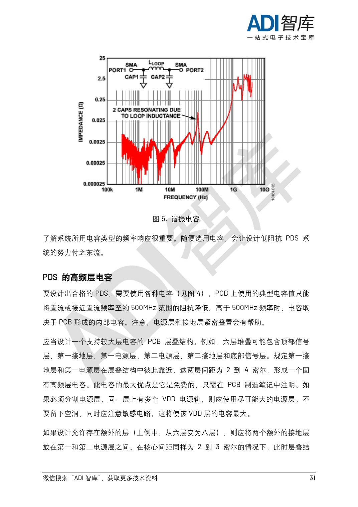


图 5. 谐振电容


了解系统所用电容类型的频率响应很重要。随便选用电容，会让设计低阻抗 PDS 系 统的努力付之东流。 

## PDS 的高频层电容

要设计出合格的 PDS，需要使用各种电容（见图 4）。PCB 上使用的典型电容值只能 将直流或接近直流频率至约 500MHz 范围的阻抗降低。高于 500MHz 频率时，电容取 决于PCB 形成的内部电容。注意，电源层和接地层紧密叠置会有帮助。 

应当设计一个支持较大层电容的 PCB 层叠结构。例如，六层堆叠可能包含顶部信号 层、第一接地层、第一电源层、第二电源层、第二接地层和底部信号层。规定第一接 地层和第一电源层在层叠结构中彼此靠近，这两层间距为 2 到 4 密尔，形成一个固 有高频层电容。此电容的最大优点是它是免费的，只需在 PCB 制造笔记中注明。如 果必须分割电源层，同一层上有多个 VDD 电源轨，则应使用尽可能大的电源层。不 要留下空洞，同时应注意敏感电路。这将使该VDD 层的电容最大。 

如果设计允许存在额外的层（上例中，从六层变为八层），则应将两个额外的接地层 放在第一和第二电源层之间。在核心间距同样为 2 到 3 密尔的情况下，此时层叠结 

构的固有电容将加倍（示例见图 6）。 

与添加更多分立高频电容以在高频时保持低阻抗相比，此结构更易于设计。 

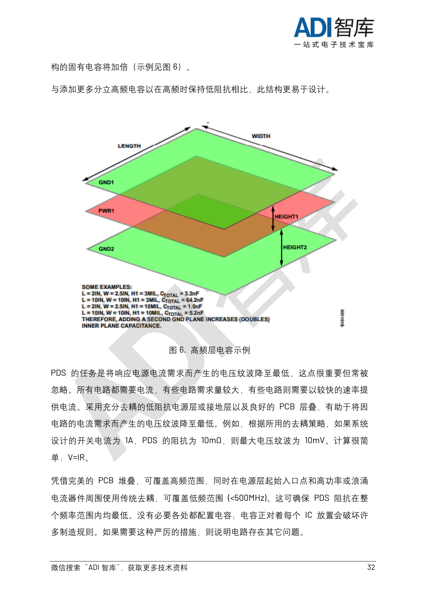


图6. 高频层电容示例


PDS 的任务是将响应电源电流需求而产生的电压纹波降至最低，这点很重要但常被 忽略。所有电路都需要电流，有些电路需求量较大，有些电路则需要以较快的速率提 供电流。采用充分去耦的低阻抗电源层或接地层以及良好的 PCB 层叠，有助于将因 电路的电流需求而产生的电压纹波降至最低。例如，根据所用的去耦策略，如果系统 设计的开关电流为 1A，PDS 的阻抗为 10mΩ，则最大电压纹波为 10mV。计算很简 单：V=IR。 

凭借完美的 PCB 堆叠，可覆盖高频范围，同时在电源层起始入口点和高功率或浪涌 电流器件周围使用传统去耦，可覆盖低频范围 (<500MHz)。这可确保 PDS 阻抗在整 个频率范围内均最低。没有必要各处都配置电容；电容正对着每个 IC 放置会破坏许 多制造规则。如果需要这种严厉的措施，则说明电路存在其它问题。 

## 层耦合

一些布局不可避免地具有重叠电路层（见图 8）。有些情况下，可能是敏感模拟层 （例如电源、接地或信号），下方的一层是高噪声数字层。 

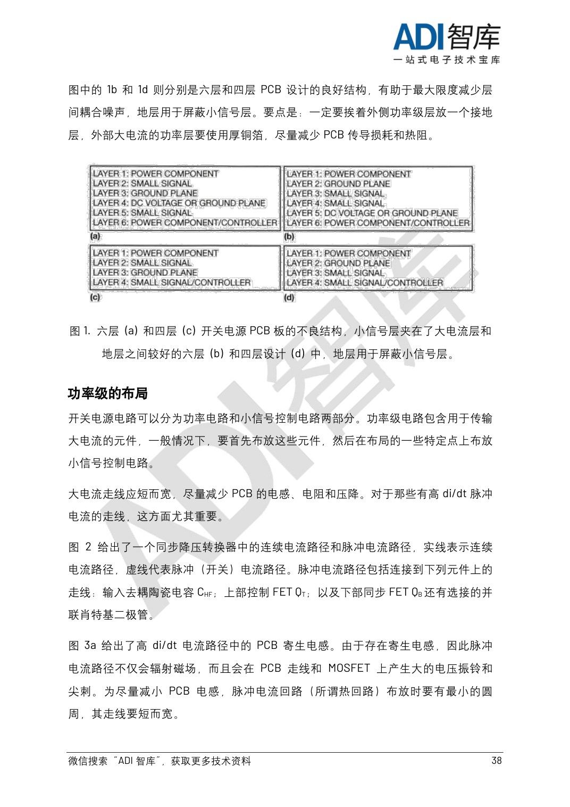


图 7. 交叉耦合层示例


这常常被忽略，因为高噪声层是在另一层——在敏感的模拟层下方。然而，一个简单的 实验就可以证明事实并非如此。以某一层面为例，在任一层注入信号。接着连接另一 层，将该相邻层交叉耦合至频谱分析仪。耦合到相邻层的信号量如图 8 所示。即使间 距40密尔，某种意义上它仍是电容，因此在某些频率下仍会耦合信号至相邻层。 


图8. 交叉耦合层实测结果


图 8 显示了这样的一个例子。举例来说，假设一个层面上的高噪声数字层具有高速 开关的 1V 信号。这意味着，另一层将看到 1mV 的耦合（约 60dB 隔离）。对具有 2-Vp-p 满量程摆幅的 12 位 ADC，这是 2LSB 的耦合。对于特定的系统这可能不成 问题，但应注意，如果系统的灵敏度提升两位，从 12 位增至 14 位，此耦合的灵敏 度只会提高四倍，即 8LSB。 

忽略此类型的交叉层耦合可能使系统失效，或者削弱设计。必须注意，两层之间存在 的耦合可能超出想象。 

在目标频谱内发现噪声杂散耦合时应注意这一点。有时布局决定了非预期信号或层 应交叉耦合至不同层。同样，调试敏感系统时应注意这一点。该问题可能出现在下 面一层。 

## 分离接地

模拟信号链设计人员最常提出的问题是：使用 ADC 时是否应将接地层分为 AGND 和 DGND 接地层？简单回答是：视情况而定。 

详细回答则是：通常不分离。为什么不呢？因为在大多数情况下，盲目分离接地层只 会增加返回路径的电感，它所带来的坏处大于好处。 

从公式 V=L (di/dt) 可以看出，随着电感增加，电压噪声会提高。随着电感增加，设 计人员一直努力压低的 PDS 阻抗也会增加。随着提高 ADC 采样速率的需求继续增 长，降低开关电流 (di/dt) 的方式却很有限。因此，除非需要分离接地层，否则请保 持这些接地连接。 


图 9. 良好电路分割示例


关键是电路分割要合理，这样就不必分离接地层，如图 9 所示。注意，如果布局允 许您将电路保持在各自区域内，便不需要分离接地层。如此分割可提供星型接地，从 而将返回电流局限在特定电路部分。 

例如，受尺寸限制的影响，电路板无法实现良好的布局分割时，就需要分离接地层。 这可能是为了符合传统设计要求或尺寸，必须将脏乱的总线电源或高噪声数字电路放 在某些区域。这种情况下，分离接地层是实现良好性能的关键。然而，为使整体设计 有效，必须在电路板的某个地方通过一个电桥或连接点将这些接地层连在一起。因 此，应将连接点均匀地分布在分离的接地层上。 

最终，PCB 上往往会有一个连接点成为返回电流通过而不会导致性能降低或强行将 返回电流耦合至敏感电路的最佳位置。如果此连接点位于转换器、其附近或下方，则 不需要分离接地。 

## 结束语

由于最佳选项太多，布局考虑总是令人困惑。技术和原则一直是公司设计文化的一部 分。工程师喜欢借鉴以前设计中的经验，同时产品上市压力使设计人员不愿更改或尝 试新技术。他们拘泥于风险权衡，直至系统内出现重大问题。 

在评估板、模块和系统级别，简单的单一接地最佳。良好的电路分割是关键。这也影 响到层和相邻层布局。如果敏感层在高噪声数字层以上，请注意可能会发生交叉耦 合。组装也很重要；提供给 PCB 车间或组装车间的制造笔记应善加利用，确保 IC 裸 露焊盘和PCB之间具有可靠连接。 

组装不良常常导致系统性能欠佳。靠近电源层入口点和转换器或 IC 的 VDD 引脚的去 耦总是有利的。然而，为了增加固有高频去耦电容，应使用紧密叠置的电源和接地层 （间距≤4 密尔）。此方法不会带来额外成本，只需花几分钟更新 PCB 制造笔记。 

设计高速、高分辨率转换器布局时，很难照顾到所有的具体特性。每个应用都是独 一无二的。希望本应用笔记所述的几个要点有助于设计工程师更好地了解未来的系 统设计。 

## 第五章 非隔离式开关电源的

## PCB 布局考虑

一个良好的布局设计可优化效率，减缓热应力，并尽量减小走线与元件之间的噪声与 作用。这一切都源于设计人员对电源中电流传导路径以及信号流的理解。 

当一块原型电源板首次加电时，最好的情况是它不仅能工作，而且还安静、发热低。 然而，这种情况并不多见。 

开关电源的一个常见问题是“不稳定”的开关波形。有些时候，波形抖动处于声波 段，磁性元件会产生出音频噪声。如果问题出在印刷电路板的布局上，要找出原因可 能会很困难。因此，开关电源设计初期的正确 PCB布局就非常关键。 

电源设计者要很好地理解技术细节，以及最终产品的功能需求。因此，从电路板 设计项目一开始，电源设计者应就关键性电源布局，与 PCB 布局设计人员展开密 切合作。 

一个好的布局设计可优化电源效率，缓热应力；更重要的是，它最大限度地减小了噪 声，以及走线与元件之间的相互作用。为实现这些目标，设计者必须了解开关电源内 部的电流传导路径以及信号流。要实现非隔离开关电源的正确布局设计，务必牢记以 下这些设计要素。 

## 布局规划

对一块大电路板上的嵌入 dc/dc 电源，要获得最佳的电压调节、负载瞬态响应和系 统效率就要使电源输出靠近负载器件，尽量减少 PCB 走线上的互连阻抗和传导压 降。确保有良好的空气流，限制热应力；如果能采用强制气冷措施，则要将电源靠 近风扇位置。 

另外，大型无源元件（如电感和电解电容）均不得阻挡气流通过低矮的表面封装半导 体元件，如功率 MOSFET 或 PWM 控制器。为防止开关噪声千扰到系统中的模拟信 号，应尽可能避免在电源下方布放敏感信号线；否则，就需要在电源层和小信号层之 间放置一个内部接地层，用做屏蔽。 

关键是要在系统早期设计和规划阶段，就筹划好电源的位置，以及对电路板空间的需 求。有时设计者会无视这种忠告，而把关注点放在大型系统板上那些更“重要”或 “让人兴奋的电路。电源管理被看作事后工作，随便把电源放在电路板上的多余空间 上，这种做法对高效率而可靠的电源设计十分不利。 

对于多层板，很好的方法是在大电流的功率元件层与敏感的小信号走线层之间布放直 流地或直流输入/输出电压层。地层或直流电压层提供了屏蔽小信号走线的交流地， 使其免受高噪声功率走线和功率元件的干扰。 

作为一般规则，多层 PCB 板的接地层或直流电压层均不应被分隔开。如果这种分隔 不可避免，就要尽量域少这些层上走线的数量和长度，并且走线的布放要与大电流保 持相同的方向，使影响最小化。 

图 1a 和 1c 分别是六层和四层开关电源 PCB 的不良层结构。这些结构将小信号层夹 在大电流功率层和地层之间，因此增加了大电流/电压功率层与模拟小信号层之间耦 合的电容噪声。 

图中的 1b 和 1d 则分别是六层和四层 PCB 设计的良好结构，有助于最大限度减少层 间耦合噪声，地层用于屏蔽小信号层。要点是：一定要挨着外侧功率级层放一个接地 层，外部大电流的功率层要使用厚铜箔，尽量减少PCB 传导损耗和热阻。 


图1. 六层 (a) 和四层 (c) 开关电源PCB板的不良结构，小信号层夹在了大电流层和 地层之间较好的六层 (b) 和四层设计 (d) 中，地层用于屏蔽小信号层。


## 功率级的布局

开关电源电路可以分为功率电路和小信号控制电路两部分。功率级电路包含用于传输 大电流的元件，一般情况下，要首先布放这些元件，然后在布局的一些特定点上布放 小信号控制电路。 

大电流走线应短而宽，尽量减少 PCB 的电感、电阻和压降。对于那些有高 di/dt 脉冲 电流的走线，这方面尤其重要。 

图 2 给出了一个同步降压转换器中的连续电流路径和脉冲电流路径，实线表示连续 电流路径，虚线代表脉冲（开关）电流路径。脉冲电流路径包括连接到下列元件上的 走线：输入去耦陶瓷电容C<sub>HF</sub>；上部控制FET Q<sub>T</sub>；以及下部同步 FET Q<sub>B</sub>还有选接的并 联肖特基二极管。 

图 3a 给出了高 di/dt 电流路径中的 PCB 寄生电感。由于存在寄生电感，因此脉冲 电流路径不仅会辐射磁场，而且会在 PCB 走线和 MOSFET 上产生大的电压振铃和 尖刺。为尽量减小 PCB 电感，脉冲电流回路（所谓热回路）布放时要有最小的圆 周，其走线要短而宽。 

高频去耦电容 C<sub>HF</sub>应为 0.1μF~10μF，X5R 或 X7R 电介质的陶瓷电容，它有极低的 ESL （有效串联电感和 ESR（等效串联电阻）。较大的电容电介质（如 Y5V）可能使电容 值在不同电压和温度下有大的下降，因此不是 ${ \complement _ { \hat { \mathsf { H F } } } }$ 的最佳材料。 

图 3b 为降压转换器中的关键脉冲电流回路提供了一个布局例子。为了限制电阻压降 和过孔数量，功率元件都布放在电路板的同一面，功率走线也都布在同一层上。当需 要将某根电源线走到其它层时，要选择在连续电流路径中的一根走线。当用过孔连接 大电流回路中的 PCB 层时，要使用多个过孔，尽量减小阻抗。 

图 4 显示的是升压转换器中的连续电流回路与脉冲电流回路。此时，应在靠近 MOSFET $\mathsf { { O } } _ { \mathsf { { B } } }$ 与升压二极管D 的输出端放置高频鸬瓷电容 ${ \complement _ { \hat { \mathsf { H F } } } }$ 

图 5 是升压转换器中脉冲电流回路的一个布局例子。此时关键在于尽量减小由开关 管 Q 、整流二极管 D 和高频输出电容 ${ \complement _ { \hat { \mathsf { H F } } } }$ 形成的回路。图 6 和图 7（略）提供了一个 同步降压电路的例子 ， 它强调了去耦电容的重要性。 图 6a 是一个双相 12Vw2.Vou/30A（最大值）的同步降压电源，使用了 LTC3729 双相单 $\mathsf { V o r }$ 控制器 1C。在无负载时，开关结点 SW1 和 SW2 的波形以及输出电感电流都是稳定的（图 6b）。但如果负载电流超过 13A，SWI 结点的波形就开始丢失周期。负载电流更高 时，问题会更恶化（图 6c）。 

在各个通道的输入端增加两只 1uF 的高频陶瓷电容，就可以解决这个问题，电容隔离 开了每个通道的热回路面积，并使之最小化。即使在高达 30A 的最大负载电流下， 开关波形仍很稳定。 

## 高 DV/DT 开关区

图 2 和图 4 中，在 $V _ { \sf I N }$ （或 $\mathsf { V } _ { 0 \mathsf { U T } } )$ 与地之间的 SW 电压摆幅有高的 dv/dt 速率。这个 结点上有丰富的高频噪声分量，是一个强大的 EMI 噪声源。为了尽量减小开关结点 与其它噪声敏感走线之间的耦合电容，你可能会让 SW 铜箔面积尽可能小。但是，为 了传导大的电感电流，并且为功率 MOSFET 管提供散热区，SW 结点的 PCB 区域又 不能够太小。一般建议在开关结点下布放一个接地铜箔区，提供额外的屏蔽。 

如果设计中没有用于表面安装功率 MOSFET 与电感的散热器，则铜箔区必须有足够 的散热面积。对于直流电压结点（如输入/输出电压与电源地），合理的方法是让铜 箔区尽可能大。 

多过孔有助于进一步降低热应力。要确定高 dv/dt 开关结点的合适铜箔区面积， 就要在尽量减小 dv/dt 相关噪声与提供良好的 MOSFET 散热能力两者间做一个设 计平衡。 

## 功率焊盘形式

注意功率元件的焊盘形式，如低 ESR 电容、MOSFET、二极管和电感。图 8a（略） 和8b（略）分别给出了不合理和合理的功率元件焊盘形式。 

对于去耦电容，正负极过孔应尽量互相靠近，以减少 PCB 的 ESL 这对低 ESL 电容尤 其有效。小容值低 ESR 的电容通常较贵，不正确的焊盘形式及不良走线都会降低它 们的性能，从而增加整体成本。通常情况下，合理的焊盘形式能降低 PCB 噪声，减 小热阻，并最大限度降低走线阻抗以及大电流元件的压降。 

大电流功率元件布局时有常见的误区，那就是不正确地采用了热风焊盘 (therma relief)，如图 8a（略）所示。非必要情况下使用热风焊盘，会增加功率元件之间的互 连阻抗，从而造成较大的功率损耗，降低小 ESR 电容的去耦效果。如果在布局时用 过孔来传导大电流，要确保它们有充足的数量，以减少阻抗。此外，不要对这些过孔 使用热风焊盘。 

图 9（略）是有多个板上电源的应用，这些电源共享相同的输入电压轨。当这些电源 互相不同步时，就需要将输入电流走线隔离开来，以避免不同电源之间耦合公共阻抗 噪声。每个电源拥有一个本地的输入去耦电容倒是不太关键。 

对于一只Polyphase 单输出转换器，为每个相做一个对称布局有助于热应力的均衡。 

## 布局设计实例

图 10（略）是一个设计实例，它是个 3.5V-14V，最大输出 1.2V/40A 的双相同步降压 转换器，使用了 LTC3855 Polyphase 电流模式步进降压控制器。在开始 PCB 布局 前，个好的习惯是在逻辑图上用不同颜色特别标示出大电流走线、高噪声的高 dv/dt 走线，以及敏感的小信号走线。这种图将有助于 PCB设计者区分开各种走线。 

图 11（略）是这个 1.2V/40A 电源的功率元件层上的功率级布局例子。图中，Q-是高 侧控制 ${ \mathsf { M O S F E T Q } } _ { \mathsf { B } }$ 是低侧同步 FET。可选择增加 Q 的接地面积，以获得更多的输出 电流。在功率元件层的下方，放了个实心的电源地层。 

## 控制电路布局

使控制电路远离高噪声的开关铜箔区。对降压转换器，好的办法是将控制电路置 于靠近 ${ \mathsf { V } } _ { 0 \mathsf { U T } } +$ 端，而对升压转换器，控制电路则要靠近 V<sub>IN</sub>+端，让功率走线承载连 续电流。 

如果空间允许，控制 IC 与功率 MOSFET 及电感（它们都是高噪声高热量元件）之间 要有小的距离（0.5 英寸~1 英寸）。如果空间紧张，被迫将控制器置于靠近功率 MOSFET 与电感的位置，则要特别注意用地层或接地走线，将控制电路与功率元件隔 离开来。 

图 12（略）是 LTC3855 电源的较好的隔离地方案，IC 有外露的 GND 焊盘，应焊到 PCB 上，以尽量减少电气阻抗与热阻。几只关键去耦电容应紧挨着 IC 引脚。 

控制电路应有一个不同于功率级地的独立信号（模拟）地。如果控制器 IC 上有独立 的 SGND（信号地）和 PGND（功率地）引脚，则应分别布。对于集成了 MOSFET 驱 动器的控制 IC，小信号部分的 IC 引脚应使用 SGND。 

信号地与功率地之间只需要个连接点。合理方法是使信号地返回到功率地层的一个千 净点。只在控制器 IC 下连接两种接地走线，就可以实现两种地。图 12（略）给出了 建议的 LTC3855 电源接地隔离法。在本例中，IC 有一个外露的接地焊盘此焊盘应焊 到PCB上，以尽量减少电气阻抗与热阻。应在接地焊盘区放置多个过孔。 

控制 IC 的去耦电容应靠近各自的引脚。为尽量减少连接阻抗，好的方法是将去耦电 容直接接到引脚上，而不通过过孔。如图 12（略）所示，应靠近置放去耦电容的 LTC3855 引脚是电流检测引脚 Sense+/Sense-，补偿引脚 I<sub>TH</sub>，信号地 SGND，反馈分 压器脚 FB， $1 0 \ : \mathsf { V } _ { \mathtt { c c } }$ 电压引脚 $\left| N - T V _ { \mathsf { c c } } \right.$ ，以及功率地引脚PGND。 

## 回路面积与串扰

两个或多个邻近导体可以产生容性耦合。一个导体上的高 dvdt 会通过寄生电容，在 另一个导体上耦合出电流。为减少功率级对控制电路的耦合噪声，高噪声的开关走线 要远离敏感的小信号走线。如果可能的话，要将高噪声走线与敏感走线布放在不同的 层，并用内部地层作为噪声屏蔽。 

空间允许的话，控制 IC 要距离功率 MOSFET 和电感有一个小的距离（0.5 英寸~1 英 寸），后者既有大噪声又发热。 

LTC3855 控制器上的 FET 驱动器 TG、BG、SW 和 BOOST 引脚都有高的 dv/dt 开关 电压。连接到最敏感小信号结点的 LTC3855 引脚是：Sense+/Sense-、 FB、I<sub>TH</sub> 和 SGND。如果布局时将敏感的信号走线靠近了高 dv/dt 结点，则必须在信号走线与高 dv/dt 走线之间插入接地线或接地层，以屏蔽噪声。 

在布放栅极驱动信号时，采用短而宽的走线有助于尽量减小栅极驱动路径中的阻抗。 在图13（略）中，布放的高FET 驱动器走线TG 与SW 应有最小的回路面积，以尽量 减小电感与高 dv/dt 噪声。同样，低 FET 驱动器走线 BG 要靠近一根 PGND 走线。 

如果在 BG 走线下布放了一个 PGND 层，低 FET 的交流地返回电流将自动耦合到一个 靠近 BG 走线的路径中。交流电流会流向它所发现的最小回路/阻抗。此时，低栅极 驱动器不需要一个独立的 PGND 返回走线。最好的办法是尽量减少栅极驱动走线通过 的层数量，这样可防止极噪声传播到其它层。 

在所有小信号走线中，电流检测走线对噪声最为敏感。电流检测信号的波幅通常小 于 100mV，这与噪声的波幅相当。以 LTC3855 为例，Sense+/Sense- 走线应以最小 间距并行布放（Kelvin 检测），以尽量减少拾取 di/dt 相关噪声的机会，如图 14 （略）所示。 

另外，电流检测走线的滤波电阻与电容都应尽可能靠近 IC 引脚。当有噪声注入长的 检测线时，这种结构的滤波效果最好。如果采用带 RC 网络的电感 DCR 电流检测方 式，则 DCR检测电阻R应靠近电感，而DCR检测电容C则应靠近IC。 

如果在走线到 Sense- 的返回路径上使用了一个过孔，则过孔不应接触到其它的内部 

V<sub>OUT</sub>+层。否则，过孔可能会传导大的 V<sub>OUT</sub>+电流，所产生的压降可能破坏电流检测信 号。要避免在高噪声开关结点（TG、BG、SW 和 BOOST 走线）附近布放电流检测走 线。如可能，在电流检测走线所在层与功率级走线层之间放置地层。 

如果控制器 IC 有差分电压远程检测引脚，则要为正、负远程检测线采用独立的走 线，同时也采用 Kelvin 检测连接。 

## 走线宽度的选择

对具体的控制器引脚，电流水平和噪声敏感度都是唯一的，因此，必须为不同信号选 择特定的走线宽度。通常情况下，小信号网络可以窄些，采用 10mil~15mil 宽度的走 线。大电流网络（栅极驱动、 $\mathsf { V } _ { \mathtt { c c } }$ 以及 PGND 则应采用短而宽的走线。这些络的走线 建议至少为20mil宽。 

## 布局检查表

表 1 可从网上下载 (http:/bit.ly/Ruxanc)，它是图 10（略）所示 LTC3855 双相电源的 一个检查表实例。采用这个检查表有助于确保得到一个布局严谨的电源设计。 

第六章 关于在开关模式电源印刷 电路板上放置电感的指南 

## 问题：

线圈应该放在哪里？ 

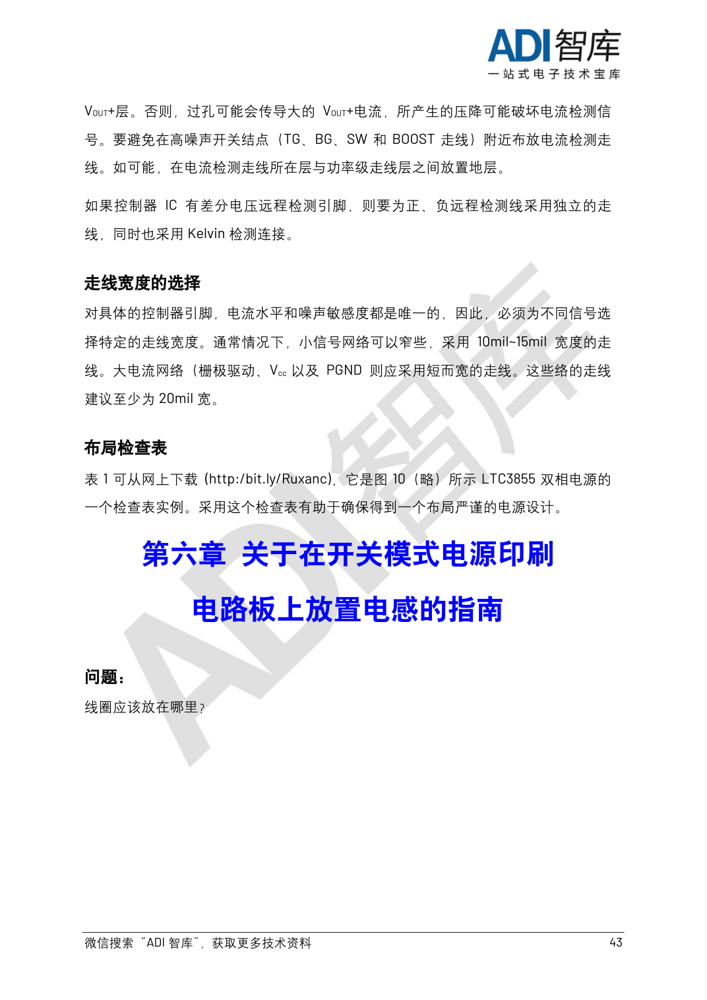

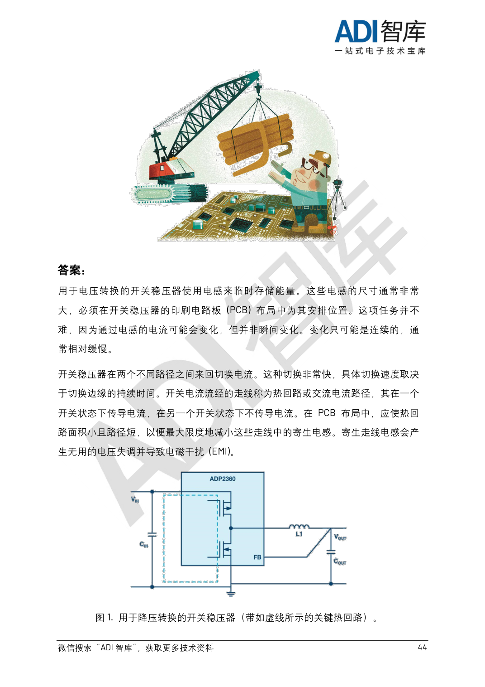


## 答案：

用于电压转换的开关稳压器使用电感来临时存储能量。这些电感的尺寸通常非常 大，必须在开关稳压器的印刷电路板 (PCB) 布局中为其安排位置。这项任务并不 难，因为通过电感的电流可能会变化，但并非瞬间变化。变化只可能是连续的，通 常相对缓慢。 

开关稳压器在两个不同路径之间来回切换电流。这种切换非常快，具体切换速度取决 于切换边缘的持续时间。开关电流流经的走线称为热回路或交流电流路径，其在一个 开关状态下传导电流，在另一个开关状态下不传导电流。在 PCB 布局中，应使热回 路面积小且路径短，以便最大限度地减小这些走线中的寄生电感。寄生走线电感会产 生无用的电压失调并导致电磁干扰 (EMI)。 

[[硬件/原始备份/PCB设计秘籍.pdf#page=45|原版PDF第45页整页回看（前文已展示）]]


图1. 用于降压转换的开关稳压器（带如虚线所示的关键热回路）。


图 1 所示为一个降压调节器，其中关键热回路显示为虚线。可以看出，线圈 L1 不是 热回路的一部分。因此，可以假设该电感器的放置位置并不重要。使电感器位于热回 路以外是正确的——因此在第一个实例中，安放位置是次要的。不过，应该遵循一些 规则。 

不得在电感下方（PCB 表面或下方都不行）、在内层里或 PCB 背面布设敏感的控制 走线。受电流流动的影响，线圈会产生磁场，结果会影响信号路径中的微弱信号。在 开关稳压器中，一个关键信号路径是反馈路径，其将输出电压连接到开关稳压器 IC 或电阻分压器。 

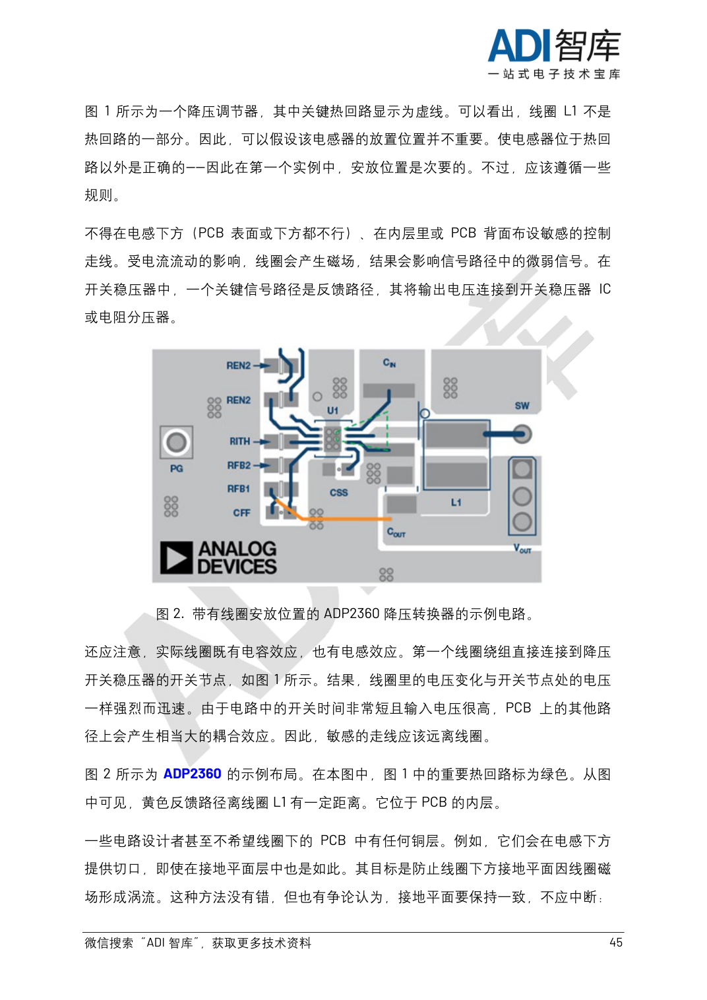


图2. 带有线圈安放位置的 ADP2360降压转换器的示例电路。


还应注意，实际线圈既有电容效 也有电感效应。第一个线圈绕组直接连接到降压 开关稳压器的开关节点，如图 1 所示。结果，线圈里的电压变化与开关节点处的电压 一样强烈而迅速。由于电路中的开关时间非常短且输入电压很高，PCB 上的其他路 径上会产生相当大的耦合效应。因此，敏感的走线应该远离线圈。 

图 2 所示为 ADP2360 的示例布局。在本图中，图 1 中的重要热回路标为绿色。从图 中可见，黄色反馈路径离线圈 L1有一定距离。它位于PCB的内层。 

一些电路设计者甚至不希望线圈下的 PCB 中有任何铜层。例如，它们会在电感下方 提供切口，即使在接地平面层中也是如此。其目标是防止线圈下方接地平面因线圈磁 场形成涡流。这种方法没有错，但也有争论认为，接地平面要保持一致，不应中断： 

 用于屏蔽的接地平面在不中断时效果最佳。 

 PCB的铜越多，散热越好。 

 即使产生涡流，这些电流也只能局部流动，只会造成很小的损耗，并且几乎不会 影响接地平面的功能。 

因此，我同意接地平面层，甚至是线圈下方，也应保持完整的观点。 

总之，我们可以得出结论，虽然开关稳压器的线圈不是临界热回路的一部分，但不在 线圈下方或靠近线圈处布敏感的控制走线却是明智的。PCB 上的各种平面——例如， 接地平面或 VDD 平面（电源电压）——可以连续构造，无需切口。 

## 第七章 差分滤波器布局八大考虑因素

## 成对差分走线的长度须相同

此规则源自这一事实：差分接收器检测正负信号跨过彼此的点，即交越点。因此，信 号须同时到达接收器才能正常工作。 

## 差分对内的走线布线须彼此靠近

如果一对中的相邻线路之间的距离大于电介质厚度的 2 倍，则其间的耦合会很小。 此规则也是基于差分信号相等但相反这一事实，如果外部噪声同等地干扰两个信号， 则其影响会互相抵消。同样，如果走线并排布线，则差分信号在相邻导线中引起的任 何干扰噪声都会被抵消。 

## 同一差分对内的走线间距在全长范围内须保持不变

如果差分走线彼此靠近布线，它们将影响总阻抗。如果此间距在驱动器与接收器之间 变化不定，则一路上会存在阻抗不匹配，导致反射。 

## 差分对之间的间距应较宽

以使其间的串扰最小。 

如果在同一层上使用铜皮铺地，应加大从差分走线到铜皮铺地之间的间隙 推荐最小间隙为走线宽度的3倍。 

## 在靠近差分对内偏斜源处引入少量弯弯曲曲的校正

从而降低这种偏斜（参见图 1）。 

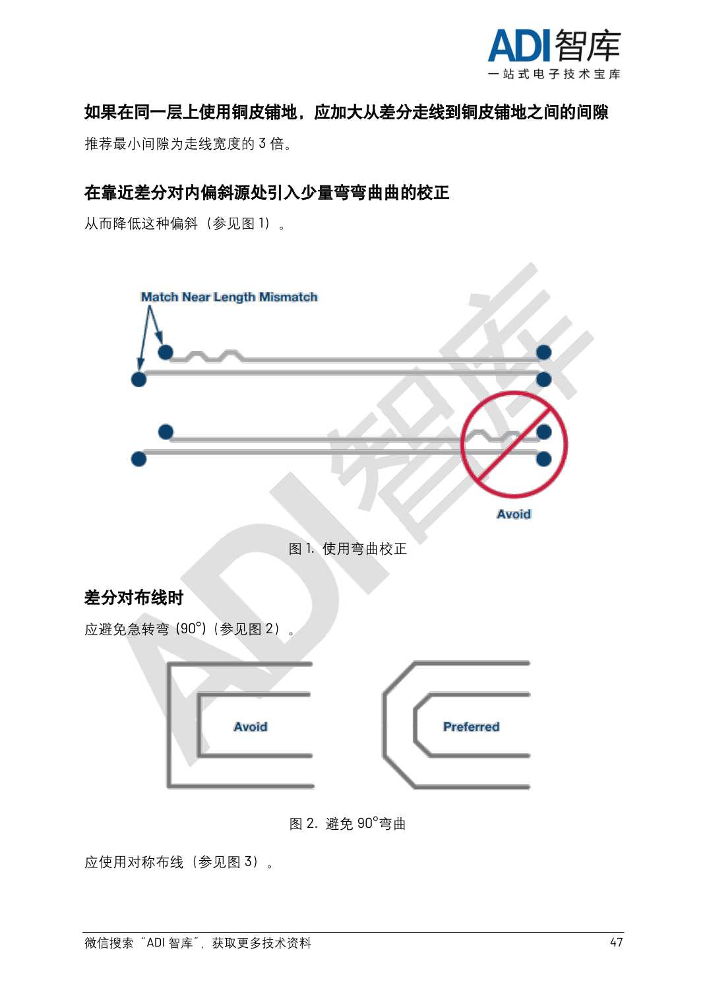


图 1. 使用弯曲校正


## 差分对布线时

[[硬件/原始备份/PCB设计秘籍.pdf#page=48|原版PDF第48页整页回看（前文已展示）]]


图 2. 避免 90°弯曲


应使用对称布线（参见图3）。


[[硬件/原始备份/PCB设计秘籍.pdf#page=48|原版PDF第48页整页回看（前文已展示）]]

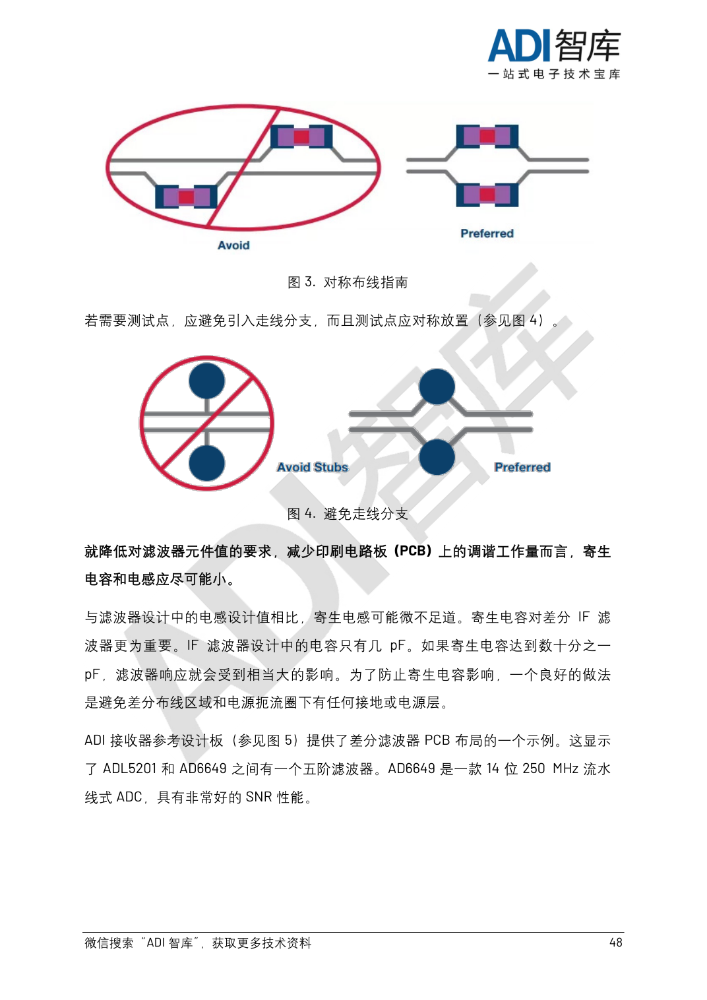


图3. 对称布线指南


若需要测试点，应避免引入走线分支，而且测试点应对称放置（参见图 4）。


[[硬件/原始备份/PCB设计秘籍.pdf#page=49|原版PDF第49页整页回看（前文已展示）]]


图 4. 避免走线分支


就降低对滤波器元件值的要求，减少印刷电路板 (PCB) 上的调谐工作量而言，寄生 电容和电感应尽可能小。 

与滤波器设计中的电感设计值相比，寄生电感可能微不足道。寄生电容对差分 IF 滤 波器更为重要。IF 滤波器设计中的电容只有几 pF。如果寄生电容达到数十分之一 pF，滤波器响应就会受到相当大的影响。为了防止寄生电容影响，一个良好的做法 是避免差分布线区域和电源扼流圈下有任何接地或电源层。 

ADI 接收器参考设计板（参见图 5）提供了差分滤波器 PCB 布局的一个示例。这显示 了 ADL5201 和 AD6649 之间有一个五阶滤波器。AD6649 是一款 14 位 250 MHz 流水 线式ADC，具有非常好的 SNR性能。 

[[硬件/原始备份/PCB设计秘籍.pdf#page=49|原版PDF第49页整页回看（前文已展示）]]

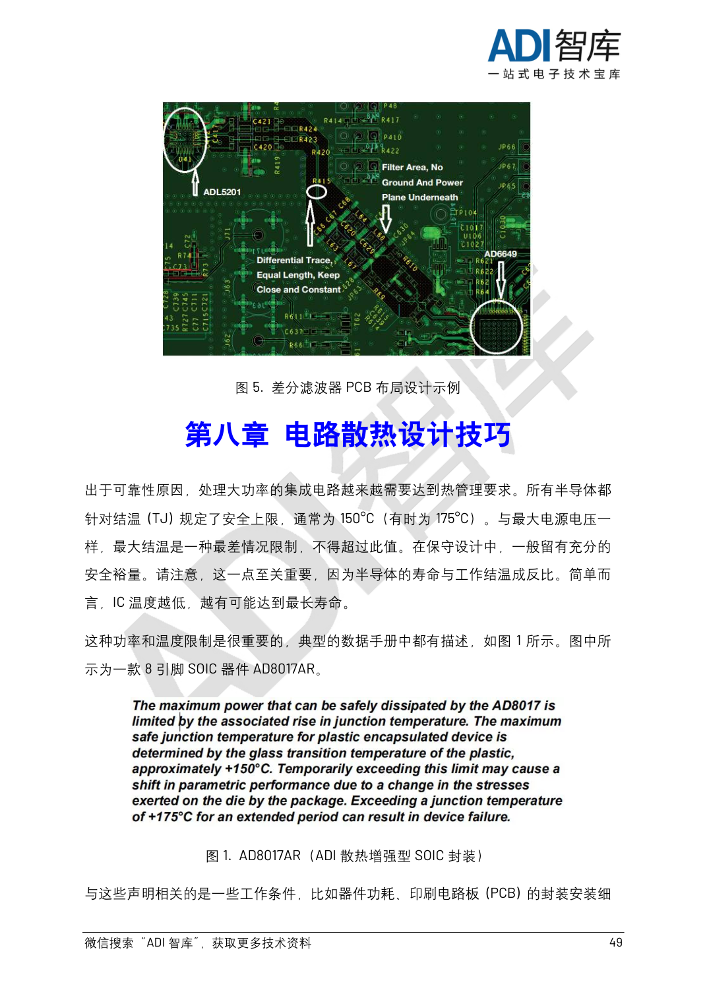


图 5. 差分滤波器 PCB 布局设计示例


## 第八章 电路散热设计技巧

出于可靠性原因，处理大功率的集成电路越来越需要达到热管理要求。所有半导体都 针对结温 (TJ) 规定了安全上限，通常为 $1 5 0 ^ { \circ } \complement$ （有时为 $1 7 5 ^ { \circ } \mathrm { C } )$ 。与最大电源电压一 样，最大结温是一种最差情况限制，不得超过此值。在保守设计中，一般留有充分的 安全裕量。请注意，这一点至关重要，因为半导体的寿命与工作结温成反比。简单而 言，IC 温度越低，越有可能达到最长寿命。 

这种功率和温度限制是很重要的，典型的数据手册中都有描述，如图 1 所示。图中所 示为一款 8 引脚 SOIC 器件 AD8017AR。 

The maximum power that can be safely dissipated by the AD8017 is limited by the associated rise in junction temperature. The maximum safe junction temperature for plastic encapsulated device is determined by the glass transition temperature of the plastic, approximately +150°C. Temporarily exceeding this limit may cause a shift in parametric performance due to a change in the stresses exerted on the die by the package. Exceeding a junction temperature of +175°C for an extended period can result in device failure. 

图 1. AD8017AR（ADI 散热增强型 SOIC 封装） 

与这些声明相关的是一些工作条件，比如器件功耗、印刷电路板 (PCB) 的封装安装细 则等。对于 AD8017AR，其在 $2 5 ^ { \circ } \complement$ 的环境温度下的额定功耗为 1.3W。其假设是 8 引脚 SOIC 封装配合的是一块双层 PCB 板，以大约 4 in2 (~2500 mm2) 的 2 盎司铜实现散 热。下面将预测该器件在其他条件下的安全工作情况。 

```txt
- θ = Thermal Resistance (°C/W)
- P = Total Device Power Dissipation (W)
- T = Temperature (°C)
- ΔT = Temperature Differential = P × θ
- θJA = Junction-Ambient Thermal Resistance
- θJC = Junction-Case Thermal Resistance
- θCA = Case-Ambient Thermal Resistance
- θJA = θJC + θCA
- TJ = TA + (P × θJA)
- Note: TJ(Max) = 150°C (Sometimes 175°C) 
```

## 散热设计基础

一般用符号 θ 来表示热阻。热阻的单位为 $^ { \circ } \complement / \sf { W }$ 。除非另有说明，热阻指热量在从热 IC 结点传导至环境空气时遇到的阻力。也可更具体地表示为 $\mathtt { \theta } _ { \mathtt { J A } }$ ，即结至环境热阻。 $\mathtt { \theta _ { \mathrm { J C } } }$ 和 ${ \tt \theta } _ { \tt C A }$ 是θ的两种其他形式，详见下文。 

一般地，热阻θ等于 ${ 1 0 0 } ^ { \circ } \complement / \sf W$ 的器件在1W 功耗下将表现出 $1 0 0 ^ { \circ } \complement$ 的温差，该值在两 个参照点之间测得。请注意，这是一种线性关系，因此，在该器件中，1W 的功耗将 产生 $1 0 0 ^ { \circ } \complement$ 的温差（如此等等，不一而足）。对于 AD8017AR，θ 约为 $9 5 ^ { \circ } \complement / \mathsf { W }$ ，因 此，1.3W 的功耗将产生大约 $1 2 4 ^ { \circ } \complement$ 结至环境温差。当然，预测内部温度时使用的正 是这种温度的上升，其目的是判断设计的热可靠性。当环境温度为 $2 5 ^ { \circ } \complement$ 时，允许约 $1 5 0 ^ { \circ } \complement$ 的内部结温。实际上，多数环境温度都在 $2 5 ^ { \circ } \complement$ 以上，因此，可以处理的功耗 会稍低。 

对于任意功耗P（单位：W），都可以用以下等式来计算有效温差 (ΔT)（单位： $^ \circ \mathsf { C } )$ 

$$
\Delta T = P \times \theta
$$

其中，θ为总适用热阻。图2总结了一些基本的热关系。 


图 2. 基本热关系


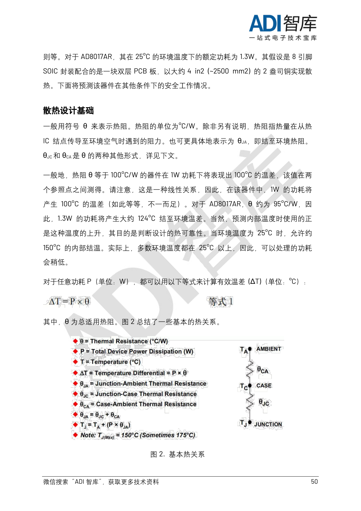

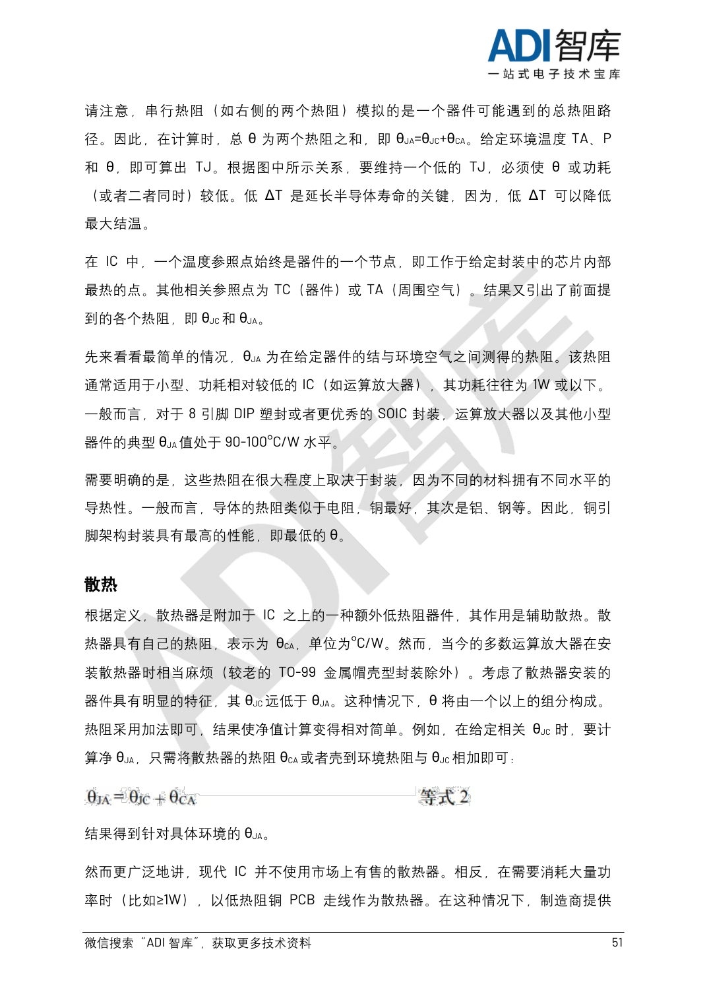


请注意，串行热阻（如右侧的两个热阻）模拟的是一个器件可能遇到的总热阻路 径。因此，在计算时，总 θ 为两个热阻之和，即 $\theta _ { \cup \mathsf { A } } { = } \theta _ { \cup \mathsf { C } } { + } \theta _ { \complement \mathsf { A } }$ 。给定环境温度 TA、P 和 θ，即可算出 TJ。根据图中所示关系，要维持一个低的 TJ，必须使 θ 或功耗 （或者二者同时）较低。低 ΔT 是延长半导体寿命的关键，因为，低 ΔT 可以降低 最大结温。 

在 IC 中，一个温度参照点始终是器件的一个节点，即工作于给定封装中的芯片内部 最热的点。其他相关参照点为 TC（器件）或 TA（周围空气）。结果又引出了前面提 到的各个热阻，即 $\mathtt { \theta _ { \mathrm { J C } } }$ 和 $\mathtt { \theta } _ { \mathtt { J A } }$ 

先来看看最简单的情况， $\mathtt { \mathtt { \mathtt { \mathtt { \mathtt { \mathtt { \mathtt { \mathtt \mathtt { \mathtt { \mathtt \mathtt { \mathtt \mathtt { A } } } } } } } } } } }$ 为在给定器件的结与环境空气之间测得的热阻。该热阻 通常适用于小型、功耗相对较低的 IC（如运算放大器），其功耗往往为 1W 或以下。 一般而言，对于 8 引脚 DIP 塑封或者更优秀的 SOIC 封装，运算放大器以及其他小型 器件的典型 $\mathtt { \theta } _ { \mathtt { J A } }$ 值处于 $9 0 { - } 1 0 0 ^ { \circ } \mathrm { C } / \mathrm { W }$ 水平。 

需要明确的是，这些热阻在很大程度上取决于封装，因为不同的材料拥有不同水平的 导热性。一般而言，导体的热阻类似于电阻，铜最好，其次是铝、钢等。因此，铜引 脚架构封装具有最高的性能，即最低的 θ。 

## 散热

根据定义，散热器是附加于 IC 之上的一种额外低热阻器件，其作用是辅助散热。散 热器具有自己的热阻，表示为 $\mathtt { \theta _ { C A } }$ ，单位为 $^ { \circ } \complement / \sf { W }$ 。然而，当今的多数运算放大器在安 装散热器时相当麻烦（较老的 TO-99 金属帽壳型封装除外）。考虑了散热器安装的 器件具有明显的特征，其 $\mathtt { \theta _ { \mathrm { J C } } }$ 远低于 $\mathtt { \theta } _ { \mathtt { J A } }$ 。这种情况下，θ 将由一个以上的组分构成。 热阻采用加法即可，结果使净值计算变得相对简单。例如，在给定相关 $\mathtt { \theta _ { \mathrm { J C } } }$ 时，要计 算净 $\mathtt { \theta } _ { \mathtt { J A } }$ ，只需将散热器的热阻 ${ \tt \theta } _ { \tt C A }$ 或者壳到环境热阻与 $\mathtt { \theta _ { \mathrm { J C } } }$ 相加即可： 

$$
\theta_ {\mathrm{JA}} = \theta_ {\mathrm{JC}} + \theta_ {\mathrm{CA}} \quad \text {等式} 2
$$

结果得到针对具体环境的 $\mathtt { \theta } _ { \mathtt { J A } }$ 。 

然而更广泛地讲，现代 IC 并不使用市场上有售的散热器。相反，在需要消耗大量功 率时（比如≥1W），以低热阻铜 PCB 走线作为散热器。在这种情况下，制造商提供 的对散热最有用的加工数据是示例 PCB 布局的边界条件以及这些条件下产生的 $\mathtt { \mathtt { \mathtt { \mathtt { \mathtt { \mathtt { \mathtt { \mathtt \mathtt { \mathtt { \mathtt \mathtt { \mathtt \mathtt { A } } } } } } } } } } }$ 如前所述，这是针对 AD8017AR 提供的具体信息。通过这种方式，展示此类条件下热 关系的示例数据如图 3 所示。这些数据适用于装有一个散热器的 AD8017AR，该散热 器的面积约为 4平方英寸，采用一块双层2盎司铜PCB 板。 

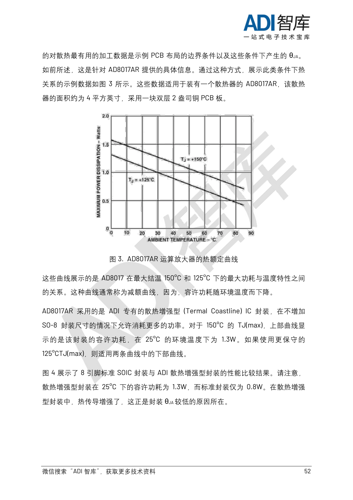


图 3. AD8017AR运算放大器的热额定曲线


这些曲线展示的是 AD8017 在最大结温 $\mathfrak { I O C }$ 和 $1 2 5 ^ { \circ } \complement$ 下的最大功耗与温度特性之间 的关系。这种曲线通常称为减额曲线，因为，容许功耗随环境温度而下降。 

AD8017AR 采用的是 ADI 专有的散热增强型 (Termal Coastline) IC 封装，在不增加 SO-8 封装尺寸的情况下允许消耗更多的功率。对于 $1 5 0 ^ { \circ } \complement$ 的 TJ(max)，上部曲线显 示的是该封装的容许功耗，在 $2 5 ^ { \circ } \complement$ 的环境温度下为 1.3W。如果使用更保守的 $1 2 5 ^ { \circ } \mathsf { C T J } ( \mathsf { m a x } )$ ，则适用两条曲线中的下部曲线。 

图 4 展示了 8 引脚标准 SOIC 封装与 ADI 散热增强型封装的性能比较结果。请注意， 散热增强型封装在 $2 5 ^ { \circ } \complement$ 下的容许功耗为 1.3W，而标准封装仅为 0.8W。在散热增强 型封装中，热传导增强了，这正是封装 $\mathtt { \theta } _ { \mathtt { J A } }$ 较低的原因所在。 

[[硬件/原始备份/PCB设计秘籍.pdf#page=53|原版PDF第53页整页回看（前文已展示）]]

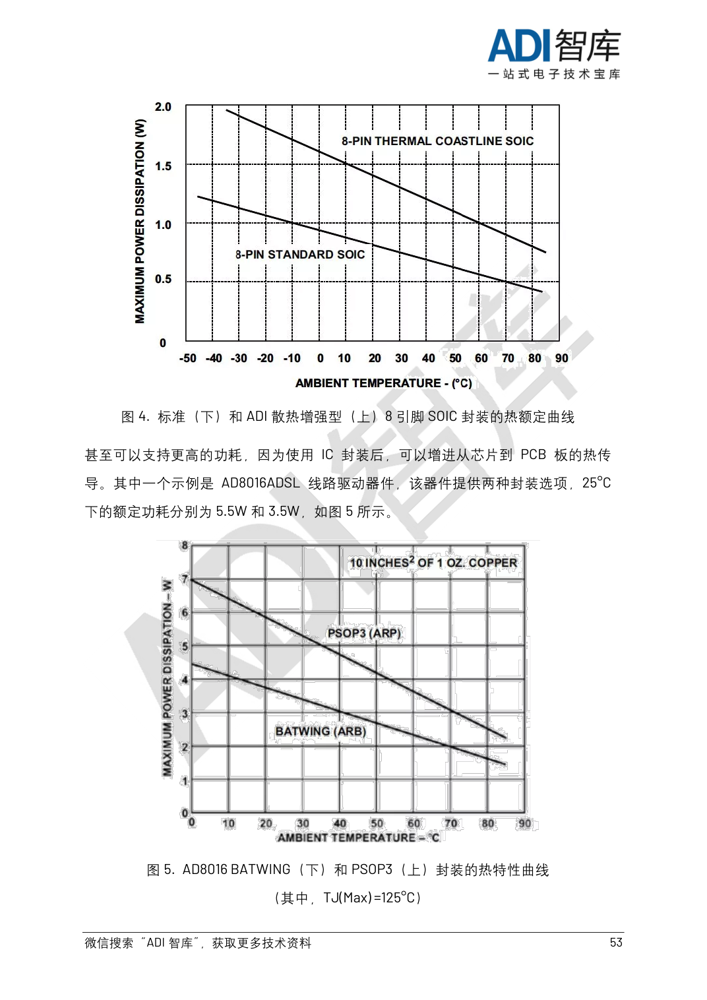


图 4. 标准（下）和 ADI 散热增强型（上）8 引脚 SOIC 封装的热额定曲线


甚至可以支持更高的功耗，因为使用 IC 封装后，可以增进从芯片到 PCB 板的热传 导。其中一个示例是 AD8016ADSL 线路驱动器件，该器件提供两种封装选项， $2 5 ^ { \circ } \complement$ 下的额定功耗分别为 5.5W 和 3.5W，如图 5 所 

[[硬件/原始备份/PCB设计秘籍.pdf#page=54|原版PDF第54页整页回看（前文已展示）]]


图 5. AD8016 BATWING（下）和 PSOP3（上）封装的热特性曲线 （其中，TJ(Max) =125°C）


以额定功耗较高的 AD8016ARP PSOP3 封装为例，当搭配一个 10in2、1 盎司散热层 时，该组合可以在 $7 0 \%$ 的环境温度下处理最高 3W 的功耗，如图中的上部曲线所 示。这相当于 $1 8 ^ { \circ } \complement / \mathsf { W }$ 的 $\mathtt { \theta } _ { \mathtt { J A } }$ ，这种情况下，该值适用于 $1 2 5 ^ { \circ } \complement$ 的最大结温。 

PSOP3 版的 AD8016 之所以具有如此出色的功耗处理能力是因为采用了一块大面积铜 片。在内部，IC 芯片直接置于铜片上，底部表面裸露情况如图 6 所示。其目的是将 该表面直接焊接到 PCB板上的一个铜层上，从而扩大散热面。 

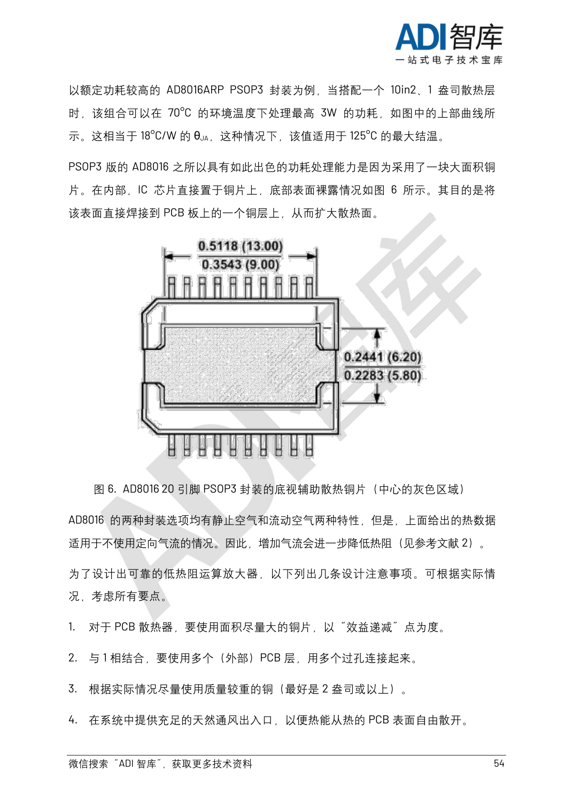


图6. AD8016 20引脚 PSOP3封装的底视辅助散热铜片（中心的灰色区域）


AD8016 的两种封装选项均有静止空气和流动空气两种特性，但是，上面给出的热数据 适用于不使用定向气流的情况。因此，增加气流会进一步降低热阻（见参考文献2）。 为了设计出可靠的低热阻运算放大器，以下列出几条设计注意事项。可根据实际情 况，考虑所有要点。 

1. 对于PCB 散热器，要使用面积尽量大的铜片，以“效益递减”点为度。 

2. 与1 相结合，要使用多个（外部）PCB层，用多个过孔连接起来。 

3. 根据实际情况尽量使用质量较重的铜（最好是2盎司或以上）。 

4. 在系统中提供充足的天然通风出入口，以便热能从热的PCB表面自由散开。 

5. 使功耗消散 PCB 层垂直朝向，促进散热器区域的气流对流。 

6. 针对精密运算放大器应用，考虑使用外部功率缓冲级。 

7. 对于需要在有限空间下耗散数瓦特的情况，考虑使用强制通风方法。 

8. 不要在散热走线上覆盖阻焊层。 

9. 不要在供电 IC 上使用过大的电源电压。 

多数情况下，以上各项都是显而易见的。然而，第 9 项却需要稍加说明。每当应用 只需要适中的电压摆幅时（如标准视频、2Vp-p），通常可以使用宽电源电压范围。 但是，如图 7 中的数据所表明的那样，在较高的电源电压下，运算放大器驱动器的运 行会产生较大的 IC 功耗，即使负载功率恒定不变亦是如此。 

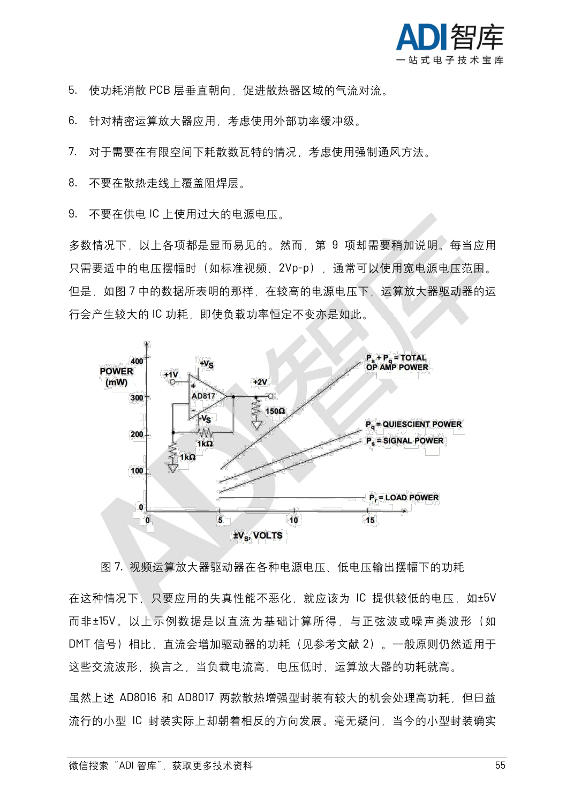


图7. 视频运算放大器驱动器在各种电源电压、低电压输出摆幅下的功耗


在这种情况下，只要应用的失真性能不恶化，就应该为 IC 提供较低的电压，如±5V 而非±15V。以上示例数据是以直流为基础计算所得，与正弦波或噪声类波形（如 DMT 信号）相比，直流会增加驱动器的功耗（见参考文献 2）。一般原则仍然适用于 这些交流波形，换言之，当负载电流高、电压低时，运算放大器的功耗就高。 

虽然上述 AD8016 和 AD8017 两款散热增强型封装有较大的机会处理高功耗，但日益 流行的小型 IC 封装实际上却朝着相反的方向发展。毫无疑问，当今的小型封装确实 会牺牲较大散热性能。但是必须了解的是，这是为了缩小运算放大器封装的尺寸，最 终是为提高整个系统的PCB板密度。 

这几点反映在 AD8057 和 AD8058 系列单通道和双通道运算放大器的热额定值中，如 图 8 所示。AD8057 和 AD8058 运算放大器提供三种不同的封装，分别为 SOT-23-5、 8 引脚 $\mu \mathrm { S 0 } | \complement$ 以及标准 SOIC封装。 

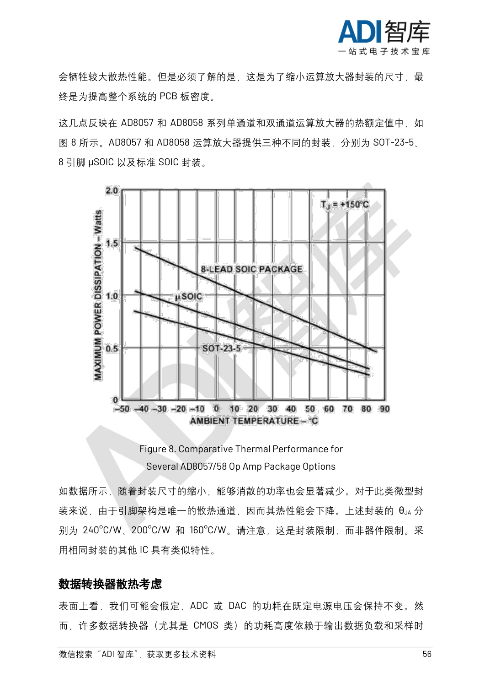


Figure 8. Comparative Thermal Performance for Several AD8057/58 Op Amp Package Options


如数据所示，随着封装尺寸的缩小，能够消散的功率也会显著减少。对于此类微型封 装来说，由于引脚架构是唯一的散热通道，因而其热性能会下降。上述封装的 $\mathtt { \theta } _ { \mathtt { J A } }$ 分 别为 $2 4 0 ^ { \circ } \mathrm { C } / \mathsf { W }$ $2 0 0 ^ { \circ } \mathrm { C } / \mathsf { W }$ 和 $1 6 0 ^ { \circ } \complement / \mathsf { W }$ 。请注意，这是封装限制，而非器件限制。采 用相同封装的其他 IC具有类似特性。 

## 数据转换器散热考虑

表面上看，我们可能会假定，ADC 或 DAC 的功耗在既定电源电压会保持不变。然 而，许多数据转换器（尤其是 CMOS 类）的功耗高度依赖于输出数据负载和采样时 钟频率。由于许多新型高速转换器在最差工作条件下可能消耗最多 1.5W 至 2W 的功 率，因此，我们必须清楚地了解这一点，以确保安装封装时，使最高预期工作温度下 的结温保持于可接受限值之内。 

指南 MT-031 谈到接地强调称，高性能 ADC（尤其是带有并行输出者）的数字输出的 负载不宜过大 (5-10pF)，以防止数字瞬变电流导致 SNR 和 SFDR 下降。然而，即使 在小输出负载下，多数 CMOS 和BiCMOS ADC的功耗也仍然是采样时钟频率的函数， 有时则为模拟输入频率和幅度的函数。 

例如，图 9 展示了 AD9245 14 位、80MSPS、3 VCMOS ADC 在数据线路的模拟输入为 2.5MHz 且输出负载为 5pF 时，功耗与频率之间的关系。图中分别展示了数字和模拟 电源电流以及总功耗。请注意，当采样频率在 10MSPS 与 80MSPS 之间变化时，总功 耗可能在 310mW 至380mW 范围内变化。 

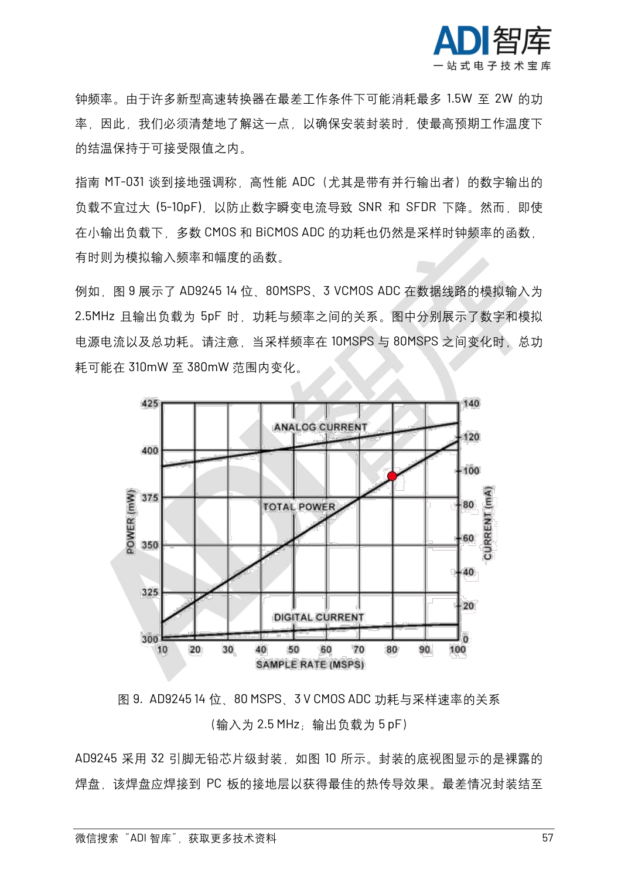


图 9. AD9245 14 位、80 MSPS、3 V CMOS ADC 功耗与采样速率的关系 （输入为 2.5 MHz；输出负载为 5 pF）


AD9245 采用 32 引脚无铅芯片级封装，如图 10 所示。封装的底视图显示的是裸露的 焊盘，该焊盘应焊接到 PC 板的接地层以获得最佳的热传导效果。最差情况封装结至 环境热阻 $\mathtt { \widehat { \theta } _ { \mathtt { J A } } }$ 的额定值为 $3 2 . 5 ^ { \circ } \mathrm { C } / \mathrm { W }$ 当功耗为 380mW 时，结温将比环境温度高 $3 2 . 5 ^ { \circ } \mathbb { C } \times 0 . 3 8 = 1 2 . 3 ^ { \circ } \mathbb { C }$ 。当最高工作温度为 $+ 8 5 ^ { \circ } \complement$ 时，结温为 $8 5 ^ { \circ } 0 { \circ } + 1 2 . 3 ^ { \circ } 0 { = } 9 7 . 3 ^ { \circ } 0$ C 

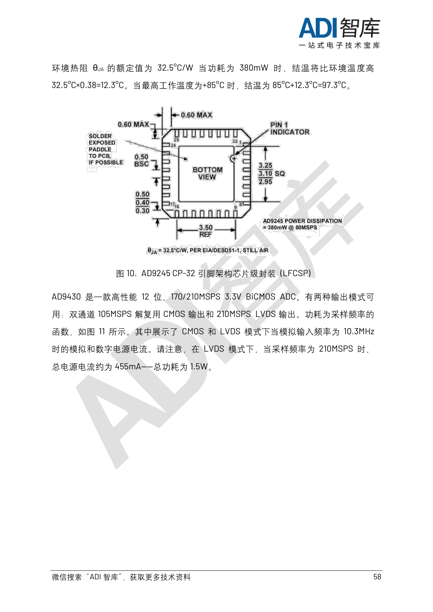


图 10. AD9245 CP-32 引脚架构芯片级封装 (LFCSP)


AD9430 是一款高性能 12 位、170/210MSPS 3.3V BiCMOS ADC。有两种输出模式可 用：双通道 105MSPS 解复用 CMOS 输出和 210MSPS LVDS 输出。功耗为采样频率的 函数，如图 11 所示。其中展示了 CMOS 和 LVDS 模式下当模拟输入频率为 10.3MHz 时的模拟和数字电源电流。请注意，在 LVDS 模式下，当采样频率为 210MSPS 时， 总电源电流约为 455mA——总功耗为 1.5W。 

[[硬件/原始备份/PCB设计秘籍.pdf#page=59|原版PDF第59页整页回看（前文已展示）]]

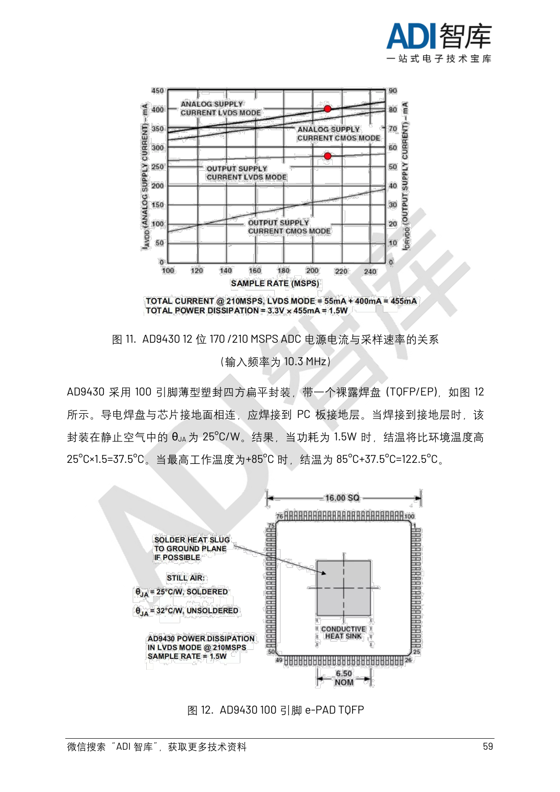


TOTAL CURRENT @ 210MSPS, LVDS MODE = 55mA + 400mA = 455mA TOTAL POWER DISSIPATION = 3.3V × 455mA = 1.5W


图 11. AD9430 12 位 170 /210 MSPS ADC 电源电流与采样速率的关系 （输入频率为 10.3 MHz）


AD9430 采用 100 引脚薄型塑封四方扁平封装，带一个裸露焊盘 (TQFP/EP)，如图 12 所示。导电焊盘与芯片接地面相连，应焊接到 PC 板接地层。当焊接到接地层时，该 封装在静止空气中的 $\mathtt { \theta } _ { \mathtt { U A } }$ 为 $2 5 ^ { \circ } \mathrm { C } / \mathsf { W }$ 结果，当功耗为 1.5W 时，结温将比环境温度高 $2 5 ^ { \circ } \mathbb { C } \times 1 . 5 { = } 3 7 . 5 ^ { \circ } \mathbb { C }$ 当最高工作温度 $\sharp \dag + 8 5 ^ { \circ } \complement$ 时，结温为 $8 5 ^ { \circ } \mathbb { C } + 3 7 . 5 ^ { \circ } \mathbb { C } = 1 2 2 . 5 ^ { \circ } \mathbb { C }$ o 

[[硬件/原始备份/PCB设计秘籍.pdf#page=60|原版PDF第60页整页回看（前文已展示）]]


图 12. AD9430 100 引脚 e-PAD TQFP


AD6645 是一款高性能 14 位、80/105MSPS ADC，采用高速互补双极性工艺 (XFCB) 制成，具有较高的SFDR (89dBc) 和SNR (75dB)。尽管其功耗（为采样频率的函数） 变化不大，该器件的最大功耗为 1.75W。采用的是散热增强型 52 引脚 PowerQuad $4 ^ { \textregistered }$ 封装，带一个裸露焊盘，如图13所示。 

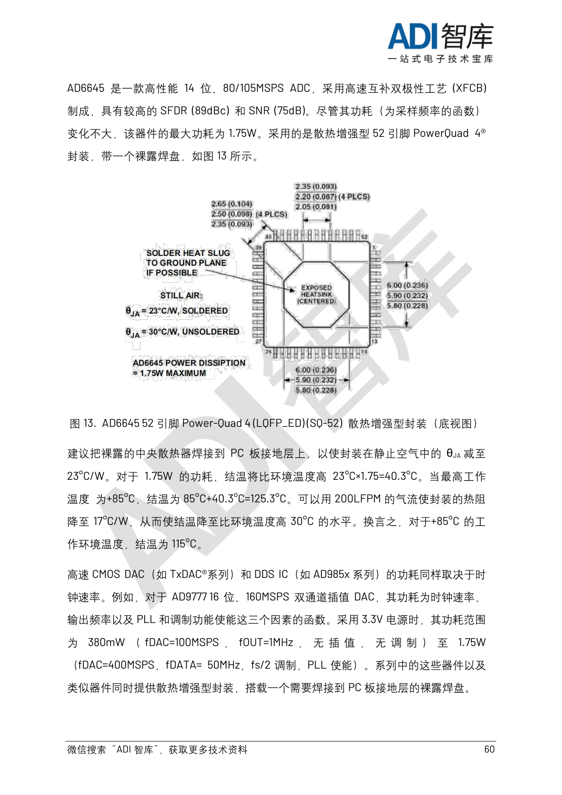


图 13. AD6645 52 引脚 Power-Quad 4 (LQFP_ED) (SQ-52) 散热增强型封装（底视图） 建议把裸露的中央散热器焊接到 PC 板接地层上， 以使封装在静止空气中的 $\mathtt { \theta } _ { \mathtt { J A } }$ 减至 $2 3 ^ { \circ } \complement / \mathsf { W }$ 。对于 1.75W 的功耗，结温将比环境温度高 $2 3 ^ { \circ } \mathbb { C } \times 1 . 7 5 { = } 4 0 . 3 ^ { \circ } \mathbb { C }$ 。当最高工作 温度 为 $+ 8 5 ^ { \circ } \complement$ 结温为 $8 5 ^ { \circ } C + 4 0 . 3 ^ { \circ } C = 1 2 5 . 3 ^ { \circ } C$ 。可以用 200LFPM 的气流使封装的热阻 降至 $1 7 ^ { \circ } \complement / \mathsf { W }$ 从而使结温降至比环境温度高 $3 0 ^ { \circ } \complement$ 的水平。换言之，对于 $+ 8 5 ^ { \circ } \complement$ 的工 作环境温度，结温为 115°C。


高速 CMOS DAC（如 TxDAC®系列）和 DDS IC（如 AD985x 系列）的功耗同样取决于时 钟速率。例如，对于 AD9777 16 位、160MSPS 双通道插值 DAC，其功耗为时钟速率、 输出频率以及PLL和调制功能使能这三个因素的函数。采用3.3V电源时，其功耗范围 为 380mW （ fDAC=100MSPS ， fOUT=1MHz ， 无 插 值 ， 无 调 制 ） 至 1.75W （fDAC=400MSPS，fDATA= 50MHz，fs/2 调制，PLL 使能）。系列中的这些器件以及 类似器件同时提供散热增强型封装，搭载一个需要焊接到PC板接地层的裸露焊盘。 

## 总结

本文讨论了运算放大器和数据转换器的散热应用问题，但并未涉及夹式（或螺栓式） 散热器这种经典散热技术。也未涉及强制通风冷却方法，该方法一般用于需要处理数 十瓦特功耗的情况。略去这些内容的主要原因在于，它们并不适用于当今的运算放大 器和数据转换器封装。 

## 第九章 降压调节器的 PCB 布局布线指南

“噪声问题！”——这是每位电路板设计师都会听到的四个字。为了解决噪声问题， 往往要花费数小时的时间进行实验室测试，以便揪出元凶，但最终却发现，噪声是由 开关电源的布局不当而引起的。解决此类问题可能需要设计新的布局，导致产品延期 和开发成本增加。 

本文将提供有关印刷电路板 (PCB) 布局布线的指南，以帮助设计师避免此类噪声问 题。作为例子的开关调节器布局采用双通道同步开关控制器 ADP1850，第一步是确定 调节器的电流路径。然后，电流路径决定了器件在该低噪声布局布线设计中的位置。 

## PCB 布局布线指南：

## 第一步：确定电流路径

在开关转换器设计中，高电流路径和低电流路径彼此非常靠近。交流 (AC) 路径携带 有尖峰和噪声，高直流 (DC) 路径会产生相当大的压降，低电流路径往往对噪声很敏 感。适当 PCB 布局布线的关键在于确定关键路径，然后安排器件，并提供足够的铜 面积以免高电流破坏低电流。性能不佳的表现是接地反弹和噪声注入 IC 及系统的其 余部分。 

图 1 所示为一个同步降压调节器设计，它包括一个开关控制器和以下外部电源器件： 高端开关、低端开关、电感、输入电容、输出电容和旁路电容。图 1 中的箭头表示高 开关电流流向。必须小心放置这些电源器件，避免产生不良的寄生电容和电感，导致 过大噪声、过冲、响铃振荡和接地反弹。 

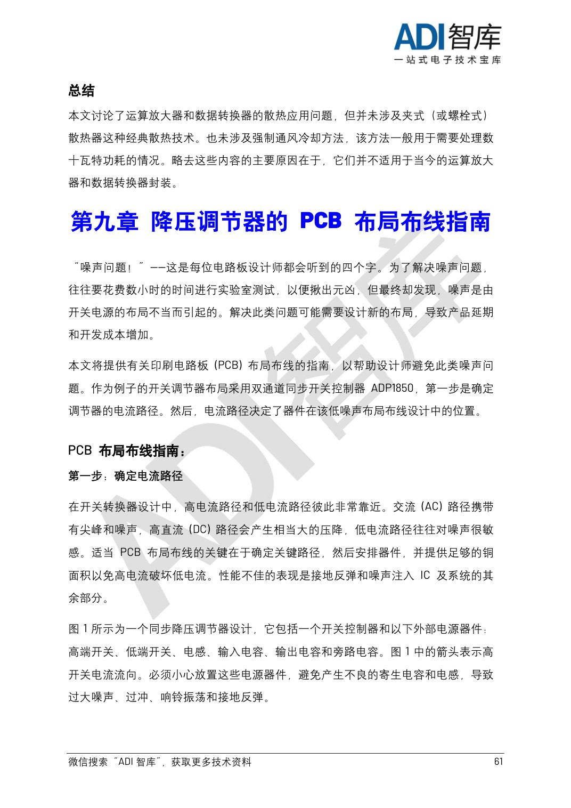

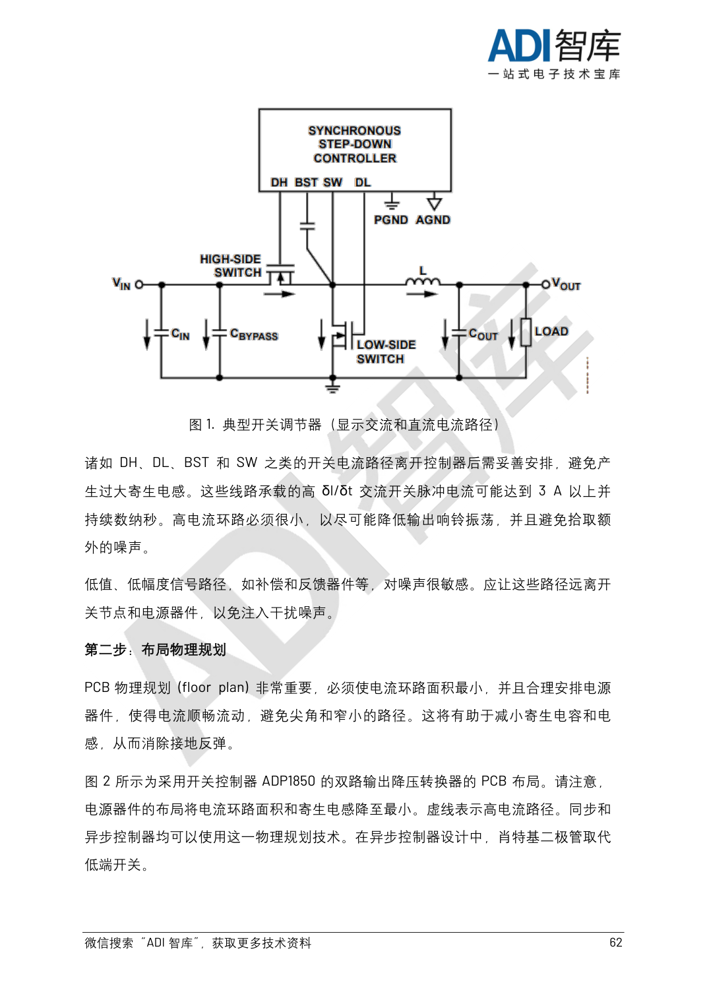


图 1. 典型开关调节器（显示交流和直流电流路径）


诸如 DH、DL、BST 和 SW 之类的开关电流路径离开控制器后需妥善安排，避免产 生过大寄生电感。这些线路承载的高 δI/δt 交流开关脉冲电流可能达到 3 A 以上并 持续数纳秒。高电流环路必须很小，以尽可能降低输出响铃振荡，并且避免拾取额 外的噪声。 

低值、低幅度信号路径，如补偿和反馈器件等，对噪声很敏感。应让这些路径远离开 关节点和电源器件，以免注入干扰噪声。 

## 第二步：布局物理规划

PCB 物理规划 (floor plan) 非常重要，必须使电流环路面积最小，并且合理安排电源 器件，使得电流顺畅流动，避免尖角和窄小的路径。这将有助于减小寄生电容和电 感，从而消除接地反弹。 

图 2 所示为采用开关控制器 ADP1850 的双路输出降压转换器的 PCB 布局。请注意， 电源器件的布局将电流环路面积和寄生电感降至最小。虚线表示高电流路径。同步和 异步控制器均可以使用这一物理规划技术。在异步控制器设计中，肖特基二极管取代 低端开关。 

[[硬件/原始备份/PCB设计秘籍.pdf#page=63|原版PDF第63页整页回看（前文已展示）]]

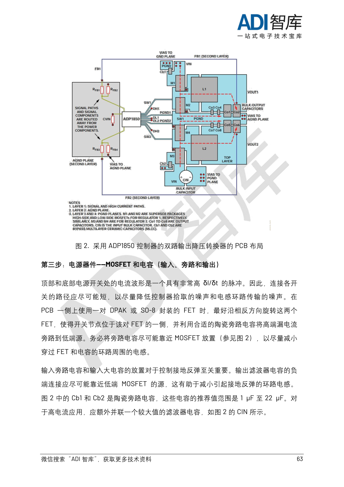


图2. 采用 ADP1850控制器的双路输出降压转换器的PCB布局


## 第三步：电源器件——MOSFET 和电容（输入、旁路和输出）

顶部和底部电源开关处的电流波形是一个具有非常高 δI/δt 的脉冲。因此，连接各开 关的路径应尽可能短，以尽量降低控制器拾取的噪声和电感环路传输的噪声。在 PCB 一侧上使用一对 DPAK 或 SO-8 封装的 FET 时，最好沿相反方向旋转这两个 FET，使得开关节点位于该对 FET 的一侧，并利用合适的陶瓷旁路电容将高端漏电流 旁路到低端源。务必将旁路电容尽可能靠近 MOSFET 放置（参见图 2），以尽量减小 穿过 FET 和电容的环路周围的电感。 

输入旁路电容和输入大电容的放置对于控制接地反弹至关重要。输出滤波器电容的负 端连接应尽可能靠近低端 MOSFET 的源，这有助于减小引起接地反弹的环路电感。 图 2 中的 Cb1 和 Cb2 是陶瓷旁路电容，这些电容的推荐值范围是 1 μF 至 22 μF。对 于高电流应用，应额外并联一个较大值的滤波器电容，如图2的CIN 所示。 

## 散热考虑和接地层

在重载条件下，功率 MOSFET、电感和大电容的等效串联电阻 (ESR) 会产生大量的 热。为了有效散热，图 2的示例在这些电源器件下面放置了大面积的铜。 

多层 PCB 的散热效果好于 2 层 PCB。为了提高散热和导电性能，应在标准 1 盎司铜 层上使用 2 盎司厚度的铜。多个 PGND 层通过过孔连在一起也会有帮助。图 3 显示 一个4层 PCB设计的顶层、第三层和第四层上均分布有 PGND 层。 

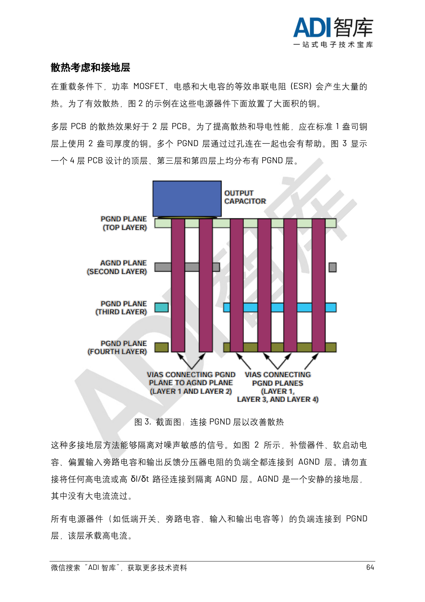


图 3. 截面图：连接 PGND 层以改善散热


这种多接地层方法能够隔离对噪声敏感的信号。如图 2 所示，补偿器件、软启动电 容、偏置输入旁路电容和输出反馈分压器电阻的负端全都连接到 AGND 层。请勿直 接将任何高电流或高 δI/δt 路径连接到隔离 AGND 层。AGND 是一个安静的接地层， 其中没有大电流流过。 

所有电源器件（如低端开关、旁路电容、输入和输出电容等）的负端连接到 PGND 层，该层承载高电流。 

GND 层内的压降可能相当大，以至于影响输出精度。通过一条宽走线将 AGND 层连 接到输出电容的负端（参见图4），可以显著改善输出精度和负载调节。 

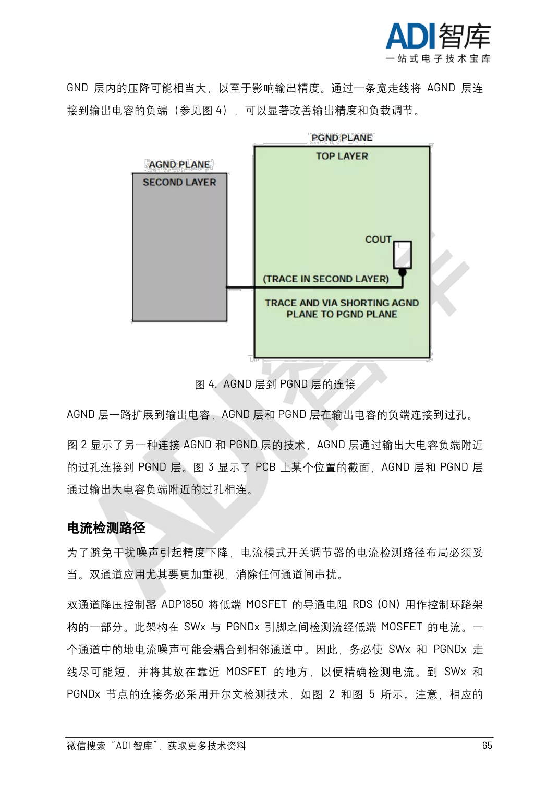


图 4. AGND 层到 PGND 层的连接


AGND 层一路扩展到输出电容，AGND 层和 PGND 层在输出电容的负端连接到过孔。


图 2 显示了另一种连接 AGND 和 PGND 层的技术，AGND 层通过输出大电容负端附近 的过孔连接到 PGND 层。图 3 显示了 PCB 上某个位置的截面，AGND 层和 PGND 层 通过输出大电容负端附近的过孔相连。 

## 电流检测路径

为了避免干扰噪声引起精度下降，电流模式开关调节器的电流检测路径布局必须妥 当。双通道应用尤其要更加重视，消除任何通道间串扰。 

双通道降压控制器 ADP1850 将低端 MOSFET 的导通电阻 RDS (ON) 用作控制环路架 构的一部分。此架构在 SWx 与 PGNDx 引脚之间检测流经低端 MOSFET 的电流。一 个通道中的地电流噪声可能会耦合到相邻通道中。因此，务必使 SWx 和 PGNDx 走 线尽可能短，并将其放在靠近 MOSFET 的地方，以便精确检测电流。到 SWx 和 PGNDx 节点的连接务必采用开尔文检测技术，如图 2 和图 5 所示。注意，相应的 

PGNDx 走线连接到低端 MOSFET 的源。不要随意将 PGND 层连接到 PGNDx 引脚。 

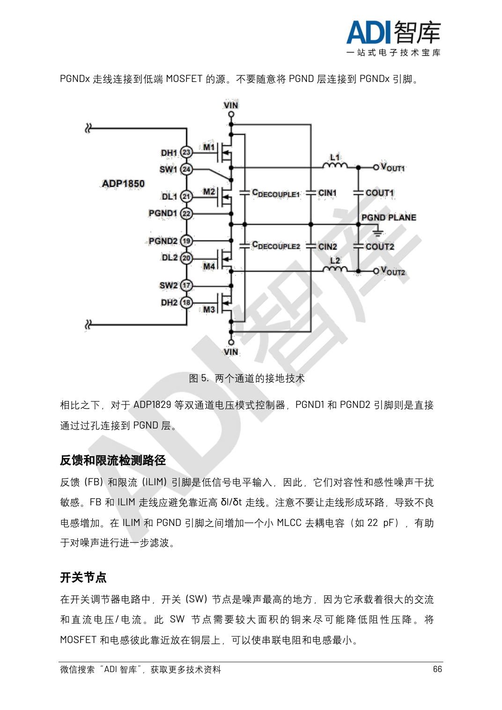


图 5. 两个通道的接地技术


相比之下，对于 ADP1829 等双通道电压模式控制器，PGND1 和 PGND2 引脚则是直接 通过过孔连接到 PGND 层。 

## 反馈和限流检测路径

反馈 (FB) 和限流 (ILIM) 引脚是低信号电平输入，因此，它们对容性和感性噪声干扰 敏感。FB 和 ILIM 走线应避免靠近高 δI/δt 走线。注意不要让走线形成环路，导致不良 电感增加。在 ILIM 和 PGND 引脚之间增加一个小 MLCC 去耦电容（如 22 pF），有助 于对噪声进行进一步滤波。 

## 开关节点

在开关调节器电路中，开关 (SW) 节点是噪声最高的地方，因为它承载着很大的交流 和直流电压/电流。此 SW 节点需要较大面积的铜来尽可能降低阻性压降。将 MOSFET 和电感彼此靠近放在铜层上，可以使串联电阻和电感最小。 

对电磁干扰、开关节点噪声和响铃振荡更敏感的应用可以使用一个小缓冲器。缓冲器 由电阻和电容串联而成（参见图 6 中的 RSNUB 和 CSNUB），放在 SW 节点与 PGND 层之间，可以降低 SW 节点上的响铃振荡和电磁干扰。注意，增加缓冲器可能会使整 体效率略微下降0.2%到0.4%。 

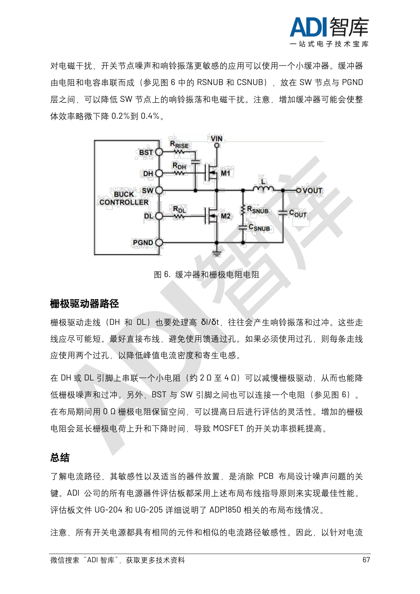


图 6. 缓冲器和栅极电阻电阻


## 栅极驱动器路径

栅极驱动走线（DH 和 DL）也要处理高 δI/δt，往往会产生响铃振荡和过冲。这些走 线应尽可能短。最好直接布线，避免使用馈通过孔。如果必须使用过孔，则每条走线 应使用两个过孔，以降低峰值电流密度和寄生电感。 

在DH 或DL 引脚上串联一个小电阻（约2 Ω至4 Ω）可以减慢栅极驱动，从而也能降 在布局期间用0 Ω栅极电阻保留空间，可以提高日后进行评估的灵活性。增加的栅极 电阻会延长栅极电荷上升和下降时间，导致MOSFET 的开关功率损耗提高。 

## 总结

了解电流路径、其敏感性以及适当的器件放置，是消除 PCB 布局设计噪声问题的关 键。ADI 公司的所有电源器件评估板都采用上述布局布线指导原则来实现最佳性能。 评估板文件UG-204和UG-205详细说明了ADP1850相关的布局布线情况。 

注意，所有开关电源都具有相同的元件和相似的电流路径敏感性。因此，以针对电流 模式降压调节器的 ADP1850 为例说明的指导原则同样适用于电压模式和/或升压开关 调节器的布局布线。 

## 第十章 开关稳压器的接地处理

## 问题

如何使用带有模拟接地层 (AGND) 和功率接地层 (PGND) 的开关稳压器？ 

这是许多开发人员在设计开关电源时会问的一个问题。一些开发人员已习惯于处理数 字接地层和模拟接地层；然而，涉及到功率 GND 时，他们的经验往往会失效。设计 师通常会直接复制所选开关稳压器的电路板布局，不再思考这个问题。 

PGND 是较高脉冲电流流经的接地连接。根据开关稳压器拓扑结构，这表示通过 功率晶体管的电流或功率驱动器级的脉冲电流。对于带有外部开关管的开关控制 器，该接地层尤为重要。 

AGND 有时被称为 SGND（信号接地层），是其他信号用作参照的接地连接，通 常十分平静。该接地层包括调节输出电压所需的内部基准电压。软启动和使能电 压也以 AGND 连接为参照。 

关于这两种接地连接的处理，有两种不同的技术观点，因此专家的意见也产生了分歧。 

根据其中一种观点，开关稳压器 IC 上的 AGND 和 PGND 连接应该在各自引脚旁相互 连接。这样 来，两个引脚之间的电压偏移保持在相对较低的水平。因此可以保护开 关稳压器 IC 免受干扰，进而免遭破坏。电路的所有接地连接和可能的接地层将以星 型拓扑的结构连接到该公共点。 

图 1 所示为该观点的实现示例。此处显示了LTM4600的电路板布局。这是一款 10 A 降压型微型模块。电路板上的独立接地连接彼此靠在一起（请参见图 1 中的蓝色椭圆 形）。由于芯片和外壳之间的各自焊线的寄生电感，以及各自引脚的电感，因此已经 存在一定程度的PGND 和AGND 去耦，这导致芯片上电路之间存在少量相互干扰。 

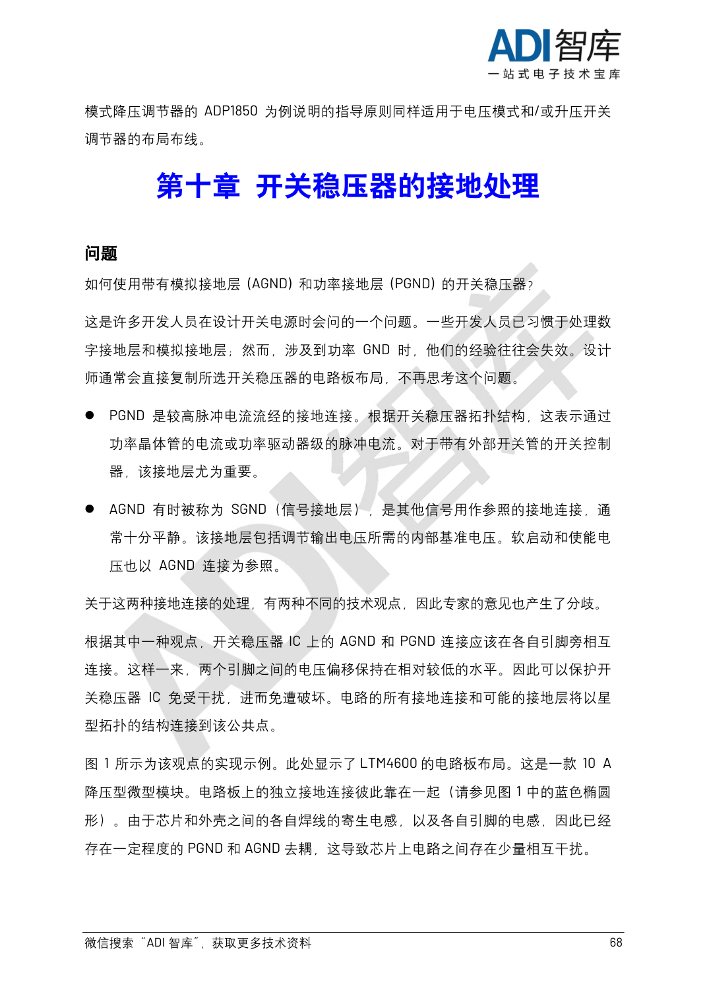

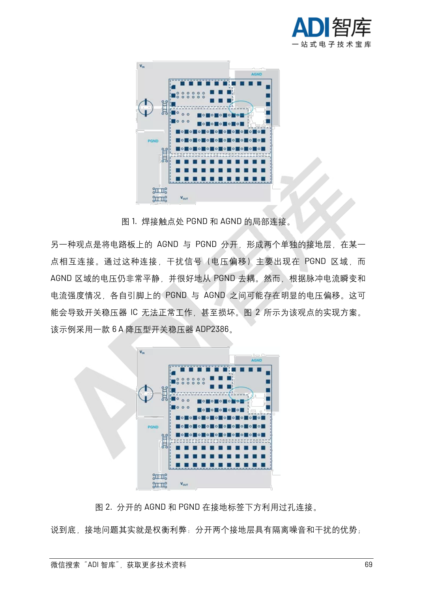


图1. 焊接触点处PGND 和AGND 的局部连接。


另一种观点是将电路板上的 AGND 与 PGND 分开，形成两个单独的接地层，在某一 点相互连接。通过这种连接，干扰信号（电压偏移）主要出现在 PGND 区域，而 AGND 区域的电压仍非常平静，并很好地从 PGND 去耦。然而，根据脉冲电流瞬变和 电流强度情况，各自引脚上的 PGND 与 AGND 之间可能存在明显的电压偏移。这可 能会导致开关稳压器 IC 无法正常工作，甚至损坏。图 2 所示为该观点的实现方案。 该示例采用一款6 A降压型开关稳压器ADP2386。 

[[硬件/原始备份/PCB设计秘籍.pdf#page=70|原版PDF第70页整页回看（前文已展示）]]


图2. 分开的AGND 和PGND 在接地标签下方利用过孔连接。


说到底，接地问题其实就是权衡利弊：分开两个接地层具有隔离噪音和干扰的优势； 

但两个接地层之间可能会产生电压偏移，从而存在损坏芯片并影响功能的风险。权衡 利弊后，最终决策正确与否主要取决于 IC 设计，包括开关转换速度、功率电平、焊 线和IC封装上的寄生电感、每个 IC 设计的闩锁风险（涉及不同的半导体工艺）。 

## 结论

关于如何处理 AGND 和 PGND 接地的问题，并没有简单的答案。所以相关讨论仍在 继续。前面我们提到，许多开关稳压器用户都采用 IC 制造商提供的示例电路中的电 路板布局和接地连接类型。这样做很有用，因为您通常可以假设制造商也利用该配置 对各 IC 进行了测试。而且，在图 1 和图 2 提供的示例中可以看到，各自的 IC 引脚排 列适用于PGND 和AGND 旁的局部接地连接，或者适用于单独接地。 

## 第十一章 在密集 PCB 布局中最大限度 降低多个 isoPower 器件的辐射

集成隔离电源 isoPower®的 iCoupler®数字隔离器采用隔离式 DC-DC 转换器，能够在 125 MHz至200 MHz 的频率范围内切换相对较大的电流。在这些高频率下工作可能会 增加对电磁辐射和传导噪声的担心。 

虽然，咱们官网上的应用笔记《isoPower 器件的辐射控制建议》提供了最大限度降 低辐射的电路和布局指南。实践证明，通过电路优化（降低负载电流和电源电压）和 使用跨隔离栅拼接电容（通过 PCB 内层电容实现），可把峰值辐射降低 25 dB 以 上。（ps.欲查看《isoPower 器件的辐射控制建议》，点击“阅读原文”即可） 

但是，倘若设计中具有多个 isoPower 器件并且布局非常密集，情况又将如何？是否 仍然能够明显降低辐射？这里，我们将针对此类情况提供一些一般指导原则。 

由于内层拼接电容能够构建低电感结构，因此最具优势。在整体 PCB 区域受限的情 况下，采用多层 PCB 就是很好的方式。采用尽可能多的层数切实可行，同时尽可能 多的交叠电源层和接地层（参考层）。图 1为一个堆叠示例。 

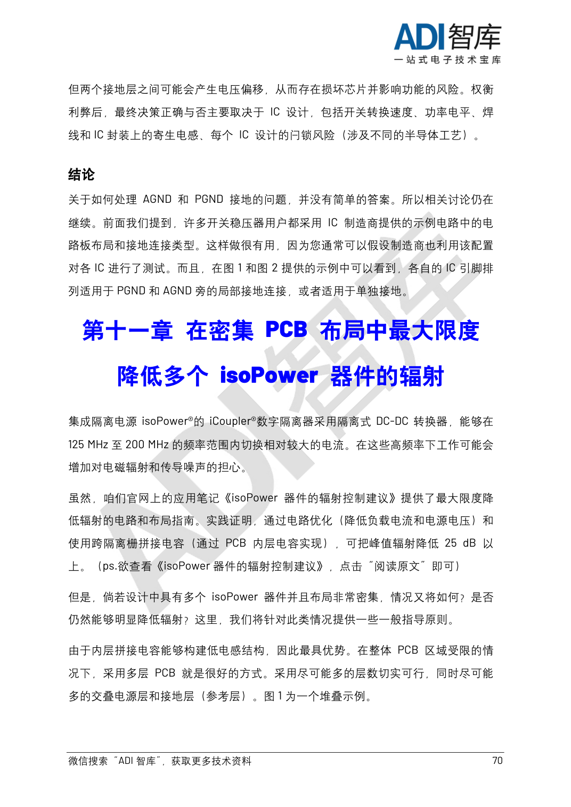

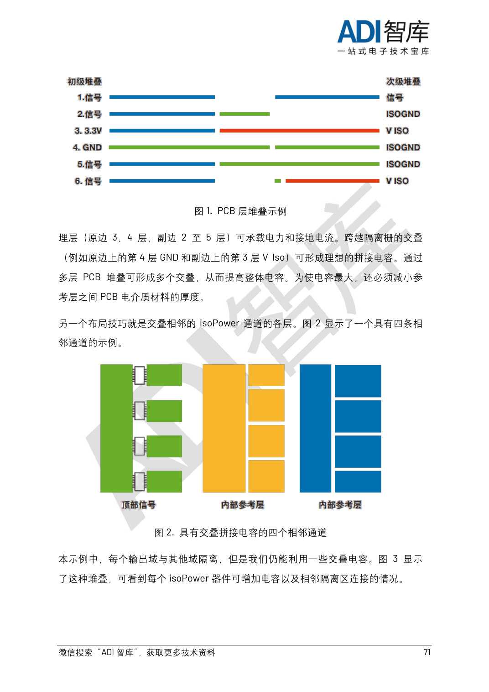


图1. PCB 层堆叠示例


埋层（原边 3、4 层，副边 2 至 5 层）可承载电力和接地电流。跨越隔离栅的交叠 （例如原边上的第4层GND 和副边上的第3层V Iso）可形成理想的拼接电容。通过 多层 PCB 堆叠可形成多个交叠，从而提高整体电容。为使电容最大，还必须减小参 考层之间 PCB电介质材料的厚度。 

另一个布局技巧就是交叠相邻的 isoPower 通道的各层。图 2 显示了一个具有四条相 邻通道的示例。 

[[硬件/原始备份/PCB设计秘籍.pdf#page=72|原版PDF第72页整页回看（前文已展示）]]


图 2. 具有交叠拼接电容的四个相邻通道


本示例中，每个输出域与其他域隔离，但是我们仍能利用一些交叠电容。图 3 显示 了这种堆叠，可看到每个 isoPower 器件可增加电容以及相邻隔离区连接的情况。 

[[硬件/原始备份/PCB设计秘籍.pdf#page=72|原版PDF第72页整页回看（前文已展示）]]

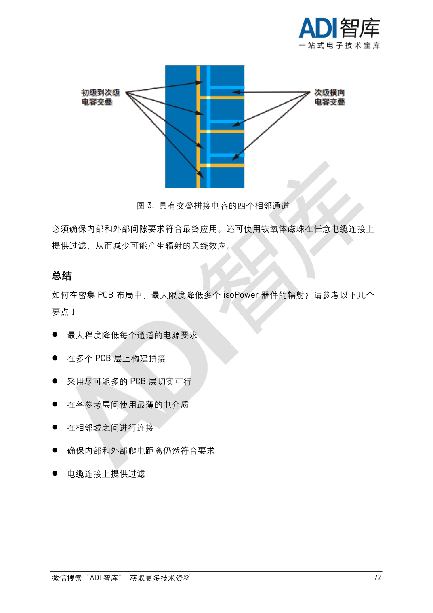


图 3. 具有交叠拼接电容的四个相邻通道


必须确保内部和外部间隙要求符合最终应用。还可使用铁氧体磁珠在任意电缆连接上 提供过滤，从而减少可能产生辐射的天线效应。 

## 总结

如何在密集 PCB 布局中，最大限度降低多个 isoPower 器件的辐射？请参考以下几个 要点↓ 

 最大程度降低每个通道的电源要求 

 在多个 PCB层上构建拼接 

 采用尽可能多的 PCB 层切实可行 

 在各参考层间使用最薄的电介质 

 在相邻域之间进行连接 

 确保内部和外部爬电距离仍然符合要求 

 电缆连接上提供过滤 

## 第十二章 高温环境下的封装考虑因素

在高温下进行芯片封装并将其连接至 PCB 绝非易事，高温时许多因素都会影响封装 完整性（图 1）。而高温功能化硅的采用只相当于完成了一半的工作。 


图1. IC封装和贴装元件


芯片粘着：材料可以确保将硅连接至封装或基板。许多在标准温度范围能够稳定使用 的材料都具有较低的玻璃化转变温度 (TG)，不适合在高温下工作。对芯片、芯片粘 着材料和基板的热膨胀系数 (CTE) 进行匹配时需要特别注意，以防止芯片在宽温度 范围内反复工作时受到应力或断裂。芯片上即便受到少量的机械应力，也可能会导致 电气参数发生变化，达到精密应用不可接受的水平。对于需要采用热连接和电气连接 连接至封装基板的功率器件，可能需要使用金属芯片粘着材料。 

线焊：是芯片和引脚互连的一种方法，这种方法是在芯片表面上从引脚架构至焊盘用 金属线连接。对高温下的线焊可靠性而言，线所用金属与焊盘金属化层的兼容性是一 大问题。 

由于焊接金属兼容性差产生的故障有两方面—— 

边界接口的金属间化合物 (IMC) 生长，这会导致焊接易碎； 

扩散（柯肯达尔效应），这会在接口处产生空洞，减小焊接强度并增加其电阻 

遗憾的是，业界最常见的金属组合之一（金线和铝焊盘金属化层）在高温时就容易产 

生上述现象。 

图 2 是金/铝焊接的剖面图，该图显示了 IMC 的生长情况，在高温条件下经过 500 小 时后会影响焊接的完整性。 


图 2. 195°C 下 500 小时后的金/铝焊接


从图 3 中可以看到，高温焊接失败后出现了明显的金/铝金属间化合物生长和柯肯达 尔空洞。更糟的是，溴和氯等卤素（时见于塑封材料）在高温时也会引起边界接口腐 蚀，加速焊接失败（幸而业界已转用“绿色”无卤素塑封材料）。 

[[硬件/原始备份/PCB设计秘籍.pdf#page=75|原版PDF第75页整页回看（前文已展示）]]


图3. 产生空洞的金属间化合物生长


因此，焊线和焊盘最好采用相同金属（单金属焊接），以避免上述不良影响。如果不 能采用相同金属，工程师应当选择 IMC 生长和扩散率足够慢的金属，以保证在所需 的寿命内可靠使用。 

图 4 显示了单金属焊接在高温下的鲁棒性。从焊接剖面来看， $1 9 5 ^ { \circ } \complement$ 下经过 3000 小 时后未出现IMC生长迹象。 


图 4. $1 9 5 ^ { \circ } \complement$ 下3000小时后的单金属焊接


IC 封装：IC 的封装也必须能够承受恶劣环境下施加的应力。塑料封装尽管达到行业 标准，但传统上只能在 $1 5 0 ^ { \circ } \complement$ 的额定温度下持续使用。随着近期高温应用日益受到关 注，研究表明，这一额定温度可增至 $1 7 5 ^ { \circ } \complement$ 但只能持续较短时间。从封装结构来 看， $1 7 5 ^ { \circ } \complement$ 是某些材料（如塑封材料）超过玻璃化转变温度的温度点。在 TG 以上温 度工作会使关键参数（如 CTE 和弯曲模量）产生显著机械变化，并因热应变引起分 层及开裂等焊接失败现象。 

因此，高温应用时最好选用密封陶瓷封装（图 5）。密封可以防止导致腐蚀的湿气和 污染进入。 

[[硬件/原始备份/PCB设计秘籍.pdf#page=76|原版PDF第76页整页回看（前文已展示）]]


图5. 密封侧面钎焊陶瓷 DIP封装


但遗憾的是，密封封装通常较大较重，且价格比同类塑料封装贵得多。在极端温度要 求 $( < 1 7 5 ^ { \circ } \mathrm { C } )$ 较少的应用中，最好采用塑料封装，可以减少PCB面积、降低成本，或 是提供更好的振动顺应性。对需要采用密封封装和高器件密度的系统而言，高温多芯 片模块是一种比较合理的解决方案。然而，这种方案需要提供已知合格芯片。 

封装引脚配置和金属化：这种情况也必须加以评估。表面贴装器件质量仅取决于焊盘 面积以及铜层和预浸材料之间的粘结质量。另一方面，通孔 $\mathsf { D } \mathsf { I P }$ 配置（业界最可靠的 封装之一）也可提供鲁棒的冲击和振动性能。极端情况下，要想进一步提升连接强 度，还可以弯曲电路板底侧引脚，并将其“钉”在 PCB 上，但是，通孔引脚排列不 允许电路板低侧的元件密集分布，这可能是空间限制严格的井下仪器等应用面临的一 大问题。 

许多情况下，鸥翼 SMT 引脚配置是一种可行的替代方法，但是，无引脚 SMT 在许多 高温环境下面临高冲击和振动时不够鲁棒。采用 SMT 器件时，设计人员应当考虑其 高度和质量。采用高温环氧树脂可以提高连接鲁棒性，但是会增加制造成本，加大维 修难度。在所有情况下，引脚金属化层都必须兼容高温焊料。 

最常见的标准焊料合金熔点低于 $2 0 0 ^ { \circ } \complement$ 。但是，有一些现成的合金可以列入“高熔 点”(HMP) 合金，其熔点远高于 $2 5 0 ^ { \circ } \complement$ 。即便在这些情况下，对任何受应力影响的焊 料而言，其最高推荐工作温度也比其熔点低 $4 0 ^ { \circ } \complement$ 左右。例如，标准 HMP 焊料合金 由 5%的锡、93.5%的铅和 1.5%的银组成，熔点为 $2 9 4 ^ { \circ } \complement$ ，但其推荐工作温度仅为 $2 5 5 ^ { \circ } \complement .$ 。9 注意，BGA（球栅阵列）封装有工厂粘结的焊料球，熔点可能不会太高。 

PCB：PCB 本身也可能是焊接失败的原因。标准 FR4 材料在 $1 3 0 ^ { \circ } \complement$ $1 8 0 ^ { \circ } \complement$ 时可在任 意位置发生玻璃化转变，依具体成分而定。如果在该温度以上使用（即使时间较 短），也会出现扩散和分层。聚酰亚胺是一种可靠的替代材料（Kapton 中就采用了 这种材料），其 TG 高达 $2 5 0 ^ { \circ } \complement$ ，具体依成分而定。但是，聚酰亚胺的吸湿性极强， 可能会使 PCB 由于各种机制迅速出现故障，因此，控制其在湿气中的暴露至关重 要。近些年来，业界引进了吸湿性较小且能在高温时保持完整的新型层压材料。 

说了这么多，ADI 用于高温工作环境的仪表放大器 AD8229 等器件是否解决了上述问 题呢？接下来我们在实验室来验证、认证、测试…… 

在实验室验证高温器件并非易事，因为工程师需要综合上述各项技术才能在极端温度 下测试器件性能。除了在建造测试夹具时采用特殊材料外，测试工程师还必须谨慎操 作环境试验箱，使系统调整至所需的温度变化。由于膨胀系数不匹配，快速温度变化 会对 PCB 板上的焊点造成损害，产生翘曲变形，并最终使系统过早出现故障。业界 采用的原则是将温度变化率保持在每分钟 3°C 以下。 

为了加快寿命与可靠性测试过程，在高温下测试电子器件是一种可以接受的方法。这 里需要引入一个加速系数 α，根据 Arrhenius 方程计算： 

$$
\alpha = e ^ {\frac {E _ {a}}{k} \left(\frac {1}{T _ {a}} - \frac {1}{T _ {s}}\right)}
$$

其中 Ea 为激活能，k 为玻尔兹曼常数，Ta 为使用时的预期工作温度，Ts 为应力温 度。虽然加速老化问题对标准产品影响不大，但是，应力温度远高于额定温度可能会 引起新的故障机制，并导致结果不准确。 

因此，为保证 AD8229 等高温器件的终身可靠性，需要在 $2 1 0 ^ { \circ } \complement$ 的最高额定温度下进 行为期 1000 小时（大约六周）的高温工作寿命测试 (HTOL)。在低温情况下，预期寿 命可以采用图 6 所示的加速度关系进行预测 


图 6. AD8229 寿命与工作温度，1000 小时 (210°C) 11


高温 IC 的可靠特性测试还存在其他阻碍因素。例如，采用的测试和测量系统可靠 性取决于其最薄弱的环节。这意味着长期处于高温下的每个要素自身的可靠性都 必须优于 IC。系统如果不可靠，产生的数据就无法体现器件的长期可靠性，并且 使得整个过程不断重复，既昂贵又耗时。统计技术可以提高测试成功率，包括准 确加大测试样本，以增加误差余量，防止因 DUT（受测试器件）故障导致系统过 早出现故障。另一个阻碍因素由保证极端情况下性能参数所需的生产环节造成， 例如测试、探测和调整。 

## 第十三章 实现数据转换器的最佳接地

图 1 显示信号源与负载之间隔开了一段距离，接地 G1 和 G2 通过一个回路连接起来。 理想情况下，G1 和 G2 之间的接地阻抗为 0，因此接地回路电流不会在 G1 和 G2 之间 产生一个差分电压。 

[[硬件/原始备份/PCB设计秘籍.pdf#page=79|原版PDF第79页整页回看（前文已展示）]]


图 1. 在电路中的任何一点，电流的算术和为 0，或者说流出去的必会流回来。 若 G1 和 G2 之间的阻抗为 0，则 G1 和 G2 之间无差分电压。


遗憾的是，让回流路径保持零阻抗是不可能的，接地回路阻抗在接地电流作用下，会 在G1 和G2之间产生一个误差电压ΔV。 

[[硬件/原始备份/PCB设计秘籍.pdf#page=80|原版PDF第80页整页回看（前文已展示）]]


图2. 接地阻抗中流动的信号和/或外部电流产生误差电压ΔV。


G1 和 G2 之间的连接不仅有电阻，还有电感。出于本文目的，这里忽略杂散电容的影 响。但在该系列的下一篇文章中，您会了解到电源层和接地层之间的电容是如何帮助 高频去耦的。 

无焊试验板，制成的电路看起来可能类似于图 3所示的电路 您可以看到图 3 试验板中的总线阻抗如何既有阻性元件又有感性元件。接地总线阻 抗是否会影响电路运行，不仅取决于电路的直流精度要求，而且取决于模拟信号频率 和电路中数字开关元件产生的频率分量。 


图3. 采用无焊试验板的电路


G1 和 G2 之间流动的电流可以是信号电流或其他电路引起的外部电流。


如果最大信号频率为 1 MHz，并且电路仅需要几毫安 (mA) 电流，那么接地总线阻抗 可能不是问题。然而，如果信号为 100 MHz，并且电路驱动一个需要 100 mA 的负 载，那么阻抗很可能会成为问题。 

大部分情况下，由于“母线 (buss wire)”在大多数逻辑转换等效频率下具有阻抗， 将其用作数字接地回路是不能接受的。 

例如，#22标准导线具有约 20 nH/英寸的电感和1 mΩ/英寸的电阻。由逻辑信号转换 产生的压摆率为 10 mA/ns 的瞬态电流，在此频率下流经 1 英寸的该导线，将形成 200 mV 的无用压降： 

对于具有 2 V 峰峰值范围的信号，此压降会转化为约 10%的误差（大约 3.5 位精 度）。即使在全数字电路中，该误差也会大幅降低逻辑噪声裕量。 

对于低频信号，该1 mΩ/英寸电阻也会产生一个误差。例如，100 mA电流流过1英寸 的#22标准导线时，产生的压降约为： 

一个2 V 峰峰值范围的信号数字化到16位精度时，其 $1 ~ \mathsf { L S B } = 2 ~ \mathsf { V } / 2 ~ 1 6 = 3 0 . 5 ~ \mu \mathsf { V }$ 。因 此，导线电阻引起的100 μV 误差约等于16位精度水平的3.3 LSB误差。 

图 4 显示了模拟接地回路中流动的高噪声数字电流如何在输入模拟电路的电压 V IN 中产生误差。将模拟电路地和数字电路地连接在同一点（如下方的正确电路图所 示），可以在某种程度上缓解上述问题。 


图 4. 模拟电路和数字电路使用单点接地可降低高噪声数字电路引起的误差效应。


## 接地层在当今系统中必不可少

在无焊试验板中，甚至在图 3 所示的采用总线结构的电路板中，能够用来降低接地 阻抗的手段并不多。无焊试验板在工业系统设计中是非常罕见的。实接地层是提供低 阻抗回流路径的工业标准方法。生产用印刷电路板一般有一层或多层专门用于接地。 这种方法相当适合最终生产，但在原型系统中较难实现。 

图 5 显示了一个包含模拟电路、数字电路以及一个混合信号器件（模数转换器或数 模转换器等）并针对PCB的典型接地安排。 

[[硬件/原始备份/PCB设计秘籍.pdf#page=82|原版PDF第82页整页回看（前文已展示）]]


图5. 针对混合信号系统PCB的良好接地解决方案。


模拟电路和数字电路在物理上相隔离，分别位于各自的接地层上。混合信号器件横跨 两个接地层，系统单点或星形接地是两个接地层的连接点。 

您应当知道，关于模拟接地和数字接地，还有其他已被证明有效的接地原理。然而， 这些原理全都基于同样的概念——分析模拟和数字电流路径，然后采取措施以最大限 度地减少它们之间的相互影响。 

## 第十四章 用于测量环境温度的正确

## PCB 布局

我们都知道，热量的传递通常是从高温物体到低温物体。通过强制系统（如冰箱）进行 能量传递，热量可以从冷的区域传递到热的区域。热传递可以通过三种基本方法实现： 

 传导 

 对流 


我们更清楚一个事实：传导是 PCB 中最普遍的热传递方法。从微观角度看，传导是 指激烈、快速移动或振动的原子和分子与邻近的原子和分子相互作用，将它们的一部 分能量（热量）传递给这些相邻的原子。 

如果 PCB 的一端温度较高，能量会向 PCB 温度较低的一端传递。高速粒子碰撞低速 

$$
H = \frac {\left(K \times A \left(T _ {H O T} - T _ {C O L D}\right)\right)}{L}
$$

其中： 

H = 单位时间传导的能量（焦耳/秒） 

K = 室温下铜的热传导系数 (385W/(m.K)) 

A = PCB 上铜的面积 

T = 温度 

i = 热的物体与冷的物体之间的距离 

图 1 显示，如果热的物体与冷的物体之间导热介质（如铜）的面积增加，那么热量传 递会更快。同样地，如果铜的面积减小，传热率也会减小。通过常识可以推断，两个 物体距离越远，冷的物体变热所需的时间就越长。 

[[硬件/原始备份/PCB设计秘籍.pdf#page=84|原版PDF第84页整页回看（前文已展示）]]


图 1. 传到的传热率


ps.铜是极好的导热体，因此在很多 PCB 设计中用于热源的散热。银和金刚石是仅有 的两个具有更好热传导系数的材料。 

## 用于测量 PCB 温度的正确 PCB 布局

PCB 热量的 60%至 65%通过引脚传递到芯片热传感器。GND 引脚连接到基板，因 此，GND 引脚与温度传感器和热源之间的热阻最小（如图 2）。 

[[硬件/原始备份/PCB设计秘籍.pdf#page=85|原版PDF第85页整页回看（前文已展示）]]


图 2. 测量 PCB 温度的正确布局


## 如何有效测量 PCB 温度

如图 3 所示，使用如下技巧可以确保温度传感器能够跟踪并精确测量 PCB 温度和主 要的热源。 

 温度传感器和热源要共用同一个 GND 平面 

 确保温度传感器所有的GND 引脚都与热源的GND 平面相连 

 在PCB上，温度传感器与热源应尽可能相互靠近 


图3. 数字温度传感器精确地跟踪热源的温度


我们都希望使用 1C 温度传感器来测量 PCB 或者器件的温度。因此，最好使用图 2 和 图3 中所示的 PCB布局方法。 

## 用于测量环境温度的正确 PCB 布局

当然，有很多人是不需要测量 PCB 的温度的，他们只想测量环境温度。问题是，如 何防止 PCB 上的热源影响温度传感器对环境温度的测量？使用如图 4 所示的 PCB 布 局设计，问题就能迎刃而解。 

[[硬件/原始备份/PCB设计秘籍.pdf#page=86|原版PDF第86页整页回看（前文已展示）]]


图4. 测量环境温度的正确布局


## 如何有效测量环境温度

使用如下技巧可以防止主要热源的散热对温度传感器产生影响，并能够精确地监测环 境温度。 

 使用散列 GND 平面。减少GND平面的面积来增加热阻 

 温度传感器尽可能地远离热源 

 为温度传感器提供单独的GND 平面，尽量减少与主 GND 平面的连接 

 使用窄的GND 连接来增加热阻 

 主热源下面使用实心 GND 平面，并露出绿色阻焊膜。这样可使主热源散热的热 阻最低 


图5. 数字温度传感器精确地跟踪环境温度


有时候，我们希望监测空气温度并利用 1C 温度传感器精确、线性、响应速度快及使 用方便的特点，那么最好选择是使用图 4和图5 中所示的PCB布局方法。 

## 第十五章 最大程度提高 PCB 对 电源变化抗扰度

对于转换器和最终的系统而言，必须确保任意给定输入上的噪声不会影响性能。那 么，为了了解电源噪声并满足系统设计需求，我们应当注意哪些方面呢？ 

1. 先选择转换器，然后选择调节器、LDO、开关调节器等。并非所有调节器都适 用。应当查看调节器数据手册中的噪声和纹波指标，以及开关频率（如果使用开 关调节器）。典型调节器在100 kHz 带宽内可能具有10 µV rms噪声。假设该噪 声为白噪声，则它在目标频段内相当于 31.6 nV rms/√Hz的噪声密度。 

2. 检查转换器的电源抑制指标，了解转换器的性能何时会因为电源噪声而下降。在 第一奈奎斯特区 fS/2，大多数高速转换器的 PSRR 典型值为 60 dB (1 mV/V)。如 

3. 使用一个 2 V p-p 满量程输入范围、78 dB SNR 和 125 MSPS 采样速率的 16 位 ADC，其噪底为 11.26 nV rms。任何来源的噪声都必须低于此值，以防其影响转 换器。在第一奈奎斯特区，转换器噪声将是 89.02 µV rms (11.26 nV rms/√Hz) × √(125 MHz/2)。虽然调节器的噪声 (31.6 nv/√Hz) 是转换器的两倍以上，但转换器 有 60 dB 的 PSRR，它会将开关调节器的噪声抑制到 31.6 pV/√Hz (31.6 nV/√Hz × 1 mV/V)。这一噪声比转换器的噪底小得多，因此调节器的噪声不会降低转换器的 性能。 

4. 电源滤波、接地和布局同样重要。在 ADC 电源引脚上增加 0.1 µF 电容可使噪声 低于前述计算值。请记住，某些电源引脚吸取的电流较多，或者比其他电源引脚 更敏感。因此应当慎用去耦电容，但要注意某些电源引脚可能需要额外的去耦电 容。在电源输出端增加一个简单的 LC 滤波器也有助于降低噪声。不过，当使用 开关调节器时，级联滤波器能将噪声抑制到更低水平。需要记住的是，每增加一 级增益就会每 10 倍频程增加大约 20 dB。 

5. 需要注意的一点是，上述分析仅针对单个转换器而言。如果系统涉及到多个转换 器或通道，噪声分析将有所不同。例如，超声系统采用许多 ADC 通道，这些通 道以数字方式求和来提高动态范围。基本而言，通道数量每增加一倍，转换器 系统的噪底就会降低3 dB。对于上例，如果使用两个转换器，转换器的噪底将变 为一半 (−3 dB)；如果使用四个转换器，噪底将变为−6 dB。之所以如此，是因为 每个转换器可以当作不相关的噪声源来对待。不相关噪声源彼此之间是独立的， 因此可以进行 RSS（平方和的平方根）计算。最终，随着通道数量增加，系统的 噪底降低，系统将变得更敏感，对电源的设计约束条件也更严格。 

要想消除应用中的所有电源噪声是不可能的，因为任何系统都不可能完全不受电源噪 声的影响。因此，作为 ADC 的用户，我们必须在电源设计和布局布线阶段就做好积 极应对。 

下面是一些有用的提示，可帮助你最大程度地提高 PCB 对电源变化的抗扰度： 

 对到达系统板的所有电源轨和总线电压去耦。 

 记住：每增加一级增益就会每10 倍频程增加大约20 dB。 

 如果电源引线较长并为特定 IC、器件和/或区域供电，则应再次去耦。 

 对高频和低频都要去耦。 

 去耦电容接地前的电源入口点常常使用串联铁氧体磁珠。对进入系统板的每个电 源电压都要这样做，无论它是来自 LDO 还是来自开关调节器。 

 对于加入的电容，应使用紧密叠置的电源和接地层（间距≤4 密尔），从而使 PCB设计本身具备高频去耦能力。 

 同任何良好的电路板布局一样，电源应远离敏感的模拟电路，如 ADC 的前端级 和时钟电路等。 

 良好的电路分割至关重要，可以将一些元件放在 PCB 的背面以增强隔离。 

 注意接地返回路径，特别是数字侧，确保数字瞬变不会返回到电路板的模拟部 分。某些情况下，分离接地层也可能有用。 

 将模拟和数字参考元件保持在各自的层面上。这一常规做法可增强对噪声和耦合 交互作用的隔离。 

 遵循 IC 制造商的建议。如果应用笔记或数据手册没有直接说明，则应研究评估 板。这些都是非常好的起步工具。 

# 第十六章 从 PCB 移除引线框芯片级 封装的正确方法

LFCSP 是一种基于引线框的塑封封装，其尺寸接近芯片的大小，因而被称为“芯片 级”（参见图 1）。封装内部的互连通常是由线焊实现。 


图 1. LFCSP 等比截面图


外部电气连接是通过将外围引脚焊接到 PCB 来实现。除引脚外，LFCSP 常常还有较 大的裸露热焊盘，可将其焊接到 PCB 以改善散热。 

## LFCSP 器件返修

将 LFCSP 器件装配到 PCB 上之后，若发现缺陷，应当返修以移除不良器件，并换上 工作正常的器件。移除器件之前，注意必须加热不良器件，直至引脚和裸露焊盘（如 有焊接）下方的焊料液化，从而更容易从电路板上移除不良器件。 

常规返修流程包括以下步骤： 

1. 准备板子 

2. 移除器件 

3. 清洁 PCB 焊盘 

4. 涂敷焊膏 

## 5. 器件对齐和贴片

## 6. 固定器件

## 7. 检查

移除器件时，可能会在 LFCSP 和 PCB 上产生机械应力。应小心移除不良器件，不仅 要避免损伤 PCB 或邻近器件，还要避免损伤不良器件本身，尤其是您打算对不良器 件进行故障分析。LFCSP 器件上若有过大应力（例如将器件加热到额定峰值温度以 上或过度暴露于高温下），可能导致封装分层或外部物理损坏（参见图 2 至图 4）。 对于要做进一步分析的器件，移除不当所引起的分层会加大找出真正故障机制的难 度。因此，为了进行有效的故障分析，妥善移除不良器件是十分必要的。 


图2. 移除不当引起LFCSP芯片焊盘分层（通过扫描声学显微镜观测）


[[硬件/原始备份/PCB设计秘籍.pdf#page=91|原版PDF第91页整页回看（前文已展示）]]


图3. LFCSP的低放大率侧视图显示返修设置过大引起的损伤（塑封材料鼓出）


[[硬件/原始备份/PCB设计秘籍.pdf#page=91|原版PDF第91页整页回看（前文已展示）]]


图 4. LFCSP的 X 射线图像显示返修设置过大引起的内部损伤（芯片翘起）


## 板准备

强烈建议在返修开始前对 PCB 组件进行干烘，以消除残留水分。若不消除，在回流 期间，残留水分可能会因为“爆米花效应”而损伤器件。在 125°C 下烘烤 PCB 组件 至少 4 小时，只要这些条件不超过 PCB 上其他器件的额定限值。如果这些条件超过 其他器件的额定限值，则应使用联合行业标准 IPC/JEDEC J-STD-033 中说明的备选 烘烤条件。 

## 移除器件

可使用不同的工具来移除器件。为了移除器件，可能要加热器件，直至焊料回流，然 后在焊料仍处于液态时通过机械手段移除器件。可编程热空气返修系统可提供受控温 度和时间设置。 

返修时应遵循器件装配所用的温度曲线。返修温度不得超过湿度灵敏度等级 (MSL) 标签上规定的峰值温度。加热时间可以缩短（例如针对液化区），只要实现了焊料完 全回流即可。焊料回流区处于峰值温度的时间应小于 60 秒。拾取工具的真空压力应 小于 0.5 kg/cm2，以防器件在达到完全回流之前顶出，并且避免焊盘浮离。请勿再 使用从PCB上移除的器件。 

控制返修温度以免损坏 LFCSP 器件和 PCB。注意，用耐热带盖住器件周围的区域可 提供进一步的保护。此外，建议加热 PCB 下方以降低 PCB 上下两面的温差，使板弯 曲最小。 

定义返修工具设置时，应标定温度曲线。首次返修特定器件时，这种标定尤其重要。 还需要利用不同的主体尺寸、PCB 材料、配置、厚度等对 LFCSP 器件进行标定，因 为它们可能有不同的热质量。标定必须包括对温度、时间和设备工具的其他设置进行 监控（参见图5）。可将热电偶装配到板组件的不同部分。 


图5. 器件移除评估的简化流程图


如 LFCSP 器件上部和 PCB 上部（参见图 6）。分析温度-时间曲线数据，从评估中获 得器件移除的有效参数。 

[[硬件/原始备份/PCB设计秘籍.pdf#page=93|原版PDF第93页整页回看（前文已展示）]]


图 6. 器件移除标定设置示例图


## 第十七章 PBGA 封装的建议返修程序

PBGA 是一种封装形式，其主要区别性特征是利用焊球阵列来与基板（如 PCB）接 触。此特性使得 PBGA 相对于其他引脚配置不同的封装形式（如单列、双列直插、四 列型）有一个优势，那就是能够实现更高的引脚密度。PBGA 封装内部的互连通过线 焊或倒装芯片技术实现。包含集成电路的 PBGA芯片封装在塑封材料中。 

[[硬件/原始备份/PCB设计秘籍.pdf#page=93|原版PDF第93页整页回看（前文已展示）]]


图 1. PBGA 器件示意图


## PBGA 器件返修

将 PBGA 器件装配到 PCB 上之后，若发现缺陷，应当返修以移除不良器件，并换上 工作正常的器件。移除器件之前，应加热不良器件直至焊接接头液化，以便于从电路 板上移除不良器件。 

常规返修程序如下： 

 准备板子。 

 移除器件。 

 清洁 PCB 焊盘。 

 涂敷焊膏。 

 器件对齐和贴片。 

 固定器件。 

 检查。 

在进行翻修之前我们首先需要进行移除器件和分层，移除器件时，可能会在 PBGA 和/或 PCB 上产生机械应力。应小心移除不良器件，避免损伤 PCB、邻近器件及不 良器件本身，尤其是若用户打算对不良器件进行故障分析时。 

[[硬件/原始备份/PCB设计秘籍.pdf#page=94|原版PDF第94页整页回看（前文已展示）]]


图2. 过度加热引起 PBGA器件的基板和塑封材料之间分层 （通过扫描声学显微镜观测）


PBGA 器件上若有过大应力，例如将器件加热到额定峰值温度以上或过度暴露于高温 下，可能导致封装分层或外部物理损坏（参见图 2 和图 3） 器件，移除不当所引起的分层会加大找出真正故障机制的难度。因此，为了进行有效 的故障分析，妥善移除不良器件是十分必要的。 

[[硬件/原始备份/PCB设计秘籍.pdf#page=95|原版PDF第95页整页回看（前文已展示）]]


图3. 过度加热导致PBGA上出现裂纹的低放大率图像（侧视图）


## 准备板子

强烈建议在返修开始前对 PCB 组件进行干烘，以消除残留水分。若不消除，在回流 期间，残留水分可能会因为“爆米花效应”而损伤器件。在 $1 2 5 ^ { \circ } \complement$ 下烘烤 PCB 组件 至少 4 小时，只要这些条件不超过 PCB 上其他器件的额定限值。如果这些条件超过 其他器件的额定限值，则应使用联合行业标准 IPC/JEDECJ-STD-033 中说明的备选 烘烤条件。 

## 移除器件

可使用不同的工具来移除器件。为了移除器件，可能要加热器件，直至焊料回流，然 后在焊料仍处于液态时通过机械手段移除器件。可编程热空气返修系统可提供受控温 度和时间设置。 

返修时应遵循器件装配所用的温度曲线。返修温度不得超过湿度灵敏度等级 (MSL) 标签上规定的峰值温度。加热时间可以缩短（例如针对液化区），只要实现了焊料完 全回流即可。焊料回流区处于峰值温度的时间应小于 60 秒。拾取工具的真空压力应 小于 0.5kg/cm2，以防器件在达到完全回流之前顶出，并且避免焊盘浮离。请勿再使 用从PCB 上移除的器件。 

控制返修温度以免损坏 PBGA 器件和 PCB。应当考虑由于热质量不同，相比基于引 线框的封装，例如标准外形集成电路 (SOIC) 和引线框芯片级封装 (LFCSP)，PBGA 的加热速度可能更快。注意，用耐热带盖住器件周围的区域可提供进一步的保护。此 外，建议加热 PCB 下方以降低 PCB 上下两面的温差，使板弯曲最小。 

定义返修工具设置时，应标定温度曲线。首次返修特定器件时，这种标定尤其重要。 还需要利用不同的主体尺寸、焊料成分或不同的 PCB 材料、配置、尺寸和厚度对 PBGA 器件进行标定，因为它们可能有不同的热质量值。 


图4. 器件移除评估的简化流程图


标定必须包括对温度、时间和设备工具的其他设置进行监控（参见图 4）。应将热电 偶装配到板组件的不同部分，如 PBGA 器件上部和 PCB 上部（参见图 5）。分析时 间和温度曲线数据，从评估中获得器件移除的有效参数。 


图5.器件移除标定设置示意图


## 清洁 PCB 焊盘

移除 PBGA 器件之后，PCB 上的焊盘会有过多的焊料，必须在安装替换 PBGA 器件之 前予以清理。焊盘清理可分为两步： 

## 去锡

利用吸锡线和刀片型烙铁去除焊盘上过多的焊料（参见图 6）。所选刀片的宽度应与 器件占用的最大宽度相匹配。刀片温度必须足够低，以避免损坏电路板。可将焊剂涂 在焊盘上，然后用吸锡线和烙铁去除过多焊料。 

[[硬件/原始备份/PCB设计秘籍.pdf#page=97|原版PDF第97页整页回看（前文已展示）]]


图 6. PCB 焊盘去锡


## 清洁

在返修区域上用清洗剂清洁，并用无绒布擦干净。使用的清洗剂取决于原始总成所用 的焊膏类型。 

## 涂敷焊膏

在将替换 PBGA 器件安装到电路板上之前应涂敷焊膏，目的是取代最初装配电路板时 涂敷的焊膏，从而保证 PBGA 焊接接头的可靠性。给每个焊球涂敷的焊膏量必须一 致，以免在电路板上安装 PBGA 时发生不共面问题 

可利用模板来将焊膏涂敷到 PCB 焊盘上。模板对齐精度是使回流焊锡处理保持均匀 的关键。使用与电路板装配相同的 PBGA 孔径几何图形和模板厚度。使用梯形孔径 （参见图7）以确保焊膏均匀释放并减少污点。 

[[硬件/原始备份/PCB设计秘籍.pdf#page=98|原版PDF第98页整页回看（前文已展示）]]


图7. 模板孔径几何图形（A比B 长）


某些情况下，利用模板将焊膏均匀精确地涂敷在 PCB 焊盘上可能不可行，尤其是对 于器件密度高或几何空间紧张的电路板。这种情况下，应考虑将焊膏涂敷在器件底部 的焊球上。为此，可利用模板将焊膏涂敷在焊球上端，或将焊膏分配给所有焊球（参 见图8和图9）。可利用专门设计的夹具和/或返修设备来达到这一目的。 

[[硬件/原始备份/PCB设计秘籍.pdf#page=98|原版PDF第98页整页回看（前文已展示）]]


图8. 焊膏模板将焊膏印制到焊球上


[[硬件/原始备份/PCB设计秘籍.pdf#page=99|原版PDF第99页整页回看（前文已展示）]]


图 9. 将焊膏分配到焊球上


## 器件对齐和贴片

将器件精准贴放到电路板上是很重要的。带分光束光学系统的贴片设备有助于 PBGA 和电路板的对齐。此类成像系统涉及到将 PBGA 焊球镜像叠放在 PCB 焊盘镜 像上（参见图 10）。 贴片机必须具有支持用户沿 x 轴和 y 轴进行微调（包括旋转） 的能力。 

[[硬件/原始备份/PCB设计秘籍.pdf#page=99|原版PDF第99页整页回看（前文已展示）]]


图10. 利用分光束光学系统对齐PCB和器件


贴片精度取决于所用的设备或工艺。虽然 PBGA 封装在回流焊过程中往往会自动对 齐，但应确保贴片偏差小于 PCB 焊盘宽度的 50%。若对齐误差过大，焊料桥接可能 引起电气短路。 

## 固定器件

因所有回流参数均经过优化，故应使用原始装配过程中制定的热曲线。 

## 检查

回流之后，检查装配好的 PBGA 有无缺陷，如未对齐或受损等。利用 X 射线检查有 无问题，如焊料桥接和锡珠等。如有必要，执行电气验证测试以验证器件功能正常。 