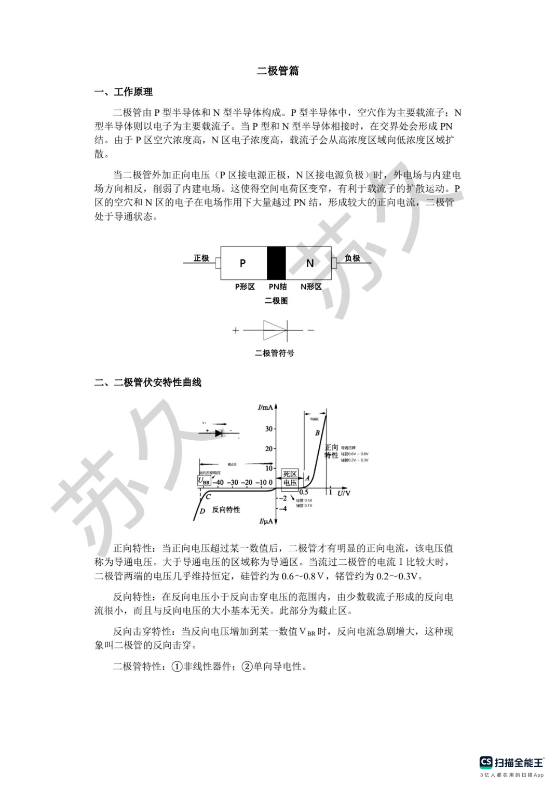
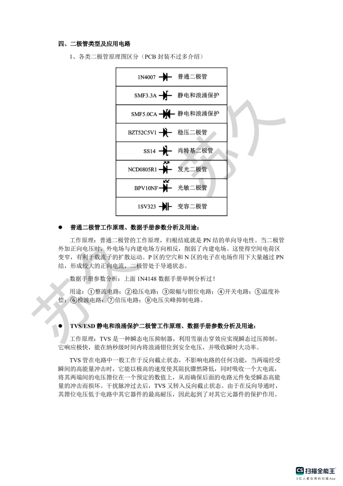
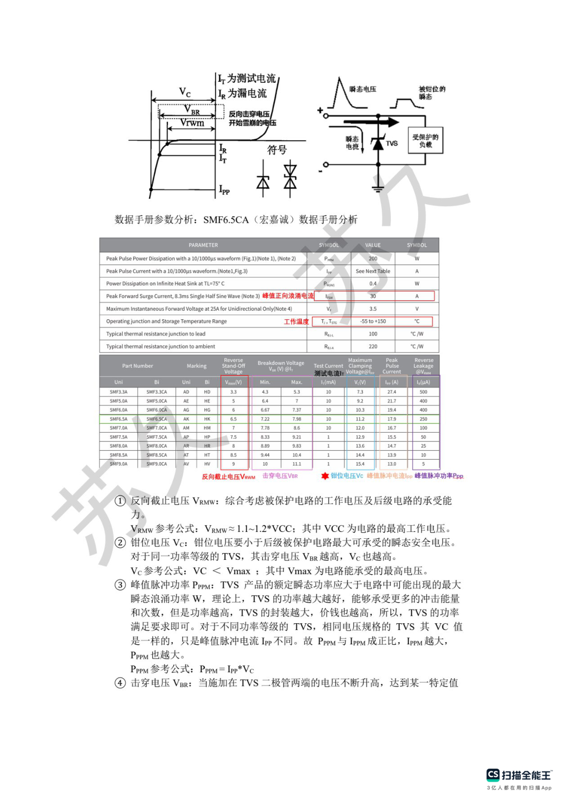
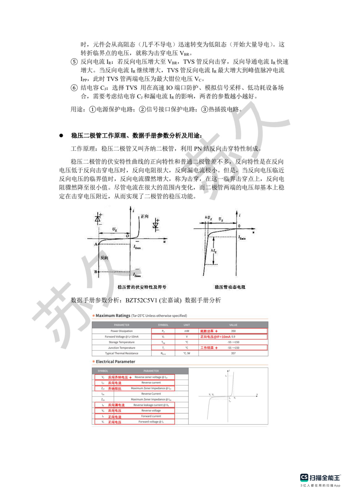
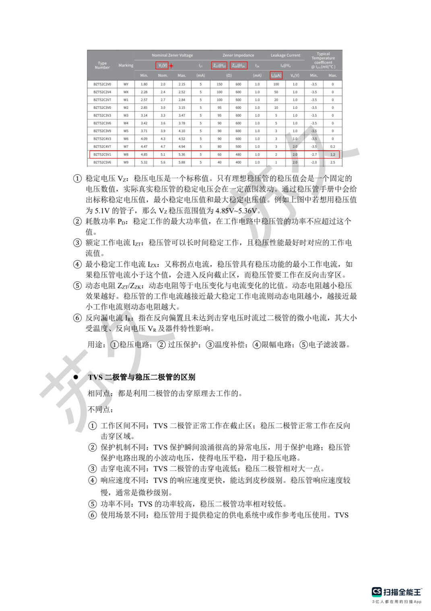
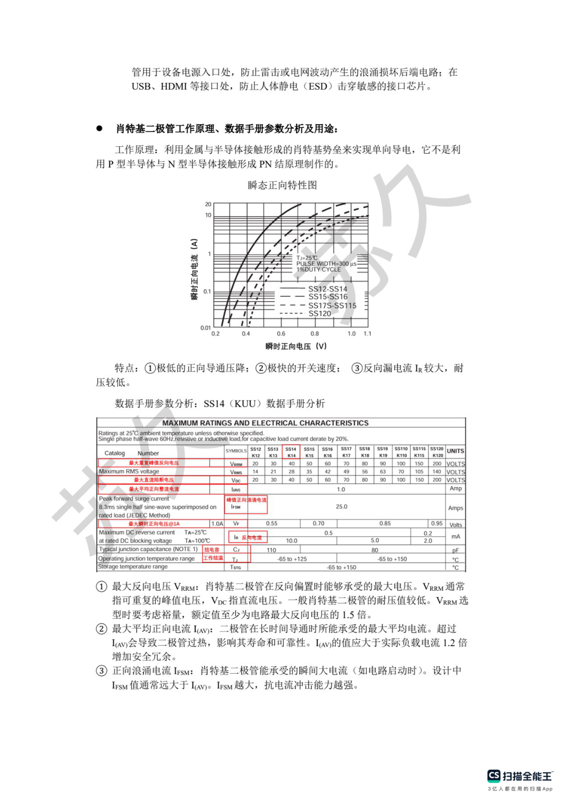

> 图像回补：缺图位置按正文前后锚点接入原版 [[硬件/原始备份/二极管篇.pdf|二极管篇.pdf]] 完整页面；跨页位置保留相邻页面，同页重复处提供页码链接。页面截图用于回看原图与上下文，不表示逐图编号或电路参数已独立核验。旧行号及原图名见 [[audit/图片修复明细.csv|图片修复明细]]。

## 二极管篇

## 一、工作原理

二极管由 P 型半导体和 N 型半导体构成。P 型半导体中，空穴作为主要载流子；N 型半导体则以电子为主要载流子。当 P 型和 N 型半导体相接时，在交界处会形成 PN 结。由于 P 区空穴浓度高，N 区电子浓度高，载流子会从高浓度区域向低浓度区域扩散。 

当二极管外加正向电压（P区接电源正极，N区接电源负极）时，外电场与内建电场方向相反，削弱了内建电场。这使得空间电荷区变窄，有利于载流子的扩散运动。P区的空穴和N区的电子在电场作用下大量越过PN结，形成较大的正向电流，二极管处于导通状态。 

## 二、二极管伏安特性曲线

[[硬件/原始备份/二极管篇.pdf#page=1|原版PDF第1页整页回看（前文已展示）]]

正向特性：当正向电压超过某一数值后，二极管才有明显的正向电流，该电压值称为导通电压。大于导通电压的区域称为导通区。当流过二极管的电流 I 比较大时，二极管两端的电压几乎维持恒定，硅管约为 0.6～0.8 V，锗管约为 0.2～0.3 V。 

反向特性：在反向电压小于反向击穿电压的范围内，由少数载流子形成的反向电流很小，而且与反向电压的大小基本无关。此部分为截止区。 

反向击穿特性：当反向电压增加到某一数值 $V_{BR}$ 时，反向电流急剧增大，这种现象叫二极管的反向击穿。 

二极管特性：①非线性器件；②单向导电性。 

## 三、数据手册中二极管参数

用 1N4148 数据手册举例说明以下参数要重点分析： 

Absolute Maximum Ratings at 25 °C

<table><tr><td colspan="2">Parameter</td><td>Symbols</td><td>1N4148W-E</td><td>Units</td></tr><tr><td colspan="2">Maximum Repetitive Peak Reverse Voltage</td><td><eq>V_{RRM}</eq></td><td>反向重复峰值电压 100 ★</td><td>V</td></tr><tr><td colspan="2">Maximum RMS voltage</td><td><eq>V_{RMS}</eq></td><td>75</td><td>V</td></tr><tr><td colspan="2">Average rectified output current</td><td><eq>I_{F(AV)}</eq></td><td>平均整流电流 ★ 150</td><td>mA</td></tr><tr><td rowspan="3">Non-reptitive Peak Forward Surge Current</td><td>at 1s</td><td rowspan="3"><eq>I_{FSM}</eq></td><td>峰值正向浪涌电流 0.5</td><td rowspan="3">A</td></tr><tr><td>at 1ms</td><td>1 ★</td></tr><tr><td>at 1us</td><td>4</td></tr><tr><td colspan="2">Total Power Dissipation</td><td><eq>P_{tot}</eq></td><td>最大功率 ★ 400</td><td>mW</td></tr><tr><td colspan="2">Typical Thermal Resistance (1)</td><td><eq>R_{\theta JA}</eq></td><td>280</td><td>°C/W</td></tr><tr><td colspan="2">Operating and Storage Temperature Range</td><td><eq>T_{j}, T_{stg}</eq></td><td>-55 ~ +125</td><td>°C</td></tr></table>

(1) P.C.B. mounted with 5 X 5 mm copper pad areas. 

Characteristics at Ta= 25 °C

<table><tr><td colspan="2">Parameter</td><td>Symbols</td><td>1N4148W-E</td><td>Units</td></tr><tr><td colspan="2">Reverse BreakdownVoltage at <eq>I_R=1μA</eq></td><td><eq>V_{(BR,R)}</eq></td><td>1uA下反向击穿电压75</td><td>V</td></tr><tr><td>Maximum Forward Voltage</td><td>at 1mAat 10 mAat 50 mAat 150mA</td><td><eq>V_F</eq></td><td>正向压降0.7150.8551.001.25</td><td>V</td></tr><tr><td>Peak Reverse Current</td><td>at <eq>V_R=20V</eq> <eq>T_J=25°C</eq>at <eq>V_R=75V</eq> <eq>T_J=25°C</eq>at <eq>V_R=25V</eq> <eq>T_J=150°C</eq>at <eq>V_R=75V</eq> <eq>T_J=150°C</eq></td><td><eq>I_R</eq></td><td>反向电流<eq>★</eq>0.02513050</td><td>uA</td></tr><tr><td colspan="2">Typical Junction Capacitance</td><td><eq>C_j</eq></td><td>寄生电容<eq>★</eq>2</td><td>pF</td></tr><tr><td colspan="2">Maximum Reverse Recovery Time</td><td><eq>t_{rr}</eq></td><td>反向恢复时间<eq>★</eq>4</td><td>ns</td></tr></table>

① $IF_{(AV)}$ （平均整流电流）：在负载设计时最好不要超过二极管平均整流电流，这有助于电路长久工作。 

② $V_{RM}$ （最高反向工作电压）：二极管两端允许的最大反向电压。若大于此值，则反向电流( $I_{R}$ )剧增，二极管的单向导电性被破坏，从而引起反向击穿。通常取反向击穿电压( $V_{BR}$ )的一半作为( $V_{RM}$ )。 

③ $I_{R}$ （反向电流）：二极管在规定的温度和反向电压作用下，流过二极管的反向电流。反向电流越小，管子的单方向导电性能越好。反向电流与温度密切相关，大约温度每升高10℃，反向电流增大一倍。硅管比锗管在高温下稳定性好。 

④ $C_{j}$ (结电容): 结电容的大小直接表示了二极管的频率特性。由于结电容的存在, 当频率高到某一程度时, 容抗小到使 PN 结短路。导致二极管失去单向导电性, 不能工作, PN 结面积越大, 结电容也越大, 越不能在高频情况下工作。 

⑤ $I_{FSM}$ （正向浪涌电流）：浪涌电流是允许流过的瞬间电流，超过这个值会损坏二极管。上图中的二极管的浪涌电流最大允许4电流不超过1us或0.5A电流不超过1s。 

⑥ $t_{rr}$ （反向恢复时间）：从正向电压变成反向电压时，电流一般不能瞬时截止，要延迟一点时间，这个时间就是反向恢复时间。这个参数决定了二极管的开关速度。 

⑦ $P_{tot}$ （最大功率）：在工作时所能承受或消耗的最大功率，主要由正向电流和正向电压决定。 

## 四、二极管类型及应用电路

## 1、各类二极管原理图区分（PCB 封装不过多介绍）

## ● 普通二极管工作原理、数据手册参数分析及用途:

工作原理：普通二极管的工作原理，归根结底就是 PN 结的单向导电性。当二极管外加正向电压时，外电场与内建电场方向相反，削弱了内建电场。这使得空间电荷区变窄，有利于载流子的扩散运动。P 区的空穴和 N 区的电子在电场作用下大量越过 PN 结，形成较大的正向电流，二极管处于导通状态。 

数据手册参数分析：上面 1N4148 数据手册举例分析过！ 

用途：①整流电路；②稳压电路；③限幅与钳位电路；④开关电路；⑤温度补偿；⑥检波电路；⑦倍压电路；⑧电压尖峰抑制电路。 

## - TVS/ESD 静电和浪涌保护二极管工作原理、数据手册参数分析及用途:

工作原理：TVS 是一种瞬态电压抑制器，利用雪崩击穿效应实现瞬态过压抑制。它响应极快，能在纳秒级时间内将浪涌钳位到安全电压，并吸收瞬时大功率。 

TVS 管在电路中一般工作于反向截止状态，不影响电路的任何功能，当两端经受瞬间的高能量冲击时，它能以极高的速度使其阻抗骤然降低，同时吸收一个大电流，将其两端间的电压箝位在一个预定的数值上，从而确保后面的电路元件免受瞬态高能量的冲击而损坏。干扰脉冲过去后，TVS 又转入反向截止状态。由于在反向导通时，其箝位电压低于电路中其它器件的最高耐压，因此起到了对其它元器件的保护作用。 

数据手册参数分析：SMF6.5CA（宏嘉诚）数据手册分析 

<table><tr><td>PARAMETER</td><td>SYMBOL</td><td>VALUE</td><td>SYMBOL</td></tr><tr><td>Peak Pulse Power Dissipation with a 10/1000μs waveform (Fig.1)(Note 1), (Note 2)</td><td><eq>P_{PPM}</eq></td><td>200</td><td>W</td></tr><tr><td>Peak Pulse Current with a 10/1000μs waveform.(Note1,Fig.3)</td><td><eq>I_{RP}</eq></td><td>See Next Table</td><td>A</td></tr><tr><td>Power Dissipation on Infinite Heat Sink at TL=75°C</td><td><eq>P_{M(AV)}</eq></td><td>0.4</td><td>W</td></tr><tr><td>Peak Forward Surge Current, 8.3ms Single Half Sine Wave (Note 3) 峰值正向浪涌电流</td><td><eq>I_{FSM}</eq></td><td>30</td><td>A</td></tr><tr><td>Maximum Instantaneous Forward Voltage at 25A for Unidirectional Only(Note 4)</td><td><eq>V_F</eq></td><td>3.5</td><td>V</td></tr><tr><td>Operating junction and Storage Temperature Range</td><td><eq>T_J,T_{STG}</eq></td><td>-55 to +150</td><td>°C</td></tr><tr><td>Typical thermal resistance junction to lead</td><td><eq>R_{\theta J-L}</eq></td><td>100</td><td>°C /W</td></tr><tr><td>Typical thermal resistance junction to ambient</td><td><eq>R_{\theta J-A}</eq></td><td>220</td><td>°C /W</td></tr></table>

<table><tr><td colspan="2">Part Number</td><td colspan="2">Marking</td><td>Reverse Stand-Off Voltage</td><td colspan="2">Breakdown Voltage <eq>{V}_{\mathrm{{BR}}}\left( \mathrm{V}\right) @{\mathrm{I}}_{\mathrm{T}}</eq></td><td>Test Current 测试电流<eq>{\mathrm{I}}_{\mathrm{T}}</eq></td><td>Maximum Clamping Voltage@<eq>{\mathrm{I}}_{\mathrm{{FP}}}</eq></td><td>Peak Pulse Current</td><td>Reverse Leakage @<eq>{V}_{\text{RWM }}</eq></td></tr><tr><td>Uni</td><td>Bi</td><td>Uni</td><td>Bi</td><td><eq>{V}_{\text{RWM }}\left( V\right)</eq></td><td>Min.</td><td>Max.</td><td><eq>{\mathrm{I}}_{\mathrm{T}}\left( \mathrm{{mA}}\right)</eq></td><td><eq>{V}_{\mathrm{C}}\left( V\right)</eq></td><td><eq>{\mathrm{I}}_{\mathrm{{PP}}}\left( \mathrm{A}\right)</eq></td><td><eq>{\mathrm{I}}_{\mathrm{R}}\left( {\mu \mathrm{A}}\right)</eq></td></tr><tr><td>SMF3.3A</td><td>SMF3.3CA</td><td>AD</td><td>HD</td><td>3.3</td><td>4.3</td><td>5.3</td><td>10</td><td>7.3</td><td>27.4</td><td>500</td></tr><tr><td>SMF5.0A</td><td>SMF5.0CA</td><td>AE</td><td>HE</td><td>5</td><td>6.4</td><td>7</td><td>10</td><td>9.2</td><td>21.7</td><td>400</td></tr><tr><td>SMF6.0A</td><td>SMF6.0CA</td><td>AG</td><td>HG</td><td>6</td><td>6.67</td><td>7.37</td><td>10</td><td>10.3</td><td>19.4</td><td>400</td></tr><tr><td>SMF6.5A</td><td>SMF6.5CA</td><td>AK</td><td>HK</td><td>6.5</td><td>7.22</td><td>7.98</td><td>10</td><td>11.2</td><td>17.9</td><td>250</td></tr><tr><td>SMF7.0A</td><td>SMF7.0CA</td><td>AM</td><td>HM</td><td>7</td><td>7.78</td><td>8.6</td><td>10</td><td>12.0</td><td>16.7</td><td>100</td></tr><tr><td>SMF7.5A</td><td>SMF7.5CA</td><td>AP</td><td>HP</td><td>7.5</td><td>8.33</td><td>9.21</td><td>1</td><td>12.9</td><td>15.5</td><td>50</td></tr><tr><td>SMF8.0A</td><td>SMF8.0CA</td><td>AR</td><td>HR</td><td>8</td><td>8.89</td><td>9.83</td><td>1</td><td>13.6</td><td>14.7</td><td>25</td></tr><tr><td>SMF8.5A</td><td>SMF8.5CA</td><td>AT</td><td>HT</td><td>8.5</td><td>9.44</td><td>10.4</td><td>1</td><td>14.4</td><td>13.9</td><td>10</td></tr><tr><td>SMF9.0A</td><td>SMF9.0CA</td><td>AV</td><td>HV</td><td>9</td><td>10</td><td>11.1</td><td>1</td><td>15.4</td><td>13.0</td><td>5</td></tr></table>

反向截止电压 $V_{RWM}$ 击穿电压 $V_{BR}$ 

钳位电压Vc 峰值脉冲电流Ipp 峰值脉冲功率Ppp 

① 反向截止电压 $V_{RMW}$ ：综合考虑被保护电路的工作电压及后级电路的承受能力。 

$V_{RMW}$ 参考公式： $V_{RMW} \approx 1.1 \sim 1.2^{*}VCC$ ；其中 VCC 为电路的最高工作电压。 

②钳位电压 $V_{C}$ ：钳位电压要小于后级被保护电路最大可承受的瞬态安全电压。对于同一功率等级的 TVS，其击穿电压 $V_{BR}$ 越高， $V_{C}$ 也越高。 

$V_{c}$ 参考公式：VC < Vmax；其中 Vmax 为电路能承受的最高电压。 

③ 峰值脉冲功率 $P_{PPM}$ ：TVS 产品的额定瞬态功率应大于电路中可能出现的最大瞬态浪涌功率 W，理论上，TVS 的功率越大越好，能够承受更多的冲击能量和次数，但是功率越高，TVS 的封装越大，价钱也越高，所以，TVS 的功率满足要求即可。对于不同功率等级的 TVS，相同电压规格的 TVS 其 VC 值是一样的，只是峰值脉冲电流 $I_{PP}$ 不同。故 $P_{PPM}$ 与 $I_{PPM}$ 成正比， $I_{PPM}$ 越大， $P_{PPM}$ 也越大。 

$P_{PPM}$ 参考公式： $P_{PPM}=I_{PP}*V_{C}$ 

④ 击穿电压 $V_{BR}$ ：当施加在 TVS 二极管两端的电压不断升高，达到某一特定值 时，元件会从高阻态（几乎不导电）迅速转变为低阻态（开始大量导电）。这转折临界点的电压，就称为击穿电压 $V_{BR}$ 。 

⑤ 反向电流 $I_{R}$ ：若反向电压增大至 $V_{BR}$ ，TVS 管反向击穿，反向导通电流 $I_{R}$ 快速增大。当反向电流 $I_{R}$ 继续增大，TVS 管反向电流 $I_{R}$ 最大增大到峰值脉冲电流 $I_{PP}$ ，此时 TVS 管两端电压为最大钳位电压 $V_{C}$ 。 

⑥ 结电容 $C_{J}$ ：选择 TVS 用在高速 IO 端口防护、模拟信号采样、低功耗设备场合，需要考虑结电容 $C_{J}$ 和漏电流 $I_{R}$ 的影响，两者的参数越小越好。 

用途：①电源保护电路；②信号接口保护电路；③热插拔电路。 

## ● 稳压二极管工作原理、数据手册参数分析及用途：

工作原理：稳压二极管又叫齐纳二极管，利用 PN 结反向击穿特性制成。 

稳压二极管的伏安特性曲线的正向特性和普通二极管差不多，反向特性是在反向电压低于反向击穿电压时，反向电阻很大，反向漏电流极小。但是，当反向电压临近反向电压的临界值时，反向电流骤然增大，称为击穿，在这一临界击穿点上，反向电阻骤然降至很小值。尽管电流在很大的范围内变化，而二极管两端的电压却基本上稳定在击穿电压附近，从而实现了二极管的稳压功能。 

[[硬件/原始备份/二极管篇.pdf#page=4|原版PDF第4页整页回看（前文已展示）]]

稳压管的伏安特性及符号

稳压管动态电阻

数据手册参数分析：BZT52C5V1 (宏嘉诚) 数据手册分析 

• Maximum Ratings (Ta=25°C Unless otherwise specified)

<table><tr><td>PARAMETER</td><td>SYMBOL</td><td>UNIT</td><td>VALUE</td></tr><tr><td>Power Dissipation</td><td><eq>{\mathrm{P}}_{0}</eq></td><td>mW</td><td>耗散功率 + 350</td></tr><tr><td>Forward Voltage @ <eq>{\mathrm{I}}_{\mathrm{r}} = {10}\mathrm{{mA}}</eq></td><td><eq>{\mathrm{V}}_{\mathrm{f}}</eq></td><td>V</td><td>正向电压@IF=10mA 0.9</td></tr><tr><td>Storage Temperature</td><td><eq>{\mathrm{T}}_{\text{reg }}</eq></td><td>°C</td><td>-55 ~+150</td></tr><tr><td>Junction Temperature</td><td><eq>{\mathrm{T}}_{\mathrm{j}}</eq></td><td>°C</td><td>工作结温 + -55 ~+150</td></tr><tr><td>Typical Thermal Resistance</td><td><eq>{\mathrm{R}}_{\theta \mathrm{J} - \mathrm{A}}</eq></td><td>°C/W</td><td>357</td></tr></table>

## Electrical Parameter

<table><tr><td colspan="2">SYMBOL</td><td colspan="2">PARAMETER</td></tr><tr><td></td><td colspan="2"><eq>V_Z</eq>反向齐纳电压+Reverse zener voltage @ <eq>I_{ZT}</eq></td><td></td></tr><tr><td></td><td colspan="2"><eq>I_{ZT}</eq>反向电流</td><td>Reverse current</td></tr><tr><td></td><td colspan="2"><eq>Z_{ZT}</eq>齐纳阻抗</td><td>Maximum Zener Impedance @ <eq>I_{ZT}</eq></td></tr><tr><td></td><td colspan="2"><eq>I_{ZK}</eq></td><td>Reverse Current</td></tr><tr><td></td><td colspan="2"><eq>Z_{ZK}</eq></td><td>Maximum Zener Impedance @ <eq>I_{ZK}</eq></td></tr><tr><td></td><td colspan="2"><eq>I_R</eq>反向漏电流</td><td>Reverse leakage current @ <eq>V_R</eq></td></tr><tr><td></td><td colspan="2"><eq>V_R</eq>反向电压</td><td>Reverse voltage</td></tr><tr><td></td><td colspan="2"><eq>I_F</eq>正向电流</td><td>Forward current</td></tr><tr><td></td><td colspan="2"><eq>V_F</eq>正向电压</td><td>Forward voltage @ <eq>I_F</eq></td></tr></table>

<!-- 原附件导入时缺失；位于 BZT52C5V1（宏嘉诚）数据手册参数段。原件和 Git 历史均未找到。 -->

<table><tr><td rowspan="3">Type Number</td><td rowspan="3">Marking</td><td colspan="4">Nominal Zener Voltage</td><td colspan="3">Zener Impedance</td><td colspan="2">Leakage Current</td><td rowspan="2" colspan="2">Typical Temperature coefficient @<eq>I_{2TC}</eq>(mV/°C)</td></tr><tr><td colspan="3"><eq>V_Z(V)</eq></td><td><eq>I_{ZT}</eq></td><td><eq>Z_{ZT}@I_{ZT}</eq></td><td><eq>Z_{ZK}@I_{ZK}</eq></td><td><eq>I_{ZK}</eq></td><td colspan="2"><eq>I_R@V_R</eq></td></tr><tr><td>Min.</td><td>Nom.</td><td>Max.</td><td>(mA)</td><td colspan="2">(Ω)</td><td>(mA)</td><td><eq>I_R(\mu A)</eq></td><td><eq>V_R(V)</eq></td><td>Min.</td><td>Max.</td></tr><tr><td>BZT52C2V0</td><td>WY</td><td>1.80</td><td>2.0</td><td>2.15</td><td>5</td><td>150</td><td>600</td><td>1.0</td><td>100</td><td>1.0</td><td>-3.5</td><td>0</td></tr><tr><td>BZT52C2V4</td><td>WX</td><td>2.28</td><td>2.4</td><td>2.52</td><td>5</td><td>100</td><td>600</td><td>1.0</td><td>50</td><td>1.0</td><td>-3.5</td><td>0</td></tr><tr><td>BZT52C2V7</td><td>W1</td><td>2.57</td><td>2.7</td><td>2.84</td><td>5</td><td>100</td><td>600</td><td>1.0</td><td>20</td><td>1.0</td><td>-3.5</td><td>0</td></tr><tr><td>BZT52C3V0</td><td>W2</td><td>2.85</td><td>3.0</td><td>3.15</td><td>5</td><td>95</td><td>600</td><td>1.0</td><td>10</td><td>1.0</td><td>-3.5</td><td>0</td></tr><tr><td>BZT52C3V3</td><td>W3</td><td>3.14</td><td>3.3</td><td>3.47</td><td>5</td><td>95</td><td>600</td><td>1.0</td><td>5</td><td>1.0</td><td>-3.5</td><td>0</td></tr><tr><td>BZT52C3V6</td><td>W4</td><td>3.42</td><td>3.6</td><td>3.78</td><td>5</td><td>90</td><td>600</td><td>1.0</td><td>5</td><td>1.0</td><td>-3.5</td><td>0</td></tr><tr><td>BZT52C3V9</td><td>W5</td><td>3.71</td><td>3.9</td><td>4.10</td><td>5</td><td>90</td><td>600</td><td>1.0</td><td>3</td><td>1.0</td><td>-3.5</td><td>0</td></tr><tr><td>BZT52C4V3</td><td>W6</td><td>4.09</td><td>4.3</td><td>4.52</td><td>5</td><td>90</td><td>600</td><td>1.0</td><td>3</td><td>1.0</td><td>-3.5</td><td>0</td></tr><tr><td>BZT52C4V7</td><td>W7</td><td>4.47</td><td>4.7</td><td>4.94</td><td>5</td><td>80</td><td>500</td><td>1.0</td><td>3</td><td>2.0</td><td>-3.5</td><td>0.2</td></tr><tr><td>BZT52C5V1</td><td>W8</td><td>4.85</td><td>5.1</td><td>5.36</td><td>5</td><td>60</td><td>480</td><td>1.0</td><td>2</td><td>2.0</td><td>-2.7</td><td>1.2</td></tr><tr><td>BZT52C5V6</td><td>W9</td><td>5.32</td><td>5.6</td><td>5.88</td><td>5</td><td>40</td><td>400</td><td>1.0</td><td>1</td><td>2.0</td><td>-2.0</td><td>2.5</td></tr></table>

① 稳定电压 $V_{Z}$ ：稳压电压是一个标称值。只有理想稳压管的稳压值会是一个固定的电压数值，实际真实稳压管的稳定电压会在一定范围波动。通过稳压管手册中会给出标称稳定电压值，最小稳定电压值和最大稳定电压值。例如上图中若想用稳压值为 5.1V 的管子，那么 $V_{Z}$ 稳压范围值为 4.85V~5.36V。 

② 耗散功率 $\mathrm{P_D}$ ：稳定工作的最大功率值，在工作电路中稳压管的功率不应超过这个值。 

③ 额定工作电流 $I_{ZT}$ ：稳压管可以长时间稳定工作，且稳压性能最好时对应的工作电流值。 

④ 最小稳定工作电流 $I_{zx}$ ：又称拐点电流，稳压管具有稳压功能的最小工作电流，如果稳压管电流小于这个值，会进入反向截止区，而稳压管要工作在反向击穿区。 

⑤ 动态电阻 $Z_{ZT}/Z_{ZK}$ ：动态电阻等于电压变化与电流变化的比值。动态电阻越小稳压效果越好。稳压管的工作电流越接近最大稳定工作电流则动态电阻越小，越接近最小工作电流则动态电阻越大。 

⑥ 反向漏电流 $I_{R}$ ：指在反向偏置且未达到击穿电压时流过二极管的微小电流，其大小受温度、反向电压 $V_{R}$ 及器件特性影响。 

用途：①稳压电路；②过压保护；③温度补偿；④限幅电路；⑤电子滤波器。 

## - TVS 二极管与稳压二极管的区别

相同点：都是利用二极管的击穿原理去工作的。 

不同点: 

① 工作区间不同：TVS 二极管正常工作在截止区；稳压二极管正常工作在反向击穿区域。 

② 保护机制不同：TVS 保护瞬间浪涌很高的异常电压，用于保护电路；稳压管保护电路出现的小波动电压，使得电压平稳，用于稳压电路。 

③ 击穿电流不同：TVS 二极管的击穿电流低；稳压二极管相对大一点。 

④ 响应速度不同：TVS 的响应速度更快，能达到皮秒级别。稳压管响应速度较慢，通常是微秒级别。 

⑤ 功率不同：TVS 的功率较高，稳压二极管功率相对较低。 

⑥ 使用场景不同：稳压管用于提供稳定的供电系统中或作参考电压使用。TVS 管用于设备电源入口处，防止雷击或电网波动产生的浪涌损坏后端电路；在USB、HDMI等接口处，防止人体静电（ESD）击穿敏感的接口芯片。 

## ● 肖特基二极管工作原理、数据手册参数分析及用途：

工作原理：利用金属与半导体接触形成的肖特基势垒来实现单向导电，它不是利用 P 型半导体与 N 型半导体接触形成 PN 结原理制作的。 

特点: ①极低的正向导通压降; ②极快的开关速度; ③反向漏电流 $\mathrm{I}_{\mathrm{R}}$ 较大, 耐压较低。 

数据手册参数分析：SS14（KUU）数据手册分析 

<table><tr><td colspan="16">MAXIMUM RATINGS AND ELECTRICAL CHARACTERISTICS</td></tr><tr><td colspan="16">Ratings at 25°C ambient temperature unless otherwise specified.Single phase half-wave 60Hz, resistive or inductive load, for capacitive load current derate by 20%.</td></tr><tr><td colspan="3">Catalog Number</td><td>SYMBOLS</td><td>SS12K12</td><td>SS13K13</td><td>SS14K14</td><td>SS15K15</td><td>SS16K16</td><td>SS17K17</td><td>SS18K18</td><td>SS19K19</td><td>SS110K110</td><td>SS115K115</td><td>SS120K120</td><td>UNITS</td></tr><tr><td colspan="2">最大重复峰值反向电压</td><td></td><td>VRRM</td><td>20</td><td>30</td><td>40</td><td>50</td><td>60</td><td>70</td><td>80</td><td>90</td><td>100</td><td>150</td><td>200</td><td>VOLTS</td></tr><tr><td colspan="3">Maximum RMS voltage</td><td>VRMS</td><td>14</td><td>21</td><td>28</td><td>35</td><td>42</td><td>49</td><td>56</td><td>63</td><td>70</td><td>105</td><td>140</td><td>VOLTS</td></tr><tr><td colspan="2">最大直流阻断电压</td><td></td><td>VDC</td><td>20</td><td>30</td><td>40</td><td>50</td><td>60</td><td>70</td><td>80</td><td>90</td><td>100</td><td>150</td><td>200</td><td>VOLTS</td></tr><tr><td colspan="2">最大平均正向整流电流</td><td></td><td>I(AV)</td><td colspan="11">1.0</td><td>Amp</td></tr><tr><td rowspan="2" colspan="3">Peak forward surge current8.3ms single half sine-wave superimposed onrated load (JEDEC Method)</td><td colspan="12">峰值正向浪涌电流IFSM25.0</td><td rowspan="2">Amps</td></tr><tr><td colspan="12"></td></tr><tr><td colspan="2">最大瞬时正向电压@1A</td><td>1.0A</td><td>VF</td><td colspan="3">0.55</td><td colspan="2">0.70</td><td colspan="5">0.85</td><td>0.95</td><td>Volts</td></tr><tr><td rowspan="2" colspan="3">Maximum DC reverse current TA=25°Cat rated DC blocking voltage TA=100°C</td><td rowspan="2" colspan="6">IR反向电流10.0</td><td colspan="4">0.5</td><td colspan="2">0.2</td><td rowspan="2">mA</td></tr><tr><td colspan="4">5.0</td><td colspan="2">2.0</td></tr><tr><td>Typical junction capacitance (NOTE 1)</td><td colspan="2">结电容</td><td>CJ</td><td colspan="3">110</td><td colspan="8">80</td><td>pF</td></tr><tr><td>Operating junction temperature range</td><td colspan="2">工作结温</td><td>TJ</td><td colspan="5">-65 to +125</td><td colspan="6">-65 to +150</td><td>°C</td></tr><tr><td colspan="3">Storage temperature range</td><td>TSTG</td><td colspan="11">-65 to +150</td><td>°C</td></tr></table>

① 最大反向电压 $V_{RRM}$ ：肖特基二极管在反向偏置时能够承受的最大电压。 $V_{RRM}$ 通常指可重复的峰值电压， $V_{DC}$ 指直流电压。一般肖特基二极管的耐压值较低。 $V_{RRM}$ 选型时要考虑裕量，额定值至少为电路最大反向电压的 1.5 倍。 

② 最大平均正向电流 $I_{(AV)}$ ：二极管在长时间导通时所能承受的最大平均电流。超过 $I_{(AV)}$ 会导致二极管过热，影响其寿命和可靠性。 $I_{(AV)}$ 的值应大于实际负载电流 1.2 倍增加安全冗余。 

③ 正向浪涌电流 $I_{FSM}$ ：肖特基二极管能承受的瞬间大电流（如电路启动时）。设计中 $I_{FSM}$ 值通常远大于 $I_{(AV)}$ 。 $I_{FSM}$ 越大，抗电流冲击能力越强。 

④ 正向压降 $V_{F}$ ：二极管正向导通时，两端产生的电压降，一般小电流下在 $V_{F}$ 在 0.15V~0.45V 之间。 $V_{F}$ 越低，导通损耗和发热就越小。同时 $V_{F}$ 并非固定值，会随正向电流增大而升高，随温度升高而略微降低。 

⑤ 反向漏电流 $I_{R}$ ：加反向电压时流过的微小电流。肖特基二极管的 $I_{R}$ 通常比普通二极管大，且 $I_{R}$ 随着温度升高显著增加。对于长期待机或低功耗产品要选择 $I_{R}$ 较小的肖特基二极管。 

⑥ 结电容 $C_{J}$ ：肖特基二极管两端存在的寄生电容。通常较小，以皮法(pF)为单位。结电容越大，对高频信号的阻碍和损耗就越大。在射频(RF)电路、高速信号处理等应用中，需优先选择结电容极小的型号。 

⑦ 工作结温 $T_{J}$ ：肖特基二极管芯片允许的最高温度。超出结温会导致性能下降或永久损坏。 

⑧ 反向恢复时间 $t_{rr}$ ：肖特基二极管从导通切换到截止所需的时间。肖特基二极管的 $t_{rr}$ 极短，通常小于 10 纳秒(ns)。 $t_{rr}$ 越短，开关速度越快，高频开关损耗越小。 

用途：①高频应用（如开关电源和 DC-DC 转换器）；②电源反接保护；③低功耗电池设备；④高频与射频电路（信号检波） 

## ● 发光二极管工作原理、数据手册参数分析及用途：

工作原理：发光二极管（LED）是一种将电能直接转化为光能的半导体器件。它基于电致发光原理工作，核心是一个 PN 结。 

当给 LED 施加正向电压时，在电场作用下，P 区的空穴和 N 区的电子会向对方区域移动，大量注入到 PN 结附近。注入的电子和空穴在 PN 结相遇并复合。复合时，电子从高能级跃迁到低能级，多余的能量以光子的形式释放出来。 

在使用过程中，发光二极管发光的强弱和流过他的电流成正比，所以如果觉得光弱，可以降低和它串联的电阻，但是要注意他能够承受的最大电流，防止损坏。 

发出有色光是由半导体材料的带隙决定的。例如： 

砷化镓（GaAs）发红光，正向电压 $V_{F}$ 1.8V - 2.4V; 

碳化硅（SiC）发黄光，正向电压 $V_{F}$ 1.8V - 2.4V； 

氮化镓（GaN）发蓝光，正向电压 $V_{F}$ 2.8V - 3.7V。 

磷化镓（GaP）发绿光，正向电压 $V_{F}$ 2.9V - 4.0V； 

氮化铟镓（InGaN）发紫色，正向电压 $V_{F}$ 2.76V - 4.4V; 

数据手册参数分析：XL-2012SURC (成兴光) 数据手册分析 

极限参数（Ta=25℃）Absolute Maximum Rating（ta=25 ℃）

<table><tr><td>项目参数Parameter</td><td>符号Symbol</td><td>数值Value</td><td>单位 Unit</td></tr><tr><td>最大功耗(Max Power Dissipation)</td><td>PD</td><td>50</td><td>mW</td></tr><tr><td>最大正向电流(Max Continuous Forward Current)</td><td>IF</td><td>20</td><td>mA</td></tr><tr><td>最大脉冲峰值电流(Peak Forward Current)</td><td>IFP</td><td>80</td><td>mA</td></tr><tr><td>最大反向电压(Max Reverse Voltage)</td><td>VR</td><td>5</td><td>V</td></tr><tr><td>抗静电能力(Antistatic ability)</td><td>ESD</td><td>2000</td><td>V</td></tr><tr><td>工作环境(Operating Temperature Range)</td><td>TOPR</td><td>-40 ~ +85°C</td><td>°C</td></tr><tr><td>储存温度(Storage Temperature Range)</td><td>TSTR</td><td>-40 ~ +85°C</td><td>°C</td></tr><tr><td>焊接温度/时间(Lead Soldering Temperature/Time)</td><td>TSOL</td><td>260°C≤6S</td><td>/</td></tr></table>

光电参数 (Ta=25°C) Optical-electrical parameter (ta=25 °C)

<table><tr><td>项目参数Parameter</td><td>符号Symbol</td><td>最小值Min.</td><td>一般值Typ.</td><td>最大值Max.</td><td>单位Unit</td><td>测试条件Test conditions</td></tr><tr><td>发光强度(Luminous Intensity)</td><td>Iv</td><td>80</td><td>/</td><td>240</td><td>mcd</td><td>IF=20mA</td></tr><tr><td>主波长(Dominant Wave Length)</td><td>λd</td><td>615</td><td>/</td><td>630</td><td>nm</td><td>IF=20mA</td></tr><tr><td>峰值波长(Peak Wave Length)</td><td>λp</td><td>/</td><td>625</td><td>/</td><td>nm</td><td>IF=20mA</td></tr><tr><td>正向电压(Forward Voltage)</td><td>VF</td><td>1.8</td><td>/</td><td>2.2</td><td>V</td><td>IF=20mA</td></tr><tr><td>发光角度(Viewing Angle)</td><td>201/2</td><td>/</td><td>120°</td><td>/</td><td>deg</td><td>IF=20mA</td></tr><tr><td>半波宽(Half wave width)</td><td>Δλ</td><td>/</td><td>20</td><td>/</td><td>nm</td><td>IF=20mA</td></tr><tr><td>反向电流(Reverse Current)</td><td>IR</td><td>/</td><td>/</td><td>≤1</td><td>μA</td><td>VR=5V</td></tr></table>

① 最大功耗 $P_{D}$ ：允许的最大功率（ $P_{D}=V_{F}*I_{F}$ ）。超过此值会因过热而损坏。 

② 最大正向电流 $I_{F}$ ：允许通过的最大正向直流电流。普通 LED 大多为 20mA。 

③ 最大反向电压 $V_{R}$ ：允许施加的最大反向电压。通常较低，典型值为 5V。 

④ 工作温度 $\mathrm{T_{OPR}}$ ：LED能正常工作的环境温度范围。超出范围效率会大幅降低。 

⑤ 主波长/峰值波长 $\lambda_{d}/\lambda_{p}$ ：波长决定 LED 颜色，以纳米（nm）为单位。例如，红光约 620-625nm。 

⑥ 正向电压 $V_{F}$ ：导通并发光时，其两端的电压降。多数 LED 为 1.4V～3.0V（一般在 $I_{F}=20mA$ 时测得）。 

⑦ 发光视角 201/2：发光强度降至轴向强度一半时所对应的角度。决定了光线的照射范围，从几度到一百多度不等。 

⑧ 反向漏电流 $I_{R}$ ：加反向电压 $V_{R}$ 时流过 LED 的微小电流。值越小越好，通常在 $10\mu A$ 以下。 

用途：①调试指示灯与显示；②工业照明；③特殊应用（医疗紫光灯，通信红外线）。 

## ● 光敏二极管工作原理、数据手册参数分析及用途：

工作原理：又叫光电二极管，是一种能将光信号转换为电信号的半导体器件。它的核心是一个对光敏感的 PN 结，通常工作在反向偏置状态下。 

数据手册参数分析：PD333-3B/L3 (亿光) 数据手册分析 

<table><tr><td>Parameter</td><td colspan="2">Symbol</td><td>Rating</td><td colspan="3">Unit</td></tr><tr><td>Reverse Voltage</td><td colspan="2"><eq>V_R</eq>反向电压</td><td>32</td><td>V</td><td colspan="2"></td></tr><tr><td>Operating Temperature</td><td colspan="2"><eq>T_{opr}</eq>工作温度</td><td>-25~+85</td><td>°C</td><td colspan="2"></td></tr><tr><td>Storage Temperature</td><td colspan="2"><eq>T_{stg}</eq>储存温度</td><td>-40~+100</td><td colspan="3">°C</td></tr><tr><td>Soldering Temperature</td><td colspan="2"><eq>T_{sol}</eq>焊接温度</td><td>260</td><td colspan="3">°C</td></tr><tr><td>Power Dissipation at (or below)25°C Free Air Temperature</td><td colspan="2"><eq>P_c</eq>耗散功率</td><td>150</td><td>mW</td><td colspan="2"></td></tr><tr><td colspan="7"></td></tr><tr><td>Parameter</td><td>Symbol</td><td>Min.</td><td>Typ.</td><td>Max.</td><td>Unit</td><td>Condition</td></tr><tr><td>Range Of Spectral Bandwidth</td><td><eq>λ_{0.5}</eq>频谱范围</td><td>840</td><td>----</td><td>1100</td><td>nm</td><td>----</td></tr><tr><td>Wavelength Of Peak Sensitivity</td><td><eq>λ_P</eq>峰值波长</td><td>----</td><td>940</td><td>----</td><td>nm</td><td>----</td></tr><tr><td>Open-Circuit Voltage</td><td><eq>V_{OC}</eq>开路电压</td><td>----</td><td>0.44</td><td>----</td><td>V</td><td><eq>Ee=5mW/cm^2</eq><eq>λp=940nm</eq></td></tr><tr><td>Short- Circuit Current</td><td><eq>I_{SC}</eq>短路电压</td><td>----</td><td>10</td><td>----</td><td>μA</td><td><eq>Ee=1mW/cm^2</eq><eq>λp=940nm</eq></td></tr><tr><td>Reverse Light Current</td><td><eq>I_L</eq>亮电流</td><td>10</td><td>----</td><td>----</td><td>μA</td><td><eq>Ee=1mW/cm^2</eq><eq>λp=940nm</eq><eq>V_R=5V</eq></td></tr><tr><td>Reverse Dark Current</td><td><eq>I_D</eq>暗电流</td><td>----</td><td>----</td><td>10</td><td>nA</td><td><eq>Ee=0mW/cm^2</eq><eq>V_R=10V</eq></td></tr><tr><td>Reverse Breakdown Voltage</td><td><eq>V_{BR}</eq>反向击穿电压</td><td>32</td><td>170</td><td>----</td><td>V</td><td><eq>Ee=0mW/cm^2</eq><eq>I_R=100μA</eq></td></tr><tr><td>Total Capacitance</td><td><eq>C_t</eq>结电容</td><td>----</td><td>10</td><td>----</td><td>pF</td><td><eq>Ee=0mW/cm^2</eq><eq>V_R=5V</eq><eq>f=1MHz</eq></td></tr><tr><td>Rise Time/ Fall Time</td><td><eq>t_{tf}/t_f</eq>响应时间</td><td>----</td><td>10</td><td>----</td><td>ns</td><td><eq>V_R=10V</eq><eq>R_L=100Ω</eq></td></tr></table>

① 反向电压 $V_{R}$ ：允许施加的最大反向直流电压。 

② 工作温度 $\mathrm{T_{OPR}}$ ：光敏二极管能正常工作的环境温度范围。 

③ 耗散功率 $P_{c}$ ：允许的最大功率，超过此值会因过热而损坏。 

④ 频谱范围 /峰值波长 $\lambda_{p}$ ：器件能响应的光的波长范围。决定了能探测何种光。 

⑤ 光电流 $I_{L}$ ：在特定光照和反向电压下产生的电流。用于衡量器件将光转为电信号能力的核心指标。值越大，灵敏度越高。 

⑥ 暗电流 $I_{D}$ ：无光照、加反向偏压时产生的微小漏电流。主要噪声源，尤其测量微弱光信号时影响大。值越低，器件越优秀 

⑦ 结电容 $C_{t}$ ：PN结的电容效应。直接影响响应速度。结电容越小，响应速度越快 

⑧ 响应时间 $T_{r}/T_{f}$ ：输出信号跟随光信号变化的速度。决定器件能处理的最高频率。高速应用需选响应时间短的。 

用途：①光控开关电路；②光信号检测与测量电路（光信号转为电压信号）；③跨阻放大器 

## ● 变容二极管工作原理、数据手册参数分析及用途：

工作原理：又称"可变电抗二极管"，利用PN结电容随外加反向偏压变化而工作的特殊半导体器件。变容二极管为特殊二极管的一种。当外加顺向偏压时，有大量电流产生，PN结的耗尽区变窄，电容变大，产生扩散电容效应；当外加反向偏压时，则会产生过渡电容效应。但因加顺向偏压时会有漏电流的产生，所以在应用上均供给反向偏压。 

变容二极管也称为压控变容器，是根据所提供的电压变化而改变结电容的半导体。作为可变电容器，可以被应用于 FM 调谐器及 TV 调谐器等谐振电路和 FM 调制电 

路中。 

数据手册参数分析：1S2638(先科)数据手册分析 

Absolute Maximum Ratings ( $T_{a} = 25^{\circ}C$ )

<table><tr><td colspan="2">Parameter</td><td>Symbol</td><td>Value</td><td>Unit</td></tr><tr><td>Breakdown Voltage</td><td>击穿电压</td><td>BV</td><td>10</td><td>V</td></tr><tr><td>Forward Current</td><td>正向电流</td><td><eq>I_F</eq></td><td>250</td><td>mA</td></tr><tr><td>Power Dissipation</td><td>耗散功率</td><td><eq>P_D</eq></td><td>350</td><td>mW</td></tr><tr><td>Operating Temperature Range</td><td>工作温度</td><td><eq>T_{opr}</eq></td><td>-65 to +175</td><td>°C</td></tr><tr><td>Storage Temperature Range</td><td>存储温度</td><td><eq>T_{stg}</eq></td><td>-65 to +200</td><td>°C</td></tr></table>

Characteristics at $T_{\mathrm{a}} = 25^{\circ}\mathrm{C}$

<table><tr><td colspan="2">Parameter</td><td>Symbol</td><td>Min.</td><td>Max.</td><td>Unit</td></tr><tr><td>Reverse Currentat <eq>V_{R} = 10</eq> V</td><td>反向电流</td><td><eq>I_{R}</eq></td><td>-</td><td>5</td><td><eq>\mu A</eq></td></tr><tr><td>Nominal Capacitanceat <eq>V_{R} = 4</eq> V, f = 1 MHz</td><td>电容</td><td>C</td><td>5</td><td>20</td><td>pF</td></tr><tr><td>at <eq>V_{R} = 4</eq> V, f = 100 MHz</td><td>品质因数</td><td>Q</td><td>50</td><td>-</td><td>-</td></tr></table>

① 反向击穿电压 BV：二极管所能承受的最高反向电压。这是一个绝对最大额定值，使用时绝对不能超过，否则器件会永久损坏。 

② 最大正向电流 $I_{F}$ ：允许通过的最大正向直流电流。 

③ 耗散功率 $P_{D}$ ：允许的最大功率，超过此值会因过热而损坏。 

④ 工作温度 $\mathrm{T_{OPR}}$ ：光敏二极管能正常工作的环境温度范围。 

⑤ 反向漏电流 $I_{R}$ ：在特定反向电压下的微小漏电流。漏电流会产生噪声和额外的功耗，在要求严格的低噪声应用中需重点关注。 

⑥ 结电容 C：在特定反向电压下的电容值（单位 pF）。电容随电压变化的最小值和最大值范围。 

⑦ 品质因数 Q: 衡量器件能量损耗的指标。Q 值越高, 表示损耗越小, 效率越高。 

用途：①电子调谐器（收音机、电视机）；②相位调制器；③压控振荡器（VCO）；④自动频率控制（接收机）；⑤可调滤波器（在射频前端）。 
