Switching Power Supply 

Design (Third Edition) 

# 开关电源设计

(第三版) 

http://www.phei.com.cn 

〔美〕 Abraham I. Pressman 

Keith Billings 

Taylor Morey 

王志强 肖文勋 虞龙 等译 

Switching Power Supply Design
(Third Edition) 

# 开关电源设计 (第三版)

McGraw-Hill 全球智慧中文化 

http://www.mheducation.com 

责任编辑：柴燕  
封面设计：孙焱津 

定价：98.00元 

电源系列丛书 

# 开关电源设计

(第三版) 

Taylor Morey 著 

電子工業出版社 

Publishing House of Electronics Industry 

北京·BEIJING 

## 内容简介

本书为二十几年来世界公认最权威的电源设计指导著作《开关电源设计》的再版(第三版)。 

书中系统地论述了开关电源最常用拓扑的基本原理、磁性元件的设计原则及闭环反馈稳定性和驱动保护等。本书在讲述的过程中应用教学式、How &Why 方法，讨论时结合了大量设计实例、设计方程和图表。本书同时涵盖了开关电源技术、材料和器件的最新发展等内容。 

本书的主要特色内容包括:各种最常用开关电源拓扑设计、解决日常设计难题所需的基础知识、变压器及磁设计原理的深入分析,以及在第二版基础上补充的电抗器设计和现代高速IGBT的最佳驱动条件等。 

本书可作为学习、研究高频开关电源的高校师生的教材，并可作为从事开关电源设计、开发的工程师的设计参考资料。 

未经许可，不得以任何方式复制或抄袭本书之部分或全部内容。 

版权所有，侵权必究。 

Abraham I. Pressman, Keith Billings, Taylor Morey 

Switching Power Supply Design, Third Edition 

ISBN: 978-0-07-148272-1 

Copyright © 2009 by The McGraw-Hill Companies Inc. 

All Rights Reserved. No part of this publication may be reproduced or transmitted in any form or by any means, electronic or mechanical, including without limitation photocopying, recording, taping, or any database, information or retrieval system, without the prior written permission of the publisher. 

This authorized Chinese translation edition is jointly published by McGraw-Hill Education (Asia) Co. and Publishing House of Electronics Industry. 

本书中文简体字翻译版专有出版权由美国麦格劳-希尔教育出版(亚洲)公司授予电子工业出版社。专有出版权受法律保护。 

本书封底贴有 McGraw-Hill 公司的激光防伪标贴，无标签者不得销售。 

版权贸易合同登记号 图字:01-2007-4583 

图书在版编目(CIP)数据 

开关电源设计/(美)普利斯曼,比利斯,莫瑞著;王志强等译.—3版.—北京:电子工业出版社,2010.6 

(电源系列丛书) 

ISBN 978-7-121-11081-8 

I. ①开… II. ①普… ②比… ③莫… ④王… III. ①开关电源 - 设计 IV. ①TN86 

中国版本图书馆 CIP 数据核字(2010)第 108443 号 

责任编辑：柴燕 

印刷：北京东光印刷厂 

装订：三河市皇庄路通装订厂 

出版发行：电子工业出版社 

北京市海淀区万寿路173信箱 邮编 100036 

开 本：787×1092 1/16 印张：33.75 字数：864 千字 

印 次：2010年6月第1次印刷 

印数：4000册 定价：98.00元 

凡所购买电子工业出版社的图书，如有缺损问题，请向购买书店调换。若书店售缺，请与本社发行部联系，联系及邮购电话：(010)88254888。 

质量投诉请发邮件至 zlts@phei.com.cn，盗版侵权举报请发邮件至 dbqq@phei.com.cn。 

服务热线：(010)88258888。 

## 作者简介

Abraham I. Pressman 是美国知名的电源顾问和专家，曾经做过军事雷达军官和四十多年的模数设计工程师。在过去的半个多世纪里，他为电子领域里的数个“第一”作出了重要贡献：第一个用粒子加速器获得 10 亿伏特电压的能量、第一台用于计算机工业的快速打印机、第一个在宇宙飞船上拍摄月球表面照片的技术，最早介绍用晶体管设计计算机逻辑电路的教科书，以及开关电源的教科书。 

Pressman 先生是《开关电源设计》前两版的作者。 

Keith Billings 是一名注册电子工程师，电源领域的专家，《Switchmode Power Supply Handbook》（由 McGraw-Hill 出版）的作者。他早期当过机械仪器制造商，为皇家空军的自动驾驶和电子指南设备等导航仪器做过技术支持；在政府的军事部门工作过，并专门从事包括 UK3 卫星的军用特殊仪器的设计。在过去的 44 年时间里，他专门从事开关电源设计和制造业。75 岁时，仍然活跃于电源工业界，并在加拿大圭尔夫市成立了自己的咨询公司——DKB 电源有限公司。在此书中，Keith 献出了 Abe Pressman 关于电源设计的培训课程，以及自己关于磁学的培训课程——变压器和电感的设计。 

Keith 曾是一名狂热的帆船爱好者,但现在的爱好是玩滑翔机,在 1993 年时已建造了一艘高性能的滑翔机,1994 年时曾在内华达明登滑翔至 22,000 英尺的海拔高度。 

Taylor Morey 是加拿大安大略省基臣纳尔市的康耐斯托加学院电子学科的教授，与人合著过电子器件教科书，曾在滑铁卢市的威尔福德劳瑞尔大学任教，在拉巴斯天主教大学教电子工程专业课。他作为自由电源工程师和顾问，以及在乔治敦的加拿大 Varian 的开关电源开发部、圭尔夫市的 Hammond 制造业和 GFC 电源工作时，多次与 Keith Billings 合作。在其职业生涯早期，曾在加拿大 IBM 大型计算机研究部和多伦多全球电视工作室工作。 

## 致谢

首先特别要感谢我的工程同事和多年老友Taylor Morey先生，他花费了比我多得多的时间认真检查了初稿的文字、语法、图表、方程及公式。 

我知道他对文稿做了成千上万次的调整，如果书中还留有任何错误的话，那责任完全在我。 

我还要感谢 Anne Pressman 女士, 感谢她允许我参与 Pressman 先生新版书的编辑。感谢 Wendy Rinaldi 和 Lee Ann Pickrell 以及 Mc Graw Hill 出版社的同事对本书出版所做的非常专业的工作。 

许多人为本书作出了贡献,当然要感谢参考文献中所列出的著作和论文的作者们,同样也要感谢那些为本书作出贡献而未被提名的同行专家。 

“我们能够看得远，是因为我们站在巨人的肩膀上”。 

## 前言

那些在作者去世之后，仍被读者持续保持高需求的技术书籍并不多见。Abraham Pressman 著述的关于开关电源设计的书，自 1977 年第一次出版，直到作者以 86 岁高龄逝世之后的许多年里，仍然十分畅销，这种现象恰好是对作者出色工作的最好肯定。他留给了我们一件珍贵的遗产，并很好地经过了时间的检验。 

Abraham 活跃于电子工业领域的时间将近 60 年。在 83 岁之前 15 年里，他一直讲授关于开关电源设计的培训课程。在他晚年的时候，我有幸结识他，并且和他在许多项目上有合作。Abraham 告诉他的学生我的书（指《开关电源手册》，译者注）是关于开关电源设计的第二本最好的书籍（不一定客观，但确实是来自老专家的难得的和宝贵的赞誉）。 

在我开始设计开关电源的19世纪60年代，关于这方面的信息非常少。那时开关电源是一项新技术，并且数量有限的专攻此领域的公司和工程师们也很少告诉圈外人他们的工作内容。当我看到Abraham的书时，开关电源设计的神秘面纱才被揭开，他的书像一束阳光照亮了这项新技术。学习了Abraham的著作，我的设计能力提高得很快。 

2000 年, 当 Abraham 觉得他已不再能够继续他的开关电源设计培训课程时, 他希望我去接手课程教案, 继续培训课程, 我为此深感自豪。但我发现课程的信息量极大, 我不可能在 4 天内介绍这么多的内容, 尽管很多年来他一直都是这样做的。另外, 我感到他的笔记和投影片由于多年使用造成损蚀, 已不太清楚。 

我简化了教案并把它转换成PowerPoint，存在我的笔记本电脑里，并且于2001年11月在波士顿，我第一次 implemented我改写的为期3天的培训课程。虽然只到了两个学生（大多数公司已经削减了他们的培训预算），但这个可怜的到场率已远远被Abraham和他的妻子安妮的到场而弥补。Abraham那时已很虚弱，我真的很高兴他活着看到他的遗产继续发挥作用，尽管是以一个很不同的形式展现。我认为他对动态多媒体演示有一点困惑，因为我能通过我的笔记本电脑悠闲地控制它。我不知道他对我这样演示有何想法，但安妮挥舞着手说：“若是Abraham的话，他会站在黑板前用教鞭来讲解课程！” 

当 Mcgraw-Hill 公司邀请我合著 Abraham 的第三版书时, 我欣然应诺, 因为我相信如果他现在在世也会希望我这样做。在本书第二版出版后的 8 年里, 技术有了很大发展, 基本元器件性能有了很大改善, 这已改变了许多 Abraham 的书中所提到的限制, 所以这是一个进行调整并添加一些新内容的好时机。 

当我审核本书第二版时，脑海里浮现出一位英国园丁做评论的情景：这位园丁站在百年未变的乡村小屋外面，面对一个新来的城市少壮派，作为对这个年轻人想来此推行现代化的做法的回应，他说：“小伙子，看看你周围，并没有什么错误，是不是？”这个评论也很适用于Abraham的第二版书。 

因此，除现有技术超越Abraham的工作的方面之外，我决定不修改Abraham久经考验的专著。他把各种拓扑电路当作独立个体分析的务实的做法，可能与当今专家教学方式不尽一致，但对于想理解各种各样可能的拓扑的入门工程师，以及那些富有经验的工程师，这是一个行之有效的方法。对现代专家非常有价值的状态空间平均模型、规范模型、双边反演技术或对偶原 理却不适合 Abraham。他的书为读者提供了电源原理的基础，说明了该怎么做以及为什么这么做。以后我们有足够的时间，从一些现有的优秀专业书籍了解更多的现代概念（见参考书目）。 

Abraham 的原稿是手写的，并且经他的妻子安妮辛勤工作几年打成印刷体。为了出版第三版，McGraw-Hill 将印刷体原稿转换为更易编辑的数字文档。这使 Taylor Morey 和我能方便地对文稿做少量的格式调整，及对一些方程、计算、图表进行更正（一些错漏仅由推导过程造成）。对一些些许变化就可以使文字更加流畅、读者更易理解的地方也做了修订。但读者很容易发现，这些变化不会改变 Abraham 先生的本意。 

在一些器件的新技术发展使第二版中提到的某些限制表达欠妥处,我以“After Pressman”(译文中译为“补充”,译者注)写了补充解释;在一些觉得需要补充说明的地方我以“TIP”(译文中译为“提示”,译者注)和“NOTE”(译文中译为“注释”,译者注)引出。 

我也给第7章和第9章增加了一些新内容，因为我觉得一些新的设计方法对读者非常有用，并且IGBT技术的发展已使它成为Abraham先前所讨论的受限器件的很好的补充。这样，本书并未改变第二版书的原有结构。另外，由于索引和参考文献照样适用，读者会发现想查找的内容仍在原来的位置。当然，页码确实改变了，这无法避免。 

即使您已有 Pressman 所著的本书的第二版, 我也确信, 由于有了以上所述的修订和补充, 您会觉得第三版也非常值得购买。另外, 您也会发现我所著的《开关电源手册》第二版 (McGraw-Hill, 1999) 是本书非常好的姊妹著作, 它提供给作者与本书稍有不同的电源设计方法。 

Keith Billings 

## 译者序

随着电力电子技术的迅速发展，高频开关电源已广泛应用于计算机、通信、工业加工和航空航天等领域。因此，从事开关电源学习和研究的高校师生及从事开关电源设计研发的工程人员，都迫切需要理论性、实用性强的学习资料。这便是我们向同行介绍本书的用意所在。 

本书是世界公认的最权威的电源设计指导著作“开关电源设计”的再版。它介绍了开关电源设计最常用拓扑的基本原理以及设计尖端开关电源所需的基本资料，涵盖了开关电源领域技术、材料和器件的最新进展等内容。本书表达严谨规范，材料全面系统，是开关电源领域拓扑理论分析与实际电路设计结合得非常好的一本书。 

这里要说明,本书是英文原版的中译本,电路中的符号均采用原版形式。 

本书的翻译历时半年，翻译工作由华南理工大学电力学院王志强副教授、电力学院肖文勋博士和英特尔半导体中国应用中心虞龙高级工程师共同组织完成。翻译工作得到了广东省电源学会理事长张波教授的大力支持。华南理工大学电力电子与电力传动专业毕业研究生刘少纯、李华、陈伟、段守圣、农苏美、刘芽芽、邱爽、严伟加、邱添泉、任凌、谢兴菊等同学承担了本书大部分章节的翻译工作，没有他们的积极参与和认真学习，本书的翻译出版几乎是不可能的。出于对原著的尊重，本书中部分单位未做国际化处理，请读者阅读时注意。 

还要感谢本书作者 Abraham I. Pressman 先生, Keith Billings 先生和 Taylor Morey 先生, 感谢 Mc Graw-Hill 公司, 感谢电子工业出版社编辑柴燕女士对本书翻译工作的支持和她的辛勤工作。 

鉴于译者的水平有限,时间仓促,译文的不足和错漏之处在所难免,希望读者予以批评指正。 

译者 

## 目录

## 第1部分 拓扑

第1章 基本拓扑 …… 2 1.1 引言——线性调整器和Buck、Boost及反相开关型调整器 …… 2 1.2 线性调整器——耗能型调整器 …… 2 1.2.1 基本工作原理 …… 2 1.2.2 线性调整器的缺点 …… 3 1.2.3 串接晶体管的功率损耗 …… 4 1.2.4 线性调整器的效率与输出电压的关系 …… 4 1.2.5 串接PNP型晶体管的低功耗线性调整器 …… 5 1.3 开关型调整器拓扑 …… 6 1.3.1 Buck开关型调整器 …… 6 1.3.2 Buck调整器的主要电流波形 …… 8 1.3.3 Buck调整器的效率 …… 9 1.3.4 Buck调整器的效率(考虑交流开关损耗) …… 10 1.3.5 理想开关频率的选择 …… 12 1.3.6 设计例子 …… 12 1.3.7 输出电容 …… 17 1.3.8 有直流隔离调整输出的Buck调整器的电压调节 …… 18 1.4 Boost开关调整器拓扑 …… 19 1.4.1 基本原理 …… 19 1.4.2 Boost调整器的不连续工作模式 …… 20 1.4.3 Boost调整器的连续工作模式 …… 21 1.4.4 不连续工作模式的Boost调整器的设计 …… 22 1.4.5 Boost调整器与反激变换器的关系 …… 24 1.5 反极性Boost调整器 …… 24 1.5.1 基本工作原理 …… 24 1.5.2 反极性调整器设计关系 …… 26 参考文献 …… 26 第2章 推挽和正激变换器拓扑 …… 27 2.1 引言 …… 27 2.2 推挽拓扑 …… 27 2.2.1 基本原理(主/辅输出结构) …… 27 2.2.2 辅输出的输入—负载调整率 …… 29 2.2.3 辅输出电压偏差 …… 29

2.2.4 主输出电感的最小电流限制 …… 30 2.2.5 推挽拓扑中的磁通不平衡(偏磁饱和现象) …… 30 2.2.6 磁通不平衡的表现 …… 32 2.2.7 磁通不平衡的测试 …… 34 2.2.8 磁通不平衡的解决方法 …… 34 2.2.9 功率变压器设计 …… 36 2.2.10 初/次级绕组的峰值电流及有效值电流 …… 38 2.2.11 开关管的电压应力及漏感尖峰 …… 41 2.2.12 功率开关管损耗 …… 42 2.2.13 推挽拓扑输出功率及输入电压的限制 …… 44 2.2.14 输出滤波器的设计 …… 45 2.3 正激变换器拓扑 …… 46 2.3.1 基本工作原理 …… 46 2.3.2 输出/输入电压与导通时间和匝数比的设计关系 …… 49 2.3.3 辅输出电压 …… 49 2.3.4 次级负载、续流二极管及电感的电流 …… 50 2.3.5 初级电流、输出功率及输入电压之间的关系 …… 50 2.3.6 功率开关管最大关断电压应力 …… 51 2.3.7 实际输入电压和输出功率限制 …… 51 2.3.8 功率和复位绕组匝数不相等的正激变换器 …… 52 2.3.9 正激变换器电磁理论 …… 53 2.3.10 功率变压器的设计 …… 55 2.3.11 输出滤波器的设计 …… 57 2.4 双端正激变换器拓扑 …… 58 2.4.1 基本原理 …… 58 2.4.2 设计原则及变压器的设计 …… 60 2.5 交错正激变换器拓扑 …… 60 2.5.1 基本工作原理、优缺点和输出功率限制 …… 60 2.5.2 变压器的设计 …… 62 2.5.3 输出滤波器的设计 …… 62 参考文献 …… 62 第3章 半桥和全桥变换器拓扑 …… 63 3.1 引言 …… 63 3.2 半桥变换器拓扑 …… 63 3.2.1 工作原理 …… 63 3.2.2 半桥变换器磁设计 …… 64 3.2.3 输出滤波器的设计 …… 65 3.2.4 防止磁通不平衡的隔直电容的选择 …… 66 3.2.5 半桥变换器的漏感问题 …… 66 3.2.6 半桥变换器与双端正激变换器的比较 …… 67

3.2.7 半桥变换器实际输出功率的限制 …… 68 3.3 全桥变换器拓扑 …… 68 3.3.1 基本工作原理 …… 68 3.3.2 全桥变换器磁设计 …… 69 3.3.3 输出滤波器的计算 …… 70 3.3.4 变压器初级隔直电容的选择 …… 71 第4章 反激变换器 …… 72 4.1 引言 …… 74 4.2 反激变换器基本工作原理 …… 74 4.3 反激变换器工作模式 …… 74 4.4 断续工作模式 …… 75 4.4.1 输入电压、输出电压及导通时间与输出负载的关系 …… 76 4.4.2 断续模式向连续模式的过渡 …… 76 4.4.3 反激变换器连续模式的基本工作原理 …… 78 4.5 设计原则和设计步骤 …… 79 4.5.1 步骤1:确定初/次级匝数比 …… 79 4.5.2 步骤2:保证磁心不饱和且电路始终工作于DCM模式 …… 79 4.5.3 步骤3:根据最小输出电阻及直流输入电压调整初级电感 …… 80 4.5.4 步骤4:计算开关管的最大电压应力和峰值电流 …… 80 4.5.5 步骤5:计算初级电流有效值和导线尺寸 …… 80 4.5.6 步骤6:次级电流有效值和导线尺寸 …… 81 4.6 断续模式下的反激变换器的设计实例 …… 81 4.6.1 反激拓扑的电磁原理 …… 83 4.6.2 铁氧体磁心加气隙防止饱和 …… 84 4.6.3 采用MPP磁心防止饱和 …… 84 4.6.4 反激变换器的缺点 …… 89 4.7 120V/220V交流输入反激变换器 …… 90 4.8 连续模式反激变换器的设计原则 …… 92 4.8.1 输出电压和导通时间的关系 …… 92 4.8.2 输入、输出电流与功率的关系 …… 93 4.8.3 最小直流输入时连续模式下的电流斜坡幅值 …… 93 4.8.4 断续与连续模式反激变换器的设计实例 …… 94 4.9 交错反激变换器 …… 95 4.9.1 交错反激变换器次级电流的叠加 …… 96 4.10 双端(两开关管)断续模式反激变换器 …… 97 4.10.1 应用场合 …… 97 4.10.2 基本工作原理 …… 97 4.10.3 双端反激变换器的漏感效应 …… 98 参考文献 …… 99 第5章 电流模式和电流馈电拓扑 …… 100 XI

5.1 简介 100  
5.1.1 电流模式控制 100  
5.1.2 电流馈电拓扑 100  
5.2 电流模式控制 100  
5.2.1 电流模式控制的优点 101  
5.3 电流模式和电压模式控制电路的比较 102  
5.3.1 电压模式控制电路 102  
5.3.2 电流模式控制电路 105  
5.4 电流模式优点详解 107  
5.4.1 输入网压的调整 107  
5.4.2 防止偏磁 107  
5.4.3 在小信号分析中可省去输出电感简化反馈环设计 107  
5.4.4 负载电流调整原理 109  
5.5 电流模式的缺点和存在的问题 109  
5.5.1 恒定峰值电流与平均输出电流的比例问题 109  
5.5.2 对输出电感电流扰动的响应 111  
5.5.3 电流模式的斜率补偿 111  
5.5.4 用正斜率电压的斜率补偿 112  
5.5.5 斜率补偿的实现 113  
5.6 电压馈电和电流馈电拓扑的特性比较 114  
5.6.1 引言及定义 114  
5.6.2 电压馈电 PWM 全桥变换器的缺点 114  
5.6.3 Buck 电压馈电全桥拓扑基本工作原理 117  
5.6.4 Buck 电压馈电全桥拓扑的优点 118  
5.6.5 Buck 电压馈电 PWM 全桥电路的缺点 119  
5.6.6 Buck 电流馈电全桥拓扑——基本工作原理 120  
5.6.7 反激电流馈电推挽拓扑(Weinberg电路) 129  
参考文献 142  
第6章 其他拓扑 143  
6.1 SCR 谐振拓扑概述 143  
6.2 SCR 和 ASCR 的基本工作原理 144  
6.3 利用谐振正弦阳极电流关断 SCR 的单端谐振逆变器拓扑 148  
6.4 SCR 谐振桥式拓扑概述 150  
6.4.1 串联负载 SCR 半桥谐振变换器的基本工作原理 152  
6.4.2 串联负载 SCR 半桥谐振变换器的设计计算 153  
6.4.3 串联负载 SCR 半桥谐振变换器的设计实例 155  
6.4.4 并联负载 SCR 半桥谐振变换器 155  
6.4.5 单端 SCR 谐振变换器拓扑的设计 156  
6.5 Cuk 变换器拓扑概述 160  
6.5.1 Cuk 变换器的基本工作原理 160 

6.5.2 输出/输入电压比与开关管Q1导通时间的关系 …… 161 6.5.3 L1和L2的电流变化率 …… 162 6.5.4 消除输入电流纹波的措施 …… 163 6.5.5 Cuk变换器的隔离输出 …… 163 6.6 小功率辅助电源拓扑概述 …… 164 6.6.1 辅助电源的接地问题 …… 164 6.6.2 可供选择的辅助电源 …… 165 6.6.3 辅助电源的典型电路 …… 165 6.6.4 Royer振荡器辅助电源的基本工作原理 …… 167 6.6.5 作为辅助电源的简单反激变换器 …… 176 6.6.6 作为辅助电源的Buck调节器(输出带直流隔离) …… 179 参考文献 …… 179  第2部分 磁路与电路设计  第7章 变压器及磁性元件设计 …… 181 7.1 引言 …… 181 7.2 变压器磁心材料与几何结构、峰值磁通密度的选择 …… 182 7.2.1 几种常用铁氧体材料的磁心损耗与频率和磁通密度的关系 …… 182 7.2.2 铁氧体磁心的几何尺寸 …… 183 7.2.3 峰值磁通密度的选择 …… 187 7.3 磁心最大输出功率、峰值磁通密度、磁心和骨架面积及线圈电流密度的选择 …… 187 7.3.1 变换器拓扑输出功率公式的推导 …… 187 7.3.2 推挽变换器输出功率公式的推导 …… 190 7.3.3 半桥拓扑输出功率公式的推导 …… 193 7.3.4 全桥拓扑输出功率公式的推导 …… 194 7.3.5 以查表的方式确定磁心和工作频率 …… 194 7.4 变压器温升的计算 …… 201 7.5 变压器中的铜损 …… 204 7.5.1 引言 …… 204 7.5.2 集肤效应 …… 204 7.5.3 集肤效应——定量分析 …… 205 7.5.4 不同规格的线径在不同频率下的交/直流阻抗比 …… 206 7.5.5 矩形波电流的集肤效应 $^{[14]}$ …… 208 7.5.6 邻近效应 …… 208 7.6 引言:利用面积乘积(AP)法进行电感及磁性元件设计 …… 215 7.6.1 AP法的优点 …… 216 7.6.2 电感器设计 …… 217 7.6.3 信号级小功率电感 …… 217 7.6.4 输入滤波电感 …… 217 7.6.5 设计举例:60Hz共模输入滤波电感 …… 219 XIII

7.6.6 差模输入滤波电感 …… 224 7.7 磁学：扼流线圈简介——直流偏置电流很大的电感 …… 227 7.7.1 公式、单位和图表 …… 228 7.7.2 有磁化直流偏置的磁化曲线特征 …… 229 7.7.3 磁场强度 $H_{\mathrm{m}}$ …… 230 7.7.4 增加扼流圈电感或者额定直流偏置量的方法 …… 230 7.7.5 磁通密度 $\Delta R$ …… 231 7.7.6 气隙的作用 …… 233 7.7.7 温升 …… 233 7.8 磁设计——扼流圈磁心材料简介 …… 234 7.8.1 适用于低交流应力场合的扼流圈材料 …… 234 7.8.2 适用于高交流应力场合的扼流圈材料 …… 234 7.8.3 适用于中等范围的扼流圈材料 …… 234 7.8.4 磁心材料饱和特性 …… 234 7.8.5 磁心材料损耗特性 …… 235 7.8.6 材料饱和特性 …… 236 7.8.7 材料磁导率参数 …… 237 7.8.8 材料成本 …… 237 7.8.9 确定最佳的磁心尺寸和形状 …… 238 7.8.10 磁心材料选择总结 …… 238 7.9 磁学：扼流圈设计例子 …… 238 7.9.1 振流圈设计例子：加了气隙的铁氧体磁心 …… 238 7.9.2 步骤一：确定 $20\%$ 纹波电流需要的电感量 …… 240 7.9.3 步骤二：确定面积乘积(AP) …… 240 7.9.4 步骤三：计算最小匝数 …… 240 7.9.5 步骤四：计算磁心气隙 …… 241 7.9.6 步骤五：确定最佳线径 …… 242 7.9.7 步骤六：计算最佳线径 …… 242 7.9.8 步骤七：计算绕组电阻 …… 243 7.9.9 步骤八：确定功率损耗 …… 243 7.9.10 步骤九：预测温升——面积乘积法 …… 243 7.9.11 步骤十：核查磁心损耗 …… 244 7.10 磁学：用粉芯磁心材料设计扼流圈——简介 …… 246 7.10.1 影响铁粉芯磁心材料选择的因素 …… 247 7.10.2 粉芯材料的饱和特性 …… 247 7.10.3 粉芯材料的损耗特性 …… 248 7.10.4 铜耗——低交流应力时限制扼流圈设计的因素 …… 249 7.10.5 磁心损耗——高交流应力时限制扼流圈设计的因素 …… 249 7.10.6 中等交流应力时的扼流圈设计 …… 250 7.10.7 磁心材料饱和特性 …… 250

7.10.8 磁心的几何结构 …… 250 7.10.9 材料成本 …… 250 7.11 振流圈设计例子:用环形 Kool Mμ 材料设计受铜耗限制的扼流圈 …… 251 7.11.1 引言 …… 251 7.11.2 根据所储存能量和面积乘积法选择磁心尺寸 …… 251 7.11.3 受铜耗限制的扼流圈设计例子 …… 252 7.12 用各种 E 形粉芯设计扼流圈的例子 …… 256 7.12.1 引言 …… 256 7.12.2 第一个例子:用#4OE 形铁粉芯材料设计扼流圈 …… 257 7.12.3 第二个例子:用#8E 形铁粉芯磁心设计扼流圈 …… 262 7.12.4 第三个例子:用#60 E 形 Kool Mμ 磁心设计扼流圈 …… 263 7.13 变感扼流圈设计例子:用 E 形 Kool Mμ 磁芯设计受铜耗限制的扼流圈 …… 266 7.13.1 变感扼流圈 …… 266 7.13.2 变感扼流圈设计例子 …… 266 参考文献 …… 269 第8章 双极型大功率晶体管的基极驱动电路 …… 270 8.1 引言 …… 270 8.2 双极型晶体管的理想基极驱动电路的主要目标 …… 270 8.2.1 导通期间足够大的电流 …… 270 8.2.2 导通瞬间基极过驱动峰值输入电流 $I_{\mathrm{st}}$ …… 271 8.2.3 关断瞬间反向基极电流尖峰 $I_{\mathrm{st}}$ …… 272 8.2.4 关断瞬间基射极间的 -1 ~ -5V 反向电压尖峰 …… 274 8.2.5 贝克(Baker)钳位电路(能同时满足高、低β值的晶体管工作要求的电路) …… 274 8.2.6 对驱动效率的改善 …… 275 8.3 变压器耦合的贝克(Baker)钳位电路 …… 275 8.3.1 Baker 钳位的工作原理 …… 277 8.3.2 使用变压器耦合的 Baker 钳位电路 …… 278 8.3.3 结合集成变压器的 Baker 钳位 …… 282 8.3.4 达林顿管(Darling $_{m}$ )内部的 Baker 钳位电路 …… 283 8.3.5 比例基极驱动 …… 284 8.3.6 其他类型的基极驱动电路 …… 288 参考文献 …… 292 第9章 MOSFET 和 IGBT 及其驱动电路 …… 293 9.1 MOSFET 概述 …… 293 9.1.1 IGBT 概述 …… 293 9.1.2 电源工业的变化 …… 293 9.1.3 对新电路设计的影响 …… 293 9.2 MOSFET 管的基本工作原理 …… 294 9.2.1 MOSFET 管的输出特性( $I_d \sim V_a$ ) …… 294 9.2.2 MOSFET 管的通态阻抗 $r_{\mathrm{dc(m)}}$ …… 297

9.2.3 MOSFET管的输入阻抗米勒效应和栅极电流 …… 297 9.2.4 计算栅极电压的上升和下降时间已获得理想的漏极电流上升和下降时间 …… 299 9.2.5 MOSFET管栅极驱动电路 …… 300 9.2.6 MOSFET管 $r_{\alpha}$ 温度特性和安全工作区 …… 302 9.2.7 MOSFET管栅极阈值电压及其温度特性 …… 304 9.2.8 MOSFET管开关速度及其温度特性 …… 305 9.2.9 MOSFET管的额定电流 …… 305 9.2.10 MOSFET管并联工作 …… 307 9.2.11 推挽拓扑中的MOSFET管 …… 309 9.2.12 MOSFET管的最大栅极电压 …… 310 9.2.13 MOSFET管源漏极间的体二极管 …… 310 9.3 绝缘栅双极型晶体管(IGBT)概述 …… 311 9.3.1 选择合适的IGBT …… 311 9.3.2 IGBT构造概述 …… 312 9.3.3 IGBT工作特性 …… 313 9.3.4 IGBT并联使用 …… 315 9.3.5 技术参数和最大额定值 …… 315 9.3.6 静态电学特性 …… 317 9.3.7 动态特性 …… 318 9.3.8 温度和机械特性 …… 320 参考文献 …… 322 第10章 磁放大器后级调节器 …… 323 10.1 引言 …… 323 10.2 线性调整器和Buck后级调整器 …… 324 10.3 磁放大器概述 …… 324 10.3.1 用作快速开关的方形磁滞回线磁心 …… 326 10.3.2 磁放大器中的关断和导通时间 …… 328 10.3.3 磁放大器磁心复位及稳压 …… 328 10.3.4 利用磁放大器关断辅输出 …… 329 10.3.5 方形磁滞回线磁心特性和几种常用磁心 …… 330 10.3.6 磁心损耗和温升的计算 …… 337 10.3.7 设计实例——磁放大器后级整流 …… 338 10.3.8 磁放大器的增益 …… 341 10.3.9 推换电路的磁放大器输出 …… 341 10.4 磁放大器脉宽调制器和误差放大器 …… 342 10.4.1 磁放大器脉宽调制及误差放大器电路 …… 342 参考文献 …… 344 第11章 开关损耗分析与负载线整形缓冲电路设计 …… 346 11.1 引言 …… 346 11.2 无缓冲电路的晶体管的关断损耗 …… 347 XM

11.3 RCD 关断缓冲电路 …… 348 11.4 RCD 缓冲电路中电容的选择 …… 349 11.5 设计范例——RCD 缓冲电路 …… 349 11.5.1 接电源正极的 RCD 缓冲电路 …… 350 11.6 无损缓冲电路 …… 351 11.7 负载线整形(减少尖峰电压以防止晶体管二次击穿的缓冲器) …… 352 11.8 变压器无损缓冲电路 …… 353 参考文献 …… 354 第 12 章 反馈环路的稳定 …… 355 12.1 引言 …… 355 12.2 系统振荡原理 …… 356 12.2.1 电路稳定的增益准则 …… 356 12.2.2 电路稳定的增益斜率准则 …… 356 12.2.3 输出 LC 滤波器的增益特性(输出电容含/不含 ESR) …… 360 12.2.4 脉宽调制器的增益 …… 361 12.2.5 LC 输出滤波器加调制器和采样网络的总增益 …… 362 12.3 误差放大器幅频特性曲线的设计 …… 362 12.4 误差放大器的传递函数、极点和零点 …… 364 12.5 零点、极点频率引起的增益斜率变化规则 …… 365 12.6 只含单零点和单极点的误差放大器传递函数的推导 …… 366 12.7 根据 2 型误差放大器的零点、极点位置计算相移 …… 367 12.8 考虑 ESR 时 LC 滤波器的相移 …… 368 12.9 设计实例——含有 2 型误差放大器的正激变换器反馈环路的稳定性 …… 368 12.10 3 型误差放大器的应用及其传递函数 …… 371 12.11 3 型误差放大器零点、极点位置引起的相位滞后 …… 372 12.12 3 型误差放大器的原理图、传递函数及零点、极点位置 …… 373 12.13 设计实例——通过 3 型误差放大器反馈环路稳定正激变换器 …… 374 12.14 3 型误差放大器元件的选择 …… 376 12.15 反馈系统的条件稳定 …… 376 12.16 不连续模式下反激变换器的稳定 …… 377 12.16.1 从误差放大器端到输出电压节点的直流增益 …… 377 12.16.2 不连续模式下反激变换器的误差放大器输出端到输出电压节点的传递函数 …… 379 12.17 不连续模式下反激变换器误差放大器的传递函数 …… 380 12.18 设计实例——不连续模式下反激变换器的稳定 …… 381 12.19 跨导误差放大器 …… 382 参考文献 …… 384 第 13 章 谐振变换器 …… 385 13.1 引言 …… 385 13.2 谐振变换器 …… 385 13.3 谐振正激变换器 …… 386

13.3.1 某谐振正激变换器的实测波形 …… 388 13.4 谐振变换器的工作模式 …… 389 13.4.1 不连续模式和连续模式；过谐振模式和欠谐振模式 …… 389 13.5 连续模式下的谐振半桥变换器 …… 390 13.5.1 并联谐振变换器（PRC）和串联谐振变换器（SRC） …… 390 13.5.2 连续模式下串联负载和并联负载谐振半桥变换器的交流等效电路和增益曲线 …… 392 13.5.3 连续模式（CCM）下串联负载谐振半桥变换器的调节 …… 393 13.5.4 连续模式下并联负载谐振半桥变换器的调节 …… 393 13.5.5 连续模式下串联/并联谐振变换器 …… 394 13.5.6 连续模式下零电压开关准谐振变换器 …… 396 13.6 谐振电源小结 …… 397 参考文献 …… 398

## 第3部分 典型波形

第14章 开关电源的典型波形 …… 400 14.1 引言 …… 400 14.2 正激变换器波形 …… 400 14.2.1 80%额定负载下测得的 $V_{\mathrm{in}}$ 和 $I_{\mathrm{a}}$ 的波形 …… 401 14.2.2 40%额定负载下的 $V_{\mathrm{in}}$ 和 $I_{\mathrm{a}}$ 的波形 …… 403 14.2.3 导通/关断过程中漏源极间电压和漏极电流的重叠 …… 404 14.2.4 漏极电流、漏源极间的电压和栅源极间的电压波形的相位关系 …… 405 14.2.5 变压器的次级电压、输出电感电流的上升和下降时间与功率晶体管漏源电压波形 …… 405 14.2.6 图14.1中的正激变换器的PWM驱动芯片(UC3525A)的关键点波形 …… 405 14.3 推挽拓扑波形概述 …… 406 14.3.1 最大、额定及最小电源电压下，负载电流最大时变压器中心抽头处的电流和开关管漏源极间的电压 …… 407 14.3.2 两开关管 $V_{\mathrm{in}}$ 的波形及死区期间磁心的磁通密度 …… 410 14.3.3 棚源极间电压、漏源极间电压和漏极电流的波形 …… 411 14.3.4 漏极处的电流探头与变压器中心抽头处的电流探头各自测量得到的漏极电流波形的比较 …… 411 14.3.5 输出纹波电压和整流器阴极电压 …… 411 14.3.6 开关管导通时整流器阴极电压的振荡现象 …… 413 14.3.7 开关管关断时下降的漏极电流和上升的漏源极间电压重叠产生的交流开关损耗 …… 414 14.3.8 20%最大输出功率下漏源极间电压和在变压器中心抽头处测得的漏极电流的波形 …… 414 14.3.9 20%最大输出功率下的漏极电流和漏极电压的波形 …… 417 14.3.10 20%最大输出功率下两开关管漏源极间电压的波形 …… 417 14.3.11 输出电感电流和整流器阴极电压的波形 …… 417 14.3.12 输出电流大于最小输出电流时输出整流器阴极电压的波形 …… 417 14.3.13 栅源极间电压和漏极电流波形的相位关系 …… 417 14.3.14 整流二极管(变压器次级)的电流波形 …… 417

14.3.15 由于励磁电流过大或直流输出电流较小造成的每半周期两次“导通”的现象 …… 418 14.3.16 功率高于额定最大输出功率 15% 时的漏极电流和漏极电压的波形 …… 420 14.3.17 开关管死区期间的漏极电压振荡 …… 420 14.4 反激拓扑波形 …… 420 14.4.1 引言 …… 420 14.4.2 90% 满载情况下，输入电压为其最小值、最大值及额定值时漏极电流和漏源极间电压的波形 …… 421 14.4.3 输出整流器输入端的电压和电流波形 …… 423 14.4.4 开关管关断瞬间缓冲器电容的电流波形 …… 424 参考文献…… 425  第 4 部分 开关电源技术的应用  第 15 章 功率因数及功率因数校正 …… 427 15.1 功率因数…… 427 15.2 开关电源的功率因数校正…… 428 15.3 校正功率因数的基本电路…… 429 15.3.1 用于功率因数校正的连续和不连续工作模式 Boost 电路对比 …… 431 15.3.2 连续工作模式下 Boost 变换器对输入网压变化的调整…… 431 15.3.3 连续工作模式下 Boost 变换器对负载电流变化的调整…… 433 15.4 用于功率因数校正的集成电路芯片 …… 434 15.4.1 功率因数校正芯片 Unitrode UC3854 …… 434 15.4.2 用 UC3854 实现输入电网电流的正弦化 …… 435 15.4.3 使用 UC3854 保持输出电压恒定 …… 437 15.4.4 采用 UC3854 芯片控制电源的输出功率 …… 437 15.4.5 采用 UC3854 芯片的 Boost 电路开关频率的选择 …… 438 15.4.6 Boost 输出电感 LI 的选择 …… 439 15.4.7 Boost 输出电容的选择 …… 439 15.4.8 UC3854 的峰值电流限制 …… 441 15.4.9 设计稳定的 UC3854 反馈环 …… 441 15.5 Motorola MC34261 功率因数校正芯片 …… 441 15.5.1 Motorola MC34261 的详细说明(图 15.11) …… 442 15.5.2 MC34261 的内部逻辑及结构(图 15.11 和图 15.12) …… 443 15.5.3 开关频率和 LI 电感量的计算 …… 444 15.5.4 MC34261 电流检测电阻(R9) 和乘法器输入电阻网络(R3 和 R7) 的选择 …… 445 参考文献…… 446 第 16 章 电子镇流器——应用于荧光灯的高频电源 …… 447 16.1 引言:电磁镇流器 …… 447 16.2 荧光灯的物理特性和类型 …… 449 16.3 电弧特性…… 452 16.3.1 在直流电压下的电弧特性 …… 452

16.3.2 交流驱动的荧光灯 …… 453 16.3.3 带电子镇流器荧光灯的伏安特性 …… 455 16.4 电子镇流器电路 …… 458 16.5 DC/AC 逆变器的一般特性 …… 458 16.6 DC/AC 逆变器拓扑 …… 459 16.6.1 电流馈电式推挽拓扑 …… 460 16.6.2 电流馈电式推挽拓扑的电压和电流 …… 462 16.6.3 电流馈电拓扑中的“电流馈电”电感的幅值 …… 462 16.6.4 电流馈电电感中具体磁心的选择 …… 463 16.6.5 电流馈电电感线圈的设计 …… 467 16.6.6 电流馈电拓扑中的铁氧体磁心变压器 …… 468 16.6.7 电流馈电拓扑的环形磁心变压器 …… 473 16.7 电压馈电推挽拓扑 …… 474 16.8 电流馈电并联谐振半桥拓扑 …… 475 16.9 电压馈电串联谐振半桥拓扑 …… 477 16.10 电子镇流器的封装 …… 478 参考文献 …… 479 第17章 用于笔记本电脑和便携式电子设备的低输入电压变换器 …… 480 17.1 引言 …… 480 17.2 低输入电压芯片变换器供应商 …… 480 17.3 凌特(Linear Technology)公司的Boost和Buck变换器 …… 481 17.3.1 凌特LT1170 Boost变换器 …… 482 17.3.2 LT1170 Boost变换器的主要波形 …… 484 17.3.3 IC变换器的热效应 …… 485 17.3.4 LT1170 Boost变换器的其他应用 …… 489 17.3.5 LTC其他类型高功率Boost变换器 …… 493 17.3.6 Boost变换器的元件选择 …… 493 17.3.7 凌特Buck变换器系列 …… 495 17.3.8 LT1074 Buck变换器的其他应用 …… 499 17.3.9 LTC高效率、大功率Buck变换器 …… 501 17.3.10 凌特大功率Buck变换器小结 …… 507 17.3.11 凌特低功率变换器 …… 507 17.3.12 反馈环的稳定性 …… 507 17.4 Maxim公司的变换器芯片 …… 513 17.5 由芯片产品构成的分布式电源系统 …… 517 参考文献 …… 519

第1部分 

# 拓扑

## 第1章 基本拓扑

## 1.1 引言——线性调整器和 Buck、Boost 及反相开关型调整器

在这本书中，将介绍几种著名的拓扑，这些拓扑一般用于线性和开关型电源的设计。每一种拓扑既有共同的特性，也有独特的特性，有经验的设计者能够很好地选择合适的拓扑以满足应用场合。而对于初学者，如何选择合适的拓扑就显得非常困难了。掌握拓扑的基本特性非常有必要，这有助于工程师选择合适的拓扑，避免因为拓扑选择不当而浪费时间。 

一些拓扑适用于离线式（电网供电的）AC/DC变换器，其中有些适合小功率输出（<200W），有些适合大功率输出；有些适合较高的AC输入电压（≥220V AC），而有些适合较低的AC输入电压的场合；有些在较高的DC输出电压（>200V）场合有较大的优势，而有些在较低的DC输出电压场会有较大的优势。对于多输出电压等级的应用场合，使用器件较少或是在器件数与可靠性之间有较好折中是选择拓扑要考虑的因素。同时，输入/输出纹波和噪声要求也是选择拓扑要考虑的重要因素。某些拓扑因其本身固有的局限性，需要辅助电路或更复杂的电路，使得在某些应用场合它的特性变得非常难以分析。 

因此，要恰当选择拓扑，熟悉各种不同基本拓扑的优缺点是非常重要的。错误的选择会导致电源的性能变差，甚至浪费设计时间和成本。因此，有必要充分地了解不同拓扑的基本特性参数。 

本章将介绍几种构成线性电源和开关电源的基本拓扑,这些拓扑包括: 

- 线性调整器 

- Buck 调整器 

- Boost 调整器 

- 反相开关型调整器(反激式或Buck-Boost调整器) 

介绍每种拓扑的基本工作原理、典型波形和优缺点，不同输出功率、不同输入电压下晶体管的峰值电流和电压应力，输入电流与输出功率和输入电压之间的关系，效率及DC和AC开关损耗，以及一些典型的应用。 

## 1.2 线性调整器——耗能型调整器

## 1.2.1 基本工作原理

为了说明较复杂的开关调整器的主要优势,先来分析线性调整器(或称串联型调整器)有哪些优缺点,有哪些特性不如开关调整器。 

线性调整器的基本电路如图1.1(a)所示，晶体管Q1（工作于线性状态，或非开关状态）构成一个连接直流源 $V_{dc}$ 和输出端 $V_{o}$ 的可调电气电阻，直流源 $V_{dc}$ 由60Hz隔离变压器，整流桥和储能电容 $C_{f}$ 构成的电路产生，输出端 $V_{o}$ 用于连接外部负载。 

在图1.1(a)中，R1和R2组成的分压网络对输出电压采样，采样电压输入到误差放大器同参考电压进行比较，误差放大器输出电压经驱动电路驱动串联的功率晶体管。调整原理如下：直流输出电压由于输入电压升高或输出负载电流减小而升高时，串接晶体管（设为NPN型）基极电压下降，其等效电阻阻值加大，使输出电压降低，从而保持采样电压等于参考电压。这种负反馈控制在输出电压由于输入电压下降或负载电流增加而下降时也同样起作用。此时，误差放大器输出会使串接晶体管基极电压上升，集射极电阻减小，直流输出电压升高，使输出电压 $V_{s}$ 恒定。 

实质上,输入电压的任何变化(不管是由于交流输入网压的纹波,还是由于输入电压规定范围内的稳态波动,或是由于负载瞬变造成的输入电压瞬态变化)都会被串联晶体管等效电阻所调整,使输出电压保持不变,其恒定程度与反馈放大器的开环增益相关。 

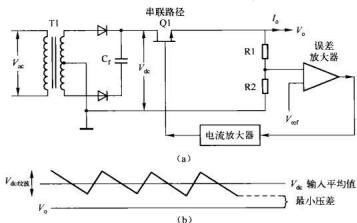

图 1.1 (a) 线性调整器。Q1 连接直流源和输出端负载，起可调电阻作用；只要输入电压足够大于输出电压，负反馈环通过误差运放改变 Q1 等效阻值以保持输出电压 $V_{0}$ 的稳定。

(b) 线性调整器需要的最小输入—输出电压差。若串联 NPN 型晶体管，则应保证交流输入电压 $V_{a}$ 最低时对应的 $C_{1}$ 端直流电压的纹波谷值与输出电压 $V_{s}$ 之间有 2.5V 的压差。

开关调整器有变压器和快速的开关动作，可能产生大量的RFI干扰。而在线性调整器中，反馈回路完全是直流耦合。由于整个回路没有开关动作，所以回路各点的直流电压都可预测和计算。线性调整器具有较低的RFI干扰，在某些应用场合具有较大的优势。因此，在现代电源应用领域，即使线性调整器的效率非常低，但它仍占有一席之地。而且，功率损耗主要由Q1的直流电流和电压产生，损耗和总效率很容易计算。 

电路中没有变压器并且不存在引起RFI噪声的瞬态尖峰电压或电流。由于晶体管不工作在开关状态，所以不存在晶体管的下降电流和上升电压瞬时重叠造成的交流开关损耗。 

## 1.2.2 线性调整器的缺点

直到20世纪60年代初期，这种简单的直流耦合串联型线性调整器一直是数十亿美元产值的电源工业的主要产品。但是，这种电路有以下缺陷。 

- 这种电源只能降压。 

- 它的输出与输入之间有公共端，当输入和输出之间，或多路输出之间需要直流隔离时， 

电路的设计会变得非常复杂。 

- 其初始直流输入电压(即图1.1(a)中的 $V_{dc}$ )一般由工频变压器次级整流获得,而工频变压器的体积和重量限制了它的推广应用。 

- 如 1.2.3 节所介绍的, 这种电路的效率非常低, 造成非常大的功率损耗, 需要较大的散热片。 

## 1.2.3 串接晶体管的功率损耗

线性调整器的主要缺点是串接晶体管存在过大功耗。所有的负载电流都必须通过串接晶体管，其功耗为 $(V_{\mathrm{dc}} - V_{\mathrm{e}})I_{\mathrm{b}}$ 。大多数情况下，串接NPN型晶体管的最小压差 $(V_{\mathrm{dc}} - V_{\mathrm{e}})$ 为 $2.5\mathrm{V}$ 。假设整流滤波电容足够大，可忽略纹波。若直流输入电压由工频变压器次级整流获得，则次级匝数选择应保证交流网压最低时对应的次级整流电压为 $(V_{\mathrm{m}} + 2.5)$ ，此时Q1的损耗最小。 

然而，当交流网压最高时 Q1 的压差将大很多，串接晶体管损耗严重，电源效率明显降低。由于 2.5V 最低压差的存在，在额定输出电压较低时造成的损耗显得更为严重。 

以下例子可以说明这一点。假设交流输入电压的波动范围为 $\pm15\%$ ，以下列3台线性调整器为例， 

- 输出 5V/10A 

- 输出 15V/10A 

- 输出 30V/10A 

假设次级滤波电容足够大，整流电压纹波可忽略。次级整流获得的直流电压 $V_{\mathrm{dc}}$ 的波动范围与交流网压波动范围对应，均为 $\pm 15\%$ 。若网压输入最低（-15%）时，变压器次级电压为 $(V_{\mathrm{o}} + 2.5)$ ，则网压输入最高（+15%）时，最大直流输入电压为 $1.35(V_{\mathrm{o}} + 2.5)$ 。调整器具体参数如下。 

<table><tr><td><eq>{V}_{\mathrm{s}}\left( \mathrm{V}\right)</eq></td><td><eq>{I}_{\mathrm{a}}</eq>(A)</td><td><eq>{V}_{\mathrm{{dc}}\left( \min \right) }</eq>(V)</td><td><eq>{V}_{\mathrm{{dc}}\left( \max \right) }</eq>(V)</td><td>最大压差(V)</td><td><eq>{P}_{\mathrm{n}\left( \max \right) }</eq>(W)</td><td><eq>{P}_{\mathrm{n}\left( \max \right) }</eq>(W)</td><td>Q1 最大损耗(W)</td><td>效率(%) <eq>\% {P}_{\mathrm{v}}/{P}_{\mathrm{n}\left( \max \right) }</eq></td></tr><tr><td>5.0</td><td>10</td><td>7.5</td><td>10.1</td><td>5.1</td><td>101</td><td>50.0</td><td>51</td><td>50</td></tr><tr><td>15.0</td><td>10</td><td>17.5</td><td>23.7</td><td>8.7</td><td>237</td><td>150</td><td>87</td><td>63</td></tr><tr><td>30.0</td><td>10</td><td>32.5</td><td>44.0</td><td>14</td><td>440</td><td>300</td><td>140</td><td>68</td></tr></table>

由上面的数据可知,直流输出电压低时,调整器的效率比输出电压高时低很多。若不忽略输入网压纹波且容许网压波动±15%,则5V输出调整器的效率只有32%~35%。 

## 1.2.4 线性调整器的效率与输出电压的关系

下面将分析效率在下列情况下的变化范围: 输出电压值从 5V 到 100V, 并且电网电压波动范围从 $\pm5\% \sim \pm15\%$ , 考虑实际纹波。 

假设最小压差是2.5V，并保证在最小输入网压产生的输入纹波的谷值处仍有2.5V的压差，如图1.1(b)所示。据此，可计算出不同输入网压波动范围和不同输出电压下调整器的效率。 

设输入电压为额定电压的 $\pm T\%$ ，则工频变压器次级匝数的选择应保证当输入网压最小时，纹波的谷值仍比预期的输出电压大2.5V（设最小压差为2.5V）。 

令电压纹波的峰—峰值为 $V_{r}$ 。当网压输入最低时，输入到晶体管的直流电压（平均电压）为 

$$
V _ {\mathrm{de}} = (V _ {\mathrm{o}} + 2. 5 + V _ {\mathrm{r}} / 2) \quad (\mathrm{V})
$$

当网压输入最高时,输入到晶体管的直流电压为 

$$
V _ {\mathrm{dc(max)}} = \frac {1 + 0 . 0 1 T}{1 - 0 . 0 1 T} (V _ {\mathrm{o}} + 2. 5 + V _ {\mathrm{r}} / 2)
$$

网压输入最高时,输入功率最大,最恶劣情况下的最大效率为 

$$
\begin{array}{r l} \text {Efficiency} _ {\mathrm{(max)}} & = \frac {P _ {\mathrm{o}}}{P _ {\mathrm{in(max)}}} = \frac {V _ {\mathrm{o}} I _ {\mathrm{o}}}{V _ {\mathrm{dc(max)}} I _ {\mathrm{o}}} = \frac {V _ {\mathrm{o}}}{V _ {\mathrm{dc(max)}}} \\ & = \frac {1 - 0 . 0 1 T}{1 + 0 . 0 1 T} \left(\frac {V _ {\mathrm{o}}}{V _ {\mathrm{o}} + 2 . 5 + V _ {\mathrm{r}} / 2}\right) \end{array}\tag{1.1}
$$

(1.2) 

图 1.2 所示为纹波电压峰—峰值为 8V 时，网压波动高限、输出电压和效率的关系曲线。以后会提到，对于 60Hz 全波整流器，若选取每 1A 负载电流对应滤波电容值为 $1000\mu F$ ，则纹波电压峰—峰值为 8V。 

从图 1.2 可见, 即使输出电压为 10V, 对于典型的 ±10% 网压波动值, 效率已低于 50%。正是线性调整器的低效率和工频变压器笨重的缺陷促进了开关电源的研制和开发。 

当然,若能使初始直流电压得到±5%左右的预调整(后面介绍的大部分拓扑都满足这一点),而输出又需要进一步稳压,则应用线性调整器还是合理的。现在市场上有1.5A塑封集成线性调整器,价格约为50美分。也有3~5A价格稍贵金属封装的该类调整器,但内置串接晶体管的功耗很大,输出5A或以上时的功耗更加严重。 

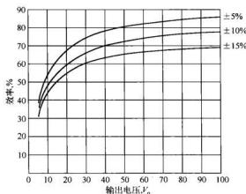

图 1.2 线性调整器效率与输出电压的关系曲线(根据式 1.2, 式中滤波电容纹波电压峰—峰值取 8V)。可见, 若对交流输入 $V_{sc}$ 最低(网压波动低限输入)时对应纹波谷值保证 2.5V 压差, 则交流输入 $V_{sc}$ 最高时, 效率最低。

## 1.2.5 串接 PNP 型晶体管的低功耗线性调整器

串接 PNP 型晶体管的线性调整器最小压差可降低至小于 0.5V。因此，可以获得更高的效率，其原因结合图 1.3 分析如下。 

图 1.3(a) 为串接 NPN 型晶体管的情况。晶体管基极要求注入电流 $(I_{\mathrm{b}})$ ，产生电流的电压必须高于 $(V_{\mathrm{o}} + V_{\mathrm{be}})$ ，约为 $(V_{\mathrm{o}} + 1)$ 。若基极串接一个电阻，则电阻输入端电压必须高于 $(V_{\mathrm{o}} + 1)$ ，以使电流流过。而最经济易行的方法是用初始直流电压向基极电阻供电。 

但是，初始直流电压（网压低限输入时对应的纹波谷值）不能与 $(V_{\mathrm{sc}} + 1)$ （额定基极输入电压）太接近。而且，串联电阻 $\mathbb{R}_{\mathrm{b}}$ 的阻值必须很小，以使大电流输出时仍可提供足够的基极电流。在这种情况下，当网压高限输入 $(V_{\mathrm{dc}} - V_{\mathrm{e}})$ 很大时， $\mathbb{R}_{\mathrm{b}}$ 将向基极提供过大电流，使大量电流转向电流放大器而加大其损耗。正是因为存在上述问题，所以要求网压低限输入时对应的纹波谷值电压必须比输出电压保有 $2.5\mathrm{V}$ 的最小压差，以使 $\mathbb{R}_{\mathrm{b}}$ 基本成为恒流电阻，流过 $\mathbb{R}_{\mathrm{b}}$ 的电流在整个输入网压波动范围内基本不变。 

然而，若串接PNP型晶体管，如图1.3(b)所示，由于驱动电流是由公共地端经电流放大器获得，所以不会出现上述问题。 $V_{dc}$ 和 $V_{o}$ 的差值只受串接晶体管 $V_{ce}-I_{c}$ 曲线弯度(knee)的影响，这使串接PNP型晶体管时的最小压差可降低至小于0.5V，从而提高了效率，特别是在低电压、大电流的应用场合效果更明显。 

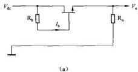

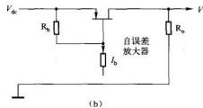

图 1.3 （a）串接 NPN 型晶体管的线性调整器。基极驱动由 $V_{dc}$ 经 $R_{b}$ 提供， $R_{b}$ 的电压一般最小为 1.5V 以提供足够的基极电流，这个电压加上基射极电压就产生 2.5V 的最小压差。

(b) 串接 PNP 型晶体管的线性调整器, 基极电流 $I_{b}$ 是由公共地端经电流放大器获得的, 最小压差不要求大于 2.5V, 甚至可以取更小的压差。

串接 PNP 型晶体管的集成线性调整器现市场上有售，但价格很高。就集成电路制造工艺而言，在同样芯片上集成较大电流的 PNP 型晶体管比集成较小电流的 NPN 型晶体管更困难。 

将 NPN 型晶体管放在负极回路中也可以获得同样的效果, 这需要将正极作为公共端(在单路输出电源中这种电路很容易实现)。 

由以上分析可知,线性调整器存在固有的缺陷,这也是目前为什么要发展更复杂的开关电路,以构造轻量小型、高效的电源。 

## 1.3 开关型调整器拓扑

## 1.3.1 Buck 开关型调整器

串接晶体管的高功耗和笨重的工频变压器使得线性调整器在现代电子应用中失去了重要地位。而且，高功耗串接元件需要的大散热片和大体积储能电容增大了线性调整器的体积。 

随着电子技术的发展,电路的集成化使得电路系统的体积更小。一般的线性调整器输出负载的功率密度仅为 $0.2\sim0.3W/in^{3}$ ，不能满足电路系统小型化的要求。而且，线性电源不能够提供数字存储系统所需要的足够长的保持时间。 

取代线性调整器的开关型调整器早在20世纪60年代就开始应用。一般的，这些新的开 关电源使用开关晶体管将输入直流电压斩波成方波。方波由占空比调节，并通过低通输出功率滤波得到直流输出电压。 

滤波器一般采用电感和输出电容。通过调节占空比，可以控制经过输出电容滤波的电压平均值。方波脉冲经过低通滤波器滤波后得到的直流输出电压等于方波脉冲的平均值。Buck开关型调整器典型的拓扑及其波形如图1.4所示。 

使用合适的 LC 滤波器可将方波脉冲平滑成无纹波直流输出，其值等于方波脉冲的平均值。整个电路采用输出负反馈，通过检测输出电压并结合负反馈控制占空比，稳定输出电压不受输入网压和负载变化的影响。 

目前高频开关电源的功率密度可达 $20 \, W/in^{3}$ ，而且可以获得与输入隔离的多组输出。它们无需工频变压器，效率达到 $75\% \sim 95\%$ 。有些 DC/DC 变换器功率密度可高达 $50 \, W/in^{3}$ 。 

## 1.3.1.1 Buck 调整器的基本符号和波形

补充: Pressman 先生介绍了以下开关型调整器的恒频工作方式, 在这类调整器中, 功率器件的导通时间 $(T_{\mathrm{on}})$ 是可调的, 而整个开关周期 $(T)$ 是固定的, 即开关频率 $(1/T)$ 也是固定的。 

比例 $T_{on}/T$ 一般称为占空比。在某些书中，占空比用 $T_{\mathrm{on}}/(T_{\mathrm{on}}+T_{\mathrm{off}})$ 表示，其中 $T_{off}$ 是功率器件的关断时间，因此 $T_{on}+T_{off}=T$ 。 

除了恒频工作方式,还有导通时间固定而频率可调的工作方式,或者导通时间和频率均可调的工作方式。 

在这本书中，dI、di、dV、dv、dT 和 dt 的用法不是很严格，一般用来表示 $\Delta I$ 、 $\Delta V$ 和 $\Delta t$ 的变化量。例如， $\Delta I/\Delta t$ 用导数 dI/dt 表述，表示电流相对时间的变化量或波形的斜率。 

— K. B. 

## 1.3.1.2 Buck调整器的基本工作方式

Buck调整器的基本电路如图1.4所示。晶体管Q1与直流输入电压 $V_{\mathrm{dc}}$ 串联，通过Q1硬开通和硬关断，在V1处产生方波电压。采用恒频控制方式，占空比可调，Q1导通时间为 $T_{\mathrm{sc}}$ 。Q1导通时，V1点电压为 $V_{\mathrm{dc}}$ （设Q1导通，压降为零），电流通过串接电感 $L_{\mathrm{o}}$ 流入输出端。Q1关断时，电感 $L_{\mathrm{o}}$ 产生反电动势，使V1点电压迅速下降到零，并变负值直至被二极管D1（也称续流二极管）钳位于-0.8V。 

设此刻二极管 D1 压降也为零，则 V1 点电压波形为矩形波，如图 1.4(b) 所示， $T_{on}$ 时段电压为 $V_{de}$ ，其余时段电压为零。该方波的电压平均值为 $V_{dc} T_{on}/T$ 。 $L_{o} C_{o}$ 滤波器接于 V1 和 $V_{o}$ 之间，它使输出点 $V_{o}$ 成为幅值等于 $V_{dc} T_{on}/T$ 的无尖峰无纹波的直流电压。 

采样电阻 R1 和 R2 检测输出电压 $V_{a}$ ，并将其输入误差放大器 (EA) 与参考电压 $V_{m}$ 进行比较。被放大的误差电压 $V_{m}$ 被输入到脉宽调制器（电压比较器）PWM。PWM 比较器的另一个输入是周期为 T 的锯齿波，如图 1.4(a) 所示，其幅值为一般 3V。PWM 电压比较器产生矩形波脉冲，即图 1.4(c) 中的 $V_{m}$ ，它从锯齿波起点开始到锯齿波与误差放大器输出电压交点结束。因此，PWM 输出的脉冲宽度 $T_{m}$ 与误差放大器输出电压成比例。 

PWM 脉冲输入到电流放大器并以负反馈方式控制开关管 Q1 的通断。其逻辑关系是：若输入电压 $V_{dc}$ 稍升高，则 EA 输出电压 $V_{ea}$ 将降低使锯齿波与 $V_{re}$ 交点提前，Q1 导通时间 $T_{on}$ 缩短使输出电压 $V_{u} = V_{dc} T_{on}/T$ 保持不变。同理，若 $V_{dc}$ 下降，则导通时间 $T_{on}$ 正比的延长使 $V_{u}$ 保持不变。Q1 导通时间的改变使采样电压总是等于参考电压，即 $V_{o} R2 / (R2 + R1) = V_{ref}$ 。 

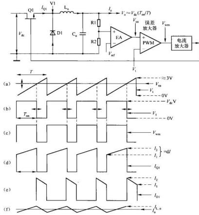

图 1.4 Buck 开关型调整器典型的拓扑及其主要波形

## 1.3.2 Buck 调整器的主要电流波形

相对于线性调整器,开关型调整器技术的最大优势在于功率回路中的线性元件损耗非常小。 

在开关型调整器中，开关管要么完全导通（只有非常小的功耗），要么完全关断（功耗可以忽略）。Buck调整器就是一个很好的例子，它的内部损耗非常小，因此具有较高的功率转换效率。 

要想完全精确地了解电路的工作特点,有必要先了解整个电路的电流和电压的波形、幅值和工作时间。这里将详细分析一个周期的工作波形,从 Q1 完全导通后开始分析。为便于分析,假设所有元件都是理想的,而且电路稳定工作,输入电压和输出电压恒定。 

Q1 导通时，V1 点的电压等于电源电压 $V_{dc}$ 。由于 $V_{o}$ 低于 $V_{dc}$ ，电感 $L_{o}$ 承受的电压为 $(V_{\mathrm{dc}} - V_{\mathrm{o}})$ 。由于电感上的电压恒定，所以流过电感的电流线性上升，其斜率为 $\mathrm{di}/\mathrm{dt} = (V_{\mathrm{dc}} - V_{\mathrm{o}})/L_{\mathrm{o}}$ （此时电感电流的波形为加在阶跃波顶部的一个斜坡，如图 1.4(d) 所示）。 

Q1 关断时，V1 点的电压迅速降到零，这是因为电感的电流不能突变，电感产生反电动势以维持原来建立的电流，若未接二极管 D1，则 V1 点电压会变得很负以保持 $L_{0}$ 上的电流方向不变。但此时 D1 导通，将电感 $L_{0}$ 前端电压钳位于比地电位低一个二极管的导通压降。此时电感上的 电压极性反相，流过电感和二极管的电流线性下降，Q1关断过程结束时，电流下降到初始值。 

详细的描述如下: 当 Q1 关断时, 电流 $I_{2}$ (关断前流过 Q1、 $L_{0}$ 、输出电容 $C_{0}$ 和负载) 转移流向二极管 D1、 $L_{0}$ 、输出电容和负载, 如图 1.4(e) 所示。此时电感 $L_{0}$ 上的电压极性反相, 幅值为 $(V_{\mathrm{o}}+1)$ , 电感中的电流 $\mathrm{di}/\mathrm{dt} = (V_{\mathrm{o}}+1)/L_{0}$ 的斜率线性下降, 波形是下降的阶梯斜坡, 如图 1.4(e) 所示。在稳定运行状态下, Q1 关断时间结束时, 电感 $L_{0}$ 的电流下降到 $I_{1}$ , 并仍然流过二极管 D1、 $L_{0}$ 、输出电容和负载。 

此时 Q1 再一次导通，它的电流逐渐取代二极管 D1 的正向电流。当 Q1 上的电流上升到 $I_{1}$ 时，二极管 D1 的电流降到零并关断，V1 点的电压近似上升到 $V_{dc}$ ，使 D1 反偏截止。因为 Q1 是硬开通，这个开通的过程非常快，一般小于 $1\mu s$ 。 

这样，电感 $L_{0}$ 上的电流是Q1导通时的电流(如图1.4(d)所示)和Q1关断时D1的电流(如图1.4(e)所示)之和,即图1.4(f)中的电流 $L_{\mathrm{e}}$ ，该电流包含直流分量和以输出电流 $I_{\mathrm{o}}$ 为中点的三角波纹波分量 $(I_{2}-I_{1})$ 。因此可推图第1.4(d)和图1.4(e)中波形斜坡的中点的电流值就是直流输出电流 $I_{\mathrm{o}}$ 。随着输出电流 $I_{\mathrm{o}}$ 的改变，图1.4(d)和图1.4(e)中的斜坡中点也会变化，但斜坡的斜率不变。Q1导通时，电感 $L_{0}$ 的斜坡斜率始终为 $(V_{\mathrm{de}}-V_{\mathrm{o}})/L_{\mathrm{o}}$ ；Q1关断时，其斜率始终为 $(V_{\mathrm{e}}+1)/L_{\mathrm{o}}$ 。 

因为电感电流纹波的峰—峰值与输出电流平均值无关，当 $I_{0}$ 减小使图1.4(d)和图1.4(e)中的电流纹波谷值达到零时（此时的输出电流称为临界负载电流），电路的特性将发生很大的变化（这种情况将在后面的章节中详细介绍）。 

## 1.3.3 Buck 调整器的效率

为了对比Buck调整器和线性调整器的固有功率损耗，假设这两种拓扑都使用理想的晶体管Q1和二极管D1。由图1.4(d)和图1.4(e)的电流波形，可以计算晶体管Q1和续流二极管D1的导通损耗，从而得到电路的效率。Q1关断时，其承受最大电压 $V_{dc}$ ，但电流为零，因此损耗也为零。Q1导通时，有电流流过，但是它的电压为零，同时D1承受 $V_{dc}$ 反向偏压，但是流过D1的电流为零，因此损耗也为零。 

即使使用理想元件,线性调整器也存在固有损耗。与线性调整器不同的是,如果选用理想元件,开关型调整器的功率损耗可以达到零,效率为100%。因此,Buck调整器的实际效率与元件的实际特性有关。因为半导体器件的特性总在不断的改善,所以电路的效率将得到进一步的提高。 

当使用实际元件时，Buck 电路的损耗主要是 Q1 和 D1 的导通损耗，以及磁性绕组的阻抗损耗。导通损耗与平均直流电流有关，因此相对容易计算。当考虑 Q1 和 D1 的开关损耗，以及电感的磁心损耗时，电路开关损耗的计算将变得很复杂。 

在开通和关断瞬间，Q1的开关损耗是由电流和电压的交叠产生的。D1的开关损耗与它的反向恢复有关，因为在反向恢复瞬间存在电流和电压应力。电感 $\mathbf{L}_{\mathrm{o}}$ 的电流纹波在磁心材料上产生磁滞和涡流损耗。下面将给出一些典型损耗的计算方法。 

## 1.3.3.1 导通损耗和导通相关的效率的计算

当忽略二次效应和交流开关损耗时，导通损耗非常容易计算。由图1.4(d)和图1.4(c)可知，在Q1和D1导通时间内 $(T_{\mathrm{on}}$ 和 $T_{\mathrm{off}})$ ，其电流平均值均为斜坡的中点值，即直流输出电流 $I_{0}$ 。由于在很宽的电流范围内，Q1和D1的导通压降均为1V，所以导通损耗可表达为 

$$
P _ {\mathrm{de}} = L (\mathrm{Q1}) + L (\mathrm{D1}) = 1 I _ {\mathrm{o}} \frac {T _ {\mathrm{on}}}{T} + 1 I _ {\mathrm{o}} \frac {T _ {\mathrm{off}}}{T} = 1 I _ {\mathrm{o}}
$$

若忽略交流开关损耗,则与导通相关的效率为 

$$
\text { Efficiency } = \frac {P _ {\mathrm{o}}}{P _ {\mathrm{o}} + \text { losses }} = \frac {V _ {\mathrm{o}} I _ {\mathrm{o}}}{V _ {\mathrm{o}} I _ {\mathrm{o}} + 1 I _ {\mathrm{o}}} = \frac {V _ {\mathrm{o}}}{V _ {\mathrm{o}} + 1}\tag{1.3}
$$

## 1.3.4 Buck 调整器的效率(考虑交流开关损耗)

补充 1: 开关损耗的计算非常复杂, 因为这种损耗与半导体特性的许多变量和开关器件的驱动方法有关, 此外, 与实际电路的设计 (包括缓冲电路、负载和能量回馈的设计) 因素有关 (见 11 章)。 

除非所有以上因素都考虑,否则任何损耗的计算只能得到近似值,有可能与实际值相差很大,特别是在高频开关电源里。 

补充2:这一版书除了一些损耗计算方法的小改动,没有改动第二版中Pressman原来给出的损耗计算方法,因为这些方法介绍了开关损耗产生的机理。但建议读者应用更实际的方法来计算实际损耗。许多半导体厂商已提供了开关损耗公式,特别是现在的快速IGBT(绝缘栅极双极型晶体管),这些公式适用于厂商提供的运行条件。如果可以实时精确的测量开关管的电流和电压,则可以用某些高速数字示波器来测量开关管的开关损耗(但对于非常高的开关频率,这仍难以实现)。 

作者建议的非常精确的损耗计算方法，是利用工作模型的公式来计算器件的温升，这个工作模型必须包含所有缓冲和负载成形等电路。可以用等效直流电流代替交流电流来计算器件的温升，这为利用简单的直流功率计算功率损耗提供了参考。这种方法可以用于优化驱动和负载成形电路，使得在工作时可以动态调整以使温升和开关损耗最小化。 

——K. B. 

交流开关损耗(或称电压电流重叠损耗)可根据某时段内电压电流动态曲线按照上升电流和下降电压的斜率计算。图1.5(a)示出了最理想的曲线,但实际上它很难达到。 

先看最理想的状态。导通时，电压电流变化同时开始，同时结束。Q1 电流从零上升到 $I_{o}$ 的同时，Q1 电压从最大值 $V_{dc}$ 下降到零。导通期间平均功率为 $P(T_{\mathrm{on}}) = \frac{1}{T_{\mathrm{on}}} \int_{0}^{T_{\mathrm{on}}} I \, \mathrm{d}V \, \mathrm{d}T = I_{o} V_{dc}/6$ ，而整个周期的平均功率为 $(I_{o} V_{dc}/6)(T_{\mathrm{on}}/T)$ 。 

若考虑同样的理想状态,关断时电流下降和电压上升同时开始同时结束,则关断损耗即电压电流重叠损耗为 $P(T_{\mathrm{eff}}) = \frac{1}{T_{\mathrm{eff}}} \int_{0}^{T_{\mathrm{eff}}} IV \, \mathrm{d}T = I_{\mathrm{o}} V_{\mathrm{dc}} / 6$ , 整个周期的平均功率为 $(I_{\mathrm{o}} V_{\mathrm{dc}} / 6)(T_{\mathrm{eff}} / T)$ 。 

设 $T_{on} = T_{off} = T_{s}$ ，则总开关损耗（关断损耗与导通损耗之和）为 $P_{\mathrm{ac}} = (V_{\mathrm{dc}} I_{\mathrm{o}} T_{\mathrm{s}})/3T$ ，而效率为 

$$
\begin{array}{r l} \text { Efficiency } & = \frac {P _ {\mathrm{o}}}{P _ {\mathrm{o}} + \mathrm{DClosses+AClosses}} \\ & = \frac {V _ {\mathrm{o}} I _ {\mathrm{o}}}{V _ {\mathrm{o}} I _ {\mathrm{o}} + 1 I _ {\mathrm{o}} + V _ {\mathrm{dc}} I _ {\mathrm{o}} T _ {\mathrm{s}} / 3 T} \\ & = \frac {V _ {\mathrm{o}}}{V _ {\mathrm{o}} + 1 + V _ {\mathrm{dc}} T _ {\mathrm{s}} / 3 T} \end{array}\tag{1.4}
$$

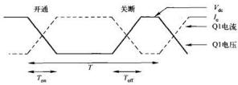

(a)

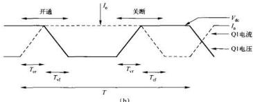

(b)

图 1.5 (a) 最理想的晶体管开关波形电流电压的转变同时开始, 同时结束。

$$
V _ {d c (\max)}
$$

$$
I _ {\bullet}
$$

$$
V _ {\mathrm{de}}
$$

计算 Buck 调整器的效率并将它与线性调整器的效率进行比较是很有必要的。设一个 Buck 调整器的参数为：输入 48V；输出 5V；开关频率为 $50\mathrm{kHz}(T=20\mu\mathrm{s})$ 。 

若不考虑交流开关损耗,且设开关时间 $T_{s}$ 为 $0.3\mu s$ , 则根据式(1.3)有 

$$
\text{Efficiency} = \frac {5}{5 + 1} = 83.3 \%
$$

若考虑如图 1.5(a) 所示的最理想情况下的开关损耗, 且 $T_{s}=0.3\mu s$ 、 $T=20\mu s$ , 则由式(1.4)有 

$$
\mathrm{Efficiency} = \frac {5}{5 + 1 + 4 8 \times 0 . 3 / 3 \times 2 0} = \frac {5}{5 + 1 + 0 . 2 4} = \frac {5}{5 + 1 . 2 4} = 80.1
$$

若考虑如图1.5(b)所示的最恶劣的情况(它更接近实际情况)下,则调整器的效率会更低。如图1.5(b)所示,开通时,开关管的电压一直保持为最大值 $(V_{dc})$ ,直到导通电流达到最大幅值 $I_{b}$ 时,电压才开始下降。电流上升时间 $T_{cr}$ 接近于电压下降时间,则开通损耗为 

$$
P (T _ {\mathrm{on}}) = \frac {V _ {\mathrm{dc}} I _ {\mathrm{o}}}{2} \frac {T _ {\mathrm{cr}}}{T} + \frac {I _ {\mathrm{o}} V _ {\mathrm{dc}}}{2} \frac {T _ {\mathrm{vf}}}{T}
$$

若设 $T_{\mathrm{cr}} = T_{\mathrm{vf}} = T_{\mathrm{s}}$ ，则 $P(T_{\mathrm{on}}) = V_{\mathrm{dc}}I_{\mathrm{o}}(T_{\mathrm{s}} / T)$ 。 

由图1.5(b)可知，关断期间，电流保持最大值 $I_{o}$ ，直到 $T_{vt}$ 时间内电压上升到最大值 $V_{dc}$ 时，电流才开始下降且在 $T_{ef}$ 时间内下降到零，则总的关断损耗为 

$$
P (T _ {\mathrm{off}}) = \frac {I _ {\mathrm{o}} V _ {\mathrm{dc}}}{2} \frac {T _ {\mathrm{vr}}}{T} + \frac {V _ {\mathrm{dc}} I _ {\mathrm{o}}}{2} \frac {T _ {\mathrm{cf}}}{T}
$$

同样，若设 $T_{\mathrm{cr}} = T_{\mathrm{vf}} = T_{\mathrm{s}}$ ，则有 $P(T_{\mathrm{off}}) = V_{\mathrm{dc}}I_{\mathrm{o}}(T_{\mathrm{s}} / T)$ ，则总交流损耗（导通损耗与关断损耗之和）为 

$$
P _ {\mathrm{ac}} = 2 V _ {\mathrm{dc}} I _ {\mathrm{o}} \frac {T _ {\mathrm{s}}}{T}\tag{1.5}
$$

总损耗(直流损耗与交流损耗之和)为 

$$
P _ {\mathrm{t}} = P _ {\mathrm{dc}} + P _ {\mathrm{ac}} = 1 I _ {\mathrm{o}} + 2 V _ {\mathrm{dc}} I _ {\mathrm{o}} \frac {T _ {\mathrm{s}}}{T}\tag{1.6}
$$

效率为 

$$
\begin{array}{r l} \text { Efficiency } & = \frac {P _ {\mathrm{o}}}{P _ {\mathrm{o}} + P _ {\mathrm{t}}} = \frac {V _ {\mathrm{o}} I _ {\mathrm{o}}}{V _ {\mathrm{o}} I _ {\mathrm{o}} + 1 I _ {\mathrm{o}} + 2 V _ {\mathrm{dc}} I _ {\mathrm{o}} T _ {\mathrm{s}} / T} \\ & = \frac {V _ {\mathrm{o}}}{V _ {\mathrm{o}} + 1 + 2 V _ {\mathrm{dc}} T _ {\mathrm{s}} / T} \end{array}\tag{1.7}
$$

在最恶劣的情况下，对于同样工作于 $T_{s}=0.3\mu s$ 的Buck调整器，由式(1.7)可得其效率为 

$$
\text{Efficiency} = \frac {5}{5 + 1 + 2 \times 48 \times 0.3 / 20} = \frac {5}{5 + 1 + 1.44} = \frac {5}{5 + 2.44} = 67.2\%
$$

若使用线性调整器将 48V 降为 5V，则由式(1.1)可知，其效率为 $V_{\mathrm{d}}/V_{\mathrm{dc(max)}}$ ，即 5/48 = 10.4%。此时效率太低，不能接受。 

## 1.3.5 理想开关频率的选择

Buck 调整器的输出电压由 $V_{o}=V_{dc}T_{en}/T$ 决定，与导通时间和工作频率有关。 

在设计电路时,人们首先会想到的是尽量选择高频率以减小滤波器件 $L_{0}$ 和 $C_{0}$ 的体积。但是,从整体上考虑,较高的开关频率不一定能减小调整器的体积。 

这可以从表示电路交流损耗的式(1.5) $P_{sc}=2V_{dc}I_{n}T$ 中看出，交流损耗与开关周期T成反比。此外，该式仅列出了开关管的损耗，而未考虑续流二极管DI的损耗，因为DI的反向恢复时间很短（反向恢复时间是二极管从其开始承受反向电压瞬间到停止流过反向漏电流所经历的时间）。续流二极管会带来明显的损耗，应使用反向恢复时间为35ns或更快的超快恢复二极管作为续流二极管DI。 

简而言之,开关时间越长,损耗越大。缩短开关周期(增加频率)的确能减小滤波器件的体积,但会增加总损耗,且需要更大的散热器,因此,要在两者之间折中选取。 

一般的,随着开关频率的增大,Buck 调整器的总体积可减小,但是开关损耗也增大,并需要更严格的高频布线和元器件,这使得最后的设计方案不得不在各种元器件中折中选择。 

注释:性能更好,成本更低,速度更快的晶体管和二极管在不断发展。在现阶段技术情况下,开关频率低于100kHz比较理想,因为元器件选择、布线和变压器、电感设计的要求不是很高,因此成本可能较低。一般而言,设计较高频率的电源,需要投入更多的时间,并需要更多的经验。然而,有些高效率的电源已能工作于MHz级的开关频率。开关频率最终由设计者自己选择,在此,作者不能给出开关频率限制的建议,因为随着技术的发展,开关频率可以不断的提高。 

—K. B. 

## 1.3.6 设计例子

## 1.3.6.1 Buck 调整器输出滤波电感(扼流圈)的设计

注释: 输出电感和电容一般作为低通滤波器, 而且在计算传递函数和环路补偿值时一般作为低通滤波器来处理。 

然而，读者更喜欢将电感看成是开关过程中维持电流相对恒定的元件（即当功率器件导通时，电感储存能量，功率器件关断时，将储存的能量传递给输出端）。 

作者认为扼流圈可看成是一种功率电感,它可以承受交流电压应力,并可承受直流电流分量。在第7章将介绍纯电感(直流电流分量为零)的设计与扼流圈(包含相当大的直流电流分量)的设计有很大区别。 

—K. B. 

输出电感(扼流圈)的电流波形如图1.4(f)所示,它的双斜坡波形在1.3.2节有定义。注意电流斜坡的中点幅值等于直流输出电流 $I_{s}$ 的平均值。 

由前面小节的分析可知，当直流输出负载电流减小时，电流斜坡的斜率仍保持恒定（因为电感 $L_{0}$ 的端电压恒定）。但是当负载电流减小时，纹波电流将整体向下移。 

当负载电流为斜坡峰—峰值的一半，即 $I_{0}=(I_{2}-I_{1})/2$ 时，斜坡的最低点正好降到零。在这个最低点处，电感电流为零，储能为零。如果负载电流进一步减小，电感将进入不连续工作模式，电压和电流的波形，以及闭环传递函数将发生较大变化。 

连续工作模式向不连续工作模式转变的过程如图 1.6(a) 所示。图中给出了 Buck 调整器的功率切换电流波形，工作频率为 25kHz，输入电压为 25V，输出电压为 5V，负载电流从额定电流 5A 降到 0.2A。 

前两个波形均为阶梯斜坡，随电流减小阶梯值降低，斜坡中点电流接近于直流输出电流。 

$I_{0}=0.95A$ 时（如图1.6(a)所示的第三波形），斜坡阶梯刚好消失，电流波形斜坡的始端为零电流，这时电感进入不连续模式，此时负载电流为临界电流。从图1.6(a)中前3个波形可见，Q1导通时间不变，但进入不连续模式以后，Q1导通时间会急剧下降。 

在这个例子中,控制环路能够在整个负载范围内将输出电压控制在5V,即使电感进入不连续工作模式。因此,这很容易让人产生错觉,认为电感进入不连续工作模式对电路工作没有影响。实际上,传递函数已发生变化(下面将讨论),控制环路必须适应这种变化。而且在Boost拓扑中,这种转变会产生一些问题。 

对于Buck调整器，电感进入不连续工作模式也没问题。在进入不连续模式之前，直流输出电压 $V_{\mathrm{e}} = V_{1}T_{\mathrm{m}} / T_{\mathrm{e}}$ 。注意此公式与负载电流参数无关，所以当负载电流变化时，不需要调节占空比，输出电压仍保持恒定(Buck调整器的等效输出电阻非常低)。实际上，当输出电流变化时，导通时间也会稍微变化，这是因为Q1的导通压降和电感电阻随着电流的变化而略有变化，这需要 $T_{\mathrm{on}}$ 做出适当的调整。 

但进入不连续模式后，传递函数会发生很大的改变， $V_{0}=V_{1}T_{on}/T$ 的关系将不再适用，这可从图 1.6(a) 中最后两个波形看到。图中 Q1 的导通时间随直流输出电流的减小而显著下降。 

提示: 比例 $T_{on}/T$ 一般称为占空比 D，连续工作模式时的电压公式可表述为 $V_{o}=V_{1}D$ 。但是在不连续工作模式下，占空比与负载电流有关，输出电压 $V_{o}$ 定义为 

$$
V _ {\mathrm{o}} = \frac {V _ {1} \cdot 2 D}{D + \sqrt {D ^ {2} + (8 L / R T)}}
$$

因为控制环路要控制输出电压恒定，负载电阻 R 与负载电流成反比例关系。假设 $V_{0}, V_{1}, L$ 和 T 恒定，为了控制电压恒定，占空比 D 必须随着负载电流的变化而变化。 

在临界转换电流处，传递函数从连续模式转变成不连续模式。工作于连续模式时，占空比保持恒定，不随负载电流而改变（相当于零输出阻抗）；工作于不连续模式时，占空随负载电流减小而改变（相当于有输出阻抗）。因此，工作于不连续模式时，控制环路的设计较困难，而且瞬态特性将降级。 

—K. B. 

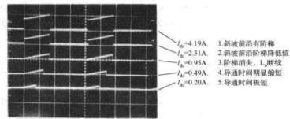

(a)

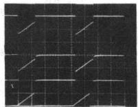

(b)

$$
I (Q 1) = 2 \mathrm{A}, 1 0 \mu \mathrm{s/cm}; I _ {\text {电}} = 4. 4 \mathrm{A} \tag {2}
$$

$$
J (Q 1) = 2 \mathrm{A}, 1 0 \mu \mathrm{s/cm}; I _ {\mathrm{dc}} = 2. 3 0 \mathrm{A}
$$

$$
I (Q 1) = 2 \mathrm{A}, 1 0 \mu \mathrm{s/cm}; I _ {\mathrm{dc}} = 0. 9 5 \mathrm{A}
$$

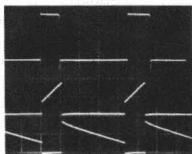

(c)

$$
I _ {\mathrm{D1}} = 2 \mathrm{A}, 1 0 \mu \mathrm{s} / \mathrm{cm}
$$

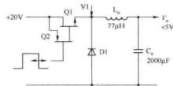

图 1.6 25kHz Buck 调整器, 随着流过电感 $L_{0}$ 的电流的减小, 由连续工作模式进入不连续工作模式。由图 1.6(a) 的上面 3 个波形可知, 只有在连续工作模式下导通时间才基本保持不变。

在进入不连续模式之前，电路改变直流输出电流是通过改变Q1和D1阶梯斜坡的阶梯值实现的，如图1.4(d)和图1.4(e)所示。这可在Q1导通时间基本不变的条件下实现。 

直流输出电流等于 Q1 和 D1 电流之和的平均值。如图 1.6(a) 第 3 个波形和第 4 个波形所示，输出电流较小时，电感电流进入不连续工作模式，电流台阶部分已降到零，则只有通过减少 Q1 导通时间来减小电流值，这可以通过负反馈环节自动调整占空比来实现。 

图 1.7(a)(临界连续工作)和图 1.7(b)(不连续工作)清楚得显示了波形的变化。从图 1.7(b)(2)可见,电感进入不连续模式时,Q1导通之前,D1电流正好下降到零。当电感 $L_{0}$ 电流为零时,Q1的发射极电压等于输出电压。这会引起Q1射极电压的衰减振荡,即振铃现象,如图 1.7(b)(1)所示。其振荡频率由 $L_{0}$ 和Q1、D1的寄生电容确定。 

提示:电压振铃虽然不会损坏电路,但是为了抑制 RFI,必须给 D1 并联一个 RC 缓冲电路。 

——K. B. 

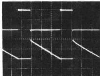

(a)

(1) Q1射极电压=10V, 10μs/cm

(2) $I_{D1}=1A,10\mu s/cm$ 可见，在开关再次开通之前，
D1电流刚好降到零； $L_{0}$ 电流
为临界连续（开始断续）

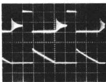

(b)

(1) Q1射极电压=10V, $10\mu s/cm$ 电感电流降为零电，可见正弦
衰减振荡；尽管振荡，反馈环
将调整Q1导通时间使输出稳定 

(2) $I_{D1}=1A,10\mu s/cm$ 电感电流在再次开通之前已降为零，为断续模式；在直流输出电流小于斜坡峰-峰值时发生 

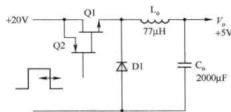

图 1.7 25kHz Buck 调整器，Q1 发射极电压和 D1 电流波形。
图(a)为临界连续工作模式时,图(b)为不连续工作模式。

## 1.3.6.2 连续工作模式的电感的设计

前面的分析已显示,对于 Buck 调整器,不连续工作模式不是必须重点考虑的问题。但是对于某些电路,特别是 Boost 拓扑,不连续工作模式需要重点分析。设计者可以通过电感的设计使电路在期望的负载电流范围内工作于连续模式。 

在这个例子中,电感的选择应保证直流输出电流为最小规定电流(通常约为额定负载电 

流的 10%，或 $0.1I_{on}$ ，其中 $I_{on}$ 是额定输出电流）时，电感电流也保持连续。 

电感电流斜坡为 $\mathrm{d}I=(I_{2}-I_{1})$ ，如图 1.4(d) 所示。因为当直流电流等于电感电流斜坡峰—峰值一半时，进入不连续工作模式，则 

$$
I _ {\mathrm{o(min)}} = 0. 1 I _ {\mathrm{on}} = (I _ {2} - I _ {1}) / 2, \text {或} (I _ {2} - I _ {1}) = \mathrm{d} I = 0. 2 I _ {\mathrm{on}}
$$

而且 

$$
\mathrm{d} I = V _ {\mathrm{L}} T _ {\mathrm{on}} / L = (V _ {1} - V _ {\mathrm{o}}) T _ {\mathrm{on}} / L
$$

式中， $V_{1}$ 为 Q1 发射极端的电压，并非常接近于 $V_{dc}$ ，所以 

$$
L = \frac {(V _ {\mathrm{dc}} - V _ {\mathrm{o}}) T _ {\mathrm{on}}}{\mathrm{d} I} = \frac {(V _ {\mathrm{dc}} - V _ {\mathrm{o}}) T _ {\mathrm{on}}}{0 . 2 I _ {\mathrm{on}}}
$$

式中， $T_{on}=V_{o}T/V_{dc}$ ，且 $V_{den}$ 和 $I_{on}$ 是额定值，所以 

$$
L = \frac {5 (V _ {\mathrm{dcm}} - V _ {\mathrm{o}}) V _ {\mathrm{o}} T}{V _ {\mathrm{dcm}} I _ {\mathrm{on}}}\tag{1.8}
$$

因此，如果 $L$ 由公式(1.8)确定，则 

$$
\mathrm{d} I = \left(I _ {2} - I _ {1}\right) = 0. 2 I _ {\mathrm{on}}
$$

式中， $I_{on}$ 为输出电流额定值并等于电感电流斜坡的中间值。 

因为电感电流在 $I_{on}$ 的 ±10% 范围内波动，电感的设计应保证它在直流电流为 $1.1I_{on}$ 时仍不明显饱和。 

第7章的7.6节给出了电感器和扼流圈的最优化设计方法。 

## 1.3.6.3 电感器(扼流圈)的设计

如前面的例子所述,当需要连续工作模式时,在整个负载电流范围内流过电感的电流不能为零。因此,电感必须承受直流电流分量,电感必须设计成扼流圈。 

优良的扼流圈，在AC电压应力和直流偏置的情况下，仍具有较低且相对恒定的感应系数。一般扼流圈的磁心可以采用带气隙的铁氧体磁心，或者采用各种铁磁性合金粉末合成磁心，包括铁粉芯或坡莫合金（一种镍铁合金）。这种铁粉芯由磁粉和树脂构成，内有均匀分布的气隙。电感值由公式(1.8)计算，扼流圈的设计必须保证电流达到规定峰值电流 $(110\% I_{\mathrm{on}})$ 时扼流圈不饱和。这种扼流圈的详细设计参见第7章的7.6节。 

Buck 调整器的最大电流范围由扼流圈的设计、功率成分的额定值、公式(1.6)确定的直流损耗与交流损耗来决定。为了实现连续工作模式，最小电流不能小于额定值 $I_{cm}$ 的 10%。若小于这个值，负载调整将会稍微变差。 

若设计保证电感磁心不饱和，则根据式(1.8)确定的电感可以承受比规定的 $I_{on}$ 更高的直流输出电流。这样，Buck调整器最大电流的唯一限制是式(1.6)确定的直流和交流损耗。根据式(1.8)确定的电感的最小电流限制是当电流小于 $I_{\mathrm{on(min)}}$ 时，电感将进入不连续模式且负载调整将会变差。 

大部分的工业(90%)需要较大的负载范围,因此需要相对大的扼流圈,这有可能不能满足。然而,设计者可以采取某些折中的办法来灵活选择磁心。如果扼流圈选择的较小(如式(1.8)所确定的值的一半),则电感会在电流等于额定电流的1/5(而非1/10)时就进入不连续模式。这将使负载调整稍微变差,所对应的最小电流值提高。但由于选用的电感值较小,负载瞬变时,Buck调整器的响应较快。 

## 1.3.7 输出电容

图1.4中输出电容 $C_{\mathrm{m}}$ 的选择必须满足一些特性的要求。 $\mathbf{C}_i$ 并非理想电容，它可等效为寄生电阻 $\mathbb{R}_{\mathrm{g}}$ 和电感 $L_{\mathrm{m}}$ 与其理想纯电容 $C_\mathrm{a}$ 的串联，如图1.8所示。 $\mathbb{R}_i$ 称为等效串联电阻(ESR)， $L_{\mathrm{m}}$ 称为等效串联电感(ESL)。一般的，如果考虑串联扼流圈 $L_{\mathrm{r}}$ 的纹波电流幅值，我们总希望这个纹波电流的大部分分量流入输出电容 $C_\mathrm{a}$ 。因此输出电压的纹波由输出滤波电容 $C_\mathrm{a}$ 等效串联电阻 $R_{\mathrm{u}}$ (ESR)和等效串联电感 $L_{\mathrm{c}}$ (ESL)决定。 

对于低频纹波电流， $L_{0}$ 可以忽略，输出纹波主要由 $R_{0}$ 和 $C_{0}$ 决定。 

注释: 实际的转变频率与电容器的设计有关, 并且电容器的生产水平不断改善。转变频率一般大于 500kHz。 

—K. B. 

因此，大约低于 $500\mathrm{kHz}$ 时， $\mathbf{L}_0$ 可以被忽略。 $\mathbf{C}_{\circ}$ 一般是大电解电容，因此在开关频率处，由 $\mathbf{C}_{\circ}$ 产生的纹波电压分量小于由 $\mathbb{R}_{\circ}$ 产生的纹波电压分量。因此在中频段，对于一阶系统，输出纹波接近等于 $\mathbf{L}_t$ 的交流纹波电流乘以 $\mathbb{R}_{\circ}$ 。 

有两个分别由 $\mathbf{R}_{\mathrm{o}}$ 和 $\mathbf{C}_{\mathrm{o}}$ 决定的纹波分量。由 $\mathbf{R}_{\mathrm{o}}$ 决定的纹波分量与 $(I_2 - I_1)$ （图1.4(f)中电感斜坡电流峰一峰值)成正比，而由 $\mathbf{C}_{\mathrm{o}}$ 决定的纹波分量与流过 $\mathbf{C}_{\mathrm{o}}$ 电流的积分成正比，两者相位不同。但考虑最恶劣的情况，假设它们同相叠加。 

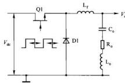

为估算这些纹波分量并选择电容，必须要知道 $R_{0}$ 的值，而电容厂家很少直接给出该值。但从一些厂家的产品目录可以认定，对很大范围内不同电压等级不同容值的常用铝电解电容，其 $R_{0}C_{0}$ 的值近似为常数，为 $50\sim80\times10^{-6}\Omega F$ 。 

图 1.8 输出电容 $C_{0}$ 及其寄生元件 

补充:低 ESR 的电解电容已投入使用,ESR 值由厂家提供。如果选择低 ESR 的电容,那么在下面的计算中将使用较低的 ESR 值。 

—K. B. 

下面举例说明典型 Buck 调整器容性和阻性纹波分量的计算。 

设计例子： 

设 Buck 调整器的开关频率为 25kHz，输入电压为 20V，输出电压为 5V， $I_{on}=5A$ 。要求在连续电流工作模式且负载为 10% 额定负载时，纹波电压小于 50mV。 

假设最小负载是 $10\%$ 额定负载，则 $I_{\mathrm{on(min)}} = 0.1, I_{\mathrm{on}} = 0.5\mathrm{A}$ ，则可根据式(1.8)求出 $L$ 为 

$$
L = \frac {5 (V _ {\mathrm{den}} - V _ {\mathrm{o}}) V _ {\mathrm{o}} T}{V _ {\mathrm{den}} I _ {\mathrm{on}}} = \frac {5 (2 0 - 5) 5 \times 4 0 \times 1 0 ^ {- 6}}{2 0 \times 5} = 1 5 0 \mu \mathrm{H}
$$

式中，斜坡峰—峰值 $(I_{2}-I_{1})=0.2I_{\mathrm{on}}=1\mathrm{A}$ 。 

如果假设输出纹波电压的大部分分量由电容器 $ESR(R_{0})$ 产生，则可以选择电容器使得 ESR 满足纹波电压的要求，如下所示。 

设阻性纹波电压峰—峰值 $V_{\pi}=0.05V$ ，则需要的 ESR 为 $R_{o}=V_{\pi}/\mathrm{d}I=0.05/(I_{2}-I_{1})$ ， $R_{o}=0.05\Omega$ 。 

利用前面介绍的典型 ESR/电容值关系式 $(R_{\circ}C_{\circ}=50\times10^{-6})$ ，得 

$$
C _ {\mathrm{o}} = 5 0 \times 1 0 ^ {- 6} / 0. 0 5 = 1 0 0 0 \mu \mathrm{F}
$$

接下来设计由电容产生的纹波电压分量,其中 $C_{0}=1000\mu F$ 。 

下面据图1.4(d)计算容性纹波电压 $V_{cr}$ 。从图1.4(d)可见，从导通时段中点到关断时段中点的半个周期(20(s)内，纹波电流为正。该三角波电流的平均值为 $(I_{2}-I_{1})/4=0.25\mathrm{A}$ 。所以此平均电流在 $C_{o}$ 上产生的纹波电压为 

$$
V _ {\mathrm{cr}} = \frac {I t}{C _ {\mathrm{o}}} = \frac {0 . 2 5 \times 2 0 \times 1 0 ^ {- 6}}{1 0 0 0 \times 1 0 ^ {- 6}} = 0. 0 0 5 \mathrm{V}
$$

图 1.4(f) 中 $I_{0}$ 线下的纹波电流将产生另外的 0.005V 的纹波电压，使整个容性纹波电压峰—峰值为 0.01V。在此例中，电容造成的电压纹波远比 ESR 电阻 $R_{0}$ 造成的电压纹波小，因此可以忽略。 

这样,本例中滤波电容的选择,通常是通过选择合适的 $R_{0}$ 来满足输出纹波电压峰—峰值的,因此有 

$$
R _ {\mathrm{o}} = \frac {V _ {\mathrm{or}}}{I _ {2} - I _ {1}} = \frac {V _ {\mathrm{or}}}{0 . 2 I _ {\mathrm{on}}}\tag{1.9}
$$

然后根据 $R_{\circ}C_{\circ}$ 的平均值（通常为 $65\times 10^{-6}$ )来求解 $C_{\circ}$ ，即 

$$
C _ {\mathrm{o}} = \frac {6 5 \times 1 0 ^ {- 6}}{R _ {\mathrm{o}}} = (6 5 \times 1 0 ^ {- 6}) \frac {0 . 2 I _ {\mathrm{on}}}{V _ {\mathrm{or}}}\tag{1.10}
$$

以上有关输出电压纹波主要由滤波电容的 ESR 决定的详细论述，可参阅 K. V. Kantak 的论文 $^{①}$ 。该文作者认为，若 $R_{o}C_{o}$ 大于开关管的关断和导通时间的一半（通常如此），则如本例所述，输出纹波仅由 ESR 决定。 

## 1.3.8 有直流隔离调整输出的Buck调整器的电压调节

为了实现不同的控制功能,电路中通常需要低功率的辅助输出,这可以通过添加几个辅助元件来实现,如图1.9所示,辅助输出的调整率一般为2%~3%。 

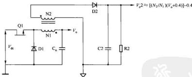

图 1.9 利用输出电感做变压器时，Buck 调整器可以实现次级隔离输出。该次级输出与输入地直流隔离，由于其初级在 Q1 关断时由稳定电压 $V_{o}$ 经 D1 放电，所以输出误差为 2%～3%。

由图1.4可见，调整器初始直流输入与调整后的输出电压共地。图1.9中，输出的滤波电感附加了匝数为N2的绕组。其输出接二极管D2和电容C2做整流滤波。N1和N2的同名端如图1.9所示。Q1关断时，N1的异名端电压极性变负并被续流二极管D1钳位于比地低一个 二极管导通压降的电压。由于 $V_{0}$ 在输入和负载变化情况下保持恒定，所以只要续流二极管D1的电流保持不变，则N1上的电压也恒定。D1是低导通压降的肖特基二极管，其导通压降在很宽的电流范围内均约为0.4V。 

这样，当 Q1 关断时，加在 N2 上的电压为 $N/2/N1(V_{\mathrm{o}}+0.4)$ ，且同名端为正。设 D2 也为肖特基二极管，则经 D2 和 C2 整流，输出 $V_{o}2=N2/N1(V_{\mathrm{o}}+0.4)-0.4$ 。由于 Q1 导通时 D2 反偏，所以输出与 $V_{dc}$ 无关。电容 C2 应该选择得足够大，以保证在较长的 Q1 导通时间内输出电压不会下降。由于 N1 和 N2 是互相隔离的，所以辅助输出与主电路中的其他元件相互隔离。 

提示: 这种技术在某些场合有用, 但是要谨慎使用。因为辅助输出是在电感电动势反向期间从主电路输出取能量的, 所以主电路输出功率必须比辅助电源的功率大很多以使 DI 导通。如果要保持有辅助输出, 需要限定主电路输出的最小负载。如果用辅助输出驱动控制电路可能会出问题, 系统可能不能启动。 

——K. B. 

## 1.4 Boost 开关调整器拓扑

## 1.4.1 基本原理

图 1.4 所示的 Buck 调整器的缺陷是它只能将较高的电压降为较低的电压, 因此 Buck 调整器通常也称为降压调整器。 

图 1.10 所示的 Boost 调整器是将较低的未调整输入电压升为较高的调整输出电压,该电路称为升压调整器或升压电感变换器。其工作电路如下所述。 

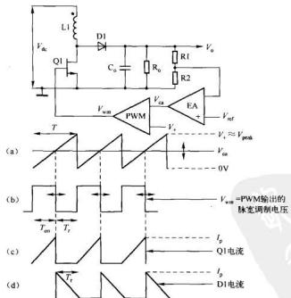

图 1.10 Boost 调整器及其主要波形。Q1 关断时，L1 的极性颠倒；将 Q1 导通时，L1 存储的能量经 D1 以更高电压释放给输出负载。

在 $V_{dc}$ 和开关管 Q1 之间串接电感 L1。当 Q1 导通时，电流从电感 L1 的下端流入 Q1。当 Q1 关断时，电流从电感 L1 的下端通过整流二极管 D1 输送给输出电容 $C_{0}$ 及负载。 

假设输出电压和电流已建立，电路已稳定运行，当Q1导通时 $(T_{\mathrm{on}})$ ，二极管反偏截止，L1的电流线性上升达到峰值 $I_{\mathrm{p}} = V_{\mathrm{dc}}T_{\mathrm{on}} / L1$ 。 

由于在 Q1 导通时段输出电流完全由 $C_{0}$ 提供，所以 $C_{0}$ 应选得足够大，以使在 $T_{on}$ 时段向负载供电时，其电压降最小并满足要求。 

Q1关断时，由于电感电流不能突变，L1的电压极性颠倒，L1异名端电压相对同名端为正。L1同名端电压为 $V_{dc}$ ，且L1经D1向 $C_{n}$ 充电，使 $C_{n}$ 两端电压（泵升电压）高于 $V_{dc}$ 。此时电感储能给负载提供电流，并补充 $C_{n}$ 单独向负载供电时损失的电荷。 $V_{dc}$ 在Q1关断时段也向负载提供能量。 

输出电压的调整是通过负反馈环控制Q1导通时间实现的。若直流负载电流上升，则导通时间会自动增加，为负载提供更多能量。若 $V_{do}$ 下降而 $T_{on}$ 不变，则峰值电流即L1的储能会下降，导致输出电压下降。但负反馈环会检测到电压的下降，并通过增大 $T_{on}$ 来维持输出电压恒定。 

## 1.4.2 Boost调整器的不连续工作模式

提示:Boost 调整器有两个非常不同的工作模式,这些工作模式与电感的状态条件有关。如果一个周期结束时,电感电流已降到零,则工作于不连续模式。如果一个周期结束时,电感电流没有降到零,则工作于连续模式。 

当介绍开关调整器时,输出滤波电容一般不包含在变换器的分析中。因此,开关调整器的输出电流不是输出到负载的直流电流,而是流入输出电容和负载的合成电流,输出电容和负载是并联的。 

与 Buck 调整器不同,Boost 调整器的输入电流是连续的(有一些纹波),而输出电流对于任何工作模式都是不连续的。因此,连续模式和不连续模式只是针对电感的电流而言。 

这两种工作模式的传递函数非常不同,因此电路的瞬态特性和稳定性也非常不同,这将在第12章详细介绍。 

——K. B. 

这一小节详细的介绍不连续工作模式，并建立能量和控制的公式，在这种工作模式中，电感的能量在 Q1 关断时完全传递给输出端。 

当 Q1 导通时，L1 的电流线性上升达到峰值 $I_{p} = V_{dc} T_{on}/L1$ 。因此能量储存在 L1 中，导通期间结束时，储存的能量为 

$$
E = (1 / 2) L 1 I _ {\mathrm{p}} ^ {2} = 0. 5 L 1 I _ {\mathrm{p}} ^ {2}\tag{1.11}
$$

式中，E 的单位为焦耳，L1 的单位为亨， $I_{p}$ 的单位为安培。 

若 Q1 下次导通之前, 流过 D1 的电流已下降到零, 则认为上次 Q1 导通时存储于 L1 (式 (1.11)) 的能量已释放完毕, 电路工作于不连续模式。 

一定时间 T 内, 输送到负载的能量 E 称为功率。若 E 的单位为焦耳, T 的单位为秒, 则功率的单位为瓦特。所以如果每周期一次性地将式(1.11)确定的所有能量都传递到负载, 则只从 L1 传递到负载的功率(假设传递效率为 100%)就有 

$$
P _ {\mathrm{L}} = \frac {1 / 2 L 1 (I _ {\mathrm{p}}) ^ {2}}{T}\tag{1.12}
$$

而在 Q1 关断期间（图 1.10 中 $T_{r}$ 时段），L1 的电流线性下降到零，同样的电流由 $V_{dc}$ 提供，并流经 L1 和 D1 给负载提供能量 $P_{dc}$ ，其值为 $T_{r}$ 时段的平均电流乘以占空比和 $V_{dc}$ ，即 

$$
P _ {\mathrm{dc}} = V _ {\mathrm{dc}} \frac {I _ {\mathrm{p}}}{2} \frac {T _ {\mathrm{r}}}{T}\tag{1.13}
$$

输送到负载的总功率为 

$$
P _ {\mathrm{t}} = P _ {\mathrm{L}} + P _ {\mathrm{dc}} = \frac {1 / 2 L 1 (L _ {\mathrm{p}}) ^ {2}}{T} + V _ {\mathrm{dc}} \frac {I _ {\mathrm{p}}}{2} \frac {T _ {\mathrm{r}}}{T}\tag{1.14}
$$

将 $I_{p}=V_{dc}T_{on}/L_{1}$ 代入公式(1.14)，得 

$$
P _ {t} = \frac {(1 / 2 L _ {1}) (V _ {\mathrm{dc}} T _ {\mathrm{on}} / L _ {1}) ^ {2}}{T} + V _ {\mathrm{dc}} \frac {V _ {\mathrm{dc}} T _ {\mathrm{on}}}{2 L 1} \frac {T _ {r}}{T} = \frac {V _ {\mathrm{dc}} ^ {2} T _ {\mathrm{on}}}{2 T L 1} (T _ {\mathrm{on}} + T _ {r})\tag{1.15}
$$

为保证 L1 的电流在 Q1 下次导通之前已下降到零，令 $(T_{\mathrm{on}} + T_{\mathrm{r}}) = kT$ ，其中 k < 1，则 

$$
P _ {1} = \left(V _ {\mathrm{dc}} ^ {2} / T _ {\mathrm{on}} / 2 T L 1\right) (k T)
$$

若设输出电压为 $V_{0}$ ，输出负载电阻为 $R_{0}$ ，则 

$$
P _ {1} = \frac {V _ {\mathrm{dc}} ^ {2} T _ {\mathrm{on}}}{2 T L 1} (k T) = \frac {V _ {\mathrm{o}} ^ {2}}{R _ {\mathrm{o}}}
$$

或 

$$
V _ {\mathrm{o}} = V _ {\mathrm{de}} \sqrt {\frac {k R _ {\mathrm{o}} T _ {\mathrm{on}}}{2 L 1}}\tag{1.16}
$$

因此，负反馈环将根据式(1.16)对输入电压变化和负载变化进行调整，以保持输出稳定。如果 $V_{dc}$ 和 $R_{o}$ 下降或上升，则反馈环会增大或减小 $T_{on}$ 来保持 $V_{o}$ 恒定。 

## 1.4.3 Boost调整器的连续工作模式

前一节已提到,若 D1 电流(如图 1.10(d) 所示)在 Q1 下次导通之前下降到零,则称电路工作于不连续模式。 

若电流在关断时间结束时还未下降到零，则由于电感电流不能突变，Q1下次导通时电流上升会有一个阶梯。Q1和D1上的电流将呈典型的阶梯斜坡形状，如图1.11所示。 

此时电路工作于连续模式,因为在一个工作周期里电感电流始终大于零。 

假设反馈环能控制输出电压恒定，则当 $R_{o}$ 或 $V_{dc}$ 减小时，反馈环会增加Q1导通时间 $T_{on}$ ，以保持输出电压恒定。当负载电流增加， $R_{o}$ 或 $V_{dc}$ 持续减小，则可能使 $T_{on}$ 增大，到下次导通之前Q1和D1电流仍未降到零，如图1.10和图1.11所示，此时电路进入连续工作模式。 

能使不连续模式下反馈环稳定工作的误差放大电路，不一定能使连续模式下的反馈环稳定，并会产生振荡。反馈环理论分析认为，连续工作模式时Boost电路的传递函数存在右半平面零点 $(\text{right-half-plane-zero})^2$ 。稳定有右半平面零点的反馈环的唯一办法是大幅减小误差放大器的带宽。 

提示: 简而言之, 在不连续工作模式中, 电感和 D1 的电流有一段时间为零。也就是在能量传递期间 (Q1 关断和 D1 导通期间) 和能量存储期间 (Q1 导通和 D1 关断期间) 有一小段时间间隙。这个时间余量 (死区) 对电源系统运行特性非常重要, 它在连续工作模式不会存在。 

充分了解这两种工作模式是非常重要的,因为在具有 Boost 功能的任何开关拓扑里,它的影响非常大。为了更好地理解这一点,我们将分析 Boost 拓扑连续工作模式下负载突然增大时电路的响应特性。 

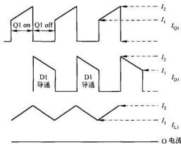

图 1.11 连续模式下 Boost 调整器 Q1、D1 和 L1 的电流波形。电感 L1 在 Q1 再次导通前，没有足够的时间将所有能量释放给负载。

假设一个连续工作模式的 Boost 电路已进入稳定运行状态, 输出电压和负载电流稳定, 电感电流连续。当负载电流突然增大时, 输出电压将有下降的趋势, 此时控制环路将增大 Q1 的导通时间, 以增大电感 L1 的电流。然而, 需要经过几个周期, 电感 L1 的电流才能增加的非常大 (由电感值、输入电压和 Q1 导通时间的实际增量决定)。 

必须注意的是,导通时间增加的直接影响是使关断时间减少,因为一周期的时间是固定的。因为 D1 只在 Q1 关断期间才导通(而且导通时间减少),平均输出电流开始减小,而不是增大。因此,当我们试图增加输出电流时,这个直接影响将减小输出电流,这需要经过几个周期电感电流的增加来慢慢使它调整。 

从控制理论的观点来看,当电感 LI 的电流增大时,在这个瞬态过程闭环控制系统产生 $180^{\circ}$ 的相移。因此,在小信号传递函数里产生一个右半平面零点。 

注意,这种影响与电源器件的动态特性有关,并且通过控制电路不能改变。实际上,高增益快速响应的控制电路将导致第一个驱动脉冲的宽度达到饱和,并且使传递到输出端的电流为零。因此,右半平面零点不能由环路补偿网络抵消。唯一的办法是降低驱动脉冲宽度的增大速度,以使输出电压不至于跌落的太严重。 

在不连续工作模式中,电路的特性非常不同。小时间间隙裕量允许导通时间增加而不减小关断时间(在有限的裕量内),所以前面遇到的问题在这里不会发生,假设这个裕量足够大以满足脉冲宽度的调节。 

连续工作模式时,任何具有 Boost 功能的变换器都会存在右半平面零点。反激变换器是一个典型的例子,将在第 12 章和参考文献 2 中介绍。 

—K. B. 

## 1.4.4 不连续工作模式的Boost调整器的设计

基于前面的分析,设计者可能希望 Boost 调整器在所有工作条件下都工作于不连续模式。 

从图 1.10(d) 可见, D1 电流在 Q1 再次导通时正好降到零。这是不连续工作模式和连续工作模式的临界点。 

式(1.16)给出了临界值公式, $V_{dc}$ 、 $T_{on}$ 、 $R_{o}$ 、 $L_{1}$ 和T的一定组合使流过L1和D1的电流正好 在 Q1 导通前降到零。在图 1.10(d) 的临界不连续情况下， $V_{dc}$ 或 $R_{o}$ 的任何微小减少（或负载电流上升）都会导致电路进入连续工作模式。并且，若误差放大器未针对连续模式设计，则会引起振荡。 

为避免这种情况，应恰当选择 $T_{on}$ ，以保证在 $T_{on}$ 最大（即 $V_{dc}$ 和 $R_{o}$ 均为规定的最小值）时，D1 电流也能降为零，并且与 Q1 再次导通之间仍留有一定的死区时间 $T_{dt}$ 。 

同时，D1电流下降到零时，L1的磁心磁通必然恢复(或称复位)到其磁滞回线的起始点，如图1.12的B1点所示。若磁心不能完全恢复到B1点，则若干周期后，磁心磁密会达到磁滞曲线饱和段使磁心饱和。由于磁心饱和时，电感的阻抗降低，只等于绕线电阻(此时不能抑制电压)，电源电压突然施加到晶体管集电极，当线路的电阻非常小甚至可以忽略时，晶体管会被损坏。 

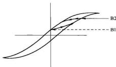

图 1.12 B/H 磁滞回线。磁心不允许在磁滞回线上一直沿单方向磁化。若它由给定伏秒数从磁滞回线上的 B1 点移到 B2 点，则磁心再次沿磁滞回线磁化上移之前必须施加反极性伏秒数使其精确复位到 B1。

在这个例子中，为保证电路工作于不连续模式，设定整个周期的20%为死区时间 $T_{dt}$ 。这样，最大导通时间加上磁心复位时间和死区时间就构成了整个周期，如图1.13所示。这将保证L1的电流在Q1导通前降到零。 

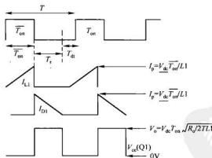

图1.13 Boost调整器不连续工作模式时的波形，具有 $20\%$ 死区裕量。对不连续模式，D1的电流必须在下次导通之前降到零，如图1.10所示。为此，电感L1的选择应保证 $T_{\mathrm{on(max)}} + T_{\mathrm{r}} = 0.8T$ （留有 $0.2T$ 的死区时间）。

若在符号下面加下画线表示其规定的最小值，加上划线表示其规定的最大值，则 $\overline{T_{\mathrm{on}}} + T_{\mathrm{r}} + T_{\mathrm{dt}} = T, \overline{T_{\mathrm{on}}} + T_{\mathrm{r}} + 0.2T = T$ ，或 

$$
\overline {{{T _ {\mathrm{on}}}}} + T _ {\mathrm{r}} = 0. 8 T\tag{1.17}
$$

从式(1.16)可知,最大导通时间 $T_{on}$ 出现在 $V_{dc}$ 和 $R_{o}$ 最小时。这样,设 $\underline{V_{dc}}$ 和 $\underline{R_{o}}$ 最小时导通(置位)伏秒数与关断(复位)伏秒数相等,则有 

$$
\underline {{{{V _ {\mathrm{dc}}}}}} \overline {{{{T _ {\mathrm{on}}}}}} = (V _ {\mathrm{o}} - \underline {{{{V _ {\mathrm{dc}}}}}}) T _ {r}\tag{1.18}
$$

式(1.17)和式(1.18)中只有两个未知数， $\overline{T_{on}}$ 和 $T_{r}$ 可联合求解，则 $\overline{T_{on}}$ 为 

$$
\overline {{T _ {\mathrm{on}}}} = \frac {0 . 8 T (V _ {\mathrm{o}} - V _ {\mathrm{dc}})}{V _ {\mathrm{o}}}\tag{1.19}
$$

若式(1.16)中 $V_{dc}$ 和 $R_{o}$ （最大负载电流）为已知，则由式(1.19)计算出 $\overline{T_{on}}$ ，并从式(1.17)知 $\overline{k}/(\overline{T_{on}}+T_{r})/T=0.8$ 。 

则可求出 $L1$ ，且电路保证不会进入连续工作模式。若输出负载电流意外增加超过其最大设定值(即 $R_{\mathrm{b}}$ 减小超过其最小设定值)或 $V_{\mathrm{dc}}$ 下降超过其最小设定值，则反馈环会增大 $T_{\mathrm{out}}$ 来保持 $V_{\mathrm{o}}$ 恒定。这样就会占用死区时间，使电路的工作更接近连续工作模式。为避免这种情况的发生，必须采用钳位电路来限制最大导通时间或最大峰值电流。 

提示:一种适用于所有情况的好方法是禁止 Q1 导通,直到电感电流降到零。对于恒频控制,这种方法会限制负载电流。也可以改用变频控制,这也是经常采用的。 

——K. B. 

若 $L1$ 的值已由式(1.16)求出，且 $V_{\mathrm{dc}}$ 为已知， $\overline{T}_{\mathrm{on}}$ 由式(1.19)计算得到，则 $\overline{Q_1}$ 的峰值电流可根据式(1.14)求解，并可根据 $I_{\mathrm{p}}$ 值来选择有足够增益的开关管。 

由于元件成本非常低，在低功率非隔离应用场合，经常采用 Boost 调整器。一个典型的应用是用于印制电路板，将 5V 计算机逻辑电平升压到 12V 或 15V，给运放供电。 

在电池供电电源的较高功率应用场合，由于电池的放电，输出电压降幅非常大。许多额定电压为12V或28V的电池，当其电压降到9V或22V时会产生问题。Boost调整器经常用于这种场合，将电压升压回12V或28V。在这类应用场合中功率范围可达50～200W。 

## 1.4.5 Boost调整器与反激变换器的关系

前面已对 Boost 调整器进行了详细的介绍,因为在许多变换器组合里具有 Boost 功能。例如,用变压器(带有副边绕组的扼流圈)替代电感,就可以得到很有价值且应用广泛的反激变换器拓扑。 

与 Boost 调整器类似, 反激变换器在开关管导通期间将能量储存于磁性元件, 而在关断期间向负载释放能量。 

因为次级绕组与输入端隔离,输出端不需要共地。另外,若采用多个次级绕组,则可获得升压或降压的多组输出,而且可以共地也可以相互隔离。 

反激变换器的连续和不连续工作模式及设计关系和方法与 Boost 调整器类似, 具体内容将在第 4 章详细讨论。 

## 1.5 反极性Boost调整器

## 1.5.1 基本工作原理

Boost 调整器的另一种拓扑如图 1.14 所示, 它提供反极性电压。其基本工作原理与前面 介绍的 Boost 调整器相同，在 Q1 导通期间能量储存于电感，Q1 关断期间将储存的能量传递给输出负载和 $C_{0}$ 。 

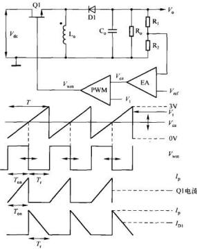

图 1.14 反极性调整器及其主要波形

将图 1.14 与图 1.10 比较, 可见, 两图中开关管和电感换了位置。反极性调整器的开关管位于电感上部, 而 Boost 调整器的开关管位于电感下部。整流二极管的连接方向也相反。 

Q1 导通时，因为二极管 D1 的阴极电压为 $V_{dc}$ （假设 Q1 导通压降为零），而且稳态时， $C_{o}$ 已充电到某一负电压，致使二极管反偏截止。由于恒定电压 $V_{dc}$ 施加在 $L_{o}$ 上，所以其电流以 $di/dt = V_{dc}/L_{o}$ 的斜率线性上升。 

经过导通时间 $T_{\mathrm{on}}$ ，电感 $\mathrm{L}_{\mathrm{e}}$ 的电流达到 $I_{\mathrm{p}} = V_{\mathrm{dc}}T_{\mathrm{on}} / L_{\mathrm{e}}$ ， $\mathrm{L}_{\mathrm{e}}$ 存储的能量为 $E = 1 / 2L_{\mathrm{e}}I_{\mathrm{p}}^{2}$ （焦耳）。Q1关断时， $\mathrm{L}_{\mathrm{e}}$ 的电压极性反向以保持电流不变。所以关断瞬间，与Q1关断前相同的电流 $I_{\mathrm{p}}$ 流过 $\mathrm{C}_{\mathrm{e}}$ 和D1。这个电流线性下降并给电容充电，电容电压极性为上负下正。 

几个周期之后，误差放大器调节Q1导通时间 $T_{\mathrm{on}}$ 使输出采样电压 $[V_{\mathrm{o}}R2 / (R1 + R2)]$ 等于参考电压 $V_{\mathrm{ref}}$ 。此外，若 $\mathbf{L}_{\mathrm{o}}$ 的储能在Q1再次导通之前全部释放完毕（ $I_{\mathrm{D1}}$ 在导通之前降为零），则电路工作于不连续模式，提供给负载的功率为 

$$
P _ {1} = \frac {1 / 2 L _ {\mathrm{o}} I _ {\mathrm{p}} ^ {2}}{T}\tag{1.20}
$$

但要注意,反极性调整器与 Boost 调整器不同,Q1 关断时存储电流并不流经电源(见式(1.13)),因此提供给负载的功率只有式(1.20)一项。设效率为 100%,则输出功率为 

$$
P _ {\mathrm{o}} = \frac {V _ {\mathrm{o}} ^ {2}}{R _ {\mathrm{o}}} = \frac {1 / 2 L _ {\mathrm{o}} I _ {\mathrm{p}} ^ {2}}{T}\tag{1.21}
$$

又因为 $I_{p} = V_{dc} T_{on} / L_{o}$ ，则有 

$$
V _ {\mathrm{o}} = V _ {\mathrm{dc}} T _ {\mathrm{on}} \sqrt {\frac {R _ {\mathrm{o}}}{2 T L _ {\mathrm{o}}}}\tag{1.22}
$$

## 1.5.2 反极性调整器设计关系

与 Boost 调整器电路类似, 反极性调整器通过保证 Q1 导通期间储存在 $L_{0}$ 的电流, 在 Q1 关断期间 $T_{r}$ 结束时能够降到零, 以保证其工作于不连续模式。为了确保这个工作过程能够实现, 可以在 Q1 导通前设置一个 0.2T 的死区时间 $T_{dt}$ 裕量。这样 $\overline{T_{on}} + T_{r} + T_{dt} = T$ , 设 $T_{dt} = 0.2T$ , 则有 

$$
\overline {{{T _ {\mathrm{on}}}}} + T _ {\mathrm{r}} = 0. 8 T\tag{1.23}
$$

此外，与 Boost 调整器一样，反极性调整器要求导通伏秒数与关断伏秒数相等，以防止磁心饱和。由于最大 $\overline{T}_{on}$ 发生在最小 $V_{dc}$ 和 $R_{a}$ （电流最大）时（见式(1.22)），所以有 

$$
\underline {{V _ {\mathrm{dc}}}} \overline {{T _ {\mathrm{on}}}} = V _ {\mathrm{o}} T _ {r}\tag{1.24}
$$

式(1.23)和式(1.24)中只有两个未知量： $\overline{T_{on}}$ 和 $T_{r}$ ，则可求出 $\overline{T_{on}}$ 为 

$$
\overline {{T _ {\mathrm{on}}}} = \frac {0 . 8 V _ {\mathrm{o}} T}{V _ {\mathrm{dc}} + V _ {\mathrm{o}}}\tag{1.25}
$$

于是， $\overline{T}_{on}$ 可由式(1.25)求出，并且 $V_{dc}$ 、 $R_{o}$ 、 $V_{o}$ 和 T 已确定，根据式(1.22)即可求出 $L_{o}$ 。另外，根据 $I_{p}=V_{dc}\overline{T}_{on}/L_{o}$ ，可求出 $I_{p}$ ，并可根据 $I_{p}$ 选择有合适增益的开关管 Q1。 

## 参考文献

1 K. V. Kantak, "Output Voltage Ripple in Switching Power Converters," Power Electronics Conference Proceedings, Boxborough, Mass., pp. 35-44, April 1987 

2 K. Billings, Switchmode Power Supply Handbook, New York: McGraw-Hill, 1999, Chap. 9. 

# 第2章 推挽和正激变换器拓扑

## 2.1 引言

第1章所讨论的三种开关调整器有一个共同的特点，即输出回路与输入回路共地，这样就无法实现多路输出(1.3.8节所讨论到的特殊情况除外)。 

本章将讨论几种最为常用的隔离型开关调整器拓扑，包括推挽变换器、单端正激变换器、双管正激变换器以及交错并联正激变换器。它们有很多相同之处，因此可以归为一类。这几种拓扑结构都是通过高频变压器将能量传递到负载端，由于输出端和输入端直流隔离，因此可以实现多路输出。 

## 2.2 推挽拓扑

## 2.2.1 基本原理(主/辅输出结构)

推挽拓扑如图2.1所示，其主变压器T1包含多个次级绕组。每个次级绕组都产生一对相位互差 $180^{\circ}$ 的方波脉冲，脉冲幅值由输入电压以及初次级绕组匝数比决定。 

所有次级绕组的脉冲宽度都相同，均由主输出回路的负反馈控制电路决定。其控制电路与图1.4所示的Buck调整器和图1.10所示的Boost调整器的控制电路相似，不过在推挽电路中，开关管Q1和Q2由两个相等的脉宽可调、相位互差 $180^{\circ}$ 的脉冲驱动。另外两个次级绕组 $\mathbf{N}_{\mathrm{d}}$ 和 $\mathbf{N}_2$ 为辅输出。 

开关管导通期间，基极驱动电压必须足够大，以使在整个额定电流范围内，都能够把每个初级半绕组的开关端电压拉低到开关管饱和导通压降 $V_{ce(set)}$ ，通常约为1V。因此，当任意一个开关管导通时，对应半个初级绕组上的方波电压幅值为 $(V_{de}-1)$ 。 

变压器次级侧是一个导通时间为 $T_{\mathrm{on}}$ 幅幅值为 $\left[(V_{\mathrm{dc}}-1)(N_{\mathrm{s}}/N_{\mathrm{p}})-V_{\mathrm{d}}\right)$ 的平顶方波。此处 $V_{d}$ 为整流二极管的正向压降，对于传统的快速恢复二极管一般取值为 1V，对于肖特基（Schottky）二极管取 0.5V。因为每个周期都有两个脉冲，因此整流二极管阴极输出脉冲的占空比为 $2T_{\mathrm{on}}/T$ 。 

因此，图2.1中LC滤波器的输入波形和图1.4所示的Buck调整器LC滤波器上的输入波形相似，波形为平顶波且脉宽可调。图2.1中LC滤波器和图1.4所示的LC滤波器的功能相同，都提供一个大小为方波平均值的直流输出。电路中电容和电感的功能与Buck调整器的功能完全相同，其值的计算方法请详见下面的分析。 

图 2.2(假设 D1 和 D2 是肖特基二极管, 其正向压降为 0.5V) 中, 输出为 $V_{m}$ 的直流或平均电压为 

$$
V _ {\mathrm{m}} = \left[ (V _ {\mathrm{dc}} - 1) \left(\frac {N _ {\mathrm{m}}}{N _ {\mathrm{p}}}\right) - 0. 5 \right] \frac {2 T _ {\mathrm{on}}}{T}\tag{2.1}
$$

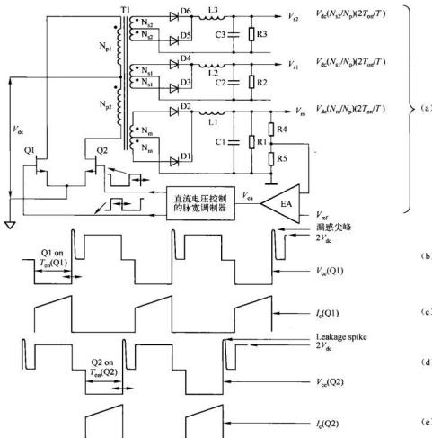

(b) 

(c) 

(d) 

(e) 

图2.1 推挽脉宽调制变换器。开关管Q1和Q2由两个相位相差 $180^{\circ}$ 的脉宽调制信号驱动。变换器的输出包括一个主输出 $(V_{\mathrm{m}})$ 和两个辅输出 $(V_{\mathrm{a1}}$ 和 $V_{\mathrm{a2}})$ 。反馈环接在主输出 $V_{\mathrm{m}}$ 上，当输入和负载变化，通过控制 $T_{\infty}$ 来调整输出。可以看出辅输出可以随着输入的变化而调整，但负载发生变化时，辅输出只能实现部分调整。 

主输出 $V_{\mathrm{m}}$ 整流器端的波形如图2.2所示。如果负反馈环路接在 $V_{\mathrm{m}}$ 端，如图2.1所示，则 $T_{\mathrm{on}}$ 和 $V_{\mathrm{m}}$ 将随着直流输入电压和输出负载电流的变化而调整，以使 $V_{\mathrm{m}}$ 保持不变。尽管负载电流没有出现在式(2.1)中，但是当负载电流改变导致 $V_{\mathrm{m}}$ 发生变化时，它也被误差放大器所采样，然后通过控制导通时间 $T_{\mathrm{m}}$ 来调整使 $V_{\mathrm{m}}$ 保持不变。假设L1（如图2.1）中的电流不会进入不连续工作模式，导通时间 $T_{\mathrm{on}}$ 的变化很小，则不同匝数比 $N_{\mathrm{m}} / N_{\mathrm{p}}$ 、 $V_{\mathrm{dc}}$ 和周期 $T$ 下 $T_{\mathrm{on}}$ 的值可以通过式(2.1)求得。 

辅输出次级侧整流二极管阴极电压则由从绕组的匝数确定。方波的导通时间 $T_{\mathrm{on}}$ 与主输出相同，由主输出 $V_{\mathrm{m}}$ 的反馈环确定。因此辅输出（设整流管为普通的二极管）为 

$$
V _ {\mathrm{sl}} = \left[ (V _ {\mathrm{dc}} - 1) \frac {N _ {\mathrm{sl}}}{N _ {\mathrm{p}}} - 1 \right] \frac {2 T _ {\mathrm{on}}}{T}\tag{2.2}
$$

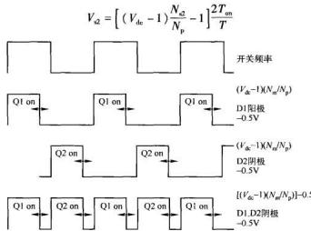

(2.3) 

图2.2 次级主绕组 $(N_{\mathrm{m}})$ 上的电压。输出LC滤波器是一个平均滤波器，其直流输出电压为 $V_{\mathrm{m}}=\left[(V_{\mathrm{dc}}-1)(N_{\mathrm{m}}/N_{\mathrm{p}})-0.5\right](2T_{\mathrm{oc}}/T)$ 。当 $V_{dc}$ 变化时，负反馈通过调整 $T_{oc}$ 以保持 $V_{m}$ 恒定。

## 2.2.2 辅输出的输入—负载调整率

从式(2.1)、式(2.2)和式(2.3)可以看出，当输入 $V_{dc}$ 变化时，为保持 $V_{m}$ 恒定，负反馈就会起作用，使辅输出也保持不变。根据式(2.1)，输入变化时，反馈环会改变导通时间 $T_{on}$ 使得 $(V_{dc}-1)T_{on}$ 的值保持不变，以维持 $V_{m}$ 恒定。相同的 $(V_{dc}-1)T_{on}$ 也出现在式(2.2)和式(2.3)中，因此 $V_{dc}$ 改变时， $V_{a1}$ 和 $V_{a2}$ 也保持恒定。 

如果主输出 $(V_{m})$ 的负载电流变化，则整流二极管正向压降及绕线电阻也会发生轻微变化。因此负反馈环路开始作用以改变负载变化带来的影响，调整 $T_{on}$ 来保持 $V_{m}$ 恒定。 

此时对于辅输出来讲，即使输入 $V_{dc}$ 没有变化，其导通时间 $T_{on}$ 也会发生改变，根据式(2.2)和式(2.3)， $V_{s1}$ 和 $V_{s2}$ 也将改变。这种由主输出负载电流变化造成辅输出电压产生的变化，称为交叉调节。 

辅输出电压也会因自身输出电流的变化而变化。相应的，辅输出电流的变化也会导致自身整流二极管正向压降以及绕线电阻的变化，从而导致电压峰值变化。这些变化不能由负反馈来调节，负反馈网络只能采样 $V_{m}$ 的变化。 

但是,如果辅输出电感I2和I3,特别是主电感L1工作在连续模式,辅输出电压就可以稳定在±5%~±8%的范围内。 

提示: 当输出采用耦合电感(所有的输出电感共用一个磁心)时, 可以得到更好的交叉调整率 $^{1}$ 。 

—K. B. 

## 2.2.3 辅输出电压偏差

尽管辅输出电压变化相对较小，但是它的实际输出电压却不能得到精确的调节。从式(2.2)和式(2.3)可见，辅输出电压值由 $T_{on}$ 及相应的次级匝数 $N_{s1}, N_{s2}$ 决定。而 $T_{on}$ 由主输出 的负反馈决定，基本保持不变。另外，因为次级从绕组的匝数只能按整数改变，所以辅输出电压实际值不能很精确地设置。通过公式 $V_{m} \cdot T_{on}/N_{p}$ 可以求出次级绕组 $N_{s}$ 每改变一匝时次级电压的变化情况。 

大多数场合，辅输出电压的实际值并不是很重要。辅输出一般用于驱动运放或电动机，这些负载通常可以允许约2V的直流电压偏差。如果辅输出电压值很重要，则通常会把这个值设计得比实际要求的高，然后通过一个线性调整器或Buck调整器将其降到所要求的精确值。因为辅输出已有半调节功能，将其结合线性调整器使用，效率不会太低。 

## 2.2.4 主输出电感的最小电流限制

1.3.6节讨论了Buck调整器输出电感的选择，并提到当电感电流波形上升沿从零开始时（见图1.6(a)和图1.6(b))，电感进入不连续工作模式。当平均电流小于该值时，反馈环通过减小导通时间维持Buck调整器输出电压的稳定，但这会使辅输出电压降低。 

然而从图1.6(a)可以看出，进入不连续工作模式以前，即使输出电流发生很大的变化，导通时间基本保持恒定。但进入不连续工作模式后，导通时间会有很大变化。对于Buck调整器来讲，由于只有一个输出电压，并且有反馈环保持其恒定，所以不会有什么问题。但对于一主多从的推挽脉宽调制变换器来讲，由式(2.2)和式(2.3)可知，辅输出电压与主输出导通时间成正比。 

因此，当有辅输出时，即使主输出电流降到最小值，也不允许主输出电感电流进入不连续工作模式。例如，设主输出电流最小值为额定值的1/10，根据式(1.8)可以计算出所需输出电感的最小值。在主输出电感电流连续范围内，辅输出电压值波动范围将保持在 $\pm5\%$ 以内。当主电感进入不连续模式时（电感电流低于最小电流值），反馈环将明显减小 $T_{m}$ 以保持主输出电压恒定。不过，辅输出电压也将下降。 

另外，辅输出在其输出电流范围内也不允许进入不连续模式。根据式(1.8)同样可以计算出辅输出电感值。显然，所允许的最小电流值越大，所需电感值越小。 

提示:这种问题同样可以通过耦合电感来解决 $^{[1]}$ 。 

——K. B. 

推挽变换器是最传统的拓扑结构之一，但设计中依然经常用到。这种拓扑能够实现多路输出，且输出端与输入端以及输出端与输出端之间可以实现直流隔离。输出电压既可以高于输入电压，也可以低于输入电压。当输入电压和负载波动时主输出电压可以得到很好的调节。辅输出电压在输入电压变化时都能保持较高的调整率，当负载发生变化时，只要辅输出电感电流不进入不连续模式，辅输出电压调整率也能控制在5%以内。 

## 2.2.5 推挽拓扑中的磁通不平衡(偏磁饱和现象)

设计者还应该注意到推挽拓扑中另一种更为潜在的失效模式——由变压器磁通不平衡引起的偏磁而导致磁心饱和。 

这种现象可以通过功率变压器上使用的典型铁氧体磁心材料的磁滞回线来理解,如图2.3所示。 

正常工作时，磁心的磁通变化范围位于图2.3所示的 $B_{1}$ 和 $B_{2}$ 之间。磁心必须工作在磁滞回线±2000G以内的线性部分。频率为25kHz左右时，磁心损耗很小，磁通允许在±2000G范围内变化。但是，如同2.2.9.4节中所讨论的那样，随着频率的上升，磁心损耗会迅速增大，当 频率高于100kHz时，峰值磁密应该控制在1200G甚至800G以下。 

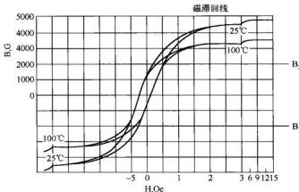

图2.3 一种典型的铁氧体磁心材料(Feroxcube 3C8)的磁滞回线。如果要磁通曲线保持在线性范围内，当频率达到 $30\mathrm{kHz}$ 时，磁通变化范围需限制在 $\pm 2000\mathrm{G}$ 之间。频率为 $100\sim 300\mathrm{kHz}$ 时，由于高频磁心损耗的原因，峰值磁通变化范围必须减至 $\pm 1200\mathrm{G}$ 或 $\pm 800\mathrm{G}$ 。3C8是Ferroxcube Corporation生产的一种铁氧体材料。该公司或其他厂家生产的其他材料除了磁心损耗及居里温度不同外，曲线形状都基本相似。

当Q1导通时，如图2.1所示， $N_{p1}$ 的异名端为正，磁心沿磁滞回线上升，即从 $\mathrm{B}_1$ 向 $\mathbf{B}_2$ 移动。其上升的实际值与 $N_{p1}$ 两端电压和Q1导通时间（根据法拉第定律，见式(1.18))的乘积成正比。当Q1关断、Q2导通时， $N_{p2}$ 的同名端为正，磁心沿磁滞回线从 $\mathbf{B}_2$ 下降到 $\mathbf{B}_1$ ，其下降的实际值与 $N_{p2}$ 两端电压和Q2的导通时间成比例。 

如果 Q1 导通时施加在 $N_{p1}$ 的伏秒数与 Q2 导通时施加在 $N_{p2}$ 的伏秒数相等，则一个周期后，磁心会从 $B_{1}$ 上升至 $B_{2}$ ，然后又返回到 $B_{1}$ 。但只要伏秒数稍有不等，磁心就不能回到起点，并且若干周期后，磁心将偏离磁滞回线进入饱和区。磁心饱和时，变压器不能承受电压，当下一周期开关管再次导通时，开关管将承受很大的电压和电流，导致开关管损坏。 

很多因素都可能引起导通时的复位伏秒数与关断时的复位伏秒数不相等。例如，即使Q1和Q2的基极驱动电压宽度相同，其集电极电压以及导通时间也可能不完全相等。如果Q1、Q2是双极型晶体管，由于存储时间的存在，当基极驱动移掉后，集电极仍会维持导通一段时间。存储时间从 $0.3\sim 6\mu \mathrm{s}$ 不等，产品之间差别也很大。另外，存储时间也受温度的影响，随温度上升而显著增加。即使Q1、Q2的存储时间恰好相同，如果它们在散热器上相距较远，以致工作温度不同，其存储时间也可能相差很大。 

因此,如果一个开关管导通的伏秒数略大于另一个,则每一周期都会使磁心慢慢偏离平衡点而最终趋向饱和。随着磁心进入磁滞回线(如图2.3所示)的弯曲部分,则该开关管的电流要比另一个开关管的电流大。因此,在该半周期,磁心励磁电流将成为负载电流的主要部分。于是流过较大电流的开关管会变得更热,使它的存储时间延长。随着该开关管存储时间的延长,这半周期内作用于磁心的伏秒数会增加,流过的电流也会增加,该管的存储时间进一步延长。这样,失控状态一出现,很快磁心饱和,开关管损坏。 

另外，由于产品之间普遍存在差异，每个管子初始的导通时间或 $V_{ce(sat)}$ 不等，也会使得Q1、Q2导通时的伏秒数不等。如前所述，对于双极型晶体管，由于导通压降会随温度升高而 下降,所以任何初始导通压降的差别都会被放大。 

如果 Q1、Q2 是 MOSFET 管 (金属氧化物半导体场效应晶体管)，则磁通不平衡问题就远没有那么严重。首先，MOSFET 管没有存储时间，两组栅极信号脉宽相等，两个开关管导通时间相等。更重要的是，由于 MOSFET 管的导通压降随温度升高而增加，所以如果有一定的补偿措施，上述失控情况就不会发生。假设伏秒数开始较大平衡，随着磁心开始移向磁滞回线的弯曲部分，其中一个场效应管的电流开始增加。流过较大电流的开关管，管温增加，导通压降也增大，但这将使对应初级半绕组上的电压降低。从而降低该半周期的伏秒数，使流过该开关管的电流减小，恢复正常。 

## 2.2.6 磁通不平衡的表现

前面的分析似乎说明不同半周期间任何一点点的伏秒数不平衡都可能造成电路失效，其实这也不尽然。推挽电路可以在一定程度的磁通不平衡环境下继续工作一段时间，而不会使磁心立即饱和并且损坏开关管。很多低功率、低电压的推挽变换器即使有明显的磁通不平衡问题也能比较稳定的运行。 

如果没有自调节措施，当磁通伏秒不平衡时，经过一定的开关周期以后，磁心就会饱和，并且损坏开关管。例如，如果开始时只有0.01%的磁通不平衡（实际情况会比这更严重），只需10000个周期，磁心磁通就会从最低的起始点 $B_{1}$ 偏移到饱和点 $B_{2}$ （如图2.3所示），而开关管在这个过程完成之前就很可能已经损坏了。 

有一种自调节方法,即利用变压器初级线圈电阻可以维持变换器在偏磁状态下正常工作。如果初始伏秒数不平衡,则开关管电流较大一侧初级半绕组电阻上的压降也较大。那么该绕组上的伏秒数降低,从而可以缓解不平衡问题。 

这样变换器就可以在这种不平衡状态下继续工作,而不会使磁心立即失控进入完全饱和区了。在变压器中心抽头上放置一个电流探头可以检测磁心在磁滞回线上的位置,如图2.4(d)所示。 

从图 2.4(a) 所示的波形可以看出伏秒数平衡的状况, 图中交替出现的电流波形峰值都相等。初级负载电流脉冲与图 1.4(d) 所示的 Buck 调整器波形相似, 是一种阶梯状的斜坡。这是因为所有次级都有 LC 输出滤波器, 其波形如 1.3.2 节所述。 

初级负载电流波形是所有次级负载电流按各自的匝数比折算到初级的电流之和。但是总的初级电流等于所有次级电流折算到初级的电流之和加上初级侧励磁电流。励磁电流是流过励磁电感的电流，而励磁电感是所有次级开路从初级测得的电感。任何变压器都包含励磁电感，电路上等效成与初级绕组并联。励磁电流与折算到初级侧的次级负载电流相加，如图2.4(e)所示。 

因此,初级总电流波形等于折算到初级的次级负载阶梯斜坡电流的和加上励磁电流。如果磁心工作在 B/H 回线的线性区域,则励磁电流是一个从零开始线性上升的斜坡电流。 

开关管导通时,会有约 $(V_{\mathrm{dt}}-1)$ 的阶跃电压加在励磁电感 $L_{pm}$ 上。则励磁电流从零开始线性上升,上升斜率为 

$$
\mathrm{d} I / \mathrm{d} t = (V _ {\mathrm{dc}} - 1) / L _ {\mathrm{pm}}\tag{2.4}
$$

经过开关管导通时间 $T_{on}$ 后到达峰值 

$$
I _ {\mathrm{pm}} = \frac {(V _ {\mathrm{de}} - 1) (T _ {\mathrm{on}})}{L _ {\mathrm{pm}}}\tag{2.5}
$$

(a)

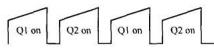

(b)

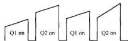

(c)

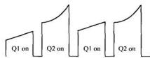

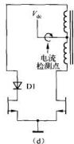

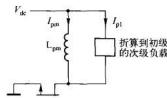

(c)

图2.4 变压器中心抽头上的电流。(a)变压器初级两个半绕组伏秒数相等。(b)变压器初级半绕组的伏秒数不相等。磁心还没到磁滞回线的弯曲部分。(c)变压器初级半绕组的伏秒数不相等，波形上的凹陷表示危险状态，磁心在磁滞回线的弯曲部分。(d)初级侧串联一个二极管，以测试伏秒数不平衡的程度。(e)总的初级电流是次级负载阶梯斜坡电流折算到初级的电流和励磁线性斜坡电流之和。

若式(2.5)中的 $L_{pm}$ 足够大，则与次级折算到初级的负载电流之和相比， $I_{pm}$ 很小。一般设计最大允许峰值励磁电流不应超过初级负载电流的10%。 

由于励磁电流的斜率很小,所以叠加在负载电流斜坡上后,其斜率增加不大。另外,如果交替半周期的伏秒数相等,因为磁心以图2.3所示磁滞回线原点为中心工作,此时两个半周期的峰值电流相等,如图2.4(a)所示。 

然而,如果交替半周期的伏秒数不等,磁心就不会以磁滞回线原点为中心工作。由于横轴(磁场强度H,单位奥斯特)与励磁电流成正比,在图2.4(b)中体现为直流电流偏置,从而使交替电流脉冲的幅值不相等。 

只要直流偏置没有使磁心过度偏离磁滞回线，则斜坡斜率依然保持线性，如图2.4(b)所示，运行依然安全。初级线圈电阻能够阻止磁心进一步偏移而进入饱和。 

但如果交替半周期的伏秒数不平衡程度较严重，磁心偏移接近饱和，并且进入磁滞回线的弯曲部分，则此时，与磁滞回线斜率成正比的励磁电感就会下降，励磁电流明显上升，使得电流波形出现凹陷，如图2.4(c)所示。 

这是一个危险的即将发生故障的状态。此时即使一点点温升都会造成前面所描述的失控局面。磁心迅速进入饱和，损坏功率开关管。如果初级中心抽头电流脉冲显示斜坡中有任何凹陷出现，则推挽变换器的设计肯定是不安全的。即使图2.4(b)所示的线性斜坡峰值电流不平衡度超过20%都是不安全的，这在设计上是不允许的。 

注释：当负载发生跳变时可能情况会更恶劣，因为此时额外的电流会令磁心迅速饱和。 

—K. B. 

## 2.2.7 磁通不平衡的测试

图2.4(d)给出了推挽变换器磁通不平衡危险程度的简单测试方法。将一个硅二极管(导通压降约为1V)与变压器初级半绕组的一端串联,则该绕组导通时,与二极管串联的半绕组上的压降比另一个半绕组的压降低1V,这样就人为地产生了伏秒数不平衡。中心抽头波形与图2.4(b)或图2.4(c)所示波形相似。没有串联二极管的半绕组的伏秒数与峰值电流均大于另一个半绕组。把二极管移到另一边,就可以看到较大的峰值电流转移到了变压器另一个初级半绕组上。 

现在就可以确定电路接近图2.4(c)所示的凹陷状态的程度。如果串联一个二极管就可以使电流斜坡凹陷，则这个电路就已经很接近故障状态了。一边串联两个二极管就可以看到有多少裕度。 

应该注意初级励磁电流不向次级传递能量,也不会出现在次级,它仅使磁心沿着磁滞回线来回偏移。 

图 2.3 中, 根据电磁学基本原理, 励磁电流与磁场强度 H(单位为奥斯特) 有关, 即 

$$
H = \frac {0 . 4 \pi N _ {\mathrm{p}} I _ {\mathrm{m}}}{l _ {\mathrm{m}}}\tag{2.6}
$$

式中， $N_{p}$ 为原边绕组匝数， $I_{m}$ 为励磁电流，单位为 A； $l_{m}$ 为磁路的长度，单位为 cm。 

## 2.2.8 磁通不平衡的解决方法

磁通不平衡问题有可能成为高压大功率场合最主要的问题。针对这个问题的处理方法有很多，但是大多数都会增加成本或者元件个数。下面介绍磁通不平衡问题的一些解决方案。 

## 2.2.8.1 磁心加气隙

当磁心偏离到图2.3所示磁滞回线的弯曲部分时，磁通不平衡就变得很严重了，励磁电流开始按指数规律增加，如图2.4(c)所示。使磁滞回线倾斜，从而磁滞回线的弯曲部分可以延伸至更大的电流区域，这样可以减小磁通不平衡现象的发生。此时，磁心可以承受更大的直流电流偏置或伏秒数不平衡。 

图 2.5 给出了磁心加上气隙后的效果。它使磁滞回线的斜率变小。2～4mil(密耳)的气隙可以使磁滞回线弯曲部分远离原点，从而磁心可以承受更大的电流偏置。在大功率场合经常用到气隙，但缺点是减小了励磁电感，为了防止变换器工作在不连续模式，所以不得不增加临界电流。 

EE型或杯型磁心只要将塑料垫片加在中心柱和外柱上就可以形成气隙。磁通从中心柱通过，经外柱返回，因此总的气隙为垫片厚度的两倍。制造变压器时，把中心柱磨掉两倍垫片厚度的成本并不是很高。这种方法与在中心柱和外柱加放垫片的效果一样，并且其气隙大小不会随意改变，这样可以减小射频干扰(RFI)，因此实际当中使用更为广泛。 

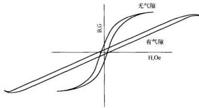

图 2.5 磁心加气隙对磁滞回线的影响

## 2.2.8.2 初级串联电阻

2.2.6节中曾指出，伏秒数不平衡时，初级绕组电阻可阻止磁心迅速饱和。当出现磁通不平衡时，伏秒数较大的初级半绕组流过较大的峰值电流。这个电流使绕组电阻压降增大，降低了该初级半绕组的伏秒数，从而使电流恢复平衡。 

初级两个半绕组都串入额外的电阻时效果更明显。所加电阻既可串接在功率晶体管的集电极，也可以加在发射极。电阻取值最好是根据变压器中心抽头电流脉冲来确定，其值通常小于0.25。当然，这样做势必会增加损耗，降低效率。 

## 2.2.8.3 匹配功率开关管

由于伏秒数不平衡主要是由两个开关管之间的存储时间和导通压降不同引起的，如果开关管参数都匹配，再加上前面所提到的两种解决方法，则磁通不平衡的问题将不再发生。 

但是这并不是一个很好的方法,因为要使开关管这两个参数匹配的成本很高。这需要专门的测试工具去完成。如果要求现场替换,就更行不通了。 

如果参数匹配测试在某一负载电流和温度下进行，那么还必须确定负载电流和温度变化时参数能否依然保持匹配。而且，因为存储时间会受到双极型晶体管正向和反向基极输入电流的影响，所以存储时间很难精确匹配。一般来说，在最大工作电流下实现了 $V_{\mathrm{ex}}$ 和 $V_{\mathrm{be}}$ （集电极一发射极之间的电压和基极一发射极之间的电压）的匹配，所有的匹配也就完成了。对于大容量商用电源，参数匹配不是一个可行的方法。 

## 2.2.8.4 使用MOSFET功率开关管

前面提到大多数伏秒数不平衡是由两个开关管存储时间不等引起的，所以使用 MOSFET 功率开关管时，很大程度上就可以避免这个问题，因为 MOSFET 管没有存储时间。 

使用MOSFET功率开关管还有一个优点，就是其导通压降会随温度的升高而增加。因此，如果一个初级半绕组承受较大的电流，则相应的开关管温度就会高一些，导通压降增加，使绕组上的电压下降，降低这一边的伏秒数，这样有利于恢复平衡。当然，这种方法只能定性地修正不平衡，对于各种功率等级的磁通不平衡问题，以及两个开关管最差组合情况下的磁通不平衡问题，其只能起到一定的帮助作用，而不能完全解决问题。 

但是，在功率小于100W且输入电压比较低的场合（如大多数DC/DC变换器）使用MOS-FET功率开关管，则推挽变换器的可靠性还是可以做得很高的。 

## 2.2.8.5 使用电流模式拓扑

迄今为止,解决磁通不平衡问题的最佳方法是采用电流模式控制。这种方式可以完全解决磁通不平衡问题,而且还有很多独特的优点。 

在传统推挽变换器中，即使采用上述所有方法，在某些最恶劣情况下还是可能出现磁通不平衡问题，并且损坏开关管。电流模式拓扑通过逐个检测每个推挽开关管的电流脉冲可以解决这个问题。控制电路控制每个交替脉冲电流的幅值相等，使磁心工作点保持在B/H回线的中心点附近。有关电流模式拓扑的细节将会在第5章中详细讨论。 

## 2.2.9 功率变压器设计

注释:磁性元器件的设计是一门专业的学科,在第7章中将进行更详细的介绍。变压器、电感、扼流圈等设计得好坏与否对设备的性能优化至关重要。工程师如果能花多点时间完全掌握这一块就能更好地完成设计。因此在进行实际设计之前,读者很有必要好好地学习第7章。 

补充: 在接下来的小节, 作者将讨论一种如何选择磁心体积和绕线参数的方法。如果采用下面示例中的方法, 可以省去很多冗长的计算过程。通过一系列参数之间的关系, 读者能更好的理解这一设计过程。但是, 在实际设计当中一般都要预先设定最高允许温升 (典型值取 $30^{\circ}C$ ), 然后借助于图表或者计算机程序可以省去那些复杂烦琐的过程, 很快就能得到想要的结果。 

— K. B. 

## 2.2.9.1 磁心选择

变压器设计首先从磁心的选择开始，磁心体积必须满足总输出功率的要求。磁心的最大输出功率由工作频率、磁通密度摆幅（图2.3中的 $B_{1}$ 和 $B_{2}$ ）、磁心面积 $A_{e}$ 、骨架窗口面积 $A_{b}$ 及各绕组电流密度决定。 

这些参数的确定是互相关联的,选择原则是尽量减小变压器的尺寸和减少温升。根据以上参数可以得到一个确定磁心最大输出功率的公式,将在第7章的磁性元件部分中介绍。 

这是一个用于迭代计算的公式。首先要试着选择磁心、最大磁密、工作频率，并计算最大输出功率。如果输出功率不足，则选择更大尺寸的磁心，重复计算，直到磁心能满足输出功率的要求。 

这个过程算起来比较烦琐,因此,可以将公式绘制成图表,对于所要求的输出功率,只要一查图表就可以确定磁心和对应的工作频率。第7章将介绍一些常用拓扑的公式和图表。 

现假设根据以上图表选择好了磁心，因此可以知道面积 $A_{e}$ ，剩下的就是初次级匝数的计算、线径的选择，以及磁心损耗、铜耗和变压器温升的计算。 

磁心骨架绕线的合理顺序对于改善绕组间的耦合，减少集肤效应和邻近效应造成的铜耗是十分重要的。第7章将介绍绕线顺序、集肤效应和邻近效应。 

本例中，设计所用的磁心将根据前面提到的选择表来确定，并假设该磁心面积 $A_{e}$ 已知。 

## 2.2.9.2 功率开关管最大导通时间的选择

从式(2.1)可知， $V_{dc}$ 下降时，变换器会通过增加导通时间 $T_{on}$ 来维持输出电压 $V_{m}$ 恒定。当直流输入电压下降到最小值 $V_{dc}$ 时，导通时间 $T_{on}$ 最大。但是此类变换器中，最大导通时间不能超过开关周期的一半。否则，复位伏秒数将小于置位伏秒数(2.2.5节)，经过几个周期后，磁心将饱和并损坏开关管。 

另外，由于双极型晶体管有存储时间这一参数，所以其基极驱动时间一定要小于半个周期。否则，存储时间的存在会导致与另一个开关管重叠。此时功率晶体管将绕组短路，电路将迅速失去控制。全部电源电压直接加在开关管两端，电流非常大，开关管将立即损坏。 

所以，为了保证一个周期内磁心可以复位，且不会造成同时导通，在直流输入电压为其最小值 $V_{dc}$ ，反馈环增大 $T_{on}$ 以保证 $V_{m}$ 恒定时，必须采取钳位电路以限制导通时间不会超过半周期的80%。这样在式(2.1)中，若已确定 $V_{dc}$ 、T及 $\overline{T}_{on}=0.8T/2$ ，则可确定匝数比 $N_{m}/N_{p}$ ，以得到所需的输出电压 $V_{m}$ 。 

注意:现在的驱动技术和控制 IC 可以提供死区可调的驱动以防止功率器件同时导通。在某些设计中,通过即时监控功率器件的导通状态,在上一个开关管完全关断之后,给驱动信号加一定的延时然后再开通第二个开关管。这样就可以利用整个占空比,并且不会出现共同导通。 

## 2.2.9.3 初级匝数的选择

根据法拉第定律(式(1.17))可以确定初级匝数 $N_{p}$ 。根据该式， $N_{p}$ 由初级绕组上的最小电压 $(V_{\mathrm{dc}}-1)$ 和最大导通时间(如上所述,不超过0.8T/2)确定,即 

$$
N _ {\mathrm{p}} = \frac {(V _ {\mathrm{de}} - 1) (0 . 8 T / 2) \times 1 0 ^ {+ 8}}{A _ {\mathrm{e}} \Delta B}\tag{2.7}
$$

式中， $A_{e}$ 由所选磁心决定， $V_{do}$ 和 T 为已知，因此只要选定 dB(0.8T/2 时间内的磁通变化)，就可以确定初级匝数。下面介绍求解过程。 

注意:读者还可以利用下面法拉第定律的量纲形式直接计算匝数: 

$$
N = \frac {V T _ {\mathrm{on}}}{A _ {\mathrm{e}} \Delta B}
$$

式中，N 为匝数；V 为绕组两端电压 $(V_{\mathrm{dc}})$ ； $T_{on}$ 为最大导通时间，ms； $\Delta B$ 为磁通密度，特斯拉（1 特斯拉 = 10000 高斯）； $A_{e}$ 为磁心有效面积，mm $^{2}$ 。 

对于所有的磁性元件设计,一般建议采用国际单位制,这样可以迅速得到结果,避免一些不常用的单位,从而减少错误。 

## 2.2.9.4 最大磁通变化(磁通密度摆幅)选择

从式(2.7)可以看出,初级匝数与磁通变化量 dB 成反比,一般尽量取最大的 dB 而使 $N_{p}$ 最小。因为较少的匝数意味着可用较大规格的导线,则给定的磁心可承受较大的电流并获得较大的输出。另外,较少的匝数不但可以降低变压器成本,还可以降低杂散寄生电容。 

从图 2.3 可以看出, 超过 ±2000G 时, 铁氧体磁心的磁滞回线就进入了弯曲部分。应使磁通变化限制在该点以下, 因为超过该点, 励磁电流就开始按指数规律上升。如果不考虑磁心损耗的限制, 则 ±2000G 应该是一个很好的选择。 

铁氧体磁心损耗约以峰值磁密的2.7次幂及工作频率的1.6次幂按指数规律增加。频率为50kHz时，即使考虑磁心损耗的问题，磁密也可以取 $\pm2000G$ ，而且也有必要工作在这个磁通密度水平。 

但是，为了防止磁心在动态时饱和，最好能保留较宽的裕度。实际上，即便在磁心损耗允许的频率下，也最好把最大磁密限制在 $\pm 1600\mathrm{G}$ 内。由法拉第定律，磁通变化dB为 

$$
\mathrm{dB} = \frac {(V _ {\mathrm{dc}} - 1) (T _ {\mathrm{on}}) \times 1 0 ^ {+ 8}}{N _ {\mathrm{p}} A _ {\mathrm{e}}}\tag{2.8}
$$

根据式(2.8)，若 $N_{p}$ 已根据给定的dB选定（如从-2000G到+2000G，则dB为4000G），则只要 $(V_{\mathrm{dc}}-1)(T_{\mathrm{on}})$ 不变，dB等于4000G不变。而且，若反馈环使输出电压 $V_{m}$ 恒定，则据式(2.1)，只要 $(V_{\mathrm{dc}}-1)(T_{\mathrm{on}})$ 不变，dB始终不变。也就是说，反馈环总是使 $V_{dc}$ 最小时 $T_{on}$ 最大，绝不会出现 $T_{on}$ 和 $V_{dc}$ 同时最大的情况。 

但在某些瞬态或故障情况下，若 $T_{\mathrm{on}}$ 保持最大导通时间一个周期或几个周期， $V_{\mathrm{dc}}$ 瞬间上冲超过其正常值的 $50\%$ ，而反馈环未能根据式(2.1)减少导通时间，就可能出现 $V_{\mathrm{dc}}$ 和 $T_{\mathrm{on}}$ 同时最大的情况。此时，根据式(2.8)，dB将等于 $1.5 \times 4000 = 6000\mathrm{G}$ 。 

如果磁心起点为 -2000G，则导通结束时磁心将会上升 6000G，即达到 +4000G。而且从图 2.3 所示的磁滞回线可见，若此时磁心温度稍高于 25℃，就会达到深度饱和，使开关管承受高电压、大电流而立即损坏。 

在 12 章的反馈环路分析一节中将会提到，由于反馈环路带宽的限制，误差放大器响应会有一定的延迟。因此在瞬态过程中，即使误差放大器最终会修正导通时间以保持 $(V_{\mathrm{dc}} - 1)(T_{\mathrm{on}})$ 不变（根据式(2.1)），但由于误差放大器的响应延迟，很有可能使得输入电压和导通时间同时最大。即使在一个周期内，由于误差放大器的延迟，使磁心工作于最大输入电压和最大导通时间，磁心都会饱和而损坏开关管。 

如果在 $V_{\infty}$ 和 $T_{\infty}$ 的情况下，根据式(2.8)选择 $N_{p}$ 使dB为3200G，电路就能承受输入电压50%的瞬时跳变。当dB=3200G时，如果误差放大器反应太慢，来不及调整导通时间，dB瞬时值将为 $1.5\times3200=4800G$ 。如果磁心从其正常的位置(-1600G)出发，磁心也只会上升至-1600+4800，即+3200C。从图2.3的磁滞回线可见，即使在100℃的情况下，此时磁心仍能够承受磁通变化而不至于饱和。 

对于 50kHz 以下频率范围(较大磁通变化也不会引起过多的磁心损耗)，dB = 3200G 时，可根据式(2.7)选择初级匝数。频率高于 50kHz 时，磁心损耗迅速增加，必须减小峰值磁密。频率为 100 ~ 200kHz 时，峰值磁密应该限制在 1200G 甚至 800G 左右，以使磁心温升控制在可以接受的范围内。 

## 2.2.9.5 次级匝数的选择

主输出和辅输出的次级匝数可以根据式(2.1)、式(2.2)和式(2.3)选择。在这些公式中，所有参数都是已知的。输出电压、 $V_{dc}$ 和T都已确定。最大导通时间 $T_{on}$ 设为0.8T/2，对于选定的磁心， $A_{k}$ 已知， $N_{p}$ 可根据法拉第定律（式(2.7))计算得出。为了减少磁心损耗，频率低于50kHz时，磁通摆幅dB取3200G。频率越高，磁通摆幅取值越低。 

## 2.2.10 初/次级绕组的峰值电流及有效值电流

在本例中,选择线径时所取的工作电流密度比较保守。电流密度指的是电流有效值的密 

度,单位是安培每圆密耳①。 

因此，在选取绕组线径之前，必须先知道每根导线所流过电流的有效值。 

## 2.2.10.1 初级峰值电流计算

直流输入电源 $V_{dc}$ 的电流可以通过变压器中心抽头检测到，其波形如图 2.1(b) 和图 2.1(d) 所示。所有次级都有 1.3.2 节中讨论过的 LC 输出滤波器，电流脉冲具有阶梯斜坡的特征。初级电流的大小等于所有次级阶梯斜坡电流以各自匝数比折算到初级的电流值和再加上励磁电流。 

在2.2.9.2节讨论过，直流输入电压为最小值 $V_{dc}$ 时，开关管导通时间为半周期的80%。因为每半周期有一个脉冲，所以当输入为 $V_{dc}$ 时，图2.1所示脉冲的占空比为0.8。为了简化计算，假设图中脉冲等效为平顶波，其幅值 $I_{pf}$ 是斜坡中点处的电流值。 

输入功率等于 $V_{dc}$ 与平均电流 $(0.8I_{\mathrm{pft}})$ 的乘积，假设效率为 80%（小于 200kHz 的变换器都能达到此效率）， $P_{o}=0.8P_{in}$ ，则 

$$
P _ {\mathrm{in}} = 1. 2 5 P _ {\mathrm{o}} = \underline {{{V _ {\mathrm{dc}}}}} 0. 8 I _ {\mathrm{pft}}
$$

即 

$$
I _ {\mathrm{pft}} = 1. 5 6 \frac {P _ {\mathrm{o}}}{V _ {\mathrm{dc}}}\tag{2.9}
$$

这个关系式很有用,因为根据已知的输出功率和最小直流输入电压,就能确定初级电流等效平顶波脉冲的幅值。根据相应的初级电流有效值可以确定初级绕组线径,同时还可以选择功率晶体管的额定电流。 

## 2.2.10.2 初级电流有效值的计算及线径的选择

每个初级半绕组每周期仅流过一个 $I_{\mathrm{pft}}$ 脉冲，因此其占空比为 $(0.8T/2)/T$ ，即0.4。众所周知，对于占空比为D、幅值为 $I_{\mathrm{pft}}$ 的平顶波脉冲，其有效值为 

$$
I _ {\mathrm{rms}} = I _ {\mathrm{pft}} \sqrt {D} = I _ {\mathrm{pft}} \sqrt {0 . 4}
$$

即 

$$
I _ {\mathrm{rms}} = 0. 6 3 2 I _ {\mathrm{pft}}\tag{2.10}
$$

且根据式(2.9)有 

$$
I _ {\mathrm{rms}} = 0. 6 3 2 \frac {1 . 5 6 P _ {\mathrm{o}}}{\underline {{V _ {\mathrm{dc}}}}} = \frac {0 . 9 8 6 P _ {\mathrm{o}}}{\underline {{V _ {\mathrm{dc}}}}}\tag{2.11}
$$

这样,根据已知的输出功率和额定的最小直流输入电压,即可求出每个初级半绕组的电流有效值。 

设计变压器时，为保守起见，通常把绕组电流密度选取为500圆密耳每有效值安培。这也不是绝对的，绕组匝数较少时，电流密度通常取300圆密耳每有效值安培。一般来讲，应避免使电流密度大于300圆密耳每有效值安培，因为那样会引起过大的铜耗和温升。 

因此，当电流密度为500圆密耳每有效值安培时，初级半绕组所需圆密耳数为 

(b) 

$$
\text {   初级绕组所需圆密耳   } = 5 0 0 \frac {0 . 9 8 6 P _ {\mathrm{o}}}{V _ {\mathrm{dc}}} = 4 9 3 \frac {P _ {\mathrm{o}}}{V _ {\mathrm{dc}}}\tag{2.12}
$$

式中，假设输出功率和最小直流输入电压均为已知。然后根据式(2.12)求出的圆密耳值即可从导线表格中选出合适的线径。 

## 2.2.10.3 次级电流的峰值、有效值，及线径的计算

图2.6给出了每个次级半绕组的电流波形。注意开关管导通结束时段的凸台部分。之所以存在电流凸台，是因为次级滤波电感的输入处没有续流二极管D1（如图1.4所示的Buck调整器）。在Buck电路中，开关管关断时，必须加上一个续流二极管给电感电流提供返回通路。开关管关断时，输出电感极性反向，如果其前端电压没有被续流二极管钳位至约比地电位低1V，则其前端电压可能变成一个很大的负值。续流二极管DI导通之后，电感电流通过它续流，如图1.4(e)所示。在图2.6所示的整流电路中则不存在这种问题。 

对于推挽拓扑输出来说,续流二极管的功能由输出整流管 D1 和 D2 来实现。当其中一个开关管关断时,电感前端电压变负。当该电压低于地电位约一个二极管压降时,两个整流管同时导通,每个整流管导通的电流约为开关管关断前电感总电流的一半,如图 2.6(d) 和图 2.6(e) 所示。 

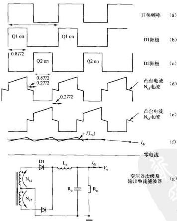

图 2.6 在推挽电路中, 输出整流管 D1 和 D2 充当续流二极管。在 20% 的死区时间内, 每个次级绕组承受正常的续流凸台一半的电流。估算次级铜耗时应该考虑这种情况。

因为每个次级半绕组的阻抗很小,所以其压降可忽略不计,整流二极管阴极电压被钳位于比地电位约低1V。 

若要精确算出次级半绕组的电流有效值,就要考虑20%死区时间内的凸台电流。本例中凸台电流仅为峰值电感电流的一半,且其占空比为 $(0.4T/2)/T=0.2$ 。如此小的幅值及占空比,在计算次级半绕组电流有效值时可以忽略不计。在最小直流输入和占空比为 $(0.8T/2)/T=0.4$ 时,可认为每个次级半绕组都具有阶梯斜坡的特征。斜坡中心处的电流值为直流输出电流 $I_{\mathrm{dc}}$ ,如图2.6(f)所示。 

## 2.2.10.4 次级电流有效值及线径的计算

为简化初级电流有效值的计算，阶梯斜坡脉冲将近似等效为平顶坡脉冲 $I_{sft}$ ， $I_{sft}$ 的幅值为斜坡中心值或直流输出电流 $I_{dc}$ ，其占空比为0.4。 

因此，每个次级半绕组的电流有效值为 

$$
I _ {\mathrm{s(rms)}} = I _ {\mathrm{de}} \sqrt {D} = I _ {\mathrm{de}} \sqrt {0 . 4} = 0. 6 3 2 I _ {\mathrm{de}}\tag{2.13}
$$

若电流密度为 500 圆密耳每有效值安培，则每个次级半绕组所需的圆密耳为 

$$
\mathrm{次级所需圆密耳} = 5 0 0 (0. 6 3 2) I _ {\mathrm{dc}} = 3 1 6 I _ {\mathrm{dc}}\tag{2.14}
$$

## 2.2.11 开关管的电压应力及漏感尖峰

从图 2.1 变压器同名端可以看出,由于两个初级半绕组的匝数相等,并且通过中心抽头连接到输入直流端,所以任一个开关管导通时,另一个开关管的集电极将承受至少两倍的直流电源电压。 

但是,最大电压应力比最大直流输入电压的两倍还要大。这种附加的电压来自图2.1(a)及图2.1(c)所示的所谓漏感尖峰。这是因为有一个小电感(漏感 $L_{1}$ )与每个初级半绕组串联,如图2.7(a)所示。 

关断瞬间，流过开关管的电流以斜率 $\mathrm{d}I / \mathrm{d}T$ 快速下降，产生以漏感底端为正，幅值为 $E_{1s} = L_1\mathrm{d}I / \mathrm{d}T$ 的尖峰。设计惯例是假设漏感尖峰为两倍最大直流输入电压的 $30\%$ 。因此，选择开关管时应考虑一定程度的安全裕量，使其能承受的最大电压应力 $V_{\mathrm{p}}$ 为 

$$
V _ {\mathrm{p}} = 1. 3 (2 V _ {\mathrm{dc}})\tag{2.15}
$$

事实上，漏感大小很难计算。使用长中心柱变压器磁心，并且采用三明治绕法，即把次级（特别是电流较大的次级）夹在两个初级半绕组之间，可以使漏感尽量减小。一个好的变压器，其漏感不应超过自身励磁电感的2%～4%。 

提示: 漏感的测量很简单, 只需将其他所有的绕组短接在一起, 然后测量目标绕组的电感即可。 

K. B. 

在开关管集电极两端加入如图2.7(a)所示的缓冲网络(电容、电阻和二极管)，可以减小漏感尖峰。这种RCD结构的另一个重要功能是，减小由开关管下降电流与集电极上升电压之间重叠而产生的交流开关损耗。缓冲器的具体设计及其带来的一些问题将在第11章中讨论。 

漏感的产生是由于一些初级磁通没有通过磁心耦合到次级，而是通过附近空气闭合返回到初级，如图2.7(b)所示。 

磁心等效电路如图2.7(c)所示，包括励磁电感 $\mathrm{L}_{\mathrm{m}}$ (2.2.6节）、初/次级漏感 $\mathrm{L}_{\mathrm{lp}}$ 和 $\mathrm{L}_{\mathrm{ls}}$ 。次级漏感也是由于次级某些磁通线没有耦合到初级绕组，而是通过周围空气闭合返回到次级而 产生的。但多数情况下次级匝数小于初级匝数， $L_{1s}$ 可以忽略不计。 

图 2.7(c) 所示的变压器等效电路, 对理解许多奇怪的电路效应很有价值。这个等效电路在频率高达 $300 \sim 500 ~kHz$ 时也适用, 只是此时必须考虑绕组上和绕组间的寄生电容。 

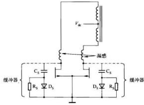

(a)

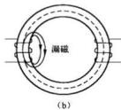

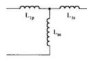

(c)

图2.7 (a)漏感在功率器件集电极端产生尖峰。(b)漏感的产生,是因为少量磁通线通过周围空气返回,而不是经过磁心耦合到次级。(c)变压器低频等效电路中的励磁电感 $L_{m}$ 、初/次级漏感 $L_{ip}$ 和 $L_{ts}$ 。

## 2.2.12 功率开关管损耗

## 2.2.12.1 交流开关(电流电压间的“重叠”)损耗

因为在 T=0 后很短的时间内，电感呈现无穷大阻抗，所以变压器漏感会使集电极电压下降很快。尽管电感上的电流不能突变，流过漏感的电流上升缓慢，但导通时下降电压和上升电流之间重叠很少，导通时开关损耗可以忽略。 

而关断时，如图1.5(b)中针对Buck调整器所做的假设，最差情况下两者之间会有显著的重叠。具体细节如图2.8所示，假设在电压上升到其最大值 $2\overline{V_{dc}}$ 的时间 $T_{vr}$ 内，电流保持为其等效平顶坡脉冲幅值 $I_{ph}(2.2.10.1节)$ 。在电流从 $I_{ph}$ 下降到零的时间 $T_{cf}$ 内，电压保持为 $2\overline{V_{dc}}$ 。设 $T_{vr}=T_{cf}=T_{s}$ ，开关周期为T，则每个开关管在一个周期内的总开关损耗 $P_{t(uc)}$ 为 

$$
P _ {\mathrm{t} (\mathrm{ac})} = I _ {\mathrm{pft}} \frac {2 \overline {{V _ {\mathrm{dc}}}}}{2} \frac {T _ {\mathrm{s}}}{T} + 2 V _ {\mathrm{dc}} \frac {I _ {\mathrm{pft}}}{2} \frac {T _ {\mathrm{s}}}{T} = 2 (I _ {\mathrm{pft}}) (\overline {{V _ {\mathrm{dc}}}}) \frac {T _ {\mathrm{s}}}{T}
$$

根据式(2.9)，可得 

$$
P _ {\mathrm{t} (\mathrm{ac})} = 3. 1 2 \frac {P _ {\mathrm{o}}}{V _ {\mathrm{dc}}} \overline {{V _ {\mathrm{dc}}}} \frac {T _ {\mathrm{s}}}{T}\tag{2.16}
$$

因为变压器漏感的存在，开关管导通时电压下降时间很短，电流上升速度很慢，因此导通时开关损耗可以忽略。最坏情况可能出现在关断时刻，直到电压上升至 $2\overline{V_{de}}$ 时，电流仍维持在其峰值 $I_{pf}$ 不变；电流下降期间 $(T_{ef})$ ，电压保持在 $2\overline{V_{de}}$ 不变。 

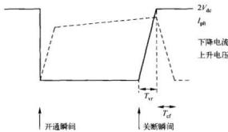

图 2.8 由电流和电压重叠产生的开关损耗

## 2.2.12.2 开关管导通损耗

简单地说,每个开关管最大直流损耗是其导通压降、导通电流及占空比的乘积,即 

$$
P _ {\mathrm{de}} = I _ {\mathrm{pft}} V _ {\mathrm{on}} \frac {0 . 8 T / 2}{T} - 0. 4 I _ {\mathrm{pft}} V _ {\mathrm{on}}
$$

在第8章将会讨论一种称为贝克钳位的技术，它可以降低开关管基极的存储时间。在很宽的电流范围内，它能使集电极导通电压钳位在1V左右。根据式(2.9)中的 $I_{pt}$ 可得 

$$
P _ {\mathrm{dc}} = 0. 4 \frac {1 . 5 6 P _ {\mathrm{o}}}{\underline {{V _ {\mathrm{dc}}}}} = \frac {0 . 6 2 4 P _ {\mathrm{o}}}{\underline {{V _ {\mathrm{dc}}}}}\tag{2.17}
$$

则每个开关管的总损耗为 

$$
P _ {\mathrm{total}} = P _ {\mathrm{t(asc)}} + P _ {\mathrm{dc}} = 3. 1 2 \frac {P _ {\mathrm{o}}}{\underline {{V _ {\mathrm{dc}}}}} \overline {{V _ {\mathrm{dc}}}} \frac {T _ {\mathrm{s}}}{T} + \frac {0 . 6 2 4 P _ {\mathrm{o}}}{\underline {{V _ {\mathrm{dc}}}}}\tag{2.18}
$$

## 2.2.12.3 150W、50kHz 推挽变换器损耗计算举例

下面以 150W、50Hz，输出 48V 的推挽变换器为例，介绍开关管的损耗计算。 

标准通信工业电源的额定输出电压为48V，最小电压 $\left(V_{\mathrm{dc}}\right)$ 和最大电压 $\left(\overline{V}_{\mathrm{dc}}\right)$ 分别为38V和60V。设频率为50kHz，开关管为双极型晶体管，开关时间（前面定义的 $T_{s}$ ）为0.3μs。 

根据式(2.17)可得,直流导通损耗为 

$$
P _ {\mathrm{dc}} = \frac {0 . 6 2 4 \times 1 5 0}{3 8} = 2. 4 6 (\mathrm{W})
$$

根据式 $(2.16)$ 可得交流开关损耗为 

$$
P _ {\mathrm{t(oc)}} = 3. 1 2 \times \frac {1 5 0}{3 8} \times 6 0 \times \frac {0 . 3}{2 0} = 1 1. 0 8 (\mathrm{W})
$$

可见交流开关损耗约为直流导通损耗的4.5倍。如果使用MOSFET管，设开关时间为 $0.05\mu \mathrm{s}$ ，则在本例中开关损耗可忽略不计。 

## 2.2.13 推挽拓扑输出功率及输入电压的限制

推挽电路除了磁通不平衡的问题外(在电流模式推挽拓扑中则不存在这种问题)，其输出功率会受到式(2.9)的限制，而输入电压会受到式(2.15)的限制。 

式(2.9)给出了不同额定输出功率下对开关管峰值电流的要求，式(2.15)给出了对应最大直流输入电压下的开关管最大电压应力。当采用双极型晶体管时，这两个条件限制了推挽拓扑的最大功率约为500W。高于这个功率等级，则很难找到能同时满足峰值电流和电压应力要求的双极型晶体管，并且具备足够的增益和响应速度。 

技术总是不断进步的,具有足够高电压和电流定额且具有足够低导通压降的高速 MOSFET 开关管将延伸推挽变换器功率等级的应用范围。 

为此，下面将讨论通信用一次电源供电的400W推挽变换器，供电电源额定输出、最小输出和最大输出电压分别为48V、38V和60V。 

由式(2.9)可知，所需最大值电流为 $I_{\mathrm{pft}} = 1.56P_{\mathrm{e}} / V_{\mathrm{dc}} = 1.56(400) / 38 = 16.4\mathrm{A}$ 。由式(2.15)可知，最大关断电压应力为 $V_{\mathrm{p}} = 2.6\overline{V_{\mathrm{dc}}} = 2.6\times 60 = 156\mathrm{V}$ 。考虑一定的安全裕量，则开关管耐压至少应为 $200\mathrm{V}$ 。 

该电源的开关管，可采用双极型晶体管 MJ13330。它的额定幅值电流、额定 $V_{ceo}$ 和额定 $V_{cev}$ （基极反向偏置电压为 $-1 \sim -5V$ 时，可以承受的关断瞬间的电压值）分别为 20A、200V 和 400V 时，可满足幅值电流和电压应力的要求。 

工作于16A时，该开关管的最大导通电压约为3V，最小增益约为5，存储时间为1.3～4μs。由于这些限制，开关管的开关损耗和直流导通损耗都很大，处理磁通不平衡也有困难（除非使用电流模式推挽拓扑），且由于存储时间过长，很难工作在频率为40kHz以上的电路中。 

该电源若使用 MOSFET 管，可选 MTH30N20 型。它的额定电流为 30A，额定电压为 200V，在 16A 时，其导通压降为 1.3V，因此其直流导通损耗是前面双极型晶体管的一半。因为电流下降很快，所以交叠开关损耗可以忽略，但是其价格（包括其他同类型的功率器件）要贵一些。 

对于离线式变换器来讲，很少采用推挽拓扑结构，因为其最大关断电压应力为 $2.6\overline{V_{\mathrm{de}}}$ （式(2.15)）。例如， $120\mathrm{V}$ 交流输入，设网压波动范围为 $\pm 10\%$ ，其整流电压峰值为 $1.41\times 1.1\times$ $120 = 186\mathrm{V}$ 。加上漏感尖峰顶部，其最大关断电压应力为 $2.6\times 186 = 484\mathrm{V}$ （式(2.15))。 

另外还必须考虑在稳态最大值上叠加瞬态值的情况。商用电源中很少规定具体瞬态值，但在实际中一般设定瞬态应力值是在稳态最大值的基础上增加15%。这使得最大应力达 $1.15 \times 484 = 557V$ 。 

某些特定场合，输入电压瞬态值比稳态最大值的15%还要大。例如，军用飞行器的交流输入标准由“军标704”做了明确的规定。此处，对于额定电压为113V的交流输入，10ms内其允许的瞬态值为180V AC。在瞬态值为180V AC时，根据式(1.15)，最大关断电压应力为 $180\times1.42\times2.6=660V$ 。尽管市面上有很多快速双极型晶体管能够承受850V的反压，但在这么高的瞬态电压下采用这种拓扑显然不是一种很好的选择。 

还有些拓扑结构关断时开关管只需承受最大直流输入电压，并且没有漏感尖峰。对于高压及离线式场合它们是更好的选择，不仅因为它们的电压应力较小，还因为它们关断时电压变化较小，产生的电磁干扰(EMI)也比较低。 

## 2.2.14 输出滤波器的设计

## 2.2.14.1 输出电感的设计

2.2.4节曾指出，主输出和辅输出的输出电感都不允许进入不连续工作模式。注意，图1.6(b)所示的不连续模式是从电感阶梯斜坡电流的阶梯下降至零开始的，这种情况会在直流电流下降至斜坡幅值 $\mathrm{d}I$ 的一半时发生(1.3.6节)。于是 

$$
\mathrm{d} I = 2 \underline {{{I _ {\mathrm{dc}}}}} = V _ {\mathrm{L}} \frac {T _ {\mathrm{on}}}{L _ {\mathrm{o}}} = (V _ {1} - V _ {\mathrm{o}}) \frac {T _ {\mathrm{on}}}{L _ {\mathrm{o}}}\tag{2.19}
$$

图2.9给出了计算输出 $L_{0}$ 和 $C_{0}$ 的整流电路。当 $V_{dc}$ 最小时，选择 $N_{s}$ 使 $V_{1}$ 最小时 $T_{on}$ 不需要大于0.8T/2就可以输出所需的 $V_{0}$ 值。 

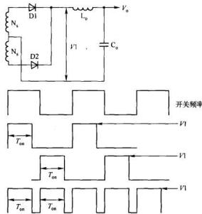

图 2.9 输出整流电路及波形

而 $V_{o} = V_{1}(2T_{\mathrm{on}} / T)$ ，则有 

$$
T _ {\mathrm{on}} = \frac {V _ {\mathrm{o}} T}{2 V _ {1}}
$$

选取 $N_{s}$ ，使 $V_{dc}$ 及相应 $V_{1}$ 最小时 $T_{on}$ 为0.8T/2，于是 

$$
\overline {{{T _ {\mathrm{om}}}}} = \frac {0 . 8 T}{2} = \frac {V _ {\circ} T}{2 \underline {{{V _ {1}}}}} \quad \text {或} \quad \underline {{{V _ {1}}}} = 1. 2 5 V _ {\circ}
$$

及 

$$
\mathrm{d} I = \frac {(1 . 2 5 V _ {\circ} - V _ {\circ}) (0 . 8 T / 2)}{L _ {\circ}} = 2   \underline {{I _ {\mathrm{dc}}}} \quad \text { 和 } \quad L _ {\circ} = \frac {0 . 0 5 V _ {\circ} T}{\underline {{I _ {\mathrm{dc}}}}}
$$

如果最小电流 $I_{dc}$ 规定为额定电流 $I_{on}$ 的1/10（通常情况），则 

$$
L _ {\mathrm{o}} = \frac {0 . 5 V _ {\mathrm{o}} T}{I _ {\mathrm{on}}}\tag{2.20}
$$

以上 $L_{0}$ 、 $V_{0}$ 和 T 的单位分别为亨利、伏特和秒； $I_{dc}$ 为最小输出电流， $I_{on}$ 为额定输出电流，单位均为安培。 

## 2.2.14.2 输出电容的设计

输出电容 $C_{n}$ 的选择应满足最大输出纹波电压的要求。1.3.7 节指出，输出纹波几乎完全由滤波电容的 ESR（等效串联电阻 $R_{n}$ ）的大小决定，而不是由电容本身的大小决定，纹波电压峰—峰值 $V_{r}$ 为 

$$
V _ {r} = R _ {\circ} \mathrm{d} I\tag{2.21}
$$

式中，dI 是所选的电感电流纹波的峰—峰值。 

另外，对于铝电解电容器，在很大容值及额定电压范围内，其 $R_{0}C_{0}$ 的乘积基本不变。铝电解电容 $R_{0}C_{0}$ 的范围是 $50\times10^{-6}\sim80\times10^{-6}$ 。因此 $C_{0}$ 可选为 

$$
C _ {\mathrm{o}} = \frac {8 0 \times 1 0 ^ {- 6}}{R _ {\mathrm{o}}} = \frac {8 0 \times 1 0 ^ {- 6}}{V _ {\mathrm{r}} / \mathrm{d} I} = \frac {(8 0 \times 1 0 ^ {- 6}) (\mathrm{d} I)}{V _ {\mathrm{r}}}\tag{2.22}
$$

式中， $C_{0}$ 的单位为法拉，dI 的单位为安培（式(2.19))， $V_{r}$ 的单位为伏特。 

## 2.3 正激变换器拓扑

## 2.3.1 基本工作原理

典型的三路输出正激变换器拓扑如图2.10所示。在直流输入电压为60～200V，输出功率为200W的场合，正激变换器可能是最广泛应用的拓扑。若输入电压低于60V且功率很大时，则对应的初级输入电流很大。若输入电压超过250V，则开关管的最大电压应力非常大。 

另外,当输出功率大于200W左右时,即使输入电压较高,初级侧的电流仍然会很大。下面的数学分析也会证明这一点。 

这种拓扑与由图2.1所示的推挽拓扑类似，且没有后者磁通不平衡这一主要缺点。因为它只有一个(而非两个)开关管，同推挽电路相比，正激电路更加经济且体积较小。 

图2.10中有一个主输出 $V_{om}$ ，两个辅输出 $V_{a1}$ 和 $V_{a2}$ 。主输出接入负反馈，根据输入及负载变化控制Q1的导通时间以保持 $V_{om}$ 恒定。当导通时间由反馈环固定后，辅输出 $V_{a1}$ 和 $V_{a2}$ 在输入电压变化的情况下也能保持恒定，但当它们自身或主输出负载变化时，辅输出只能相对地保持恒定（误差约5%～8%）。电路工作原理如下。 

正激变换器与图2.1所示推挽电路相比，只有一个开关管被二极管D1取代。当Q1导通时，初级绕组 $N_{f}$ 及所有次级绕组的同名端相对于异名端为正。电流及能量流入 $N_{f}$ 的同名端。同时，所有整流二极管(D2～D4)正向偏置，电流和能量从所有次级绕组的同名端流出到LC滤波器和负载。注意到，能量在开关管Q1导通时流入负载，因此称为正激变换器。推挽及Buck调整器都是在开关管导通时传递能量到负载的，所以也属于正激类型。 

相反，Boost调整器和图1.10与图1.14所示的反极性变换器，以及反激变换器（将在第3章讨论），在开关管导通时将能量存储于电感或变压器初级，然后在开关管关断时将能量传递给负载。这些能量存储类拓扑可运行在不连续或连续模式。它们与正激拓扑有着根本的不同，这在1.4.2节和1.4.3节中已讨论过，还将在第4章反激拓扑中继续讨论。 

如图 2.10 所示, Q1 导通期间 ( $T_{on}$ ), 主输出整流管 D5 阴极的电压很高。设 Q1 导通压降 

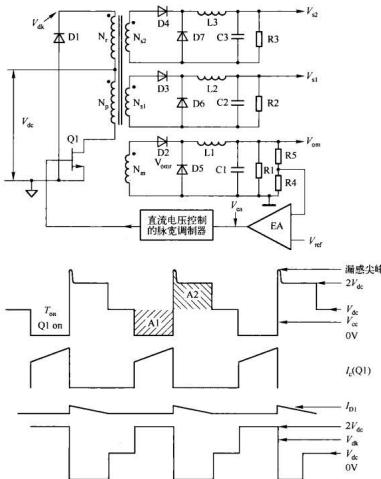

图 2.10 正激变换器拓扑。反馈环接在主输出 $V_{on}$ 上， $V_{on}$ 可针对输入及负载变化进行调节。此外，还有两个仅针对输入变化进行调节的辅输出 ( $V_{a1}$ 和 $V_{a2}$ )。

为1V，整流管正向压降为 $V_{D2}$ ，则该高电压 $V_{omr}$ 为 

$$
\dot {V} _ {\mathrm{omr}} = \left[ (V _ {\mathrm{dc}} - 1) \frac {N _ {\mathrm{m}}}{N _ {\mathrm{p}}} \right] - V _ {\mathrm{D2}}\tag{2.23}
$$

整流二极管阴极之后的电路与图1.4 Buck调整器电路一样。二极管D5～D7的作用就像该图中的续流二极管D1。当Q1关断时，存储在T1的(图2.7(c)所示的变压器等效电路的励磁电感)电流使 $N_{p}$ 的电压反向。此时所有初/次级绕组的同名端相对于异名端变负。如果没有二极管D1钳位，N，同名端的电压将很负，且因为 $N_{p}$ 和N，匝数相等（通常情况下），所以 $N_{p}$ 异名端上的正电压将变得相当大，使得Q1雪崩击穿，进而损坏。 

然而，由于二极管D1导通， $\mathbf{N}_{\mathrm{r}}$ 同名端电压被钳位于比地电位低一个二极管正向压降。如果T1没有漏感，则 $\mathbf{N}_{\mathrm{p}}$ 上的电压与 $\mathbf{N}_{\mathrm{r}}$ 上的电压相等。假设D1的正向压降(1V)可以忽略，则 $\mathbf{N}_{\mathrm{p}}$ 和 $\mathbf{N}_{\mathrm{r}}$ 上的电压等于 $V_{\mathrm{dc}},\mathbf{N}_{\mathrm{p}}$ 异名端即Q1集电极的电压为 $22V_{\mathrm{dc}}$ 。 

前面讲过，在一个周期内，如果磁心已在其磁滞回线上沿一个方向运动，则它在下一周期沿同一方向运动之前，必须在本周期内准确回到其磁滞回线的起始位置。否则，若干周期后， 

(b) 

磁心将沿该方向进入饱和。此时磁心不能承受所加电压，开关管将损坏。 

从图2.10可以看出，若Q1在 $T_{on}$ 期间导通，则 $N_{p}$ 的同名端为正，其伏秒数为 $V_{dc}T_{on}$ 。此伏秒数就是图2.10中A1的面积。根据法拉第定律（式(1.17))，此伏秒数产生的磁通变化为 $dB=(V_{dc}T_{on}/N_{p}A_{c})10^{8}$ 。 

Q1 关断时, 当励磁电感电流使 $N_{p}$ 的电压反向, 且其异名端电压 $(2V_{\mathrm{dc}})$ 持续的时间足以使其伏秒数面积 A2 与 A1 相等, 如图 2.10 所示, 则磁心能回到其磁滞回线的起始位置, 下一周期就可以安全启动。专业术语中这种情况被称为复位伏秒数与置位伏秒数相等。 

Q1关断后，所有次级的同名端相对于异名端变负。所有输出电感 $(\mathrm{L}1\sim \mathrm{L}3)$ 中的电流下降。由于电感电流不能突变，所以所有电感的极性反向以尽量保持电流不变。电感前端电压将变得很负，但被续流二极管D5～D7(图2.10)钳位于比输出地低一个二极管正向压降，同时整流二极管D2～D4被反向偏置。电感电流此时继续沿同一方向流动，从其输出端流出，经过负载(部分经过滤波电容)和续流二极管返回到电感输入端。 

主整流二极管D2阴极上的电压如图2.11(b)所示。导通时间 $T_{\mathrm{on}}$ 内，该电压高达 $[(V_{\mathrm{dc}} - 1)(N_{\mathrm{m}} / N_{\mathrm{p}})] - V_{\mathrm{D2}}$ ，而 $T - T_{\mathrm{on}}$ 期间，该电压比地电位低一个续流二极管(D5)正向压降。LC滤波器平滑这个波形，设D5的正向压降等于D2的正向压降 $(V_{\mathrm{d}})$ ，则直流输出电压 $V_{\mathrm{on}}$ 为 

$$
V _ {\mathrm{om}} = \left[ \left(\left(V _ {\mathrm{dc}} - 1\right) \frac {N _ {\mathrm{m}}}{N _ {\mathrm{p}}}\right) - V _ {\mathrm{d}} \right] \frac {T _ {\mathrm{on}}}{T}\tag{2.24}
$$

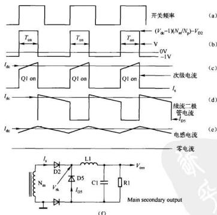

图2.11 正激变换器的次级临界电流。每个次级电流都具有阶梯斜坡的特征，因为输出电感上电压固定，且电感值不变。电感电流是次级绕组和续流二极管电流之和，它围绕直流输出电流上下波动。初级电流是所有次级阶梯斜坡电流用各自匝数比折算到初级的和。初级电流也是个阶梯斜坡。

## 2.3.2 输出/输入电压与导通时间和匝数比的设计关系

负反馈采样值是 $V_{om}$ 的一部分，此采样值与参考电压 $V_{ref}$ 比较，然后改变 $T_{on}$ 使 $V_{om}$ 在 $V_{dc}$ 或负载电流发生任意变化时都能保持恒定。 

从式(2.24)可以看出，当 $V_{dc}$ 改变时，反馈环通过保持 $V_{dc}T_{on}$ 恒定来保持输出恒定。因此最大导通时间 $T_{\mathrm{on}}(\overline{T}_{\mathrm{on}})$ 将出现在 $V_{dc}$ 最小 $(V_{\underline{\mathrm{de}}})$ 的时候。对于最小直流输入电压，式(2.24)可改写为 

$$
V _ {\mathrm{om}} = \left[ \left(\left(V _ {\mathrm{dc}} - 1\right) \frac {N _ {\mathrm{m}}}{N _ {\mathrm{p}}}\right) - V _ {\mathrm{d}} \right] \frac {\overline {{T _ {\mathrm{on}}}}}{T}\tag{2.25}
$$

在式(2.25)中，必须以适当的顺序确定参数。首先，确定最小直流输入电压 $V_{dc}$ ，然后将对应 $V_{dc}(V_{dc}$ 最小值)的最大允许导通时间 $T_{on}$ 设为半周期的80%。 

这样做是为确保图2.10中A2的面积等于A1的面积。因为如果导通时间占满整个半周期，则A2在下一周期开始时才刚好勉强等于A1。存储时间会因温度的改变和产品的差异而不同，若导通时间因存储时间改变而稍有增加，就会使A1和A2不相等。从而磁心不能完全复位到磁滞回线的起始点，若干周期后，磁心便会进入饱和区，使开关管损坏。 

知道 $V_{\mathrm{dc}}$ 和导通时间 $T_{\mathrm{on}}$ 内的磁通变化后，可根据法拉第定律(式1.17)确定初级匝数 $N_{\mathrm{p}}$ 。磁通变化方面的限制与1.5.9节讨论的推挽拓扑类似，下面还要讨论这个问题。 

这样，式(2.25)中的 $V_{dc}$ 、 $\overline{T}_{om}$ 、T和 $V_{d}$ 为已知，利用法拉第定律求出 $N_{p}$ 之后，就可根据所需主输出电压 $V_{om}$ 求解次级主绕组匝数 $N_{m}$ 。 

## 2.3.3 辅输出电压

辅输出滤波器 L2、C2 和 L3、C3 分别用于平滑各自整流管阴极输出的脉宽调制矩形波。此波形的高电平分别为 $\left\{\left[(V_{dc}-1)(N_{c1}/N_{p})\right]-V_{d3}\right\}$ 和 $\left\{\left[(V_{dc}-1)(N_{c2}/N_{p})\right]-V_{dc4}\right\}$ 。其低电平均比地低一个二极管正向压降。直流输入电压 $V_{dc}$ 最小时，它们与次级主绕组一样有最大导通时间 $T_{on}$ 。若假设整流二极管和续流二极管的正向压降均为 $V_{d}$ ，则输入电压 $V_{dc}$ 最小时，辅输出电压为 

$$
V _ {\mathrm{sl}} = \left[ \left(\left(\underline {{V _ {\mathrm{dc}}}} - 1\right) \frac {N _ {\mathrm{sl}}}{N _ {\mathrm{p}}}\right) - V _ {\mathrm{d}} \right] \frac {\overline {{T _ {\mathrm{on}}}}}{T}\tag{2.26}
$$

$$
V _ {s 2} = \left[ \left(\left(\underline {{V _ {\mathrm{de}}}} - 1\right) \frac {N _ {s 2}}{N _ {\mathrm{p}}}\right) - V _ {\mathrm{d}} \right] \frac {\overline {{T _ {\mathrm{on}}}}}{T}\tag{2.27}
$$

通过调节 $V_{om}$ ，反馈环保持 $V_{dc}T_{on}$ 恒定。这个乘积也出现在式(2.26)和式(2.27)中，因此在 $V_{dc}$ 变化时辅输出也保持恒定。 

从式(2.24)和图2.14可见，通过适当地控制 $T_{\mathrm{on}}$ 使采样输出与参考电压 $V_{\mathrm{ref}}$ 相等，反馈环在输入和负载变化时均能保持主输出恒定。由于负载电流没有直接出现在式(2.24)中，负载变化时输出调节不显著。但负载电流还是有间接影响。负载变化会改变Q1的正向压降（此前设为1V）和整流二极管的正向压降。尽管这些变化很小，也会引起输出电压的微小变化，并由误差放大器采样，调整 $T_{\mathrm{on}}$ 来修正输出电压。 

此外，从式(2.26)和式(2.27)可见， $V_{dc}$ 不变时，改变 $T_{os}$ ，会使辅输出电压改变。辅输出电压也随自身负载电流的变化而变化。当它们的负载电流变化时，相应整流二极管正向压降也 改变,使输入到 LC 平滑滤波器的幅值电压改变。若此时 $T_{on}$ 没有相应的变化,则辅输出电压将随着平滑滤波器幅值电压的变化而改变。由主/辅输出负载电流变化引起的辅输出电压变化范围为 5%~8%。 

2.2.4节中讨论过，这要求主输出和辅输出电感在其最小负载电流下也不进入不连续状态。可以通过选择合适的输出电感来保证这点，具体内容将在下面讨论。 

若所有参数已知，或据已知值计算出来，则次级从绕组匝数 $N_{a1}$ 和 $N_{a2}$ 可根据式(2.26)和式(2.27)计算。参数 $V_{dc}$ 、T和 $V_{d}$ 为已知， $\overline{T}_{on}$ 如前所述设定为0.8T/2，则 $N_{p}$ 可由法拉第定律（式(1.17))求解。 

## 2.3.4 次级负载、续流二极管及电感的电流

选择次级和输出电感线径、整流二极管和续流二极管额定电流时,需要知道各自输出电流的幅值和波形。 

与1.3.2节所述的Buck调整器类似，Q1导通时，次级恒定电压加在输出电感两端（其输入端相对于输出端为正）使次级电流具有阶梯斜坡的特征，如图2.11(c)所示。 

Q1关断时，电感的输入端相对于输出端变负，其电流斜坡向下。关断时刻，电感电流转移到续流二极管。因续流二极管与电感串联，其电流斜坡也向下，如图2.11(d)所示。电感电流是Q1导通时次级电流与Q1关断时续流二极管电流之和，如图2.11(e)所示。图2.11(c)、图2.11(d)和图2.11(e)的斜坡中点值均等于直流输出电流。 

## 2.3.5 初级电流、输出功率及输入电压之间的关系

设从直流输入到所有次级总输出功率的转换效率为80%，即 $P_{o}=0.8P_{m}$ 或 $P_{m}=1.25P_{o}$ 。若以最小直流输入电压 $V_{dc}$ 计算 $P_{in}$ ，则输入功率为最小直流输入电压 $V_{dc}$ 与对应初级电流平均值的乘积。 

由于各次级都有输出电感,所以次级电流波形均为阶梯斜坡。直流输入电压最小时,这些阶梯斜坡的宽度为0.8T/2。所有次级电流根据匝数比折算到初级,因此初级电流脉冲也是一个宽度为0.8T/2的阶梯斜坡。因为是单开关管电路,所以每周期仅有一个这样的波形,如图2.10所示。初级电流脉冲的占空比为 $(0.8T/2)/T=0.4$ 。 

和推挽拓扑一样，将阶梯斜坡电流等效为同样脉宽的平顶电流，其幅值为阶梯斜坡中点值 $I_{pf}$ 。则电流平均值为 $0.4I_{pf}$ ，因此有 

$$
P _ {\mathrm{in}} = 1. 2 5 P _ {\mathrm{o}} = \underline {{{V _ {\mathrm{dc}}}}} (0. 4 I _ {\mathrm{pft}}) \quad \text {或} \quad I _ {\mathrm{pft}} = \frac {3 . 1 3 P _ {\mathrm{o}}}{\underline {{{V _ {\mathrm{dc}}}}}}\tag{2.28}
$$

此关系式非常有用,根据给出的最小直流输入电压和总输出功率,即可求出等效平顶初级电流脉冲的幅值。从而可立即选出具有足够电流额定值和增益的双极型晶体管,或具有足够低导通压降的 MOSFET 管。 

由式(2.28)和式(2.9)可见，在相同输出功率和最小直流输入电压下，正激变换器的 $I_{ph}$ 是推挽拓扑的 $I_{ph}$ 的两倍。 

显然，这是因为推挽拓扑每周期有两个电流（或功率）脉冲，而正激变换器只有一个。由式(2.25)可知，在正激变换器中，如果次级匝数选得足够大，则最小直流输入电压下的最大导通时间也可以不超过半周期的80%。这样，如图2.10所示，在下一周期开始前，面积A2总能 等于 A1。磁心在一个周期内能复位到磁滞回线上的起始点，从而不会饱和。 

但正激变换器实现上述工作的代价是，在相同的输出功率下，初级幅值电流是推挽变换器的两倍。当然，推挽拓扑即使采用了2.2.8节所述的全部预防措施，在动态负载或输入异常的情况下，也难确保不发生磁通不平衡的问题。 

## 2.3.6 功率开关管最大关断电压应力

在正激变换器中，若复位绕组 $N_{r}$ 的匝数与初级绕组 $N_{p}$ 的匝数相等，功率开关管最大关断电压应力为最大直流输入电压的两倍加上漏感尖峰。2.2.11 节已讨论过漏感尖峰及其成因和减少漏感尖峰的措施。即使采用了所有减小漏感尖峰的措施，为设计安全，也应该假设漏感尖峰为最大直流输入电压两倍的 30%。正激拓扑开关管最大关断电压应力与推挽拓扑的一样，为 

$$
\overline {{{V _ {\mathrm{ms}}}}} = 1. 3 (2 \overline {{{V _ {\mathrm{dc}}}}})\tag{2.29}
$$

## 2.3.7 实际输入电压和输出功率限制

2.3.1节开始就已指出，对于最大直流输入电压低于60V的正激变换器，其实际最大输出功率为 $150\sim 200\mathrm{W}$ 。这是因为，正激变换器每周期只有一个电流脉冲而不像推挽拓扑那样有两个；较大功率输出时，由式(2.28)算出的初级电流幅值会太大。 

现在考虑设计一个用于通信行业的200W正激变换器。其最小和最大输入电压分别为38V及60V；由式(2.28)算出的初级电流幅值为 $I_{\mathrm{phi}} = 3.13P_{\mathrm{o}} / V_{\mathrm{dc}} = 3.13(200) / 38 = 16.5\mathrm{A}$ ；由式(2.29)算出最大关断电压应力为 $\overline{V_{ms}} = 2.6\overline{V_{dc}} = 2.6\times 60 = 156\mathrm{V}$ 。 

为留有一定的安全裕度，应采用耐压至少为200V的器件。这样，输入电压瞬态值超过稳态最大值(60V)，也不会损坏器件。 

200V/16A开关管市场上有售，但均有2.2.13节所讨论的缺点。双极型晶体管速度慢，MOSFET管速度快但价格高。对200W应用场合，选择无磁通不平衡问题的推挽拓扑应更适合，因为其每周期有两个电流脉冲，电流幅值仅为8A。电流幅值低，接地母线的噪声和射频干扰(RFI)会显著减小，这对通信工业电源是一个很重要的因素。这种无磁通不平衡问题的推挽拓扑称为“电流模式推挽拓扑”，这将在后面讨论。 

正激变换器与推挽拓扑(见2.2.13节)一样,用于交流输入为 $120\times(1\pm10\%)$ V的离线式变换器时的最大电压应力是一个难以解决的问题。交流输入电压最高时,整流后直流输入为 $1.1\times120\times1.41=186V$ ,再减去2V的整流二极管正向压降即184V。由式(2.29),关断期间开关管的最大电压应力为 $\overline{V_{ms}}=2.6\times184=478V$ 。 

而交流输入电压最低时，整流后直流输入为 $\overline{V_{dc}}=(0.9\times120\times1.41)-2=150V$ 。根据式(2.28)，峰值电流为 $I_{pft}=3.13\times22/150=4.17A$ 。 

对于 200W 的离线式正激变换器,最大的问题是最大电压应力(478V)而不是初级峰值电流(4.17A)。因为当考虑 15% 的输入瞬态值(见 2.2.13 节)时,峰值关断电压应力为 550V。当然,如果双极型晶体管工作在 $V_{\text{ave}}$ (关断瞬间基极反向偏置为 -1 ~ -5V)的情况下,550V 的电压应力也不是绝对不能承受的。许多器件的 $V_{\text{ave}}$ 电压为 650 ~ 850V,初级峰值电流为 4.17A 时仍有较高的增益、速度和较低的导通压降。但是,正如 2.2.13 节所讨论的,还有更佳的拓扑可供选择,其开关管关断电压仅为 $V_{\text{de}}$ 而不是 $2V_{\text{de}}$ (后面将讨论)。 

## 2.3.8 功率和复位绕组匝数不相等的正激变换器

此前，均假设初级绕组 $N_{p}$ 的匝数与复位绕组 $N_{r}$ 的匝数相等。如果 $N_{r}$ 的匝数比 $N_{p}$ 的大些或小些，都会带来某些好处。 

初级绕组 $N_{p}$ 的匝数总是由法拉第定律确定的，这将在 2.3.10.2 节中讨论。如果 $N_{r}$ 选得比 $N_{p}$ 小，对于给定输出功率，其初级电流幅值将比式 (2.28) 的计算值小，而 Q1 最大关断电压应力比式 (2.29) 的计算值大。如果 $N_{r}$ 选得比 $N_{p}$ 大，Q1 最大关断电压应力将比式 (2.29) 的计算值小，而对于给定输出功率，其初级电流幅值比式 (2.28) 的计算值要大。这些可以从图 2.12 中看出。Q1 关断时， $N_{p}$ 和 N，的极性反向， $N_{r}$ 同名端变负，且被钳位二极管 D1 钳位至地电位。此时变压器 T1 是一个自耦变压器。 $N_{r}$ 上的压降为 $V_{dc}$ ，而 $N_{p}$ 上的压降为 $N_{p}/N_{r}(V_{dc})$ 。导通期间，磁化被伏秒数 $V_{dc}T_{m}$ 置位，必须施加相等的伏秒数才能使它复位到磁滞回线的起始位置。复位伏秒数为 $N_{p}/N_{r}(V_{dc})T_{m}$ 。 

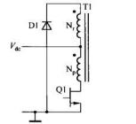

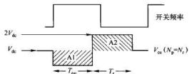

(a)

(b)

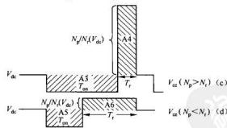

图2.12 当 $N_{\mathrm{p}} = N_{\mathrm{r}}$ 时，正激变换器的集射结电压。注意，所有情况下，复位伏秒数都等于置位伏秒数。(a)开关频率；(b) $N_{\mathrm{p}} = N_{\mathrm{r}}$ ；(c) $N_{\mathrm{p}} > N_{\mathrm{r}}$ ；(d) $N_{\mathrm{p}} < N_{\mathrm{r}}$ 。

$N_{p}=N_{r}$ 时，复位电压等于置位电压且复位时间等于置位时间（面积A1=面积A2），如图2.12(b)所示。对于 $N_{p}=N_{r}$ ，将对应于最小直流输入电压的Q1的最大导通时间选为0.8T/2，以确保磁心在下一周期开始前能复位。此时， $T_{on}+T_{r}=0.8T$ 。 

如果 $N_{r}$ 小于 $N_{p}$ ，则复位电压大于 $V_{dc}$ ， $T_{r}$ 将变短（面积 A3 = 面积 A4），如图 2.12(c) 所示。 

$T_{s}$ 缩短， $T_{on}$ 大于0.8T/2，但 $(T_{\mathrm{on}}+T_{\mathrm{r}})$ 依然等于0.8T，以使磁心在下一周期开始前能够复位。由于 $T_{m}$ 变长，对于相同的平均电流和输出功率，电流峰值就会变小。与图2.12(b)相比，图2.12(c)中，较小的电流峰值应力必须以较大的电压应力为代价。 

若 $N_{\mathrm{r}}$ 大于 $N_{\mathrm{p}}$ 则复位电压小于 $V_{\mathrm{dc}}$ 。若仍保持 $T_{\mathrm{en}} + T_{\mathrm{r}} = 0.8T$ ，因复位电压小于置位电压，若使复位伏秒数与置位伏秒数相等（图2.12(d)中面积A5=面积A6），则 $T_{\mathrm{r}}$ 必须大于0.87/2， $T_{\mathrm{en}}$ 小于 $0.8T / 2$ 。 $T_{\mathrm{en}} < 0.8T / 2$ 时，对于相同的平均电流，电流幅值必然增加，如图2.12(d)所示。与图2.12(b)相比，在相同的输出功率下，减小的电压应力是以更高的电流幅值为代价的。这种情况定量分析如下 

$$
\mathrm{设} T _ {\mathrm{on}} + T _ {\mathrm{r}} = 0. 8 T; \quad \mathrm{复位电压} = V _ {\mathrm{r}} = \frac {N _ {\mathrm{p}}}{N _ {\mathrm{r}}} V _ {\mathrm{dc}}\tag{2.30}
$$

因置位伏秒数等于复位伏秒数,所以 

$$
V _ {\mathrm{dc}} T _ {\mathrm{on}} = \frac {N _ {\mathrm{p}}}{N _ {\mathrm{r}}} V _ {\mathrm{dc}} T _ {\mathrm{r}}\tag{2.31}
$$

结合式(2.30)和式(2.31)，有 

$$
\overline {{{T _ {\mathrm{on}}}}} = \frac {0 . 8 T}{1 + N _ {\mathrm{r}} / N _ {\mathrm{p}}}\tag{2.32}
$$

效率为 $80\%$ 时， $P_{\mathrm{in}} = 1.25P_{\mathrm{o}}$ 。输入为 $\underline{V_{\mathrm{dc}}}$ 时， $P_{\mathrm{in}} = \underline{V_{\mathrm{dc}}}(I_{\mathrm{av}}) = \underline{V_{\mathrm{dc}}} I_{\mathrm{pft}}(\overline{T_{\mathrm{on}}}) / \mathrm{T}$ ，即 $I_{\mathrm{pft}} = 1.25(P_{\mathrm{o}} / \underline{V_{\mathrm{dc}}})(T / T_{\mathrm{on}})$ 。从式(2.32)得 

$$
I _ {\mathrm{pft}} = 1. 5 6 \left(\frac {P _ {\mathrm{o}}}{V _ {\mathrm{dc}}}\right) (1 + N _ {\mathrm{r}} / N _ {\mathrm{p}})\tag{2.33}
$$

若不计漏感尖峰, 则 Q1 最大关断电压应力 $\overline{V_{ms}}$ 等于最大直流输入电压 $\overline{V_{dc}}$ 加上复位电压 ( $N_{r}$ 同名端接地时, $N_{p}$ 两端的电压), 即 

$$
\overline {{V _ {\mathrm{ms}}}} = \overline {{V _ {\mathrm{dc}}}} + \frac {N _ {\mathrm{p}}}{N _ {\mathrm{r}}} (\overline {{V _ {\mathrm{dc}}}}) = \overline {{V _ {\mathrm{dc}}}} (1 + N _ {\mathrm{p}} / N _ {\mathrm{r}})\tag{2.34}
$$

由式(2.33)和式(2.34)计算出的 $I_{pft}$ 和 $V_{ms}$ 如下列数据所示。 

<table><tr><td><eq>{N}_{e}/{N}_{p}</eq></td><td><eq>{I}_{\mu \mathrm{b}}</eq> (见式(2.33))</td><td><eq>{V}_{\text{in }}</eq> (见式(2.34))</td></tr><tr><td>0.6</td><td><eq>{2.50}\left( {{P}_{e}/{V}_{\text{in }}}\right)</eq></td><td><eq>{2.67}{\overline{{V}}}_{\text{in }} +</eq> 满感尖峰</td></tr><tr><td>0.8</td><td><eq>{2.81}\left( {{P}_{e}/{V}_{\text{in }}}\right)</eq></td><td><eq>{2.25}{\overline{{V}}}_{\text{in }} +</eq> 满感尖峰</td></tr><tr><td>1.0</td><td><eq>{3.12}\left( {{P}_{e}/{V}_{\text{in }}}\right)</eq></td><td><eq>{2.00}{\overline{{V}}}_{\text{in }} +</eq> 满感尖峰</td></tr><tr><td>1.2</td><td><eq>{3.43}\left( {{P}_{e}/{V}_{\text{in }}}\right)</eq></td><td><eq>{1.83}{\overline{{V}}}_{\text{in }} +</eq> 满感尖峰</td></tr><tr><td>1.4</td><td><eq>{3.74}\left( {{P}_{e}/{V}_{\text{in }}}\right)</eq></td><td><eq>{1.71}{\overline{{V}}}_{\text{in }} +</eq> 满感尖峰</td></tr><tr><td>1.6</td><td><eq>{4.06}\left( {{P}_{e}/{V}_{\text{in }}}\right)</eq></td><td><eq>{1.62}{\overline{{V}}}_{\text{in }} +</eq> 满感尖峰</td></tr></table>

## 2.3.9 正激变换器电磁理论

## 2.3.9.1 仅运行于第一象限

正激变换器的变压器磁心只运行在磁滞回线的第一象限，如图2.10所示。当Q1导通时，T1的同名端相对于异名端为正，磁心沿磁滞回线的正向移动，励磁电感中的电流线性上升。 

Q1 关断时，存储在励磁电感上的电流使所有绕组电压极性反向。 $N_{r}$ 的同名端变负，直至被钳位二极管 D1 钳位至比地电位起一个极管正向压降。此时实际存储于磁心中的励磁电流将继续流动。不过是从 $N_{p}$ (Q1 导通期间，它沿斜线上升) 转移到 $N_{c}$ 。励磁电流从 $N_{r}$ 的异名端流出，经电源电压 $V_{dc}$ 的正/负极，再经二极管 D1 的阳极和阴极，最后返回 $N_{r}$ 同名端。 

Q1 关断期间,由于 $N_{r}$ 的同名端相对于异名端为负,励磁电流 $I_{d}$ 沿斜坡直线下降,如图 2.10 所示。当斜坡值降为零(面积 A2 的末端,如图 2.10 所示)时,励磁电感中不再有任何存储的能量;不能维持 $N_{r}$ 同名端电压低于地电位。 $N_{r}$ 的同名端电压开始上升至 $V_{dc}$ ,同时 $N_{p}$ 的异名端电压(Q1 集电极)开始从 $2V_{dc}$ 下降至 $V_{dc}$ 。 

因此，磁心在磁滞回线上约以励磁电流幅值的半值为中心 $(V_{\mathrm{dc}}/T_{\mathrm{on}}/2L_{\mathrm{m}})$ 运行。励磁电流没有反向，它只简单地线性上升至幅值，然后再线性下降到零。 

这种只在第一象限的运行有利也有弊。首先，与推挽电路相比，对给定磁心，它只能提供一半的输出功率。这可以从确定初级匝数的法拉第定律(式(1.17))看出。 

根据法拉第定律, 计算初级匝数的公式为 $N_{\mathrm{p}} = (Edt / A_{\mathrm{s}}dB) \times 10^{8}$ 。由于正激变换器 dB 变化范围限制为从零至某个 $B_{\max}$ 而不是推挽电路的从 $-B_{\max}$ 到 $+B_{\max}$ 。当 $V_{\mathrm{d}}$ 相同时, 正激变换器初级绕组匝数是推挽电路每个初级半绕组匝数的两倍。尽管推挽电路有两个初级绕组, 每个绕组都必须承受和正激变换器相同的伏秒数, 但推挽电路每周期有两个功率脉冲而正激变换器只有一个。最终结果是使用同样的磁心, 正激变换器仅提供推挽拓扑一半的输出功率。 

但推挽电路磁通变化范围是正激变换器的两倍，两倍输出功率下的推挽电路磁心发热更严重些。由于磁心损耗与磁滞回线包围的面积成正比，所以推挽电路磁心损耗是正激变换器的两倍。 

然而,这样的推挽电路的两个初级半绕组总铜耗并不比输出功率仅为其一半的正激变换器大。这是因为,虽然该推挽电路每个初级半绕组的电流有效值与输出功率为其一半的正激变换器相等;但推挽电路每个初级半绕组的匝数只是对应正激变换器的一半,推挽电路每个初级半绕组的阻抗也只有该正激变换器的一半。因此,该正激变换器的总铜耗与有着两倍输出功率的推挽电路的两个初级半绕组的总铜耗相等。 

## 2.3.9.2 正激变换器的磁心气隙

图 2.3 所示是无气隙的铁氧体磁心的磁滞回线。可以看出，零磁化力(0 Oe)时仍存在 ±1000G 的剩余磁通密度，通常称为剩磁。 

如果正激变换器磁心从0 Oe即1000G开始进行，则磁心进入磁滞回线弯曲部分之前的最大磁通变化dB约为1000G。一般希望起始磁通能远离磁滞回线弯曲部分，但没有气隙的正激变换器磁心最大dB限制为1000G。如上所述，初级匝数与dB成反比。较小的dB就要求较多的初级匝数。较多的初级匝数使线径减小，从而降低了变压器的输出电流和输出功率。 

磁心加入气隙使磁滞回线倾斜，剩磁会显著降低，如图2.5所示。磁滞回线的倾斜并不会改变其与H轴的交点（零磁密点，称为矫顽力）。从图2.3可见，铁氧体矫顽力约为0.2Oe。对用于输出功率为200～500W的大多数磁心来说，约2～4mil的气隙可使剩磁降到约为200G。200G的剩磁，使磁心进入磁滞回线弯曲部分之前允许的dB约为1800G，这样也能减少初级匝数。 

但引入气隙也是有代价的。从图2.5可见，气隙使磁滞回线斜率降低，使dB/dH（磁心磁导率）降低。磁导率降低使励磁电感值减小，使励磁电流 $(I_{\mathrm{m}}=V_{\mathrm{dc}}T_{\mathrm{on}}/L_{\mathrm{m}})$ 增大。励磁电流不 向负载传递功率，只用于使磁心磁通沿磁滞回线移动。它不应超过初级负载电流的10%。 

## 2.3.9.3 有气隙磁心的励磁电感

有气隙磁心的励磁电感计算如下。励磁电感的电压为 $L_{m}dI_{m}/dt$ ，根据法拉第定律有 

$$
V _ {\mathrm{dc}} = \frac {L _ {\mathrm{m}} \mathrm{d} I _ {\mathrm{m}}}{\mathrm{d} t} = \frac {N _ {\mathrm{p}} A _ {e} \mathrm{d} B}{\mathrm{d} t} 1 0 ^ {- 8} \quad \text {或} \quad L _ {\mathrm{m}} = \frac {N _ {\mathrm{p}} A _ {e} \mathrm{d} B}{\mathrm{d} I _ {\mathrm{m}}} 1 0 ^ {- 8}\tag{2.35}
$$

式中， $L_{m}$ 为励磁电感(H)； $N_{p}$ 为初级匝数； $A_{e}$ 为磁心面积( $cm^{2}$ )；dB 为磁心磁通变化量(G)； $dI_{m}$ 为励磁电流的变化量(A)。 

根据磁基本定律即安培定律有 

$$
\int H \cdot \mathrm{d} l = 0. 4 \pi N I
$$

上式表明，若包围导线的安匝数为 $NI$ ，则点积 $H\cdot \mathrm{d}l$ 沿此线的积分为 $0.4\pi NI$ 。如果该导线绕过与磁通线平行且与气隙交叉的磁心，则因磁心内 $H$ 是相同的，记为 $H_{1}$ ，气隙内 $H$ 也相同，记为 $H_{a}$ ，所以有 

$$
H _ {i} l _ {i} + H _ {a} l _ {a} = 0. 4 \pi N I _ {\mathrm{m}}\tag{2.36}
$$

式中， $H_{i}$ 为磁心（铁氧体）磁场强度（Oe）； $l_{i}$ 为磁心磁路长度（cm）； $H_{a}$ 为气隙磁场强度（Oe）； $l_{a}$ 为气隙磁路长度（cm）； $I_{m}$ 为励磁电流（A）。 

另外， $H_{i}=B_{i}/u$ ，其中， $B_{i}$ 为磁心磁密，u为磁心磁导率。而 $H_{a}=B_{a}$ ，因为空气磁导率等于1。设气隙周围没有发散的漏磁通，则 $B_{a}=B_{i}$ （磁心中的磁密=气隙中的磁密）。此时式(2.36)可写成 

$$
\frac {B _ {\mathrm{i}}}{u} l _ {\mathrm{i}} + B _ {\mathrm{i}} l _ {\mathrm{a}} = 0. 4 \pi N _ {\mathrm{p}} I _ {\mathrm{m}} \quad \text {或} \quad B _ {\mathrm{i}} = \frac {0 . 4 \pi N I _ {\mathrm{m}}}{l _ {\mathrm{a}} + l _ {\mathrm{i}} / u}\tag{2.37}
$$

由上式得 $\mathrm{dB / dI_{ms}} = 0.4\pi N / (l_a + l_i / u)$ ，代入式(2.35)得 

$$
L _ {\mathrm{m}} = \frac {0 . 4 \pi (N _ {\mathrm{p}}) ^ {2} A _ {\mathrm{e}} \times 1 0 ^ {- 8}}{l _ {\mathrm{a}} + l _ {\mathrm{i}} / u}\tag{2.38}
$$

因此，长度为 $l_{i}$ 的磁心中引入长度为 $l_{a}$ 的气隙，励磁电感的减少比例为 

$$
\frac {L _ {\mathrm{m(有气隙)}}}{L _ {\mathrm{m(无气隙)}}} = \frac {l _ {\mathrm{i}} / u}{l _ {\mathrm{n}} + l _ {\mathrm{i}} / u}\tag{2.39}
$$

下面举例说明。 

以国际标准磁心 Ferroxcube 783E608-3C8 为例, 其磁路长度为 9.7cm, 有效磁导率为 2300。如果在磁路上加 4mil(0.0102cm) 的气隙, 则根据式(2.39)有 

$$
L _ {\mathrm{m(有气隙)}} = \frac {9 . 7 / 2 3 0 0}{0 . 0 1 0 2 + 9 . 7 / 2 3 0 0} L _ {\mathrm{m(无气隙)}} = 0. 2 9 L _ {\mathrm{m(无气隙)}}
$$

检验气隙磁心的一个有效方法是检查式(2.38)的分母。多数情况下，u 很大，则 $l_{i}/u$ 的数值会比气隙长度 $l_{n}$ 小，电感主要由气隙长度决定。 

## 2.3.10 功率变压器的设计

## 2.3.10.1 磁心选择

与2.2.9.1节讨论的推挽拓扑一样，正激变换器的变压器磁心有效功率与峰值磁密、磁心面积和窗口面积、频率及绕组电流密度(圆密耳每有效值安培)有关。 

第 7 章将导出根据这些参数所确定的磁心实际输出功率的公式。若把这个公式转换为图表，则很容易选择磁心及其工作频率。 

这里假设磁心已选定，且磁心面积和窗口面积为已知。 

## 2.3.10.2 初级匝数的计算

初级匝数可以根据法拉第定律由式(2.7)计算。由2.3.9.2节知，对于正激变换器，加气隙磁心的磁密从约200G变化至某最大磁密 $B_{max}$ 。 

如 2.2.9.4 节所述, 对于推挽拓扑, 即使在低频下磁心损耗不是限制因素时, 铁氧体磁心峰值磁密也只设为 1600G。这样是为了避免直流输入电压或负载电流快速瞬变时造成的过大的磁通变化。由于误差放大器带宽限制, 不能如此快速地调整开关管导通时间, 所以不能对这些瞬变做出及时的快速修正。 

误差放大器延迟期间，在若干周期内，峰值磁密可能达到比正常稳态运行时的计算值高出50%。将正常峰值磁密设为较低的1600G，以适应输入或负载瞬变的情况，可以解决上述问题。如前所述，从约OG到1600G的变化时间应为半周期的80%，以保证下一周期开始前磁心已复位，如图2.12(b)所示。 

因此，由法拉第定律确定的初级匝数表达式为 

$$
N _ {\mathrm{p}} = \frac {(V _ {\mathrm{dc}} - 1) (0 . 8 T / 2) \times 1 0 ^ {8}}{A _ {\mathrm{e}} \mathrm{d} B}\tag{2.40}
$$

式中， $V_{dc}$ 为最小直流输入电压(V)，T 为工作周期(s)； $A_{e}$ 为磁心面积( $cm^{2}$ )；dB 为磁通密度变化量(G)。 

## 2.3.10.3 次级匝数的计算

次级匝数可由式(2.25)～式(2.27)计算出来。在这些关系式中，除次级匝数外，所有值都已知或已计算出来。其中（图2.10）， $V_{dc}$ 为最小直流输入电压（V）， $\overline{T}_{on}$ 为最大导通时间 $(T_{on}=0.8T/2)$ ， $N_{m}$ 、 $N_{s1}$ 、 $N_{s2}$ 为次级主绕组和从绕组的匝数， $N_{p}$ 为初级绕组的匝数， $V_{d}$ 为整流管正向压降。 

如果主输出端为5V大电流输出，其使用0.5V的肖特基二极管。辅输出电压较高，需要更高压的二极管。在很宽的电流范围内，这些恢复快、电压较高的二极管的正向压降均为1.0V。 

## 2.3.10.4 初级电流有效值和线径的选择

根据式(2.28)可求解初级等效平顶电流幅值。该电流在一个周期内至多流动半周期的80%，因此最大占空比为0.4。已知幅值为 $I_{p}$ 的平顶脉冲电流的有效值为 $I_{ms}=I_{p}\sqrt{T_{on}/T}$ ，则初级电流有效值为 

$$
I _ {\mathrm{rms(初级)}} = \frac {3 . 1 2 P _ {\mathrm{o}}}{V _ {\mathrm{dc}}} \sqrt {0 . 4} = \frac {1 . 9 7 P _ {\mathrm{o}}}{V _ {\mathrm{dc}}}\tag{2.41}
$$

如果线径的选择基于500圆密耳每有效值安培，则需要的圆密耳为 

$$
\mathrm{所需圆密耳} = \frac {5 0 0 \times 1 . 9 7 P _ {\circ}}{\underline {{{V}}} _ {\mathrm{de}}} = \frac {9 8 5 P _ {\circ}}{\underline {{{V}}} _ {\mathrm{de}}}\tag{2.42}
$$

## 2.3.10.5 次级电流有效值和线径的选择

如图2.11所示，次级电流具有阶梯斜坡特征。脉冲斜坡中点值等于直流输出电流。因此当输入为 $V_{dc}$ 时（此时脉宽最大），次级脉冲电流的等效平顶电流幅值为 $I_{dc}$ ，脉宽为0.8T/2，占空比为 $(0.8T/2)/T=0.4$ 。所以有 

$$
I _ {\mathrm{rms(次级)}} = I _ {\mathrm{dc}} \sqrt {0 . 4} = 0. 6 3 2 I _ {\mathrm{dc}}\tag{2.43}
$$

若电流密度选为 500 圆密耳每有效值安培, 则每个次级所需圆密耳为 

$$
\mathrm{所需圆密耳} = 5 0 0 \times 0. 6 3 2 I _ {\mathrm{de}} = 3 1 6 I _ {\mathrm{de}}\tag{2.44}
$$

## 2.3.10.6 复位绕组电流有效值和线径的选择

复位绕组仅流过励磁电流，这从图2.10中的同名端可以看出。Q1导通时，二极管D1反向偏置，复位绕组没有电流流过。初级绕组 $N_{p}$ 中的励磁电流线性增加。Q1关断时，励磁电流必须继续流动。Q1电流停止时，励磁电感上的电流使所有绕组的极性反向。当 $N_{r}$ 同名端电压低于地电位时，励磁电流从 $N_{p}$ 转移到 $N_{r}$ 继续流动，经电源 $V_{dc}$ 和二极管D1返回到 $N_{r}$ 。因为N,异名端相对于同名端为正，所以励磁电流斜坡下降直至零，如图2.10所示。 

除了左右位置不同外，N, 下降的电流与 Q1 导通时上升的励磁电流一样。因此该三角形电流的峰值为 $I_{\mathrm{p}(\text{carnegating})}=V_{\mathrm{dc}}\overline{L}_{\mathrm{on}}/L_{\mathrm{mg}}$ ，其中 $L_{mg}$ 为由式 (2.39) 计算出的带气隙的励磁电感。不带气隙的电感可由铁氧体产品目录中的 $A_{1}$ 值 (每 1000 匝的电感值) 计算出来。由于电感与匝数的平方成正比，所以 n 匝的电感值为 $L_{n}=A_{1}(n/1000)^{2}$ 。该三角形电流的持续时间为 0.8T/2（占空比最大为 0.4 时磁心所需的最大复位时间）。 

已知峰值为 $I_{p}$ 的周期性三角波（相邻三角波临界连续）的有效值为 $I_{rms} = I_{p} / \sqrt{3}$ ，但此三角波的占空比为 0.4，因此其有效值为 

$$
L _ {\mathrm{rms}} = \frac {V _ {\mathrm{dc}} \overline {{T _ {\mathrm{on}}}}}{L _ {\mathrm{mg}}} \frac {\sqrt {0 . 4}}{\sqrt {3}} = 0. 3 6 5 \frac {V _ {\mathrm{dc}} \overline {{T _ {\mathrm{on}}}}}{L _ {\mathrm{mg}}}
$$

若电流密度为 500 圆密耳每有效值安培，则复位绕组所需圆密耳为 

$$
\mathrm{所需圆密耳} = 5 0 0 \times 0. 3 6 5 \frac {V _ {\mathrm{de}} \overline {{T _ {\mathrm{on}}}}}{L _ {\mathrm{mg}}}\tag{2.45}
$$

通常，励磁电流非常小，所以复位绕组用线径小于30号(AWG)的导线绕制即可。 

## 2.3.11 输出滤波器的设计

输出滤波器 L1C1、L2C2 及 L3C3 平滑整流二极管阴极的幅值电压。电感的选择应能够使最小直流输出电流下的电感电流仍保持连续。电容的选择要满足规定最小输出纹波电压。 

## 2.3.11.1 输出电感的设计

1.3.6节中讨论过，当电感阶梯斜坡电流的阶梯降为零时出现不连续状态，如图2.10所示。因为直流输出电流为斜坡中点值，从图2.10可见，不连续状态在最小电流 $I_{dc}$ 等于斜坡幅值dI一半时开始。 

现参照图2.11，得 

$$
\mathrm{d} I = 2 \underline {{I _ {\mathrm{dc}}}} = \frac {(V _ {\mathrm{rk}} - V _ {\mathrm{o}}) \overline {{T _ {\mathrm{on}}}}}{L 1} \quad \text {或} \quad L 1 = \frac {(V _ {\mathrm{rk}} - V _ {\mathrm{o}}) (\overline {{T _ {\mathrm{on}}}})}{2 \underline {{I _ {\mathrm{do}}}}}
$$

而 $V_{o} = V_{rk} \overline{T}_{on} / T$ ，则有 

$$
L 1 = \left(\frac {V _ {\mathrm{o}} T}{\overline {{T _ {\mathrm{on}}}}} - V _ {\mathrm{o}}\right) \frac {\overline {{T _ {\mathrm{on}}}}}{2 \underline {{I _ {\mathrm{de}}}}} = \frac {V _ {\mathrm{o}} (T / \overline {{T _ {\mathrm{on}}}} - 1) \overline {{T _ {\mathrm{on}}}}}{2 \underline {{I _ {\mathrm{de}}}}}
$$

因为 $\overline{T_{on}}=0.8T/2$ ，所以 

$$
L 1 = \frac {0 . 3 V _ {\mathrm{e}} T}{I _ {\mathrm{dc}}}\tag{2.46}
$$

另外，若最小直流电流 $I_{dc}$ 为额定输出电流 $I_{on}$ 的1/10，则 

$$
L 1 = \frac {3 V _ {\mathrm{o}} T}{I _ {\mathrm{on}}}\tag{2.47}
$$

## 2.3.11.2 输出电容的设计

1.3.7节中讲过，输出纹波几乎全由滤波电容的等效串联电阻决定。纹波电压总幅值 $V_{or}$ 为 $V_{or}=R_{o}dI$ ，其中dI是前面讲过的所选电感斜坡电流的峰—峰值。设对于很宽的耐压和容值范围的铝电解电容，其 $R_{o}C_{o}$ 的平均值为 $R_{o}C_{o}=65\times10^{-6}$ 。于是有 

$$
C _ {\mathrm{o}} = 6 5 \times 1 0 ^ {- 6} / R _ {\mathrm{o}} = 6 5 \times 1 0 ^ {- 6} \frac {\mathrm{d} I}{V _ {\mathrm{or}}}\tag{2.48}
$$

式中，dI 的单位为安培， $V_{or}$ 的单位为伏特， $C_{o}$ 的单位为法拉。 

## 2.4 双端正激变换器拓扑

## 2.4.1 基本原理

双端正激变换器拓扑如图2.13所示。与图2.10所示的单管单端(以下简称单端)正激变换器使用单个开关管不同，双端正激变换器使用两个开关管，且这样有显著的优点。即关断时，每个开关管仅承受一倍直流输入电压(单端正激变换器中为两倍直流输入电压)。另外，关断时也不出现漏感尖峰。 

2.3.7节中曾指出，考虑到 $15\%$ 的瞬态误差、 $10\%$ 的稳态误差和 $30\%$ 的漏感尖峰，交流输入为额定电压 $120\mathrm{V}$ 的单端正激变换器的关断电压应力高达 $550\mathrm{V}$ 。 

尽管许多双极型晶体管额定 $V_{cev}$ 高达 650V 甚至 850V，能够承受这样的电压应力，但使用只承受一半关断电压应力的双端正激变换器要更可靠。可靠性是开关电源设计中最重要的考虑因素。若权衡可靠性与原始成本，则最好的、从长远看也是最经济的选择是可靠性。 

而且，对于用于欧洲市场的电源（那里交流电压为220V，整流后额定直流电压约为308V），根本不能使用单端正激变换器，因为开关管关断时电压应力太大（式(2.29)）。用于欧洲市场的产品，只能采用双端正激变换器、半桥或全桥电路（将在第3章讨论）。 

下面分析双端正激变换器的工作原理。如图2.13所示，Q1和Q2分别串接于变压器初级的顶端和底端。两个开关管同时导通和关断。当它们导通时，所有初级和次级的同名端为正，功率传递给负载。当它们关断时，存储于T1励磁电感上的电流使所有绕组电压极性反向。 

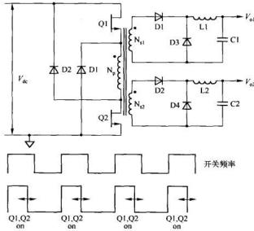

图 2.13 双端正激变换器。开关管 Q1 和 Q2 同时导通和关断。二极管 D1 和 D2 的作用是使 Q1 和 Q2 的最大关断电压应力为 $V_{dc}$ ，而图 2.10 所示的正激变换器最大关断电压应力为漏感尖峰加上 $22V_{de}$ 。

$N_{p}$ 的同名端电位被二极管 D1 钳位至地电位。 $N_{p}$ 的异名端电位被二极管 D2 钳位于 $V_{dc}$ 。 

所以，Q1的发射极电压不会超过 $V_{dc}$ ，Q2的集电极电压也不会超过 $V_{dc}$ 。漏感尖峰被钳位，使任一开关管的最大电压应力都不会超过最大直流输入电压。 

电路更显著的优点是没有漏感能量消耗。开关管导通时，存储于漏感中的所有能量不是消耗于电阻元件或功率开关管内，而是在开关管关断时通过D1和D2回馈给 $V_{dc}$ 。漏感电流从 $N_{p}$ 的异名端流出，经D2流入 $V_{dc}$ 的正极，然后从其负极流出，经D1返回到 $N_{p}$ 的同名端。 

考察图2.13所示的电路会发现，只要保证复位时间等于导通时间，则磁心总能复位。因为开关管关断时， $N_{p}$ 上的反向电压与导通时其上的正向电压相等。因此，若不需要最大导通时间超过半周期的80%，使下半周期开始前有20%的安全裕量，则磁心总能成功地复位。选择足够大的次级匝数，使 $V_{dc}$ 最小时次级电压峰值与最大占空比0.4的乘积等于所需输出电压（式(2.25)），就可达到上述要求。 

## 2.4.1.1 实际输出功率的限制

一定要注意,这种拓扑与单端正激变换器一样,每周期仍只有一个功率脉冲。因此,无论是单端或双端结构,给定磁心能提供的实际功率均相等。2.3.10.6节中谈到,单端拓扑的复位绕组仅用于开关管关断时通过励磁电流。由于这个电流很小,只用线径为30号甚至更小的导线绕制即可。若使用同样的磁心,即使双端拓扑没有复位绕组也不允许利用加大功率绕组线程的方法来提高输出功率。 

由于开关管最大电压应力不大于最大直流输入电压，所以2.3.7节中讨论的单端正激变换器200W的实际功率限制不再成立。随着双端正激变换器电压应力的下降，输出功率可达到400～500W，且满足所需电压和电流及增益要求的廉价开关管也很容易买到。 

下面考虑一个额定交流输入为120V，且具有±10%稳态误差和±15%瞬态误差的双端正激变换器。它的最大整流直流电压为 $1.41\times120\times1.1\times1.15=214V$ ，最小整流直流电压为 $1.41\times120\div1.1\div1.15=134V$ ，初级等效平顶电流幅值为 $I_{ph}=3.13P_{o}/V_{dc}$ （根据式(2.28))，当 $P_{o}=400W,I_{ph}=9.6A$ 。市场上有很多满足这种要求的开关管（双极型和MOSFET），并且增益足够，价格低廉。 

双端正激变换器由120V交流供电时，一个较好的替代方案是接入倍压电路(图3.1)。这种电路能使电压应力加倍至428V，使电流幅值减半至4.8A。4.8A的初级电流，会使RFI问题减轻。如果关断时刻有反向偏置为 $-1\sim-5V$ （额定 $V_{cev}$ ），则额定 $V_{cev}$ 为400V的双极型晶体管很容易承受428V电压。 

## 2.4.2 设计原则及变压器的设计

## 2.4.2.1 磁心的选择及初级匝数和线径的计算

双端正激变换器变压器设计过程与单端正激变换器的完全一样。根据所需输出功率和工作频率，就可以从上面提到的图表(将在第7章给出)中选择磁心。 

初级匝数根据法拉第定律由式(2.40)计算出来。由于初级串联两个开关管，所以最小初级电压为 $(V_{\mathrm{dc}}-2)$ 。但是2V的压降影响不大，因为 $V_{dc}$ 一般为134V（120V交流输入）。如果不被磁心损耗限制，频率为50kHz或更高时，最大导通时间可取为0.8T/2，dB取1600G。 

以前提到过，由于磁心损耗随频率提高而上升，所以在100～300kHz的频率范围内，峰值磁密可能不得不降至约1400G或800G。要精确确定峰值磁密还要看是否有更新的、更低损耗的磁性材料，某种程度上也取决于变压器的尺寸。较小的磁心常可以工作于较高的磁密，因为这种磁心的散热面积与体积比值较大，更容易散热（热量与体积成比例）。 

因为双端变换器与单端变换器一样，每周期只有一个电流或功率脉冲，所以给定输出功率和最小直流输入电压下初级电流可由式(2.28)计算出来，初级线径可根据式(2.42)选择。 

## 2.4.2.2 次级匝数及线径的计算

次级匝数的选择与2.3.2节和2.3.3节所述的完全相同，由式(2.25)～式(2.27)给出。线径可根据2.3.10.5节中的式(2.44)计算。 

## 2.4.2.3 输出滤波器的设计

输出电感和电容的计算与2.3.11节所述的完全相同，可由式(2.46)～式(2.48)计算。 

## 2.5 交错正激变换器拓扑

## 2.5.1 基本工作原理、优缺点和输出功率限制

这种拓扑只是两个相同的单端正激变换器交替工作(各占半个周期)，其次级电流通过整流二极管相加。其拓扑如图2.14所示。 

这种拓扑的优点是每周期有两个功率脉冲,如图2.14所示,且每个变换器只提供总输出功率的一半。 

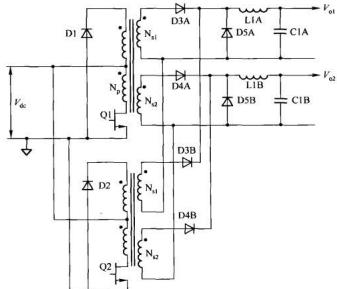

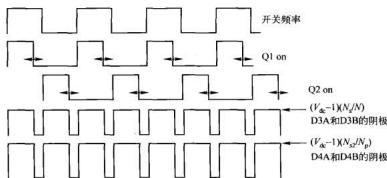

图 2.14 交错正激变换器。Q1 和 Q2 每半周期交替导通，次级输出相加使每周期有两个功率脉冲，且避免了推挽拓扑的磁通不平衡问题。

式(2.28)给出了开关管等效平顶电流幅值 $I_{\mathrm{pf}} = 3.13P_{\mathrm{ot}} / 2V_{\mathrm{dc}}$ ，其中 $P_{\mathrm{ot}}$ 为总输出功率。开关管电流是获得相同总输出功率的单个单端正激变换器的一半。因此，两个开关管的费用因每个开关管额定峰值电流较低而相互抵消了，也许价格比两倍额定电流的单个开关管更低。 

或从另一角度看，若这两个额定电流相同的开关管，其电流幅值与给定输出功率单端变换器开关管的相同，则交错变换器可提供的输出功率是该单端变换器输出功率的两倍。 

另外,EMI 强度与电流幅值成比例,而不是与电流脉冲数量成比例,相同总输出功率下,交错变换器产生的 EMI 比单个正激变换器产生的 EMI 小。 

相比起来，推挽拓扑可能更有优越性。尽管都是双开关管电路，但交错正激变换器的两个变压器可能比推挽拓扑的一个大变压器更昂贵，占用的空间更多。不过至今仍不很确定，在输入和负载失常的瞬态情况下，推挽拓扑的磁通不平衡问题是否完全能解决。没有磁通不平衡问题可能是使用交错正激变换器的最好理由。 

当直流输出电压超过200V的场合，同样的输出功率下，选用交错正激变换器比选用单个正激变换器更合理。单个正激变换器输出续流二极管（D5A或D5B）承受的反向电压峰值为 交错正激变换器的两倍。这是因为它的占空比只有后者的1/2。 

输出电压低时占空比小没有什么问题，见式(2.25)。变压器次级匝数选择原则（对于单端正激变换器）是，直流输入最小即次级电压幅值最低时，产生所需输出电压的占空比 $T_{on}/T$ 不超过0.4。当直流输出为200V时，续流二极管承受的反向电压峰值为500V。开关管导通瞬间，续流二极管已流过很大的正向电流，又将突然承受反向电压。如果该二极管反向恢复时间长，短时内500V的反向电压就会引起很大的反向电流，可能会损坏二极管。 

二极管额定反向电压越大，反向恢复时间越长，这种情况下，问题就很严重了。对于200V直流输出，交错正激变换器运行在两倍占空比，续流二极管反向电压仅为250V。使用低压、恢复快的二极管，可大大降低其损耗。 

## 2.5.2 变压器的设计

## 2.5.2.1 磁心的选择

磁心根据上面讲到的第7章将提供的图表选出。因为每个变压器只提供一半的输出功率，所以磁心按总输出功率的一半选取。 

## 2.5.2.2 初级匝数及线径

最小直流输入时，每个变换器的导通时间依然为0.8T/2，则交错正激变换器初级匝数可由式(2.40)求出。对于所选磁心，其面积 $A_{e}$ 可从表中读取。初级线径可按总输出功率的一半由式(2.42)求出。 

## 2.5.2.3 次级匝数及线径

次级匝数由式(2.26)～式(2.27)确定。因为每个周期有两个电压脉冲，且输入为 $V_{dc}$ 时每个占空比为0.4，所以式(2.26)～式(2.27)中占空比取为0.8。因每个次级流过电流的最大占空比为0.4，次级线径由式(2.44)决定，其中 $I_{dc}$ 是实际直流输出电流。 

## 2.5.3 输出滤波器的设计

## 2.5.3.1 输出电感的设计

同推挽拓扑输出电感一样，交错正激变换器输出电感每周期也流过两个电流脉冲。相同的直流输出电流下，这两个脉冲的脉宽、幅值和占空比与推挽拓扑的相同。因此，同推挽拓扑电感一样，交错正激变换器的电感可根据式(2.20)计算。 

## 2.5.3.2 输出电容的设计

同理，输出电容要过滤的波形与推挽电路的完全相同。因此，若电感电流纹波幅值及允许输出电压纹波值与推挽电路相同，则交错正激变换器的电容值可由式(2.22)求出。 

## 参考文献

1 K. Billings, Switchmode Power Supply Handbook, New York: McGraw-Hill, 1990. 

## 第3章 半桥和全桥变换器拓扑

## 3.1 引言

半桥和全桥拓扑晶体管的电压应力等于直流输入电压，而不像推挽、单端正激或交错正激拓扑那样为输入电压的两倍。所以，桥式拓扑广泛应用于那些直流供电电压高于晶体管的安全耐压值的离线式变换器中。输入网压为220V或更高的场合普遍地使用桥式拓扑。当然在输入网压为120V时也有使用桥式拓扑的情况。 

桥式拓扑的另一优点是,能将变压器初级侧的漏感电压尖峰(如图2.1和图2.10所示)钳位于直流母线电压,并将漏感储存的能量回馈到输入母线,而不是损耗在有损缓冲电路的电阻元件上。 

## 3.2 半桥变换器拓扑

## 3.2.1 工作原理

半桥变换器拓扑如图3.1所示。如同双端正激变换器那样，晶体管关断时承受电压应力为 $V_{dc}$ 而不是 $2V_{dc}$ 。这个优点使得半桥变换器拓扑在网压为220V的欧洲市场设备中得到了广泛应用。 

首先看图3.1中的输入整流和滤波部分。当要求设备适应不同的网压(120V AC(美国)或220V AC(欧洲))时,这是一种普遍采用的方案。不管输入网压是120V AC还是220V AC,该电路整流得到的直流电压都约为320V。当输入网压为220V AC时,S1断开;为120V AC时,S1闭合。通常S1并不是实际的开关,更常见的情形是,这是一段跳线,在120V AC输入时安装,在220V AC输入时不安装。 

输入为220V交流电压时，S1断开，电路为全波整流电路，滤波电容C1和C2串联。整流得到的直流电压峰值约为 $1.41\times220-2=308V$ ；当输入为120V交流电压时，S1闭合，电路相当于一个倍压整流器。在输入电压的正半周，A点相对于B点为正，电源通过D1给C1充电，C1电压为上正下负，峰值约为 $1.41\times120-1=168V$ ；在输入电压的负半周，A点电压相对于B点为负，电源通过D2给C2充电，C2电压为上正下负，峰值也为 $1.41\times120-1=168V$ ，这样两个电容串联的输出为336V。从图3.1可见，当任何一个晶体管导通时，另一个关断的晶体管承受的电压只是最大直流输入电压，而并非其两倍。 

因此，在电路中可以采用价格较低的双极型晶体管和场效应管，它们能承受336V的开路电压（即使考虑15%的裕量，386V也在可承受的范围之内）。这样，只需要一个普通的开关或者跳线的切换，装置就可工作于120V或220V交流电路中。 

补充：有时使用自动网压检测和开关电路，该电路驱动继电器或其他器件代替S1的位置。虽然增加了成本和电路的复杂性，但方便了电气设备的终端用户，他们可能不再为如何为 不同网压输入时选择转换开关的位置而困惑,也避免了将220V输入到120V配置的电路时造成设备毁坏的可能。 

—— T. M. 

假设整流后的直流输入电压为 336V，该电路工作情况如下：首先忽略小容量隔直电容 $C_{b}$ ，则 $N_{p}$ 的下端可近似地看连接到 C1 与 C2 的节点。若 C1、C2 的容量基本相等，则该节点电压近似为整流电压的一半，约为 168V。通常的做法是在 C1、C2 两端各并接等放值电电阻来均衡两者的电压。图 3.1 中的晶体管 Q1、Q2 轮流导通半个周期。Q1 导通、Q2 关断时， $N_{p}$ 同名端（有点端）的电压为 +168V，Q2 承受的电压为 336V；同理，Q2 导通、Q1 关断时，Q1 承受的电压也为 336V，此时 $N_{p}$ 同名端的电压为 -168V。 

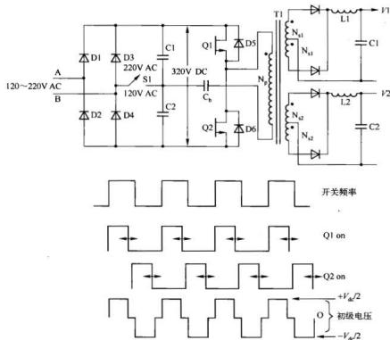

图 3.1 半桥变换器。变压器的一端通过隔直电容 $C_{b}$ 与滤波电容 C1、C2 相连，另一端接在晶体管 Q1、Q2 的节点，功率晶体管 Q1、Q2 交替导通。当开关 S1 闭合时，电路为倍压整流器；而断开时，电路为全波整流器。整流后的输出电压约为 $308 \sim 336V$ 。

和推挽拓扑一样,初级交流方波电压使所有次级感应全波式方波电压,因此这种半桥电路的次级电压、导线规格、输出电感和电容的选择都与推挽式电路相同。 

## 3.2.2 半桥变换器磁设计

## 3.2.2.1 最大导通时间、磁心尺寸和初级绕组匝数的选择

从图 3.1 可见, 若 Q1、Q2 同时导通, 即使是很短的时间, 也将使电源瞬间短路从而损坏晶 体管。为防止此现象发生，输入电压为最小值时，Q1或Q2的最大导通时间必须限制在半周期的80%以内。应选择合适的次级匝数使在导通时间不大于0.8T/2的情况下保证输出电压满足要求。此外，电路应采用钳位技术以保证在故障或暂态情况下导通时间也不超过0.8T/2。 

磁心可利用第7章中提供的表格进行选择,这些表格给出了最大输出功率与工作频率、峰值磁密、磁心面积及绕线电流密度之间的函数关系。 

假定最低输入电压为 $(V_{\mathrm{dc}} / 2) - 1$ ，最大导通时间为 $0.87 / 2$ ，在已知磁心种类和磁心面积的情况下，可以通过法拉第定律(式(1.17))计算出初级绕组匝数。磁感应增量dB值为峰值磁密期望值(频率低于 $50\mathrm{kHz}$ 时选用 $1600\mathrm{G}$ ，频率越高该值越小)的两倍。2.3.9节中介绍过，正激变换器的磁心只工作于磁滞回线的第一象限，而半桥变换器的磁心工作于磁滞回线的第一、三象限，所以半桥变换器磁感应增量dB取峰值磁密期望值的两倍。 

## 3.2.2.2 输入电压、初级电流、输出功率之间的关系

设效率为80%，则有 

$$
\text { Input   power } = P _ {\mathrm{in}} = 1. 2 5 P _ {\mathrm{o}}
$$

电源输入电压最低时，输入功率等于初级电压最小值与对应的初级平均电流的乘积。如前所述，输入直流电压最小时，每半周期导通时间最大值选为0.8T/2。由于每周期有两个脉宽为0.8T/2的电流脉冲，电压为 $V_{dc}/2$ 时的输入功率为 $1.25P_{o}=(\underline{V_{dc}}/2)(I_{ptt})(0.8T/T)$ ，其中， $I_{ptt}$ 为初级电流脉冲等效为平顶脉冲后的峰值 

$$
I _ {\mathrm{ph(半桥)}} = \frac {3 . 1 3 P _ {\mathrm{o}}}{\underline {{V _ {\mathrm{dc}}}}}\tag{3.1}
$$

## 3.2.2.3 初级线径的选择

在输出功率相同的条件下，半桥变换器的初级线径要比推挽电路的大很多。但由于推挽电路有两个初级且每个初级承受的电压是半桥电路电压的两倍，因此两种拓扑的绕组尺寸相差不多。 

半桥拓扑初级电流有效值 $I_{\mathrm{rms}} = I_{\mathrm{pft}} \sqrt{0.8T / T}$ ，由式(3.1)可得 

$$
I _ {\mathrm{rms}} = \frac {2 . 7 9 P _ {\mathrm{o}}}{V _ {\mathrm{dc}}}\tag{3.2}
$$

设每有效值安培需要500圆密耳，则所需的总圆密耳数为 

$$
\frac {5 0 0 \times 2 . 7 9 P _ {\circ}}{\underline {{V _ {\mathrm{dc}}}}} = \frac {1 3 9 5 P _ {\circ}}{\underline {{V _ {\mathrm{dc}}}}}\tag{3.3}
$$

## 3.2.2.4 次级绕组匝数和线径的选择

由式(2.1)至式(2.3)可以计算出次级绕组匝数。其中， $\overline{T_{on}}=0.8T/2$ ，式中的 $(V_{\mathrm{dc}}-1)$ 需替换为初级最小电压值 $(V_{\mathrm{dc}}-1)/2$ 。 

半桥变换器次级电流有效值和线径可通过式(2.13)和式(2.14)计算。这与全波整流型推挽电路次级的相关计算完全相同。 

## 3.2.3 输出滤波器的设计

由于对输出电感电流幅值及输出纹波电压的要求与推挽电路一样，所以输出电感和电容的选择可参照式(2.20)和式(2.22)进行计算。 

## 3.2.4 防止磁通不平衡的隔直电容的选择

为了避免2.2.5节讨论的推挽电路的磁通不平衡问题，在图3.1中，初级设置了串联小电容 $C_{b}$ 。磁通不平衡在初级置位伏秒数与复位伏秒数不相等时发生。 

因此，在半桥电路中，若 C1、C2 节点处的电压不能精确到电源电压的一半，则 Q1 导通时初级承受的电压将与 Q2 导通时的不相等，磁通会沿磁滞回线正向或反向持续增加直至使磁心饱和，损坏晶体管。 

饱和效应的产生是由于初级存在直流分量。为了避免这个直流分量的存在，可在初级串联小容值的隔直电容。电流 $I_{ph}$ 流过时，该电容被充电，这部分充电电压使初级平顶脉冲电压有所下降，如图3.2所示。 

该直流偏移电压占用一部分电压,使次级电压降低,则获得同样输出电压所需的导通时间延长。一般希望尽可能地使初级脉冲电压保持为平顶波。 

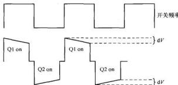

图3.2 若滤波电容的节点处的电压不能精确到电源电压的一半，则为防止磁通不平衡，必须在半桥变换器的变压器初级串联小容值隔直电容 $C_{b}$ 。初级电流对该电容充电，导致初级电压下降，下降幅度不应该超过10%（dV为允许的下降量）。

在这个例子中，设允许的压降为 $\mathrm{d}V$ ，产生该压降的等效平顶脉冲电流为式(3.1)中的 $I_{\mathrm{pft}}$ 而流通该电流的时间为 $0.8T / 2$ ，这样所需隔直电容值可简单地通过下式得到 

$$
C _ {\mathrm{b}} = \frac {I _ {\mathrm{pft}} \times 0 . 8 T / 2}{\mathrm{d} V}\tag{3.4}
$$

例如,一个功率为 150W 的半桥电路,额定直流输入电压为 320V,频率为 100kHz,假设有 15% 的网压波动,最小输入电压为 272V,则初级电压应为 ±272/2V 或 ±136V。 

初级平顶脉冲电压允许的下降量约为10%，即约为14V。 

根据式（3.1），已知功率为 $150\mathrm{W}, V_{\mathrm{dc}} = 272\mathrm{V}$ ，则 $I_{\mathrm{pf}} = 3.13 \times 150 / 272 = 1.73\mathrm{A}$ ，再由式（3.4）可得 $C_{\mathrm{b}} = 1.73 \times 0.8 \times 5 \times 10^{-6} / 14 = 0.49\mu \mathrm{F}$ 。当然，该电容应为非极性电容。 

## 3.2.5 半桥变换器的漏感问题

半桥变换器不存在像单端正激和推挽拓扑中那样麻烦的漏感尖峰问题，因为晶体管Q1、Q2分别并联了二极管D5、D6，它将晶体管承受的漏感尖峰电压钳位于 $V_{dc}$ 。 

Q1导通时，负载电流和励磁电流流过Q1、变压器T1的漏感、 $\mathbf{N}_{\mathrm{p}}$ 并联的励磁电感及按匝比 

平方折算到初级的次级负载等效阻抗，最后流经 $C_{b}$ 到达C1、C2节点， $N_{p}$ 同名端电压为正。 

Q1 关断时,励磁电感迫使所有绕组电压极性反向,通过(次级到初级)反激式的作用, $N_{p}$ 同名端电压变负,如果这个状态继续的话,使 Q1 承受远大于 $V_{dc}$ 的电压,有可能使其损坏,同时也可能使 Q2 承受反压而损坏。然而 D6 把 T1 的同名端电压钳位,使得 T1 的同名端电压不可能比直流输入母线的负端更低。 

同理，Q2导通时，励磁电感储存能量， $N_{p}$ 同名端相对于异名端为负压（T1初级绕组两端电压接近 $V_{dc}/2$ ）；Q2关断时，励磁电感使所有绕组电压极性反向。 $N_{p}$ 同名端电压力图变正，但由于D5的存在， $N_{p}$ 同名端电压被钳位于正母线电压。这样，导通时间内的漏感储能就会经D5、D6反馈给电源 $V_{dc}$ 。 

## 3.2.6 半桥变换器与双端正激变换器的比较

由于半桥变换器晶体管承受的关断电压与双端正激变换器(图2.13)承受的关断电压同样为 $V_{dc}$ （而非 $2V_{dc}$ ），所以这两种拓扑构成的电源在网压为220V的欧洲市场设备中得到了广泛应用。有必要对两者进行比较。 

两者最主要区别在于,半桥变换器次级输出为全波整流而非双端正激变换器输出的半波整流。因此半桥变换器的方波频率是正激变换器的两倍,从而使半桥变换器输出电感 L、输出电容 C 的数值小得多。 

补充：“频率”这个术语，当用于双端和单端变换器时，意义不大。用它研究次级脉冲的重复率更合适。若次级脉冲重复率（一般为单端变换器开关频率的两倍）相同时，传输的转换功率也是相同的。这仅关乎（与频率相关的）功率转换的方式，而与（双端和单端变换器）功率额定值的区别无关。如在推挽情况下，正负半周期各产生一个输出脉冲，从而导致每个周期有两个脉冲（脉冲频率加倍）。所以简单地使单端拓扑在相同的周期内产生两个脉冲，也会在输出端得到相同的输出。 

单端和双端变换器的本质区别体现在磁感应增量上。推挽变换器使磁通量从BH环曲线的负端(第三象限)变化到正端(第一象限)，而单端变换器仅在零磁通量到正磁通量之间变化，即前者为后者磁通量的两倍。然而，一般当开关频率在50kHz以上时，磁心损耗限制磁通摆幅的峰—峰值不得超过200mT，这个磁通摆幅值很容易由推挽和单端变换器推导而得。 

— K. B. 

正激变换器次级峰值电压比半桥变换器高，因为它的次级占空比只有半桥变换器的一半。但这一点只在2.5.1节中讨论的情况下(输出直流电压大于200V)才比较明显。因为正激变换器的变压器必须承受全部电源电压，所以正激变换器变压器初级绕组匝数是半桥变换器的两倍。因此半桥变换器绕组的成本较低，寄生电容也更小。 

补充：尽管半桥变换器的绕组更少，但是电流加倍，且铜损与 $I^{2}$ 成正比，所以在要求相同的铜损时，线径必须是正激变换器的两倍。 

—K. B. 

半桥变换器的另一优点是它的由邻近效应(见7.5.6.1节)形成的绕组损耗比正激变换器的稍低。 

邻近效应损耗是由于相邻绕组层的电流感应涡流电流造成的，它随着绕组层数增加而迅速增加。由于相同功率及相同直流输出电压下半桥变换器初级匝数只有双端正激变换器的一半，所以其损耗比正激变换器的小。但由于半桥变换器的线径较大，如正激变换器所需圆密耳 数为 $985P_{\mathrm{o}} / V_{\underline{\mathrm{dc}}}$ （式(2.42))，而半桥变换器的为 $1395P_{\mathrm{o}} / V_{\underline{\mathrm{dc}}}$ （式(3.3))，所以最终两者实际损耗相差也不大。 

实际应用中，半桥变换器邻近效应损耗较小的优点并不显著。关于邻近效应损耗将在第7章详细讨论。 

## 3.2.7 半桥变换器实际输出功率的限制

半桥变换器最大输出功率由峰值初级电流和晶体管能承受的最大关断电压决定。半桥变换器工作于网压输入为120V倍压模式时，如图3.1所示，与2.4.1.1节中介绍的双端正激变换器一样，其输出功率极限约为 $400\sim500W$ 。此时初级等效平顶脉冲电流峰值 $I_{p0}=3.13P/V_{dc}$ 。若考虑15%的瞬态波动和10%的稳态波动，则晶体管能承受的最大关断电压为 $V_{dc}=1.41\times120\times2\times1.1\times1.15=428V$ ，最小直流输入电压为 $V_{dc}=1.41\times120\times2/1.1/1.15=268V$ 。 

若输出功率为500W，则由式(3.1)可知，最大初级等效平顶电流 $I_{ph}=3.13\times500/268=5.84A$ 。很多MOSFET管和双极型晶体管都能满足428V耐压、6A电流的要求。当然，由于大多数满足该电流等级的快速晶体管的电压参数 $V_{ces}$ 只有400V，为安全承受428V关断电压还必须在关断时提供 $-1\sim-5V$ 的基极反压。 

虽然半桥变换器输出功率可达1000W，但是大多数满足12A电流等级的快速双极型晶体管的放大倍数往往太小，而满足电流电压条件的MOSFET管的导通压降又太大，且成本也高。因此，输出功率超过500W时，一般考虑应用可使功率加倍的半桥改进变换器——全桥变换器。 

## 3.3 全桥变换器拓扑

## 3.3.1 基本工作原理

全桥变换器拓扑如图 3.3 所示, 其输入与半桥变换器相同, 采用倍压/全桥切换整流电路。全桥拓扑可用于构成接 440V 网电的离线变换器。 

全桥变换器最主要的优点是，其初级施加的是幅值为 $\pm V_{\mathrm{dc}}$ 的方波电压，而非半桥变换器的 $\pm V_{\mathrm{dc}} / 2$ ，但其晶体管承受的关断电压却与半桥变换器相同，等于最大输入直流电压。所以在晶体管承受相同峰值电流和电压的条件下，全桥变换器输出功率是半桥变换器的两倍。当然，由于全桥变换器变压器初级承受相当于半桥变换器变压器初级两倍的输入电压，所以其匝数为半桥的两倍。但当输出功率和输入直流电压相同时，全桥变换器初级电流峰值和有效值只有半桥的一半。所以，相同功率下两种变换器的变压器大小是一样的。但若使用较大体积的变压器，全桥变换器可在相同晶体管电流电压定额下得到两倍于半桥的功率输出。 

图3.3中的全桥变换器有两个输出，即主输出 $V_{om}$ 和辅输出 $V_{ol}$ 。电路工作过程为，斜对角的两个晶体管(Q2和Q3或Q4和Q1)同时导通，两组晶体管交替导通半个周期，若忽略晶体管的导通压降，则施加到变压器的初级电压是幅值为 $V_{dc}$ 、宽度为 $t_{om}$ （受反馈环控制）的交变方波。 

网压和负载变化时，反馈环检测输出电压 $V_{om}$ 的变化并调制脉宽 $t_{on}$ ，以维持输出电压 $V_{om}$ 不变。与其他拓扑相同，全桥变换器辅输出在网压改变时能保持不变，但负载变化时，辅输出的变化为5%～8%的额定值。 

设每个开关晶体管的导通压降为1V，主输出肖特基整流管的导通压降为0.5V，辅输出整流管导通压降也为1V，则变换器输出电压为 

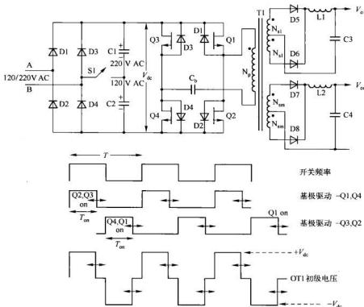

图3.3 全桥变换器拓扑。功率变压器T1接在晶体管Q1、Q2节点与Q3、Q4节点之间。在每个周期内Q2、Q3与Q4、Q1交替导通，导通时间可调。变压器初级电压为方波，幅值为 $\pm V_{\mathrm{dc}}$ ，不同于半桥的 $\pm V_{\mathrm{dc}} / 2$ ，所以全桥变换器的额定输出功率为半桥的两倍。

$$
V _ {\mathrm{om}} = \left[ (V _ {\mathrm{dc}} - 2) \frac {N _ {\mathrm{sm}}}{N _ {\mathrm{p}}} - 0. 5 \right] \frac {2 t _ {\mathrm{om}}}{T}\tag{3.5a}
$$

$$
V _ {\mathrm{om}} \approx V _ {\mathrm{dc}} \frac {N _ {\mathrm{sm}}}{N _ {\mathrm{p}}} \frac {2 t _ {\mathrm{on}}}{T}\tag{3.5b}
$$

$$
V _ {\mathrm{al}} = \left[ (V _ {\mathrm{de}} - 2) \frac {N _ {\mathrm{al}}}{N _ {\mathrm{p}}} - 1. 0 \right] \frac {2 t _ {\mathrm{on}}}{T}\tag{3.6a}
$$

$$
V _ {\mathrm{al}} \approx V _ {\mathrm{dc}} \frac {N _ {\mathrm{al}}}{N _ {\mathrm{p}}} \frac {2 t _ {\mathrm{an}}}{T}\tag{3.6b}
$$

与其他拓扑原理相同，当输入电压 $V_{dc}$ 以一定比例上升或下降时，脉宽调制器将以同样的比例减小或增大脉宽，保持 $(V_{\mathrm{dc}})(t_{\mathrm{on}})$ 乘积不变，来保持输出电压恒定。 

## 3.3.2 全桥变换器磁设计

## 3.3.2.1 最大导通时间、磁心尺寸和初级绕组匝数的选择

如图 3.3 所示, 若垂直桥臂上下两管 (Q3 和 Q4 或 Q1 和 Q2) 同时导通, 则会将电源短路 从而损坏晶体管。为避免这种情况，应选择使晶体管最大导通时间（由式(3.5b)和式(3.6b)知，发生在直流输入电压 $V_{dc}$ 最低时）不超过半周期的80%。也就是说，要根据电压方程正确选择匝比 $N_{sm}/N_{p}$ 、 $N_{s1}/N_{p}$ ，使在规定电压 $V_{dc}$ 下 $(\overline{V_{om}}=0.8T/2$ 时）变换器仍能输出所要求的电压 $V_{om}$ 、 $V_{o1}$ 。 

磁心尺寸和工作频率可根据第7章中的磁心—频率表选择。若已选定磁心，且已知铁心面积 $A_{e}$ ，则可根据法拉第定律(式(1.17))计算初级匝数 $N_{p}$ 。在式(1.17)中，E是初级最低电压 $E=V_{dc}-2$ ，dB是所选的0.8T/2(dt)时间内的磁通变化。2.2.9.4节中讨论过，频率低于50kHz时，选择 $dB=3200G(-1600G\sim+1600G)$ 。由于频率越高，磁心损耗越大，所以频率高于50kHz时，应选择更低的dB值。 

## 3.3.2.2 初级电流、输出功率和输入电压的关系

设变换器效率为80%，则输出功率 $P_{o}=0.8P_{in}$ ，即 $P_{in}=1.25P_{o}$ 。输入电压为最小值 $V_{dc}$ 时，每半个周期晶体管的导通时间为0.8T/2，即占空比为0.8，若忽略晶体管的导通压降，则输入功率为 

$$
P _ {\mathrm{in}} = \underline {{{V _ {\mathrm{dc}}}}} (0. 8) I _ {\mathrm{pft}} = 1. 2 5 P _ {\mathrm{o}}
$$

即 

$$
I _ {\mathrm{pft}} = \frac {1 . 5 6 P _ {\mathrm{o}}}{V _ {\mathrm{dc}}}\tag{3.7}
$$

式中，电流 $I_{ph}$ 为2.2.10.1节定义的初级等效平顶脉冲电流幅值。 

## 3.3.2.3 初级线径的选择

因为占空比为0.8，因此电流 $I_{pft}$ 的有效值为 $I_{rms}=I_{pft}\sqrt{0.8}$ ，综合式(3.7)可得 

$$
I _ {\mathrm{rms}} = (1. 5 6 P _ {\mathrm{o}} / \underline {{{V _ {\mathrm{dc}}}}}) \sqrt {0 . 8} \quad \text {即} \quad I _ {\mathrm{rms}} = \frac {1 . 4 0 P _ {\mathrm{o}}}{\underline {{{V _ {\mathrm{dc}}}}}}\tag{3.8}
$$

设电流密度为 500 圆密耳每有效值安培, 则有 

$$
\mathrm{总圆密耳数} = \frac {5 0 0 \times 1 . 4 0 P _ {\mathrm{o}}}{V _ {\mathrm{de}}} = \frac {7 0 0 P _ {\mathrm{o}}}{V _ {\mathrm{dc}}}\tag{3.9}
$$

## 3.3.2.4 次级绕组匝数和线径的选择

各次级绕组的匝数可根据式(3.5a)和式(3.5b)计算,式中对应规定的最小输入电压 $\underline{V_{dc}}$ ,应有 $\overline{t_{on}}=0.8T/2$ 。 $N_{p}$ 可根据3.3.2.1节所讲的方法计算,所有的输出电压均为规定值。 

次级电流有效值和次级线径的确定与2.2.10.3节所讲的推挽拓扑完全相同。其中，次级电流有效值可根据式(2.13)计算，每个次级半绕组所需圆密耳数可由式(2.14)确定。 

## 3.3.3 输出滤波器的计算

全桥变换器拓扑与半桥变换器及推挽拓扑相同，均为全波整流输出，其输出电感和电容可分别由式(2.20)和式(2.22)计算。根据式(2.20)计算最小直流输出电流为额定值的1/10条件下的输出滤波电感值，根据式(2.22)计算给定输出纹波电压峰—峰值 $V_{r}$ 和给定电感纹波电流峰—峰值条件下的输出滤波电容值。 

## 3.3.4 变压器初级隔直电容的选择

图 3.3 中, 变压器初级串联了一个无极性隔直电容 $C_{b}$ , 其容值较小, 用以避免 3.2.4 节所述的磁通不平衡问题。 

虽然全桥变换器的磁通不平衡问题没有半桥的严重,但仍可能发生。对双极型晶体管,一个半周期导通对管的储存时间可能与另一个半周期导通对管的不同;对 MOSFET 管,交替导通的对管的导通压降之间可能存在差异。这些情况都会造成变压器初级侧伏秒数不相等,使磁心偏离平衡点造成饱和,最终损坏晶体管。 

(c)

(a) 

## 第 4 章 反激变换器

在设计反激式变换器时,我发现有很多工程师和学生,存在很大的困难。实际上这种拓扑非常实用,而且设计也并不难。 

问题并不在于设计本身的难处，或是学生的能力，而是与传统设计的教学方式有关。 

从反激变压器设计的第一步开始,就定下了错误的思维定势,设计者常常把“反激变压器”当成真正的变压器来设计,这正是问题所在。 

对于变压器,我们已经非常熟悉,它是一种非常简单的设备——初级绕组上施加一定的电压,次级绕组上就可以得到相应的电压。电压比率与匝比相同,与输出(负载)电流无关。换句话说讲,变压器保证初次级电压的转换比率(初级绕组为1V/匝,从而使次级绕组电压也为1V/匝。如果需要得到10V电压,用10匝次级绕组即可实现,原理非常简单。)但是,需要注意变压器的一个很重要的特性,初级与次级同时导通。即电流从初级绕组的正极性流进,则同时从次级绕组的正极性流出。 

反激变换器的基本电路图如图 4.1 所示。 

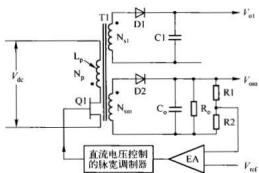

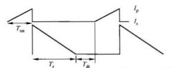

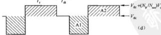

图4.1 反激变换器的基本电路图。工作原理如下：当Q1导通时，所有的整流二极管都反向截止，输出电容给负载供电。T1相当于一个纯电感，流过 $N_{p}$ 的电流线性上升，达到峰值 $I_{p}$ 。当Q1关断时，所有绕组电压反向。此反激电用使输出二极管进入导通状态，同时初级储存的能量 $1/2L_{p}^{2}$ 传送到次级，提供负载电流，同时给输出电容充电（Q1导通时损失的能量）。若次级电流在下一个周期开始（Q1导通）前下降到零，则电路工作于断续模式。 

值得注意的是，在开关管Q1导通期间，电流流进变压器T1的初级绕组，而此时次级二极管不导通，故次级无电流流过。当开关管Q1关断时，初级电流停止，所有绕组电压反向。这种反激电压使得输出二极管及次级绕组导通，并流过电流。所以“反激变压器”的初级与次级绕组在不同的时刻导通并流过电流，这种差异很明显地改变了“反激变压器”的工作原理。 

让我们分析“反激变换器”工作模式。当开关管Q1导通时，只有初级绕组导通（其他绕组因未导通，可暂不考虑其对初级电压的影响），此时，开关管可认为只是给电感储存能量。当开关管Q1关断时，只有次级绕组导通，分析时可暂不考虑初级绕组对次级的影响(此时，次级可认为只是电感放电过程)。所以，“反激变压器”与真正变压器有什么样的时间，就显而易见了。所谓的“反激变压器”，从功能上考虑，实际上只是有着若干绕组的电感而已。 

这种不止一个绕组的电感工作原理是，初级与次级的安匝比守恒（而不是像真正的变压器一样，电压比守恒）。例如，初级绕组100匝，开关管Q1关断时的峰值电流为1A，存储在初级的安匝数为100安匝。这个数值必须等于次级的安匝数，若次级绕组为10匝，则电流应为 $10\mathrm{A}(10\mathrm{T}\times 10\mathrm{A} = 100$ 安匝）。同样，1匝次级绕组将会有100A的峰值电流，1000匝次级绕组对应于0.1A的峰值电流。 

这种情况下,电压方面的关系又如何呢?首先需要说明的是,初次级绕组电压并不相关,次级绕组电压只与负载有关。假设次级绕组安匝数为100,匝数为10,则峰值电流为10A,如上节例子所述。如果将次级绕组与1Ω负载相连,则可得到10V的次级电压。如果将这样的次级绕组与100Ω的负载相连,则可以在次级得到不可思议的1000V电压,这就是之所以反激拓扑在高压应用场所得到普遍应用的原因(不得将次级开路,会导致半导体元件损坏)。当次级有几个绕组同时导通时,则所有次级绕组的安匝数之和与初级安匝数守恒。 

根据以上所述可知，“反激变压器”实际上是以电感的特性工作，所以就需要采用电感的设计原理进行设计（因为磁心同时需要承载电流的直流和交流成分，故第7章中名词采用扼流圈代替电感）。所以说，假若最初“反激变压器”可以根据其功能正确命名为“反激扼流圈”，那现在就不会有那么多的疑惑了。 

但是我们都知道，初级与次级绕组就算是不同时导通，它们之间也会存在电压转换关系。还是采用上面的实例，10匝的次级绕组加在 $100\Omega$ 负载之上，次级绕组上电压为1000V。这1000V电压将会折射到初级绕组，其折射电压值为10000V，加上输入电压100V，开关管在关断期间将会承受10100V的电压（耐压11000V的开关管，超过现有的工艺水平）。所以在现实中很难实现，但是理论上可行。 

所以，当我们在设计“反激变压器”时，需要注意以下几点。 

① 记住你不是在设计一个变压器，而是有着多绕组的扼流圈。 

② 初级绕组匝数需要满足 AC 电压应力(伏秒数)和磁心饱和特性 

$$
N _ {\mathrm{p}} = \frac {V T}{B A _ {\mathrm{e}}}
$$

其中， $N_{p}$ 是最小的初级匝数，V 是最大的初级直流电压（V），T 是开关管 Q1 的最大导通时间（ $\mu s$ ），B 是 AC 磁通密度变化的峰—峰值（特斯拉），铁氧体典型值为 200mT， $A_{e}$ 为磁心中心柱的有效面积（mm $^{2}$ ）。 

③ 次级绕组可灵活选择。如果次级绕组每匝电压值与初级相同，则开关管 Q1 上的反激电压为输入电压的两倍。 

④ 当使用带有磁隙的铁氧体磁心时，最小的磁隙长度必须保证在流过交流和直流励磁电 流和时，磁心不能饱和。而在更多的情况下，磁隙长度的选择是为了满足能量转换的要求，这样经常会导致磁隙长度超过了其需求的最小长度。初级绕组储存的能量为 

$$
E (\text { 焦   耳 }) = 1 / 2 L I ^ {2}
$$

这是初级能够传送到次级的最大能量,而且只是在断续(完全能量传递)的工作模式。在连续的工作模式,只有部分能量被传送。 

注意：减小电感值 $L$ ，看上去可以减少初级储存的能量，但是在电感减小的同时，电流 $I$ 会以相同的比例增大。又因为能量与电流 $I$ 的平方值成正比，所以减小电感值，其实初级储存的能量实际上是增加的。 

⑤ 不推荐一味地设计出某一固定的电感值，而最好是电感值能够在磁隙长度或是磁心材料(磁导率)改变时可以有相应的变化裕量。 

第4章接下来的内容，对传统的“反激变压器”设计方法，进行了详尽的分析。读者可先阅读本书的第7章及第二部分的第1章，第2章（见本章末的参考文献部分），这样对学习与理解会有很大的帮助。 

## 4.1 引言

到目前为止,除了 Boost 调整器(1.4 节)和反极性调整器(1.5 节)外,所有讨论过的变换器都是在开关管导通时将能量输送到负载的。 

然而，本章讨论的反激变换器与它们的工作原理不同。在反激拓扑中，开关管导通时，变压器储存能量，负载电流仅由输出滤波电容提供；开关管关断时，变压器将储存的能量传送到负载和输出滤波电容，以补偿电容单独提供负载电流时消耗的能量。 

下面详细讨论此类拓扑的优缺点。反激变换器的主要优点是不需要输出滤波电感(滤波电感在所有正激拓扑中都是必需的)，因为反激变压器有着变压器和电感的双重功能。在低成本多输出电源中，这一点对减小变换器体积，降低成本尤为重要。 

## 4.2 反激变换器基本工作原理

反激变换器基本电路原理图及主要的电压及电流波形在图4.1中已经给出，这种拓扑在输出功率为5～150W的低成本电源应用中非常广泛。它最大的优点，很明显，就是不需要次级输出电感。这会使反激变换器在体积和成本上占有很大的优势。 

从图4.1所示的变压器初、次级同名端标识(绕组始端黑点所示)很容易判别出其为反激变换器类型。Q1导通时，所有绕组同名端的电压相对于异名端为负；输出整流管D1、D2反偏，C1、C2单独向负载供电。C1、C2容量的选择(详见下文)应保证提供负载电流的同时能满足输出电压纹波和压降的要求。 

## 4.3 反激变换器工作模式

反激变换器有两种完全不同的工作模式：连续和断续工作模式。两种工作模式的波形、性能和传递函数都有很大的不同，其主要工作波形如图4.2所示。变换器的工作模式由初级电感和负载电流决定。 

(a)

(b)

(c)

(d)

图4.2 (a,b) 反激变换器断续模式向连续模式的过渡波形图。当次级电流降为零到下一周期开关管开始导通之间存在死区 $(T_{\mathrm{ab}})$ ，则电路工作于断续模式。(c,d) 若变压器工作超出临界模式点，使次级关断电流仍未降到零，则下周期开始时，初级电流前沿将出现阶梯。这种电流阶梯现象是连续工作模式的特点，此时次级电流在任何的导通期间都不会减小到零。刚进入连续工作模式时的电路拓扑，其传递函数发生了很大的变化，若此时误差放大器带宽未能迅速减小，则电路将发生振荡。

## 4.4 断续工作模式

图4.1中所示的反激电路有一主一辅两个输出。与前面介绍的其他拓扑相同，该电路主输出 $V_{\mathrm{em}}$ 接负反馈闭环。 $V_{\mathrm{em}}$ 的采样电压与参考电压相比较，产生的误差信号控制Q1的导通时间(脉冲宽度)，使输出采样电压在输入电压和负载变化时跟随参考电压变化，所以主输出能够得到很好的调整。辅输出对输入电压的变化调整率也很好，但因为次级绕组电压跟随主输出电压变化，故其对负载变化的调整率稍差。虽然辅输出调整率比主输出差，但相比正激变换器来说，辅输出调整率还是要好得多。 

Q1 导通期间， $N_{p}$ 上所加电压恒定，其电流线性上升，斜率为 $\mathrm{di}/\mathrm{dt} = (V_{\mathrm{dc}} - 1)/L_{p}$ 。其中， $L_{p}$ 是初级励磁电感。在导通结束之前，初级电流上升达到 $I_{\mathrm{p}} = (V_{\mathrm{dc}} - 1)T_{\mathrm{on}}/L_{p}$ 。此时变压器储存的能量为 

$$
E = \frac {L _ {\mathrm{p}} (I _ {\mathrm{p}}) ^ {2}}{2}\tag{4.1}
$$

式中，E 的单位为焦耳， $L_{p}$ 的单位为亨利， $I_{p}$ 的单位为安培。 

此时 Q1 关断, 励磁电感的电流使各绕组电压反向(反激电压), 设此时次级只有一个主次级绕组 $N_{m}$ , 没有任何其他辅绕组。则由于电感电流不能突变, 在 Q1 关断瞬间, 变压器电流从初级传递到次级, 其次级电流幅值为 

$$
I _ {\mathrm{s}} = I _ {\mathrm{p}} \left(N _ {\mathrm{p}} / N _ {\mathrm{m}}\right)
$$

几个开关周期之后，次级直流电压上升到 $V_{cm}$ （计算分析见下一小节）。Q1 关断时， $N_{m}$ 同名端电压为正，电流从该端流出并线性下降，斜率为 $dI_{s}/dt = V_{cm}/L_{s}$ 。其中， $L_{s}$ 为次级电感。变换器的断续工作模式定义如下。 

若次级电流 $I_{s}$ 在 Q1 再次导通之前降到零，则变压器初级储存的能量在 Q1 再次导通前已全部传送到负载端，则变压器工作于断续模式。 

由于一个周期(秒)内传递的能量 E(焦耳)即为输入功率(瓦),一个周期 T 内直流母线电压 $V_{dc}$ 提供的输入功率为 

$$
P = \frac {1 / 2 L _ {\mathrm{p}} (L _ {\mathrm{p}}) ^ {2}}{T} \mathrm{W}\tag{4.2a}
$$

又因， $I_{\mathrm{p}}=(V_{\mathrm{dc}}-1)T_{\mathrm{on}}/L_{\mathrm{p}}$ ，则有 

$$
P = \frac {\left[ (V _ {\mathrm{dc}} - 1) T _ {\mathrm{on}} \right] ^ {2}}{2 T L _ {\mathrm{p}}} \approx \frac {(V _ {\mathrm{dc}} T _ {\mathrm{on}}) ^ {2}}{2 T L _ {\mathrm{p}}} \mathrm{W}\tag{4.2b}
$$

从式(4.2b)可见,只要反馈环路保持 $V_{dc}T_{on}$ 恒定,即可保持输出恒定。 

## 4.4.1 输入电压、输出电压及导通时间与输出负载的关系

设变换器效率为 80%, 则有 

$$
\mathrm{输入功率} = 1. 2 5 (\mathrm{输出功率}) = \frac {1 . 2 5 (V _ {\circ}) ^ {2}}{R _ {\circ}} = \frac {1 / 2 (L _ {\mathrm{p}} I _ {\mathrm{p}} ^ {2})}{T}
$$

从式(4.2b)可见,最大导通时间 $T_{on}$ 出现在输入电压最低的时候,因此 $I_{p}=V_{dc}\overline{T_{on}}/L_{p}$ ,则有 

$$
1. 2 5 (V _ {\circ}) ^ {2} / R _ {\circ} = 1 / 2 L _ {\mathrm{p}} \underline {{V _ {\mathrm{dc}} ^ {2}}} \overline {{T _ {\mathrm{on}} ^ {2}}} / L _ {\mathrm{p}} ^ {2} T \quad \text { 或 } \quad V _ {\circ} = \underline {{V _ {\mathrm{dc}}}} \overline {{T _ {\mathrm{on}}}} \sqrt {\frac {R _ {\circ}}{2 . 5 T L _ {\mathrm{p}}}}\tag{4.3}
$$

反馈环在 $V_{dc}$ 或 $R_{0}$ 上升时减小 $T_{on}$ ，在 $V_{dc}$ 或 $R_{0}$ 下降时增大 $T_{on}$ ，从而自动调整输出。 

## 4.4.2 断续模式向连续模式的过渡

图 4.2(a) 和图 4.2(b) 中的实线表示断续模式的初/次级电流。初级电流是从零开始上升的三角波，开关管导通结束时，电流上升到 $I_{pl}$ ，如图 4.2(a) 中的 B 点所示。 

关断瞬间，储存于初级的电流 $t_{p}$ 根据安匝数等式 $I_{d} = (N_{\mathrm{e}} / N_{\mathrm{s}})I_{p}$ 转换到次级。此电流在整个开关管关断期间，全部提供给次级输出电容及负载。次级电流以斜率 $dI_{\mathrm{s}} / \mathrm{dt} = (V_{\mathrm{e}} + 1) / L_{\mathrm{r}}$ 下降，其中， $L_{\mathrm{r}}$ 为次级电感，它等于初级励磁电感与 $(N_{\mathrm{e}} / N_{\mathrm{p}})^2$ 的乘积。电流在I点降为零，与下一周期开始(F点)之间存在一段死区时间 $T_{\mathrm{ds}}$ 。这种情况下，所有导通阶段初级储存的能量在开关管下一周期开始之前已全部传送至负载。其平均电流(直流输出电流)值为三角波GHI的平均值与其占空比 $T_{\mathrm{dt}} / T$ 的乘积。 

如上所述，为使电路始终工作于断续模式，在次级电流减小至零与开关管下次导通之前必须留有死区时间 $T_{\mathrm{dc}}$ （图4.2(b)）。输出功率增大时，必须增大 $T_{\mathrm{on}}$ 以保持输出电压恒定（式(4.3)）。随 $T_{\mathrm{on}}$ 增大，若初级电流斜率不变（设 $V_{\mathrm{dc}}$ 恒定），则初级电流峰值会由B点上升到D点（图4.2(a)）；次级峰值电流 $I_{\mathrm{ct}} = (N_{\mathrm{p}} / N_{\mathrm{s}})I_{\mathrm{pl}}$ 由H点升到K点（图4.2(b)），且其开始时刻由G点延迟到J点。 

由于反馈环可以保持输出电压稳定，次级电流下降斜率 $V_{0}/L_{s}$ 将保持不变，次级电流降为零的时间更接近下一个导通时刻，这将减小 $T_{dt}$ ；在L点，次级电流刚好在开关管再次导通 时刻降为零，这一点为断续模式与连续模式的临界点。若输入电压 $V_{dc}$ 降低（输出功率/输出电流不变条件下）时，为了保持输出恒定，反馈环路必须增加导通时间 $T_{on}$ ，此时也会有上述现象发生。 

可见，只要电路工作于断续模式，就会有死区时间存在，增加导通时间就会增加初级电流三角波的面积和次级电流三角波GHI的面积直至其上限JKL。并且，由于直流输出电流就是次级三角波电流的平均值和占空比的乘积，所以导通时间增大的下个周期，次级就会向负载提供更大的电流。 

但死区时间缩短为零后，由于次级电流的后沿无法再向右移，负载电流的增加使导通时间增加的同时也使关断时间缩短。这样，次级电流的前沿将比J点迟而比K点高（图4.2(b)）。因此当下一导通时间开始时(图4.2(a)中的F点或图4.2(b)中的L点)，变压器次级仍剩余一定的电流(能量)。 

此时初级电流的前沿会出现小阶梯，反馈环将试图延长导通时间（至J点之后）以提供更大的直流负载电流。于是，在接下来的几个关断时间内，关断结束时的次级电流即导通时的初级电流阶梯值将增加。 

若干周期之后，初级电流前沿阶梯值及关断时间结束时的次级电流均足够大（图4.2(d)），使XYZW包围的面积稍微大于提供负载电流所需的面积。此时反馈环开始减小导通时间，使初级梯形电流持续时间为从M点到P点，次级梯形电流持续时间为从T点到W点(图4.2(c)和图4.2(d))。 

此时，变压器初级开关管导通期间的导通伏秒数与其关断期间的关断伏秒数相等，这是变压器磁心磁通在每个周期结束时能沿磁滞回线复位到起始点位置的条件，也是使初级绕组周期内所加平均电压或直流电压为零的条件。这是非常基本的要求，因为直流阻抗约等于零的初级绕组不可能长时间承受直流电压。 

进入连续模式后，若增加负载电流，首先会增加导通时间(图4.2(e)中从MP到MS)。在固定频率的工作模式中，由于死区时间已为零，次级电流脉冲后沿已不能再后移，导通时间延长反而使关断时间缩短(图4.2(d)中从TW到XW)。虽然次级电流峰值有所增加(从U到Y)，但关断时间减少(从T到X)引起的面积减小比斜坡升高(图4.2(d)中从UV到YZ)增加的面积还要大。 

因此，在连续模式下，直流输出电流突然增加先是使次级电流梯形宽度减小，而高度稍有增加。若干开关周期之后，梯形平均高度建立起来而脉宽得到恢复，从而保持初级导通伏秒数与其关断伏秒数相等。 

如前所述，由于直流输出电压与次级电流的梯形面积成正比，反馈环要在负载电流增加时保持输出电压恒定，首先会大幅度降低输出电压；而经若干周期之后，当次级梯形电流所需面积建立起来后，最终校正输出电压。这就是所谓的右半平面零点电路的作用，该电路将大幅度减小误差放大器的带宽以使反馈环稳定。右半平面零点问题将在反馈环稳定性一章中深入讨论。 

补充：在恒定频率的工作系统中，为了提高初级和输出电流，增加导通时间必然会减小开关管的关断时间（即电流从次级传送至负载的时间）。而变压器电感使电流不会瞬间发生很大变化，所以试图增大电流就会导致输出电流短时间的下降（反其道而行之）。这种现象的产生，根本原因就在于传递函数中右半平面零点的存在。这是一种无补偿的动态响应，所以设计者在设计环路时，不得不使用比较低频的响应速度，从而保持系统稳定，此时系统的瞬态响应 性能会比较差。连续工作模式下的反激变换器具有 Boost 变换器特性，而任何具有 Boost 变换器特性的变换器或组合，都存在右半平面零点问题。 

—K. B. 

## 4.4.3 反激变换器连续模式的基本工作原理

反激拓扑广泛应用于高电压、小功率场合(电压不大于5000V, 功率小于15W)。当直流输入电压较高(不小于160V), 初级电流适当时, 该拓扑也可以用在输出功率达到150W的电源中。输出端可不接滤波电感的特性, 使该拓扑在高压输出场合具有很大的优势。而前面讨论的正激变换器由于输出滤波电感必须承受高压而带来了许多问题。此外, 反激变换器不需要高压续流二极管, 使它在高电压场合下应用更有利。 

补充：反激变换器在高压应用场合还具有另一优势：相对于其他拓扑而言，反激变换器利用较少的绕组匝数，就可获得较高电压。 

—K. B. 

反激拓扑非常适用于多路输出的变换器，由于不需要输出电感，输入电压和负载变化时反激变换器的各输出端都能很好地跟随调整，比前面讨论的正激拓扑类型的变换器输出调整率要好得多。所以在输出功率为50～150W，多路输出（最多可大于10组隔离输出）的变换器中常用反激拓扑。 

虽然这种拓扑直流输入电压可低至5V,但一般更常见于采用经过115V交流电压整流而得到的160V直流电压作为输入。只要变压器匝比设计得当,则这种拓扑同时应用于由115V交流整流得到的160V和由220V交流整流得到的320V作为直流输入的场合,从而无需采用图3.1所示的倍压整流方案。 

尽管倍压整流方案被广泛采用,却存在一个问题。若将电路从115V交流输入切换到220V时,必须将图3.1中的转换开关置于电源外部(这必然导致安全隐患),或者打开电源机壳进行切换。这两种方法都有缺陷,4.7节将介绍另一种不需要开关切换的方案。 

两种工作模式下的电路拓扑相同,如图4.1所示。决定电路工作模式的参数只是变压器的励磁电感和电路的输出负载电流。励磁电感给定后,若负载电流超出规定范围,电路就会脱离原先设计的断续工作模式而进入连续模式。下面将对工作模式转变的原理及其后果进行详细讨论。 

如图4.2(a)所示，断续模式的初级电流波形前端没有阶梯。而在开关管关断期间（图4.2(b))，次级电流是衰减的三角波，且在下一周期开始之前已衰减至零。开关管导通期间储存于初级的所有能量，在下个周期开始之前已完全由次级传送至负载。 

连续模式如图4.2(c)所示，初级电流有前沿阶梯且从前沿开始斜坡上升。在开关管关断期间(图4.2(d))，次级电流为阶梯上叠加衰减的三角波。当开关管在下个周期开始导通瞬间，次级仍然维持有电流(等于阶梯值)。很明显，在下个周期开关管开通时刻，变压器储存能量未完全释放，仍有能量剩余。 

两种工作模式有完全不同的工作特性和应用场合。传递函数中不含右半平面零点的断续模式电路，其负载电流突变的瞬态响应更快且引起的输出电压尖峰更低。 

但快速的瞬态响应带来了一个问题，从图4.2(b)和图4.2(d)可见，断续模式下次级峰值电流为连续模式下的 $2\sim 3$ 倍。次级电流波形的平均值即为直流负载电流，若设两种模式下的关断时间基本相等，且波形平均值相同，则断续模式的三角波峰值会明显比连续模式下的梯形波峰值高很多。 

断续工作模式下的次级电流峰值大，将在开关管关断瞬间产生较大的输出电压尖峰，从而需要较大的LC滤波器。另外，断续工作模式下的开关管关断瞬间，较大的次级峰值电流会造成严重的RFI问题。即使输出功率不是很大，关断瞬间次级有较大电流尖峰流入，在输出线电感产生较高的di/dt，从而会在输出地线上产生严重的噪声。 

补充：断续工作模式主要的优点是，次级整流二极管关断时电流应力很小，即在开关管Q1下一次导通时刻之前，二极管已经完全关断。所以在此模式中就不会存在二极管反向恢复的问题，而在高压应用场合中，这种优势更加明显。二极管反向恢复带来的电流尖峰很难去除，且会带来较严重的RFI问题。 

——K. B. 

因为较差的波形系数,断续模式下次级电流的有效值比连续模式下大得多。因此,断续模式要求更大的导线尺寸和耐高纹波的输出滤波电容。同时由于次级有效值电流较大,断续模式下的整流二极管的温升也会更高。而且,断续模式下的初级电流峰值也会大于连续模式。若输出功率相同,则图4.2(a)所示的三角波电流峰值一定比图4.2(c)所示的梯形电流峰值高。而较大的初级电流峰值,就要求使用更大电流规格且可能更昂贵的开关管。另外,开关管关断时的初级电流越大就会导致越严重的RFI问题。 

虽然断续模式存在诸多缺点，但它比连续模式应用更加广泛。原因有两个：第一，如前所述，断续模式本身的变压器励磁电感小从而响应快，且输出负载电流和输入电压突变时，输出电压瞬态尖峰小；第二，由于连续模式本身的特性（其传递函数具有右半平面零点，这将在后面反馈环稳定性一章中讨论），必须大幅减小误差放大器带宽才能使反馈环稳定。 

补充：现代的功率设备比如功率集成度很高的 Top Switch（开关模块）类产品，其中与散热片隔离的芯片中的开关管漏极，是很大的噪声源。这种产品连同集成的驱动和控制电路，通常使用断续工作模式的反激拓扑来减少 RFI 问题。 

—K. B. 

## 4.5 设计原则和设计步骤

## 4.5.1 步骤 1: 确定初/次级匝数比

一个得当的变压器设计,需遵循如下众多规则,且必须注意设计顺序。 

首先,根据功率需求选择合适的磁心型号。 

其次，确定匝比 $N_{p}/N_{sm}$ ，因为匝比决定了不考虑漏感尖峰时开关管可承受的最大关断电压应力 $\overline{V_{ms}}$ 。若忽略漏感尖峰并设整流管压降为1V，则直流输入电压最大时开关管的最大电压应力为 

$$
\overline {{{V _ {\mathrm{ms}}}}} = \overline {{{V _ {\mathrm{dc}}}}} + \frac {N _ {\mathrm{p}}}{N _ {\mathrm{sm}}} (V _ {\mathrm{o}} + 1)\tag{4.4}
$$

参数的选择应使 $V_{ms}$ 尽量小，以保证即使有 $0.3V_{dc}$ 的漏感尖峰叠加于 $V_{ms}$ ，开关管的最大耐压值 $(V_{ceo}, V_{cer}$ 或 $V_{cev})$ 仍留有30%的安全裕量。 

## 4.5.2 步骤 2: 保证磁心不饱和且电路始终工作于 DCM 模式

为确保磁心不会偏离其磁滞回线（上、下方向），变压器在导通期间伏秒数乘积 (图 4.1(d) 中 A1 面积) 必须与复位伏秒数乘积(图 4.1(d) 中 A2 面积) 相等。假设 Q1 和 D1 的正向导通压降都是 1V，则有 

$$
(\underline {{V _ {\mathrm{dc}}}} - 1) \overline {{T _ {\mathrm{dc}}}} = (V _ {\circ} + 1) \frac {N _ {\mathrm{p}}}{N _ {\mathrm{sm}}} T _ {\mathrm{r}}\tag{4.5}
$$

式中， $T_{r}$ 是图 4.1(c) 中变压器的复位时间，也是次级电流降为零所需的时间。 

为保证电路工作于断续模式,必须留有一定的死区时间(图4.1(c)中的 $T_{dt}$ ),从而使 $V_{dt}$ 最低时对应的最大导通时间与复位时间之和也不超过整个周期的80%。留出0.2T的裕度,是为防止负载 $R_{o}$ 降得过低,而导致反馈环过度增大导通时间以保持输出电压 $V_{o}$ (式(4.3)),从而进入连续模式。 

1.4.2 和 1.4.3 节中对 Boost 变换器(它也是反激类型的拓扑)的讨论中曾经指出,若误差放大器的设计仅仅是保持反馈环路在 DCM 模式下稳定工作,则当变换器偶尔进入 CCM 模式时,电路将发生振荡。 

负载电流增大或输入 $V_{dc}$ 减小时，误差放大器将增加 $T_{on}$ 来保持输出 $V_{u}$ 恒定（式(4.3)）。 $T_{on}$ 增加，必定会占用死区时间 $T_{m}$ ，可能使次级电流在Q1再次导通前无法归零，电路开始进入连续模式。若此时误差放大器的带宽设计未能满足连续模式时稳定工作的低带宽要求（误差放大器带宽应远低于断续模式下放大器所需带宽），则电路将发生振荡。为确保电路工作于DCM模式，最大功率输出时的最大导通时间有如下关系式 

$$
\overline {{{T _ {\mathrm{on}}}}} + T _ {\mathrm{r}} + T _ {\mathrm{dt}} = T \quad \text {或者} \quad \overline {{{T _ {\mathrm{on}}}}} + T _ {\mathrm{r}} = 0. 8 T\tag{4.6}
$$

$V_{dc}$ 和 $V_{ms}$ 确定后， $N_{p}/N_{sm}$ 可由式(4.4)求得，此时式(4.5)和式(4.6)中仅有两个未知量，将这两个式子联立，可得 

$$
\overline {{T _ {\mathrm{on}}}} = \frac {(V _ {\mathrm{o}} + 1) (N _ {\mathrm{p}} / N _ {\mathrm{sm}}) (0 . 8 T)}{(\underline {{V _ {\mathrm{dc}}}} - 1) + (V _ {\mathrm{o}} + 1) (N _ {\mathrm{p}} / N _ {\mathrm{sm}})}\tag{4.7}
$$

## 4.5.3 步骤 3: 根据最小输出电阻及直流输入电压调整初级电感

由式(4.3)可得初级电感计算式为 

$$
L _ {\mathrm{p}} = \frac {R _ {\mathrm{o}}}{2 . 5 T} \left(\frac {V _ {\mathrm{dc}} \overline {{T _ {\mathrm{on}}}}}{V _ {\mathrm{o}}}\right) ^ {2} = \frac {(V _ {\mathrm{dc}} \overline {{T _ {\mathrm{on}}}}) ^ {2}}{2 . 5 T \overline {{P _ {\mathrm{o}}}}}\tag{4.8}
$$

## 4.5.4 步骤 4: 计算开关管的最大电压应力和峰值电流

若开关管为双极型晶体管,其峰值电流 $I_{p}$ 为 

$$
I _ {\mathrm{p}} = \frac {V _ {\mathrm{dc}} \overline {{T _ {\mathrm{on}}}}}{L _ {\mathrm{p}}}\tag{4.9}
$$

应确保双极型晶体管在峰值电流工作点时有足够高的增益。其中， $V_{dc}$ 已给定， $T_{on}$ 由式(4.7)可得， $L_{p}$ 可由式(4.8)求出。 

若开关管为 MOSFET 管, 则其最大峰值电流额定值应约为式(4.9)计算值的 5 ~ 10 倍, 从而使其导通电阻足够小, 产生足够低的导通压降及损耗。 

## 4.5.5 步骤 5: 计算初级电流有效值和导线尺寸

初级电流为三角波，导通时间 $T_{on}$ 最大时其峰值为 $I_{p}$ ，有效值为 

$$
I _ {\mathrm{rms(初级)}} = \frac {I _ {\mathrm{p}}}{\sqrt {3}} \sqrt {\frac {T _ {\mathrm{on}}}{T}}\tag{4.10}
$$

式中， $I_{p}$ 和 $T_{on}$ 由式(4.7)和式(4.9)给出。 

若设电流密度为500圆密耳每安培(有效值)，则初级导线所需总圆密耳值为 

$$
5 0 0 I _ {\mathrm{rms(初级)}} = 5 0 0 \frac {I _ {\mathrm{p}}}{\sqrt {3}} \sqrt {\frac {T _ {\mathrm{on}}}{T}}\tag{4.11}
$$

## 4.5.6 步骤 6: 次级电流有效值和导线尺寸

次级电流为三角波，峰值 $I_{\mathrm{s}} = I_{\mathrm{p}}(N_{\mathrm{p}} / N_{\mathrm{s}})$ ，持续时间为 $T_{\mathrm{r}}$ 。初/次级匝比 $N_{\mathrm{p}} / N_{\mathrm{s}}$ 由式(4.4)给出， $T_{\mathrm{r}} = (T - T_{\mathrm{on}})$ ，因此，次级电流有效值为 

$$
I _ {\mathrm{rms(初级)}} = \frac {I _ {\mathrm{p}} (N _ {\mathrm{p}} / N _ {\mathrm{s}})}{\sqrt {3}} \sqrt {\frac {T _ {\mathrm{r}}}{T}}\tag{4.12}
$$

若取电流密度为 500 圆密耳每安培(有效值)，则 

$$
5 0 0 I _ {\mathrm{rms(次级)}} = 5 0 0 \frac {I _ {\mathrm{p}} (N _ {\mathrm{p}} / N _ {\mathrm{s}})}{\sqrt {3}} \sqrt {\frac {T _ {\mathrm{r}}}{T}}\tag{4.13}
$$

## 4.6 断续模式下的反激变换器的设计实例

按如下参数设计一个反激变换器。 

<table><tr><td><eq>V_{o}</eq></td><td>5.0V</td></tr><tr><td><eq>P_{o(max)}</eq></td><td>50W</td></tr><tr><td><eq>I_{o(max)}</eq></td><td>10A</td></tr><tr><td><eq>I_{o(min)}</eq></td><td>1.0A</td></tr><tr><td><eq>V_{dc(max)}</eq></td><td>60V</td></tr><tr><td><eq>V_{dc(min)}</eq></td><td>38V</td></tr><tr><td>开关频率</td><td>50kHz</td></tr></table>

首先选择开关管的额定电压。因为开关管额定电压是决定变压器匝比的主要因素，这里选择额定电压为200V的开关管。在式(4.4)中，开关管关断时承受的最大电压应力 $V_{\mathrm{max}}$ 为120V。即使加上关断瞬间开关管上值为 $V_{\mathrm{max}}$ 的25%（或30V）的漏感尖峰，它仍有50V的电压裕度。由式(4.4)可得 

$$
1 2 0 = 6 0 + \frac {N _ {\mathrm{p}}}{N _ {\mathrm{sm}}} (V _ {\mathrm{o}} + 1) \quad \text {或} \quad \frac {N _ {\mathrm{p}}}{N _ {\mathrm{sm}}} = 1 0
$$

可根据式(4.7)确定最大导通时间 

$$
\begin{array}{r l} \overline {{T _ {\mathrm{on}}}} & = \frac {(V _ {\mathrm{o}} + 1) (N _ {\mathrm{p}} / N _ {\mathrm{sm}}) (0 . 8 T)}{(V _ {\mathrm{dc}} - 1) + (V _ {\mathrm{o}} + 1) N _ {\mathrm{p}} / N _ {\mathrm{sm}}} \\ & = \frac {6 \times 1 0 \times 0 . 8 \times 2 0}{(3 8 - 1) + 6 \times 1 0} \\ & = 0. 9 \mu \mathrm{s} \end{array}
$$

由式(4.8)有 

$$
\begin{array}{r l} L _ {\mathrm{p}} & = \frac {(V _ {\mathrm{dc}} \overline {{T _ {\mathrm{on}}}}) ^ {2}}{2 . 5 T P _ {\mathrm{o}}} \\ & = \frac {(3 8 \times 9 . 9 \times 1 0 ^ {- 6}) ^ {2}}{2 . 5 \times 2 0 \times 1 0 ^ {- 6} \times 5 0} \\ & = 5 6. 6 \mu \mathrm{H} \end{array}
$$

由式(4.9)有 

$$
\begin{array}{r l} I _ {\mathrm{p}} & = \frac {V _ {\mathrm{dc}} \overline {{T _ {\mathrm{on}}}}}{L _ {\mathrm{p}}} \\ & = \frac {3 8 \times 9 . 9 \times 1 0 ^ {- 6}}{5 6 . 6 \times 1 0 ^ {- 6}} \\ & = 6. 6 \mathrm{A} \end{array}
$$

由式(4.10)得初级电流有效值为 

$$
\begin{array}{r l} I _ {\mathrm{rms(初级)}} & = \frac {I _ {\mathrm{p}}}{\sqrt {3}} \sqrt {\frac {T _ {\mathrm{on}}}{T}} \\ & = \frac {6 . 6}{\sqrt {3}} \times \sqrt {\frac {9 . 9}{2 0}} \\ & = 2. 7 \mathrm{A} \end{array}
$$

根据式(4.11)，初级所需总圆密耳数为 

$$
I _ {(\text { 初   级   圆   密   耳   数 })} = 5 0 0 \times 2. 7 = 1 3 5 0 \text { 圆   密   耳 }
$$

这里选用19号线，其圆密耳数为1290，与计算值(1350)非常接近。 

根据式(4.12)，可得次级电流有效值为 

$$
I _ {\mathrm{rms(次级)}} = \frac {I _ {\mathrm{p}} (N _ {\mathrm{p}} / N _ {\mathrm{s}})}{\sqrt {3}} \sqrt {\frac {T _ {\mathrm{r}}}{T}}
$$

又因复位时间 $T_{\mathrm{r}}$ 为 

$$
(0. 8 T - \overline {{T _ {\mathrm{on}}}}) = (1 6 - 9. 9) = 6. 1 \mu \mathrm{s}
$$

故 

$$
I _ {\mathrm{ms(次级)}} = \frac {6 . 6 \times 1 0}{\sqrt {3}} \sqrt {\frac {6 . 1}{2 0}} = 2 1 \mathrm{A}
$$

由式(4.12)知,次级导线所需的圆密耳数为 $500 \times 21 = 10500$ , 故应选用 10 号线。但 10 号线直径太大, 因此应选用等圆密耳值的铜箔绕组或者细线并绕代替。 

补充：与一般观点相反的是，反激变压器的导线尺寸、漏感都是非常重要的设计参数。多股导线并绕时，其单股导线最大截面积可根据最小的集肤和邻近效应来选择。尽管次级能量来自于变压器磁心中存储的能量，但必须尽量减小漏感，确保初级绕组到次级绕组有较高的能量传送比例，从而减小关断时刻开关管Q1上的尖峰电压、缓冲器体积和RFI问题（见第7章）。 

—K. B. 

输出电容可根据给定的输出纹波最大值来选择。输出电流最大时，滤波电容 $C_{0}$ 在 $13.9\mu \mathrm{s}$ 里输出10A电流，其电压压降为 $V = I(T - t_{\mathrm{off}}) / C_0$ 。若电压压降为 $0.05\mathrm{V}$ ，则 

$$
C _ {\mathrm{o}} = \frac {1 0 \times 1 3 . 9 \times 1 0 ^ {- 6}}{0 . 0 5} = 2 8 0 0 \mu \mathrm{F}
$$

从 1.3.7 节可知, 容量为 $2800 \mu F$ 的铝电解电容的平均 ESR 值为 

$$
R _ {\mathrm{esr}} = 6 5 \times 1 0 ^ {- 6} / C _ {o} = 0. 0 2 3 \Omega
$$

在开关管关断瞬间，次级电流峰值为66A，此电流流过电容等效电阻，产生很窄的尖峰电压 $66\times0.023=1.5V$ 。当反激变换器的匝比 $N_{p}/N_{s}$ 较大时，开关管关断时这种高幅度窄尖峰电压是一个很常见的问题。通常的解决办法是选用比上式计算值更大的电容（因为 $R_{eu}$ 与 $C_{o}$ 成反比）或外接小型LC电路以吸收此种窄尖峰。 

补充：由于电压尖锋含有大量的高频噪声，一般采用多个电容并联，可明显减小其等效电阻，从而减小电压尖锋。在实际应用中，也会经常使用较小的陶瓷电容和薄膜电容。 

—K. B. 

反激变换器变压器磁心的选择与正激变换器的变压器截然不同。已知在反激变换器中，当初级流过电流时，没有电流流过次级绕组以抵消初级安匝数（正激变换器在初级流过电流时，次级绕组也流过电流以抵消初级安匝数）。因此，在反激变换器中，初级安匝数很容易会使磁心饱和。 

相反，在非反激拓扑中，初级电流流动的同时次级电流也流动，且其方向为抵消初级安匝的方向（楞次定律），只有励磁电流能使磁心沿其磁滞回线移动至使其饱和。但是由于非反激变换器的励磁电感值较大，励磁电流仅为初级负载电流中很小的一部分，所以不存在磁心饱和问题。 

因此，必须采取措施确保反激变压器在初级电流较大的情况下磁心不会饱和。通常的做法是选用磁导率较低的磁心，如采用本身内部有气隙的MPP(坡莫合金粉末)磁心或是给铁氧体磁心加气隙(见第2.3.9.3节和第7章)。这些将在后面的章节中进一步讨论。 

## 4.6.1 反激拓扑的电磁原理

从图 4.1(a) 中绕组同名端的标识可见, 当开关管 Q 导通且初级流过电流时, 次级没有电流流动。这一点与正激拓扑类型变换器完全不同, 在正激拓扑类型变换器中, 当电流流过初级时, 次级也有电流流动, 即初级电流流入同名端时, 次级电流流出同名端。 

由于初/次级负载安匝数相互抵消，它们不会使磁心沿磁滞回线移动。因此对正激拓扑类型的变换器，只有励磁电流会使磁心沿磁滞回线移动，并可能使它饱和。但励磁电流仅为初级总电流的很小一部分（一般小于总电流的10%）。 

但是，在反激变换器中，没有次级安匝数抵消初级安匝数。图4.1(b)中的全部三角波初级电流都会使磁心沿磁滞回线移动。这样情况下，若未采取任何预防措施，即使很低的输出功率，无气隙的磁心几乎就会立即饱和从而损坏开关管。 

为防止反激变压器磁心饱和，通常的做法是给磁心加气隙。给磁心加气隙有两种方法。一种是采用实心铁氧体磁心。可通过研磨掉EE型或罐型磁心的中心柱的一部分以形成气隙。也可以通过在U型或UU型磁心的两片接合处插入塑料薄片，从而得到需要的气隙。 

更常用的方法是采用 MPP(坡莫合金粉末)磁心。这种磁心是将磁粉混合后烘焙硬化制成的，也就是将磁粉与塑料树脂黏合剂混合为浆体后浇铸成圆环状。这样，磁环中每一个磁粒都被树脂包覆，作用如分布空气磁隙，可防止磁心饱和。这种被磨成磁粉的基本磁心材料名为 square permalloy 80，它是由 Magnetics 和 Arnold Magnetics 公司制造的一种合金材料，含 79% 的 

镍、17%的铁和4%的钼。 

可以通过控制浆体中的磁粒子浓度来控制磁环的磁导率。在很高的温度变化范围内也能保证磁导率的变化不超过±5%，且可获得的磁导率范围为14～550。磁导率低的磁心可以看作是内部气隙较大的磁心，要得到相同的所需电感量需要的匝数较多，但对应的饱和安匝数也高。磁导率高的磁心所需的匝数相对较少，但其饱和安匝数也低。 

这样的 MPP 磁心不仅用于初级电流为单向直流的反激变换器, 它也可用作正激变换器中需要承受很大直流分量的输出电感(见 1.3.6 节)。 

## 4.6.2 铁氧体磁心加气隙防止饱和

给实心铁氧体磁心加气隙有两个作用。第一，可以使磁滞回线倾斜(图2.5)，从而降低磁导率，这是选择匝数以得到某定值电感量时必要的已知条件；第二，也是更重要的，它可以提高饱和安匝数。 

磁心制造商通常都会给出可用来计算对应电感所需匝数的曲线图和饱和安匝数。如图4.3所示，这些曲线及磁环不同气隙下的每千匝电感量 $A_{ig}$ 和饱和安匝数 $N_{i_{sat}}$ 。由于电感与绕组匝数的平方成正比，因此可以利用下式计算不同电感值所需的匝数N1。 

$$
N 1 = 1 0 0 0 \sqrt {\frac {L}{A _ {1 g}}}\tag{4.14}
$$

图4.3示出了不同气隙下的 $A_{\mathrm{lg}}$ 曲线及饱和开始的临界拐点。从图中可见，气隙越大， $A_{\mathrm{lg}}$ 值越低，饱和拐点的安匝数也就越高。若能得到所有磁心在不同气隙下的 $A_{\mathrm{lg}}$ 值曲线，则可依据曲线读出 $A_{\mathrm{lg}}$ 值，再根据式(4.14)计算出选定气隙下得到某一给定电感值所需要的绕组匝数。从曲线的拐点可知，在给定的初级电流下磁心饱和的安匝数。 

尽管不能得到所有磁心全部气隙下的 $A_{\mathrm{lg}}$ 曲线，但这并不是问题。根据式(2.39)和无气隙时的 $A_{1}$ 值 $(A_{1}$ 值一般在厂家产品目录会给出)可以较准确地计算出 $A_{\mathrm{lg}}$ 值。不同气隙情况下的磁心饱和拐点可根据式(2.37)计算得出，饱和拐点对应于磁心磁密 $B_{1}$ ，在 $B_{1}$ 点处磁滞曲线开始弯曲进入饱和段。 

从图2.3可以看出，对于Ferroxcube 3C8铁氧体材料，这个拐点并不是很确定，大约为 $2500\mathrm{G}$ 。因此，将 $2500\mathrm{G}$ 代入式(2.37)，即可求出饱和安匝数。在式(2.37)中，由于 $\mu$ 一般都很大，气隙长度 $L_{\mathrm{a}}$ 远大于 $l_{\mathrm{i}} / \mu$ ，因此通常情况下式(2.37)中磁密主要由气隙长度 $L_{\mathrm{a}}$ 决定。 

## 4.6.3 采用MPP磁心防止饱和

这些环形磁心应用广泛,主要由 Magnetics 公司(产品目录 MPP303S)和 Arnold Magnetics 公司(产品目录 PC104G)生产。 

补充：反激变压器中的“变压器”这个词名不副实，带有很大的误导性。我们都知道，真正的变压器，初级和次级必须同时导通。从初级转换电压至次级，而不是电流。在反激变换器情况下，所谓的变压器是从初级转换安匝数至次级，而不是电压。这就意味着它实际上是一个流过直流分量电流，带有多余绕组的“电感”。我发现如果从这一角度出发，反激变压器的设计将会变得更加容易。由于电感值可灵活调整，从而得到所需值，所以读者在设计中使用这种方法时，将会很有帮助。第7章将对此方法进行详细讨论，并在电感设计章节也有所论述。 

—K. B. 

<table><tr><td>Part No</td><td>A</td><td>J</td><td>Approx Gap</td><td>A1, nHV 1000 Tums ≥3%</td><td>μC (Ref)</td></tr><tr><td>140BPA 60-3CB</td><td>551</td><td>328</td><td>.027</td><td>80</td><td>37</td></tr><tr><td>140BPA 100-3CB</td><td>551</td><td>328</td><td>.015</td><td>100</td><td>63</td></tr><tr><td>140BPA 200-3CB</td><td>551</td><td>328</td><td>.005</td><td>200</td><td>126</td></tr><tr><td>140BPA 250-3CB</td><td>551</td><td>328</td><td>.004</td><td>250</td><td>156</td></tr><tr><td>140BPA 315-3CB</td><td>551</td><td>328</td><td>.003</td><td>315</td><td>198</td></tr><tr><td>181PA 75-3CB</td><td>705</td><td>416</td><td>.017</td><td>75</td><td>35</td></tr><tr><td>181PA 100-3CB</td><td>705</td><td>416</td><td>.018</td><td>130</td><td>62</td></tr><tr><td>181PA 250-3CB</td><td>705</td><td>416</td><td>.008</td><td>230</td><td>119</td></tr><tr><td>181PA 315-3CB</td><td>705</td><td>416</td><td>.006</td><td>315</td><td>150</td></tr><tr><td>181IPA 400-3CB</td><td>705</td><td>416</td><td>.004</td><td>400</td><td>199</td></tr><tr><td>221PA 85-3CB</td><td>846</td><td>528</td><td>.050</td><td>85</td><td>33</td></tr><tr><td>221PA 100-3CB</td><td>846</td><td>528</td><td>.053</td><td>145</td><td>57</td></tr><tr><td>2213PA 315-3CB</td><td>846</td><td>528</td><td>.009</td><td>315</td><td>123</td></tr><tr><td>2213PA 400-3CB</td><td>846</td><td>528</td><td>.007</td><td>400</td><td>157</td></tr><tr><td>2213PA 500-3CB</td><td>846</td><td>528</td><td>.005</td><td>500</td><td>196</td></tr><tr><td>2616PA 100-3CB</td><td>1.004</td><td>.634</td><td>.064</td><td>100</td><td>31</td></tr><tr><td>2616PA 150-3CB</td><td>1.004</td><td>.634</td><td>.072</td><td>170</td><td>53</td></tr><tr><td>2616PA 200-3CB</td><td>1.004</td><td>.634</td><td>.009</td><td>400</td><td>125</td></tr><tr><td>2616PA 250-3CB</td><td>1.004</td><td>.634</td><td>.009</td><td>500</td><td>156</td></tr><tr><td>2616PA 310-3CB</td><td>1.004</td><td>.634</td><td>.005</td><td>830</td><td>197</td></tr><tr><td>3019PA 125-3CB</td><td>1.181</td><td>.740</td><td>.070</td><td>125</td><td>32</td></tr><tr><td>3019PA 150-3CB</td><td>1.181</td><td>.740</td><td>.035</td><td>210</td><td>54</td></tr><tr><td>3019PA 200-3CB</td><td>1.181</td><td>.740</td><td>.011</td><td>500</td><td>129</td></tr><tr><td>3019PA 250-3CB</td><td>1.181</td><td>.740</td><td>.008</td><td>630</td><td>163</td></tr><tr><td>3019PA 300-3CB</td><td>1.163</td><td>.740</td><td>.007</td><td>800</td><td>206</td></tr><tr><td>3622PA 105-3CB</td><td>1.398</td><td>.855</td><td>.079</td><td>160</td><td>33</td></tr><tr><td>3622PA 170-3CB</td><td>1.398</td><td>.855</td><td>.040</td><td>275</td><td>57</td></tr><tr><td>3622PA 630-3CB</td><td>1.398</td><td>.855</td><td>.016</td><td>630</td><td>131</td></tr><tr><td>3622PA 1000-3CB</td><td>1.398</td><td>.855</td><td>.012</td><td>600</td><td>166</td></tr><tr><td>3622PA 1500-3CB</td><td>1.398</td><td>.855</td><td>.008</td><td>1000</td><td>208</td></tr><tr><td>4299PA 160-3CB</td><td>1.669</td><td>.1164</td><td>.103</td><td>160</td><td>33</td></tr><tr><td>4299PA 170-3CB</td><td>1.669</td><td>.1164</td><td>.051</td><td>275</td><td>56</td></tr><tr><td>4299PA 630-3CB</td><td>1.669</td><td>.1164</td><td>.020</td><td>630</td><td>128</td></tr><tr><td>4299PA 1000-3CB</td><td>1.669</td><td>.1164</td><td>.015</td><td>800</td><td>162</td></tr><tr><td>4299PA 1000-3CB</td><td>1.669</td><td>.1164</td><td>.011</td><td>1000</td><td>208</td></tr></table>

Nominal dimensions in inches 

罐形磁心直流分量与 $A_{\mathrm{L}}$ 值的关系

图 4.3 各种磁心在不同气隙下的每千匝电感值 $A_{1g}$ ，以及对应饱和拐点的安匝数(Ferroxcube 公司产品目录)

为使磁心在规定的最大直流电流偏置情况下能得到所需的电感量，应正确选择磁心尺寸和磁导率，以保证磁心在最大安匝数下也不会饱和。现在厂家可以提供各种不同尺寸的磁心，而且每种尺寸的磁心都给不同磁导率(14～550)可选。选择方法在上一小节中已有介绍，但下面介绍的方法可能会更直接有效。 

在Magnetics公司的产品目录中，每个尺寸的磁环都有一整页的介绍，如图4.4所示。对于每一种尺寸的磁心，都给出了不同磁导率磁环的 $A_{1}$ （每千匝电感量，单位为毫亨）值。图4.5也节选自Magnetics公司的产品目录，它给出了不同磁导率磁心的磁导率(或 $A_{1}$ 值)随电磁力（单位为奥斯特）增加而下降的情况（电磁力与安匝关系见式(2.6)）。 

抛光后磁心尺寸 

绕组尺寸
窗口系数为1
OD(MAX) 1.468in 37.3mm
HT(MAX) 0.944in 24.0mm 

<table><tr><td colspan="7">磁数据</td></tr><tr><td>磁心号</td><td>磁导率<eq>\mu</eq></td><td>第1000起电感值mH·8%</td><td>频定直流电阻Ω/ml**</td><td>光洁度和稳定值</td><td>GRADINGSTATUS25% BANDS</td><td>B/N1每桩高斯数</td></tr><tr><td>55933-55932-55894-</td><td>14-26-60</td><td>183275</td><td>0.4570.2570.110</td><td>A2A2ALL</td><td>●●●YES</td><td>2.77(&lt;150μg/min)2.56(&lt;150μg/min)1.19(&lt;150μg/min)</td></tr><tr><td>55930-55929-55928-55924-</td><td>125-147-173-200</td><td>157185201217251</td><td>0.05240.04440.04090.03790.03270.02180.0111</td><td>ALLALLALL</td><td>YESYES</td><td>24.8(&lt;150μg/min)29.1(&lt;150μg/min)31.7(&lt;150μg/min)34.3(&lt;150μg/min)</td></tr><tr><td>55927-55925-55926-</td><td>100-300-550</td><td>377370540</td><td>0.02180.0111</td><td>A2 and 16</td><td>YESYES</td><td>39.6(&lt;60μg/min)59.4(&lt;50μg/min)109(&lt;50μg/min)</td></tr></table>

14,26,60 and 125m types are available as high flux ores, See p.84, "How to Order". 

<table><tr><td colspan="7">as high flux ores,See p.84,&quot;How to Order&quot;.</td></tr><tr><td rowspan="3"></td><td colspan="6">窗口数据</td></tr><tr><td colspan="2">AWG</td><td>Rdc</td><td colspan="2">AWG</td><td>Rds</td></tr><tr><td>WIRE SIZE</td><td>TURNS</td><td>OHMS</td><td>WIRE SIZE</td><td>TURNS</td><td>OMMS</td></tr><tr><td>9</td><td>21</td><td></td><td>0.00291</td><td>24</td><td>587</td><td>2.58</td></tr><tr><td>10</td><td>27</td><td></td><td>0.00459</td><td>25</td><td>725</td><td>4.02</td></tr><tr><td>11</td><td>34</td><td></td><td>0.00726</td><td>26</td><td>906</td><td>6.37</td></tr><tr><td>12</td><td>42</td><td></td><td>0.01148</td><td>27</td><td>1141</td><td>10.05</td></tr><tr><td>13</td><td>53</td><td></td><td>0.01805</td><td>28</td><td>1400</td><td>15.67</td></tr><tr><td>14</td><td>66</td><td></td><td>0.0284</td><td>29</td><td>1711</td><td>24.1</td></tr><tr><td>15</td><td>82</td><td></td><td>0.0447</td><td>30</td><td>2139</td><td>38.1</td></tr><tr><td>16</td><td>103</td><td></td><td>0.0707</td><td>31</td><td>2633</td><td>59.1</td></tr><tr><td>17</td><td>127</td><td></td><td>0.1102</td><td>32</td><td>3209</td><td>89.1</td></tr><tr><td>18</td><td>159</td><td></td><td>0.1739</td><td>33</td><td>3980</td><td>140.5</td></tr><tr><td>19</td><td>197</td><td></td><td>0.272</td><td>34</td><td>5066</td><td>227</td></tr><tr><td>20</td><td>246</td><td></td><td>0.428</td><td>35</td><td>6286</td><td>357</td></tr><tr><td>21</td><td>398</td><td></td><td>0.676</td><td>36</td><td>7759</td><td>552</td></tr><tr><td>22</td><td>380</td><td></td><td>1.036</td><td>37</td><td>9478</td><td>832</td></tr><tr><td>23</td><td>474</td><td></td><td>1.649</td><td>38</td><td>11847</td><td>1316</td></tr></table>

图 4.4 典型的 MPP 磁心。它具有很大的分布气隙，可承受很大的直流电流而不饱和。有多种不同尺寸的磁心可供选择（Magnetics 公司产品目录）。

如图4.5所示，磁心的尺寸和磁导率，可根据磁心在最大直流电流和选定匝数情况下的 $A_{1}$ 值即电感值的下降百分比进行选择。当直流电流为零时，电感值比最大直流电流时的电感值大得多。具有这种特性的电感称为“摆动电感”，它在许多场合都很有用。例如，若输出滤波器的电感为摆动电感，其数值可大幅度变化，则变换器进入断续模式的最小电流比较低(1.3.6节)。但摆动电感将使反馈环稳定设计变得复杂，所以在大多数情况下，电源设计不允许输出滤波器或反激变压器的电感值在零电流和最大电流间有太大的变化。 

直流分量与磁导率的关系

图 4.5 具有不同磁导率的 MPP 磁心在直流磁化力(奥斯特)增加时磁导率或 $A_{t}$ 的下降曲线(Magnetics 公司的产品目录)。

从图4.4可知,这一尺寸的磁心有各种不同磁导率(14～550)。磁导率大于125的磁心 $A_{f}$ 值较大,其在零直流电流下得到所需电感值对应匝数较少。但从图4.5可见,磁导率高的磁心在较小的安匝数下就会饱和。然而在电源设计中,电感直流电流很少低于1A,所以磁导率大于125的磁心很少使用。一般经常采用的原则是,从零到给定的最大直流电流间的电感值有10%的变化。 

从图4.5可见，电感值下降百分比为 $10\%$ 时对应磁导率为14、26、60和125的磁心可承受的最大磁化力分别为 $170\mathrm{e},95\mathrm{o},39\mathrm{o}$ 和 $190\mathrm{o}$ 。可根据式(2.6） $(\overline{H} = 0.4\pi (\overline{NI})L_{\mathrm{m}})$ 将最大磁化力转换为最大安匝数。其中， $L_{\mathrm{m}}$ 为磁路长度（cm），图4.3中此种磁心的磁路长度为 $6.35\mathrm{cm}$ 

根据最大安匝数 $\overline{N}$ （超过该安匝数电感值的下降百分比将超过10%），可求出对应不同峰值电流的最大匝数 $\overline{N}$ 。若已知最大匝数 $\overline{N}$ ，即可根据式 $L_{\max}=0.9A_{l}(N_{\max}/1000)^{2}$ 计算出不同磁心在给定峰值电流下的最大电感值。 

表 4.1、表 4.2 和表 4.3 给出了 3 种最常用的磁心在磁导率为 14、26、60 和 125 且峰值电流为 1A、3A、5A、10A、20A 和 50A 时的匝数最大值 $N_{max}$ 和电感最大值 $L_{max}$ 。根据这些数据，无需烦琐的计算即可查出应选的磁心形状和磁导率。 

下面介绍表4.1的使用方法。假设这种磁心的尺寸合适，首先横向查表找到比给定电流大的首个峰值电流，然后从该峰值电流向下查表找到比所需电感值大的首个电感 $L_{\mathrm{max}}$ ，则对应 该电感的磁心即为能绕制所需电感且电感量下降不超过10%的磁心。对不同电感值需要绕制的匝数可通过下式计算(误差为5%) 

$$
N _ {\mathrm{d}} = 1 0 0 0 \sqrt {\frac {L _ {\mathrm{d}}}{0 . 9 5 A _ {i}}}
$$

式中， $A_{i}$ 为表4.1中第3列数值，若在垂直方向查表，磁心的最大值电感均小于所需电感值，则必须选择尺寸更大（外径或厚度增加）的磁心。 

而且磁心的内径必须足够大,才能容下根据500圆密耳每有效值安培电流密度选择的绕组匝数,否则同样需要使用尺寸更大的磁心。 

表 4.2 和表 4.3 给出了同一类型的较小外径(OD=0.8in)和较大外径(OD=1.8in)的磁心的相关数据。其他尺寸的磁心也可得到类似图表，但表 4.1、表 4.2 和表 4.3 已经囊括了 90% 的 500W 以内反激变换器和 50A 以下输出电感的设计需求。 

当最初选择的电感值下降太大时，可采用下面一种常用的匝数修正方案。即若最初选择的匝数在给定最大电流下电感或磁导率下降 $P\%$ （见图4.5），则可将匝数增加 $P\%$ 以进行修正。由于磁化力(单位为奥斯特)和绕组匝数成正比，这将使磁心工作点向右移动 $P\%$ ，也即进一步向饱和曲线区移动，这可能通常被误认为电感会下降更多。但其实电感与匝数的平方成正比而磁化力仅与匝数成正比，电感在零电流时增加 $2P\%$ ，而磁化力只增加了 $P\%$ 。这样在给定的最大电流处，电感值将得到校正。若校正后振荡仍然很大，则需选择更大尺寸的磁心。 

表 4.1 不同峰值电流 ${I}_{\mathrm{p}}$ 下保证电感下降 $\leq  {10}\%$ 时允许的最大匝数 ${N}_{\max }$ 及其最大电感值 ${L}_{\max }$

<table><tr><td>Magnetics 公司磁 心型号</td><td>磁导率</td><td><eq>{A}_{i}</eq> ,每千 匝 <eq>\mathrm{{mH}}</eq> 值</td><td>保证电感 下降≤10% 时的最大 <eq>H</eq> (operated)值</td><td>与 <eq>H</eq> 对应 的允许的 最大 <eq>{Nl}</eq> (安匝)值</td><td colspan="8">在指定峰值电流下保证电感下降≤10%时允许的最大原数及其电感值</td></tr><tr><td rowspan="2">Core</td><td rowspan="2"><eq>\mu</eq></td><td rowspan="2"><eq>{A}_{i}</eq></td><td rowspan="2"><eq>H</eq></td><td rowspan="2"><eq>{NI}</eq></td><td rowspan="2">1A</td><td colspan="2"><eq>{N}_{\max }/{L}_{\max }</eq></td><td rowspan="2">5A</td><td rowspan="2">10A</td><td rowspan="2">20A</td><td rowspan="2">50A</td><td rowspan="2"><eq>{I}_{p}</eq></td></tr><tr><td>2A</td><td>3A</td></tr><tr><td rowspan="2">55930</td><td rowspan="2">125</td><td rowspan="2">157</td><td rowspan="2">19</td><td rowspan="2">96</td><td>96</td><td>48</td><td>32</td><td>19</td><td>10</td><td>5</td><td>2</td><td><eq>{N}_{\max }</eq></td></tr><tr><td>1382</td><td>339</td><td>145</td><td>56</td><td>15</td><td>3.5</td><td>0.6</td><td><eq>{L}_{\max }</eq></td></tr><tr><td rowspan="2">55894</td><td rowspan="2">60</td><td rowspan="2">75</td><td rowspan="2">39</td><td rowspan="2">197</td><td>197</td><td>99</td><td>66</td><td>39</td><td>20</td><td>10</td><td>4</td><td><eq>{N}_{\max }</eq></td></tr><tr><td>2620</td><td>662</td><td>294</td><td>103</td><td>27</td><td>7</td><td>1</td><td><eq>{L}_{\max }</eq></td></tr><tr><td rowspan="2">55932</td><td rowspan="2">26</td><td rowspan="2">32</td><td rowspan="2">95</td><td rowspan="2">4890</td><td>480</td><td>240</td><td>160</td><td>96</td><td>48</td><td>24</td><td>10</td><td><eq>{N}_{\max }</eq></td></tr><tr><td>6635</td><td>1659</td><td>737</td><td>265</td><td>66</td><td>17</td><td>3</td><td><eq>{L}_{\max }</eq></td></tr><tr><td rowspan="2">55933</td><td rowspan="2">14</td><td rowspan="2">18</td><td rowspan="2">170</td><td rowspan="2">859</td><td>859</td><td>430</td><td>286</td><td>172</td><td>86</td><td>43</td><td>17</td><td><eq>{N}_{\max }</eq></td></tr><tr><td>11954</td><td>2995</td><td>1325</td><td>479</td><td>120</td><td>30</td><td>5</td><td><eq>{L}_{\max }</eq></td></tr></table>

注：以上均为Magnetics MPP磁心。所有磁心外径 $(\mathrm{OD}) = 1.060\mathrm{in}$ ，内径 $(\mathrm{ID}) = 0.58\mathrm{in}$ ，高度 $= 0.44\mathrm{in},L_{\mathrm{m}} = 6.35\mathrm{cm}$ 。所有电感值单位均为 $\mathrm{mH}$ 。 

表 4.2 不同峰值电流 ${I}_{\mathrm{p}}$ 下保证电感下降 $\leq  {10}\%$ 时允许的最大匝数 ${N}_{\max }$ 及其最大电感值 ${L}_{\max }$

<table><tr><td rowspan="3">Magnetics公司磁心型号</td><td rowspan="3">磁导率</td><td rowspan="3"><eq>{A}_{1}</eq> ,每千座mH值</td><td rowspan="3">保证电感下降≤10%时的最大H(σensted)值</td><td rowspan="3">与H对应的允许的最大N(安桩)值</td><td colspan="8">在指定峰值电流下保证电感下降≤10%时允许的最大频数及其电感值</td></tr><tr><td rowspan="2">1A</td><td colspan="2"><eq>{N}_{\max }/{L}_{\max }</eq></td><td rowspan="2">5A</td><td rowspan="2">10A</td><td rowspan="2">20A</td><td rowspan="2">50A</td><td rowspan="2"><eq>{I}_{p}</eq></td></tr><tr><td>2A</td><td>3A</td></tr><tr><td rowspan="2">55206</td><td rowspan="2">125</td><td rowspan="2">68</td><td rowspan="2">19</td><td rowspan="2">77</td><td>77</td><td>39</td><td>26</td><td>15</td><td>8</td><td>4</td><td>2</td><td><eq>{N}_{\max }</eq></td></tr><tr><td>363</td><td>93</td><td>41</td><td>14</td><td>4</td><td>1</td><td>0.24</td><td><eq>{l}_{\max }</eq></td></tr><tr><td rowspan="2">55848</td><td rowspan="2">60</td><td rowspan="2">32</td><td rowspan="2">39</td><td rowspan="2">158</td><td>158</td><td>79</td><td>53</td><td>32</td><td>16</td><td>8</td><td>3</td><td><eq>{N}_{\max }</eq></td></tr><tr><td>719</td><td>180</td><td>81</td><td>29</td><td>7</td><td>2</td><td>0.26</td><td><eq>{L}_{\max }</eq></td></tr><tr><td rowspan="2">55208</td><td rowspan="2">26</td><td rowspan="2">14</td><td rowspan="2">95</td><td rowspan="2">385</td><td>385</td><td>193</td><td>128</td><td>77</td><td>39</td><td>19</td><td>8</td><td><eq>{N}_{\max }</eq></td></tr><tr><td>1868</td><td>469</td><td>206</td><td>75</td><td>19</td><td>4.5</td><td>0.8</td><td><eq>{L}_{\max }</eq></td></tr><tr><td rowspan="2">55209</td><td rowspan="2">14</td><td rowspan="2">7.8</td><td rowspan="2">170</td><td rowspan="2">689</td><td>689</td><td>345</td><td>230</td><td>138</td><td>69</td><td>34</td><td>14</td><td><eq>{N}_{\max }</eq></td></tr><tr><td>3333</td><td>836</td><td>371</td><td>134</td><td>33</td><td>8</td><td>1.4</td><td><eq>{l}_{\max }</eq></td></tr></table>

注：以上均为Magnetics MPP磁心。OD=0.80in，ID=0.80in，高度=0.25in， $L_{m}=5.09cm$ 。所有电感值单位均为mH。 

表 4.3 不同峰值电流 ${I}_{\mathrm{p}}$ 下保证电感下降 $\leq  {10}\%$ 时允许的最大匝数 ${N}_{\max }$ 及其最大电感值 ${L}_{\max }$

<table><tr><td>Core</td><td><eq>\mu</eq></td><td><eq>{A}_{j}</eq></td><td>H</td><td><eq>\overline{NJ}</eq></td><td>1A</td><td>2A</td><td>3A</td><td>5A</td><td>10A</td><td>20A</td><td>50A</td><td><eq>{I}_{\mathrm{p}}</eq></td></tr><tr><td rowspan="2">55438</td><td rowspan="2">125</td><td rowspan="2">281</td><td rowspan="2">19</td><td rowspan="2">162</td><td>162</td><td>81</td><td>54</td><td>32</td><td>16</td><td>8</td><td>3</td><td><eq>{N}_{\max }</eq></td></tr><tr><td>6637</td><td>1659</td><td>737</td><td>259</td><td>65</td><td>16</td><td>2</td><td><eq>{L}_{\max }</eq></td></tr><tr><td rowspan="2">55439</td><td rowspan="2">60</td><td rowspan="2">135</td><td rowspan="2">39</td><td rowspan="2">333</td><td>333</td><td>167</td><td>111</td><td>67</td><td>33</td><td>17</td><td>7</td><td><eq>{N}_{\max }</eq></td></tr><tr><td>13473</td><td>3389</td><td>1497</td><td>545</td><td>132</td><td>35</td><td>6</td><td><eq>{L}_{\max }</eq></td></tr><tr><td rowspan="2">55440</td><td rowspan="2">26</td><td rowspan="2">59</td><td rowspan="2">95</td><td rowspan="2">812</td><td>812</td><td>406</td><td>271</td><td>162</td><td>81</td><td>41</td><td>16</td><td><eq>{N}_{\max }</eq></td></tr><tr><td>35011</td><td>8753</td><td>3900</td><td>1394</td><td>348</td><td>89</td><td>14</td><td><eq>{L}_{\max }</eq></td></tr><tr><td rowspan="2">55441</td><td rowspan="2">14</td><td rowspan="2">32</td><td rowspan="2">170</td><td rowspan="2">1454</td><td>1454</td><td>727</td><td>485</td><td>291</td><td>145</td><td>73</td><td>29</td><td><eq>{N}_{\max }</eq></td></tr><tr><td>60744</td><td>15222</td><td>6774</td><td>2439</td><td>605</td><td>153</td><td>24</td><td><eq>{L}_{\max }</eq></td></tr></table>

注：以上均为 Magnetics MPP 磁心。所有磁心外径 OD = 1.84in, ID = 0.95in, 高度 = 0.71 时, $L_{m} = 10.74cm$ 所有电感值单位均为 mH。 

## 4.6.4 反激变换器的缺点

尽管反激变换器有许多优点,但它有以下缺点。 

## 4.6.4.1 较大的输出电压尖峰

开关管导通时间结束时的初级峰值电流可由式(4.9)计算出来。导通结束后，初级峰值电流与匝比 $N_{p}/N_{s}$ 的相乘值注入次级，而后线性下降，如图4.1(c)所示。大多数情况下反激变换器的输出电压远小于输入电压，这就使得 $N_{p}/N_{s}$ 匝比较大，从而导致较大的次级电流。 

开关管关断的初始时刻，从 $C_{o}$ 看进去的阻抗远小于 $R_{o}$ （见图 4.1），几乎所有的次级电流都流入 $C_{o}$ 及其等效串联电阻 $(R_{\mathrm{esr}})$ 。这将产生窄而高的输出电压尖峰 $I_{\mathrm{p}}(N_{\mathrm{p}}/N_{\mathrm{s}})R_{\mathrm{esr}}$ ，尖峰的宽度通常小于 $0.5\mu s$ （随时间常数 $R_{esr}C_{o}$ 不同而不同）。 

通常，开关电源中对于输出电压纹波的技术规格一般只针对其有效值或峰一峰基值。由 于这样的窄尖峰的有效值很小,当选用较大电容值的输出滤波电容时,电源输出很容易满足有效值纹波要求,但电源会输出危害性很大的尖峰电压。50mV 峰—峰值的输出纹波中,一般都会有 1V 的窄尖峰存在。 

因此，通常在反激变换器的主储能电容后附加小型的 LC 滤波器。L 值和 C 值都可以很小，因为它们只用来滤掉宽度小于 $0.5 \mu s$ 的尖峰。虽然该电感远小于正激变换器的电感，但它仍需占用空间。误差放大器应放置在 LC 滤波器之前对输出电压进行采样。 

## 4.6.4.2 需要大容量且耐高纹波电流的输出滤波电容

反激变换器输出滤波电容的容量一定要远大于正激变换器的输出电容。正激变换器在开关管关断时(图2.10)，储能的滤波电容和滤波电感同时向负载提供电流。而反激变换器在开关管导通时只能由输出电容的储能向负载提供电流，所以滤波电容必须更大。输出纹波主要由滤波电容的等效串联电阻ESR决定(1.3.7节)，可参照输出纹波要求根据式(1.10)初步选择滤波电容。 

但输出纹波电压的要求并不能决定滤波电容的最终选择，而是由根据纹波电压的要求初选电容的纹波电流额定值决定的。对于正激变换器（与Buck调整器相同），输出滤波电容纹波电流受到与之串联的输出电感的抑制(1.3.6节)。但对于反激变换器，开关管导通时，全部直流电流由接地端向上流过电容；开关管关断时，同样大小的电量流过电容以补偿开关管导通时电容损失的能量。假设如图4.1所示，电路导通时间与复位时间之和为开关周期的 $80\%$ ，则电容纹波电流有效值约为 

$$
I _ {\mathrm{rms}} = I _ {\mathrm{dc}} \sqrt {\frac {t _ {\mathrm{on}}}{T}} = I _ {\mathrm{dc}} \sqrt {0 . 8} = 0. 8 9 I _ {\mathrm{dc}}\tag{4.15}
$$

若根据输出纹波电压初选的电容不能达到式(4.15)额定纹波电流的要求,则应选择更大容量的电容,或使用多个电容并联工作。 

## 4.7 120V/220V 交流输入反激变换器

以下主要讨论不需要转换开关和倍压电路的市电或宽范围电压输入的反激变换器。 

3.2.1节介绍了用简单转换开关使电源工作于120V/220V交流输入下的常用电路。如图3.1所示，120V交流输入时，开关S1在低位闭合，输入采用倍压电路，产生336V整流电压。220V交流输入时，开关S1高位闭合，输入采用全波整流电路，C1、C2串联，输出电压约为308V。这种反激变换器设计主要是选择合适的变压器匝比以满足额定输入电压为308～336V的要求。 

在一些实际应用中,最好不要使用开关 S1 进行 120V/220V 交流输入的切换。若不需打开电源机壳就能拨动 S1 开关,必须将开关置于电源外部,这样做存在安全隐患。若将转换开关置于电源内部,则需打开机壳才能拨动开关,这也不合理。另外,当电源接入 220V 输入时,很有可能由于误操作开关处于低位闭合的倍压位置。这将会对电源造成严重损坏——开关管、整流管及滤波电容都将被烧毁。 

较好的方案是,市电输入电压从115~220V全范围内都不使用开关切换。已知输入120V时,整流输出为160V;输入220V时,整流输出为310V。 

反激变换器可以使用较小的初/次级匝数比，以保证交流输入电压较高时，开关管关断电压应力不会损坏开关管。 

220V AC 输入时，其电压最低时的导通时间 $T_{on}$ 最大，可依式(4.7)对应的最小整流电压计算。其余有关的磁性元件设计可按式(4.7)后介绍的步骤进行。最小导通时间发生在输入电压最高时。由于反馈环路保持 $V_{dc}$ 与 $T_{on}$ 的乘积恒定（式(4.3)），最小导通时间 $\underline{T}_{\overline{on}} = \overline{T}_{\overline{on}}$ （ $V_{dc}/\overline{V_{dc}}$ ）。其中， $V_{dc}$ 和 $V_{dc}$ 是输入电压最低值和最高值对应的整流电压值。 

115V交流电压输入时的最大导通时间同样可由式(4.7)计算出来。由于 $(V_{dc} - 1)$ 数值减小，最大导通时间将比 $220\mathrm{V}$ 输入情况下更长。但由于反馈环路使 $V_{dc}T_{m}$ 维持恒定，与该乘积成正比的初级电感 $L_{\mathrm{p}}$ （式(4.8)）仍保持不变。根据最高输入电压对应的直流电压计算出最小导通时间，只要开关管在此最小导通时间下仍能正常工作，则变换器就不存在问题。由于双极晶体管在高频下工作时，存储时间会限制其工作的最小导通时间。下面的例子将会对此进行阐述。 

式(4.4)给出了最大直流输入电压、输出电压、 $N_{p}/N_{s}$ 匝比和开关管的最大关断应力的关系式。设式中 $\overline{V_{max}}=500V$ ，关断时基极加偏置反压，许多双极型晶体管都能安全承受此电压应力。220V电压输入时，额定的整流电压 $V_{dc}$ 为310V；若高压输入波动加上瞬态干扰使 $V_{dc}$ 最高为375V，则输出5V时，由式(4.4)可计算出匝比为21。 

现设最低直流输入电压为额定值的 $80\%$ ，开关频率为 $50\mathrm{kHz}$ （周期为 $20\mu \mathrm{s}$ ），可由式(4.7）计算最大导通时间，其中最低直流输入电压为最低交流输入电压 $0.8\times 115 = 92\mathrm{V}$ 对应的整流电压。已知最低直流输入电压为 $1.41\times 92 = 128\mathrm{V}$ ，代入式(4.7)可得出最大导通时间为 $7.96\mu \mathrm{s}$ 。 

最小导通时间发生在交流输入电压最高时。若设高压输入波动升高20%，则最大直流输入电压为 $1.2 \times 220 \times 1.41 = 372V$ 。因为反馈环路使 $V_{dc} T_{m}$ 维持恒定(式(4.3))，输入电压向上波动20%(即264V)对应的导通时间为2.74μs。这样变换器可通过调整导通时间(2.74～7.96μs)，工作从115V输入向下波动20%的92V输入到220V输入向上波动20%的264V输入的电压范围。 

若使用更高的开关频率,则220V AC输入对应的最小导通时间就会变得太小,使双极型晶体管(它有0.5~1.0μs的存储时间)无法正常工作。双极型晶体管在上述电路工作的频率上限约为100kHz。 

下面举例说明上述反激变换器的设计。假设输出功率为 150W，输出电压为 5V，则 $R_{o}=0.167\Omega$ 。由式(4.8)可求得初级电感为 

$$
\begin{array}{r l} L _ {\mathrm{p}} & = \left(\frac {0 . 1 6 7}{2 . 5 \times 2 0 \times 1 0 ^ {- 6}}\right) \left(\frac {1 2 8 \times 7 . 9 6 \times 1 0 ^ {- 6}}{5}\right) ^ {2} \\ & = 1 3 9 \mu \mathrm{H} \end{array}
$$

由式(4.9)可求得峰值电流为 $I_{p}=\frac{128\times7.96\times10^{-6}}{139\times10^{-6}}=7.33A$ 。 

能够满足额定电压 $V_{onv}$ 大于 500V、电流 7.33A 的条件下有足够增益的要求且价格合理的双极型晶体管，市场上可选的产品很丰富。 

由表4.1可见,55932MPP磁心电感量下降不超过 $10\%$ 允许的最大安匝数为480(如第9列数据:5A时,最大匝数为96,对应最大电感为 $265\mu \mathrm{H}$ )。若安匝数取最大值480时,则电流为7.33A,允许的最大匝数为 $480 / 7.33 = 65.4$ ,取66匝,则其电感为 $32000\times 0.9(66 / 1000)^{2} = 125\mu \mathrm{H}$ 。若(4.3.3.2节)增加 $10\%$ 的绕组匝数,则电流为7.33A时电感将增加 $10\%$ ，达到 $138\mu \mathrm{H}$ ,但此时零电流电感值将比 $138\mu \mathrm{H}$ 增加 $20\%$ 

若不希望电感值有 $20\%$ 的变化范围，则可使用表4.1中磁导率较低的55933磁心。由表 可查，其最大安匝数为859。对于7.33A电流，允许的最大匝数为(859/7.33)，取整数为117。保证变化范围在 $10\%$ 以内的最大电感为 $18000 \times 0.9(0.117)^{2} = 222\mu \mathrm{H}$ 。所需电感为 $139\mu \mathrm{H}$ ，则绕制匝数为 $1000\sqrt{0.139 / 18 \times 0.95} = 90$ 。 

这样，无需倍压/全波整流转换开关，反激变换器就能直接在115V或220V电压输入下工作。但它要求开关管关断时能承受包括漏感尖峰在内约500V的高压。因此，其可靠性可不及双管单端正激或半桥变换器——它们的开关管关断时只承受最大直流母线电压（前面实例中为375V）而无漏感尖峰。当然，115V和220V两种电压输入时，双管单端正激或半桥变换器必须使用图3.1所示的整流转换开关。 

补充：现在技术条件下的开关管（如功率集成器件“Top Switch”）大大简化了市电输入情况下的反激变换器设计，使得反激变换器成为了小功率应用中被广泛接受的标准拓扑。也有很多应用手册专门针对这种设计进行详细的阐述。 

——K. B. 

## 4.8 连续模式反激变换器的设计原则

## 4.8.1 输出电压和导通时间的关系

再次参考图4.1，当开关管导通时，变压器初级电压约为 $(V_{\mathrm{dc}} - 1)$ ，同名端相对于异名端是为负，磁心沿磁滞回线向上移动。开关管关断时，励磁电流力图保持不变，使变压器初/次级电压反向。这时，初/次级电压都为正，且次级电压被二极管D2钳位在 $(V_{\mathrm{om}} + 1)$ 处（假设二极管的正向压降是 $1\mathrm{V}$ ）。 

这个电压折算到初级为 $(N_{\mathrm{p}} / N_{\mathrm{s}})(V_{\mathrm{on}} + 1)$ ，同名端相对于异名端为正。初级流过的电流（图4.2(c)中的 $I_{\mathrm{PO}}$ ）现全部转换到次级（图4.2(d)中的 $I_{\mathrm{TU}}$ ）。次级电流的初始值等于初级电流导通结束时刻的电流值乘以匝比 $N_{\mathrm{p}} / N_{\mathrm{s}}$ 。因为，此时次级同名端相对于异名端为正，所以次级电流线性下降（如图4.2(d)中的UV段）。 

假设初级直流阻抗为0，经过若干周期以后，它的直流电压也为0。因此，稳态时，初级绕组在开关管导通时的伏秒数应等于其关断时的伏秒数，也即一周期内初级绕组所加的平均电压等于0。这就是说，磁心在关断期间BH磁滞回路上的下降量等于其导通期间BH磁滞回路的上升量。因此有 

或 

$$
\begin{array}{r l} & (\underline {{V _ {\mathrm{dc}}}} - 1) \overline {{t _ {\mathrm{om}}}} = (V _ {\mathrm{om}} + 1) \frac {N _ {\mathrm{p}}}{N _ {\mathrm{s}}} t _ {\mathrm{off}} \\ & V _ {\mathrm{om}} = \left[ (\underline {{V _ {\mathrm{dc}}}} - 1) \frac {N _ {\mathrm{s}}}{N _ {\mathrm{p}}} \frac {\overline {{t _ {\mathrm{om}}}}}{t _ {\mathrm{off}}} \right] - 1 \end{array}\tag{4.16}
$$

因为连续模式中无死区时间， $t_{on} + t_{off} = T$ ，故有 

$$
\begin{array}{r l} V _ {\mathrm{om}} & = \left[ \frac {(V _ {\mathrm{dc}} - 1) (N _ {\mathrm{s}} / N _ {\mathrm{p}}) (\overline {{t _ {\mathrm{on}}}} / T)}{1 - \overline {{t _ {\mathrm{on}}}} / T} \right] - 1 \\ & = \left[ \frac {(V _ {\mathrm{dc}} - 1) (N _ {\mathrm{s}} / N _ {\mathrm{p}})}{(T / \overline {{t _ {\mathrm{on}}}}) - 1} \right] - 1 \end{array}\tag{4.17a}
$$

(4.17b) 

反馈环路根据直流输入变化调整导通时间，以保持输出电压恒定。在 $V_{dc}$ 增大时降低 $T_{on}$ ，在 $V_{dc}$ 减小时升高 $T_{on}$ 。 

## 4.8.2 输入、输出电流与功率的关系

在图 4.6 中, 输出功率等于输出电压与次级电流脉冲平均值的乘积。因为 $I_{car}$ 等于次级电流上升斜坡的中间值。所以有如下关系式 

$$
\begin{array}{r l} P _ {\mathrm{o}} & = V _ {\mathrm{o}} I _ {\mathrm{csr}} \frac {t _ {\mathrm{off}}}{T} \\ & = V _ {\mathrm{o}} I _ {\mathrm{csr}} (1 - \overline {{t _ {\mathrm{on}}}} / T) \end{array}\tag{4.18}
$$

或 

$$
I _ {\mathrm{esr}} = \frac {P _ {\mathrm{o}}}{V _ {\mathrm{o}} (1 - t _ {\mathrm{on}} / T)}\tag{4.19}
$$

式(4.18)和式(4.19)中的 $t_{on}/T$ 由式(4.17)中的 $V_{on}$ 、 $V_{dc}$ 和匝比 $N_{s}/N_{p}$ 确定，匝比求解式(4.4)可得。 

图4.6 连续模式下反激变换器的初、次级电流的实时关系图。电流在开关管关断期间被传送至输出电容。直流输入电压恒定时， $T_{on}$ 和 $T_{off}$ 保持恒定。反馈环通过改变初级电流 $I_{cpu}$ 和次级电流 $I_{cw}$ 的中心值实现对输出电流的调整。在输出电流变化的开始几个周期中，导通时间逐渐增大，直到平均电流建立， $T_{on}$ 和 $T_{off}$ 到达一个新平衡。

假设效率为 $80\%$ ，即 $P_{\mathrm{o}} = 0.8P_{\mathrm{in}}, I_{\mathrm{cpe}}$ 等于初级电流上升斜坡的中间值，则有如下关系式 

$$
P _ {\mathrm{in}} = 1. 2 5 P _ {\mathrm{o}} = V _ {\mathrm{dc}} I _ {\mathrm{cpr}} \frac {t _ {\mathrm{on}}}{T} \quad \text {或} \quad I _ {\mathrm{cpr}} = \frac {1 . 2 5 P _ {\mathrm{o}}}{(V _ {\mathrm{dc}}) (\overline {{t _ {\mathrm{on}}}} / T)}\tag{4.20}
$$

补充：在连续模式中，初次级电压比决定占空比大小。负载电流的变化试图反映到初级，从而维持输出稳定。但是当负载突然改变时，变压器电感会限制电流的变化率，使开关管Q1导通时间增长（增大初级电流），导致在负载变化的一开始输出电压下降。而且这会造成传送能量的关断时间减小，即次级的导通时间减小，使输出电压的下降幅度变大。这样，经过多个周期以后，占空比才能恢复为初始值，新的较大电流的平衡条件建立。这是反激拓扑固有的动态响应特点，无法通过控制环路进行补偿。在控制理论中，这称为右半平面零点特性。 

—K. B. 

## 4.8.3 最小直流输入时连续模式下的电流斜坡幅值

前文已指出，连续模式的起始点是初级电流出现前端阶跃的时刻。参照图4.6，此阶跃在 初级平均电流值等于斜坡幅度的 $\mathrm{d}I_{\mathrm{p}}$ 一半时出现，这个电流值是电路仍处于连续模式的最小值。从式(4.20)可看出， $I_{\mathrm{cpr}}$ 与输出功率成正比，则对应于最小输出功率 $P_{\mathrm{o}}$ 的 $I_{\mathrm{cpr}}$ 为 

$$
I _ {\underline {{\mathrm{cpr}}}} = \frac {\mathrm{d} I _ {\mathrm{p}}}{2} = \frac {1 . 2 5 P _ {\mathrm{o}}}{(V _ {\mathrm{dc}}) (\overline {{t _ {\mathrm{on}} / T}})} \quad \text {或} \quad \mathrm{d} I _ {\mathrm{p}} = \frac {2 . 5 P _ {\mathrm{o}}}{(V _ {\mathrm{dc}}) (\overline {{t _ {\mathrm{on}} / T}})}\tag{4.21}
$$

在式(4.21)中， $t_{on}$ 由式(4.17)得到，直流电压 $V_{dc}$ 取最小值，斜坡斜率 $dI_{p}$ 的值为 

$$
\mathrm{d} I _ {\mathrm{p}} = \left(\underline {{V _ {\mathrm{dc}}}} - 1\right) \overline {{t _ {\mathrm{on}}}} / L _ {\mathrm{p}}
$$

式中， $L_{p}$ 是初级的励磁电感。则有 

$$
L _ {\mathrm{p}} = \frac {(V _ {\mathrm{dc}} - 1) t _ {\mathrm{on}}}{\mathrm{d} I _ {\mathrm{p}}} = \frac {(V _ {\mathrm{dc}} - 1) (V _ {\mathrm{dc}}) (t _ {\mathrm{on}}) ^ {2}}{2 . 5 P _ {\mathrm{o}} T}\tag{4.22}
$$

式中， $P_{0}$ 是最小额定输出功率， $t_{on}$ 是由式(4.17)中代入最小输入直流电压计算而得到的最大导通时间。 

## 4.8.4 断续与连续模式反激变换器的设计实例

在相同的输出功率和输入电压的情况下，比较断续模式和连续模式的反激变换器设计，非常具有说明性。因为这样可以很容易地看出电流幅值和初级电感的不同。 

设计某通信工业使用电源,输出功率为50W,输出电压为5V,开关频率为50kHz,最小直流输入为38V,最大值为60V。假设最小输出功率为额定值的10%,即5W。 

首先考虑变换器工作于断续模式的情况。假设保守选择额定值为150V的双极型开关管，忽略 $V_{cor}$ 、 $V_{cev}$ 电压参数选择。在式(4.4)中，假设最大关断电压应力是114V（不包括漏感尖峰），这样就可以留出36V的漏感尖峰裕度，从而防止开关管上所加的电压超过其额定值。这样，由式(4.4)计算出的匝比 $N_{p}/N_{e}=(114-60)/6=9$ 。 

由式(4.7)可得,最大导通时间为 

$$
\overline {{t _ {\mathrm{on}}}} = 6 \times 9 \times 0. 8 \frac {2 0 \times 1 0 ^ {- 6}}{3 7 + 6 \times 9} = 9. 4 9 \mu \mathrm{s}
$$

负载 $R_{\mathrm{o}} = 5 / 10 = 0.5\Omega$ 时，由式(4.8)可得 

$$
L _ {\mathrm{p}} = \frac {0 . 5}{2 . 5 \times 2 0 \times 1 0 ^ {- 6}} \left(\frac {3 8 \times 9 . 4 9}{5}\right) ^ {2} \times 1 0 ^ {- 1 2} = 5 2 \mu \mathrm{H}
$$

由式(4.9)可得初级电流峰值为 

$$
I _ {\mathrm{p}} = \frac {3 8 \times 9 . 4 9 \times 1 0 ^ {- 6}}{5 2 \times 1 0 ^ {- 6}} = 6. 9 \mathrm{A}
$$

次级电流峰值为 

$$
I _ {\mathrm{s(峰值)}} = (N _ {\mathrm{p}} / N _ {\mathrm{s}}) I _ {\mathrm{p}} = 9 \times 6. 9 = 6 2 \mathrm{A}
$$

如前所述，反激变换器的断续模式中，次级电流衰减至零的复位时间加上最大导通时间等于0.8T(式(4.6))。故复位时间为 

$$
T _ {\mathrm{r}} = (0. 8 \times 2 0) - 9. 4 9 = 6. 5 \mu \mathrm{s}
$$

次级电流三角波的平均值应等于直流输出电流，则有 

$$
I _ {(\mathrm{次级})} = \frac {I _ {\mathrm{s(峰值)}}}{2} \frac {T _ {\mathrm{r}}}{T} = \left(\frac {6 2}{2}\right) \frac {6 . 5}{2 0} = 1 0 \mathrm{A}
$$

现在考虑在相同频率、相同输入/输出电压功率和匝比 $N_{p}/N_{s}=9$ 的情况下，连续模式中的 

各参数值。根据式(4.17b)， $V_{dc}=38V$ 时的 $t_{on}/T$ 为 

$$
5 = \left[ \frac {(3 7 / 9) (\overline {{t _ {\mathrm{on}}}} / T)}{1 - \overline {{t _ {\mathrm{on}}}} / T} \right] - 1
$$

求解得 $\overline{t_{on}}/T=0.5934$ 及 $\overline{t_{on}}=11.87\mu s,t_{off}=8.13\mu s$ ，再由式(4.19)可得 

$$
I _ {\mathrm{csr}} = \frac {5 0}{(5) (1 - 0 . 5 9 3 4)} = 2 4. 5 9 \mathrm{A}
$$

次级电流的平均值等于直流输出电流，为 

$$
I _ {s v (\mathrm{次级})} = I _ {c s r} (t _ {\mathrm{eff}} / T) = 2 4. 5 9 \times 8. 1 3 / 2 0 = 1 0. 0 \mathrm{A}
$$

由式(4.20)可得 

$$
I _ {\mathrm{cpr}} = 1. 2 5 \times 5 0 / (3 8) (1 1. 8 6 / 2 0) = 2. 7 7 \mathrm{A}
$$

由式(4.22)可得,最小直流输入为38V,最小输出功率为5W时, 

$$
L _ {\mathrm{p}} = 3 7 \times 3 8 (1 1. 8 6) ^ {2} 1 0 ^ {- 1 2} / 2. 5 \times 5 \times 2 0 \times 1 0 ^ {- 6} = 7 9 1 \mu \mathrm{H}
$$

初/次级电流小,尤其是次级电流小,是连续模式的一大优点。但是,初级电感过大会影响负载电流变化的响应速度,且因为连续模式的右半平面零点特性,需要带宽很窄的误差放大器来达到反馈环路的稳定。这些限制了连续模式在对负载变化响应速度需求较高的场合中的应用。但在恒定负载的应用中,这些都不成问题。 

连续模式与断续模式的参数对比(最小直流输入38V)如下所示。 

<table><tr><td></td><td>断续模式</td><td>连续模式</td></tr><tr><td>初级电感(μH)</td><td>52</td><td>791</td></tr><tr><td>初级峰值电流(A)</td><td>6.9</td><td>2.77</td></tr><tr><td>次级峰值电流(A)</td><td>62.0</td><td>24.6</td></tr><tr><td>导通时间(μs)</td><td>9.49</td><td>11.86</td></tr><tr><td>关断时间(μs)</td><td>6.5</td><td>8.13</td></tr></table>

## 4.9 交错反激变换器

交错反激变换器拓扑如图4.7所示。它由两个或多个断续模式反激变换器组成，开关管交替导通，它们的次级电流通过其整流管互相叠加。 

这种变换器可应用于不大于300W的功率场合,主要的缺点是初/次级峰值,尤其是次级电流峰值太高。尽管这样的功率等级也可以通过一个电流合适的连续模式反激变换器实现,但是采用成本高和体积大的两个或多个断续模式的交错反激变换器,具有很多优点,更容易被接受。 

采用交错反激拓扑,可提高纹波频率,大大地降低输入/输出纹波。增加交错反激变换器的个数,开关管驱动信号间采用适当的相移,可进一步降低纹波电流。而且,断续模式下反馈环路较快的响应速度,较大误差放大器的带宽,和无右半面零点不稳定特性等优点,使得交错反激变换器成为不错的选择。 

因为初/次级电流峰值很大，单个断续模式下的反激变换器无法工作在300W的功率等级。这一点可以从式(4.2)、式(4.7)和式(4.8)看出。 

实际上，在150W的功率输出等级，由于正激变换器的次级电流峰值较低，单个正激变换器要比两个断续模式下的交错反激变换器更加实用。这里介绍交错反激变换器的目的是为了能完整地介绍反激变换器，和其在较低功率多路（大于5）输出时应用的可能性。 

图 4.7 交错反激变换器，两个断续模式反激变换器轮流导通，从而可减小电流峰值。在峰值电流幅值较低的情况下，输出功率可达 300W。

## 4.9.1 交错反激变换器次级电流的叠加

交错反激变换器里每个反激变换器的磁性元件设计与单个反激变换器的完全相同。次级电流通过整流二极管叠加，从而传输到负载端。 

即使两个次级二极管同时向负载提供电流(从 $t_{1}$ 到 $t_{2}$ )，一个二极管也不可能使另一个二极管反偏而单独提供全部的负载电流。但在两个低阻抗电压源同时向负载供电时，这种情况就有可能发生。两个低阻抗电压源并联供电时，若一个电源的开路电压比另一个的高0.1V或其二极管正向压降比另一个低时，就会使另一个电源的二极管反偏而单独提供所有负载电流。这将使二极管或给该二极管供电的开关管过载。 

但是，从反激变换器的次级看进去，次级电感形成了一个高阻抗的电流源。因此，任意二极管传送到公共端的电流不受同时给负载供电的其他二极管的影响。 

## 4.10 双端(两开关管)断续模式反激变换器

## 4.10:1 应用场合

双端断续模式反激变换器拓扑如图4.8(a)所示。它的最大优点是沿用了图2.13所示的双端正激变换器的方案，开关管关断时只承受最大直流输入电压。与图4.1所示的单端反激变换器相比，它有许多优点。单端反激变换器的开关管关断时承受的电压等于最大直流输入电压与次级折射电压 $(N_{\mathrm{F}} / N_{\mathrm{s}})(V_{\mathrm{o}} + 1)$ 及漏感尖峰电压(此值可能达到直流输入电压的1/3)三者之和。 

## 4.10.2 基本工作原理

双端断续模式反激变换器的关断电压较低的应力原理与图2.13所示的双端正激变换器的相同。开关管Q1和Q2同时开关，当开关管导通时次级同名端为负，D3反偏，次级无电流流通。初级绕组等效于一个电感，初级电流以斜率 $\mathrm{d}I_{1}/\mathrm{d}t=V_{\mathrm{dc}}/(L_{\mathrm{m}}+L_{1})$ 线性上升，其中， $L_{m}$ 和 $L_{1}$ 分别是初级绕组的励磁电感和漏感。 

当 Q1 和 Q2 同时关断时,与前面的反激变换器相同,初/次级电压都反向,D3 正偏,励磁电感中储存的能量被传输到负载。 

如前所述，初级的正、负伏秒数必须相同。在关断瞬间， $L_{1}$ 的底端电压试图急剧上升，但是它被钳位在 $V_{dc}$ 的正端。 $L_{m}$ 的上端电压试图急剧下降，但也被钳位在 $V_{dc}$ 的负端。这样，Q1 和 Q2 的关断电压就不会超过 $V_{dc}$ 。 

励磁电感 $L_{m}$ 在关断期间的实际复位电压由次级的折射电压 $(N_{\mathrm{p}}/N_{\mathrm{s}})(V_{\mathrm{o}}/V_{\mathrm{D3}})$ 确定，而串联的 $L_{m}$ 和 $L_{1}$ 所加电压为直流输入电压。因此，如图 4.8(b) 所示，漏感 $L_{1}$ 上所加的电压值为 $V_{1}=V_{dc}-V_{r}$ 。 

(a)

(b)

图4.8 Q1和Q2关断时的电路。 $I_{1}$ 通过漏感 $L_{1}$ 流通。关断期间，储存在励磁电感 $L_{m}$ 中的能量传送到负载端。而漏感将 $1/2L_{1}I_{2}^{2}$ 的能量通过二极管D1、D2送回电源端，直至漏感电流下降至0，从而减少了本应传送到输出端的能量。为了使漏感 $L_{1}$ 中的电流 $I_{1}$ 快速下降到0，需要取较低的 $N_{p}/N_{s}$ ，从而使折射电压 $V_{z}=(N_{p}/N_{s})(V_{s}+V_{D})$ 较小，则 $V_{i}$ 较大。通常取 $V_{z}=2/3V_{\mathrm{d}(min)}$ ， $V_{i}=1/3V_{\mathrm{d}(min)}$ 。

关断期间 $L_{m}$ 和 $L_{1}$ 的串联分压对本电路的设计非常关键，并且决定了变压器的匝比 $N_{p}/N_{s}$ 大小，这一点将在下面讨论。 

## 4.10.3 双端反激变换器的漏感效应

图4.8(b)示出了Q1和Q2关断时的电路等效图。 $L_{m}$ 和 $L_{l}$ 的串联电压通过二极管D1和D2钳位至直流输入电压。励磁电感的所加电压 $V_{r}$ 被次级折射电压钳位，其大小为 $(N_{p}/N_{s})(V_{o}+V_{D3})$ 。故 $L_{l}$ 上的电压为 $V_{1}=V_{dc}-V_{r}$ 。 

在关断瞬间， $L_{m}$ 和 $L_{1}$ 流过相同的电流，这个电流流经二极管 D1 和 D2，将能量返还至电源 $V_{dc}$ 。 $L_{1}$ 上的电流以斜率 $dI_{1}/dt = V_{1}/L_{1}$ 下降，如图 4.9(a) 中的斜坡 AC 或 AD。 $L_{m}$ 上的电流以斜率 $V_{r}/L_{m}$ 下降，如图 4.9(a) 中的斜坡 AB。 

此时实际向负载提供功率的是电流 $I_{2}$ ，其值为流过 $L_{\mathrm{m}}$ 和 $L_{1}$ 的电流差值。若 $L_{1}$ 的电流下降斜率为图4.9(a)中的线段AC，则 $I_{2}$ 的电流波形为图4.9(b)中的RST；若 $L_{1}$ 的电流下降斜率更陡，为图4.9(a)中的线段AD，则 $I_{2}$ 的电流波形为图4.9(c)中的UVW。因此，很明显，在图4.9(b)和图4.9(c)中，只要漏感 $L_{1}$ 中仍有电流经D1和D2流回电源，则 $L_{\mathrm{m}}$ 中的电流并不是全部流向负载，而是部分回馈给电源。 

从图 4.9(b) 和图 4.9(c) 中可以看出, 若需将 $L_{m}$ 传送至负载的电流最大化, 并避免电流流向负载时有所延迟, 应使漏感电流的下降率最大(选择图 4.9(a) 中的 AD 段斜率, 而不是 AC 段斜率), 即漏感电流迅速下降到 0。 

因为漏感的下降率为 $V_{1}/L_{1}$ ，且 $V_{1}=V_{dc}-\left(N_{p}/N_{s}\right)\left(V_{a}+V_{D3}\right)$ ，所以选择匝比 $N_{p}/N_{r}$ 较小时，会使漏感电压 $V_{1}$ 增大，并加速漏感电流复位。通常折射电压取 $\left(N_{p}/N_{s}\right)\left(V_{a}+V_{D3}\right)=2/3V_{dc}$ ，则漏感电压为 $V_{1}=1/3V_{dc}$ 。若 $V_{r}$ 太小，则励磁电感复位时间变长，减少 Q1 和 Q2 的导通时间，从而降低输出功率。 

(a)

(b)

(c)

图 4.9 (a) 双端反激变换器励磁电感和漏感中的电流；(b) $N_{p}/N_{s}$ 很大时折射的负载阻抗中的电流，图 4.9(a) 中的 AB-AC；(c) $N_{p}/N_{s}$ 较小时折射的负载阻抗中的电流，图 4.9(a) 中的 AB-AD。

一旦选定匝比 $N_{\mathrm{p}} / N_{\mathrm{s}}$ ，使 $V_{1} = V_{\mathrm{dc}} / 3$ ，则可通过式(4.7)计算得出断续模式下的最大导通时间， $L_{\mathrm{m}}, I_{\mathrm{p}}$ 可分别由式(4.8)和式(4.9)计算得出，同单端反激变换器的求解相同。 

## 参考文献

1 Billings, K., Switchmode Power Supply Handbook, McGraw-Hill, New York, 1989. 

2 Chryssis, G., High Frequency Switching Power Supplies, 2d ed., pp. 122–131, McGraw-Hill, New York, 1989. 

3 Dixon, L., "The Effects of Leakage Inductance on Multi-Output Flyback Circuits," Unitrode Power Supply Design Seminar Handbook, Unitrode Corp., Lexington, Mass., 1988. 

4 Patel, R., D. Reilly, and R. Adair, "150 Watt Flyback Regulator," Unitrode Power Supply Design Seminar Handbook, Unitrode Corp., Lexington, Mass., 1988. 

# 第5章 电流模式和电流馈电拓扑

## 5.1 简介

虽然电流模式 $^{[1-7]}$ 和电流馈电拓扑 $^{[9-20]}$ 有显著的区别,但是因为它们都有同时控制输入电流和输出电压的特点(虽然控制方式不同),所以在本章中将其归为一类。 

## 5.1.1 电流模式控制

电流模式控制电路有两个反馈环,如图 5.3 所示:一个响应速度慢的外环通过 R1、R2 和误差放大器 EA 检测直流输出电压,从而产生控制电压 $V_{\text{res}}$ ;另外一个是由 $R_i$ , $V_i$ 和脉冲宽度调节器 PWM 构成的快速响应的电流内环,通过 $R_i$ 检测开关管的峰值电流(即峰值电感电流)并逐周期限流以保持此峰值电流恒定。这种方式可以解决推挽电路的偏磁问题,在解决偏磁问题的其他方法(2.2.8节)不是那么可靠的情况下,电流模式控制使得推挽电路变得更加实用。此外,由于开关管的电流波形峰值恒定,也简化了反馈环路的设计。 

补充:本例中所用变换器为正激型拓扑,副边电流折射到原边,通过检测流过Q1和Q2的公共电流,电流内环有效控制输出电感 $L_{s}$ 的电流。电流内环通过逐周期调节保持 $L_{s}$ 的峰值电流恒定,仅在缓慢地响应输出电压调整时调节电流。因此,将 $L_{s}$ 的峰值电流作为控制参数,这就将 $L_{s}$ 排除在电压外环的小信号传递函数之外,使得闭环响应速度更快。同时,由于电流为控制参数,使得限流和短路保护成为电流模式控制的固有特性。又由于电流被逐周期控制,因此可以有效控制Q1和Q2电流不平衡,变压器T1不存在饱和问题。并且,输入电压的任何变化都被 $L_{s}$ 上的峰值输出电流(变化)抵消,因此变换器具有优良的网压调节性能。 

——K. B. 

## 5.1.2 电流馈电拓扑

如图 5.9 所示,电流馈电拓扑经过一个输入电感(扼流圈)来从输入端获取能量。图中,推挽正激变换器的变压器顶端从输入电感 L1 获得能量。电路的输入是一个高内阻的电流源(输入电感 L1),而不是低内阻的整流滤波电容或电池。较高的源阻抗可有效地解决变压器 T1 的偏磁问题,并且具有其他一些优点。 

## 5.2 电流模式控制

在以前讨论的所有电压型拓扑中，输出电压都是唯一的控制参数。在这些电路中，对负载电流变化的调整过程是：电流变化引起输出电压的微小变化，而误差放大器会检测到这个变化并且调节开关管的导通时间以保持输出电压恒定，但电压型拓扑并不直接检测输出电流。 

在19世纪80年代，一种电压和电流同时被检测的新拓扑——电流模式拓扑出现了。虽然这种拓扑在此以前也为人所知，但由于需要分立元件实现控制，所以应用并不广泛。当Unitrode $^{™}$ 推出一款能实现电流模式控制所有功能的新型 PWM 芯片——UC1846 时，电流控制技术的优势很快被大家认同并得到了广泛应用。 

补充: 如今, 市场上已经出现了许多功能类似的电流模式控制芯片。Unitrode 成为了 TI 公司的一部分。 

—K. B. 

UC1846 采用电流模式控制，输出两路相位差为 $180^{\circ}$ 的 PWM 脉冲信号，可应用于推挽、半桥、全桥、交错正激或者反激变换器。现在也有较廉价的单端 PWM 控制器——UC1842，可应用于电流模式的单端变换器，如正激、反激和 Buck 调整器。 

## 5.2.1 电流模式控制的优点

## 5.2.1.1 防止推挽变换器的偏磁问题

偏磁现象已在2.2.5节中讨论过。当推挽变换器的变压器磁心工作点偏离磁滞回线原点，就会出现这种现象。其后果是磁心饱和，使一只晶体管承受的电流远大于另外一只，如图2.4(c)所示。 

如果磁心工作点远远偏离磁滞回线原点，变压器就可能进入深度饱和而损坏晶体管。在2.2.8节中讨论了一些防止偏磁的方法。但是这些方法在一些异常的网压输入或负载瞬变条件下，特别是大功率输出时，仍不能完全保证避免偏磁。 

电流模式检测每个周期的电流脉冲，并且通过调整晶体管导通时间使交替电流脉冲峰值相等。这一特点使推挽电路可应用于各种新设计，并且对其他拓扑也非常有价值。例如，电流模式出现之前，为可靠防止偏磁，往往选择没有偏磁现象的正激变换器，而这提高了设计成本。 

从式(2.28)可知，正激变换器的初级电流峰值为 $3.13(P_{\mathrm{o}}/V_{\mathrm{dc}})$ 。而由式(2.9)可知，推挽电路的电流峰值只有它的一半，即 $1.56(P_{\mathrm{o}}/V_{\mathrm{dc}})$ 。在小功率场合，尽管在同等输出功率条件下，正激变换器峰值电流是推挽电路的两倍，但由于只用一个晶体管，其应用还是比较广泛的。但在大功率场合，正激变换器峰值电流是推挽电路的两倍的问题就显得非常突出了。 

推挽拓扑非常适用于通信电源的场合,其输入电压范围为38～60V,而可保证没有偏磁问题的电流模式推挽电路正适用于这种电源。 

## 5.2.1.2 对输入网压变化无误差放大器延时的快速响应(电压前馈特性)

输入网压变化会立即引起晶体管导通时间调整是电流模式本身固有的特性。与传统的电压模式不同，这种响应无需等到输出变化反馈到误差放大器时才发生，因此没有延迟。具体情况将在后面详细讨论。 

## 5.2.1.3 反馈环路设计的简化

前面讨论的所有拓扑(反激变换器除外)都有一个 LC 输出滤波器。在略大于谐振频率 $f_{o}=1/2\pi \sqrt{LC}$ 时，LC 滤波器可造成最大 $180^{\circ}$ 的相移，且随频率的提高，输出输入的电压增益会快速下降。随着频率的上升，串联 L 支路阻抗会上升，而并联支路阻抗会下降。 

这种大的相移和随频率改变而快速变化的增益令反馈环路的设计变得复杂。更重要的是，为了稳定环路，误差放大器的外围元件会变得很复杂，并且会引起对输入电压和输出电流 

变化的响应问题。 

在电流模式电压外环的小信号分析中,计算增益和相移时,尽管输出电感与输出电容串联在电路中,但是可以忽略电感的存在。所以,当电压环小信号变化时,电感对环路没有影响。 

此时电路可认为是一个带并联输出电容和负载电阻的恒流源。这样，其相移就只有 $90^{\circ}$ 而非 $180^{\circ}$ 。其输出输入电压增益下降速度也会减半（为-20dB/十倍频，而不是-40dB/十倍频）。这简化了反馈环路的设计，误差放大器的外围电路也相对简单，并且不会引起网压或负载变化时的响应问题，具体原因将在后面详细讨论。 

## 5.2.1.4 并联输出

多个电流模式电源可并联工作，且可均分负载电流。这可通过在每个电源设置相同的电流检测电阻实现。这些电阻把晶体管的电流波形转化为电压波形，并与同一数值的误差放大器输出电压信号相比较，从而产生峰值电流检测电压并使得并联电源的峰值电流相等。 

## 5.2.1.5 改善负载电流调整率

与电压模式相比,电流模式有更强的负载电流调整能力,但它的负载电流调整能力没有它的网压调整能力那么突出。电流模式网压调整率高是因为它具有电压前馈的特点,而有较好的电流调整能力是因为电流模式拓扑中误差放大器有更大的带宽。 

## 5.3 电流模式和电压模式控制电路的比较

要理解电流模式与电压模式的不同及电流模式的优点，首先要了解电压模式控制电路的工作原理。图5.1是典型的电压模式PWM控制电路。框图给出了SG1524的主要结构。SG1524是最早的集成控制芯片，它的出现曾引起了开关电源工业革命。最初由Silicon General公司生产的这种芯片，现在很多公司都在生产，包括改进的UC1524A（Unitrode公司）和SG1524B(Silicon General公司）。 

## 5.3.1 电压模式控制电路

在图5.1中，锯齿波发生器产生3V的锯齿波电压 $V_{st}$ ，由于有约0.5V的直流偏置电压，其峰值约为3.5V。锯齿波的周期由外围元件 $R_{t}$ 和 $C_{t}$ 决定，即 $T=R_{t}C_{t}$ 。 

输出采样电压 $KV_{o}$ 和参考电压 $V_{ref}$ 通过误差放大器比较并输出误差电压 $V_{ca}$ ，然后 $V_{ca}$ 再通过 PWM 比较器与锯齿波进行比较。注意，输出反馈电压应该输入到误差放大器的反相端，使 $V_{o}$ 上升时，误差放大器的输出 $V_{ca}$ 下降。 

在 PWM 电压比较器中，锯齿波输入到同相端而 $V_{cs}$ 输入到反相端。所以 PWM 的输出是一个脉宽可变的负脉冲。在 $V_{cs}$ 电压大于锯齿波电压的时段， $t_{1}$ 到 $t_{2}$ 输出的是低电平。如果直流输出电压稍微上升， $KV_{o}$ 也稍微上升，则 $V_{ca}$ 下降，更靠近锯齿波的底部，负脉冲 $V_{pwm}$ 宽度缩小。 

这个负脉冲宽度就是晶体管的导通时间。在以上讨论的所有电压控制拓扑中，输出电压都和晶体管导通时间成比例，通过负反馈环减小导通时间可以减小输出电压。当输出直流电压减小时，负脉冲 $V_{pwm}$ 的宽度增加。 

UC1524 是为推挽等双端拓扑设计的，所以产生的单组负脉冲必须转化为相位相差 $180^{\circ}$ 的两组脉冲。这可以通过二进制计数器和负逻辑与非门 G1 和 G2 来实现。二进制计数器由锯齿波振荡器产生的对应锯齿波下降沿的正脉冲 $V_{p}$ 触发。 

图 5.1 电压型 PWM 控制器。误差放大器直接检测输出电压，只有当输出电流变化引起输出电压变化时才进行调整。电流限制放大器只在电流超出限定值时才工作，切断电源。晶体管导通时间为从锯齿波起点开始到锯齿波与 $V_{m}$ 的交点结束。

二进制计数器的输出 Q 和 Q 的频率为锯齿波的一半，且为相位互补的方波。这些方波和 $V_{pwm}$ 输入到负逻辑与非门。其结果是，当所有的输入为负时，输出为正。这样，Q1 和 Q2 的输出每半周期交替为正，其宽度和 $V_{pwm}$ 负脉冲相等。 

由于 $KV_{0}$ 与误差放大器的反相端相连，晶体管的导通时间与 $V_{pnm}$ 的负脉冲相对应，以保证电路负反馈性能。功率开关管为 NPN 型时，由 Q1、Q2 的发射极驱动；为 PNP 型时，由集电极驱动。若功率开关管与 Q1、Q2 输出之间接入电流放大器驱动环节，则其逻辑应保证 Q1、Q2 导通时间与开关管导通时间相等。 

宽度很窄的正脉冲 $V_{p}$ 输入到逻辑与非门 G1 和 G2，可使两个门的输出同时有一段是与 $V_{p}$ 同宽的低电平，且使两个功率开关晶体管同时关断，从而保证即使 $V_{pwm}$ 达到半个周期宽度也不会出现两个开关管同时导通的情况。在推挽拓扑中，哪怕只在很短的时间内出现同时导 通，也会产生很大的短路电流而使开关管甚至整个电源损坏。 

UC1524 为电压模式控制电路，它并不直接检测开关管电流或输出电流。开关管在半周期的起点导通，在锯齿波和误差放大器输出直流电压的交点关断，误差放大器只采集输出电压信号。 

SG1524 的内部结构如图 5.2(a) 所示。图 5.1 所示的负逻辑与非门 G1 和 G2 在图 5.2(a) 中画为正逻辑或非门。二者最终实现同样的功能，都是在所有输入为“低”时，输出为“高”；而在有一路输入为“高”时，就输出“低”。 

(a)

(b)

图 5.2 (a) 第一代 PWM 集成芯片 SG1524(Courtesy Silicon General Corp);

(b) 第一代电流模式 PWM 集成芯片 UC1846(Unitrode)

如图 5.2(a) 所示, 当第 10 脚电压为高时, 与之相连的晶体管集电极电压被拉低, 使误差放大器的输出电压 (Pin 9) 跌至锯齿波谷点电压以下。这使输出晶体管的导通时间下降到零, 从而切断电源。在电流限制比较器部分, 如果第 4 脚的电压超过第 5 脚的 200mV, 同样也会使误差放大器输出接地 (其中内置反相器并未画出), 从而切断电源。第 4 脚与第 5 脚之间可跨接一个电流采样电阻。如果要限制电流为 $I_m$ , 则该电阻取值应为 $R_n = 0.2 / I_m$ 。 

## 5.3.2 电流模式控制电路

图 5.2(b) 所示为最早的电流模式集成芯片 (UC1846)。图 5.3 示出了其基本单元及如何控制一个推挽变换器。 

图 5.3 电流模式集成芯片(UC1846)。它可以驱动推挽式 MOSFET 变换器。两个晶体管在时钟脉冲前沿交替开始导通，当电流检测电阻上的电压等于电压误差放大器输出电压时，导通结束。PWM 比较器使 Q1、Q2 电流脉冲幅值相等。

从图 5.3 中可以看到两个反馈环: 一个是包含输出电压采样信号 (EA) 的电压外环; 另一个是由接收初级峰值电流采样信号的 PWM 比较器, 及将开关晶体管阶梯斜坡电流信号转换为阶梯斜坡电压信号的电流检测电阻 $R_{i}$ 构成的电流内环。 

输入电压变化和负载变化的调整是通过改变晶体管的导通时间来实现的。导通时间由误差放大器的输出电压 $V_{\mathrm{eas}}$ 与电流采样电阻 $R_{i}$ 上得到的阶梯斜坡电压信号通过PWM比较器比较确定。 

因为所有次级都有输出电感，所以次级电流波形具有阶梯斜坡形状。初级电流及开关晶体管电流与次级电流有相同的波形，其幅值由匝比 $N_{e}/N_{p}$ 确定。电流流过与共射极相连的电阻 $R_{1}$ ，产生阶梯斜坡电压 $V_{i}$ 。下面分析如何确定晶体管的导通时间。内部振荡器产生窄时钟脉冲 $C_{p}$ ，振荡周期由外围元件 $R_{1}$ 和 $C_{p}$ 决定，约为0.9A、 $C_{p}$ 。每次出现时钟脉冲，触发器FF1就复位，使其输出 $Q_{p}$ 为低。从后面的讨论可知， $Q_{p}$ 低电平宽度就是芯片输出A(或B)的高电平宽度，也就是晶体管的导通时间。 

PWM 比较器输出为高时,FF1 置位, $Q_{pw}$ 由低变高,芯片输出 A(或 B) 由高电平变为低电平,使已导通的晶体管关断。所以,PWM 比较器输出由低变高的时刻就是导通时间的结束时刻。 

PWM 比较器将阶梯斜坡电流信号电压 $V_{i}$ 和电压误差放大器 EA 的输出进行比较。当 $V_{i}$ 的峰值与 $V_{max}$ 相等时，PWM 比较器输出由低变高，FF1 置位， $Q_{pw}$ 为高，输出 A（或 B）由高变低，晶体管关断。 

由于时钟脉冲使FF1输出变低，所以FF1每个时钟周期输出低电平一次。当PWM比较器的同相输入等于EA的直流输出时，FF1输出由低变高。通常情况下，晶体管Q1和Q2是N型的，需要正的触发信号来导通。所以这些等宽的负信号通过负逻辑与非门G1和G2，转换成相位差为 $180^{\circ}$ ，由输出A和输出B交替输出的两组正脉冲。 

芯片输出级 TPA 和 TPB 为“图腾柱”结构。当图腾柱下端的开关管导通时，其上端的开关管关断，反之亦然。输出节点 A 和 B 均具有很小的输出阻抗。下管导通时，它们可在开关管驱动由高变低的转换过程中吸纳 100mA 的静态电流或 400mA 的瞬态电流。上管导通时，可在开关管驱动由低变高的转换过程中提供 100mA 的静态电流或 400mA 的瞬态电流。 

分相控制由二进制计数器 BC1 完成。它由时钟脉冲上升沿触发，每个时钟脉冲触发一次。BC1 输出的两组分相负脉冲结合 $Q_{pw}$ 负脉冲分别输入负逻辑与非门 G1 和 G2，使芯片在 A 点和 B 点的输出为相位差 $180^{\circ}$ 的正脉冲，其宽度与 $Q_{pw}$ 负脉冲的宽度相等。 

$Q_{pw}$ 从导通时间结束到下次导通开始之前的这段时间为高电平。这使 G1、G2 的反相输出端均为高电平，从而使 A 和 B 都为低电平。这就形成了一管关断后与另一管导通之前的死区时间。死区时间内两开关管输入均为低电平这一点很重要，它使开关管在关断时栅极呈现低阻抗，可防止噪声导致误导道。由于 G1、G2 的反相输出端同为高电平，其同相输出端均为低电平，使图腾柱 TPA 和 TPB 上面的开关管都关断，避免了它们的过度损耗。 

同时，也可见时钟窄脉冲作为与非门G1和G2的第三个输入信号，这使G1、G2的反相输出端在时钟脉宽时段内始终为高电平，而A、B始终为低电平。这样，即使由于故障原因控制使导通时间达到半个周期 $Q_{\mathrm{ps}}$ 半个周期恒低，A或B半个周期恒高），两个导通脉冲间仍留有一定的死区，从而防止两个开关管同时导通。 

## 5.4 电流模式优点详解

## 5.4.1 输入网压的调整

下面讨论芯片如何对输入网压的变化进行调整。假设输入网压上升 $(V_{\mathrm{dc}}$ 随之上升 $)$ ， $V_{dc}$ 上升时，次级绕组峰值电压上升，经过 $I_{o}$ 输出的 $V_{o}$ 也上升。由于次级直流输出电压与次级绕组峰值电压和晶体管导通时间成比例，次级峰值电压上升就要求晶体管导通时间下降才能保持直流输出电压不变。上升的 $V_{o}$ 经误差放大器（一段时间延时后）使 $V_{\mathrm{exp}}$ 下降，从而在PWM比较器中电流采样电压 $V_{i}$ 和下降后的 $V_{\mathrm{exp}}$ 电压等值点较低（即交点提前），并使导通时间缩短，输出电压 $V_{o}$ 被拉低而保持恒定。 

然而，若这仅是针对输入电压调整的唯一机理，则由于要经 $L_{n}$ 和误差放大器的延时，响应速度就会较慢。但实际上电流模式可避开这些延时。即当 $V_{sp}$ 上升时，加到输出电感的输入端的峰值电压 $V_{sp}$ 增大，电感电流斜率 $dI_{s}/dt$ 及 $V_{i}$ 的斜率也增加。这样 $V_{i}$ 的斜坡峰值将更快达到 $V_{ssn}$ ，导通间不需要 $V_{ssn}$ 的调节延时而立即缩减。由于这种电压前馈特性，输入网压瞬态变化所引起的输出电压的瞬态变化的幅值和持续时间都将显著减小。 

## 5.4.2 防止偏磁

如图5.3中的 $V_{i}$ 波形所示，它取自电流采样电阻，其值与晶体管电流成正比。当 $V_{i}$ 峰值与误差放大器输出 $V_{\mathrm{ean}}$ 相等时，导通时间结束。由图5.3可见，一个周期内两个交替的半周期峰值电流不会像图2.4(b)和图2.4(c)所示的那样不等，这是因为误差放大器输出电压 $V_{\mathrm{ean}}$ 波形基本是水平的直线，并且因其带宽限制，在一个周期内不可能有较大改变。 

当变压器磁心偏离平衡区域，开始趋于向某一方向饱和时，电压 $V_{i}$ 上升将呈上凹形状，并且很快达到 $V_{co}$ ，使导通时间较早结束。此时在此半个周期的磁通增长也被中止。而在接下来的半个周期内，由于另一个开关管导通时间并未减少，所以磁心磁通恢复而不致饱和。 

图 5.3 中斜坡电压 $V_{i}$ 的峰值是相等的，说明两个半周期的峰值电流相等。因此图 2.4(b) 所示的交替电流不等造成的偏磁现象不会存在。 

## 5.4.3 在小信号分析中可省去输出电感简化反馈环设计

参考图 5.3。在小信号分析中,要确定环路是否稳定,首先要假设环路在某一点断开,再在此断开处加入频率变化的正弦小信号。然后,计算从正弦小信号加入处到此断开点的另外一端的整个环路的增益和相移与频率的关系。根据环路中的其他元器件(主要是 LC 输出滤波器)合理地设计误差放大器的增益和相移,就可以保证闭环稳定。 

通常假定频率变化的正弦信号从误差放大器的输入端接入。在第12章“环路稳定性分析”中，将详细介绍如何计算和设计误差放大器的增益和相移以达到预期效果。 

在图5.3中，从误差放大器的输出到LC滤波器的输入的正弦信号的增益和相移的表达形式并非一望而知。关键是要注意到环路能有效响应的最高频率小于变换器的开关频率。因此，误差放大器的输出 $V_{\mathrm{res}}$ 缓慢变化或基本为直流电压，当它与斜坡脉冲 $V_{i}$ 峰值相等时， $Q_{pw}$ 上将产生一系列宽度与 $V_{res}$ 相关的负脉冲。而 $Q_{pw}$ 负脉冲将对应产生加于LC滤波器输入端的系列正脉冲。 

在这种将电平转化为一定频率的系列脉冲的系统中，正弦信号的增益和相移是很难解释的，不过也可以作如下分析。 

如果在误差放大器的输入端输入正弦信号，其输出端就会出现一定相移的放大信号。直流输出电压 $V_{\mathrm{em}}$ 的幅值及负脉冲 $Q_{\mathrm{pe}}$ 的宽度同样会受到该频率正弦信号的调制。输出整流器的正向脉冲宽度也受到调制。若对与脉宽成正比的整流器阴极电压在比开关周期长的一个时段内取平均值，则它的幅值被与误差放大器输入端接入的正弦信号相同的频率进行调制。 

只要调制周期大于开关周期，这种调制方式属于正弦波—脉宽—正弦波变换器的调制方式。该调制方式下的增益问题将在“反馈环路稳定性”一章中详细介绍。 

这样，在图5.3所示的变换器中，只剩下计算不同频率的正弦信号通过LC滤波器时的增益和相移问题。若在整流器的阴极得到的是正弦波电压信号，则其经LC滤波器的相移在谐振频率 $1 / 2\pi \sqrt{L / C}$ 的条件下为 $90^{\circ}$ ，而在稍大于该频率时为 $180^{\circ}$ ，其输入到输出的增益衰减为 $-40\mathrm{dB} / \text{十倍频}$ 

但对于电流模式,PWM 比较器迫使整流器的输出电压跟随调制的恒流脉冲而非电压脉冲变化。所以,在 LC 滤波器的输入端,其平均波形是恒流而非恒压的正弦波。 

由于是恒流的正弦波，滤波电感将不会产生相移。在小信号分析中，这种电路可以忽略电感的存在。因此，在整流器的输出端，增益和相移是由流入并联的输出电容和负载电阻的恒流正弦波确定的。这样，电路最多只有90°的相移和-20dB/十倍频而非-40dB/十倍频的增益衰减。 

从第12章反馈环路稳定性分析中，我们将会看到上述特性会极大简化误差放大器的设计，误差放大器带宽更宽，且环路对负载电流和输入网压的阶跃响应性能更好。图5.4(a)和图5.4(b)所示分别为电压模式和电流模式电路中误差放大器反馈网络的比较。 

(a)

(b)

图 5.4 (a) 电压模式电源的典型补偿网络。由于 LC 输出滤波器导致了 180° 相移和 40dB/十倍频的增益衰减，导致了电压模式环路稳定比较困难，误差放大器的补偿不得不采用复杂网络。(b) 电感模式电源的典型补偿网络。对于电流模式，输出电感可看作一个电流源，输出电感不会导致相移。输出可看作一个电流源给并联的电容和负载电阻供电，这样只造成 90° 的相移和 20dB/十倍频的增益衰减，使误差放大器的补偿简化。从而更加适应输入和负载变化范围大的场合。 

补充: 注意电感实际是存在于电路中的, 仅在小信号分析中不考虑其对环路的影响。在更大的瞬态变化中, 电感仍会限制电流的变化速率并且不能被忽略(大的瞬态变化或大信号变化)时, 误差放大器的输出达到最大或最小限值, 即饱和。 

—K. B. 

## 5.4.4 负载电流调整原理

从图 5.3 可见,电压波形 $V_{i}$ 与和次级电流呈匝比关系的开关管电流成正比。 

直流输入电压为 $V_{dc}$ 时，次级幅值电压 $V_{\mathrm{sp}} = V_{\mathrm{dr}} \left( N_{\mathrm{s}} / N_{\mathrm{p}} \right)$ 。若每个晶体管导通时间为 $t_{on}$ ，则直流输出电压 $V_{o} = V_{\mathrm{sp}} \left( 2t_{\mathrm{on}} / T \right)$ 。这个公式与电压模式推挽电路输出电压方程相同。如图 5.3 所示，导通时间从时钟脉冲开始，到 $V_{i}$ 的斜坡峰值等于误差放大器输出电压时结束。 

如前所述，若直流输入电压上升，则 $V_{i}$ 斜坡上升率增加，它达到原 $V_{\infty}$ 的时间提前，导通时间缩短。这就实现了对输入电压跳变的快速调整。同时，由于次级幅值电压升高，导通时间缩短的现象会持续，以得到正确的输出电压 $V_{o}$ 。 

负载电流调整的机理不同。若直流负载电流跃升，则由于 LC 输出滤波器阻抗（约为 $\sqrt{LC}$ ）也瞬时跃升，直流输出电压将稍有下降；经误差放大器延时后， $V_{cmp}$ 将根据误差放大器增益上升一定值。 

这样， $V_{i}$ 斜坡电压必然延长上升时间以增加幅值，从而使其与升高的 $V_{eo}$ 相等。这使次级峰值电流和输出电感峰值电流也增大。电感电流上升时间延长，会使另一个开关管导通之前的死区时间缩短。 

死区时间缩短使死区开始时，乃至另一个开关管导通时，对应的电感电流随周期增大。同时 $V_{i}$ 表示的阶梯斜坡电流的阶梯值增加。 

这个过程会持续几个开关周期，直到阶梯斜坡电流的阶梯上升到足以满足输出负载电流的要求。随着直流输出电流的增加，输出电压逐步回升， $V_{eas}$ 逐渐回落，导通时间(脉宽)逐渐恢复到原来的值。因此，直流负载电流变化的响应时间与输出电感值(电感值越小电流变化越快)和误差放大器的带宽有关。 

## 5.5 电流模式的缺点和存在的问题

## 5.5.1 恒定峰值电流与平均输出电流的比例问题 $^{[1\sim4]}$

从图 5.3 可见,电流模式保持开关管峰值电流恒定,即控制输出电感电流峰值也恒定,以确保输出所要求的直流平均负载电流,从而保持所对应的直流输出电压与电压误差放大器确定的输出电压值一致。 

直流负载电流是输出电感电流的平均值，而恒定开关管电流峰值只是恒定了电感电流的峰值，并不能保证电感电流的平均值恒定，即无法保持输出负载电流的恒定。这样，在上述的未改进的电流模式电路中，直流输入电压的变化会引起直流输出电压的瞬时变化，经过短暂延时后，这个输出电压变化会被误差放大器外反馈环调整。因为正是这个电压反馈环最终确定输出电压。 

补充: 这涉及到“峰值与平均值的比值”问题, 此问题来源于保持电感峰值电流恒定不能保证其平均电流恒定, 原因在于占空比的改变会改变平均电流, 而峰值电流却保持不变。在宽范围的占空比变化时, 将导致次谐波不稳定问题, 但可通过斜率补偿加以解决(5.5.3节)。 

——K. B. 

尽管如此,控制峰值电流的内环,能保持电感峰值电流恒定,却不一定能提供与输出电压对应的正确的电感平均电流,从而导致输出电压的再次变化。反复的调整会造成输入电压变 化时输出电压产生振荡，并且会维持一段时间。至于具体情形，可以用图5.5中输出电感电流的上升和下降斜率来解释。 

图5.5 电流模式存在的问题。(a) 不同输入电压下的输出电感电流波形。在电流模式下，电感峰值电流是恒定的。直流输入电压最低时， $t_{\mathrm{m}}$ 最大，对应产生的电感平均电流为 $I_{\mathrm{m1}}$ ；随着直流输入电压的升高，导通时间会减小以维持输出恒定。但是对应的电感平均电流 $I_{\mathrm{m3}}$ 比 $I_{\mathrm{m}}$ 小。由于输出电压和电感电流的平均值(而非峰值)相关，输入电压变化时会引起振荡。 $\mathfrak{m}_2$ 为电感电流的下降斜率， $m_1$ 是低压输入时电感电流的上升斜率， $m_{1\%}$ 是高压输入时电感电流的上升斜率。(b) 占空比小于0.5时，初始电感电流扰动 $I_1$ 到下个周期会导致更小的 $I_2$ ，直到最终消失。(c) 占空比大于0.5时，电感电流初始扰动 $I_3$ 到下个周期会导致更大的扰动 $I_4$ ，最终衰减但形成振荡。

图 5.5(a) 显示出电流模式电感电流在两种不同输入电压下的上升和下降斜率。 $m_{2}$ 是下降斜率： $m_{2}=dI_{1}/dt=V_{o}/L_{u}$ 。可见，它不随输入电压改变。输入电压较高时，导通时间 $t_{on}$ 较短；输入电压较低时，导通时间 $t_{on}$ 较长。 

由于晶体管的峰值电流受 PWM 比较器限制，所以电感峰值电流是恒定的，如图 5.3 所示。电压外环保持输出电压 $V_{o}$ 不变，使比较器的直流输入 $V_{eso}$ 恒定。而恒定的 $V_{eso}$ 使 $V_{i}$ 峰值不变，从而使晶体管和输出电感的峰值电流也是恒定的。 

如图 5.5(a) 所示, 稳态下, 导通时间内输出电感上电流上升的值和关断时间内电流下降的值是相等的。如果不相等, 输出电感两端就会有直流电压。因为已经假设电感的电阻可忽略, 所以它是无法承受直流电压的。 

从图 5.5(a) 可见, 直流输入较低时的电感平均电流值要比输入较高时的值大, 这可定量地从下面等式的分析中得出。 

$$
\begin{array}{r l} I _ {\mathrm{av}} & = I _ {\mathrm{p}} - \frac {\mathrm{d} I _ {2}}{2} = I _ {\mathrm{p}} - \left(\frac {m _ {2} t _ {\mathrm{off}}}{2}\right) \\ & = I _ {\mathrm{p}} - \left[ \frac {m _ {2} (T - t _ {\mathrm{on}})}{2} \right] \\ & = I _ {\mathrm{p}} - \left(\frac {m _ {2} T}{2}\right) + \left(\frac {m _ {2} t _ {\mathrm{on}}}{2}\right) \end{array}\tag{5.1}
$$

从式(5.1)和图5.5(a)可知，由于反馈环保持 $V_{dc}t_{on}$ 乘积恒定，所以输入电压低时，导通时 

间长，输出电感的平均电流 $I_{av}$ 高。 

又由于直流输出电压与电感电流的平均值而非峰值成正比，所以当输入电压下降，电流内环使脉宽增加时，会造成直流输出电压过高；而反馈外环又使脉宽减少，电压下降。这样，直流输出被反馈环反复调整形成振荡。 

但这种现象不会在只控制输出电压的电压模式中出现。在电压模式中，由于直流输出电压与电感电流的平均值相关而不是与其峰值成正比，保持输出电压恒定与保持电感平均电流恒定不会发生矛盾。 

## 5.5.2 对输出电感电流扰动的响应

图 5.5(b) 和图 5.5(c) 示出了电流模式会引起振荡的第二个原因。如图 5.5(b) 所示，在恒定输入电压下，如果由于某种原因产生了初始扰动电流 $\Delta I_{1}$ ，则经过第一个下降沿后，电流会偏移 $\Delta I_{2}$ 。 

此外，如图5.5(b)所示，若占空比小于 $50\% (m_2 < m_1)$ ，则输出扰动 $\Delta I_2$ 会小于输入扰动 $\Delta I_1$ ，那么经过几个周期以后，扰动就会自动消除。但若如图5.5(c)所示，占空比大于 $50\% (m_2 > m_1)$ ，则经过一个周期后输出扰动 $\Delta I_4$ 就会比输入扰动 $\Delta I_3$ 更大。这个干扰情况也可根据图5.5(b)定量分析。设电流出现微小扰动 $\Delta I_1$ ，则电流上升到原来的峰值的时间将提前，变化量 $\mathrm{dt} = \Delta I_1 / m_1$ 。 

从扰动后的电感电流的下降沿可见,对应原导通结束时刻,最终电流比原来电流降低了 $\Delta I_{2}$ 

$$
\Delta I _ {2} = m _ {2} \mathrm{d} t = \Delta I _ {1} \frac {m _ {2}}{m _ {1}}\tag{5.2}
$$

若 $m_{2}$ 大于 $m_{1}$ ，则干扰将连续增加，从而引起振荡。 

## 5.5.3 电流模式的斜率补偿 $^{[1-4]}$

图 5.6 示出了解决上述电流模式的两个问题的方案。其中，水平线 OP 是未被修正的误差放大器输出电压。解决上述问题(斜率补偿)的方法是，在误差放大器的输出叠加一个斜率为 -m 的电压。如果按以下的方法选择合适的 m，则输出电感的平均电流就和晶体管的导通时间无关。从而可以解决式(5.1)和式(5.2)中存在的问题。 

图 5.6 示出电感电流的上升斜率 $m_{1}$ 和下降斜率 $m_{2}$ 。从电流模式的原理可知，晶体管导通时间从每个时钟脉冲前沿开始到晶体管电流信号电压 $V_{t}$ 达到误差放大器输出电压时结束，如图 5.3 所示。斜率补偿就是将一个从时钟脉冲前沿开始且负斜率为 $m = dV_{es}/dt$ 的电压叠加到误差放大器的输出端。m 的计算方法如下。如图 5.6 所示，一个时钟脉冲后的 $t_{on}$ 时间间误差放大器输出为 

$$
V _ {\mathrm{ca}} = V _ {\mathrm{cao}} - m t _ {\mathrm{on}}\tag{5.3}
$$

式中， $V_{\mathrm{eo}}$ 是时钟脉冲开始时误差放大器的输出。图5.3中初级电流采样电阻 $R_{i}$ 上的峰值电压 $V_{i}$ 为 

$$
V _ {\mathrm{i}} = I _ {\mathrm{pp}} R _ {\mathrm{i}} = I _ {\mathrm{sp}} \frac {N _ {\mathrm{s}}}{N _ {\mathrm{p}}} R _ {\mathrm{i}}
$$

式中， $I_{pp}$ 和 $I_{sp}$ 分别是初级和次级的电流峰值。而 $I_{sp}=I_{aa}+dI_{2}/2$ ，这里 $I_{aa}$ 是次级或输出电感的平均电流， $dI_{2}$ （图 5.6 中）是关断期间次级电流变化值 $(dI_{2}=m_{2}t_{\mathrm{eff}})$ 。所以有 

图 5.6 斜率补偿。通过叠加一个斜率为 $m = N_{s} / N_{p} (R_{i}) (m_{2} / 2)$ 的负电压到误差放大器的输出端，如图 5.3 所示，能解决图 5.5 中的两个问题。

从而 

$$
\begin{array}{r l} I _ {\mathrm{sp}} & = I _ {\mathrm{aa}} + \frac {m _ {2} t _ {\mathrm{off}}}{2} \\ & = I _ {\mathrm{aa}} + \frac {m _ {2}}{2} (T - t _ {\mathrm{on}}) \\ V _ {\mathrm{i}} & = \frac {N _ {\mathrm{s}}}{N _ {\mathrm{p}}} R _ {\mathrm{i}} \left[ I _ {\mathrm{aa}} + \frac {m _ {2}}{2} (T - t _ {\mathrm{on}}) \right] \end{array}\tag{5.4}
$$

根据电流模式 PWM 比较器两输入量相等的规律, 令式(5.3)等于式(5.4), 则有 

$$
\frac {N _ {\mathrm{s}}}{N _ {\mathrm{p}}} R _ {\mathrm{i}} I _ {\mathrm{sa}} = V _ {\mathrm{eso}} + t _ {\mathrm{on}} \left(\frac {N _ {\mathrm{s}}}{N _ {\mathrm{p}}} R _ {\mathrm{i}} \frac {m _ {2}}{2} - m\right) - \left(\frac {N _ {\mathrm{s}}}{N _ {\mathrm{p}}} R _ {\mathrm{i}} \frac {m _ {2}}{2} T\right)
$$

若上式中 

$$
\frac {N _ {\mathrm{s}}}{N _ {\mathrm{p}}} R _ {\mathrm{i}} \frac {m _ {2}}{2} = m = \frac {\mathrm{d} V _ {\mathrm{ea}}}{\mathrm{d} t}\tag{5.5}
$$

则 $t_{on}$ 的系数为零，即输出电感的平均电流和导通时间无关。这就解决了上述由于无补偿电流模式只恒定输出电感峰值电流，而非恒定输出电感平均电流所造成的两个问题。 

## 5.5.4 用正斜率电压的斜率补偿 $^{[3]}$

5.5.3节中讲到，在误差放大器的输出叠加一个斜率由式(5.5)确定的负斜率电压，就可以解决电流模式的两个问题。 

在电流采样信号 $V_{i}$ (图5.3)上叠加一个正斜率电压而不改变误差放大器输出电压，也可以达到以上目的。在 $V_{i}$ 上叠加正斜率信号更为简单，电路也更容易实现。这种方法同样也可使输出电感的平均电流与导通时间无关。其原理为：在 $V_{i}$ 上叠加一个斜率为 $\mathrm{d}V / \mathrm{d}t$ 的信号，然后和误差放大器的输出在PWM比较器中比较。如果PWM比较器发现两者相等，就立刻关断晶体管。则 $V_{i} + \mathrm{d}V / \mathrm{d}t\times t_{\mathrm{on}} = V_{\mathrm{max}}$ 。将式(5.4)代入有 

$$
\frac {N _ {\mathrm{s}}}{N _ {\mathrm{p}}} R _ {\mathrm{i}} \left[ I _ {\mathrm{sn}} + \frac {m _ {2}}{2} (T - t _ {\mathrm{om}}) \right] + \frac {\mathrm{d} V}{\mathrm{d} t} t _ {\mathrm{on}} = V _ {\mathrm{eao}}
$$

从而 

$$
\frac {N _ {\mathrm{s}}}{N _ {\mathrm{p}}} R _ {\mathrm{i}} I _ {\mathrm{ss}} + \frac {N _ {\mathrm{s}}}{N _ {\mathrm{p}}} R _ {\mathrm{i}} \frac {m _ {2}}{2} T + t _ {\mathrm{on}} \left(\frac {\mathrm{d} V}{\mathrm{d} t} - \frac {N _ {\mathrm{s}}}{N _ {\mathrm{p}}} R _ {\mathrm{i}} \frac {m _ {2}}{2}\right) = V _ {\mathrm{cao}}
$$

由上式可知,如果叠加到 $V_{i}$ 的电压的斜率 dV/dt 等于 $(N_{\mathrm{s}}/N_{\mathrm{p}})R_{\mathrm{i}}m_{2}/2$ , 式中 $t_{on}$ 的系数变为零, 同样可以使次级平均电流 $I_{sa}$ 与导通时间无关。 

注意： $m_{2}=V_{o}/L_{o}$ 是输出电感电流的下降斜率。 

## 5.5.5 斜率补偿的实现 $^{[3]}$

在UC1846芯片中，从每个时钟脉冲开始的正斜率斜坡电压可以从定时电容的正端（图5.2(b)的第8脚）取得。其电压为 

$$
V _ {\mathrm{osc}} = \frac {\Delta V}{\Delta t} t _ {\mathrm{on}}\tag{5.6}
$$

式中， $\Delta V=1.8V,\Delta t=0.45R_{t}C_{t}$ 

如图5.7所示，斜率为 $\Delta V / \Delta t$ 的电压的一部分加在 $V_{\mathrm{i}}$ （电流采样电阻两端的电压）上。选择适当的 $R1$ 和 $R2$ 值，使该电压斜率等于 $(N_{\mathrm{s}} / N_{\mathrm{p}})R_{\mathrm{i}}(m_2 / 2)$ 。这样在图5.7中，因为 $R_{\mathrm{i}}$ 远小于 $R1$ ，输入到电流检测端（第4脚）的电压为 

图 5.7 电流型控制芯片 UC1846 中的斜率补偿。由 R1 和 R2 确定幅值的正斜坡电压取自定时电容的上端，并与电流采样电阻的电压叠加。若选择 R1 和 R2，使叠加到 $V_{i}$ 的电压斜率等于输出电感电流下降斜率的一半，则输出电感电流平均值与开关管脉宽无关。

$$
V _ {\mathrm{i}} + \frac {R 1}{R 1 + R 2} V _ {\mathrm{osc}} = V _ {\mathrm{i}} + \frac {R 1}{R 1 + R 2} \frac {\Delta V}{\Delta t} t _ {\mathrm{om}}\tag{5.7}
$$

设置叠加电压的斜率为 $(N_{\mathrm{s}} / N_{\mathrm{p}})R_{\mathrm{i}}m_{2} / 2$ ，就可得到 

$$
\frac {R 1}{R 1 + R 2} = \frac {\left(N _ {\mathrm{s}} / N _ {\mathrm{p}}\right) \left(R _ {\mathrm{i}}\right) \left(m _ {2} / 2\right)}{\Delta V / \Delta t}\tag{5.8}
$$

式中， $\Delta V/\Delta t=1.8/(0.45R_{t}C_{t})$ 。 

由于 $(R1+R2)$ 会从定时电容正端吸收电流而改变频率,所以要选择足够大的 $(R1+R2)$ 以减小对频率的影响,或者在第8脚与电阻之间接一个射极跟随器。通常先选定R1,然后根 

据式(5.8)选择 R2。 

补充: 在电感 $I_{n}$ 值很大或是工作频率很高条件下, 电流波形(图 5.5)在其达到导通转为关断时刻的斜率趋近于零。因此, 任何微小扰动都会引起开关提前或滞后动作, 从而导致输出噪声。此时, 快速调整的电流内环增益非常大。注意 PCB 的合理布线, 选择合适的无感电流检测电阻 $R_{i}$ 或使用 DCCT 有助于解决此问题。但大部分情况下, 解决此问题的办法在于减小电感值, 但这将导致高频纹波电流的增加。 

—K. B. 

## 5.6 电压馈电和电流馈电拓扑的特性比较

## 5.6.1 引言及定义

以上讨论的各种拓扑都是电压馈电拓扑。所谓电压馈电是指使用内阻很小的电压源向拓扑供电。在开关管动作异常或其他故障的情况下，该类输入电源是无法限制电流的。 

当然有多种通过增加辅助电路实现限流的方法，如通过检测过流使脉冲宽度缩窄或使脉冲完全终止等。但这些方法都不是即时的，总会有几个周期的延时，这会导致晶体管或者整流管的过度损耗和过大的电流电压尖峰。且这种限流方法对晶体管导通和关断的瞬间过流无法起到保护作用。 

电压馈电拓扑的输入阻抗可能是离线变换器滤波电容的输出阻抗，或是电池供电变换器的电池输出阻抗，或是网电整流器后端加的Buck前置调整器的输出阻抗，它们的输出阻抗都是很低的。 

在电流馈电拓扑中，具有很高瞬间阻抗的电感被加在输入电源和拓扑之间。这会带来很多好处，特别是在大功率（大于1000W）、高输出电压（大于200V）及辅输出电压也像主输出那样要求严格稳压的多路输出电源场合，其优点更为突出。 

为了解电流馈电拓扑的这些优点,先解释一下用于大功率、高输出电压、多路输出的电压馈电拓扑的缺点。 

## 5.6.2 电压馈电 PWM 全桥变换器的缺点 $^{[9]}$

图 5.8 是传统的电压馈电全桥电路, 常用于功率为 1000W 左右的输出场合。在功率为 1000W 以上的高压输出或多路输出的场合, 该电路有以下显著缺点。 

图 5.8 传统的电压馈电全桥电路。通常用于输出功率为 1kW 的场合。 $C_{f}$ 左侧的低阻电源和需要使用输出电感 L，是功率超过 1kW 且输出电压超出几百伏时的主要问题。另外，多路输出电源的每一个输出都需要输出电感，使得拓扑价格昂贵并且增加了它的体积。 

## 5.6.2.1 电压馈电 PWM 全桥电路的输出电感问题

在高压输出或多路输出情况下，输出电感的体积和价格都是很难接受的。因为输出电感的选择应保证在规定的最小负载电流下其电流也连续，这在1.3.6节和2.2.14.1节中曾介绍过。通常最小负载电流为额定负载电流 $L_{on}$ 的1/10，式(2.20)给出了电感的计算公式 $L_{o}=0.5V_{o}T/I_{on}$ 。 

假设一个输出 $V_{o}=200V, I_{on}=10A$ 、功率为 2000W 的电源，其最小输出电流为 1A 。为了减小输出电感尺寸，T 应该尽量小，选择开关频率为 50kHz， $V_{o}=200V, I_{on}=10A$ ，则根据式(2.20)可得 $L_{o}=200\mu H$ 。 

电感必须能承受10A电流而不饱和。对于带气隙的铁氧体磁心和铁粉芯磁环做成的电感如何承受大的直流偏置电流而不饱和将会在以后的章节中讨论。200μH、10A的铁粉芯电感的直径为2.5in，高为1.0in。 

虽然算出的这个单组输出的2000W的电源电感不算太大，但是如果有多路输出，而且输出功率更大或输出电压更高，则多个这样大的电感的体积和价格就会成为一个严重的问题。在高压输出（大于1000V）时，即使输出电流很小，为承受高压使用的较多的电感绕组匝数也会带来很大问题。特别是图5.8中D5、D6的阴极在死区时间内均为低电压，这样加在电感两端的高电压就会导致电晕和飞弧。 

需接输出电感的这类拓扑(图5.8)的另一缺点是多路输出的交叉调整率很差。在主输出电流变化时，辅输出电压也会变化(2.2.2节)。另外，主输出和辅输出的电感都必须足够大，以防止在负载电流最小时电感电流不连续而引起输出电压更大的变化。 

后面将讨论的电流馈电拓扑，如图5.10所示，没有使用输出电感，所以也不会出现上述的各种问题。该拓扑使用单一输入电感L1代替所有的输出电感，此电感放置于高频开关桥式电路之前、输入交流整流电路及输入电容之后。这样，直流输出电压是变压器次级的峰值电压而不是其平均电压。调节电压是通过调整桥式电路的脉冲宽度或图5.10所示的Buck变换器电感L1前的晶体管Q5的导通脉宽来实现的。 

## 5.6.2.2 电压馈电 PWM 全桥电路开关管导通瞬间存在的问题 $^{[9]}$

图 5.8 中斜对角的两对开关管交替导通。设计时，每对开关管的导通时间都不应超过半个周期的 80%。这可保证在一对开关管关断与另一对开关管导通之间留有 0.2T/2 的死区。死区时间是必需的，因为若两对开关管有重叠导通，即使时间很短也会造成滤波电容短路放电。这在没有电流限制的情况下会立即损坏晶体管。 

在死区时间内，所有开关管均关断。输出整流二极管 D5、D6 的阳极均为地电平，滤波电感 $L_{0}$ 前端电压急降以使电感电流保持不变。此时二极管 D5、D6 导通续流，其阴极将电感输入端电压钳位于比地电平低一个二极管压降。死区时间前流过电感的电流（约等于直流输出电流）按原方向继续流动，即通过地线流回到次级中心抽头，然后经二极管 D5 和二极管 D6 均分流回到滤波电感的输入端。 

下半个周期开始时，当Q1、Q2导通时，T1初级的异名端电压为高电平，T1次级的异名端(D6阳极)电压也力图为高电平。但由于二极管D6阴极与正流过一半直流输出电流的二极管D5的阴极相连，在二极管D6电流增加到能抵消二极管D5正向电流之前，二极管D5仍呈低阻(10Ω以下)导通状态。 

次级的低阻抗使变压器初级也呈低阻抗。但由于变压器漏感与初级串联，它阻止抵消D5续流电流的初级电流的增加。漏感的强限流作用使开关管Q1和Q2维持饱和导通，直到二极管D5的电流下降为零。 

二极管 D5 在电流降为零后的反向恢复时间(快恢复二极管, 这个时间为 200ns; 超快恢复二极管, 这个时间为 35ns) 内仍呈低阻状态。若反向恢复时间为 $t_r$ , 电源电压为 $V_{\text{ec}}$ , 变压器初级漏感为 $L1$ , 则初级电流会产生过冲 ( $V_{\text{ec}} t_r / L1$ )。这种过冲电流使开关管过饱和, 造成降级甚至损坏。 

另外，输出二极管快速恢复时阴极会产生衰减的正弦振荡电压，其首半个周期产生的振幅可能超过二极管反压应力的两倍以上，而使二极管损坏。即使是小功率电源，也需在二极管两端加RC网络来衰减振荡。当然，缺点在于吸收电阻上会产生损耗。 

## 5.6.2.3 电压馈电 PWM 全桥电路开关管关断瞬间存在的问题 $^{[9]}$

对于图 5.8 所示电路, 晶体管关断时刻下降的电流和上升的电压有重叠时间, 所以会有较大的关断损耗。 

假设，开关管 Q3 和 Q4 导通时其基极接收到关断信号。开关管 Q3 和 Q4 开始关断，T1 的漏感和励磁电感的电流会使初级电压极性反向。T1 原边下端电压立即变正，且二极管 D1 导通将其钳位于直流母线正端( $C_{f}$ 的正端)。而 T1 原边上端立即变负，且二极管 D2 导通将其钳位于 $C_{f}$ 的负端。只要二极管 D1 和 D2 导通，开关管 Q3 和 Q4 的电压就被钳位于 $V_{cc}$ ，不会产生推挽或正激变换器那样的漏感尖峰电压。漏感中的能量就被无损地回馈到输入电容 $C_{fo}$ 。 

但是，当开关管 Q3 和 Q4 的电压保持为 $V_{cc}$ 时，它们的电流会依其基极负驱动信号所确定的时间 $t_{f}$ 线性下降到零。这样，恒定电压 $V_{cc}$ 和从 $I_{p}$ 线性下降的电流重叠，造成一个周期内的平均关断损耗为 

$$
\mathrm{PD} = V _ {\infty} \frac {I _ {\mathrm{p}}}{2} \frac {t _ {\mathrm{f}}}{T}\tag{5.9}
$$

下面计算功率为2kW，频率为50kHz、 $V_{cc}$ 为336V（120V AC倍压整流离线式变换器的典型输入电压，见3.1.1节）的电源的关断损耗。假设 $V_{cc}$ 最小为 $0.9\times336V=302V$ 。据式(3.7)，可得峰值电流为 

$$
I _ {\mathrm{p}} = \frac {1 . 5 6 P _ {0}}{V _ {\mathrm{dc}}} = 1. 5 6 \times \frac {2 0 0 0}{3 0 2} = 1 0. 3 \mathrm{A}
$$

这种功率等级的双极性晶体管的电流下降时间约为 $0.3\mu \mathrm{s}$ 。由于关断时刻峰值电流值与直流输入电压无关，所以可以选择最高输入电压，即 $V_{\mathrm{cc}} = 1.1\times 336 = 370\mathrm{V}$ 计算重叠损耗。对于开关管Q3或Q4，根据式(5.9)可得到其损耗 

$$
\mathrm{PD} = V _ {\mathrm{ec}} \left(I _ {\mathrm{p}} / 2\right) \left(t _ {\mathrm{f}} / T\right) = 3 7 0 (1 0. 3 / 2) (0. 3 / 2 0) = 2 8. 5 \mathrm{W}
$$

全桥电路中四个晶体管总的重叠关断损耗为114W。 

为作比较,有必要计算晶体管的导通损耗。若饱和导通压降 $V_{ce(sat)}$ 为典型值 1.0V, 占空比为 0.4, 则其导通损耗为 $V_{ce(sat)} I_{c} T_{on}/T = 1 \times 10.3 \times 0.4 = 4.1W$ 。 

虽然可以通过缓冲器(将在后面章节中讨论)将28.5W的晶体管重叠损耗部分减小,但缓冲器只是将损耗转移到缓冲电阻,并不能提高效率。后面将介绍的电流馈电拓扑,只用两个缓冲器就能消除晶体管的重叠损耗,但其缺点在于这两个缓冲器中单个吸收电阻的损耗比电压馈电全桥电路中的要高。 

## 5.6.2.4 电压馈电 PWM 全桥电路的磁通不平衡问题

推挽电路和半桥电路的磁通不平衡问题已分别在2.2.5节和3.2.4节中讨论过。它是由于变压器初级的伏秒数在两个半周期内不平衡造成的。当磁心的磁通逐步远离磁化曲线原点时，变压器会进入饱和状态，使之无法承受电压，造成晶体管损坏。 

传统全桥变换器会因交替半周期内伏秒数不平衡造成磁通不平衡。通常伏秒数不平衡是因为在两个半周期内双极性晶体管存储时间不同或MOSFET管导通压降不同。对于全桥电路，可以通过在初级串联一个隔直电容来解决这个问题。这样可以防止变压器直流偏磁，使其工作在磁滞回线原点附近。隔直电容的计算可以参考3.2.4节半桥变换器隔直电容的计算方法。 

后面将讨论的电流馈电拓扑与电压馈电拓扑相比无需隔直电容，尽管这个电容体积不大，价格也不高，这仍然是电流馈电拓扑的一个优点。 

## 5.6.3 Buck 电压馈电全桥拓扑基本工作原理

电路拓扑如图 5.9 所示。这种拓扑可以避免电压馈电 PWM 全桥拓扑用于高压、大功率、多路输出场合的众多缺点。 

图 5.9 Buck 电压馈电全桥拓扑。全桥前端的 Buck 调整器使多路输出电源省去输出电感。但是 Buck 调整器的输出电容及其低输出阻抗构成低内阻电源，使这种拓扑有许多缺点。Q5 可进行脉宽调制，Q1～Q4 导通时间保持为半周期的 90%，以避免共同导通。输出电容 C2、C3 的电压为整流器输出电压峰值（而非平均值），实际输出功率为 2～5kW。

首先介绍它的工作原理。这种电路在全桥逆变器前串接了Buck变换器，而输出整流器后只接滤波电容。这样直流输出电压就是变压器次级电压峰值（忽略整流二极管导通压降）。若同时忽略逆变晶体管导通压降，则直流输出电压 $V_{o}=V_{2}(N_{e}/N_{p})$ ，其中 $V_{2}$ 是Buck调整器的输出。这样逆变晶体管可以不用脉宽调制。导通时间约为0.9T/2，并保持不变，以避免同一桥臂双管直通，斜对角的两只晶体管则同时导通和关断。 

一个次级输出(通常是输出电流最大或者稳压要求最高的)接入反馈,控制调整Buck晶体管Q5的脉宽。Buck电路将网电整流电压 $V_{1}$ 降为 $V_{2}$ 。 $V_{2}$ 通常等于最低网压输入时整流电压 $V_{1}$ 的75%。应根据主输出电压 $V_{om}=V_{2}(N_{s}/N_{p})$ 来选择变压器匝比 $N_{s}/N_{p}$ 。 

保持网压、负载波动下输出电压 $V_{om}$ 恒定的反馈环路，也同时保持 $V_{2}$ 恒定（忽略整流二极管压降）在 $V_{2}=V_{o}(N_{p}/N_{s})$ 。这样，在变压器上增加其次级绕组及整流二极管和滤波电容就可以形成稳定的辅输出。 

同样，可以将Buck输出电压 $V_{2}$ 接入反馈，从而保持 $V_{2}$ 的值不变。那么从 $V_{2}$ 到输出就是开环。但是二极管和晶体管的导通压降随电流的变化很小，几个次级的输出电压只与 $V_{2}$ 成正比，在网压和负载波动下，次级输出电压仍基本恒定。 

虽然将 $V_{2}$ 接入反馈会导致输出稍有不稳,但是可以避免反馈信号初/次级传递需隔离的问题。若误差放大器与次级共地而 PWM 调节环节与初级共地,则直流误差信号从次级向初级传递需要隔离。通常的做法是使用光耦,但光耦的增益离散大,可靠性较差。 

## 5.6.4 Buck 电压馈电全桥拓扑的优点

## 5.6.4.1 无需输出电感

这种拓扑在多路输出场合应用中最明显的优点是,可以用一个输入电感取代多个输出电感,这样既降低成本又可节省空间。 

因为主辅输出级都没有输出电感，所以不会出现由于电感电流不连续而造成输出电压剧烈变化的情况(见1.3.6节和2.2.4节)。辅输出电压会紧紧跟随主输出电压，在输出电流大范围变化的情况下，其电压变化也只有±2%。而具有输出电感的拓扑在连续工作模式下也会有±(6%～8%)的输出电压变化，如果电感电流工作在不连续模式时，变化还会更大。 

补充:若多路输出共地,通过采用耦合电感代替多个输出电感的方法也可以解决这种问题,即每路输出电感的单绕组都共用一个磁心。这种绕组间变压器式的耦合方式还可解决上述的许多问题 $^{[1]}$ 。 

—K. B. 

输入电感的设计应使它自身通过的电流在大于规定的最小电流时工作于电流连续模式。由于所有输出同时输出最小电流的情况不太可能出现，所以规定的最小输入电感电流值会相对较大，从而减小电感体积(1.3.6节)。 

即使输入电感处于不连续模式,主输出电压仍能保持恒定,但输出纹波增大且负载调整变差。此时,反馈环仍能通过大幅度减小 Buck 晶体管脉宽来稳定主输出电压,如图 1.6(a) 所示。 

此外，由于辅输出电压根据各自的匝比关系跟随主输出电压，故辅输出电压在输入网压和负载变化较大时也可保持恒定。 

由于省掉了直流高压输出时所需的多匝数输出电感(需承受交流高压)，使输出2000～3000V高压很容易实现。即使输出电压高达15000～30000V的场合(如输出较小电流的阴极射线管或输出较大电流的行波管负载)，也可以通过在该拓扑次级接入传统的(二极管—电容组合)倍压整流电路来满足应用要求。 

## 5.6.4.2 消除全桥电路晶体管导通瞬时应力

5.6.2.2节讨论了图5.8所示的PWM全桥电路中晶体管(Q1～Q4)的导通瞬时电流应 

力和整流二极管(D5 和 D6)的瞬时电压应力。 

5.6.2.2节中指出，这种应力的产生是因为整流二极管同时也是续流二极管。当斜对角的晶体管(Q1和Q2)瞬间导通时，二极管D5依然作为续流管导通。在二极管D5正向电流下降到零之前，从Q1和Q2看进去的导通阻抗就是变压器T1的漏感串联折射到初级的D5的导通阻抗。 

而后，流过 Q1 和 Q2 的初级电流上升到可抵消 D5 正向电流，但此时由于 D5 反向恢复时间的存在，其折射到初级的阻抗依然很小。这会造成初级电流过冲，使 Q1 和 Q2 承受过大的电流应力。当反向恢复时间结束时，次级电流过冲会产生振荡使 D5 承受过大的电压应力。 

上述这种晶体管的电流应力和整流管的电压应力都不会在图5.9所示的Buck电压馈电拓扑中出现。在该拓扑中，一对晶体管关断和另一对晶体管导通之间虽有一定死区时间（约为0.17/2）。在此死区时间内无任何晶体管导通，次级整流器也没有电流流过，输出负载电流完全由滤波电容提供。所以在下半周期开始时，将导通的二极管不会由于续流二极管导通（图5.8所示）而造成负担过重的情况。由于此时另一个二极管早已关断，晶体管不会有电流过冲，整流管也没有反向恢复问题，从而不会造成二极管电压应力过大。 

## 5.6.4.3 减小全桥电路晶体管关断损耗

5.6.2.3节计算了功率为 $2\mathrm{kW}$ 的电压馈电PWM全桥电源在120VAC倍压整流输入下，网压最高时每个晶体管的关断损耗为 $28.5\mathrm{W}$ ，如图5.8所示。 

在如图5.9所示的Buck电压馈电PWM全桥电路中，这种损耗会小一些。这是因为即使在网压最高时，晶体管关断电压为Buck电路降压输出值 $V_{2}$ ，其值为最低网压整流电压的 $75\%$ （见5.6.2.3节）。若最低网压整流电压为 $302\mathrm{V}$ ，则 $V_{2} = 0.75 \times 302\mathrm{V} = 227\mathrm{V}$ 。而网压最高时整流电压为 $370\mathrm{V}$ 。 

对于降压后的227V电压，晶体管峰值电流不会与5.6.2.3节中计算出的10.3A相差很多。所以假设图5.8所示电路的总效率为 $80\%$ ，图5.9所示电路中的Buck电路和全桥电路的损耗各占一半。 

若设全桥电路效率为90%，则其输入功率为2000/0.9=2222W。由于前级调整的存在，全桥晶体管可工作于占空比在90%的情况下而不会出现同一桥臂开关管共通的问题。输入功率为0.9 $I_{\mathrm{p}}V_{\mathrm{dc}}$ =2222W，若取 $V_{\mathrm{dc}}$ 为227V，则 $I_{\mathrm{p}}$ =10.8A。可根据5.6.2.3节介绍的公式计算晶体管损耗。设电流下降时间 $t_{\mathrm{f}}$ 为0.3μs，周期T为20μs，则可计算出每个晶体管的损耗为 $(I_{\mathrm{p}}/2)(V_{\mathrm{dc}})(t_{\mathrm{f}}/T)=(10.8/2)227\times0.3/20=18.4\mathrm{W}$ 。这样整个全桥的关断损耗为74W，小于5.6.2.3节中图5.8所示电路的损耗114W。 

## 5.6.4.4 桥式变压器的磁通不平衡问题

这个问题和图 5.8 所示拓扑的问题一样。由于双极性晶体管的存储时间不一致和 MOSFET 管的导通压降不等而导致伏秒数不平衡。而图 5.8 和图 5.9 所示的拓扑都可以采用在变压器初级串接隔直电容的方法解决此问题。 

## 5.6.5 Buck 电压馈电 PWM 全桥电路的缺点 $^{[9],[10]}$

尽管 Buck 电压馈电全桥电路相对于 PWM 全桥电路有很多优点,但也有不少缺点。 

首先是由于前级加了Buck变换器，这种拓扑成本增加了，体积增大了，Buck晶体管Q5也 产生了功耗,还有Buck LC滤波器也增加了成本及体积。但由于所有输出都不用电感,可以补偿一定的成本和空间。而且Buck电路晶体管Q5和续流二极管D5的损耗对2kW以上的电源总损耗来说通常只是很小一部分。 

其次，Buck 晶体管的开关损耗要比其直流导通损耗大得多。虽然晶体管的损耗可以通过转移到缓冲器的无源器件而减少，但是缓冲器的损耗、价格和体积又是一个问题。在后面章节中，将对这种开关缓冲器在 Buck 电流馈电全桥拓扑上的应用进行讨论。 

全桥晶体管的关断瞬态损耗,虽然要比图5.8所示的PWM全桥晶体管低一些(5.6.4.3节),但是仍然比较严重。 

另外，在晶体管存储时间异常增大的情况下（通常是在高温、大负载或低输入的情况），在一对晶体管尚未关断前，另一对晶体管已开始导通，使Buck电路输出母线短路，滤波电容放电，从而烧毁一个甚至所有晶体管。 

## 5.6.6 Buck 电流馈电全桥拓扑——基本工作原理 $^{[9],[10]}$

这种拓扑如图 5.10 所示。它与图 5.9 所示的 Buck 电压馈电全桥电路类似，同样没有输出电感而且还无需 Buck 滤波电容 C1。不过，此处可认为仍有一个由次级输出电容根据变压器匝比平方关系折射的当量电容 C1V，其滤波功能与同容量实际电容相同。 

图 5.10 Buck 电流馈电全桥电路。这里省去了常用的 Buck 输出滤波电容 Cl。图中画有当量电容 ClV，它是所有主辅输出电容折算到初级的电容值。斜对角的两个开关管同时导通，使即将关断的开关管和即将导通的开关对管短时直叠导通（～1μs）对电路工作非常有利。两对开关管重复导通时，由于 L1（未接 Cl1）呈现高阻抗，桥路所有的输入、输出接点电压均降为零。正是他后阻抗使桥路的供电源成为恒流源。Z1 和 D8 构成高端电压钳位电路，限制 V2 电压，使后关断的开关管关断电压不超过 V1。

与图 5.9 所示的电路一样,该电路用一个输入电感代替图 5.8 所示电路的所有输出电感,因此,它具有 5.6.2.1 节讨论的所有优点。 

该电路晶体管 Q1～Q4 不像图 5.8 所示电路那样使用脉宽调制。两对斜对角的晶体管以半个周期轮流导通，而且与图 5.9 所示的 Buck 电压馈电拓扑不同，两者之间无需保留死区 时间。图5.10所示电路中的每对晶体管的导通时间都稍大于半个周期。通常通过使用较慢晶体管(其存储时间较长)或关断延时 $1\mu \mathrm{s}$ 左右(对快速晶体管或MOSFET管)来实现。而输出电压的调节是通过调节Buck电路Q5的导通脉宽实现的，与如图5.9所示的电路相同。 

去掉Buck电路的滤波电容和故意重叠两对晶体管的导通时间会带来很多优点，这将在下面介绍。 

## 5.6.6.1 Buck 电流馈电全桥电路缓解了开关管开关瞬间存在的问题 $^{[9],[10]}$

5.6.2.2节介绍过，图5.8所示的PWM全桥电路晶体管导通瞬间会出现晶体管电流过冲和损耗较大及整流管电压应力过大的问题。但因为两对晶体管之间存在重叠导通时间，无Buck电路输出电容和电感L的高阻抗，这些问题在图5.10所示的电流馈电电路中都不会发生。 

如图 5.11 和图 5.12 所示，T1 时刻之前 Q3 和 Q4 已导通，而 Q1 和 Q2 在 T1 时刻导通。Q3 和 Q4 一直导通到 T2 时刻，如图 5.12 所示，这样就形成了重叠导通时间 $T2 \sim T1$ 。在 $T_{t}$ 时刻，Q1 和 Q2 导通，将 L1 输出端短路。由于 L1 的阻抗很大，电压 $V_{2}$ 会马上下降到零，如图 5.12(c) 所示。又因为 L1 电感量较大，故其电流 $I_{L}$ 将保持恒定。此时，Q1 和 Q2 的电流从零开始上升，如图 5.12(f) 和图 5.12(g) 所示，同时 Q3 和 Q4 的电流从 $I_{L}$ 开始下降，如图 5.12(d) 和图 5.12(e) 所示。 

图 5.11 重叠导通期间 4 个开关管均导通， $V_{2}$ 及 A、B 间电压均降到零。L1 的漏感储能经变压器供给负载，而不是与传统电路一样消耗于缓冲电阻或回馈至输入母线。所以，桥路开关管无开通损耗，输出整流器无过高电压应力。

由于 Q1 和 Q2 的电流在 $V_{2}$ 电压为零的条件下上升，所以图 5.11 所示的 A、B 两端的电压也为零。即是 Q1 和 Q2 电流上升时其两端电压为零，所以它们在此段时间内不产生损耗。在 $T_{3}$ 时刻，Q1 和 Q2 的电流上升到 $I_{L}/2$ ，而 Q3 和 Q4 的电流下降到 $I_{L}/2$ ，其总和等于电感电流 $I_{L}$ 。 

在 T2 时刻，Q3 和 Q4 应关断。假设最坏的情况为两管并未同时关断，Q3 速度慢，而 Q4 先关断。由于 V2 为零，Q4 为零电压关断，所以关断损耗很小。 $I_{Q4}$ 从 $I_{L}/2$ 下降到零 (T2 ~ T4)，因电感电流 $I_{L}$ 恒定，故 $I_{Q2}$ 从 $I_{L}/2$ 上升到 $I_{L}$ ，此时 $I_{Q3}$ 也需从 $I_{L}/2$ 上升到 $I_{L}$ 以支持 $I_{Q2}$ 。同理，由于 L1 的电流 $I_{L}$ 维持不变，所以随 $I_{Q3}$ 上升到 $I_{L}$ ， $I_{Q3}$ 在 T4 时刻也下降到零。 

从 T1 时刻到 T4 时刻，V2 电压一直为零，变压器初级 A、B 两端电压也降到零，如图 5.11 所示。在 Q3 和 Q4 导通时漏感 $L_{L}$ 存储的能量，随着 A、B 端电压下降，初级漏感两端的电压将会反向以维持其电流。此时漏感工作类似发电机通过变压器次级对输出负载供电，而不是像 传统电路一样将存储的能量回馈到输入母线或将能量损耗在缓冲器中。 

在稍后的时刻 T5，慢速的 Q3 开始关断。其电流从 $I_{L}$ 下降到零，如图 5.12(d) 所示。同时，电流 $I_{Q1}$ 试图从零上升到 $I_{L}$ 以保持电感电流恒定，但电流 $I_{Q1}$ 的上升时间受变压器漏感限制，如图 5.12(f) 所示。由于 $I_{Q3}$ 下降时间要比 $I_{Q1}$ 上升时间快，所以电压 V2 会出现超过稳态值的过冲，必须对其钳位以防止 Q3 承受过大电压应力（此时其发射极通过 Q2 导通而接地）。通常可采用图 5.10 和图 5.13 所示的齐纳二极管实现钳位。 

图 5.12 Buck 电流馈电拓扑 4 个开关管重叠导通时桥路输入电压及开关管电流波形

Q3 关断期间的 V2 电压过冲引起的损耗大于如图 5.8 所示的传统 PWM 全桥电路。对于图 5.10，该损耗为 $(V_{1} + V_{s})(I_{L}/2)(T6 - T5)/T$ ，而图 5.8 所示电路中该损耗仅为 $V_{1}(I_{L}/2)(T6 - T5)/T_{s}$ 。图 5.8 所示电路中的 4 个晶体管有相同的关断损耗，而图 5.10 和图 5.13 所示电路中只有两个后关断的晶体管才有高的关断损耗。如上所述，该拓扑先关断的晶体管由于零压关断而没有关断损耗；所有的晶体管因为与变压器漏感串联而零压导通，所以开通损耗可忽略。 

可以将两个开关管增加的关断损耗转移到缓冲电路的电阻，缓冲电路如图5.13所示的R1、C1、D1和R2、C2、D2，后面的章节中还会详细介绍。 

图 5.13 Buck 电流馈电全桥拓扑只用两组关断缓冲电路 (R1、C1、D1 和 R2、C2、D2)。后关断的晶体管关断时需要高端电压钳位电路 (Z1、 $D_{c}$ ) 限制 V2

## 5.6.6.2 Buck 电流馈电全桥电路无共同导通问题

图 5.9 所示的 Buck 电压馈电全桥电路，必须避免垂直桥臂（Q1 和 Q4 或 Q2 和 Q3）的共同导通问题。共通会使电容 C1 短路，因为电容 C1 的低阻抗，它能供给后级负载很大电流，同时也能保持 V2 电压不会有大的跌落，所以会使桥臂晶体管同时承受高电压和大电流而立即损坏。 

虽然可通过在两对晶体管关断和导通之间设置死区来避免共通，但在一些特殊情况下，如高温重负载场合，晶体管存储时间会比其额定存储时间长很多；又如在低压输入场合（最大占空比限制和欠压锁定电路又失效），反馈回路会过度增加导通时间，这些都会导致共通出现。 

但是对于电流馈电全桥电路，共通本身是正常工作中必不可少的，并且由此带来前面所述的各种优点。而且，由于Buck电流馈电全桥电路每对晶体管的导通时间都稍大于半个周期，而电压馈电全桥电路为避免共通，晶体管的最大导通时间通常设置为半周期的90%，故其晶体管峰值电流要小于Buck电压馈电全桥电路。 

## 5.6.6.3 Buck 电流馈电及电压馈电全桥电路的 Buck 晶体管开通问题 $^{[10]}$

从图 5.14 可知, Buck 电压或电流馈电的 Buck 晶体管在开通和关断瞬间都有很大的开关损耗。首先考虑 Q5 导通期间的瞬时电流和电压。图 5.14(b) 是其电流上升和电压下降的轨迹图。Q5 开通前, 续流二极管 D5 导通并流过电感电流。当 Q5 开始导通时, 其集电极电压为 V1, 其发射极电压比地电压低一个二极管 (D5) 导通压降。在开关管 Q5 电流从零上升至 $I_{L}$ , 抵消续流二极管的电流之前, 发射极电压一直保持不变。 

补充: 在开关管 Q5 关断时, 电感 L1 使流过 Q5 的电流保持恒定, 直到整流管 D5 导通, Q5 射极电压降为零, L1 电流开始从 Q5 转移至 D5。在这个过程中, Q5 承受持续上升的电压, 且流过的电流一直保持恒定。所加电压为 1/2V1 时, 损耗功率最大, 其值为 $P_{F} = V I_{L}/2$ 。采用快速开关管可以减少平均损耗, 但是无法减少峰值损耗。除非在 Q5 关断瞬间, 可提供 L1 电流的其他通路。 

—K. B. 

(b)

图 5.14 (a) Buck 电流、电压馈电拓扑中 Buck 开关管开通时的电压 - 电流特性较差。开关管电流上升直到续流二极管电流为零的过程中，电压均为输入电压 V1。这将产生很大的开通损耗。(b) 开关管 Q5 开通时的 $I_{ex} - V_{ex}$ 曲线。Q5 电流上升直到抵消续流二极管 D5 的电流 $I_{h}$ （从 A 到 B）， $V_{ex}$ 保持等于 V1 不变；若 Q5 射极电容较小且 D5 能快速恢复，则 $V_{ex}$ 快速减小到稳定导通电压，约为 1V（从 B 到 C）。

在电流上升至 $t_{\mathrm{r}}$ 时段， $I_{\mathrm{c}} - V_{\mathrm{ce}}$ 的轨迹为从A到B。在 $t_\mathrm{r}$ 期间，Q5的平均电流为 $I_{\mathrm{r}} / 2$ ，而电压为V1。当Q5电流上升到 $I_{\mathrm{L}}$ ，并忽略Q5射极电容和D5反向恢复时间，则Q5的电压就会从B到C迅速下降到零。设一个周期内只有一个导通时段 $t_\mathrm{r}$ ，那么Q5的一个周期 $T$ 内平均开通损耗为 

$$
\mathrm{PD} _ {\text {tumon}} = V 1 \frac {I _ {\mathrm{L}} t _ {\mathrm{r}}}{2 T}\tag{5.10}
$$

下面对220V AC网压整流输入的2kW Buck电流馈电全桥电路晶体管进行开通损耗计算。它的额定整流电压为300V(最小为270V,最大为330V)。设Buck降压后的电压 $V_{2}$ 为最小整流电压的75%,即200V。此外,设全桥逆变器的效率为80%,那么输入功率为2500W。因为I2为200V,L1的平均电流为12.5A。若电感L1足够大,则可忽略电感的电流纹波。 

假设电流上升时间为 $0.3\mu \mathrm{s}$ （双极性晶体管均可满足此值），Q5的开关频率为 $50\mathrm{kHz}$ ，则由式(5.10)可得最大交流电压输入下的开通损耗为 

$$
\mathrm{PD} = 3 3 0 \left(\frac {1 2 . 5}{2}\right) \left(\frac {0 . 3}{2 0}\right) = 3 1 \mathrm{W}
$$

注意,计算中已经忽略了 D5 的反向恢复时间。在 5.6.2.2 节中曾讨论过桥式逆变器整流二极管的反向变化的影响,这个问题在 Buck 电路的续流二极管中更为严重。因为 D5 的耐压要求较高,V1 最大为 330V 时的耐压值至少需要 400V。高耐压二极管的反向恢复时间要比低耐压的更长,致使 Q5 导通时的电流会大大超过 D5 中的电流(约为 12.5A)。此外,如 5.6.2.2 节所讨论的,反向恢复之后产生的振荡会使续流二极管 D5 承受过大的电压应力。 

接入图 5.15 所示的开通缓冲器, 可以消除 Q5 的开通损耗和 D5 的电压应力。 

## 5.6.6.4 Buck 晶体管开通缓冲器的基本工作原理

图5.15(a)中的开通缓冲器并不会减小总损耗。它只是将较脆弱的晶体管上的损耗转移到无源电阻 $\mathbb{R}_{\mathrm{e}}$ 上，过热的半导体晶体管往往容易损坏，而电阻却可耐受较高温度。其工作原理如下：在续流二极管上串联一个电感L2，当Q5关断时，电感电流 $I_{\mathrm{L}}$ 通过逆变桥晶体管、电感L2、续流二极管D5再回到电感 $\mathrm{L}1$ 。这使电感L2的顶端电压稍微低于其底端电压。 

(b) 

图5.15 (a) L2, $D_{g}$ 和 $R_{g}$ 构成的开通缓冲电路消除了 Q5 的开通损耗，但损耗转移到 $R_{c}$ 。Q5 开始导通时，L2 的存在使 Q5 发射极电压上升，直到与集电极电压相差 $V_{0}$ 。随 Q5 电流上升至 $I_{L}$ ，Q5 关断时存储于 L2 的电流下降到零。这样 Q5 开通时其电压为 1V（而非 $V_{1}$ ）。Q5 关断时，L2 充电到 $I_{L}$ 而充电电压不能太高，电阻 $R_{g}$ 用来限制其充电电压值。(b) 接缓冲电路开通时，Q5 电压下降（从 A 到 B）和电流上升（从 B 到 C）的轨迹。

Q5开始导通时，将向D5的阴极输入电流来抵消D5的正向续流电流。此电流输入到L2，与其原电流方向相反。由于电感上的电流不能突变，电感上的电压会立即反向以维持其电流不变。 

L2 的上端电压上升，会抬高续流二极管阴极电压，直到和导通的 Q5 射极电压相等。Q5 的射极电压也会被抬高，直至与其集电极电压差为饱和电压 $V_{ce(sat)}$ ，此时 Q5 的电流持续上升，但是其承受的电压为 1V，而不是未接 L2 时的 370V(V1)。 

当 Q5 电流上升到 $I_{L}$ （在时间 t，内），D5 的导通电流已经下降到零，Q5 提供电感 L1 所需的全部电流。由于在 $t_{r}$ 期间，Q5 的电压为 1V，所以其损耗可以忽略。此外，由于 L2 的高阻抗性，D5 的反向恢复电流很小，也可以忽略。Q5 导通时，电压电流工作点的轨迹如图 5.15(b) 所示。 

## 5.6.6.5 Buck 晶体管开通缓冲器器件选择

如前所述，电感L2的电流在Q5开通瞬间等于负载电流 $I_{L}$ ，而在 $t_{r}$ 时间内下降到零，同时Q5的电流上升到 $I_{L}$ 。由于 $t_{r}$ 期间，L2的电压被钳位为V1，所以L2的值为 

$$
L 2 = \frac {V 1 t _ {\mathrm{r}}}{I _ {\mathrm{L}}}\tag{5.11}
$$

以上例子中， $V_{1}$ 取最大值为 $330V, t_{r}$ 为 $0.3\mu s, I_{L}$ 为 12.5A。从式(5.11)可知， 

$$
L 2 = 3 3 0 \times 0. 3 \div 1 2. 5 = 7. 9 \mu \mathrm{H}
$$

图 5.15(a) 中， $R_{c}$ 和 $D_{c}$ 的选择应保证在 Q5 开始开通的瞬间 L2 的电流等于 $I_{L}$ ，而且在 L2 的电流上升过程中不会使 Q5 过压。 

假设 $R_{c}$ 和 $D_{2}$ 不存在。Q5 关断的时刻，由于 L1 的电流不能突变，L1 的输入端电压会立即变负，以保持电流恒定。如果没有 L2，D5 将导通使 L1 输入端和 Q5 射接地，Q5 上的电压就为 $V_{10}$ 。但是如果 L2 存在，L2 将呈现很大的瞬间阻抗。Q5 关断时， $I_{L}$ 通过 L2 使其顶端电压为幅值很大的负电压，而此时 Q5 集电极电压为 370V，这样将使它承受过高电压而损坏。 

将 $R_{e}$ 和 $D_{e}$ 与L2并联，可以在Q5关断瞬间给 $I_{L}$ 提供通路。 $R_{e}$ 必须选择得足够小，以使 

电流 $I_{L}$ 流过它时产生的压降加上 V1 仍在 Q5 可承受的电压范围内。所以 

$$
V _ {\mathrm{Q5(max)}} = V 1 + R _ {c} I _ {\mathrm{L}}\tag{5.12}
$$

在先前的例子中，V1最大为330V。假设Q5的额定电压 $V_{ceo}$ 为450V。当其基极加-1～-5V电压时，Q5可承受650V的电压。考虑到一定的安全裕度，应选择 $R_{c}$ 使 $V_{\mathrm{Qt(max)}}$ 为450V。根据式(5.12)，可得 $450 = 330 + R_{c} \times 12.5$ ，即 $R_{c} = 9.6\Omega$ 。 

## 5.6.6.6 Buck 晶体管缓冲器电阻的损耗

从图5.15(a)可知，电流 $I_{L}$ 从 $R_{e}$ 和12并联的电路流过。根据戴维宁等效原理，这相当于电压为 $I_{L}R_{e}$ 的电压源给串联电感12和电阻 $R_{e}$ 充电。所以，要使电感电流达到 $I_{p}$ ，即存储能量 $1/2L(I_{p})^{2}$ ，就会在电阻上消耗同样的能量。若L每周期都充电到 $I_{p}$ ，则电阻的损耗为 $1/2L(I_{p})^{2}/T$ 。前面的例子中， $T=20\mu s$ ， $L=7.9\mu H$ ， $I_{e}=12.5A$ ，则 

$$
\mathrm{PD} _ {\text { snubberresistor }} = \frac {(1 / 2) (7 . 9) (1 2 . 5) ^ {2}}{2 0} = 3 1 \mathrm{W}
$$

所以，如前所述，缓冲器并不能降低损耗，只是把Q5的损耗转移到电阻上去了。 

## 5.6.6.7 缓冲电路电感充电时间

缓冲电路电感电流必须在 Buck 晶体管关断期间达到 $I_{L}$ 。充电时间常数为 L/R，就上述例子来说，等于 $7.9/6.4 = 1.23 \mu s$ 。电感电流会在 3 倍的时间常数，即 $3.7 \mu s$ 内上升至 $I_{L}$ 的 95%。 

上面例子中，开关周期 T 为 $20 \mu s$ 。要将 330V 的电压经过 Buck 降压到 200V，导通时间 $T_{\mathrm{on}} = 20 \times (200 / 330) = 12 \mu s$ 。于是 Q5 的关断时间为 $8 \mu s$ ，大于 $4.17 \mu s$ ，说明有足够的时间使缓冲电路电感电流达到 $I_{L}$ 。 

## 5.6.6.8 Buck 晶体管的无损开通缓冲器 $^{[10],[21],[22]}$

可采用图5.16所示的电路消除图5.15(a)所示电路中缓冲电阻的损耗。在此电路中，加入一个小变压器T2。其初级匝数为 $N_{\mathrm{p}}$ ，且磁心要留有气隙，使其可承受电流 $I_{\mathrm{L}}$ ，并使其电感值和图5.15(a)中L2的值相同。T2初/次级的同名端关系如图5.16所示。 

图 5.16 无损开通缓冲电路。Q5 关断时，L1 的电流 $I_{L}$ 将经 T2 的 $N_{P}$ 续流。 $N_{P}$ 同名端的负压在此电感充电期间受到 $N_{e}/N_{p}$ 的限制。若 Q5 关断时， $N_{P}$ 的同名端负压被钳位于 $(-V_{n})$ ，则 Q5 关断电压应力为 $(V1 + V_{n})$ 。而且当 $N_{P}$ 同名端电压为 $(-V_{n})$ 时， $N_{S}$ 的异名端电压达到 V1， $D_{s}$ 导通并钳位于 V1，使 $N_{p}$ 所加电压钳位于预设值 $V_{o}$ 。为此，选择 $N_{e}/N_{p} = V1/V_{o}$ 。 $N_{P}$ 的充电电流不受电阻限制，如图 5.14 所示，所以没有衰减损耗。 

Q5 关断时，L1 的前端电压变负以保持电流恒定。这样电流 $I_{L}$ 通过 D5 和 $N_{p}$ ，在 $N_{p}$ 的同名端产生一个负压，大小为 $V_{n}$ ，使 Q5 所加电压为 $(V_{1} + V_{n})$ 。 $V_{n}$ 的选择应保证 $(V_{1} + V_{n})$ 处于 Q5 的安全耐压范围内。为了在 Q5 关断时使 $N_{p}$ 电压保持恒定，应选择匝比 $N_{s}/N_{p}$ 等于 $V_{1}/V_{n}$ 。这样，Q5 关断时， $N_{n}$ 的同名端下降到大小为 $V_{n}$ 的负电压， $N_{s}$ 的异名端极性为正且被钳位至 V1，使 $N_{p}$ 电压保持等于 $V_{n}$ 。 

在 Q5 开通之前，L1 电流流过 $N_{p}$ 和 D5。Q5 开通瞬间，其射极与高阻抗的 $N_{p}$ 相连，放射极电压会立即上升，直至与其集电极电压相差 1V。这样 Q5 的电流在 1V 压降下增加，其导通损耗可以忽略。在 Q5 关断期间， $N_{p}$ 存储的能量可经 L1 无损地供给负载。而 Q5 的关断损耗，可通过接入关断缓冲器来减小（见第 11 章）。 

## 5.6.6.9 Buck 电流馈电全桥电路的设计

首先要明确 Buck 电流馈电全桥电路适合用于输出大功率和高电压的场合。 

就成本、效率和体积考虑，该电路通常适合用于功率为1～10kW，甚至20kW的场合。对于输出电压为200V以上，输出电流为5A以上的电路，无需输出电感的优势很明显。若输出功率在1kW以上，则该电路的Buck级所增加的损耗、体积和成本就不会比PWM全桥电路有明显的增加。 

对于多路高压(5000～30000V)输出场合,这种拓扑更是极佳的选择。在这种场合下,没有输出电感,可以采用电容和二极管组合的多级倍压电路 $^{[8]}$ . $^{[11]}$ 。同样,在输出电压较低的场合,无需输出电感也可以部分抵消Buck晶体管及其输出电感占用的成本和体积。 

第二个需要考虑的就是确定Buck电路的输出电压，即图5.10中的V2。其值通常选为最低交流输入时整流电压V1（图5.10）的纹波谷值的 $75\%$ 。电感L1的选择要保证其电流等于输出最小功率(V2已选定)所对应的最小电感电流 $I_{\mathrm{L(min)}}$ 时电感也不会不连续。选择方法与1.3.6节中介绍的传统Buck电路相同。 

对于输出电容，由于桥开关管重叠导通，无需再考虑输出储能和消除纹波的要求。要考虑的只是应该使所有电容折算到初级的等效串联电阻 $R_{esr}$ 尽量小以减少 $V_{2}$ 纹波。从1.3.7节输出电容容值计算可知，Buck调整器的纹波电压 $V_{br}$ 为 

$$
V _ {\mathrm{br}} = \Delta I R _ {\mathrm{ear}}
$$

式中， $\Delta I$ 为 Buck 电感电流的纹波峰—峰值，通常选为最小负载电流的两倍，这样电感流过最小负载电流时其电流临界连续。最小负载电流是在选定的 V2 下输出功率最小时对应的电流。选择了 $R_{\mathrm{es}}$ 来满足 V2 纹波要求之后，各个次级纹波值就很容易求出，即 

$$
V _ {\mathrm{sr}} = V _ {\mathrm{br}} \frac {N _ {\mathrm{s}}}{N _ {\mathrm{p}}}
$$

下面讨论相同 Buck 输出电压(V2)下,电流馈电全桥电路与电压馈电全桥电路的区别。 

对于电压馈电全桥电路,晶体管的最大导通时间一般控制在半个周期的80%,以防止同桥臂晶体管共通。由于电压馈电Buck电路输出电阻很小,所以共通会导致很大的短路电流而损坏晶体管。 

在电流馈电电路中,要求两对晶体管任何直流输入情况下都稍有重叠导通,所以其导通时间会稍长于半个周期。由于电压馈电全桥电路导通时间为半个周期的80%,所以在相同的输出功率下,其峰值电流要比电流馈电全桥电路高20%。 

但需要注意的是，V2相同时不同的导通时间会导致磁通变化的不同，电流馈电全桥电路的导通时间比电压馈电全桥电路长 $20\%$ ，所以它的变压器初级匝数就要多 $20\%$ ，具体原理可参见法拉第定律(式(2.7))。 

## 5.6.6.10 Buck 晶体管和全桥晶体管的工作频率

Buck 晶体管和全桥晶体管同步工作，且 Buck 晶体管频率为全桥晶体管开关频率的两倍。Buck 晶体管为脉宽调制模式，而全桥晶体管工作占空比为 50%，并有一定的重叠导通时间。 

通常,图 5.17(a) 所示的方案是用来消减 Buck 晶体管的损耗的。由图可见,电路中采用了两个 Buck 晶体管(Q5A 和 Q5B)。它们与全桥晶体管同步,且轮流导通(占空比采用脉宽调制)半个周期。这样两个晶体管将所有的直流和交流开关损耗平分,从而提高了可靠性。 

(a)

图 5.17 (a) Buck 开关管 Q5 可以是与全桥开关管同步且工作频率为其两倍的单个晶体管，也可以是两只同步脉宽调制的开关管（更常见），与全桥开关管同频交替工作。(b) 为减小 Buck 开关管的功耗，通常采用双管并联，并且每个都同时与全桥开关管同频工作。Q5A 和 Q5B 进行脉宽调制。而桥路开关管不调脉宽，并有较小的重叠导通时间。

## 5.6.6.11 Buck 电流馈电推挽拓扑

图 5.18 所示的电路是 Buck 电流馈电电路与推挽电路的结合。它比电流馈电全桥电路少用两个晶体管，但仍具有电流馈电全桥电路所有的优点。其缺点是推挽电路晶体管要承受更大的电压应力。全桥的电压应力为 V2，而推挽的为 2V2。V2 是经过预调整的 Buck 电路输出电压，一般为网波波动最低时的整流电压 V1 的 75%。这个电压应力与最大直流输入下 PWM 全桥电路（图 5.8）基本相同。 

然而，该拓扑仍保留了电流馈电技术中无输出电感和无磁通不平衡的主要优点。它特别适用于输出功率为2～5kW的电源，尤其是多路输出或是至少有一路高压输出的场合。 

图5.18 Buck 电流馈电推挽电路。与 Buck 电流馈电全桥电路相同，Buck 电感 L1 后不接电容，且 Q1、Q2 导通时间有一定重叠。仅对 Buck 开关管 Q5A 和 Q5B 实施脉宽调制，不接输出电感。它具有所有 Buck 电流馈电全桥电路所具有的优点。虽然开关管关断电压为 V2 的两倍（还要加上漏感），但因为 V2 获为 V1 最低值的 75%，所以关断电压仍远低于 V1 的两倍。该电路用于比 Buck 电流馈电全桥电路功率较低的电路，它比全桥电路节省了两个开关管。 

## 5.6.7 反激电流馈电推挽拓扑(Weinberg 电路 $^{[23]}$ )

该拓扑如图 5.19 所示。它由一个反激变压器和一个推挽逆变电路串联组成。该电路有很多 Buck 电流馈电推挽电路（图 5.18）所具有的优点，而且它不需要脉宽调制晶体管（Q5），所以其损耗更小、成本更低、体积更小、可靠性更高。 

电路初看起来有点怪，因为输出端没有 LC 滤波器。输出端只是二极管和电容电路，它输出峰值电压而非平均电压，那么在输入和负载变化时如何调整输出电压呢？答案是可通过调整 T1 中心抽头电压，从而保持 $V_{ct}$ 基本不变来实现，即通过调节 Q1 和 Q2 的导通时间来保持输出电压恒定。由于该电路输出电压等于 $(N_{\mathrm{f}}/N_{\mathrm{g}})V_{\mathrm{ct}}$ ，反馈环检测输出电压 $V_{g}$ 调制 Q1 和 Q2 的脉宽，以保持 $V_{ct}$ 进而保持输出电压恒定。Q1 和 Q2 的导通时间和输出电压的关系将在下面进行讨论。 

该电路同样保持有电流馈电技术的主要优点,即只有一个输入电感而没有输出电感,所以它同样适合于有高压输出的多路输出场合。此外,由于反激变压器初级电感有很大的阻抗,电压馈电推挽拓扑的磁通不平衡问题将不会导致变压器饱和、晶体管损坏。该电路通常可用于1～2kW的功率等级。 

图 5.19(a) 和图 5.19(b) 是反激电流馈电推挽拓扑的两种不同的结构。图 5.19(a) 中 T2 次级通过二极管 D3 和输出相连；而图 5.19(b) 中此二极管与输入相连。如果二极管接到 $V_{s}$ ，将使输出纹波电压最小；如果二极管接到 $V_{in}$ ，将使输入纹波电流最小。先看图 5.19(a) 所示的电路结构，其中二极管与输出相连。 

图 5.19(a) 所示的电路可以工作在两种不同的模式下。第一种模式是 Q1 和 Q2 在任何直流输入电压下都不允许重叠导通。第二种模式是 Q1 和 Q2 会在某些特定的直流输入电压范围内重叠导通。当输入电压变化时，电路可在反馈环路的作用下进行两种模式的切换。 

在非重叠导通模式下，中心抽头电压 $V_{ct}$ 要低于直流输入电压（类似 Buck 调整器的工作原理）；而在重叠导通模式下，中心抽头电压 $V_{ct}$ 要高于直流输入电压（类似 Boost 调整器的工作）。所以在非重叠导通模式下， $V_{ct}$ 相对较低，Q1 和 Q2 的电流在给定输入功率下就会较大。但是较低的 $V_{ct}$ 会使 Q1 和 Q2 的关断电压应力较小。在重叠导通模式下， $V_{ct}$ 高于 $V_{in}$ ，Q1 和 Q2 图 5.19 (a) 反激电流馈电推挽拓扑 (Weinberg 电路; 参考文献 $^{[21]}$ )。电路由 PWM 推挽变换器与反激变压器串联构成，由于它不需要输出电感而只需要一个输入的反激变压器 T2，所以特别适合作为含一个或多个最高输出的多输出电源。由于 T2 初级呈现高阻抗使电路成为电流馈电式，从而使该电路具有图 5.18 所示电路所有的优点。如图所示，T2 次级被错位于 $V_{0}$ 。开关管 Q1、Q2 可工作于交替导通时保留死区状态，也可工作于重叠导通状态。与图 5.18 所示的电路相比，该电路的优点是无需输入开关管。该电路输出功率通常为 $1 \sim 2kW$ 。(b) 该电路与图 5.19 (a) 所示的电路基本相同，只是反激变压器次级钳位于 $V_{0}$ ，从而降低了输入电流纹波（输出电压纹波增大）。 

(a)

(b)

的电流在给定功率输入下就会较小,但是电压应力会较大。 

通常，这种电路在整个输入电压范围内，不是只工作在一种模式。即当输入电压从最小值变化到最大值过程中，占空比大于0.5时，它工作在重叠模式；占空比小于0.5时，它工作在非重叠模式。因此，在输入电压大范围波动的场合，这种组合工作方式比只工作在一种模式下更合理。 

## 5.6.7.1 反激电流馈电推挽拓扑中不存在磁通不平衡问题

因为高阻抗的电流馈电电源向推换变压器提供能量,所以这种拓扑的磁通不平衡问题并不严重。 

电流馈电性质来自于与 T1 中心抽头串联的反激变压器 T2, T2 的励磁电感对输入电流呈 

现高阻抗。 

在传统电压馈电推挽变换器中，不平衡的伏秒数会产生磁通不平衡(2.2.5节)。变压器磁心工作点会逐渐偏离磁滞回线原点而趋于饱和。由于电压源内阻很低，T2中心抽头的电流无法限制，而电压源却始终保持高压，使得磁心将更加饱和，最后阻抗消失而使晶体管电流极剧增加。此时，承受高电压大电流的晶体管将立即损坏。 

而从图 5.19(a) 可见, 由于 T2 的 $N_{LF}$ 绕组呈现很高的阻抗, T1 磁心趋于饱和时, 电流增大将引起 $V_{et}$ 电压下降, 从而伏秒数减小, 可防止磁心完全饱和。 

所以，高阻抗的 $N_{LP}$ 并不能完全防止磁通饱和。在最坏的情况下，它可能使磁心工作于接近磁滞回线的拐点，但这足以防止晶体管电流持续上升至损坏。因此，推挽电路磁通不平衡的问题在这个电路中并不严重。 

## 5.6.7.2 反激电流馈电推挽拓扑可减小推挽晶体管电流

传统的电压馈电 PWM 推挽电路，鉴于输入电压源的低阻抗，必须要保留半个周期的 20% 作为死区时间以防止共通。这会导致相同的输出功率下，晶体管需承受更高的峰值电流（平均电流与输出功率成正比）。但这种死区时间是必需的，如果 Q1 和 Q2 同时导通，则晶体管会同时承受高电压和大电流，最终损坏。 

但是在反激电流馈电推挽拓扑中，由于 $N_{1P}$ 的高阻抗特性，即使两个晶体管在瞬态或故障情况下同时导通（如输入电压异常低或晶体管存储时间异常长）也不会出现什么问题。如果同时导通， $V_{ct}$ 会马上下降到零，而推挽输入电流会被T2的初级电感限制。 

这样，即使工作在非重叠模式也无需设置死区时间。偶尔由存储时间造成的共通也只是将 $V_{ct}$ 降为零，不会出现问题。没有死区时间使该拓扑在相同的输出功率和输入电压下开关管峰值电流减少20%。另外，与前面讨论的重叠时间（因晶体管存储时间而造成）很短的重叠模式不同，反激电流馈电拓扑重叠时间可以占其半周期的较大比例。 

## 5.6.7.3 反激电流馈电推挽拓扑非重叠导通模式的基本工作原理

该电路的工作原理可通过观察图 5.20 中的电压和电流波形来理解。 

首先假设 Q1 和 Q2 的导通压降很小且可以忽略。若考虑其 1V 的实际压降，反而会使设计方程复杂，影响对电路工作原理的理解。也假设 D1、D2 和 D3 的导通压降相同，均为 $V_{d}$ 。 

如图 5.19(a) 所示，Q1 或 Q2 导通时，对应的次级电压为 $(V_{\mathrm{o}} + V_{\mathrm{d}})$ 。这样，T1 中心抽头的电压为 $(N_{\mathrm{p}} / N_{\mathrm{s}})(V_{\mathrm{o}} + V_{\mathrm{d}})$ ，如图 5.20(d) 所示。 $N_{p} / N_{s}$ 的选择应使 $V_{ct}$ 等于最低交流输入下整流电压纹波谷值的 75%。 

这样，任意一个晶体管导通时， $N_{tp}$ 的同名端电压相对于异名端均为负，电流经输入电感流入T1中心抽头，其电压为 $V_{ct}$ 。图5.20(g)和图5.20(h)为流过T1中心抽头的电流波形。这些电流波形与1.3.2节讨论的连续模式下Buck调整器电路的电流波形一致，呈阶梯斜坡形状。 

导通的晶体管关断时， $\mathrm{N}_{1\mathrm{F}}$ 的同名端电压变正，以维持 $\mathrm{L_p}$ 电流恒定。 $\mathrm{N}_{1\mathrm{S}}$ 的同名端同样变正，直到D3正向导通使 $\mathrm{N}_{1\mathrm{S}}$ 电压钳位于 $V_{\mathrm{o}}$ 。若使T2的匝比 $N_{1\mathrm{F}} / N_{1\mathrm{S}}$ 与T1的匝比 $N_{\beta} / N_{\mathrm{s}}$ （以后称为 $N$ )相等，则折算到T2初级的电压为 $N(V_{\mathrm{o}} + V_{\mathrm{d}})$ 。这样当任意一个晶体管关断时， $V_{\mathrm{ct}}$ 将升高到 $[V_{\mathrm{dc}} + N(V_{\mathrm{s}} + V_{\mathrm{d}})]$ ，直到另一个晶体管也导通，如图5.20(d)所示。根据图5.20(d)可以计算电路输出电压和导通时间之间的关系。 

图 5.20 工作于非重叠模式的反激电流馈电电路的主要电流电压波形。Q1 或 Q2 管导通时，才向负载供电。供电电压为 $(N_{\mathrm{p}}/N_{\mathrm{s}})(V_{\mathrm{o}}+V_{\mathrm{d}})$ ，小于 $V_{dc}$ 。

## 5.6.7.4 反激电流馈电推挽拓扑在非重叠导通模式下的输出电压和导通时间的关系

如图5.20(d)所示，在导通时间 $t_{\mathrm{on}}$ 内， $V_{\mathrm{ct}}$ 为 $N(V_{\mathrm{o}} + V_{\mathrm{d}})$ ，而在关断时间 $t_{\mathrm{off}}$ 内， $V_{\mathrm{ct}}$ 为 $[V_{\mathrm{dc}} + N(V_{\mathrm{o}} + V_{\mathrm{d}})]$ 。但是该点的平均电压必须等于 $V_{\mathrm{dc}}$ ，即 $L_{\mathrm{p}}$ 前级的直流电压。这是因为，假设 $L_{\mathrm{p}}$ 的直流电阻可忽略，则其承受的平均电压必须等于零。另外一种解释是，图5.20(d)中伏秒面积A1和A2必须相等。而面积 $A1 = [V_{\mathrm{dc}} - N(V_{\mathrm{o}} + V_{\mathrm{d}})]t_{\mathrm{on}}$ ，且 

$$
V _ {\mathrm{dc}} t _ {\mathrm{on}} - N V _ {\mathrm{o}} t _ {\mathrm{on}} - N V _ {\mathrm{d}} t _ {\mathrm{on}} = N V _ {\mathrm{o}} t _ {\mathrm{off}} + N V _ {\mathrm{d}} t _ {\mathrm{off}}
$$

或 

$$
N V _ {\mathrm{o}} \left(t _ {\mathrm{on}} + t _ {\mathrm{off}}\right) = V _ {\mathrm{dc}} t _ {\mathrm{on}} - N V _ {\mathrm{d}} \left(t _ {\mathrm{on}} + t _ {\mathrm{off}}\right)
$$

又由 

$$
t _ {\mathrm{on}} + t _ {\mathrm{off}} = \frac {T}{2}
$$

可知 

$$
V _ {\mathrm{o}} = \left(\frac {2 V _ {\mathrm{dc}} t _ {\mathrm{on}}}{N T}\right) - V _ {\mathrm{d}}
$$

或 

$$
V _ {\mathrm{o}} = \left(2 V _ {\mathrm{dc}} \frac {N _ {\mathrm{s}}}{N _ {\mathrm{p}}}\right) \frac {t _ {\mathrm{on}}}{T} - V _ {\mathrm{d}}\tag{5.13}
$$

因此,就像前面的电路,反馈环要通过调整脉宽 $t_{on}$ 来调节 $V_{o}$ ,保持 $V_{dc}t_{on}$ 恒定从而实现稳压。 

## 5.6.7.5 非重叠导通模式下的输出电压纹波和输入电流纹波

从图5.21可见，选择图5.19(a)中的 $N_{\mathrm{Lp}} / N_{\mathrm{LS}}$ 等于 $N_{\mathrm{p}} / N_{\mathrm{s}}$ ，可以使 $V_{\mathrm{o}}$ 纹波最小。由于D1、D2和D3阳极输出电压幅值相等，通过D1和D2的电流 $NI_{Q1}$ 和 $NI_{Q2}$ 也相等；另外，由于在 $t_\mathrm{eff}$ 期间 $N_{\mathrm{LP}} / N_{\mathrm{LS}} = N_{\mathrm{p}} / N_{\mathrm{s}}$ ，通过D3的电流也等于 $NI_{Q1}$ ，所以没有时间间隔使电容 $\mathbf{C}_{\mathrm{o}}$ 充放电。总的负载电流由D1、D2或D3轮流供给， $\mathbf{C}_{\mathrm{o}}$ 没有储能作用。 

图 5.21 对于图 5.19(a)，若选择 $N_{p}/N_{s}=N_{LP}/N_{15}$ ，则加到 D1、D2、D3 阳极的电压峰值相等。若某二极管阳极电压下降比将导通的二极管电压上升更快，则在输出端会出现窄的换向尖峰。

输出电压纹波为次级纹波电流 $\Delta I_{\mathrm{e}}$ 和 $\mathbf{C}_{\mathrm{o}}$ 的等效串联电阻 $R_{\mathrm{res}}$ 的乘积。此外， $\Delta I_{\mathrm{s}} = N\Delta I_{\mathrm{p}}$ ，这里 $\Delta I_{\mathrm{p}}$ 为最小输出功率下Q1和Q2电流斜坡的中心值的两倍。根据1.3.6节的讨论选择 $\Delta I_{\mathrm{p}}$ ，应使电感 $L_{\mathrm{p}}$ 足够大，以保证在最小输入功率下电感电流也不会不连续。而如1.3.7节所讨论的 $\mathbf{C}_{\mathrm{o}}$ 的选择应使 $R_{\mathrm{res}}$ 最小。 

从图 5.21 可见, 在晶体管导通和关断时有很窄(小于 $1 \mu s$ ) 的电压尖峰。这是由于 D1、D2 或 D3 的阳极电压下降时间比接下来导通的二极管电压上升时间稍快造成的。不过这种尖峰可以用简单的 LC 积分电路很容易地消除。 

如图5.20(i)所示， $V_{m}$ 的输入电流是不连续的。尽管T2次级绕组在关断时间内也输出电流，使输出电流连续，但输入电流在关断时间内已减小至零。这种不连续的输入电流要求附加RFI输入滤波器消除谐波电流。但若如图5.19(b)所示，将T2次级和D3回馈到输入端，输入电流就不会下降到零，而是会出现如图5.20(g)和图5.20(h)所示的幅值上下连续变化的情况。这可明显减小RFI滤波器的尺寸，甚至可以不用。 

## 5.6.7.6 非重叠导通模式下的输出级和主变压器设计举例

下面举例说明非重叠模式下的反激电流馈电推挽拓扑的输出级和变压器设计。 

现在只考虑主输出次级的匝数选择。若绕制其他次级，其匝数应根据其与主输出的电压比来选择。辅输出电压会跟随主输出电压变化且误差不会超过2%，这比有LC滤波器电源的误差要小得多。 

设计参数如下： 

输出功率 2000W 

输出电压 48V 

效率 80% 

开关频率 $50\mathrm{kHz}(T=20\mu\mathrm{s})$ 

二极管压降 1V 

直流输入电压(115VAC 输入,波动为±15%)最大为184V,额定为160V,最小为136V。 

首先要确定的是导通时的 $V_{ct}$ 。5.6.7.3 节中讲过， $V_{ct}$ 应选择为最低直流输入电压的 75%，即 $0.75 \times 136 = 102V$ 。 

接着选择匝比使导通时电压为 $102\mathrm{V}$ 。如图5.20(d)所示， $V_{\mathrm{ct}}$ 在导通时应为 

$$
V _ {\mathrm{ct}} = \frac {N _ {\mathrm{p}}}{N _ {\mathrm{s}}} (V _ {\mathrm{o}} + V _ {\mathrm{d}}) \quad \text {或} \quad \frac {N _ {\mathrm{p}}}{N _ {\mathrm{s}}} = N = \frac {1 0 2}{4 8 + 1} = 2
$$

然后计算晶体管电流幅值 $I_{Q1}$ 、 $I_{Q2}$ 及其导通时间，以便计算初级和次级的电流有效值和线径。根据功率选定变压器磁心后，可根据导通时间和 $V_{ct}$ ，用法拉第定律计算出初级匝数。 

由式(5.13)可得 

$$
\frac {t _ {\mathrm{on}}}{T} = \frac {(V _ {\mathrm{o}} + V _ {\mathrm{d}}) (N _ {\mathrm{p}} / N _ {\mathrm{s}})}{2 V _ {\mathrm{dc}}}
$$

可据此得出表5.1中的数据。 

已知晶体管导通时，输入电感将向T1中心抽头提供如图5.20(g)或图5.20(h)所示的电流，电压 $V_{ct}$ 为102V。晶体管关断时，图5.20(i)所示的电流通过D3流入负载。关断期间，在电压 $(V_{\mathrm{o}} + V_{\mathrm{d}})$ 下提供电流 $N I_{Q}$ 等同于在电压 $N(V_{\mathrm{o}} + V_{\mathrm{d}})$ 下提供电流 $I_{Q}$ 的能量。这样，综合导通时间和关断时间，可以等效为在电压 $N(V_{\mathrm{o}} + V_{\mathrm{d}})$ ，即102V下，全占空比向T1中心抽头提供 $I_{Q}$ 电流。 

假设从 T1 中心抽头到输出的效率为 80%，那么输入到 T1 中心抽头的功率就为 2000/0.8 = 2500W。中心抽头的平均电流为 2500/102 = 24.5A，这个值应很接近于图 5.20（g）和图 5.20(h) 所示的电流斜坡的中点值。 

这样，通过 TI 的每个初级绕组的电流都可以近似为平顶脉冲，其幅值为 24.5A，其宽度见表 5.1，其有效值为 $I_{PK} \sqrt{t_{on}/T}$ 。当 $V_{dc}$ 最小时，输入电流有效值取最大值。即 $V_{dc} = 136V$ 时，初级的电流有效值 $I_{rms} = 24.5 \sqrt{0.36} = 14.7A$ 。如果电流密度为 500 圆密耳每有效值安培，则初级线圈需要的圆密耳数为 $500 \times 14.7 = 7350$ 。 

表5.1

<table><tr><td><eq>{V}_{\mathrm{{dc}}},\mathrm{V}</eq></td><td><eq>{t}_{\mathrm{{dc}}}/T</eq></td><td><eq>{t}_{\mathrm{{dc}}},\mu \mathrm{e}</eq></td></tr><tr><td>200</td><td>0.245</td><td>4.9</td></tr><tr><td>184</td><td>0.266</td><td>5.3</td></tr><tr><td>160</td><td>0.306</td><td>6.12</td></tr><tr><td>136</td><td>0.360</td><td>7.2</td></tr></table>

变压器磁心可根据第7章中的图表选择，这在2.2.9.1节已有所讨论。忽略这些过程，假设已从表中选定铁氧体软磁性材料EC70磁心，其截面积为 $2.79cm^{2}$ ，在频率为48kHz时可传递功率2536W。 

然后，根据法拉第定律(式(1.17))在最大导通时间(7.2μs)和初级电压为102V时计算初级匝数。频率为50kHz时，对于采用的铁氧体软磁材料3F3的EC70磁心，若选择峰值磁密为1600G，则损耗只有60mW/cm³。若磁心体积为40.1cm³，其损耗非常小，仅为2.4W，即使铜损是铁损的两倍，也可使变压器温升限制在安全范围内。根据法拉第定律， $N_{\mathrm{p}} = V_{\mathrm{p}}t_{\mathrm{cm}} \times 10^{+5}/A_{\mathrm{p}}\Delta B = 102(7.2\times 10^{-6})10^{8}/2.79\times 3200 = 8$ 匝。由于 $N_{\mathrm{p}} / N_{\mathrm{s}} = 2$ ，则次级为4匝。 

最后，计算次级导线线径。次级传递的电流波形如图5.20(g)或图5.20(h)所示，电流斜坡的中点值就是直流输出电流。在最低直流输入电压下，其脉宽最大。根据表5.1，该脉宽应为 $7.2\mu s$ 。为了便于计算其有效值，可将其看作幅值为 $I_{dc}$ ，宽度为 $7.2\mu s$ 的矩形波电流。如果输出功率为 $2000\mathrm{W}$ ，则直流输出电流为 $2000 / 48 = 41.6\mathrm{A}$ 。则矩形波电流幅值为 $41.6\mathrm{A}$ ，宽度为 $7.2\mu s$ ，周期为 $20\mu s$ ，其有效值为 $41.6\sqrt{7.2 / 20} = 25A$ 。 

如果取电流密度为 500 圆密耳每有效值安培，则每个次级绕组需要的导线截面积为 $500 \times 25 = 12500$ 圆密耳。对于这么大的截面积，次级绕组通常采用薄铜片。截面积为 7350 圆密耳的初级绕组，可采用多股细线并联绕制。 

## 5.6.7.7 5.6.7.6节实例中的反激变压器设计

前面实例是基于连续模式工作的电感 $L_{p}$ 而进行的设计，即流过最小直流电流时，电感电流仍连续，见1.3.6节。而当 $\Delta I$ （斜坡电流的峰—峰值）小于最小直流电流的两倍时，电感才开始进入不连续模式。其中，最小直流电流是输出功率最低时斜坡电流的中点值。 

对于上例，假设最小输出功率为额定输出功率的1/10。额定输出功率下，斜坡电流中点值为25A，则最小输出功率下斜坡电流中点值为2.5A，其峰—峰值为5A。 $\Delta I=V_{L}t_{on}/L_{p}$ ，式中， $V_{L}$ 为 $t_{on}$ 期间加在 $L_{p}$ 上的电压。根据表5.1, $V_{de}=136V$ 时， $t_{on}=7.2\mu s$ 。则有 

$$
L _ {\mathrm{p}} = \frac {(1 3 6 - 1 0 2) (7 . 2 \times 1 0 ^ {- 6})}{5 . 0} = 4 9 \mu \mathrm{H}
$$

T2 次级线径的计算, 必须考虑最高直流输入的情况, 因为此时反激变压器电流脉宽 $t_{eff}$ 最大, 见表 5.1。此外, 前面讲过, 等效平顶脉冲幅值为 $I_{de}$ 。从表 5.1 可知, 其最大脉宽为 $10 - 5.3 = 4.7 \mu s$ 。因此, 最大有效值电流为 

$$
\begin{array}{r l} I _ {\mathrm{rms(T2次级)}} & = 4 1. 6 \sqrt {\frac {t _ {\mathrm{off}}}{0 . 5 T}} \\ & = 4 1. 6 \sqrt {\frac {4 . 7}{1 0}} \\ & = 2 8. 5 \mathrm{A} \end{array}
$$

若电流密度为500圆密耳每有效值安培，则绕组截面积应为 $500\times28.5=14260$ 圆密耳。 

T2 初级绕组线径的计算要考虑输入电压最低的情况, 因为那时主变压器通过的电流脉宽最大, 从而有效值最大。从表 5.1 可得 

$$
I _ {\mathrm{rms(T2初级)}} = 2 5 \sqrt {\frac {t _ {\mathrm{off}}}{0 . 5 T}} = 2 5 \sqrt {\frac {7 . 2}{1 0}} = 2 1. 2 \mathrm{A}
$$

若电流密度为500圆密耳每有效值安培，则绕组截面积应为 $500\times21.2=10600$ 圆密耳。 

(f) 

(d) 

(b) 

对于这样大的截面积，初/次级绕组最好都用薄铜片绕制。 

当然，由于 T2 是反激变压器，初级流过电流时，次级没有电流，所以所有的初级电流都用于激磁，从而容易导致磁心饱和。为了在 25A 电流下还维持 $49 \mu H$ 的初级电感，磁心必须加气隙，或者采用坡莫合金或铁粉磁心（4.3.3 节）。 

## 5.6.7.8 反激电流馈电推挽拓扑重叠导通模式的工作原理 $^{[14]}$

在如图 5.20 所示的非重叠模式 $(T_{\mathrm{on}}/T<0.5)$ 下，该拓扑不适合输入电压大范围变化的场合。因为在最低输入下，其最大导通时间限制为 0.5T 。而在高电压输入时，其占空比会很小。50～100kHz 频率下，其导通时间可能仅为 1～3μs 。而晶体管存储时间较长，不能工作于这么短的导通时间。 

但若在如图5.22所示的重叠模式下 $(T_{\mathrm{on}} / T > 0.5)$ ，其可靠工作的输入电压范围将大大提高。 

(e)

(g) 

(h) 

图5.22 工作于重叠模式 $(T_{\mathrm{on}} > T_{\mathrm{off}})$ 下的反激馈电电路主要的电流一电压波形。该方式下允许输入电压范围很宽，只是在一个管导通另一个管关断时才向负载供电。向负载供电的电压 $V_{\mathrm{oc}}$ 比直流输入电压 $V_{\mathrm{dc}}$ 高（Boost方式）。而图5.20所示的非重叠模式电路，向负载供电的电压比直流输入电压 $V_{\mathrm{dc}}$ 低（Buck方式）。

通常的 PWM 集成芯片不能工作在重叠模式, 因为它们交替导通的最大占空比一般仅为 0.5。参考文献[14]、[19]介绍了使用分立的集成芯片组合得到 0 ~ 100% 占空比的电路。 

只要选择合适的匝比 $N_{\mathrm{p}} / N_{\mathrm{k}}$ 和 $N_{\mathrm{tp}} / N_{\mathrm{LS}}$ （以下分别称为 $N_{1}, N_{2}$ ），重叠模式同样可以用图5.19所示的电路实现。下面将讨论图5.19(a)所示的电路的工作原理，该电路的二极管D3回馈到输出电压而不是输入电压。这样的接法是为了尽可能减小输出电压（而不是输入电压）的纹波。 

从图 5.22 所示的波形和图 5.19(a) 所示的电路可理解反激电流馈电推挽拓扑的工作原理。对于重叠模式，Q1 和 Q2 在 T1 时段同时导通，而在 $T_{off}$ 时段只有一个管导通 ( $t_{2} \sim t_{3}$ 时段，Q2 关断； $t_{4} \sim t_{5}$ 时段，Q1 关断)。电路只在关断时间 $T_{off}$ 内向负载供电。 

两个晶体管都导通时，变压器初级不能承受电压，T1中心抽头电压下降到零，如图5.22(d)所示。所有输入电压 $V_{dc}$ 都加在T2的初级电感 $L_{p}$ 上，其电流开始以斜率 $dI/dT=V_{dc}/L_{p}$ 线性上升。该电流由Q1和Q2平均分担，波形可见 $t_{3}\sim t_{4}$ 及 $t_{5}\sim t_{6}$ 区间上升的斜坡凸台。在 $T_{1}$ 期间，D3反偏，T1次级不输出电压。所以在 $T_{1}$ 期间，所有的输出功率都由滤波电容 $C_{o}$ 提供。 

当 Q2 在 $t_{2}$ 时刻关断，Q1 依然导通。此时 Q1 对应的初级绕组能够承受电压使 $V_{ct}$ 及 D1 阳极电压上升。D1 阳极电压上升直到其阴极电压达到 $V_{o}$ 。此时，次级电压钳位在 $(V_{o} + V_{d})$ ，而 $V_{ct}$ 钳位在 $N_{1}(V_{o} + V_{d})$ ，如图 5.22(d) 所示。 

匝比 $N_{LP}/N_{LS}$ ，即 $N_{2}$ ，必须选得足够大，以保证一个管导通而另一个管关断，且 $N_{LP}$ 上的电压最大时， $N_{LS}$ 上的电压也不会使 D3 导通。这样可保证 $V_{ct}$ 在 $T_{off}$ 期间钳位于 $N_{1}(V_{o} + V_{d})$ 。此时， $T_{1}$ 期间 $L_{p}$ 的储能和直流输入 $V_{dc}$ 将以电压 $V_{ct} = N_{1}(V_{o} + V_{d})$ 通过 T1 初级向负载提供电流。下面还可以看到，输入直流电压 $V_{dc}$ 太高时，D3 也会导通向负载供电。 

$t_2$ 时刻，由于 $\mathrm{L_p}$ 上的电流不能突变，所以Q1电流等于Q2关断前Q1和Q2电流的总和。 $t_2\sim t_3$ 期间，电流斜坡向下（图5.22(g))是因为 $N_{1}$ 选得足够大，使 $N_{1}(V_{\circ} + V_{d})$ 大于 $V_{\mathrm{dc}}$ 。这样， $\mathrm{L_p}$ 的同名端为正，其电流(及Q1电流)线性下降。 

$t_{3}$ 时刻，Q2 被触发，两个晶体管再次同时导通。从 $t_{3}$ 时刻到 $t_{4}$ 时刻（Q1 关断时刻），初级绕组不承受任何电压， $V_{ct}$ 电压为零，如图 5.22(d) 所示。而从 $t_{4}$ 时刻到 $t_{5}$ 时刻， $V_{ct}$ 再次被钳位于 $N_{1}(V_{\alpha} + V_{\mathrm{d}})$ 。 

下面根据图 5.22(d)，计算输入/输出电压和导通时间的关系。 

## 5.6.7.9 重叠模式下输入/输出电压和导通时间的关系

如图5.19(a)所示，两个晶体管导通时， $L_{p}$ 的同名端电压相对于异名端为负。而当一只晶体管关断(在 $T_{eff}$ 期间)时， $L_{p}$ 极性反向以保持其电流恒定。 $L_{p}$ 同名端的电压会上升直到被次级钳位于 $N_{1}(V_{\mathrm{e}}+V_{\mathrm{d}})$ 。 

假设 $L_{p}$ 的直流阻抗可以忽略，则它不能承受任何直流电压，即全周期或半周期内加在该电感上的平均电压必然等于零。由于 $L_{p}$ 的输入端电压为 $V_{dc}$ ，其输出端半周期内平均电压也必为 $V_{dc}$ ，即如图 5.22(d) 所示，A1 的面积必须等于 A2 的面积 

$$
\begin{array}{r l} V _ {\mathrm{dc}} T _ {1} & = \left[ N _ {1} (V _ {\mathrm{o}} + V _ {\mathrm{d}}) - V _ {\mathrm{dc}} \right] T _ {\mathrm{off}} \\ & = N _ {1} V _ {\mathrm{o}} T _ {\mathrm{off}} + N _ {1} V _ {\mathrm{d}} T _ {\mathrm{off}} - V _ {\mathrm{dc}} T _ {\mathrm{off}} \\ V _ {\mathrm{o}} N _ {1} T _ {\mathrm{off}} & = V _ {\mathrm{dc}} (T _ {1} + T _ {\mathrm{off}}) - N _ {1} V _ {\mathrm{d}} T _ {\mathrm{off}} \end{array}
$$

又由 $T_{1} + T_{\mathrm{eff}} = T / 2$ ，有 

$$
V _ {\mathrm{o}} = \left(\frac {V _ {\mathrm{dc}} T}{2 N _ {1} T _ {\mathrm{off}}}\right) - V _ {\mathrm{d}} \quad \text {和} \quad T _ {\mathrm{off}} = T - T _ {\mathrm{on}}
$$

由 $D = T_{\mathrm{on}} / T$ ，可得 

$$
V _ {\mathrm{o}} = \left[ \frac {V _ {\mathrm{dc}}}{2 N _ {1} (1 - D)} - V _ {\mathrm{d}} \right]\tag{5.14a}
$$

根据式(5.14a)，可求出对应不同直流输入电压的占空比为 

$$
D = \frac {2 N _ {1} (V _ {\mathrm{o}} + V _ {\mathrm{d}}) - V _ {\mathrm{dc}}}{2 N _ {1} (V _ {\mathrm{o}} + V _ {\mathrm{d}})}\tag{5.14b}
$$

## 5.6.7.10 重叠模式下主变压器及反激变压器匝比的选择

式(5.14a)给出了重叠模式下选定 $N_{1}$ (T1的匝比)时,输入/输出电压和导通时间的关系。 $N_{1}$ 可根据式(5.14a)计算得到,即在额定输入电压 $V_{dcn}$ 下,占空比D选为0.5。这样,输入电压低于 $V_{dcn}$ 时,进入重叠模式(D>0.5),其输出电压和导通时间的关系可根据选定的 $N_{1}$ 值从式(5.14a)得出。 

但输入电压高于 $V_{dcn}$ 时，D<0.5，不存在重叠导通时间，式(5.14a)就不适用了。此时，输出电压与导通时间的关系式中应包含 $N_{2}$ 。式(5.14a) (D>0.5) 不包含 $N_{2}$ 是因为 $N_{2}$ 选得足够大，使 $T_{off}$ 期间 D3 反偏， $V_{ct}$ 幅值电压只受 $N_{1}$ 影响，如图 5.22(d) 所示。 

这样，应首先根据式(5.14a)选择 $N_{1}$ ，使额定输入电压为 $V_{dcn}$ 时，D=0.5。根据式(5.14a) 

$$
N _ {1} = \frac {V _ {\mathrm{den}}}{2 (V _ {\mathrm{o}} + V _ {\mathrm{d}}) (1 - 0 . 5)} = \frac {V _ {\mathrm{den}}}{V _ {\mathrm{o}} + V _ {\mathrm{d}}}\tag{5.15}
$$

其次，根据图5.22(d)，可选择 $N_{2}$ （即 $N_{\mathrm{LP}} / N_{\mathrm{LS}}$ ），保证关断期间 $\mathbf{N}_{\mathrm{LS}}$ 两端电压最高时也不会使D3正向导通。 $\mathbf{N}_{\mathrm{LS}}$ 电压最高，即 $V_{\mathrm{dc}}$ 电压最低时， $\mathbf{N}_{\mathrm{LS}}$ 电压最高，如图5.22(d)所示。T2次级最高电压等于 $[N_{1}(V_{0} + V_{d}) - V_{\mathrm{dc(min)}}] / N_{2}$ 。此外，若已知D3阴极电压为 $V_{o}$ ，为使D3不导通，则 

或 

$$
\begin{array}{r l} & \frac {N _ {1} (V _ {\mathrm{o}} + V _ {\mathrm{d}}) - V _ {\mathrm{dc(min)}}}{N _ {2}} <   V _ {\mathrm{o}} + V _ {\mathrm{d}} \\ & N _ {2} > \frac {[ N _ {1} (V _ {\mathrm{o}} + V _ {\mathrm{d}}) - V _ {\mathrm{dc(min)}} ]}{V _ {\mathrm{o}} + V _ {\mathrm{d}}} \end{array}\tag{5.16a}
$$

为了避免 T1 漏感尖峰带来的问题, $N_{2}$ 通常取该最小值的两倍,即 

$$
N _ {2} = \frac {2 \left[ N _ {1} \left(V _ {\mathrm{o}} + V _ {\mathrm{d}}\right) - V _ {\mathrm{dc(min)}} \right]}{V _ {\mathrm{o}} + V _ {\mathrm{d}}}\tag{5.16b}
$$

## 5.6.7.11 高输入电压下,进入非重叠模式的重叠导通模式拓扑输入/输出电压和导通时间的关系

在根据式(5.15)和式(5.16b)分别选定 $N_{1}$ 和 $N_{2}$ 的条件下，若输入电压 $V_{de}$ 小于额定值 $V_{des}$ ，则输出电压和导通时间的关系可由式(5.14a)确定；输入为额定值时， $D=T_{on}/T=0.5$ ；若输入电压高于 $V_{des}$ ，则D<0.5且没有重叠时间。这种输入电压范围的电路工作波形如图5.23所示。 

从图5.23可见，Q1或Q2导通时，次级电压被钳位于 $(V_{\mathrm{o}} + V_{\mathrm{d}})$ ，初级中心抽头电压被钳位于 $N_{1}(V_{\mathrm{o}} + V_{\mathrm{d}})$ ，其中 $N_{1}$ 由式(5.15)计算得出。当晶体管关断， $\mathbf{L}_{\mathrm{p}}$ 的同名端电压会上升以维持电流恒定。 $\mathbf{N}_{\mathrm{tP}}$ 同名端电压上升使 $\mathbf{N}_{\mathrm{tS}}$ 同名端电压也上升，直到 $\mathbf{N}_{\mathrm{tS}}$ 电压被D3钳位于 $(V_{\mathrm{o}} + V_{\mathrm{d}})$ 。同时 $V_{\mathrm{ct}}$ 被钳位于 $[V_{\mathrm{de}} + N_2(V_{\mathrm{o}} + V_{\mathrm{d}})]$ ，如图5.23(d)所示。 

图 5.23 当直流输入电压升至足够高时, 可使图 5.20 所示电路工作从重叠模式进入非重叠模式。选择合适的匝比即可实现重叠模式与非重叠模式间的平滑转变

同样如图 5.23 所示,由于在半周期内直流平均电压必须为零,所以面积 A1 必须等于 A2,或 

$$
\left[ V _ {\mathrm{dc}} - N _ {1} \left(V _ {\mathrm{o}} + V _ {\mathrm{d}}\right) \right] T _ {\mathrm{on}} = \left[ N _ {2} \left(V _ {\mathrm{o}} + V _ {\mathrm{d}}\right) \right] \left[ (T / 2) - T _ {\mathrm{on}} \right]
$$

据此，由于 $T_{\mathrm{on}} / T = D$ ，可得 

$$
V _ {\mathrm{o}} = \frac {V _ {\mathrm{dc}} D - N _ {2} V _ {\mathrm{d}} (0 . 5 - D) - N _ {1} V _ {\mathrm{d}} D}{N _ {2} (0 . 5 - D) + N _ {1} D}\tag{5.17a}
$$

式(5.17a)中，二极管导通压降 $V_{d}$ 约为1V，分子中后两项远小于 $V_{dc}D$ ，故可以忽略，则方程可改写为 

$$
V _ {\circ} = \frac {V _ {\mathrm{de}} D}{N _ {2} (0 . 5 - D) + N _ {1} D}\tag{5.17b}
$$

根据式(5.17b)，任何直流输入电压下的占空比为 

$$
D = \frac {0 . 5 V _ {\mathrm{o}} N _ {2}}{V _ {\mathrm{do}} - V _ {\mathrm{o}} (N _ {1} - N _ {2})}\tag{5.18}
$$

所以，对于重叠模式设计， $N_{1}$ 可根据式(5.15)计算， $N_{2}$ 可根据式(5.16b)计算。直流输入电压低于额定电压 $V_{den}$ 时，反馈环可根据式(5.14a)确定占空比来维持 $V_{o}$ 恒定。这时占空比大于0.5。 

随着输入电压升高达到 $V_{den}$ ，占空比会减小达到 0.5，从而使 $V_{a}$ 不变。当直流输入电压升高至超过 $V_{den}$ 后，反馈环会根据式(5.17b)确定占空比来保持输出恒定。此时占空比小于 0.5。 

随着 $V_{dc}$ 上升，占空比从 D>0.5 到 D<0.5 的转变是平滑和连续的。这样重叠模式的直流输入电压变化范围远宽于 5.6.7.6 节讲过的完全非重叠模式。 

## 5.6.7.12 重叠模式下的设计举例

下面举例说明重叠模式的设计，并计算不同输入电压与导通时间的关系。仍采用5.6.7.6节中讲过的完全非重叠模式的例子。已知设计实例中，输出电压 $V_{o}$ 为48V，额定输入电压 $V_{den}$ 为160V，最小输入电压 $V_{\mathrm{dc(min)}}$ 为100V，开关频率为50kHz，输出功率 $P_{o}$ 为2000W。从式(5.15)可得 

$$
N _ {1} = \frac {V _ {\mathrm{dcn}}}{V _ {\mathrm{o}} + V _ {\mathrm{d}}} = \frac {1 6 0}{4 8 + 1} = 3. 2 7
$$

从式(5.16b)可得 

$$
\begin{array}{r l} N _ {2} & = \frac {2 [ (3 . 2) (4 9) - 1 0 0 ]}{4 9} \\ & = 2 \left(3. 2 7 - \frac {1 0 0}{4 9}\right) = 2. 4 6 \end{array}
$$

当时 $V_{dc} < V_{den}$ ，根据式(5.14b)可得 

$$
\begin{array}{r l} D & = \frac {\left[ 2 N _ {1} \left(V _ {\mathrm{o}} + V _ {\mathrm{d}}\right) - V _ {\mathrm{dc}} \right]}{2 N _ {1} \left(V _ {\mathrm{o}} + V _ {\mathrm{d}}\right)} \\ & = 1 - \left(\frac {V _ {\mathrm{dc}}}{2 \times 3 . 2 7 \times 4 9}\right) \\ & = 1 - \left(\frac {V _ {\mathrm{dc}}}{3 2 0 . 5}\right) \end{array}\tag{5.19}
$$

当 $V_{de} > V_{den}$ 时, 根据式(5.17b)可得 

$$
\begin{array}{r l} D & = \frac {0 . 5 V _ {\mathrm{o}} N _ {2}}{V _ {\mathrm{dc}} - V _ {\mathrm{o}} (N _ {1} - N _ {2})} \\ & = \frac {0 . 5 \times 4 8 \times 2 . 4 6}{V _ {\mathrm{dc}} - 4 8 (3 . 2 7 - 2 . 4 6)} \\ & = \frac {5 9}{V _ {\mathrm{dc}} - 3 8 . 9} \end{array}\tag{5.20}
$$

根据式(5.19)至式(5.22)，就可以得到表5.2。 

表5.2

<table><tr><td><eq>{V}_{\text{th }}\left( \mathrm{V}\right)</eq></td><td><eq>D</eq></td><td><eq>{T}_{\text{ref }}\left( {\mu \mathrm{s}}\right)</eq></td><td><eq>{T}_{\text{off }}\left( {\mu \mathrm{s}}\right)</eq></td><td><eq>{I}_{\mathrm{p}}\left( \mathrm{A}\right)</eq> (Eq. 5.21)</td><td><eq>{I}_{\max }\left( \mathrm{A}\right)</eq> (Eq. 5.22)</td></tr><tr><td>50</td><td>0.840</td><td>16.9</td><td>3.1</td><td>50.2</td><td>24.6</td></tr><tr><td>100</td><td>0.688</td><td>13.8</td><td>6.2</td><td>25.2</td><td>15.1</td></tr><tr><td>136</td><td>0.576</td><td>11.5</td><td>8.5</td><td>18.3</td><td>12.2</td></tr><tr><td>160</td><td>0.500</td><td>10.0</td><td>10.0</td><td>15.6</td><td>11. 0</td></tr><tr><td>175</td><td>0.433</td><td>8.67</td><td>11. 3</td><td>13.8</td><td></td></tr><tr><td>185</td><td>0.404</td><td>8.08</td><td>11.9</td><td>13.1</td><td></td></tr><tr><td>200</td><td>0.366</td><td>7.32</td><td>12.7</td><td>12.3</td><td></td></tr></table>

将表 5.2 与表 5.1 相比较可以看出, 设计为重叠和不重叠的交叉模式可以满足更大范围的输入电压波动, 且在高输入电压下开关管导通时间较长。这一点对因存储时间限制不能工作于太短导通时间的双极性晶体管特别有利。 

## 5.6.7.13 重叠模式下的电压、电流和线径的选择

可根据图 5.22 和图 5.23 的波形计算晶体管电流和变压器有效值电流。线径可根据 500 圆密耳每有效值安培的电流密度计算选择。 

先考虑 $V_{dc}$ 低于额定值工作在重叠模式下的情况，其波形如图 5.22 所示。假设 5.6.7.6 节中讲过的实例效率为 80%，则输入功率为 $P_{a}/0.8 = 2000/0.8 = 2500W$ 。分析可知，不管 $V_{dc}$ 高于还是低于额定值，向负载提供功率的 T1 中心抽头电压均为 $N_{1}(V_{a} + V_{d})$ 。若 $V_{dc}$ 低于额定值，如图 5.22(d) 所示，则中心抽头电压会被提升到 $N_{1}(V_{a} + V_{d})$ 。若输入电压高于额定值，则中心抽头电压会被降到同样的值，如图 5.23(d) 所示。在这个设计实例中， $N_{1}(V_{a} + V_{d}) = 3.27(48 + 1) = 160V$ 。 

现在计算流入 T1 中心抽头的等效平顶电流脉冲 $I_{p}$ ，它是图 5.22(g) 所示的斜坡电流的中点值。输入 T1 中心抽头的功率为 

$$
P _ {\mathrm{in}} = 2 5 0 0 = 1 6 0 I _ {\mathrm{p}} \frac {2 T _ {\mathrm{off}}}{T} \quad \text {或} \quad I _ {\mathrm{p}} = \frac {1 5 6}{T _ {\mathrm{off}}}\tag{5.21}
$$

对应于低于额定值的输入电压 $V_{\mathrm{dc}}$ ，其等效电流 $I_{\mathrm{p}}$ 可以根据式(5.21)计算，结果见表5.2。如果Q1和Q2是双极型晶体管，则必须有足够的基极驱动，使晶体管在该峰值电流下能够饱和导通。晶体管耐压值可根据图5.23(e)和图5.23(f)选择，其最大集射极电压为 $V_{\mathrm{dc(max)}} + (N_{\mathrm{l}} + N_{\mathrm{q}})(V_{\mathrm{u}} + V_{\mathrm{d}})$ ，比图5.22(e)和图5.22(f)中的集射极电压 $2N_{\mathrm{l}}(V_{\mathrm{u}} + V_{\mathrm{d}})$ 要高。另外，还应考虑留有承受漏感尖峰电压的裕量。 

重叠模式电路在一个周期的两个关断期间将功率(电流)传递给负载(图5.22(g)和图5.22(h))，使次级绕组在 $T_{eff}$ 期间通过电流 $I_{p}$ 。在两个T1时段内，次级通过电流 $I_{p}/2$ ，如图5.22所示，其中 $T_{1}=(T/2)-T_{eff}$ 。这样，次级电流有效值为 

$$
I _ {\mathrm{rms}} = I _ {\mathrm{p}} \left(\frac {T _ {\mathrm{eff}}}{T}\right) ^ {1 / 2} + \left(\frac {I _ {\mathrm{p}}}{2}\right) \left(\frac {T - 2 T _ {\mathrm{eff}}}{T}\right) ^ {1 / 2}\tag{5.22}
$$

表 5.2 示出了这些电流的有效值。次级线径可根据 500 圆密耳每有效值安培的电流密度选择，从表 5.2 可见，输入电压最低时，电流有效值最大。输入电压高于 $V_{dcn}$ 时，电流有效值比输入电压低于 $V_{dcn}$ 时要小。可根据表 5.2 的电流有效值选择线径。 

如图 5.23 所示，反激变压器 T2 次级流过脉冲电流 $I_{D3}$ 。随着输入直流电压的升高，晶体管导通时间会下降到零，而 $I_{D3}$ 的宽度会增大直到等于半个周期。此时所有的输出电流都通过反激变压器 T2 的次级提供。由于 D3 电流的斜坡中点值表示输出电流流，所以在最坏的情况下，应考虑 T2 的次级在 100% 的占空比下承受此输出电流，并据此来选择线径。 

最后,要选择 T2 初级的线径。表 5.2 给出了输入电压低于额定值时每个初级的电流有效值。由于 T2 初级要承受两个初级的电流之和,所以其有效值应为表中数值的两倍。 

由图5.22可知，随着输入直流电压的降低，电流值会明显升高。这是因为输入电压降低时 $T_{off}$ 会减小，如图5.22所示。由于只在TI中心抽头有电压时（即 $T_{off}$ 时段），电路才输出功率给负载，此时若 $T_{off}$ 太短，就会导致需要很大的电流峰值和有效值，才能提供足够的输出功率。 

## 参考文献

1 B. Holland, "A New Integrated Circuit for Current Mode Control," Proceedings Powercon 10, 1983. 

2 W. W. Burns and A. K. Ohri, "Improving Off Line Converter Performance with Current Mode Control," Proceedings Powercon 10, 1983. 

3 "Current Mode Control of Switching Power Supplies" Unitrode Power Supply Design Seminar Manual SEM 400, 1988 Unitrode Corp., Lexington, MA. 

4 T. K. Phelps, "Coping with Current Mode Regulators," Power Control and Intelligent Motion (PCIM Magazine), April 1986. 

5 C. W. Deisch, "Simple Switching Control Method Changes Power Converter into a Current Source," 1978 IEEE. 

6 R. D. Middlebrook, "Modelling Current Programmed Regulators," APEC Conference Proceedings, March 1987. 

7 G. Fritz, "UC3842 Provides Low Cost Current Control," Unitrode Corporation Application Note U-100, Unitrode Corp. Lexington, MA. 

## Current Fed:

8 A. I. Pressman, Switching and Linear Power Supply, Power Converter Design, p. 146, Switchtronix Press, Waban, MA, 1977. 

9 E. T. Calkin and B. H. Hamilton, "A Conceptually New Approach for Regulated DC to DC Converters Employing Transistor Switches and Pulse Width Control," IEEE Transactions on Industry Applications, 1A: 12, July 1986. 

10 E. T. Calkin and B. H. Hamilton, "Circuit Techniques for Improving the Switching Loci of Transistor Switches in Switching Regulators," IEEE Transactions on Industry Applications, 1A: 12, July 1986. 

11 K. Tomaschewski, "Design of a 1.5 kW Multiple Output Current Fed Converter Operating at 100 kHz," Proceedings Powercon 9, 1982. 

12 B. F. Farber, D. S. Goldin, C. Siegert, and F. Gourash, "A High Power TWT Power Processing System," PESC Record, 1974. 

13 R. J. Froelich, B. F. Schmidt, and D. L. Shaw, "Design of an 87 Per Cent Efficient HVPS Using Current Mode Control," Proceedings Powercon 10, 1983. 

14 V. J. Thottuvelil, T. G. Wilson, and H. A. Owen, "Analysis and Design of a Push Pull Current Fed Converter," IEEE Proceedings, 1981. 

15 J. Lindena, "The Current Fed Inverter—A New Approach and a Comparison with the Voltage Fed Inverter," Proceedings 20th Annual Power Sources Conference, pp. 207-210, 1966. 

16 P. W. Clarke, "Converter Regulation by Controlled Conduction Overlap," U.S. Patent 3,938,024, issued Feb. 10, 1976. 

17. B. Israelson, J. Martin, C. Reeve, and A. Scown, "A 2.5 kV High Reliability, TWT Power Supply: Design Techniques for High Efficiency and Low Ripple," PESC Record, 1977. 

18. J. Biess and D. Cronin, "Power Processing Module for Military Digital Power Sub System," PESC Record, 1977. 

19. R. Redl and N. Sokal, "Push Pull Current Fed, Multiple Output DC/DC Power Converter with Only One Inductor and with 0 to 100% Switch Duty Ratio," IEEE Proceedings, 1980. 

20. R. Redl and N. Sokal, "Push Pull, Multiple Output, Wide Input Range DC/DC Converter —Operation at Duty Cycle Ratio Below 50%," IEEE Proceedings, 1981. 

21. L. G. Meares, "Improved Non-Dissipative Snubber Design for Buck Regulator and Current Fed Inverter," Proceedings Powercon 9, 1982. 

22. E. Whitcomb, "Designing Non-Dissipative Snubber for Switched Mode Converters," Proceedings Powercom 6, 1979. 

23. A. H. Weinberg, "A Boost Regulator with a New Energy Transfer Principle," Proceedings of the Spacecraft Power Conditioning Electronics Seminar, European Space Research Organization Publication Sp-103, September 1974. 

24. Rudolf P. Severns and Gordon (Ed) Bloom, Modern DC-to-DC Switchmode Power Converter Circuits, Van Nostrand Reinhold Company, 1985. 

25. Keith Billings, Switchmode Power Supply Handbook, McGraw-Hill, New York, 1989. 

26. Wm. T. McLyman, Transformer and Inductor Design Handbook, Marcel Dekker Inc., New York, 1978. 

27. Wm. T. McLyman, Magnetic Core Selection for Transformers and Inductors, Marcel Dekker Inc., New York, 1982. 

## 第6章 其他拓扑

## 6.1 SCR 谐振拓扑概述

可控硅整流器(SCR)在 DC/AC 逆变器和 DC/DC 电源中的应用已经超过 25 年 $^{[1,2]}$ ，与双极型晶体管和 MOSFET 管相比，其成本更低，电压与电流额定值更高，主要应用在功率超过 1000W 的电源上。在大功率变换器中，SCR 的一个显著特点是它不会因为次级损坏而损坏，而这恰恰是晶体管最常见的失效模式。 

SCR相当于一种固态开关，很容易被施加于门极的窄脉冲触发导通，并且脉冲消失后仍能维持导通。一旦开通，就需要在某个时间点关断；但这并非易事，因为仅仅控制门极无法将其关断。现有文献中提到很多用来关断SCR（“转换”其状态）的电路。本质上，这些电路都是通过在一段很短的时间 $t_0$ 内将SCR上的导通电流转移到另一条支路上，使其电流下降到零而实现关断的。下面将讨论SCR的关断。 

补充:需要一个类似于 SCR 且可以通过门极关断(GTO)的门极控制开关,能通过门极控制其开通和关断,并维持其正确的工作状态。
——K. B. 

早期的 DC/AC 或 DC/DC SCR 电源在开关频率大于 8～10kHz 时不能可靠工作。因为即使是开关速度最快的逆导型 SCR，也必须在被关断且电流已经下降到零的 10～20μs 后，其输出端才能达到可靠的高阻抗开路状态，阳阴极间才能承受高电压。 

此外，早期的 SCR 即使在其输出电流下降到零的 $10 \sim 20\mu s$ 后，其输出端也仍然不能承受较大的 dV/dt。大多数 SCR 输出端能承受的最大电压变化率为 $200V/\mu s$ 。当 dV/dt 大于该值时，SCR 将不再受关断信号控制而再次导通。 

此外，早期的逆导型 SCR 在导通瞬间也不能承受太大的电流变化率，大多数 SCR 可承受的电流变化率范围为 $100 \sim 400A/\mu s$ 。当 dI/dt 大于该值时，芯片的平均结温将上升，局部热点将扩大，SCR 要么立即被损坏，要么性能变差并很快被损坏。 

由于工作频率被限制在10kHz以内，变压器、电感和电容的体积仍然较大，因而在许多场合中DC/AC或DC/DC变换器的体积过大。而且，10kHz以下的开关频率处于人类听觉频率范围之内，因而变换器工作时会发出严重噪声，不宜用于办公室甚至工厂中。为使噪声降到可以接受的程度，开关频率必须大于听觉频率范围的最大值(约为20kHz)。 

大约在 1977 年，RCA 公司研制出了不对称可控硅整流器（ASCR），解决了上述大多数问题，并使 DC/AC 和 DC/DC 变换器的工作频率上升到 40～50kHz。 

传统 SCR 的输出端能承受的反向电压等于它们的正向阻断电压。但在多数电路中，SCR 输出端的反向电压都被钳位在一个到两个二极管压降的水平（至多为 2V），因此没必要具备很大的反向阻断能力。RCA 公司对 SCR 芯片进行改进，使其关断时间 ( $t_{g}$ ，即从 SCR 正向电流下降为零到可以承受额定正向电压所需的时间）下降到 4μs。这样做的代价是，其反向阻断能力下降到约为 7V，但这在大多数逆变电路中已经足够。 

$t_{q}$ 下降到 $4\mu s$ , RCA 公司生产的这种器件 (S7310) 允许逆变器主电路的工作频率提高到 

40～50kHz。S7310还具有很多优点。它能承受的dV/dt和dI/dt的额定值分别为3000V/μs（带1V输入反偏）和2000A/μs，而传统的SCR只有200V/μs和400A/μs。而且，这种器件可工作在额定电压为800V和额定电流为40A的条件下。这样的电流、电压参数和 $t_{q}$ 值，使基于半桥电路的逆变器和DC/DC变换器在工作频率为40kHz时仅用两个ASCR就能输出4000W的功率。 

在最初几年里，S7310 的市场价格为 5 美元，当时没有其他使用晶体管的电路能够仅用两个开关器件（总共 10 美元）就使输出功率达到 4000W。当 RCA 公司不再生产 S7310 时，其他厂家就开始生产类似的不对称 SCR。其中，与 S7310 非常相似的是 Marconi 公司生产的 ACR25U，其阻断时间 $t_{q}$ 为 $4\mu s$ ，阻断电压为 1200V，有效额定电流为 40A。 

## 6.2 SCR 和 ASCR 的基本工作原理

图 6.1 是 SCR 的电路符号, 其 1 端为门极, 2 端为阳极, 3 端为阴极。SCR 导通时电流由阳极流到阴极; 关断时, SCR 能够承受或阻断的阳阴极间的最大电压记为 $V_{DRM}$ 。ASCR 的 $V_{DRM}$ 额定值为 $400 \sim 1200V$ 。 

图6.1 可控硅整流器的符号

SCR一旦导通，从阳极到阴极的电流就由电源电压和负载阻抗决定。导通时，阳阴极间的电压和阳极电流之间的关系可参考具体器件的参数手册。对于Marconi公司的ACR25U芯片，若其额定有效电流为电压在阳极电流为100A时的典型值为2.2V，如图6.2所示。

图 6.2 阳极电流与阳极电压的关系曲线

阳极电压下降时间较长的原因是阳极载流子需要较长的时间才能均匀地扩散到整个芯片上。最初，载流子仅仅集中在芯片一个很小的区域，因而阳阴极之间的瞬态电阻很大，瞬态导通电压很高。经过一段时间后，载流子将均匀地扩散到整个芯片上，此时导通电压也会下降到图6.2所示的静态水平。 

因此，SCR 的大部分损耗在开通过程中产生，损耗大小等于积分 $\int I_{a} V_{a} dt$ 。在大多数 SCR 电路中，电流波形是正弦半波而不是方波，这非常有利。由图 6.5 可见，若阳极电流脉冲是方波，则电流脉冲的前沿将与阳极电压在 25V 左右交叉，产生很大的损耗。同时由图 6.5 可知，如果阳极电流脉冲波形为正弦半波，则其宽度必须大于 $2.5\mu s$ ，以使在整个正弦半波期间与其交叉的阳极电压不超过 5V，减小损耗。 

若阳极电流为100A，则门极脉冲的宽度应当大于400ns。在门极电流脉冲持续期间，门极与阴极间的电压如图6.4所示。对于大小不同的门极电流，其门极与阴极间的电压一般为0.9～3V。一旦导通，阳极就被擎住，并且在门极触发脉冲消失后仍能维持导通。对于20～100A的阳极电流，其阳极和阴极间的电压约为1.2～2.2V，如图6.2所示。 

SCR 由加在门极与阴极间的电流脉冲触发，脉冲的实际幅值和持续时间在参数手册中没有详细说明。图 6.3 所示的是阳极电流延迟及上升时间（到 100A）与门极触发电流的关系曲线。门极电流脉冲宽度在一定程度上也决定了电流的上升时间，但参数手册很少给出相关资料。对于 ACR25U，若阳极电流为 100A，则门极电流一般为 90～200mA。 

(a)

(b)

图6.3（a）开关时间。典型开关时间 $t_{gt}, t_d, t_r$ 与门极触发电流的关系曲线。（b）关断电压、导通电流与门极触发电压之间的关系，从中给出定义导通时间 $t_g$ 的参考点（注意：图6.3(a)和图6.3(b)给出的参数对应于和Marconi公司生产的ACR25U芯片类型非常相似的RCA公司生产的S7310芯片）。

图 6.4 门极电压与电流的关系曲线

对 SCR 而言，阳阴极间电压的下降时间比阳极电流上升时间（图 6.3）更为重要。如图 6.5 所示，即使门极电流为 500mA，一个幅值为 125A、持续时间为 8μs 的阳极电流脉冲也只能使阳阴极间的电压在 2.5μs 内下降到 5V。这是该电流下阳阴极间静态电压的两倍，如图 6.2 所示。图 6.6 和图 6.7 所示为 Marconi 公司生产的 ACR25U 芯片的 dV/dt 和 $t_{q}$ 特性曲线。 

图 6.5 Marconi 公司生产的 ACR25U 芯片的特性及阳阴极间电压的下降时间

图 6.6 Marconi 公司生产的 ACR25U 芯片的特性曲线。断态电压的最小线性临界比率(或上升率)和门极电压的关系曲线。

图 6.7 Marconi 公司生产的 ACR25U 芯片的特性曲线。关断时，典型电路的转换时间和门极电压的关系。

## 6.3 利用谐振正弦阳极电流关断 SCR 的单端谐振逆变器拓扑

SCR 很容易由一个窄脉冲触发导通，并且触发脉冲消失后仍能维持导通。为保证 SCR 可靠关断，必须在阳极电流下降到零并保持一段时间 $t_{q}$ 后，阳阴极间才能重新施加电压，并且电压上升率 dV/dt 必须小于规定值。 

要使 SCR 满足上述要求,只需使其阳极电流为正弦波,这也能带来其他一些显著优点。下面将结合图 6.8 $^{[3\sim8]}$ 所示的典型单端 SCR 谐振变换器对 SCR 基本电路及其优点进行简单阐述。 

图6.8 单端SCR谐振变换器。电感 $L_{e}$ 对C充电至一个大于 $V_{dc}$ 的电压。当Q1被触发，正弦电流就流经Q1，传递能量给 $R_{o}$ 。在 $t_{1}$ 时刻正弦电流反向，流经D1传递能量给 $R_{o}$ 。如果 $T_{d}$ 大于Q1的 $t_{q}$ 值，则SCR自动关断。在 $(t_{\mathrm{r}}-t_{\mathrm{r}})$ 期间， $L_{e}$ 重新对C充电，开始下一个周期。

如图6.8所示，SCR与电感L、电容C串联。SCR被触发前，电容C已经由流经恒流电感 $\mathbf{L}_{\mathrm{c}}$ 的电流充电，其电压极性为左正右负。SCR被触发后，环路接通，电容C上的电压加到闭合 的 LC 串联谐振电路上。电路的电流进入谐振状态，振荡周期为 $t_{r}=2\pi\sqrt{LC}$ 。 

在半个周期内 $(t=\pi\sqrt{LC})$ ，阳极正弦电流首先增大至首个负峰值，而后下降到零。由于SCR带有反并联二极管D1，正弦谐振电流在 $t_{i}$ 时刻过零然后反向流动，并在后半周期内流过D1。在二极管导通的半周期时间 $T_{d}$ 内，SCR的反向电压被D1钳位在约为1V的水平，相对于不对称SCR能承受的7～10V的最大反向电压，这个电压很安全。 

如果 $T_{d}$ 大于器件的额定参数 $t_{q}$ ，则 $T_{d}$ 结束时，SCR 已经自动安全关断，不再需要外围“转换”电路，SCR 可以重新安全地承受正向电压。流经 SCR 及其反并联二极管的正弦半波电流共同为负载电阻 $R_{o}$ 提供能量。 

到 $t_2$ 时刻，D1的电流下降为零，Q1和D1都安全关断，流经 $\mathbf{L}_0$ 的恒流开始重新对C充电，并使其两端电压极性为左正右负。在 $t_2$ 到 $t_3$ 期间，C所储存的能量为 $CV^2 /2$ ，其中一部分将在Q1下一次导通期间被传送给负载。经过时间 $t_1$ （触发周期）后，Q1被重新触发，下一个工作周期开始。 

负载增大(即 $R_{o}$ 减小)时,前半周期电流的幅值增大,持续时间增长,而后半周期的持续时间 $T_{d}$ 缩短。但是,负载不能增加到使 $T_{d}$ 小于 $t_{q}$ (即 SCR 的关断时间),否则 SCR 将不能成功关断。 

在输入电压最低和负载最大时，选择触发周期 $t_{t}$ 为谐振周期， $1.5\sim2$ 倍，使谐振截止时间 $(t_{t}-t_{r})$ 不会太长，如图6.8所示。这样，对不同的 $R_{s}$ ，输出电压都会是一个低畸变的交流正弦波。在 $R_{s}$ 上并联电容可以减小由时间间隔 $(t_{t}-t_{r})$ 引起的输出电压畸变。电源电压 $V_{dc}$ 增大，则正弦波的幅值增大，输出功率也随之增大。为了维持恒定的输出功率或输出电压，要使用反馈环路检测输出电压，如果 $V_{dc}$ 或 $R_{s}$ 增大，则减小触发频率（即延长 $t_{t}$ ），以维持输出交流电压峰值恒定，但是畸变会随时间 $(t_{t}-t_{r})$ 的增长而增大。 

如果加上输出调节和隔离，该电路就会更适用于DC/DC变换器，如图6.9所示。 $R_{o}$ 由功率变压器的初级代替，次级带整流二极管和滤波电容。电源电压或负载变化时可通过改变开关频率，即触发频率 $f_{1}$ 来实现调节。 

图 6.9 由变压器耦合的串联负载单端 SCR 谐振变换器

当电源电压升高或负载电阻增大时，正弦峰值也随之增大，如图6.8所示，但其半周期宽度大致恒定为 $\pi\sqrt{LC}$ 。当电源电压或负载改变时，电压误差放大器检测由整流得到的直流输出电压，并调节开关频率以维持输出恒定。当电源电压升高或负载电流减小使输出电压升高时，则降低开关频率，以减少单位时间内输入的能量。同样地，输出电压偏低也可通过提高开关频率来纠正。这种通过改变开关频率来调节输出电压的方法常用于输出电流或电压脉宽恒 定的谐振型电源中；在非谐振型拓扑中，工作频率恒定，输出直流电压的调节是通过改变脉宽来实现的。 

在恒频电路中，电源的开关频率通常与显示终端的水平扫描频率或系统时钟同步，因此能轻易兼容任何来自显示屏的 RFI 暮声，减小由于噪声干扰而产生计算机逻辑错误的可能性。而频率可变的谐振型调压电路由于不具备上述优点，在许多场合中并不适用。假如存在 RFI 暮声，对变频开关电源来说将是一个严重缺点。但是它实际上不大可能存在，因为谐振变换器的正弦电流相对于频率固定、脉宽可调的变换器方波电流，具有更低的 $\frac{d}{dt}/\frac{d}{dt}$ ，因而产生的 RFI 暴声极小。 

可控硅电源利用谐振产生正弦电流，在电流过零时将 SCR 可靠关断，这是另一个显著的优点。由 1.2.4 节可知，若电流为方波，则开关器件的损耗大部分是在关断时由电流下降和电压上升的交叠产生的。但对正弦电流而言，开关器件在零电压状态下关断，损耗几乎为零。导通时由于电压下降相对较慢（如章节 6.1 和图 6.5 所示），损耗较大。但如果正弦半波周期宽度 $\pi \sqrt{LC}$ 大于 $8\mu s$ ，那么这些损耗也不会太大，如图 6.5 所示。 

如图6.9所示的DC/DC变换器在输出功率为1kW时，仅需要一个有效额定值为800V、45A的SCR(见参考文献[4]），而且次级无需输出电感；因为SCR及其反并联二极管的电流波形(如图6.8所示)都是恒流脉冲，其幅值约等于施加于串联元件LC上的电压除以系数 $\sqrt{L/C}$ 。这些电流折算到次级也是恒幅电流脉冲。该电流脉冲流经输出电阻，产生相似的电压波形，再经过简单电容滤波后得到恒定的低纹波直流电压。因为无需输出电感，该电路可以用在高压电源上。 

下面介绍应用更为广泛的使用两个 SCR 的谐振桥式 DC/DC 变换器，并会给出定量计算的设计例子。 

## 6.4 SCR 谐振桥式拓扑概述

谐振型半桥电路(图6.10)和全桥电路(图6.11)是最有用的SCR电路。半桥电路仅用两个额定有效值为800V、45A的SCR(Marconi ACR25U08LG)，就可以从经过整流的220V交流电网上获取高达4kW的交流或直流输出功率。若器件额定电压为1200V，则用全桥电路可以输出8kW的功率。全桥电路的工作原理与半桥电路相似，若输出功率相同，则全桥电路中SCR承受的电压应力将是半桥的两倍，电流应力则为其一半。下面将详细介绍半桥电路。 

半桥电路可工作于串联负载状态，如图6.10所示，次级负载通过变压器T1折算到初级与谐振电路发生串联谐振(Q1导通时，C1与L3和L1发生串联谐振；Q2导通时，C1与L3和L2发生串联谐振)。 

在串联负载电路中，次级负载折算到初级的阻抗不能太高，否则谐振电路的 $Q$ 值太低，当谐振电流反向时，原先导通的SCR就无法可靠关断。该电路无需输出电感，因此在输出高压或低压的场合都适用。正常工作时，因为负载和LC串联，与LC元件相比阻抗很小，所以该电路可以安全地承受输出端短路。但是该电路输出端不能开路，这将在下面进行论述。 

图6.10 串联负载SCR谐振半桥电路。晶体管Q1和Q2轮流导通半个周期。当Q1导通时，电容C3与L3及L1发生谐振；当Q2导通时，C3与L3及L2发生谐振。只要触发其中一个SCR，就会流过正弦半波电流，然后电流过零反向，以正弦半波规律流经其反并联二极管。如果二极管电流的持续时间大于SCR的 $t_{\mathrm{e}}$ 值，SCR就能自动关断。

图 6.11 SCR 谐振全桥电路。它的输出功率能达到半桥电路输出功率的两倍。

半桥电路也可以工作在并联负载状态，如图6.12所示，输出负载通过T1折算到初级，和谐振电容C3并联。输出负载折算到T1初级的阻抗不能太小，否则会造成谐振电路的 $Q$ 值太低而无法可靠关断SCR的情况。因此，该电路输出端可以开路，但不能短路。 

串联负载电路可作为驱动 T1 初级的电流源进行分析，而并联负载电路可作为驱动 T1 初级的电压源进行分析。当要求输出直流时，并联负载电路需要次级输出电感，但对输出电压纹波要求不高时也可以省略。因此，对于 DC/DC 变换器，串联负载电路是一个更好的选择。 

图6.12 并联负载SCR谐振半桥电路。其输出功率由谐振电容两端获得。次级负载折算到初级的阻抗必须足够大，以免降低谐振电路的 $Q$ 值，因为 $Q$ 值过低时SCR无法正常关断。

## 6.4.1 串联负载 SCR 半桥谐振变换器的基本工作原理 $^{[9,10]}$

图 6.10 是串联负载 SCR 谐振半桥电路, 其主要波形如图 6.13 所示。由图 6.10 可见, 当 Q1 被触发导通时, 环路形成, C1 上幅值为 $V_{dc}/2$ 的电压加到 L3、L1 和 C3 组成的串联谐振电路上。其中由 T1 次级折算到初级的阻抗和 T1 的励磁电感并联。 

图 6.13 图 6.10 所示的串联负载 SCR 半桥电路在直流输入电压最小、负载最大时的主要电流波形。当输入电压或者负载电阻增大时，反馈环会减小触发频率，以增大 Q1 和 Q2 的正弦电流波的时间间隔，从而维持平均输出电流和电压恒定。

如果等效电路的 $Q$ 值足够大，电流就会进入正弦“振荡”状态，如图6.13(a)所示。在开始的半个周期内，正弦电流流经Q1。在该半波结束时刻 $t_1$ ，电流过零并反向流过反并联二极管D1。 $t_1$ 到 $t_2$ 期间，SCR的电流为零；如果 $(t_2 - t_1)$ 大于器件的 $t_\mathrm{q}$ 值，SCR将自动关断，可以重新安全地承受正向电压。 

电路谐振周期为 $t_{r}=2\pi\sqrt{(L_{1}+L_{3})C_{3}}$ 。轻载时，SCR 和反并联二极管的导通时间（分别为 $t_{cr}$ 和 $t_{d}$ ）相等。次级负载增大 ( $R_{u}$ 减小) 时， $t_{cr}$ 和 $I_{pq}$ 增加，而 $t_{d}$ 和 $I_{pq}$ 减小。但负载不能增大到使 $t_{d}$ 小于规定的 $t_{q}$ 最大值，否则 SCR 将不能可靠关断。 

在触发周期 $t_{\mathrm{r}}$ 的后半周期内，Q1安全关断，Q2被触发，谐振周期变为 $2\pi \sqrt{(L_2 + L_3)C_3}$ Q2和D2的电流波形与Q1和D1的相似，如图6.13(b)所示。图6.13(c)所示是Q1、D1和Q2、D2的电流波形，将其乘以匝比 $N_{\mathrm{p}} / N_{\mathrm{s}}$ ，并在T1二次侧经输出二极管整流后叠加，就可得到输出电流波形。 

该电路输出的直流电压可由图6.13(c)所示的电流平均值乘以次级负载电阻 $R_{0}$ 得到。而且电路无需输出电感，只要经过输出电容滤波就可以得到恒定的、低纹波的输出电压。 $t_{1}$ 时刻后，下一个周期开始。 

在直流输入电压最小和输出功率最大(输出负载电阻最小)时,电路也会维持图6.13所示的时间关系。谐振电感值和电容值的选择要使图6.13(c)所示的电流幅值和时间间隔在电源电压最小和负载最大时,且在设定的输出电压范围内,能够满足所需平均输出电流的要求。后文将介绍满足上述要求的计算方法。电源电压或负载改变时,检测输出电压的反馈环将调节SCR的触发频率 $f_{i}$ 以维持输出电压恒定。 

由图6.13(c)可见，电路电流峰值与直流输入电压成比例。电流峰值增大时，反馈环将降低 $f_{1}$ ，以维持次级平均电流恒定，从而维持输出电压恒定。而且，对于固定的直流输入电压和Lc值，电流峰值(图6.13(c)和图6.13(d))将是恒定的；如果 $R_{0}$ 增大，反馈环将降低 $f_{1}$ 以维持平均输出电压恒定。正常的直流输入电压和负载下的相应波形如图6.14所示。 

图 6.14 高输入电压下的整流桥输出电流 $I_{ss}$ 。过高的电流峰值会迫使反馈环减小触发频率，以维持输出电压恒定。

## 6.4.2 串联负载 SCR 半桥谐振变换器的设计计算 $^{[9,10]}$

串联负载 SCR 半桥谐振变换器的电路如图 6.10 所示, 图 6.13 和图 6.14 所示的是相应的主要波形。下面以 D. Chambers 的一篇论文 $^{[9]}$ 为基础对该变换器进行讨论。 

首先要确定谐振周期或频率。假设使用 Marconi ASCR 类型的 ACR25U 芯片，如图 6.7 所示，当门极偏置电压为 0V，通态电流为 50A 时，其典型关断时间为 5μs。假设情况最坏时，关断时间延长 20%，即 6μs。同时假设电路输入电压最小、输出功率最大，且工作于连续模式的 临界状态(如图6.13所示,二极管电流过零点与对应SCR电流的开始时刻之间没有时间间隔)。则由图6.13可见,最小的谐振周期应为 $12\mu s$ ,即最大谐振频率为83kHz。 

但由 6.3 节可知, 输出功率较大时二极管导通时间 $t_{d}$ 将减小到一个难以预测的数值。若它小于 $t_{q}$ 值, SCR 就可能无法正常关断, 因而 $t_{d}$ 应留有一定的裕量。 

而且，由图6.5可见，阳阴极间电压在导通时不能迅速下降到 $2\sim 3\mathrm{V}$ 的静态值。为使导通时阳阴极间高电压的持续时间只占SCR导通时间 $\varepsilon_{cr}$ 的一小部分，谐振半周期至少应为 $2.5\mu s$ 的4倍。这使在正弦阳极电流峰值时刻阳阴极间的电压约为 $3\mathrm{V}$ ，如图6.5所示，而这是一个合理的折中方案。因此谐振周期选择为 $20\mu s(f_{\mathrm{r}} = 50\mathrm{kHz})$ ，即 

$$
T _ {\mathrm{r}} = 2 \pi \sqrt {(L 3 + L 1) C 3} = 2 0 \times 1 0 ^ {- 6}\tag{6.1}
$$

下面来选择 T1 初级(图 6.10)的电压峰值。根据 Chambers 在论文中的建议 $^{[9]}$ ，其值应为一个桥电容(图 6.10 中的 C1 或 C2)最小电压的 60%，即 

$$
\mathrm{最小初级电压} = V _ {\mathrm{p(min)}} = \frac {0 . 6 V _ {\mathrm{dc(min)}}}{2}\tag{6.2}
$$

假设桥式输出整流器每个二极管的压降为1V，则可以确定T1的匝比为 

$$
\frac {N _ {\mathrm{p}}}{N _ {\mathrm{s}}} = \frac {0 . 6 V _ {\mathrm{dc(min)}}}{2 (V _ {\mathrm{o}} + 2)}\tag{6.3}
$$

当电源电压最小,输出电流最大时,次级电流如图6.13(e)所示,反向二极管续流结束时刻和另一个SCR的导通时刻之间没有时间间隔。假设在负载电流最大时,SCR和二极管的导通时间都约为半个周期,同时假设二极管电流峰值为SCR的1/4(Chambers在论文中提到),则图6.13(e)中SCR和二极管的电流的平均值为 

$$
I _ {(\mathrm{次级平均值})} = I _ {\mathrm{o(dc)}} = \frac {2 I _ {\mathrm{ps}}}{\pi} \frac {T}{2 T} + \frac {2 I _ {\mathrm{ps}}}{4 \pi} \frac {T}{2 T} = \frac {1 . 2 5 I _ {\mathrm{ps}}}{\pi}
$$

式中， $I_{ps}$ 是初级 SCR 电流峰值折算到次级的值，因而 

$$
I _ {\mathrm{ps}} = 0. 8 \pi I _ {\mathrm{o(dc)}}\tag{6.4}
$$

$$
I _ {\mathrm{pp}} = I _ {\mathrm{ps}} \frac {N _ {\mathrm{s}}}{N _ {\mathrm{p}}} = 0. 8 \pi I _ {\mathrm{a(de)}} \frac {N _ {\mathrm{s}}}{N _ {\mathrm{p}}}\tag{6.5}
$$

式中， $I_{pp}$ 是初级 SCR 的电流峰值。 

图6.10中， $V_{\mathrm{sp}}$ 指施加于串联谐振元器件上的电压，当Q1导通时，即为桥电容C1上的电压加上变压器电压峰值 $0.6V_{\mathrm{dc(min)}} / 2$ ，即 

$$
V _ {\mathrm{sp}} = \frac {V _ {\mathrm{dc(min)}}}{2} + \frac {0 . 6 V _ {\mathrm{dc(min)}}}{2} = 0. 8 V _ {\mathrm{dc(min)}}\tag{6.6}
$$

因此，可以大致推算，当阶跃电压 $V_{ap}$ 加到串联LC电路上时，首个谐振电流脉冲的峰值为 

$$
I _ {\mathrm{pp}} = \frac {V _ {\mathrm{ap}}}{\sqrt {L / C}}\tag{6.7}
$$

本例中， $L = L1 + L3$ ，C = C3，则有 

$$
\sqrt {(L 1 + L 3) / C 3} = \frac {V _ {\mathrm{up}}}{I _ {\mathrm{pp}}}
$$

即 

$$
\sqrt {(L 1 + L 3) / C 3} = \frac {0 . 8 V _ {\mathrm{dc(min)}}}{0 . 8 \pi I _ {\mathrm{o[dc(min)]}} (N _ {\mathrm{s}} / N _ {\mathrm{p}})} = \frac {V _ {\mathrm{dc(min)}} (N _ {\mathrm{p}} / N _ {\mathrm{s}})}{\pi I _ {\mathrm{o(dc)}}}\tag{6.8}
$$

因此，由式(6.1)和式(6.8)给出的 $(L1 + L3)$ 和 $C3$ 的关系，对于特定的 $V_{\mathrm{dc(min)}}$ 和最大输出电流 $I_{o(dc)}$ ，可以确定谐振元件 $(L1 + L3)$ 或者 $(L2 + L3)$ 和 $C3$ 的值，而变压器的匝比由式(6.3)确定。 

选择恰当的比值 $I3 / I1$ ，可以使SCR所受的断态电压应力最小。比值越小则应力越小， $\mathrm{dV} / \mathrm{dt}$ 应力也越小，但最好依据经验值来选择。电感L3包括变压器初级漏感和杂散电感，但它的值的确定不宜过分依赖于漏感值，因为漏感通常有较大的变化，这会导致谐振周期的变化过大。 

## 6.4.3 串联负载 SCR 半桥谐振变换器的设计实例

上文中的各种量与量之间的关系将运用于下面的设计实例中。假设图 6.10 中的电路性能指标如下： 

<table><tr><td>输出功率</td><td>2000W</td></tr><tr><td>输出电压</td><td>48V</td></tr><tr><td>输出电流 <eq>{I}_{\mathrm{o}\left( \mathrm{{dc}}\right) }</eq></td><td>41.7A</td></tr><tr><td>正常输入直流电压</td><td>310V</td></tr><tr><td>最大输入直流电压</td><td>370V</td></tr><tr><td>最小输入直流电压</td><td>270V</td></tr></table>

由式(6.3)可得, $N_{p}/N_{s}=0.6\times270/2(48+2)=1.62$ 。由式(6.1)可得 

即 

$$
\begin{array}{r l} 2 \pi & \sqrt {(L 3 + L 1) C 3} = 2 0 \times 1 0 ^ {- 6} \\ & \sqrt {(L 3 + L 1) C 3} = 3. 1 8 \times 1 0 ^ {- 6} \end{array}\tag{6.1a}
$$

由式(6.8)可得 

$$
\begin{array}{r l} \sqrt {\frac {(L 3 + L 1)}{C 3}} & = \frac {V _ {\mathrm{dc(min)}} (N _ {p} / N _ {s})}{\pi I _ {\mathrm{o(dc)}}} = \frac {2 7 0 \times 1 . 6 2}{\pi \times 4 1 . 7} \\ & = 3. 3 4 \end{array}\tag{6.8a}
$$

由式(6.1a)和式(6.8a)可得， $C3=0.95\mu F, L3+L1=10.6\mu H$ ；由式(6.6)和式(6.7)可得 

$$
\begin{array}{r l} I _ {\mathrm{pp}} & = \frac {V _ {\mathrm{ap}}}{\sqrt {(L 3 + L 1) / C 3}} = \frac {0 . 8 \times 2 7 0}{3 . 3 4} \\ & = 6 4. 7 \mathrm{A} \end{array}
$$

由于 SCR 在电流峰值时刻的最大占空比为 $t_{r}/2t_{\mathrm{min}}=0.25$ ，如图 6.13(a) 和图 6.13(c)，所示，SCR 的电流有效值为 $I_{\mathrm{rms}(SCR)}=64.7\times\sqrt{0.25/\sqrt{2}}=22.9A$ 。最大电流有效值为 40A 的 Marconi ACR25U 就能轻易满足这个要求。同时，上文中假设的反并联二极管的电流峰值为 SCR 的 1/4，即 $64.7/4=16.2A$ 。由于变压器匝比为 1.62，则相应的整流二极管的电流峰值分别为 104.8A 和 26.2A。由于整流二极管电流较大，所以使用带一个串联二极管的全波整流器比使用带两个串联二极管的桥式整流器更好。 

## 6.4.4 并联负载 SCR 半桥谐振变换器 $^{[6,12]}$

大多数实用 SCR 谐振桥式电源的初始电路都来自 Neville Mapham 的经典论文 $^{[6]}$ 中所描述的并联负载谐振半桥 DC/AC 逆变器。论文中介绍了用于 DC/AC 逆变器的并联负载 SCR 谐振半桥电路,其本质上与图6.12所示的电路相同,只是其变压器次级上的整流器和滤波器换成了阻性负载。 

Mapham 在论文中并没有尝试对输出进行调节,但指出当输出电流在其额定值的 $1/10$ 与额定值之间变化时,无需反馈就可输出一个畸变很小、电压波动小于 $1\%$ 的正弦电压。详细准确的计算机分析表明,可根据输入直流电压的波动调节 SCR 的触发频率,使输出的正弦电压峰值稳定。 

计算机分析是基于标称值 $(R_{\mathrm{e}}/\sqrt{L/C}, I_{\mathrm{scr}}\sqrt{L/C}/E, I_{\mathrm{diode}}\sqrt{L/C}/E, V_{\mathrm{e}}/E)$ 进行的，简化了次级带阻性负载的电路的设计。尽管分析结果难以推广到输出带整流器和LC滤波器的电路，但对其分析有很好的指导作用。 

如图6.12所示的并联负载电路也可通过调节SCR的触发频率来调节输出。图6.12中整流器阴极的输出电压波形与图6.13和图6.14所示的串联负载电路的电流波形相似。在并联负载电路中，用LC滤波器进行输出电压滤波，而在串联负载电路中，仅用电容进行输出电流滤波。 

由于并联负载电路需要输出电感,因此它与串联负载电路相比并没有优势。这里提到并联负载电路,只是为了提及 Mapham 论文中非常有用的计算机分析,这是对串联负载电路进行全面了解的基础。使用 MOSFET 管的并联负载电路可用于频率更高的 DC/DC 变换场合 $^{[13]}$ 。 

## 6.4.5 单端SCR谐振变换器拓扑的设计[3,5]

在 6.3 节中已对单端谐振 SCR 变换器(图 6.8)做过定性讨论,下面将对其进行更为详细的定量分析。分析中包含一些简化的估计,对具体的设计来说还不够精确。要进行更严密的讨论就需要对该电路进行计算机分析。 

图 6.15 所示的单端谐振 SCR 变换器电路结构很实用。它的次级负载通过隔离变压器耦合到串联谐振电路上，与谐振元件 (C1、L1 和 L2) 串联。满足谐振周期所需的谐振电感等于 T1 的漏感 L1 和其他杂散电感 L2 之和。如果 L2 比 L1 大得多，可以忽略 L1 的离散性带来的影响。 

T1 的励磁电感虽然与谐振元件串联,但由于它与次级负载折算到初级的阻抗并联,所以在大多数场合中并不影响谐振周期或电路的工作。但若次级负载开路,则励磁电感的高阻抗会使谐振电路的 Q 值变低,阻止 SCR 关断。如果 T1 的磁心留有气隙,则 $R_{o}$ 很大时电路仍能正常工作。 

电路的基本工作原理如下: 假设 C1 已经被充电至某个大于 $V_{dc}$ 的左正右负的直流电压 $V_{max}$ (同 1.4.1 节中讲过的 Boost 调节器)。当受到窄脉冲触发时, Q1 将导通并维持导通, 直至它的电流下降为零。由于 Q1 导通, 一个幅值为 $V_{max}$ 的阶梯电压将加到 Q1 右边所有串联在一起的元件上。这将产生一个正弦半波电流, 沿回路 $L_{t}$ 流过 Q1, 持续时间为 $t_{cr}$ 。在 $t_{1}$ 时刻, 正弦半波电流过零, 然后反向按正弦半波规律流过 D1, 持续时间为 $t_{d}$ 。 

轻载时，流过 Q1 和 D1 的正弦半波电流的持续时间 $(t_{cr}$ 和 $t_{d})$ 都近似等于 $\pi\sqrt{(L1+L2)}C_{1}^{i}$ 。负载增大时， $t_{d0}$ 增大而 $t_{d}$ 减小。若 $t_{d}$ 在最小时仍大于 SCR 的 $t_{q}$ 时间，则 SCR 能够自动关断，可以安全地承受正向电压而不被误触发。在关断期间 $(t_{eff}=t_{3}-t_{2})$ ，L3（L3 至少为 $(L3+L2)$ 的 20 倍）中的电流使 C1 充电至 $V_{max}$ ，Q1 可被再次触发。这一过程循环进行，周期为 

(e) 

(f) 

图 6.15 单端 SCR 谐振变换器 

$$
t _ {1} = t _ {\mathrm{r}} + t _ {\mathrm{eff}} = (2 \pi \sqrt {(L 1 + L 2)} C 1) + t _ {\mathrm{eff}}
$$

流过 SCR 和二极管的初级电流是相似的正弦半波，为次级电流的 N（即 $N_{s}/N_{p}$ ）倍。次级电流由整流二极管 D3 和 D4 整流后叠加，如图 6.15(c) 所示。次级电流脉冲的平均值（由 $C_{o}$ 滤波而无需输出电感）等于直流端的输出电流。 

通过调节触发周期可以维持恒定的平均输出电流，从而维持输出电压恒定，以此达到调节直流输出电压的目的。当直流输入电压升高或负载电阻 $R_{0}$ 增大时，可通过反馈环增大 $t_{t}$ 以维持输出电压恒定；反之则缩短 $t_{t}$ 。 

## 6.4.5.1 最小触发周期的选择

图 6.15(b) 所示的 SCR 电路和二极管的电流峰值 ( $I_{pcr}$ 和 $I_{d}$ ) 由谐振电容 C1 充电时达到的最大电压决定。为了确定触发周期及平均输出电流和平均输出电压，必须知道电流峰值。 

图 6.15(d) 到图 6.15(f) 分别是输出功率值为最大、正常和零时 C1 左端的电压 $V_{scr}$ 的波形。SCR 被触发时，C1 已经被充至最大电压 $V_{max}$ ，储能为 $\mathrm{C1}(V_{\mathrm{max}})^{2}/2$ 。 $t_{2}$ 时刻，部分储能已 由流过 SCR 和二极管 D1 的正弦半波电流传递给负载。 

当输出功率为正常值，至关断时间结束时，电容上仍有部分能量，电压不为零。因此当二极管电流在 $t_{2}$ 时刻降为零时，C1的左端没有被钳位于零，L3中的电流开始对C1充电。由于C1上仍有电压 $V_{min}, V_{scr}$ 由电压 $V_{min}$ 开始缓慢上升，如图6.15(e)所示。 

负载最大时，至关断结束时刻 $t_{0}$ ，所有储能都已传递给负载，因此在 $t_{3}$ 时刻再次关断时，C1上没有残留的电压， $V_{ser}$ 没有前沿阶梯，如图6.15(d)所示。 

当负载为零时，截止到Q1导通时刻，所有存储在C1上的能量到Q1再次关断时仍然保持不变，如图6.15(f)所示， $V_{\mathrm{max}} = V_{\mathrm{min}}$ 。由图6.15(d)到图6.15(f)所示的波形可以确定最小触发周期。由于电感L3没有直流压降，其输出端和输入端的平均电压必须相等，即为 $V_{dc}$ ，因此有 

即 

$$
\begin{array}{r l} V _ {\mathrm{dc}} & = \frac {V _ {\max} + V _ {\min}}{2} \frac {t _ {\text {off}}}{t _ {\mathrm{t}}} \\ V _ {\max} + V _ {\min} & = \frac {2 V _ {\mathrm{dc}} t _ {\mathrm{t}}}{t _ {\mathrm{off}}} \end{array}\tag{6.9}
$$

由图6.15(d)可见，在最大负载时， $V_{\mathrm{min}} = 0$ ，因此 

$$
V _ {\max} = \frac {2 V _ {\mathrm{dc}} t _ {\mathrm{t}}}{t _ {\mathrm{off}}}
$$

由图6.15(b)可知， $t_{\mathrm{off}} = t_1 - t_r$ ，所以 

$$
V _ {\max} = \frac {2 V _ {\mathrm{dc}}}{1 - t _ {\mathrm{r}} / t _ {1}}\tag{6.10}
$$

由式(6.10)可知,对于离线式变换器,其不同的 $t_{i}/t_{i}$ 值对应不同的 $V_{max}$ 。最大功率出现在输入网压最小、直流输出电流最大时,因为这种情况下SCR流过的电流最大。假设输入网压的正常值和最小值分别为115V AC和98V AC,整流得到的直流电压大约为160V和138V。最小 $V_{dc}$ 为138V时,根据式(6.10)可得到表6.1。 

表6.1

<table><tr><td><eq>{t}_{\mathrm{b}}/{t}_{\mathrm{d}}</eq></td><td><eq>{V}_{\max }\left( {{V}_{\mathrm{{dc}}} = {138}\mathrm{\;V}}\right)</eq></td><td><eq>{V}_{\max }\left( V\right)</eq></td></tr><tr><td>0.7</td><td>6.6 <eq>{V}_{dc}</eq></td><td>911</td></tr><tr><td>0.6</td><td>5.0 <eq>{V}_{dc}</eq></td><td>690</td></tr><tr><td>0.5</td><td>4.0 <eq>{V}_{dc}</eq></td><td>552</td></tr><tr><td>0.4</td><td>3.3 <eq>{V}_{dc}</eq></td><td>455</td></tr><tr><td>0.3</td><td>2.9 <eq>{V}_{dc}</eq></td><td>393</td></tr></table>

由表6.1可见， $t_{t}/t_{t}=0.6$ 是一个不错的折中选择，因为这样可选用价格低廉的800V的SCR。若 $t_{t}=16\mu s$ ，谐振半周期为8 $\mu s$ ，则SCR在绝大部分导通时间里阳阴极间电压很低，如图6.5所示。此时对应的最小触发周期 $t_{t}$ 为26.6 $\mu s$ （最大触发频率为38kHz）。输出功率较小时，最小触发频率约为最大触发频率的三分之一，即13kHz，这在听觉范围内不是太低。 

## 6.4.5.2 SCR 电流峰值及 LC 元件值的选择

SCR 和二极管 D1 的电流峰值如图 6.15(b) 所示。对于半桥结构 (6.4.2 节) 而言, 假设二极管电流峰值为 SCR 电流的 $1/4$ , 对应的整流后的次级电流如图 6.15(c) 所示。若 T1 的匝比 

为 $N$ ，则次极电流的平均值为 

$$
I _ {\mathrm{s} (\mathrm{av})} = \frac {2 I _ {\mathrm{pp}} N}{\pi} \frac {t _ {\mathrm{r}}}{2 t _ {\mathrm{t}}} + \frac {2 I _ {\mathrm{pp}} N}{4 \pi} \frac {t _ {\mathrm{r}}}{2 t _ {\mathrm{t}}} = 1. 2 5 I _ {\mathrm{pp}} N \frac {t _ {\mathrm{r}}}{\pi t _ {\mathrm{t}}}\tag{6.11}
$$

式中， $I_{pp}$ 是初级电流峰值，如图 6.15(b) 所示。这是输入网压最小而输出电流最大时的电流平均值即直流输出电流。负载电阻为最小值 $R_{0}$ 时，输出电压为 

$$
V _ {\mathrm{o}} = 1. 2 5 N I _ {\mathrm{pp}} R _ {\mathrm{o}} \frac {t _ {\mathrm{r}}}{\pi t _ {\mathrm{t}}}\tag{6.12}
$$

下面介绍如何选择变压器匝比和谐振元件 L、C 的值，以使谐振电流峰值能够符合上述要求。 

根据6.4.2节中Chambers论文中的建议，选择T1初级电压为整环(图6.15(a)中A点到B点)电压的 $60\%$ ，即式(6.10)中 $V_{\mathrm{max}}$ 的0.6倍。该电压通过匝比 $N$ 被钳位，其中次级电压为输出电压和一个整流二极管的压降之和，则 

$$
N = \frac {0 . 6 V _ {\max}}{V _ {\mathrm{o}} + 1}\tag{6.13}
$$

当 SCR 被触发时, 加到谐振电路元件上的电压为 $V_{ap} = V_{max} + 0.6V_{max} = 1.6V_{max}$ , SCR 的半正弦波电流脉冲的峰值为 

$$
I _ {p p} = \frac {V _ {\mathrm{ap}}}{\sqrt {(L 1 + L 2) / C 1}} = \frac {1 . 6 V _ {\max}}{\sqrt {(L 1 + L 2) / C 1}}\tag{6.14}
$$

最大直流输出电流可由式(6.11)确定,相关的其余各项也可由式(6.13)和表6.1得出, $(L1+L2)/C1$ 的值可由式(6.14)得到,且在6.4.5.1节中选择谐振周期 $t_{r}$ 为 $16\mu s$ ,则可得 

$$
t _ {r} = 2 \pi \sqrt {(L 1 + L 2) C 1} = 1 6 \times 1 0 ^ {- 6}\tag{6.15}
$$

由式(6.14)和式(6.15)可求得 C1 和 $(L1 + L2)$ 。 

## 6.4.5.3 设计实例

根据以下要求设计一个单端 SCR 谐振变换器。 

<table><tr><td>输出功率</td><td>1000W</td></tr><tr><td>输出电压</td><td>48V</td></tr><tr><td>输出电流</td><td>20.8A</td></tr><tr><td>正常交流输入</td><td>有效值115V</td></tr><tr><td>最小交流输入</td><td>有效值98V</td></tr><tr><td>整流后正常直流电压</td><td>160V</td></tr><tr><td>整流后最小直流电压</td><td>138V</td></tr></table>

从表6.1中选择 $t_{\mathrm{r}} / t_{\mathrm{t}} = 0.6$ ，则 $V_{\mathrm{max}} = 690\mathrm{V}$ 。由式(6.13)得 

$$
N = \frac {0 . 6 V _ {\max}}{V _ {\mathrm{o}} + 1} = \frac {0 . 6 \times 6 9 0}{4 9} = 8. 4 4
$$

由式(6.11)可得 

$$
\begin{array}{r l} I _ {\mathrm{s(sv)}} & = I _ {\mathrm{o(dc)}} = 2 0. 8 = 1. 2 5 I _ {\mathrm{pp}} N \frac {t _ {\mathrm{r}}}{\pi t _ {1}} \\ & = 1. 2 5 I _ {\mathrm{pp}} \times 8. 4 4 \left(\frac {0 . 6}{\pi}\right) \end{array}
$$

即 $I_{pp}=10.3A$ 。因此由式(6.14)有 

即 

$$
\begin{array}{r l} I _ {\mathrm{pp}} = 1 0. 3 & = \frac {1 . 6 V _ {\max}}{\sqrt {(L 1 + L 2) / C 1}} = \frac {1 . 6 \times 6 9 0}{\sqrt {(L 1 + L 2) / C 1}} \\ & \sqrt {\frac {(L 1 + L 2)}{C 1}} = 1 0 7. 8 \end{array}\tag{6.14a}
$$

由式(6.15) 

可得 

$$
\begin{array}{r l} t _ {r} & = 1 6 \times 1 0 ^ {- 6} = 2 \pi \sqrt {(L 1 + L 2) C 1} \\ & \sqrt {(L 1 + L 2) C 1} = 2. 5 5 \times 1 0 ^ {- 6} \end{array}\tag{6.15a}
$$

则由式(6.14a)和式(6.15a)可得 $C_{1}=0.024\mu F, L_{1}+L_{2}=275\mu H$ 。 

$t_{r}/t_{1}$ 较小时, SCR 的电压应力也较小, 见表 6.1, 从而有更高的可靠性。但这会使 $t_{1}$ 增大 (触发频率降低), 输出功率降低; 且由式 (6.12) 可知, 过大的 $t_{1}$ 还会使触发频率下降到听觉频率的范围内。 

## 6.5 Cuk 变换器拓扑概述

在特定的应用领域中，Cuk 变换器是一种很具创意、应用价值很高的拓扑。其主要优点在于，它输入和输出的脉动电流都是连续的，不会中断。由图 1.4 中的 Buck 调节器可见，如果 $L_{0}$ 足够大，则输出电流连续，但输入电流不连续，如图 1.4 所示。对于 Boost 调节器，如图 1.10 和图 1.11 所示，输入电流 $I_{L1}$ 连续，但流经整流二极管的输出电流 $I_{D1}$ 不连续。 

在一些特殊场合中，对输入和输出电流噪声的要求非常严格，这就必须使输入和输出的脉动电流在上升和下降的过程中不会如图1.4(f)所示那样出现中断。大多数拓扑(正激变换器、反激变换器、Buck型、推挽式和桥式等)是通过在输入端加上RFI滤波器达到这样的效果的，但这增加了费用和空间。 

## 6.5.1 Cuk 变换器的基本工作原理

Cuk 变换器(图 6.16(a))的输入和输出电流都是连续的,如图 6.16(e) 和 6.16(f) 所示。只要 L1 和 L2 足够大,电流纹波的幅值将会非常小。由下文可知,只要 L1 和 L2 绕在同一磁心上,纹波幅值将有可能减小至零。 

图 6.16(a) 是该电路的基本结构图, 输入与输出共地, 也可加入隔离变压器以实现直流隔离, 这一点将在后面讨论。 

下面介绍非隔离基本电路(图6.16(a))的工作原理。当Q1导通时，V1急剧下降至零。由于电容电压不能突变，V2也急剧下降相等的幅度，使D1反偏，如图6.16(c)和图6.16(d)所示。由于加在L1上的电压为 $V_{dc}$ ，其电流线性上升，储能增加。在Q1导通前，C1左端电平已经被充电至 $V_{p}$ ，其右端电平被D1钳位到地电位，此时C1已有储能 $C1V_{p}^{2}/2$ 。 

一旦 Q1 导通，则 C1 相当于蓄电池，电流从其左端出发，流经 Q1 及 $R_{0}$ ，再通过 L2 回到 C1 的右端。储存在 C1 和 L2 上的能量就传递给 $R_{0}$ ，同时将输出滤波电容反向充电至负电压 $-V_{0}$ 。 

当 Q1 关断时，V1 上升至正电压 $V_{p}$ ，V2 随之上升，但如上所述，它将被 D1 钳位，只能到达零电位。此时 L2 的左端为地电位，右端电位为 $-V_{o}$ ，L2 上的电流（储存的能量）就流经 D1 和 $R_{o}$ 后回到 L2 的右端。 

(c) 

(e) 

(d) 

(f) 

图 6.16 不带输入/输出隔离的基本 Cuk 变换器的主要电压和电流波形

当 Q1 导通时，L1 的电流上升率为 $di/dt = V_{dc}/L1$ ，如图 6.16(e) 所示。由于 V2 和 V1 降低的幅度都为 $V1(V_{p})$ ，所以 L2 的左端电位为 $-V_{p}$ ，L2 的电流上升率为 $di/dt = (V_{o} - V_{p})/L2$ ，如图 6.16(f) 所示。 

Q1 关断时，V1 已经升至一个高于 $V_{dc}$ 的电压，即 $V_{p}, L1$ 的电流下降率为 $\mathrm{di}/\mathrm{dt} = (V_{\mathrm{p}} - V_{\mathrm{dc}})/L1$ ，如图 6.16(e) 所示。此时，由于 Q1 关断，L2 左端由 D1 钳位到地，其右端电位为 $-V_{o}, L2$ 的电流下降率为 $\mathrm{di}/\mathrm{dt} = V_{o}/L2$ ，如图 6.16(f) 所示。如果 L1 和 L2 足够大，它们的电流就会停留在某个值上，不会下降到零。 

## 6.5.2 输出/输入电压比与开关管 Q1 导通时间的关系

假设 L1 的直流阻抗为零,没有直流压降,因此在一个周期内其底端电压(V1)的平均值必定等于其顶端的直流电压( $V_{dr}$ );这在图 6.16(c)中表现为区域 A1 的伏秒数等于区域 A2 的伏秒数。因此有 

$$
V _ {\mathrm{p}} = \frac {t _ {\mathrm{off}}}{T} = V _ {\mathrm{dc}}\tag{6.16a}
$$

即 

$$
V _ {\mathrm{p}} = V _ {\mathrm{dc}} \frac {T}{t _ {\mathrm{off}}}\tag{6.16b}
$$

由于 V2 的变化量与 V1 的相等，在 $t_{on}$ 期间，V2 为最小值 $-V_{p}$ ；在 $t_{off}$ 期间，V2 为最大值，被 D1 钳位至零。 

类似地，由于L2上没有直流压降，在一个周期内其左端电压(V2)的平均值必定等于其右端的电压 $(-V_{0})$ ；在图6.16(d)中表现为区域A3的伏秒数等于区域A4的伏秒数。因此有 

$$
V _ {\mathrm{p}} = \frac {t _ {\mathrm{on}}}{T} = V _ {\mathrm{o}}\tag{6.17a}
$$

即 

$$
V _ {\mathrm{p}} = V _ {\mathrm{o}} \frac {T}{t _ {\mathrm{on}}}\tag{6.17b}
$$

由式(6.16b)和式(6.17b)的等量关系可得 

$$
V _ {\mathrm{o}} = \frac {V _ {\mathrm{dc}} t _ {\mathrm{on}}}{t _ {\mathrm{eff}}}\tag{6.18}
$$

由式(6.18)可知,直流输出电压可以小于、等于或大于直流输入电压,这取决于 $t_{on}/t_{off}$ 的比值。 

## 6.5.3 L1 和 L2 的电流变化率

若 L1 = L2，则在 $t_{ss}$ 期间 L1 和 L2 的电流上升率相等，且在 $t_{eff}$ 期间它们的下降率也相等，如图 6.16(e) 和图 6.16(f) 所示。因此，采取适当的措施有可能会将 Cuk 变换器输入侧的电流纹波减小到零，使其成为噪声极低的电路。 

电流上升率和下降率相等这一特征可由下面的分析得出。在 $t_{on}$ 期间，L1电流上升率为 

$$
\frac {+ \mathrm{d} i _ {1}}{\mathrm{d} t} = \frac {V _ {\mathrm{dc}}}{L 1}
$$

L2 电流上升率为 

$$
\frac {+ \mathrm{d} i _ {2}}{\mathrm{d} t} = \frac {V _ {\mathrm{p}} - V _ {\mathrm{o}}}{L 2}
$$

由式(6.16a)和式(6.18)可得 

$$
\frac {+ \mathrm{d} i _ {2}}{\mathrm{d} t} = \frac {1}{L 2} \left(\frac {V _ {\mathrm{dc}} T}{t _ {\mathrm{off}}} - \frac {V _ {\mathrm{dc}} t _ {\mathrm{on}}}{t _ {\mathrm{off}}}\right) = \frac {V _ {\mathrm{dc}}}{L 2 t _ {\mathrm{off}}} (T - t _ {\mathrm{on}}) = \frac {V _ {\mathrm{dc}}}{L 2}
$$

可见，若 L1 = L2，则在 $t_{on}$ 期间两电感的电流上升率相等。 

在 $t_{\mathrm{eff}}$ 期间，电感电流逐渐下降，对L2有 $-\mathrm{d}i_2 / \mathrm{d}t = V_{0} / L2$ ，由式(6.18)得 

$$
\frac {- \mathrm{d} i _ {2}}{\mathrm{d} t} = \frac {V _ {\mathrm{dc}}}{L 2} \frac {t _ {\mathrm{on}}}{t _ {\mathrm{off}}}\tag{6.19a}
$$

对 $L1, -\mathrm{d}i_{1} / \mathrm{d}t = (V_{\mathrm{p}} - V_{\mathrm{dc}}) / L1$ 。但由式(6.16b)可得 

$$
\frac {- \mathrm{d} i _ {1}}{\mathrm{d} t} = \frac {(V _ {\mathrm{dc}} T / t _ {\mathrm{off}}) - V _ {\mathrm{dc}}}{L 2} = \frac {V _ {\mathrm{dc}}}{L 2} \frac {T - t _ {\mathrm{off}}}{t _ {\mathrm{off}}} = \frac {V _ {\mathrm{dc}}}{L 2} \frac {t _ {\mathrm{on}}}{t _ {\mathrm{off}}}\tag{6.19b}
$$

那么，若 $L1 = L2$ ，则在 $t_{\mathrm{off}}$ 期间，两电感的电流下降率也相等，如图6.16(e)和6.16(f)所示，其值可由式(6.19a)和式(6.19b)得到。 

## 6.5.4 消除输入电流纹波的措施

如果将 L1 和 L2 绕在同一磁心上,且极性如图 6.17 所示,则输入和输出电流的脉动将减小至零,导线上只剩下直流分量。 

如图6.17所示，将L1和L2绕在同一磁心上，就构成了一个变压器。在Q1导通期间，由 $V_{dc}$ 流出的电流从L1的同名端流进，且逐渐增大，如图6.16(e)所示。而L2的同名端相对于异名端电位为正，根据变压器特性，L1上将出现一个感生电压，其同名端相对于另一端电位为正；这样L1中将出现一个“次级”电流，由L1的同名端流向 $V_{dc}$ 。该电流正向增大，其上升率与由 $V_{dc}$ 流出的电流的上升率相同。 

图 6.17 如果 L1 和 L2 绕在同一磁心上，则输入和输出的电流纹波将接近于零。初级电流的变化分量被次级感应回来的大小相等方向相反的电流抵消。次级电流纹波的消除与之类似。

由于这两个电流上升率相等(在6.5.3节中已证明)，方向相反，故通路中的电流在 $t_{on}$ 期间保持不变；也就是说，流过 $V_{dc}$ 的电流为纯直流电流，其大小为 $P_{o}/V_{dc}E$ ，其中 $P_{o}$ 为输出功率，E为效率。 

同理,如果 L1 和 L2 100% 耦合,则负载电流同样为没有纹波的纯直流电流,其值为 $V_{o}/R_{o}$ 。 

而且，由于在 $t_{eff}$ 期间，L1和L2的电流下降率相等，在 $t_{eff}$ 期间输入和输出电流也没有纹波分量。 

## 6.5.5 Cuk 变换器的隔离输出

在大多数场合，输出地与输入地之间必须有直流隔离；这可用匝比为1:1的隔离变压器实现，如图6.18所示。变换器输出电压仍然由 $t_{on}/t_{off}$ 的大小决定，输出极性可正可负，取决于次级电路哪一端接地。 

图 6.18 使用匝比为 1:1 的隔离变压器, 实现输出地与输入地间的直流隔离。输出极性的选择取决于次级电路的哪一端接地。

图 6.18 中的 Cuk 变换器用非常巧妙的方式使输入和输出电流都为纯直流电流；但是，所需的两个磁性元件的价格（电感磁心 L1、L2 和变压器 T1）相对于该优点来说太高了。 

## 6.6 小功率辅助电源拓扑概述[15~17]

严格来说，并没有适用范围非常广的“拓扑”电路，在具体场合中每个电路各具特色。但由于辅助电源都能够产生输出电压，而这是开关电源的一个主要功能，所以有必要将它们作为独立的拓扑进行讨论。 

这里讨论的拓扑输出功率都非常小(1～3W)，输出电压为10～45V，主要为主功率电路的PWM芯片及提供辅助功能的逻辑、检测电路供电。其中辅助功能包括过流/过压的检测和保护、遥控信号，以及多输出电源各输出按正确顺序的导通关断。 

这类辅助电源并非一定要稳压输出，因为负载通常可以承受相对较大的输入电压波动（最大可达 $\pm 15\%$ ）。如果使辅助电源稳压输出（通常只要求波动在 $\pm 2\%$ 以内），可提高电路的可靠性，而且主功率电路的运行将更具可预测性。这类电源所用元件数量必须少且成本要低，并且只能占用主功率电路及其输出电路所占空间的一小部分。 

## 6.6.1 辅助电源的接地问题

在设计电路时,首先要决定为 PWM 芯片供电的辅助电源是接输出地还是接输入地。在大多数场合中,输入地和输出地之间都有直流隔离。带负载的输出端接输出地。主开关功率晶体管接输入地,即网压供电变换器中整流所得的直流母线的其中一端(在以蓄电池供电的 DC/DC 变换器中则为蓄电池的一个输出端)。 

为了调节输出电压,必须用与输出共地的直流误差放大器来检测输出电压,将其与参考电压比较并放大得到误差电压。该误差电压是参考电压与输出电压的一部分的差值,放大后的误差电压用于调节与输入共地的主功率电路晶体管的驱动脉冲宽度。图2.1所示的电路是一个典型的例子。 

由于输出地和输入地间有直流隔离,且其直流电压等级可能相差数十甚至数百伏,所以PWM脉冲不能通过直流耦合直接驱动晶体管。 

这样,如果误差放大器和脉宽调制器都接输出地(PWM芯片中的普遍接法),则PWM脉冲必须通过脉冲变压器来克服输出地和输入地隔离的障碍。辅助电源的功能就是产生以输出地为参考、大小为10～15V、功率为1～3W的输出电压;而其输入功率来自于连接输入地的电源。 

这类辅助电源常用在 PWM 芯片接输入地的场合。虽然芯片所需能量在主功率晶体管开始工作后可以取自主变压器的一个辅助绕组，但如果驱动关闭（例如过压或过流等原因），能量输送就会中断，无法再为远程显示仪供电。同时，由于来自辅助绕组的电压消失，PWM 芯片上的电压降低，会使脉宽过大，导致电路发生故障。 

通常来说,由辅助电源为 PWM 芯片供电比由主功率变压器的辅助绕组供电(自举法)更加可靠。 

另一个方法是用光耦跨越输入地和输出地隔离的障碍，将输出电压检测信号送回输入端用于调制脉宽，控制功率晶体管的通断。但如果不适合由主功率变压器的辅助绕组自举供电，仍然需要与输入共地的辅助电源。下面将讨论一些实现辅助电源的电路方案。 

## 6.6.2 可供选择的辅助电源

为减少辅助电源所用元件数，许多设计者选择了单晶体管或双晶体管变压器耦合反馈自振荡电路。这节省了PWM芯片或多频振荡器所占的空间和成本。PWM芯片或多频振荡器能产生交流脉冲以驱动变换器。只要使用一个变压器耦合反馈振荡器，并在变压器上增加一个独立绕组，就可以在任何直流电压水平下提供输出功率。由集电极绕组到基极绕组的反馈维持了电路振荡，也为输出绕组传递功率提供了足够的驱动。 

## Keith Billings 手册 $^{[16]}$ 里介绍了这类自振荡辅助变换器。

这种自振荡变换器由于电路简单、元件数量少而十分抢眼。但若没有附加电路，它就不能输出稳定的直流电压，而且还有其他缺点。若增加外围电路来调节输出并克服其他的缺点，则会增加内部损耗、元件数量及电路的复杂程度。 

在某些场合里仍存在这样的争议，就是这些自振荡变换器相对于采用单晶体管、驱动电路简单的小功率变换器（如由自身PWM芯片供电的反激变换器），是否更具有优势呢？ 

由于反激变换器无需输出电感，所用的 PWM 芯片价格不断降低，且输出电压容易调节（可通过检测与输入共地的从绕组电压来实现），因此可作为自振荡电路可靠的替换选择。 

下面将对 Royer 和 Jensen 这两种最常用的振荡变换器进行讨论，并与简单的反激变换器进行比较。 

## 6.6.3 辅助电源的典型电路

图 6.19 到图 6.21 是三种实用的辅助电源的简化电路, 其误差放大器和脉宽调节器都置于 PWM 芯片内, PWM 芯片接输出地。 

## 6.6.3.1 交流输入的辅助电源

图 6.19 所示是最简单最常用的交流输入辅助电源电路。其中，工频变压器(通常为 $2 \sim 6W$ ) 由交流电网直接供电，其次级经整流后接输出地。很多厂家都可提供此类变压器，其初级绕组也有抽头，可满足不同网压输入(115V/220V、50Hz/60Hz)的要求。 

图 6.19 作为网压供电的变换器, 最简单的辅助电源就是一个小功率 (2W)、60Hz 的隔离变压器, 其次级带整流器, 产生以输出地为参考的 15V 直流电压。该变压器串联一个与输出共地的输出电压为 12V 的线性调节器。

6VA 电源的典型尺寸为 $1.88in \times 1.56in \times 0.85in$ ，2VA 电源的尺寸为 $1.88in \times 1.56in \times 0.65in$ 。它们的次级电压等级很多，且通常每个电源有两个次级，可串联起来为带中间抽头的全波输出 整流器供电，也可以并联起来为桥式整流器供电。次级输出经整流和电容滤波得到直流电压，并根据设计要求将整流得到的直流电压与输出或者输入共地。 

整流得到的直流电压会有和交流输入电压一样的波动,通常为±10%。由于大多数 PWM 芯片在8～40V的直流驱动电压下都能正常工作,因而整流得到的直流输出无需稳压。但如果采取稳压措施,电路运行将更加安全,更具可预测性。因此,应选择变压器次级电压使整流得到的直流电压高于设计要求约3V,然后在滤波电容后面串联一个不贵的TO220封装的集成线性调节器,如图6.19所示。所设计的电路通常要达到这样的要求:+12V稳压输出,在输出功率为3W且网压向上波动10%时,效率能达到55%。 

## 6.6.3.2 直流输入振荡式辅助电源

电源为直流时，变压器次级没有交流电压，就无法简单地通过整流得到以输出地为参考点的直流电压。图6.20所示的就是用于这种场合的常见电路 $^{[17]}$ 。由直流供电的简单的磁耦合型反馈振荡器在次级产生以输出地为参考的高频方波。 

图6.20 直流输入的辅助电源。当没有交流电压，无法通过整流得到与输出共地的直流电压时，可用简单的磁耦合反馈振荡器作为DC/DC变换器，提供与输出共地的电压，来驱动PWM芯片。其中，振荡器由输入直流电压供电。辅助电源的输出电压与输入电压成比例。如果主PWM芯片能够接受波动在±10%以内的驱动电压，则无需输入调节器。

次级的高频方波经整流和电容滤波后得到接输出地的直流电压。由于是高频方波，次级的滤波电容比图6.19所示的 $60\mathrm{Hz}$ 整流滤波器所需的电容小得多。 

在这类电路中,整流得到的直流电压通常与直流输入电压成比例。如果允许直流输出电压有±10%的波动,且采用有效的振荡器,则该电路所需元件数量少,效率也高。很多振荡器在输出功率为3W时效率可达75%~80% $^{[16]}$ 。下面将以这类振荡器中的Royer电路为例进行讨论。 

如果要求输出稳压直流，可在振荡器前面串联集成线性调节器，如图6.20所示，但这会使效率下降约44%（若通信电源的最大直流输入为60V，则线性调节器会将其降低到35V——刚好低于通信电源规定的最小电压）。 

如果用简单的 Buck 调节器代替图 6.20 所示的线性调节器, 则会稍微增加元件数量及成本, 但在输出功率为 3W 时效率可达 70% 甚至 75%。 

## 6.6.3.3 直流输入的反激式辅助电源

图 6.20 所示的电路如果要求输出稳压直流，则必须增加成本和元件数量，从而使这种简单的自振荡电路失去其优势。图 6.21 提供了另一种可供选择的辅助电源，这是一种简单的反 激变换器,可由许多价格低廉的 PWM 芯片驱动,由接输入地的直流电源供电,通过次级绕组 W1 产生以输出地为参考的直流电压。 

图 6.21 用作辅助电源且使用元件最少的反激变换器。尽管该电路所需元件比图 6.20 所示电路多，但无需线性调节器就可得到稳定输出电压，而且在输出功率为 2～3W 时其所需输入功率比图 6.19 和图 6.20 所示电路的更小。

在图 6.21 中，PWM 芯片刚启动时由射随器 Q3 供电。Q3 输出电压为发射极电压，其值比 10V 稳压管 Z1 的稳压值低一个基极—发射极间的压降。Q3 射极的输出电压为 9V，足以驱动 PWM 芯片 U1。接着，U1 驱动反激晶体管 Q1，从而通过 W1 驱动与输出共地的主 PWM 芯片 U2。 

由于 U1 已由 Q3 驱动，反激变压器上的自举绕组 $W_{f}$ 开始输出电压。绕组 $W_{f}$ 匝数的选择要使滤波电容 C1 上的电压约为 12V，高于 Q3 发射极电压。这时 Q3 发射极电压为 12V 而基极电压为 10V，Q3 被反偏关断。此后，辅助 PWM 芯片继续由绕组 $W_{f}$ 驱动，主 PWM 芯片则由绕组 W1 驱动。 

电阻 R2 应足够小, 以使 U1 在启动瞬间能提供足够大的电流。电阻 R2 的损耗可以忽略, 因为该过程仅维持数十微秒。虽然电阻 R1 上的电流连续, 但它提供约为 1mA 的 Q3 基极电流, U1 就可以得到 10 ~ 20mA 的启动电流, 所以 R1 的功耗非常小。 

U1 中的误差放大器检测为其供电的电压 V1，并维持其稳定。因为在反激变换器中，辅输出能够很好地跟随主输出，所以由绕组 W1 得到的输出电压 V2 作为 V1 的一个辅输出，也能够维持稳定（在 1%～2% 的误差范围内）。 

## 6.6.4 Royer 振荡器辅助电源的基本工作原理 $^{[17,18]}$

图 6.22(a) 是 Royer 振荡器的电路图。该电路于晶体管面世仅几年后的 1955 年提出，是功率电子学中晶体管应用最早的一种 $^{[1]}$ 。 

目前这种电路已被用于产生交流方波，加上整流器后就成为 DC/DC 变换器，功率可达数百瓦。但是，初始模型中两个明显的缺点限制了它的应用，使其在许多场合中不够可靠；然而只需稍微改进并采用现代电子器件，它就能成为一个很有价值的电路，可应用于功率为 10～300W 的场合。 

最基本的 Royer 振荡器如图 6.22(a) 所示。这是一个推挽电路，由从集电极绕组到基极绕组的正反馈维持振荡。该正反馈由集电极绕组和基极绕组的同名端点号可见。 

假设 Q1 已经饱和导通，初级绕组 $N_{pl}$ 的异名端（无点号端）为正，因此其基极绕组 $N_{bl}$ 的异 名端也为正。 $N_{pl}$ 上的电压为 $V_{dc}$ （忽略 $V_{ce}$ 压降）， $N_{pl}$ 通过 $N_{sl}$ 将能量传送到输出端，也通过 $N_{bl}$ 和R1给Q1提供足够的基极电流，使其在负载电阻 $R_{o}$ 最小、折算到初级的负载电流最大时仍能维持Q1饱和导通。 

(a)

图6.22 (a) 基本 Royer 振荡器。(b) T1 磁心的方形磁滞回线。(c) 导通结束时的大电流尖峰特性。这些尖峰是 Royer 振荡器的主要缺陷。只要磁心工作点在磁滞回线的竖直线上，由 $N_{B}$ 到 $N_{B}$ 的正反馈就将维持一个晶体管处于饱和导通状态。当磁心工作点在磁滞回线的顶端或底端时，由于磁心的磁导率保持不变，集电极和基极绕组的耦合消失，导通晶体管的基极电压和电流下降为零，其集电极电压开始上升。绕组间由空气滞留耦合产生的电压导通另一个晶体管，并由正反馈使之完全导通。在半个周期内，磁心工作点运动的路线为 CDEF，在下半个周期内的运动路线则为 FEGHBA。 

变压器 T1 的磁心由具有方形磁滞回线的材料制成，磁滞回线如图 6.22(b) 所示。假设 Q1 开始导通时，磁心工作在磁滞回线的 C 点。当电压 $V_{dc}$ 加到绕组 $N_{pt}$ 上时，根据法拉第定律，磁心中的磁通密度变化率为 

$$
\frac {\mathrm{d} B}{\mathrm{d} t} = \frac {V _ {\mathrm{dc}} \times 1 0 ^ {- 8}}{N _ {\mathrm{pl}} A _ {\mathrm{e}}}\tag{6.20}
$$

磁心的工作点将沿着磁滞回线中的 CDE 曲线从磁通密度为 $-B_{s}$ 的负饱和点运动到磁通 

密度为 $+B_{s}$ 的正饱和点。由式(6.20)可得,所需时间为 

$$
T 1 = \frac {T}{2} = \frac {\mathrm{d} B N _ {\mathrm{pl}} A _ {\mathrm{e}} \times 1 0 ^ {- 8}}{V _ {\mathrm{dc}}} = \frac {2 B _ {\mathrm{s}} N _ {\mathrm{pl}} A _ {\mathrm{c}} \times 1 0 ^ {- 8}}{V _ {\mathrm{dc}}}\tag{6.21}
$$

当工作点到达磁滞回线的E点时，磁心饱和，磁导率几乎不再变化，Q1基极绕组与集电极绕组耦合而产生的电压突然消失，基极电流也迅速下降到零，集电极电压开始上升。绕组 $N_{p1}$ 与 $N_{s2}$ 同名端之间由空气滞留耦合产生的电压迫使Q2导通。Q2一旦导通， $N_{p2}$ 到 $N_{s2}$ 的正反馈会加速它的导通，直至完全导通。在Q1导通时， $N_{p1}$ 的异名端为正，磁心的工作点沿着磁滞回线上升。当Q2导通时， $N_{p2}$ 的同名端为正，磁心的工作点将沿着路线EGHBA被拉回到磁滞回线的底部。 

由式(6.21)可知,工作点同样要经过 T/2 的时间才能回到磁滞回线的底部。接着,下一个周期开始,因此电路振荡频率为 

$$
F = \frac {1}{T} = \frac {V _ {\mathrm{dc}} \times 1 0 ^ {* 8}}{4 B _ {\mathrm{s}} N _ {\mathrm{p}} A _ {\mathrm{e}}}\tag{6.22}
$$

由图6.22(a)可知， $R_{3}$ 的作用是使电路正常启动。 $V_{dc}$ 首次施加在电路上时，Q1和Q2都没有导通，上述循环不可能开始。但由于 $V_{dc}$ 流出的电流，经R3进入基极绕组的中间抽头，再经过半个基极绕组，流过它的基极电阻到基极，使管子导通，电路开始工作。通常，放大系数较大的晶体管首先导通。一旦电流开始振荡，基极电流就会从基极绕组输出，经过基极电阻、基极、发射极及D1，再流回基极绕组的中心抽头。 

图 6.22(a) 所示的电路只是许多基极驱动方案中的一种。其中基极电阻用于限制基极电流，以免高温时电流过大，晶体管存储时间过长。Baker钳位（将在后面介绍双极性基极驱动的章节中讨论）将用于该电路上，以降低电路对负载变化、晶体管增益参数的分散性和温度变化等因素的灵敏度。 

## 6.6.4.1 Royer 振荡器的缺陷 $^{[17]}$

最基本的 Royer 振荡器有两个主要缺陷,但它们都能通过简单的方法加以矫正。由图 6.22(c) 可以看出第一个缺陷为,在晶体管关断瞬间有一个极大的电流尖峰,虽然该尖峰仅持续 $1 \sim 2\mu s$ ,但其幅度却可能是正常电流峰值的 $3 \sim 5$ 倍。 

该电流尖峰在集电极电压约等于电源电压时出现，这将大大增加晶体管的功耗。由于同时出现高电压和大电流，晶体管的工作点很容易跃出安全工作区域(SOA)，甚至在平均损耗很低的时候，也会因“二次击穿”而损坏。 

出现电流尖峰是由 Royer 振荡器的内部特性决定的, 其产生过程如下: 假设在 Q1 导通, Q2 被反偏截止时, 磁心工作点上升到磁滞回线的顶端, 处于饱和状态。这时 Q1 的基极绕组不再产生电压, Q1 开始截止, 其集电极电压将会迅速上升。 

但是，必须等储存在基极的电荷全部放掉而且Q2完全导通，使绕组 $\mathbf{N}_{\mathrm{p2}}$ 和 $\mathbf{N}_{\mathrm{b}}$ 的异名端都出现负电压时，Q1的基极电压才变成负值，其集电极电流才能被截止。从变压器磁心饱和、一个晶体管开始关断到另一个晶体管导通的延迟时间里，正在关断的晶体管将工作于高集电极电压和大尖峰电流的状态下，可能被损坏。 

第二个缺陷实际上是出现第一个缺陷的部分原因。从一个晶体管开始关断到另一个晶体管导通需要较长的延迟时间。在该延迟时间里，将要关断的晶体管的基极电压停留在约0.5V的水平上，并缓慢下降，直至另一个晶体管完全导通后才被迅速拉低。 

然而，在基极电压从0.5V缓慢下降的过程中该晶体管尚未完全关断，集射极间的电压很高；此时由于基极电压停留在0.5V左右，半导通（没有完全关断）的晶体管通常会发生高频振荡。这个缺陷很容易克服。根据经验，只要在晶体管的集电极和基极间加上100～500pF的耦合电容就可以了。 

该电路的另一个缺点是振荡器的方波频率与电源电压成比例(见式(6.22))。相对于恒频开关电源来说,由于所有RFI都涵盖了宽广且连续的频谱范围,故存在许多与系统相关的缺陷。 

图 6.23 给出了基于 Royer 振荡器的 DC/DC 变换器的典型电路及其主要波形，该变换器的输出功率为 2.4W，输入电压为 38V 直流电压（即通信电源要求的最低输入电压）。 

上图： $V_{\mathrm{oe}}(\mathrm{Q1})50\mathrm{V},10\mu \mathrm{s / cm}$ 下图： $V_{\mathrm{oe}}(\mathrm{Q2})50\mathrm{V},10\mu \mathrm{s / cm}$

上图： $V_{(R1)}$ 10V, 10μs/cm $I_{c}=10/28-357mA/cm$ 下图： $V_{(R2)}$ 10V, 10μs/cm $I_{c}=10/28=357mA/cm$

图 6.23 使用方形磁滞回线磁心的典型 Royer 振荡器,通常作为低功率辅助电源驱动接输出地的 PWM 芯片,其输入功率来自接输入地的电源。尽管该电路所用元件数量少,但在导通和关断瞬间会出现很大的电流尖峰,降低了可靠性。 

Royer 振荡器所需元件较少,但如图 6.23 右下方的波形所示,该电路在关断和导通瞬间都会出现上述的电流尖峰。左下方是集电极电压波形。由于在导通和关断时刻都会出现电流尖峰,所以变换器效率仅有 50.6%。 

## 6.6.4.2 电流馈电型 Royer 振荡器 $^{[19]}$

要消除上文提到的在晶体管导通和关断时出现的电流尖峰，只需在 Royer 变压器的初级绕组中间抽头上串联一个电感，而且这能大大地提高效率。 

串联电感后的电路变成电流馈电型电路(相对于电压馈电型而言),并具有电流馈电拓扑的所有优点(5.6节)。串联电感的作用为,当磁心饱和,导通的晶体管开始出现一个幅值很大的电流尖峰,电流变化率 $d/dt$ 也很大,由于电感电流不能突变,变压器中间抽头的电压将下降到地电位,集电极电流就被限制在磁心饱和前的数值上。 

此时，流过 R3 的启动电流导通另一个晶体管，因此在即将关断的晶体管的存储时间内两个晶体管同时导通，集电极与发射极间的电压都接近于零。这样，一个晶体管为零电压关断，另一个晶体管为零电压导通，瞬时关断损耗和导通损耗都达到最小(2.2.12.1节)。 

由图 6.24 可以看出电流馈电型 Royer 电路的优点。如图 6.23 所示的 Royer 电路由一个可调压的电源供电，中间串联一个 $630 \mu H$ 的电感 (1408-3C8 铁氧体磁心, 50 匝, 总气隙长度为 2mil)。 

图 6.24 所示为上述电路中晶体管的电流波形, 可见在导通结束时没有出现电流尖峰。图 6.24 的有关数据如表 6.2 所示。 

表6.2

<table><tr><td><eq>{V}_{\text{dc(in) }}/\mathrm{V}</eq></td><td><eq>{I}_{\text{dc(in) }}/\mathrm{{mA}}</eq></td><td><eq>{P}_{\text{in }}/\mathrm{W}</eq></td><td><eq>{V}_{\text{out }}/\mathrm{V}</eq></td><td><eq>{R}_{\mathrm{d}}/\Omega</eq></td><td><eq>{P}_{\text{out }}/\mathrm{W}</eq></td><td>效率/%</td></tr><tr><td>38.0</td><td>96</td><td>3.65</td><td>11.24</td><td>49.8</td><td>2.54</td><td>69.6</td></tr><tr><td>50.0</td><td>127</td><td>6.37</td><td>15.05</td><td>49.8</td><td>4. 55</td><td>71.4</td></tr><tr><td>60.0</td><td>151</td><td>9.03</td><td>18.08</td><td>49.8</td><td>6.56</td><td>72.7</td></tr></table>

由表6.2可以看出，当输入电压在通信电源要求的 $38\sim 60\mathrm{V}$ 的范围内，且输出端带恒定负载，则平均效率约为 $71\%$ ；而相同的Royer电路在没有串联输入电感（图6.23），且带相同的 $49.8\Omega$ 的电阻负载时效率只有 $50.6\%$ 。由此可见，串联输入电感使效率明显提高了。 

如图 6.24 和图 6.25 所示,由于存在输入电感,变压器中间抽头处的电压值会变为零。 

如果输入直流电压为 $38\sim 60\mathrm{V}$ ，输出电压在 $11\sim 18\mathrm{V}$ 范围内是可以被接受的，那么这种元件数很少的非稳压电流馈电RoyerDC/DC变换器将是一个很好的选择。 

## 6.6.4.3 带 Buck 预调节的电流馈电 Royer 变换器

很多应用场合要求稳定的输出电压, 这只需在 Royer 振荡器前面串联一个 Buck 调节器就能满足, 如图 6.26 和图 6.27 所示, 但这样会稍微增加电路的复杂性和成本。因为 Buck 调节器的效率通常为 90% 以上, 所以即使经过 Buck 调节器和 Royer 振荡器两级处理, 电路的总效率也不会很低。由图 6.27 可见, 在不同的输入直流电压和输出功率下 (38 ~ 60V, 2.3 ~ 5.7W), 其总效率都在 57.9% ~ 69.5% 之间。 

图 6.24 电流馈电型 Royer 振荡器的波形。通过在 $V_{m}$ 与变压器中间抽头之间串联一个电感，消除了晶体管导通和关断时出现的电流尖峰，如图 6.22(c) 所示，并大大提高了效率。这是因为在每次转换过程中，两个晶体管有一个短暂的共通状态，中间抽头的电压下降为零。图 6.22(a) 是电路串联 $630\mu H$ 的电感后，输入分别为 38V、50V 和 60V 时的波形。

由图 6.27 可知, Buck 调节器能检测并维持其输出电压(即 Royer 振荡器的输入电压)稳定, 使 Royer 振荡器在开环状态下, 具有稳定的输出电压和良好的负载特性。从图中还可以看出, 当上述的直流输入电压和负载变化时, 其输出电压仅在 9.79 ~ 10.74V 之间变化, 这完全可以满足辅助电源的要求。 

若需要更好的负载特性,则 Buck 电路的误差放大器可以通过检测主功率变压器的自举从属绕组的输出来进行调节;其设计可参见章节 6.6.3.3 和图 6.21。 

图 6.27 所示电路的具体参数如图 6.26 所示。 

V(R2) 5V或178mA,5μs/cm

$V$ (T1中心抽头) $50\mathrm{V}, 5\mu \mathrm{s} / \mathrm{cm}$

$V_{R2}$ 5V or 178mA, 5μs/cm 

(a)

(b)

图 6.25 (a) 图 6.22 所示电路中 T1 中间抽头串联 $630 \mu H$ 电感后的发射极电阻电压。
(b) 图 6.23(a) 所示电路, T1 中间抽头电压在每个转换过程中下降为零。

## 6.6.4.4 用于 Royer 振荡器的方形磁滞回线材料

Royer 振荡器的变压器磁心必须具有方形的磁滞回线, 否则, 两个晶体管轮流导通的转换过程将变得缓慢, 甚至不能完成转换。 

导通的晶体管可能将磁心的工作点推到磁滞回线的顶部，并保持传递足够的基极驱动能量以维持它的导通，但不能导通另外一个晶体管。在这种情况下，独立导通的晶体管将会在数十微秒内损坏。 

绝大多数铁氧体磁心没有完全方形的磁滞回线，但很多其他材料具备这个特性。最早的材料是一种合金，由79%的镍、17%的铁、4%的钼组成。许多厂商都能提供这种材料，并赋予不同的命名。Magnetics公司能提供最多可选的标准尺寸磁心，其磁心材料为Square Permalloy 80。其他厂商把几乎完全一样的磁心材料命名为4-79Permalloy、Squire Mu 79或Square Permalloy等，其饱和磁通密度为6600～8200G。 

材料通常被加工成薄带状，卷成柱形，外面用铝或者其他非金属容器包住。薄带的厚度约为1mil或1/2mil。磁心损耗会随频率增大而迅速增加，因此在功率变压器中，工作频率越高，制造磁心的叠片的厚度就必须越小，以使损耗最小。若频率小于50kHz，则可用厚度为1/2mil的叠片做成磁心；但若频率大于100kHz，那么即使是厚度为1/2mil的叠片，磁心损耗也会过大。 

在19世纪80年代，出现了一种新的软磁性材料，在高频时损耗很小，而磁通密度能够在 $+B_{s}$ 到 $-B_{s}$ 间变化。这样，在磁心损耗和温升可以接受的条件下，Royer振荡器的工作频率将可以上升到200kHz。 

补充: 将具有方形磁滞回线的非晶磁性材料用于单变压器 Royer 自振荡电路设计时必须注意: 振荡要求磁心能够满足反激, 而一些非晶材料的剩磁值 $B_{r}$ 接近其饱和值, 以致磁心维持在饱和状态而无法振荡。——K. B. 

图6.26 由Buck调节器驱动电流馈电Royer DC/DC变换器以得到恒定的输出电压 $V_{0}$ 。反馈取自Buck调节器的输出，Royer DC/DC变换器工作在开环状态下。输入在38~60V之间变化时，调节精度可达0.5%，但负载变化时调节精度仅为±5%。为了得到更好的负载调节特性，反馈可取自接输入地的从输出。

图 6.27 由 Buck 调节器驱动的电流反馈型 Royer 变换器的波形和数据。反馈取自 Buck 输出，其电路如图 6.26 所示。

由美国的 Allied 公司和 Magnetics 公司制造的这种非晶磁性材料命名为 Metglas，由 Toshiba 公司制造的则称为 Maorphous-MB，该材料的饱和磁通密度为 5700～6200G。 

由于这些具有方形磁滞回线的磁心都由较薄的叠片叠成，与铁氧体磁心相比，磁心面积较 小。因此在相同的频率下，它们需要的绕组匝数比铁氧体磁心更多（若铁氧体磁心也具有方形磁滞回线）。 

但由式(6.22)可见，Royer变换器的绕组匝数和磁心面积间没有必然联系。其绕组匝数与饱和磁通密度、频率和磁心面积成反比。虽然这种由薄片叠成的磁心面积较小，但是它们的饱和磁通密度约为现有的任何具有方形磁滞回线的铁氧体磁心的两倍。同时，这种磁心允许Royer电路的工作频率提高到 $50\sim 200\mathrm{kHz}$ ，因此所需的绕组匝数较少，所以不存在由于磁心面积小而绕组匝数很多的问题。 

如果需要选用磁心面积较大的铁氧体磁心，则可供选择的具有方形磁滞回线的磁性材料非常少；其中一种材料是Fairite(Walkill, New York)公司生产的Type 83，它的饱和磁通密度为4000G。但饱和磁通密度为±4000G时，其损耗很大，最大工作频率只能为50kHz。表6.3列出了现有的所有具有方形磁滞回线的磁心材料。 

表6.3

<table><tr><td rowspan="2">铁心材料</td><td rowspan="2">饱和磁通密度/G</td><td colspan="2">磁心损耗, <eq>+ \mathrm{W}/{\mathrm{{cm}}}^{3}</eq></td></tr><tr><td>50kHz</td><td>100kHz</td></tr><tr><td>Toshiba MB</td><td>6000</td><td>0.49</td><td>1.54</td></tr><tr><td>Metglas 2714A</td><td>6000</td><td>0.62</td><td>1.72</td></tr><tr><td>Square Permalloy 80(1/2mil)</td><td>7800</td><td>0.98</td><td>2.26</td></tr><tr><td>Square Permalloy 80(1mil)</td><td>7800</td><td>4.2</td><td>9.6</td></tr><tr><td>Fritze Type 83</td><td>4000</td><td>4.0+</td><td>30.0</td></tr></table>

* 磁通在正饱和值与负饱和值之间变化,25kHz时为+1W/cm³。 

需要指出的是，绝大多数由带状叠片叠成的磁心表面辐射面积很小，因而具有较高的热阻，约为 $40\sim 100^{\circ}\mathrm{C / W}$ 。除非固定在散热片上，否则它们的总损耗必须控制在1W以下。 

## 6.6.4.5 电流馈电 Royer 电路和 Buck 预调节电流馈电 Royer 电路的应用前景

如果在有关现代电源设计的文献中提出：“30年前已被冷落的Royer电路仍有很大的发展空间”，这将是难以置信的。但在许多场合，工作在电流馈电模式、晶体管集电极与基极之间有跨越电容，且采用新型低损耗软磁性磁心的Royer电路仍极具吸引力。 

如果无需进行输入电压调节,则 Royer 电路所需元件数量极少,如图 6.23 和图 6.24 所示。它主要应用在低压直流输入场合,如 48V 的通信电源、28V 的航空电源和 12V 或 24V 的汽车电源。 

如果应用上述新型磁心，则该电路的功率可达200～300W。因为无需输出电感，所以该电路只需接上一个多匝次级和一个输出电压增效器就能轻易输出高电压。如果要求稳压输出，则可在前面串联高效的Buck调节器，如图6.26和图6.27所示。 

可以预见,在不久的将来,基于电流反馈 Royer 谐振器的 DC/DC 变换器将会重新广泛引起人们的兴趣。 

## 6.6.5 作为辅助电源的简单反激变换器

图 6.21 是小功率反激电路，作为辅助电源时其详细电路如图 6.28 所示。 

图6.28 带输出隔离的低功率反激变换辅助电源，输出电压为 $V_{0}$

可见从关断时间传来至下一导通时间开始无死区时间；工作在不连续式的临界状态

$V_{\mathrm{cc}}(\mathrm{Q2})50\mathrm{V}, 5\mu \mathrm{s / cm}$

根据第4章提到的设计方法,所设计的反激电路将工作在不连续模式下,工作频率为50kHz,输入直流电压为38~60V(通信电源电压范围),输出功率为6W,能轻易传送两倍输出功率而不增加任何元件的应力。但是在输入电压小于38V且其输出功率超过6W时,除非改变反馈环进行调节,否则电路将会进入连续工作模式而发生振荡(4.3节)。 

在图6.28所示的电路中，主输出电压 $V_{cm}$ 是以输入地为参考的稳压输出，而辅输出 $V_{o}$ 以输出地为参考，用于驱动主功率电路的PWM芯片。反激变换器没有输出电感，但其辅输出能够紧跟主输出变化。因而稳压输出的 $V_{cm}$ 能够使作为辅助电源的 $V_{o}$ 保持稳定。 

在图6.28所示的电路中，Q1为PWM芯片提供启动电压。电源启动并建立输出电压后， $V_{om}$ 替代启动电压通过D4给芯片供电。D4的阴极电压约为11V。由于Q1的基极电压被Z1钳位在9.1V，当由D4引过来的发射极电压约升至9V时，Q1被反偏关断。 

图 6.29(a)、图 6.29(b) 和图 6.29(c) 是低功率反激变换器电路的主要波形及其性能参数，对应的输入电压分别为 38V、50V 和 60V，效率约为 70%。这是在电路的设计及效率未被优化的情况下测得的。 

(b) $V_{\mathrm{dc}} = 50\mathrm{V}$

(c) $V_{dc}=60V$

$I(N_{s1})2A, 5\mu s/cm$

图 6.29 图 6.28 的低功率反激变换器的主要波形

这里只给出实际工作在不连续模式下的反激变换器的主要经典波形。图6.29(a)是直流输入电压为38V、工作在不连续模式的临界状态下的电路的波形(见4.4.1节和图4.8)。可见，在次级电流刚下降到零的时刻，初级电流就开始上升，两者之间没有死区时间。图6.29(b)和图6.29(c)分别是输入电压为50V和60V时的相关波形。可见，在次级电流下降为零到下一周期初级电流开始上升之间有一段死区时间。 

反激变换器比图 6.26 所示的电流反馈型 Royer 电路所用的元器件数量更少。但由图 6.29 可见，当输出功率为 6W 时，反激变换器的次级电流峰值为 3A，而 Buck 调节电流反馈型 Royer 电路（图 6.25(a)）的这一电流值仅为 0.36A。反激变换器中次级电流越大，RFI 问题就会越严重，就需要容量越大的输出滤波器，甚至需要在主滤波电容后面加上一个小容量的 LC 滤波器，以消除在关断瞬间由主电容的 ESR 带来的输出电压尖峰。 

## 6.6.6 作为辅助电源的 Buck 调节器(输出带直流隔离)

图 1.9 所示的是另一种价格低廉、结构简单的电路(1.3.8节)，可作为带直流隔离的辅助电源。必须注意的是，在该电路中，取自次级的电流并不足以使初级电流进入不连续模式，这意味着需要加上调节器。 

## 参考文献

1 B. D. Bedford and R. G. Hoft, Principles of Inverter Circuits, Wiley, New York, 1964. 

2 General Electric SCR Manual, 6th ed., General Electric Co., Auburn, NY, 1979. 

3 I. Martin, Operating Characteristics of Self-Commutated Sinewave SCR Inverters, RCA Application Note AN-6745, RCA, Somerville, NJ, 1978. 

4 I. Martin, Regulating the SCR Inverter Power Supply, RCA Application Note AN-6856, RCA, Somerville, NJ, 1980. 

5 Z. F. Chang, Application of ASCR in 40 kHz Sine Wave Converter, RCA Application Note ST-6867, RCA, Somerville, NJ, 1980. 

6 N. Mapham, "An SCR Inverter with Good Regulation and Sine Wave Output," IEEE Transactions on Industry and General Applications, IGA-3 (2), 1967. 

7 N. Mapham, "Low Cost Ultrasonic Frequency Inverter Using Single SCR," IEEE Transactions on Industry and General Applications, IGA-3 (5), 1967. 

8 I. Martin, "Application of ASCR's to High Frequency Inverters," Proceedings Powercon 4, May 1977. 

9 D. Chambers, "Designing High Power SCR Resonant Converters for Very High Frequency Operation," Proceedings Powercon 9, 1982. 

10 D. Chambers, "A 30 kW Series Resonant X Ray Generator," Powertechnics Magazine, January 1986. 

11 K. Check, "Designing Improved High Frequency DC/DC Converters with a New Resonant Thyristor Technique," Intel Corporation, Hillsboro, OR. 

12 See Ref. 1, Chaps. 8, 10. 

13 D. Amin, "Applying Sinewave Power Switching Techniques to the Design of High Frequency Off-Line Converters," Proceedings Powercon 7, 1980. 

14 S. Cuk and D. Middlebrook, Advances in Switched Mode Power Converters, Vols. 1, 2, Teslaco, Pasadena, CA, 1981. 

15 G. Chryssis, High Frequency Switching Power Supplies, 2d ed., McGraw-Hill, New York, 1989. 

16 K. Billings, Switchmode Power Supply Handbook, McGraw-Hill, New York, 1990. 

17 A. Pressman, Switching and Linear Power Supply, Power Converter Design, Switchtronix Press, Waban, MA, 1977. 

18 G. H. Royer, "A Switching Transistor AC to DC Converter," AIEE Transactions, July 1955. 

19 D. V. Jones, "A Current Sourced Inverter with Saturating Output Transformer," IEEE Proceedings, 1981. 

