第2部分 

# 磁路与电路设计

# 第 7 章 变压器及磁性元件设计

## 7.1 引言

在本书第1部分中,对最常用的几种电路拓扑特性做了充分的讨论,以便用户根据电源设计的要求来选择最合适的拓扑。通常选择电路拓扑时最需要考虑的是高网压时功率开关管承受的关断电压应力最小,而输出最大功率时流过开关管的峰值电流最小。其他需要考虑的还有减少元器件数量、电源成本以及整机体积。另外,如何减小射频干扰也是在选择拓扑和开关频率时需要考虑的一个因素。 

电路拓扑选定以后，就要确定电路的工作频率和变压器磁心尺寸，确保在变压器体积最小的情况下获得所需要的最大输出功率。要确定频率和变压器磁心尺寸，首先要知道输出功率和变压器各种参数之间的关系，如变压器体积、磁心窗口面积、骨架绕线面积、峰值磁通密度、工作频率以及线圈电流密度等。下面的章节将对最常用的几种电路拓扑的这些关系进行推导，并给出计算公式。 

上面所提到的这些关系可以写成公式的形式,根据这些公式可以选择变压器磁心和工作频率。一种方法是首先估算出所需磁心的大小和工作频率,然后根据所选磁心、频率以及相关参数计算出近似功率。如果这个功率不符合要求,就必须更改先前的假设,重新设定变压器尺寸和工作频率,重复以上过程。由于这些参数彼此相关,所以必须经过大量计算才能得到满足要求的变压器尺寸和工作频率。 

提示:参考文献17的368页提供了一种计算表格,根据所需功率和选定的工作频率可以直接得到最优的变压器磁心大小。 

—K. B 

另外一种更好的方法就是将公式转化为图表。图表中纵坐标参量为工作频率（每8kHz一格），横坐标参量为不同厂家生产的磁心参数，根据公式计算，纵轴与横轴的交点就是在这些参数下的输出功率。 

沿着横轴方向,输出功率不断增加。这样由图表就能很容易的选定工作频率。只要沿着该频率所在行向右查找,找到的第一个满足功率要求的磁心即为所求。或者若满足尺寸要求的磁心已经选定,那么只要沿着该磁心所在的列向上查找,第一个满足输出功率要求的频率就是所需要的频率。 

该图表给出了4个主要磁心厂家所生产的各种磁心尺寸。 

以下章节给出了目前最常用的几家厂商生产的不同磁心材料的磁心损耗随频率和峰值磁通密度变化的特性，讨论了现有的铁氧体磁心的几何结构以及各自的应用场合。也提供了铁损和铜损的计算方法，并对产生铜损的主要因素——邻近效应进行了阐述。最后还论证了变压器温升与磁心损耗和铜损的关系。 

## 7.2 变压器磁心材料与几何结构、峰值磁通密度的选择

## 7.2.1 几种常用铁氧体材料的磁心损耗与频率和磁通密度的关系

大多数开关电源的变压器都采用铁氧体磁心。铁氧体是一种具有晶体结构的陶瓷性铁磁材料，一般由氧化铁和锰或锌氧化物混合构成。因为它有很高的电阻率，所以铁氧体的涡流损耗可以忽略。有些铁氧体材料的磁心损耗主要来自磁滞损耗，如果磁滞损耗足够小，则这种材料可以用在1MHz以上开关频率的场合。目前市面上常用的铁氧体磁心主要来自几大厂家，如美国的Ferroxcube-Philips、Magnetics Inc.、Ceramic Magnetics Inc.、Ferrite International、Fair-rite，以及其他国家的生产厂家如TDK、Siemens、Thomson-CSF、Tokin等。 

每个厂家都生产了一系列不同材料的磁心，采用不同的生产工艺可以得到不同优点的产品。有的磁心材料可以使工作在高频 $(>100\mathrm{kHz})$ 时的磁心损耗最小，有的可以使在高温下（如 $90^{\circ}\mathrm{C}$ ）磁心损耗最小，还有的可以使在常用的高频和峰值磁通密度条件下的磁心损耗最小。但是，大多数厂家适用于功率变压器的铁氧体的直流磁滞回线都是相似的。当温度为 $100^{\circ}\mathrm{C}$ 时，它们都在3000G到3200G的范围内达到 $10\%$ 的饱和度，矫顽力在 $0.10\sim 0.15\mathrm{Oe}$ 之间，剩余磁通密度约为 $900\sim 1200\mathrm{G}$ 。 

选择磁心材料的主要参考因素为磁心损耗(单位一般为 $mW/cm^{3}$ ) 随频率和峰值磁密变化的曲线。以 Ferroxcube-Philips 生产的 3F3 型磁心为例, 图 7.1 给出了其磁心损耗曲线和直流磁化曲线。表 7.1 列出了一些常用材料的磁心损耗值。 

尽管没有特别说明,表7.1中这些由磁心厂家提供的数据一般都是针对双极性磁路即磁通变化工作在磁滞回线一、三象限的电路(如推挽、半桥和全桥)而言的,而正激变换器和反激变换器仅工作在第一象限。 

由于铁氧体的磁心损耗仅为磁滞损耗，而磁滞损耗又与磁滞回线所包含的面积成正比，因此可以想象，如果电路的磁场是单极性的，磁滞回线面积仅为双极性磁场的一半，那么在相同的峰值磁通密度下，磁心损耗仅为双极性电路的一半。 

关于这一点,生产商之间还存在不少的争议。有的厂家认为在同样的峰值磁通密度下,单极性电路的磁心损耗只有双极性电路的1/4,他们认为单极性电路的磁通密度从零变化到最大磁通密度 $B_{max}$ 时,相当于双极性电路的磁通密度从最小值 $(-B_{\max}/2)$ 变化到最大值 $(B_{\max}/2)$ 。而双极性电路中磁心损耗与峰值磁通密度变化的平方成正比,那么有着相同峰值磁通密度变化的单极性电路的磁心损耗应为双极性电路的1/4。 

TDK 提供的曲线显示,一个单极性电路磁通密度从零变化到 $B_{max}$ 时的磁心损耗与双极性电路的磁通密度从 $-B_{max}$ 到 $+B_{max}$ 时的磁心损耗呈 $K_{fc}$ 倍关系。其中参数因子 $K_{fc}$ 与频率有关,20kHz 时为 0.39,60kHz 时为 0.35,100kHz 时为 0.34。 

磁滞回线面积只有双极性电路的一半（对单极性电路而言），那么其磁心损耗也应减半，这个观点虽仍有争议但还是被大部分人所接受。这么看来，在峰值磁通密度相同的情况下，表7.1中所列单极性电路的损耗应该只有该表所示值的一半。 

表 7.1 为不同磁心材料在不同频率和峰值磁通密度下的磁心损耗(温度为 $100^{\circ}$ C) 

表7.1

<table><tr><td rowspan="2">频率kHz</td><td rowspan="2">材料</td><td colspan="6">铁损(不同峰值磁通密度值下),<eq>\mathrm{{mW}}/{\mathrm{{cm}}}^{3}/\mathrm{G}</eq></td></tr><tr><td>1600</td><td>1400</td><td>1200</td><td>1000</td><td>800</td><td>600</td></tr><tr><td rowspan="8">20</td><td>Ferrocube 3C8</td><td>85</td><td>60</td><td>40</td><td>25</td><td>15</td><td></td></tr><tr><td>Ferrocube 3C85</td><td>82</td><td>25</td><td>18</td><td>13</td><td>10</td><td></td></tr><tr><td>Ferrocube 3F3</td><td>28</td><td>20</td><td>12</td><td>9</td><td>5</td><td></td></tr><tr><td>Magnetics Inc.,-R</td><td>20</td><td>12</td><td>7</td><td>5</td><td>3</td><td></td></tr><tr><td>Magnetics Inc.,-P</td><td>40</td><td>18</td><td>13</td><td>8</td><td>5</td><td></td></tr><tr><td>TDK-H7C1</td><td>60</td><td>40</td><td>30</td><td>20</td><td>10</td><td></td></tr><tr><td>TDK-H7C4</td><td>45</td><td>29</td><td>18</td><td>10</td><td></td><td></td></tr><tr><td>Siemens N27</td><td>50</td><td></td><td></td><td>24</td><td></td><td></td></tr><tr><td rowspan="8">50</td><td>Ferrocube 3C8</td><td>270</td><td>190</td><td>130</td><td>80</td><td>47</td><td>22</td></tr><tr><td>Ferrocube 3C85</td><td>80</td><td>65</td><td>40</td><td>30</td><td>18</td><td>9</td></tr><tr><td>Ferrocube 3F3</td><td>70</td><td>50</td><td>30</td><td>22</td><td>12</td><td>5</td></tr><tr><td>Magnetics Inc.,-R</td><td>75</td><td>55</td><td>28</td><td>20</td><td>11</td><td>5</td></tr><tr><td>Magnetics Inc.,-P</td><td>147</td><td>85</td><td>57</td><td>40</td><td>20</td><td>9</td></tr><tr><td>TDK-H7C1</td><td>160</td><td>90</td><td>60</td><td>45</td><td>25</td><td>20</td></tr><tr><td>TDK-H7C4</td><td>100</td><td>65</td><td>40</td><td>28</td><td>20</td><td></td></tr><tr><td>Siemens N27</td><td>144</td><td></td><td></td><td>96</td><td></td><td></td></tr><tr><td rowspan="9">100</td><td>Ferrocube 3C8</td><td>850</td><td>600</td><td>400</td><td>250</td><td>140</td><td>65</td></tr><tr><td>Ferrocube 3C85</td><td>260</td><td>160</td><td>100</td><td>80</td><td>48</td><td>30</td></tr><tr><td>Ferrocube 3F3</td><td>180</td><td>120</td><td>70</td><td>55</td><td>30</td><td>14</td></tr><tr><td>Magnetics Inc.,-R</td><td>250</td><td>150</td><td>85</td><td>70</td><td>35</td><td>16</td></tr><tr><td>Magnetics Inc.,-P</td><td>340</td><td>181</td><td>136</td><td>96</td><td>57</td><td>23</td></tr><tr><td>TDK-H7C1</td><td>500</td><td>300</td><td>200</td><td>140</td><td>75</td><td>35</td></tr><tr><td>TDK-H7C4</td><td>300</td><td>180</td><td>100</td><td>70</td><td>50</td><td></td></tr><tr><td>Siemens N27</td><td>480</td><td></td><td></td><td>200</td><td></td><td></td></tr><tr><td>Siemens N47</td><td></td><td></td><td></td><td>190</td><td></td><td></td></tr><tr><td rowspan="9">200</td><td>Ferrocube 3C8</td><td></td><td></td><td></td><td>700</td><td>400</td><td>190</td></tr><tr><td>Ferrocube 3C85</td><td>700</td><td>500</td><td>350</td><td>300</td><td>180</td><td>75</td></tr><tr><td>Ferrocube 3F3</td><td>600</td><td>360</td><td>250</td><td>180</td><td>85</td><td>40</td></tr><tr><td>Magnetics Inc.,-R</td><td>650</td><td>450</td><td>280</td><td>200</td><td>100</td><td>45</td></tr><tr><td>Magnetics Inc.,-P</td><td>850</td><td>567</td><td>340</td><td>227</td><td>136</td><td>68</td></tr><tr><td>TDK-H7C1</td><td>1400</td><td>900</td><td>500</td><td>400</td><td>200</td><td>100</td></tr><tr><td>TDK-H7C4</td><td>800</td><td>500</td><td>300</td><td>200</td><td>100</td><td>45</td></tr><tr><td>Siemens N27</td><td>960</td><td></td><td></td><td>480</td><td></td><td></td></tr><tr><td>Siemens N47</td><td></td><td></td><td></td><td>480</td><td></td><td></td></tr><tr><td rowspan="6">500</td><td>Ferrocube 3C85</td><td></td><td></td><td></td><td>1800</td><td>950</td><td>500</td></tr><tr><td>Ferrocube 3F3</td><td></td><td>1800</td><td>1200</td><td>900</td><td>500</td><td>280</td></tr><tr><td>Magnetics Inc.,-R</td><td></td><td>2200</td><td>1300</td><td>1100</td><td>700</td><td>400</td></tr><tr><td>Magnetics Inc.,-P</td><td></td><td>4500</td><td>3200</td><td>1800</td><td>1100</td><td>570</td></tr><tr><td>TDK-H7F</td><td></td><td></td><td></td><td></td><td></td><td>100</td></tr><tr><td>TDK-H7C4</td><td></td><td>2800</td><td>1800</td><td>1200</td><td>980</td><td>320</td></tr><tr><td rowspan="4">1000</td><td>Ferrocube 3C85</td><td></td><td></td><td></td><td></td><td></td><td>2000</td></tr><tr><td>Ferrocube 3F3</td><td></td><td></td><td></td><td>3500</td><td>2500</td><td>1200</td></tr><tr><td>Magnetics Inc.,-R</td><td></td><td></td><td></td><td>5000</td><td>3000</td><td>1500</td></tr><tr><td>Magnetics Inc.,-P</td><td></td><td></td><td></td><td></td><td></td><td>6200</td></tr></table>

注：表中数据是对双极性磁场而言的（磁场工作于第一、三象限）。如果为单极性电路（正激变换器和反激变换器），则取原值的一半。 

## 7.2.2 铁氧体磁心的几何尺寸

铁氧体磁心的几何形状相对来说比较少,但是每种形状的磁心又有不同尺寸,文献1~4所示产品目录给出了4个不同厂家的磁心的几何形状和尺寸 $^{[1-4]}$ 。 

在这些产品目录中大多数的磁心形状和尺寸都为国际标准，从不同厂家那里可以得到他们专有的磁心材料产品。国际标准磁心材料参见MMPA（美国磁性材料制造商协会）公布的标准[5,6]及美国国家标准化协会公布的IEC文件[7]。图7.1所示为3F3型材料的主要特性。 

图7.2中所示各种磁心的几何形状有罐状或杯状，有RM型、EE型、PQ型、UU型或UI型。其中图7.2(e)所示为罐状磁心，它通常用于低功率等级(不超过125W)的DC/DC变换器中，其主要优点是骨架中心柱上的线圈几乎完全被铁氧体材料包住，从而有效地减小了辐射磁场，因此主要用于EMI或者RFI要求严格的场合。 

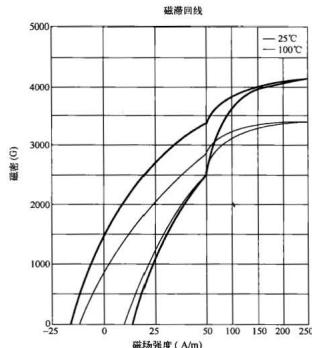

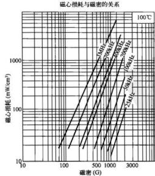

(f)

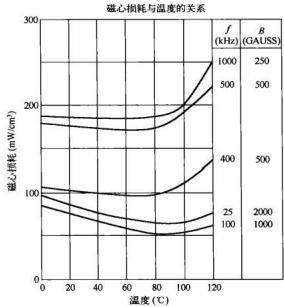

图 7.1 3F3 型材料(一种高频、低损的磁心材料)的主要特性(由 Ferroxcube - Philips 提供)

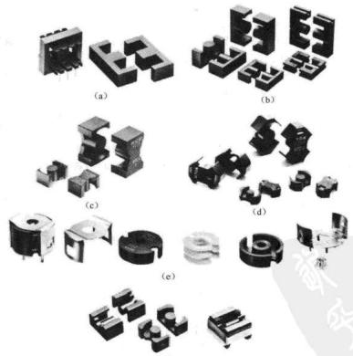

图 7.2 各种几何结构的变压器磁心: (a) EE 磁心; (b) EC 和 ETD 磁心; (c) PQ 磁心; (d) RM 磁心; (e) 罐状磁心; (f) LP 磁心(由 TDK 公司提供)

罐状磁心的主要缺点是其出线槽很窄，因此在输入或者输出电流较大的变换器中，由于绕线的线径很大而很难采用这种磁心，另外在多路输出电源中因需要多个引出线也较少采用。 

即使功率很低,当电源电压很高时罐状磁心也不是一个很好的选择。因为罐状铁氧体的出线槽太窄,带有高压的线头可能会产生电弧。 

大多数罐状磁心中心柱处都设有不同大小的气隙，以便磁心能通过一定大小的直流偏置电流而不饱和。因此罐状磁心可用作Buck变换器(1.3.6节)、正激变换器(2.3.9.2节、2.3.9.3节)、推挽变换器(2.2.8.1节)及反激变换器(4.3.3.1节)的输出电感。 

通常,如果磁心的中心柱上开有气隙,生产厂家应该给出参数 $A_{1}$ 的值(每1000匝线圈的电感值,单位为mH)和安匝数临界值(线圈饱和的临界值)。 

如果要求磁心开气隙，从性能的角度来看，采用中心柱上带有气隙的磁心比用一定厚度的塑料薄片隔离来形成气隙的磁心性价比更高。由于时间、温度以及产品离散度的原因，加薄片的磁心无法保证 $A_{1}$ 值的批量一致性。另外，在磁心外侧磁柱开气隙会加剧EMI问题。 

最常用的磁心为 EE 型磁心(图 7.2(a))，因为 EE 型磁心没有像罐状磁心那样限制烧线引进或导出的狭窄缺口。由于这类磁心的线圈没有完全被铁氧体包围住，它将产生较大的 EMI - RFI 磁场。但是这样的结构空气可以从中间流过，因此变压器散热好。EE 型磁心的中心柱有方形和圆形两种。中心柱为圆形的磁心(EC 或 ETD 型，见图 7.2(b))与方形相比具有一定的优势，即在中心柱面积相同的情况下，前者每匝线圈的平均长度要比后者短 11%。因此在相同匝数的情况下，其线圈阻抗也要小 11%。而且铜损和温升相对来说也要小一些。 

EE型磁心尺寸有很多规格，在不同频率和峰值磁通密度下，EE型磁心能传递5W到5kW甚至10kW的功率。如果将两个中心柱为方形的EE型磁心并联，磁心截面积将加倍，在初级电压、峰值磁通密度及频率相同的情况下，线圈匝数可以减少一半（根据法拉第定律，即公式2.7）。与采用单个磁心相比，这种方式可以使输出功率加倍，并减小了变压器体积。 

RM型(或方形)磁心是一种介于罐状磁心和EE型磁心之间的磁心结构,如图7.2(d)所示。它实际上是一种更有效的罐状磁心,其铁氧体上的开槽更宽,因此这种磁心适用于大功率输出或多路输出电源。较宽的开槽也便于空气流动,因此与罐状磁心相比其温升更低。 

由于线圈没有完全被铁氧体包住,因此它的 EMI-RFI 辐射问题要比罐状磁心严重。但是相同输出功率下,其 EMI 要比 EE 型磁心好,因为方形磁心中被铁氧体包围的线圈面积比 EE 型磁心的大。 

RM型磁心分为有中心柱孔和无中心柱孔两种。中心柱孔一般用来安装螺栓或用在对频率变化敏感的场合。如果在中心柱孔中插入一根可调的铁氧体磁柱，则可使 $A_{1}$ 值最大能改变30%。考虑到能量损耗的问题，在功率变压器中很少用到这种调节功能，但是在频敏滤波器中经常用到。 

PQ 型磁心 (Magnetics Inc. 和 TDK 生产, 见图 7.2(c)) 的体积与辐射面表面积及线圈的绕组面积之间的比例是最佳的。由于磁心损耗和磁心体积成正比, 而热辐射能力与辐射表面面积成正比, 因此, 在给定的输出功率条件下, PQ 型磁心的温升最小。另外由于 PQ 磁心在体积与线圈绕组面积的比例是最优的, 所以相同输出功率下变压器体积也是最小的。 

LP型磁心(图7.2(e),TDK生产)是专门为小剖面变压器设计的。它们的中心柱很长,这样可以减小漏感。 

UU或UI型磁心(图7.2没有给出来)主要用于高压或超大功率场合,1kW以下很少用到。与EE型磁心相比,在相同的磁心面积下,其窗口面积要大得多。因此可以允许更粗的线 径,更多的匝数。但是由于UU型磁心磁通路径很长,初/次级之间的耦合程度不如EE型磁心,所以采用该类磁心的变压器漏感很大。 

## 7.2.3 峰值磁通密度的选择

在2.2.9.3节中已讨论过，如果峰值磁通密度 $B_{\max}$ 已经确定，利用法拉第定律（式(1.17)，2.7节）可以得到变压器初级绕组匝数。从式(1.17)可以看出，磁通密度偏移越大（即 $B_{\max}$ 越大），初级线圈匝数越少，可允许的绕线尺寸就越大，因此能获得的输出功率就越大。 

铁氧体磁心的峰值磁通密度受到两个因素的限制，即磁心损耗以及由磁心损耗带来的温升。大多数铁氧体材料的磁心损耗与峰值磁通密度的2.7次方成正比，因此峰值磁通密度取值不能太大，尤其是在频率很高的情况下。但是大多数铁氧体在频率小于25kHz时磁心损耗都是很小的，即使是磁心损耗最大的那种。在这种情况下峰值磁通密度可以不考虑磁心损耗的影响(见表7.1)。因此，在工作频率很低时，峰值磁通偏移可以达到磁滞回线(BH曲线)包围的面积区域的顶部。但是应该注意磁心不能进入饱和区域，否则原边电流将失去控制变得很大而损坏开关管。同时，铁氧体磁心损耗大约与开关频率的1.7次方成正比。因此，对于高损耗的铁氧体材料(表7.1)来讲，当工作频率很高时，如果试图提高峰值磁通密度来减小绕组匝数的话，反而会导致更多的损耗，从而带来过高的温升。磁心损耗等于损耗因子(mW/cm³)与磁心体积(cm³)的乘积。 

所以，当频率为50kHz以上时，必须采用低损耗的磁心材料（这种材料会贵一点），或者适当减小峰值磁通密度。当然，峰值磁通密度值减小了，初级匝数就会增加(式2.7)。如果磁心骨架上的绕组面积相同，就必须减小绕线尺寸，这样初次级电流就将减小，其最大输出功率也将减小。因此，工作在高频(>50kHz)时需要使用损耗最小的磁心材料，并选择较低的峰值磁通密度，以保证磁心损耗和铜损所带来的温升控制在允许的范围内。怎样利用磁心损耗和铜损来计算温升将在7.4节中介绍。 

虽然在低频时选择峰值磁密不用考虑磁心损耗的影响，但是也不能为了减少初级匝数而选取过高的峰值磁通密度。由图2.3可知，BH回线在2000G（大部分铁氧体材料磁滞回线上线性部分的最大值）附近仍是线性的。如果磁通密度超出这个范围，晶体管导通阶段结束的时刻励磁电流将会增大，进而增加线圈损耗和晶体管导通损耗。对大多数铁氧体来说，在计算原边匝数 $N_{\mathrm{p}}$ （式2.7）的时候取最大磁通密度为2000G是有风险的。因为当网压或负载跳变的时候，如果反馈误差放大器响应速度不够快，在几个开关周期内无法调节过来，那么最大磁通密度将会达到饱和值(100℃时大于3200G)并且损坏功率晶体管。这在2.2.9.4节中已详细介绍过。 

因此，在后面的设计实例中，即使频率小于50kHz，峰值磁通密度也选择为1600G。在高频时，如果采用损耗小的磁心材料其功率损耗还是超出期望的范围，那么还需继续减小峰值磁通密度值。通过后面的“输出功率表”将介绍如何根据峰值磁通密度来计算输出功率。 

## 7.3 磁心最大输出功率、峰值磁通密度、磁心和骨架面积及线圈电流密度的选择

## 7.3.1 变换器拓扑输出功率公式的推导

以图 7.3 所示正激变换器为例,为了推导变换器的输出功率关系,做出如下假设。 

(1) 忽略控制电路的损耗, 设变换器从输入到全部输出之间的功率转换效率为 80%。 

(2) 窗口使用系数(即整个骨架窗口面积中绕有线圈的部分所占的比例)为0.4,其中包括初级和所有次级绕组、绝缘层、所有RFI或静电屏蔽层以及空余的间隙。在变压器设计中，窗口使用系数通常取0.4～0.6之间，因为各种因素，骨架窗口绕线面积存在一定的浪费，其中一个重要的原因就是线圈层间的匝数分布不平均。匝数分布均匀有利于所有层的宽度相等，提高磁场耦合程度，从而减小漏感。另一个因素就是欧洲安全标准(VDE)中要求每层线圈与骨架间要留有4mm的空间。除此之外，对绝缘层厚度也有要求，VDE标准中一般要求采用3层度厚为1密耳的绝缘材料。如果次级被夹在两个初级层之间(为了减小邻近效应带来的铜损)也会浪费6密耳的骨架高度。最后，在实际中经常遇到的一个问题就是，如果骨架高度已被充分利用，磁心和骨架将会很难安装，所以这种浪费不可避免。 

(3) 图 7.3 所示为变换器初级电流波形。输入电压 $V_{\text{dc}}$ 最小时，最大导通时间为 0.8T/2 (2.3.2 节和 2.3.5 节)。由于次级输出电感的存在，每个周期内初级电流为阶梯状的斜坡波形，斜坡波动范围约为中心值 $I_{\text{pt}}$ 的 ±10%。初级电流波形可近似等效成幅值为 $I_{\text{pt}}$ 、占空比为 0.8T/2T 即 0.4 (2.3.5 节) 的矩形脉冲。当 $V_{\text{dc}} = V_{\text{dc(min)}}$ 时， 

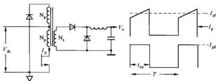

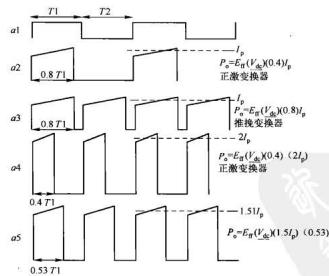

图7.3 正激变换器拓扑及初级电流 $I_{\mathrm{p}}$ 的波形。 $I_{\mathrm{ph}}$ 为等效平顶波电流，用来计算输出功率与 $B_{\mathrm{max}}$ 、频率、 $A_{\mathrm{s}}$ 、 $A_{\mathrm{b}}$ 和 $D_{\mathrm{cmax}}$ 的关系。匝比 $N_{s}/N_{p}$ 应选择为输入电压取最小值 $V_{\mathrm{dc(min)}}$ 、导通时间为0.8T/2时，输出电压为 $V_{\mathrm{s}}$ 。

$$
\begin{array}{r l} P _ {\mathrm{o}} & = 0. 8 P _ {\mathrm{in}} = 0. 8 V _ {\mathrm{dc(min)}} \left[ I _ {\mathrm{av}} \mathrm{at} V _ {\mathrm{dc(min)}} \right] \\ & = 0. 8 V _ {\mathrm{dc(min)}} \left(I _ {\mathrm{pt}}\right) \frac {0 . 8 T}{2 T} \\ & = 0. 3 2 V _ {\mathrm{dc(min)}} I _ {\mathrm{pfl}} \end{array}\tag{7.1}
$$

幅值为 $I_{pft}$ ，占空比为 0.4 的方波电流有效值为 $I_{rms} = I_{pft} \sqrt{0.4}$ 或 $I_{pft} = 1.58 I_{rms}$ ，则 

$$
\begin{array}{r l} P _ {\mathrm{o}} & = 0. 3 2 V _ {\mathrm{dc(min)}} (1. 5 8 I _ {\mathrm{rms}}) \\ & = 0. 5 0 6 V _ {\mathrm{dc(min)}} I _ {\mathrm{rms}} \end{array}\tag{7.2}
$$

根据法拉第定律有 

$$
V _ {p} = N _ {p} A _ {c} \frac {\Delta B}{\Delta T} \times 1 0 ^ {- 8}
$$

式中， $V_{p}$ 为初级电压 $(\approx V_{\mathrm{dc}})$ ; $N_{p}$ 为初级线圈匝数； $A_{e}$ 为磁心面积，单位为 $cm^{2}$ ; $\Delta B$ 为磁通密度增量，单位为 G（取值范围为 $0 \sim B_{max}$ ); $\Delta T$ 为时间，单位为 s，此处磁通密度变化的时间为 0.4T。 

当输入直流电压为 $V_{\mathrm{dc(min)}}$ 时， $\Delta B/\Delta T=B_{\max}/0.4T$ 。根据式(7.2)f=1/T，则 

$$
\begin{array}{r l} P _ {\mathrm{o}} & = \frac {0 . 5 0 6 I _ {\mathrm{rms}} N _ {\mathrm{p}} A _ {\mathrm{e}} B _ {\mathrm{max}} f}{0 . 4} \times 1 0 ^ {- 8} \\ & = 1. 2 6 5 N _ {\mathrm{p}} B _ {\mathrm{max}} A _ {\mathrm{e}} f \times 1 0 ^ {- 8} (I _ {\mathrm{rms}}) \end{array}\tag{7.3}
$$

假设初级和所有次级绕组电流密度都取 $D_{ema}$ ，单位为圆密耳每安培(RMS值)。复位绕组由于只流过励磁电流，其绕线尺寸通常很小(不超过AWG 30号线)，所以忽略其在骨架上所占的面积。 

令 $A_{b}$ 为骨架的绕组面积，单位为 $in^{2}$ ; $A_{p}$ 为初级绕组面积，单位为 $in^{2}$ ; $A_{s}$ 为次级绕组面积（包括所有次级），单位为 $in^{2}$ ; $A_{ti}$ 为初级功率绕组每匝的面积，单位为 $in^{2}$ 。 

则当窗口使用系数 $\mathrm{SF} = 0.4$ ，且 $A_{\mathrm{p}} = A_{s}$ 时，有 

或 

$$
\begin{array}{r l} A _ {\mathrm{p}} & = 0. 2 0 A _ {\mathrm{b}} = N _ {\mathrm{p}} A _ {\mathrm{u}} \\ A _ {\mathrm{u}} & = \frac {0 . 2 A _ {\mathrm{b}}}{N _ {\mathrm{p}}} \end{array}\tag{7.4}
$$

则电流密度为 

$$
D _ {\mathrm{cms}} = \frac {A _ {\mathrm{tem}}}{I _ {\mathrm{rms}}}
$$

式中， $A_{tem}$ 是初级绕线面积，单位为圆密耳，有 

$$
I _ {\mathrm{rms}} = \frac {A _ {\mathrm{tcm}}}{I _ {\mathrm{rms}}}\tag{7.5}
$$

又 $1\mathrm{in}^2 = (4 / \pi)\times 10^6$ 圆密耳，则 

$$
A _ {\mathrm{tcm}} = \frac {4 A _ {\mathrm{b}} \times 1 0 ^ {6}}{\pi} = \frac {4 (0 . 2 0 A _ {\mathrm{b}}) 1 0 ^ {6}}{\pi N _ {\mathrm{p}}}
$$

由式(7.5)可得 

$$
I _ {\mathrm{rms}} = \frac {0 . 8 A _ {\mathrm{b}} \times 1 0 ^ {6}}{\pi N _ {\mathrm{p}} D _ {\mathrm{cma}}}\tag{7.6}
$$

将式(7.6)代入式(7.3)可得 

$$
P _ {o} = (1. 2 6 5 N _ {\mathrm{p}} B _ {\max} A _ {a} f \times 1 0 ^ {- 8}) \frac {0 . 8 A _ {\mathrm{b}} \times 1 0 ^ {6}}{\pi N _ {\mathrm{p}} D _ {\mathrm{cma}}}
$$

$$
= \frac {0 . 0 0 3 2 2 B _ {\max} f A _ {e} A _ {b}}{D _ {\mathrm{cma}}}
$$

式中， $A_{b}$ 单位为 $in^{2}$ ，除以 6.45 后将其转化为 $cm^{2}$ ，那么 

$$
P _ {\mathrm{o}} = \frac {0 . 0 0 0 5 0 B _ {\max} f A _ {\mathrm{e}} A _ {\mathrm{b}}}{D _ {\mathrm{cma}}}\tag{7.7}
$$

式中， $P_{o}$ 的单位为 W, $B_{max}$ 的单位为 G, $A_{e}$ 和 $A_{b}$ 的单位为 cm², f 的单位为 Hz, $D_{cma}$ 的单位为圆密耳每安培 (RMS 值)。 

## 7.3.2 推挽变换器输出功率公式的推导

假设条件如7.3.1节中讨论的一样， $P_{\mathrm{w}} = 0.8P_{\mathrm{in}} = 0.8V_{\mathrm{dc(min)}}I_{\mathrm{av}}$ （取 $V_{\mathrm{dc(min)}}$ 时的 $I_{\mathrm{av}}$ 值）。在推挽电路中，当输入为最小值 $V_{\mathrm{dc(min)}}$ 时，每个开关管在其半周期内的占空比最大值0.87/2，每个周期有两个脉冲，所以整个周期内从 $V_{\mathrm{dc(min)}}$ 获得电流的占空比为0.8。每个开关管导通时，开关管和相应的初级回路流过幅值为 $I_{\mathrm{ph}}$ 的等效平顶波电流，则输出功率为 

$$
\begin{array}{r l} P _ {\mathrm{o}} & = 0. 8 V _ {\mathrm{dc(min)}} (0. 8 I _ {\mathrm{pft}}) \\ & = 0. 6 4 V _ {\mathrm{dc(min)}} I _ {\mathrm{pft}} \end{array}\tag{7.8}
$$

由于初级每个开关管流过电流的占空比仅为0.4，因此流过初级每条支路的电流有效值为 $I_{rms}=I_{pft}\sqrt{0.4}$ 或 $I_{pft}=1.58I_{ms}$ ，有 

$$
P _ {\mathrm{e}} = \frac {0 . 0 0 0 5 0 B _ {\max} f A _ {\mathrm{e}} A _ {\mathrm{b}}}{D _ {\mathrm{cma}}}\tag{7.9}
$$

又令 $\mathrm{SF} = 0.4$ ，初级和次级绕组面积分别为整个窗口面积的一半，每个绕组的电流密度都为 $D_{\mathrm{cma}}$ （圆密耳每安培），由此可以得到 

或 

$$
\begin{array}{r l} A _ {\mathrm{p}} & = 0. 2 0 A _ {\mathrm{b}} = 2 N _ {\mathrm{p}} A _ {\mathrm{ti}} \\ A _ {\mathrm{ti}} & = \frac {0 . 1 A _ {\mathrm{b}}}{N _ {\mathrm{p}}} \end{array}\tag{7.10}
$$

式中， $N_{p}$ 为半个初级绕组的匝数； $A_{b}$ 为骨架窗口总面积，单位为 $in^{2}$ ; $A_{ti}$ 为初级绕线每匝的面积，单位为 $in^{2}$ 。 

又因 

$$
D _ {\mathrm{cms}} = \frac {A _ {\mathrm{lcm}}}{I _ {\mathrm{rms}}}
$$

式中， $A_{tcm}$ 为绕线面积（单位为圆密耳）， $I_{rms}$ 为初级每条支路的电流有效值，且 

$$
I _ {\mathrm{rms}} = \frac {A _ {\mathrm{rem}}}{D _ {\mathrm{cma}}}\tag{7.11}
$$

而 $A_{\mathrm{ti}} = A_{\mathrm{tem}}(\pi /4)\times 10^{-6}$ ，将此式代入式(7.10)，可以得到 

$$
A _ {\mathrm{tem}} = 0. 1 2 7 3 \frac {A _ {\mathrm{b}}}{N _ {\mathrm{p}}} 1 0 ^ {6}
$$

再将上式代入式(7.11)，得到 

$$
I _ {\mathrm{rms}} = 0. 1 2 7 3 \frac {A _ {\mathrm{b}}}{N _ {\mathrm{p}} D _ {\mathrm{cma}}} 1 0 ^ {6}
$$

代入式(7.9)，则 

$$
P _ {\mathrm{o}} = 1. 0 1 V _ {\mathrm{dc(min)}} \frac {0 . 1 2 7 3 A _ {\mathrm{b}}}{N _ {\mathrm{p}} D _ {\mathrm{cma}}} 1 0 ^ {6}
$$

$$
= 0. 1 2 9 \frac {V _ {\mathrm{dc(min)}} A _ {\mathrm{b}}}{N _ {\mathrm{p}} D _ {\mathrm{ctm}}} 1 0 ^ {6}\tag{7.12}
$$

根据法拉第定律,可得 

$$
V _ {\text { primary   min }} \approx V _ {\mathrm{dc(min)}} = \left(\frac {N _ {\mathrm{p}} A _ {\mathrm{e}} \Delta B}{\Delta T}\right) 1 0 ^ {- 8}
$$

推挽电路中，当输入电压为 $V_{\mathrm{dc(min)}}$ 时，磁通密度在 0.4T 时间内的变化量为 $2B_{max}$ ，将该量代入式(7.12)，可得 

$$
\begin{array}{r l} P _ {\mathrm{o}} & = 0. 1 2 9 (N _ {\mathrm{p}} A _ {\mathrm{e}}) \frac {2 B _ {\max} A \mathrm{b}}{0 . 4 T N _ {\mathrm{p}} D _ {\mathrm{cma}}} 1 0 ^ {- 2} \\ & = \frac {0 . 0 0 6 4 5 B _ {\max} f A _ {\mathrm{e}} A _ {\mathrm{b}}}{D _ {\mathrm{cma}}} \end{array}
$$

同样，式中 $A_{\mathrm{b}}$ 的单位是 $\mathrm{in}^2$ ，除以系数6.45后转化为 $\mathrm{cm}^2$ ，即 

$$
P _ {\mathrm{o}} = \frac {0 . 0 0 1 0 B _ {\max} f A _ {\mathrm{e}} A _ {\mathrm{b}}}{D _ {\mathrm{cma}}}\tag{7.13}
$$

式中， $P_{o}$ 的单位为 W, $B_{max}$ 的单位为 G, $A_{e}$ 和 $A_{b}$ 的单位为 cm², f 的单位为 Hz, $D_{cm}$ 的单位为圆密耳每安培 (RMS 值)。从这个结果可知，在相同磁心、频率和电流的情况下，推挽拓扑的输出功率是正激拓扑的两倍。 

推挽电路中，变压器初级每边绕组承受与正激变换器相同的输入电压，但是它的磁通偏移为 $2B_{max}$ ，而不是正激变换器的 $B_{max}$ 。根据法拉第定律，磁通增量 $B_{max}$ 相同时，推挽电路每边绕组的匝数是正激变换器的一半。但是推挽电路有两个次级，所以 $V_{dc}$ 和 $B_{max}$ 相同时，推挽电路所有的匝数之和与正激变换器相等（忽略正激变换器中复位绕组所占的很小的比例）。 

在推挽电路中，每个次级绕组传送一半的输出功率。因此，推挽变换器和正激变换器输出功率相同时，前者变压器每边绕组的峰值和有效值电流是后者的一半（比较式(2.11)和式(2.28)、式(2.9)和式(2.41)可得）。同样，前者变压器每半边绕组要求的绕线面积（圆密耳）和骨架窗口面积也是后者的一半。如果骨架窗口面积相同，从式(7.17)和式(7.13)可以看出，磁心相同时推挽电路传送的功率是正激变换器的两倍。 

## 7.3.2.1 推挽变换器和正激变换器的磁心损耗与铜损

比较式(7.7)和式(7.13)可知,如果推挽变换器和正激变换器采用同样尺寸的磁心(即 $A_{e}A_{b}$ 的乘积相同),则前者的输出功率是后者的两倍。 

但是推挽变压器也有一个缺陷，即变压器温升比正激变换器的高。这是因为虽然它的输出功率是正激变换器的两倍，但是铜损相同，而磁心损耗却是正激变换器的两倍。如图7.3(a3)所示，推挽电路中，变压器每半个初级绕组承受的电压和正激变换器初级绕组一样，都为输入电压，但是正激变换器的磁通密度在时间0.8T $_{i}$ 内从0变化到预先选定的最大值 $B_{max}$ 附近(图7.3(a2))，而推挽电路的磁通密度在相同的时间内从 $-B_{max}$ 变化到 $B_{max}$ ，即磁通偏移为2B $_{max}$ 。 

根据法拉第定律,匝数与承受的电压成正比,与磁通密度的变化成反比。因此,峰值磁通密度相同时,推挽电路每半个初级绕组的匝数是正激变换器初级绕组匝数的一半。 

如果推挽电路的输出功率为正激变换器的两倍，那么它每半个周期内的电流峰值与正激变换器的相同。又因为在推挽电路中流过半个初级绕组的电流的时间与正激变换器输出一半 功率时相等,那么推挽电路半个初级绕组中的电流有效值与正激变换器的相等。 

当电流密度都取500圆密耳每安培时，推挽电路与正激变换器初级绕组的导线尺寸相同（圆密耳数相同）。另外由于推挽电路半个初级绕组的匝数是正激变换器半输出功率时初级绕组匝数的一半，因此推挽电路整个初级绕组的体积与正激变换器的相同。 

推挽电路半个初级绕组的匝数为正激变换器初级的一半，电流有效值与正激变换器相同，相应的铜损 $I^{2}R$ 为正激变换器的一半，因此初级绕组总的铜损与半输出功率下正激变换器的铜损相同。 

但是推挽电路的磁心损耗是正激变换器的两倍。因为推挽电路的磁通密度是从 $-B_{max}$ 变化到 $+B_{max}$ ，正激变换器的磁通密度只是从0变化到 $B_{max}$ ，而磁心损耗与磁滞回线所包围的面积成正比，所以推挽电路（工作在磁滞回线的第一、第三象限）的磁心损耗是正激变换器（工作在磁滞回线的第一象限）的两倍(7.2.1节)。随着新型的低损耗磁心材料的应用，在频率小于30kHz的情况下，磁心损耗不再是变压器温升的限制因素。 

## 7.3.2.2 不采用推挽拓扑，使给定的磁心输出功率加倍

上节的分析中指出，对于同样的磁心，在频率较低的时候推挽拓扑的输出功率是正激变换器的两倍，且铜损保持不变，唯一的缺点是磁心损耗会加倍。 

但是推挽拓扑采用两个晶体管，这样成本和体积都会增加。另外，推挽变压器每个绕组需引出三个出线端，而正激变换器中每个绕组只需引出两个出线端，所以推挽变压器的绕制更加复杂，其基本正激变换器的高。最后，如果推挽电路工作在非电流模式，还会存在磁通不平衡问题(2.2.5节)。 

对于给定的正激变换器,要想在不增加磁心尺寸的情况下使输出功率加倍,下面所介绍到的方法是替代推挽电路一个很好的选择(图7.3(a))。 

在 30kHz 以下的工作场合，在相同磁心的条件下，推挽电路之所以能产生两倍于正激变换器的输出功率，是因为该电路每个周期能产生两个电流脉冲，而正激变换器只能产生一个。所以使正激变换器的输出功率加倍的方法就是保持正激变换器电路拓扑不变，使其电流脉冲幅值为推挽电路的两倍，脉冲宽度为原推挽电路电流周期的一半，如图 7.3(a4) 所示。 

另外一种方法就是使正激变换器频率加倍(此处正激变换器的频率定义为磁心沿着磁滞回线磁化运动一周所需时间的倒数)。式(7.7)表明,磁心的输出功率与频率成正比。 

因此，如果正激变换器的频率提高一倍，则其磁心的输出功率必将提高一倍。但同时因为磁心损耗与频率的1.7次幂成正比（见表7.1和7.2.3节），所以磁心损耗大于原值的两倍（接近3倍）。 

补充:与相应的推挽电路相比,在峰值磁通密度相等的情况下,正激变换器工作频率增加一倍并不一定导致磁心损耗增加。注意到推挽电路中磁通变化的峰-峰值是正激变换器的两倍,因此推挽电路磁通变化一个周期与正激变换器磁通变化两个周期产生的损耗相等。用另外一种方式可以理解为,正激变换器B/H回线变化一个周期所围成的面积是推挽电路的一半。 

——K. B. 

正激变换器采用两倍频率和两倍初级电流峰值使输出功率加倍时的铜损保持不变,其原因将在下面的章节中加以分析。 

上述方法的缺点在于正激变换器的磁心损耗将是原来的3倍，但由于推挽电路的磁心损耗也为原来的两倍，因此在原来的工作频率下还是可以考虑用此方法替代推挽电路的。 

但是采用该方法的前提是,原来的频率应低于50～80kHz。因为如果原来的频率已经较高,则频率增加一倍后开关损耗和缓冲电路的损耗(第11章)将会很大,从而使变换器效率变低。 

如图 7.3(a4) 所示,为了使输出功率加倍,正激变换器的频率和初级电流的峰值都增加了一倍。但是这种方法有自己的缺点:首先电流峰值增大将会加剧 RFI 问题,同时也要求选用更高电流等级的晶体管,增加了成本。 

如果初级电流峰值加倍的方法不可取，还有一种方法就是增大晶体管的最大导通时间。图7.3(n4)中，设变压器变比 $N_{\mathrm{r}} / N_{\mathrm{p}}$ （变压器复位绕组与功率绕组的匝数比）为1，取最大脉宽为0.8T1/2。最大脉宽的选取必须确保磁心能在同样的复位时间内完全复位，同时在下一个开关管导通之前留有一段死区(2.3.2节）。 

在2.3.8节中已介绍过，如果令 $N_{r}/N_{p}$ 小于1，则开关管导通时间增加，但复位电压和开关管承受的关断电压应力也会增大。所以在图7.3(a5)中， $N_{r}/N_{p}$ 取0.5。与 $N_{r}/N_{p}=1$ 时相比，最大脉宽从0.4T1增大为0.53T1，电流峰值也由 $2I_{p}$ 减小为1.51 $I_{p}$ 。缺点是此时开关管承受的关断电压为 $3V_{dc}$ ，而不是原先的 $2V_{dc}$ 。 

正如2.3.8节所述，令 $N_{r}/N_{p}$ 小于1可以降低开关管的最大电流应力，但增加了最大电压应力。如果 $N_{r}/N_{p}$ 小于0.5，则开关管关断时的电压应力通常会超出管子所能承受的范围。 

如前所述,采用使正激变换器频率和开关管电流峰值加倍,从而使输出功率加倍的方法后,变换器的铜损保持不变,具体可以参考下面的表格。 

<table><tr><td>图号</td><td>频率</td><td><eq>I_p</eq></td><td>占空比</td><td><eq>I_{rms}</eq></td><td>N</td><td>绕线截面积</td><td>绕线电阻</td><td><eq>(I_{rms})^2R</eq></td><td><eq>P_o</eq></td></tr><tr><td>7.3(a2)</td><td><eq>F_1</eq></td><td><eq>I_p</eq></td><td>0.4</td><td>0.632<eq>I_p</eq></td><td>N</td><td>A1</td><td>R1</td><td><eq>(I_{rms})^2R</eq></td><td><eq>P_o</eq></td></tr><tr><td>7.3(a4)</td><td>2F1</td><td>2<eq>I_p</eq></td><td>0.4</td><td>1.264<eq>I_p</eq></td><td>0.5N</td><td>2A1</td><td>0.25R1</td><td><eq>(I_{rms})^2R</eq></td><td>2<eq>P_o</eq></td></tr></table>

频率加倍后正激变换器的电流有效值变为原来的两倍，从而绕线的面积应为原来变换器在半功率输出条件下绕线面积的两倍，而此时初级的匝数却为原来的一半，综合起来，变换器的阻抗为原来的1/4。由铜损公式 $I^{2}R$ 可知，变换器此时的铜损与原来变换器在半功率输出时的相等。 

## 7.3.3 半桥拓扑输出功率公式的推导

图3.1所示为半桥拓扑，同样假设输入电压最小值为 $V_{det(\min)}$ ，此时晶体管的最大导通时间为0.8T/2，设变换器效率为80%，并令 $A_{c}$ 、 $A_{b}$ 分别为磁心面积和骨架窗口面积，单位为 $cm^{2}$ ； $A_{bi}$ 为骨架窗口面积，单位为 $in^{2}$ ； $A_{p}$ 为初级绕组面积，单位为 $in^{2}$ ；SF=0.4，初级绕组面积和所有次级绕组面积相等； $D_{cmax}$ 为电流密度，单位为圆密耳每安培（所有绕组都工作在相同的电流密度值）； $A_{u}$ 为绕线面积，单位为 $in^{2}$ ； $A_{tum}$ 为绕线面积，单位为圆密耳； $N_{p}$ 为初级匝数； $I_{pH}$ 为初级电流脉冲等效为平顶波后的幅值。 

电流 $I_{\mathrm{pft}}$ 的占空比为0.8，其有效值为 $I_{\mathrm{rms}} = I_{\mathrm{pft}}\sqrt{0.8} = 0.894I_{\mathrm{pft}}$ 或 $I_{\mathrm{pft}} = 1.12I_{\mathrm{rms}}$ ，则有 

$$
\begin{array}{r l} P _ {\mathrm{o}} & = 0. 8 P _ {\mathrm{in}} = 0. 8 \frac {V _ {\mathrm{dc(min)}}}{2} [ I \text { average   at } V _ {\mathrm{dc(min)}} ] \\ & = 0. 4 V _ {\mathrm{dc(min)}} 0. 8 I _ {\mathrm{pft}} \\ & = 0. 3 2 V _ {\mathrm{dc(min)}} I _ {\mathrm{pft}} \\ & = 0. 3 5 8 V _ {\mathrm{dc(min)}} I _ {\mathrm{rms}} \end{array}
$$

又 

$$
A _ {\mathrm{p}} = 0. 2 A _ {\mathrm{bi}} = N _ {\mathrm{p}} A _ {\mathrm{ti}}\tag{7.14}
$$

$$
A _ {\mathrm{ti}} = \frac {0 . 2 A _ {\mathrm{bi}}}{N _ {\mathrm{p}}}
$$

而 $A_{\mathrm{ti}} = A_{\mathrm{tcm}}(\pi /4)\times 10^{-6}$ 所以 

$$
A _ {\mathrm{tem}} = 0. 2 5 5 \left(\frac {A _ {\mathrm{bi}}}{N _ {\mathrm{p}}}\right) 1 0 ^ {6}\tag{7.15}
$$

$$
\begin{array}{r l} I _ {\mathrm{rms}} & = \frac {A _ {\mathrm{tcm}}}{D _ {\mathrm{cma}}} \\ & = 0. 2 5 5 \frac {A _ {\mathrm{bi}}}{N _ {\mathrm{p}} D _ {\mathrm{cma}}} 1 0 ^ {6} \end{array}\tag{7.16}
$$

将式 $(7.16)$ 代入式 $(7.14)$ 可得 

$$
P _ {\mathrm{o}} = 0. 0 9 1 3 \frac {V _ {\mathrm{dc(min)}} A _ {\mathrm{bi}}}{N _ {\mathrm{p}} D _ {\mathrm{cma}}} 1 0 ^ {6}\tag{7.17}
$$

因为输入电压为 $V_{\mathrm{dc(min)}}$ 时，初级承受的电压为 $V_{\mathrm{dc(min)}}/2$ ，则根据法拉第定律可得 

$$
V _ {\mathrm{p(min)}} = \frac {V _ {\mathrm{dc(min)}}}{2} = N _ {\mathrm{p}} A _ {e} \frac {\Delta B}{\Delta T} 1 0 ^ {- 8}
$$

式中， $\Delta B=2B_{\max},\Delta T=0.4T$ 。而 $V_{\mathrm{dc(min)}}=10N_{\mathrm{p}}fA_{\mathrm{c}}B_{\max}10^{-8}$ ，将此式代入式(7.17)，则 

$$
P _ {\circ} = \frac {0 . 0 0 9 1 3 B _ {\max} f A _ {\mathrm{e}} A _ {\mathrm{bi}}}{D _ {\mathrm{cma}}}
$$

除以系数6.45，将骨架窗口面积单位转化为 $\mathrm{cm}^2$ ，可得 

$$
P _ {\mathrm{e}} = \frac {0 . 0 0 1 4 B _ {\max} f A _ {\mathrm{e}} A _ {\mathrm{b}}}{D _ {\mathrm{cma}}}\tag{7.18}
$$

式中， $P_{o}$ 的单位为 W, $B_{max}$ 的单位为 G, $A_{e}$ 和 $A_{b}$ 的单位为 cm², f 的单位为 Hz。 

## 7.3.4 全桥拓扑输出功率公式的推导

若选用相同的磁心，则全桥拓扑的输出功率与半桥拓扑相等，只有选用更大磁心，它才能传送两倍于半桥的输出功率。因为全桥变换器初级承受的电压为半桥的两倍，所以它的初级匝数也为半桥的两倍（据3.3.2.1节的法拉第定律可得）。 

如果全桥变换器中骨架的窗口使用面积与半桥的相等，那么原边绕线尺寸减小一半。绕线尺寸减半后，如果电流密度(圆密耳每有效值安培)不变，那么允许的有效值电流将会减半。综合来看，虽然全桥变换器磁心的工作电压为半桥的两倍，但初级电流却只有半桥的一半，所以相同磁心下传送的输出功率与半桥的相等。 

当然,如果此时全桥变换器初级电压为半桥的两倍,而电流一样,那么它的输出功率将是半桥的两倍。但是如果电流密度一样,则初级绕组匝数将是半桥变换器的两倍,这意味着磁心需要更大的绕线面积,亦即需要选择尺寸更大的磁心。 

## 7.3.5 以查表的方式确定磁心和工作频率

通过式(7.7)、式(7.13)和式(7.18)可以选择相应输出功率所需要的磁心和工作频率。但是，正如7.1节所述，这需要大量烦琐的计算过程。 

表7.2a和表7.2b避免了这些计算，表中列出了 $B_{\mathrm{max}} = 1600\mathrm{G}$ 和 $D_{\mathrm{oma}} = 500$ 圆密耳每安培时，根据上面三个公式计算所得的输出功率。 

表 7.2a 正激变换器拓扑的最大输出功率

<table><tr><td rowspan="2">磁心</td><td rowspan="2"><eq>{A}_{\mathrm{a}},{\mathrm{{cm}}}^{2}</eq></td><td rowspan="2"><eq>{A}_{1},{\mathrm{\;{cm}}}^{2}</eq></td><td rowspan="2"><eq>{A}_{\mathrm{c}}/{A}_{\mathrm{b}},{\mathrm{{cm}}}^{4}</eq></td><td colspan="9">各频率下的最大输出功率</td><td rowspan="2">体积 <eq>{\mathrm{{cm}}}^{3}</eq></td></tr><tr><td>20kHz</td><td>24kHz</td><td>48kHz</td><td>72kHz</td><td>96kHz</td><td>150kHz</td><td>200kHz</td><td>250kHz</td><td>300kHz</td></tr><tr><td colspan="14">EE Cores, Ferrocube-Philips</td></tr><tr><td>814E250</td><td>0.202</td><td>0.171</td><td>0.035</td><td>1.1</td><td>1.3</td><td>2.7</td><td>4.0</td><td>5.3</td><td>8. 3</td><td>11.1</td><td>13.8</td><td>16.6</td><td>0.57</td></tr><tr><td>813E187</td><td>0.225</td><td>0.329</td><td>0.074</td><td>2.4</td><td>2.8</td><td>5.7</td><td>8.5</td><td>11.4</td><td>17.8</td><td>23.7</td><td>29.6</td><td>35.5</td><td>0.89</td></tr><tr><td>813E343</td><td>0.412</td><td>0.359</td><td>0.148</td><td>4.7</td><td>5.7</td><td>11.4</td><td>17.0</td><td>22.7</td><td>35.5</td><td>47.3</td><td>59.2</td><td>71.0</td><td>1.64</td></tr><tr><td>812E250</td><td>0.395</td><td>0.581</td><td>0.229</td><td>7.3</td><td>8. 8</td><td>17.6</td><td>26.4</td><td>35.3</td><td>55.1</td><td>73.4</td><td>91.8</td><td>110.2</td><td>1.93</td></tr><tr><td>782E272</td><td>0.577</td><td>0.968</td><td>0.559</td><td>17.9</td><td>21.4</td><td>42.9</td><td>64.3</td><td>85.8</td><td>134.0</td><td>178.7</td><td>223.4</td><td>268.1</td><td>3.79</td></tr><tr><td>E375</td><td>0.810</td><td>1:149</td><td>0.931</td><td>29.8</td><td>35.7</td><td>71.5</td><td>107.2</td><td>143.0</td><td>223.4</td><td>297.8</td><td>372.3</td><td>446.7</td><td>5.64</td></tr><tr><td>E21</td><td>1.490</td><td>1.213</td><td>1.807</td><td>57.8</td><td>69.4</td><td>138.8</td><td>208.2</td><td>277.6</td><td>433.8</td><td>578.4</td><td>722.9</td><td>867.5</td><td>11.50</td></tr><tr><td>783E608</td><td>1.810</td><td>1.781</td><td>3.224</td><td>103.2</td><td>123.8</td><td>247.6</td><td>371.4</td><td>495.1</td><td>773.7</td><td>1031.6</td><td>1289.4</td><td>1547.3</td><td>17.80</td></tr><tr><td>783E776</td><td>2.330</td><td>1.810</td><td>4.217</td><td>135.0</td><td>161.9</td><td>323.9</td><td>485.8</td><td>647.8</td><td>1012.2</td><td>1349.5</td><td>1686.9</td><td>2024.3</td><td>22.90</td></tr><tr><td>E625</td><td>2.340</td><td>1.370</td><td>3.206</td><td>102.6</td><td>123.1</td><td>246.2</td><td>369.3</td><td>492.4</td><td>769.4</td><td>1025.9</td><td>1282.3</td><td>1538.8</td><td>20.80</td></tr><tr><td>E55</td><td>3.530</td><td>2.800</td><td>9.884</td><td>316.3</td><td>379.5</td><td>759.1</td><td>1138.6</td><td>1518.2</td><td>2372.2</td><td>3162.9</td><td>3953.6</td><td>4744.3</td><td>43.50</td></tr><tr><td>E75</td><td>3.380</td><td>2.160</td><td>7.301</td><td>233.6</td><td>280.4</td><td>560.7</td><td>841.1</td><td>1121.4</td><td>1752.2</td><td>2336.3</td><td>2920.3</td><td>3504.4</td><td>36.00</td></tr><tr><td colspan="14">EC Cores,Ferracube-Philips</td></tr><tr><td>EC35</td><td>0.843</td><td>0.968</td><td>0.816</td><td>26.1</td><td>31.3</td><td>62.7</td><td>94.0</td><td>125.3</td><td>195.8</td><td>261.1</td><td>326.4</td><td>391.7</td><td>6.53</td></tr><tr><td>EC41</td><td>1.210</td><td>1.350</td><td>1.634</td><td>52.3</td><td>62.7</td><td>125.5</td><td>188.2</td><td>250.9</td><td>392.0</td><td>522.7</td><td>653.4</td><td>784.1</td><td>10.80</td></tr><tr><td>EC52</td><td>1.800</td><td>2.130</td><td>3.834</td><td>122.7</td><td>147.2</td><td>294.5</td><td>441.7</td><td>588.9</td><td>920.2</td><td>1226.9</td><td>1533.6</td><td>1840.3</td><td>18.80</td></tr><tr><td>EC70</td><td>2.790</td><td>4.770</td><td>13.308</td><td>425.9</td><td>511.0</td><td>1022.1</td><td>1533.1</td><td>2044.2</td><td>3194.0</td><td>4258.7</td><td>5323.3</td><td>6388.0</td><td>40.10</td></tr><tr><td colspan="14">ETD Cores,Ferracube-Philips</td></tr><tr><td>ETD 29</td><td>0.760</td><td>0.903</td><td>0.686</td><td>22.0</td><td>26.4</td><td>52.7</td><td>79.1</td><td>105.4</td><td>164.7</td><td>219.6</td><td>274.5</td><td>329.4</td><td>5.50</td></tr><tr><td>ETD 34</td><td>0.971</td><td>1.220</td><td>1.185</td><td>37.9</td><td>45.5</td><td>91.0</td><td>136.5</td><td>182.0</td><td>284.3</td><td>379.1</td><td>473.8</td><td>568.6</td><td>7.64</td></tr><tr><td>ETD 39</td><td>1.250</td><td>1.740</td><td>2.175</td><td>69.6</td><td>83.5</td><td>167.0</td><td>250.6</td><td>334.1</td><td>522.0</td><td>696.0</td><td>870.0</td><td>1044.0</td><td>11.50</td></tr><tr><td>ETD 44</td><td>1.740</td><td>2.130</td><td>3.706</td><td>118.6</td><td>142.3</td><td>284.6</td><td>427.0</td><td>569.3</td><td>889.5</td><td>1186.0</td><td>1482.5</td><td>1779.0</td><td>18.00</td></tr><tr><td>ETD 49</td><td>2.110</td><td>2.710</td><td>5.718</td><td>183.0</td><td>219.6</td><td>439.2</td><td>658.7</td><td>878.3</td><td>1372.3</td><td>1829.8</td><td>2287.2</td><td>2744.7</td><td>24.20</td></tr><tr><td colspan="14">Pot Cores,Ferracube-Philips</td></tr><tr><td>704</td><td>0.070</td><td>0.022</td><td>0.002</td><td>0.0</td><td>0.1</td><td>0.1</td><td>0.2</td><td>0.2</td><td>0.4</td><td>0.5</td><td>0.6</td><td>0.7</td><td>0.07</td></tr><tr><td>905</td><td>0.101</td><td>0.034</td><td>0.003</td><td>0.1</td><td>0.1</td><td>0.3</td><td>0.4</td><td>0.5</td><td>0.8</td><td>1.1</td><td>1.4</td><td>1.6</td><td>0.13</td></tr><tr><td>1107</td><td>0.167</td><td>0.054</td><td>0.009</td><td>0.3</td><td>0.3</td><td>0.7</td><td>1.0</td><td>1.4</td><td>2.2</td><td>2.9</td><td>3.6</td><td>4.3</td><td>0.25</td></tr></table>

第7章 变压器及磁性元件设计

<table><tr><td rowspan="2">磁心</td><td rowspan="2"><eq>{A}_{\mathrm{a}},{\mathrm{{cm}}}^{2}</eq></td><td rowspan="2"><eq>{A}_{\mathrm{b}},{\mathrm{{cm}}}^{2}</eq></td><td rowspan="2"><eq>{A}_{\mathrm{c}}/{A}_{\mathrm{b}},{\mathrm{{cm}}}^{4}</eq></td><td colspan="9">各频率下的最大输出功率</td><td rowspan="2">体积 <eq>{\mathrm{{cm}}}^{3}</eq></td></tr><tr><td>20kHz</td><td>24kHz</td><td>48kHz</td><td>72kHz</td><td>96kHz</td><td>150kHz</td><td>200kHz</td><td>250kHz</td><td>300kHz</td></tr><tr><td colspan="14">Pot Cores, Ferrocube-Philips(continued)</td></tr><tr><td>1408</td><td>0.251</td><td>0.097</td><td>0.024</td><td>0.8</td><td>0.9</td><td>1.9</td><td>2.8</td><td>3.7</td><td>5.8</td><td>7.8</td><td>9.7</td><td>11.7</td><td>0.50</td></tr><tr><td>1811</td><td>0.433</td><td>0.187</td><td>0.081</td><td>2.6</td><td>3.1</td><td>6.2</td><td>9.3</td><td>12.4</td><td>19.4</td><td>25.9</td><td>32.4</td><td>38.9</td><td>1.12</td></tr><tr><td>2213</td><td>0.635</td><td>0.297</td><td>0.189</td><td>6.0</td><td>7.2</td><td>14.5</td><td>21.7</td><td>29.0</td><td>45.3</td><td>60.4</td><td>75.4</td><td>90.5</td><td>2.00</td></tr><tr><td>2616</td><td>0.948</td><td>0.407</td><td>0.386</td><td>12.3</td><td>14.8</td><td>29.6</td><td>44.4</td><td>59.3</td><td>92.6</td><td>123.5</td><td>154.3</td><td>185.2</td><td>3.53</td></tr><tr><td>3019</td><td>1.380</td><td>0.587</td><td>0.810</td><td>25.9</td><td>31.1</td><td>62.2</td><td>93.3</td><td>124.4</td><td>194.4</td><td>259.2</td><td>324.0</td><td>388.8</td><td>6.19</td></tr><tr><td>3622</td><td>2.020</td><td>0.774</td><td>1.563</td><td>50.0</td><td>60.0</td><td>120.1</td><td>180.1</td><td>240.2</td><td>375.2</td><td>500.3</td><td>625.4</td><td>750.5</td><td>10.70</td></tr><tr><td>4299</td><td>2.660</td><td>1.400</td><td>3.724</td><td>119.2</td><td>143.0</td><td>286.0</td><td>429.0</td><td>572.0</td><td>893.8</td><td>1191.6</td><td>1489.6</td><td>1787.5</td><td>18.20</td></tr><tr><td colspan="14">RM Cores, Ferrocube-Philips</td></tr><tr><td>RM5</td><td>0.250</td><td>0.095</td><td>0.024</td><td>0.8</td><td>0.9</td><td>1.8</td><td>2.7</td><td>3.6</td><td>5.7</td><td>7.6</td><td>9.5</td><td>11.4</td><td>0.45</td></tr><tr><td>RM6</td><td>0.370</td><td>0.155</td><td>0.057</td><td>1.8</td><td>2.2</td><td>4.4</td><td>6.6</td><td>8.8</td><td>13.8</td><td>18.4</td><td>22.9</td><td>27.5</td><td>0.80</td></tr><tr><td>RM8</td><td>0.630</td><td>0.310</td><td>0.195</td><td>6.2</td><td>7.5</td><td>15.0</td><td>22.5</td><td>30.0</td><td>46.9</td><td>62.5</td><td>78.1</td><td>93.7</td><td>1.85</td></tr><tr><td>RM10</td><td>0.970</td><td>0.426</td><td>0.413</td><td>13.2</td><td>15.9</td><td>31.7</td><td>47.6</td><td>63.5</td><td>99.2</td><td>132.2</td><td>165.3</td><td>198.3</td><td>3.47</td></tr><tr><td>RM12</td><td>1.460</td><td>0.774</td><td>1.130</td><td>36.2</td><td>43.4</td><td>86.8</td><td>130.2</td><td>173.6</td><td>271.2</td><td>361.6</td><td>452.0</td><td>542.4</td><td>8. 34</td></tr><tr><td>RM14</td><td>1. 980</td><td>1.100</td><td>2.178</td><td>69.7</td><td>83.6</td><td>167.3</td><td>250.9</td><td>334.5</td><td>522.7</td><td>697.0</td><td>871.2</td><td>1045.4</td><td>13.19</td></tr><tr><td colspan="14">PQ Cores, Magnetics, Inc.</td></tr><tr><td>42016</td><td>0.620</td><td>0.256</td><td>0.159</td><td>5.1</td><td>6.1</td><td>12.2</td><td>18.3</td><td>24.4</td><td>38.1</td><td>50.8</td><td>63.5</td><td>76.2</td><td>2.31</td></tr><tr><td>42020</td><td>0.620</td><td>0.384</td><td>0.238</td><td>7.6</td><td>9.1</td><td>18.3</td><td>27.4</td><td>36.6</td><td>57.1</td><td>76.2</td><td>95.2</td><td>114.3</td><td>2.79</td></tr><tr><td>42620</td><td>1.190</td><td>0.322</td><td>0.383</td><td>12.3</td><td>14.7</td><td>29.4</td><td>44.1</td><td>58.9</td><td>92.0</td><td>122.6</td><td>153.3</td><td>183.9</td><td>5.49</td></tr><tr><td>42625</td><td>1.180</td><td>0.502</td><td>0.592</td><td>19.0</td><td>22.7</td><td>45.5</td><td>68.2</td><td>91.0</td><td>142.2</td><td>189.6</td><td>236.9</td><td>284.3</td><td>6.53</td></tr><tr><td>43220</td><td>1.700</td><td>0.470</td><td>0.799</td><td>25.6</td><td>30.7</td><td>61.4</td><td>92.0</td><td>122.7</td><td>191.8</td><td>255.7</td><td>319.6</td><td>383.5</td><td>9.42</td></tr><tr><td>43230</td><td>1.610</td><td>0.994</td><td>1.600</td><td>51.2</td><td>61.5</td><td>122.9</td><td>184.4</td><td>245.8</td><td>384.1</td><td>512.1</td><td>640.1</td><td>768.2</td><td>11.97</td></tr><tr><td>43535</td><td>1.960</td><td>1,590</td><td>3.116</td><td>99.7</td><td>119.7</td><td>239.3</td><td>359.0</td><td>478.7</td><td>747.9</td><td>997.2</td><td>1246.6</td><td>1495.9</td><td>17.26</td></tr><tr><td>44040</td><td>2.010</td><td>2,490</td><td>5.005</td><td>160.2</td><td>192.2</td><td>384.4</td><td>576.6</td><td>768.8</td><td>1201.2</td><td>1601.6</td><td>2002.0</td><td>2402.4</td><td>20.45</td></tr></table>

开关电源设计

注：从式(7.7)知，当 $D_{\mathrm{rms}} = 500$ 圆密耳每有效值安培， $B_{\max} = 1600\mathrm{C}$ 时， $P_{\mathrm{u}} = 0.00050B_{\max}fA_{\mathrm{u}} / D_{\mathrm{rms}}$ 。其中， $P_{\mathrm{u}}$ 的单位为 $\mathbb{W}, B_{\max}$ 的单位为 $G, A_{\mathrm{u}}$ 和 $A_{\mathrm{g}}$ 的单位为 $\mathrm{cm}^2$ . $f$ 的单位为 $\mathrm{Hs}, D_{\mathrm{rms}}$ 的单位为圆密耳每有效值安培，骨架窗口使用系数为 $40\%$ 。而对于其 $B_{\max}$ 值，表中数据应乘以系数 $(B_{\max} / 1600)$ ；对于其他 $D_{\mathrm{rms}}$ 值，应乘以系数 $500 / D_{\mathrm{rms}}$ ；对于推挽拓扑，应取原值的2倍。 

表 7.2b 半桥或全桥拓扑的最大输出功率

<table><tr><td rowspan="2">磁心</td><td rowspan="2"><eq>{A}_{\mathrm{a}},{\mathrm{{cm}}}^{2}</eq></td><td rowspan="2"><eq>{A}_{\mathrm{b}},{\mathrm{{cm}}}^{2}</eq></td><td rowspan="2"><eq>{A}_{\mathrm{c}}{A}_{\mathrm{b}},{\mathrm{{cm}}}^{4}</eq></td><td colspan="9">各频率下的最大输出功率</td><td rowspan="2">体积 <eq>{\mathrm{{cm}}}^{3}</eq></td></tr><tr><td>20kHz</td><td>24kHz</td><td>48kHz</td><td>72kHz</td><td>96kHz</td><td>150kHz</td><td>200kHz</td><td>250kHz</td><td>300kHz</td></tr><tr><td colspan="14">EE Cores, Ferrocube-Philips</td></tr><tr><td>814E250</td><td>0.202</td><td>0.171</td><td>0.035</td><td>3.1</td><td>3.7</td><td>7.4</td><td>11. 2</td><td>14.9</td><td>23.2</td><td>30.9</td><td>38.7</td><td>46.4</td><td>0.57</td></tr><tr><td>813E187</td><td>0.225</td><td>0.329</td><td>0.074</td><td>6.6</td><td>8.0</td><td>15.9</td><td>23.9</td><td>31.8</td><td>49.7</td><td>66. 3</td><td>82.9</td><td>99.5</td><td>0.89</td></tr><tr><td>813E343</td><td>0.412</td><td>0.359</td><td>0.148</td><td>13. 3</td><td>16.0</td><td>31.8</td><td>47.8</td><td>63.6</td><td>99.4</td><td>132.5</td><td>165.7</td><td>198.8</td><td>1.64</td></tr><tr><td>812E250</td><td>0.395</td><td>0.581</td><td>0.229</td><td>20.6</td><td>24.8</td><td>49.3</td><td>74.1</td><td>98.7</td><td>154.2</td><td>205.6</td><td>257.0</td><td>308.4</td><td>1.93</td></tr><tr><td>782E272</td><td>0.577</td><td>0.968</td><td>0.559</td><td>50.0</td><td>60.3</td><td>120.1</td><td>180.4</td><td>240.2</td><td>375.3</td><td>500.4</td><td>625.6</td><td>750.7</td><td>3.79</td></tr><tr><td>E375</td><td>0.810</td><td>1.149</td><td>0.931</td><td>83.4</td><td>100.5</td><td>200.1</td><td>300.6</td><td>400.2</td><td>625.4</td><td>833.9</td><td>1042.4</td><td>1250.8</td><td>5.64</td></tr><tr><td>E21</td><td>1.490</td><td>1.213</td><td>1.807</td><td>161.9</td><td>195.2</td><td>388.6</td><td>583.8</td><td>777.2</td><td>1214.6</td><td>1619.4</td><td>2024.3</td><td>2429.1</td><td>11.50</td></tr><tr><td>783E608</td><td>1.810</td><td>1.781</td><td>3.224</td><td>288.8</td><td>348.1</td><td>693.1</td><td>1041.2</td><td>1386.2</td><td>2166.2</td><td>2888.4</td><td>3610.4</td><td>4332.5</td><td>17.80</td></tr><tr><td>783E776</td><td>2.330</td><td>1.810</td><td>4.217</td><td>377.9</td><td>455.5</td><td>906.7</td><td>1362.2</td><td>1813.4</td><td>2834.0</td><td>3778.7</td><td>4723.4</td><td>5668.1</td><td>22.90</td></tr><tr><td>E625</td><td>2.340</td><td>1.370</td><td>3.206</td><td>287.2</td><td>346.2</td><td>689.2</td><td>1035.5</td><td>1378.5</td><td>2154.3</td><td>2872.4</td><td>3590.5</td><td>4308.6</td><td>20.80</td></tr><tr><td>E55</td><td>3.530</td><td>2.800</td><td>9.884</td><td>885.6</td><td>1067.5</td><td>2125.1</td><td>3192.5</td><td>4250.1</td><td>6642.0</td><td>8856.1</td><td>11070.1</td><td>13284.1</td><td>43.50</td></tr><tr><td>E75</td><td>3.380</td><td>2. 160</td><td>7.301</td><td>654.2</td><td>788.5</td><td>1569.7</td><td>2358.2</td><td>3139.3</td><td>4906.1</td><td>6541.5</td><td>8176.9</td><td>9812.3</td><td>36.00</td></tr><tr><td colspan="14">EC Cores,Ferrocube-Philips</td></tr><tr><td>EC35</td><td>0.843</td><td>0.968</td><td>0.816</td><td>73.1</td><td>88.1</td><td>175.4</td><td>263.6</td><td>350.9</td><td>548.4</td><td>731.2</td><td>913.9</td><td>1096.7</td><td>6.53</td></tr><tr><td>EC41</td><td>1.210</td><td>1.350</td><td>1.634</td><td>146.4</td><td>176.4</td><td>351.2</td><td>527.6</td><td>702.4</td><td>1097.7</td><td>1463.6</td><td>1829.5</td><td>2195.4</td><td>10.80</td></tr><tr><td>EC52</td><td>1.800</td><td>2.130</td><td>3.834</td><td>343.5</td><td>414.1</td><td>824.3</td><td>1238.4</td><td>1648.6</td><td>2576.4</td><td>3435.3</td><td>4294.1</td><td>5152.9</td><td>18.80</td></tr><tr><td>EC70</td><td>2.790</td><td>4.770</td><td>13.308</td><td>1192.4</td><td>1437.3</td><td>2861.3</td><td>4298.6</td><td>5722.6</td><td>8943.2</td><td>11924.2</td><td>14905.3</td><td>17886.4</td><td>40.10</td></tr><tr><td colspan="14">ETD Cores,Ferrocube-Philips</td></tr><tr><td>ETD 29</td><td>0.760</td><td>0.903</td><td>0.686</td><td>61.5</td><td>74.1</td><td>147.6</td><td>221.7</td><td>295.1</td><td>461.2</td><td>614.9</td><td>768.6</td><td>922.4</td><td>5.50</td></tr><tr><td>ETD 34</td><td>0.971</td><td>1.220</td><td>1. 185</td><td>106.1</td><td>127.9</td><td>254.7</td><td>382.6</td><td>509.4</td><td>796.1</td><td>1061.4</td><td>1326.8</td><td>1592.1</td><td>7.64</td></tr><tr><td>ETD 39</td><td>1.250</td><td>1.740</td><td>2.175</td><td>194.9</td><td>234.9</td><td>467.6</td><td>702.5</td><td>935.3</td><td>1461.6</td><td>1948.8</td><td>2436.0</td><td>2923.2</td><td>11.50</td></tr><tr><td>ETD 44</td><td>1.740</td><td>2.130</td><td>3.706</td><td>332.1</td><td>400.3</td><td>796.8</td><td>1197.1</td><td>1593.7</td><td>2490.6</td><td>3320.8</td><td>4150.9</td><td>4981.1</td><td>18.00</td></tr><tr><td>ETD 49</td><td>2.110</td><td>2.710</td><td>5.718</td><td>512.3</td><td>617.6</td><td>1229.4</td><td>1846.9</td><td>2458.8</td><td>3842.6</td><td>5123.4</td><td>6404.3</td><td>7685.1</td><td>24.20</td></tr><tr><td colspan="14">Pot Cores,Ferrocube-Philips</td></tr><tr><td>704</td><td>0.070</td><td>0.022</td><td>0.002</td><td>0.1</td><td>0.2</td><td>0.3</td><td>0.5</td><td>0.7</td><td>1.0</td><td>1.4</td><td>1.7</td><td>2.1</td><td>0.07</td></tr><tr><td>905</td><td>0.101</td><td>0.034</td><td>0.003</td><td>0.3</td><td>0.4</td><td>0.7</td><td>1.1</td><td>1.5</td><td>2.3</td><td>3.1</td><td>3.8</td><td>4.6</td><td>0.13</td></tr></table>

<table><tr><td rowspan="2">磁心</td><td rowspan="2"><eq>{A}_{\mathrm{s}},{\mathrm{{cm}}}^{2}</eq></td><td rowspan="2"><eq>{A}_{\mathrm{s}},{\mathrm{{cm}}}^{2}</eq></td><td rowspan="2"><eq>{A}_{\mathrm{r}}{A}_{\mathrm{b}},{\mathrm{{cm}}}^{6}</eq></td><td colspan="9">各频率下的最大输出功率</td><td rowspan="2">体积 <eq>{\mathrm{{cm}}}^{3}</eq></td></tr><tr><td>20kHz</td><td>24kHz</td><td>48kHz</td><td>72kHz</td><td>96kHz</td><td>150kHz</td><td>200kHz</td><td>250kHz</td><td>300kHz</td></tr><tr><td colspan="14">Pot Cores,Feroxabc-Philips(continued)</td></tr><tr><td>704</td><td>0.070</td><td>0.022</td><td>0.002</td><td>0.1</td><td>0.2</td><td>0.3</td><td>0.5</td><td>0.7</td><td>1.0</td><td>1.4</td><td>1.7</td><td>2.1</td><td>0.07</td></tr><tr><td>905</td><td>0.101</td><td>0.034</td><td>0.003</td><td>0.3</td><td>0.4</td><td>0.7</td><td>1.1</td><td>1.5</td><td>2.3</td><td>3.1</td><td>3.8</td><td>4. 6</td><td>0.13</td></tr><tr><td>1107</td><td>0.167</td><td>0.054</td><td>0.009</td><td>0.8</td><td>1.0</td><td>1.9</td><td>2.9</td><td>3.9</td><td>6.1</td><td>8.1</td><td>10.1</td><td>12.1</td><td>0.25</td></tr><tr><td>1408</td><td>0.251</td><td>0.097</td><td>0.024</td><td>2.2</td><td>2.6</td><td>5.2</td><td>7.8</td><td>10.4</td><td>16.3</td><td>21.8</td><td>27.2</td><td>32.7</td><td>0.50</td></tr><tr><td>1811</td><td>0.433</td><td>0.187</td><td>0.081</td><td>7.3</td><td>8.7</td><td>17.4</td><td>26.2</td><td>34.8</td><td>54.4</td><td>72.6</td><td>90.7</td><td>108.8</td><td>1.12</td></tr><tr><td>2213</td><td>0.635</td><td>0.297</td><td>0.189</td><td>16.9</td><td>20.4</td><td>40.5</td><td>60.9</td><td>81.1</td><td>126.7</td><td>169.0</td><td>211.2</td><td>253.5</td><td>2.00</td></tr><tr><td>2616</td><td>0.948</td><td>0.407</td><td>0.386</td><td>34.6</td><td>41.7</td><td>83.0</td><td>124.6</td><td>165.9</td><td>259.3</td><td>345.7</td><td>432.1</td><td>518.6</td><td>3.53</td></tr><tr><td>3019</td><td>1.380</td><td>0.587</td><td>0.810</td><td>72.6</td><td>87.5</td><td>174.2</td><td>261.6</td><td>348.3</td><td>544.4</td><td>725.8</td><td>907.2</td><td>1088.7</td><td>6.19</td></tr><tr><td>3622</td><td>2.020</td><td>0.774</td><td>1.563</td><td>140.1</td><td>168.9</td><td>336.1</td><td>505.0</td><td>672.3</td><td>1050.7</td><td>1400.9</td><td>1751.1</td><td>2101.3</td><td>10.70</td></tr><tr><td>4229</td><td>2.660</td><td>1.400</td><td>3.724</td><td>333.7</td><td>402.2</td><td>800.7</td><td>1202.9</td><td>1601.3</td><td>2502.5</td><td>3336.7</td><td>4170.9</td><td>5005.1</td><td>18.20</td></tr><tr><td colspan="14">RM Cores,Feroxabc-Philips</td></tr><tr><td>RM5</td><td>0.250</td><td>0.095</td><td>0.024</td><td>2.1</td><td>2.6</td><td>5.1</td><td>7.7</td><td>10.2</td><td>16.0</td><td>21.3</td><td>26.6</td><td>31.9</td><td>0.45</td></tr><tr><td>RM6</td><td>0.370</td><td>0.155</td><td>0.057</td><td>5.1</td><td>6.2</td><td>12.3</td><td>18.5</td><td>24.7</td><td>38.5</td><td>51.4</td><td>64.2</td><td>77.1</td><td>0.80</td></tr><tr><td>RM8</td><td>0.630</td><td>0.310</td><td>0.195</td><td>17.5</td><td>21.1</td><td>42.0</td><td>63.1</td><td>84.0</td><td>131.2</td><td>175.0</td><td>218.7</td><td>262.5</td><td>1.85</td></tr><tr><td>RM10</td><td>0.970</td><td>0.426</td><td>0.413</td><td>37.0</td><td>44.6</td><td>88.8</td><td>133.5</td><td>177.7</td><td>277.7</td><td>370.2</td><td>462.8</td><td>555.4</td><td>3.47</td></tr><tr><td>RM12</td><td>1.460</td><td>0.774</td><td>1.130</td><td>101.3</td><td>122.0</td><td>243.0</td><td>365.0</td><td>485.9</td><td>759.4</td><td>1012.5</td><td>1265.6</td><td>1518.8</td><td>8.34</td></tr><tr><td>RM14</td><td>1.980</td><td>1.100</td><td>2.178</td><td>195.1</td><td>235.2</td><td>468.3</td><td>703.5</td><td>936.5</td><td>1463.6</td><td>1951.5</td><td>2439.4</td><td>2927.2</td><td>13.19</td></tr><tr><td colspan="14">PQ Cores,Magnetics,Inc.</td></tr><tr><td>42016</td><td>0.620</td><td>0.256</td><td>0.159</td><td>14.2</td><td>17.1</td><td>34.1</td><td>51.3</td><td>68.2</td><td>106.7</td><td>142.2</td><td>177.8</td><td>213.3</td><td>2.31</td></tr><tr><td>42020</td><td>0.620</td><td>0.384</td><td>0.238</td><td>21.3</td><td>25.7</td><td>51.2</td><td>76.9</td><td>102.4</td><td>160.0</td><td>213.3</td><td>266.6</td><td>320.0</td><td>2.79</td></tr><tr><td>42620</td><td>1.190</td><td>0.322</td><td>0.383</td><td>34.3</td><td>41.4</td><td>82.4</td><td>123.8</td><td>164.8</td><td>257.5</td><td>343.3</td><td>429.2</td><td>515.0</td><td>5.49</td></tr><tr><td>42625</td><td>1.180</td><td>0.502</td><td>0.592</td><td>53.1</td><td>64.0</td><td>127.4</td><td>191.3</td><td>254.7</td><td>398.1</td><td>530.8</td><td>663.4</td><td>796.1</td><td>6.53</td></tr><tr><td>43220</td><td>1.700</td><td>0.470</td><td>0.799</td><td>71.6</td><td>86.3</td><td>171.8</td><td>258.1</td><td>343.6</td><td>536.9</td><td>715.9</td><td>894.9</td><td>1073.9</td><td>9.42</td></tr><tr><td>43230</td><td>1.610</td><td>0.994</td><td>1.600</td><td>143.4</td><td>172.8</td><td>344.1</td><td>516.9</td><td>688.1</td><td>1075.4</td><td>1433.9</td><td>1792.4</td><td>2150.9</td><td>11.97</td></tr><tr><td>43535</td><td>1.960</td><td>1.590</td><td>3.116</td><td>279.2</td><td>336.6</td><td>670.0</td><td>1006.6</td><td>1340.1</td><td>2094.2</td><td>2792.3</td><td>3490.4</td><td>4188.4</td><td>17.26</td></tr><tr><td>44040</td><td>2.010</td><td>2.490</td><td>5.005</td><td>448.4</td><td>540.5</td><td>1076.1</td><td>1616.6</td><td>2152.1</td><td>3363.3</td><td>4484.4</td><td>5605.5</td><td>6726.6</td><td>20.45</td></tr></table>

注：从式(7.18)可知，当 $D_{\mathrm{rms}} = 500$ 圆密耳每有效值安培 $B_{\mathrm{max}} = 1600G$ 时 $P_{\mathrm{e}} = 0.0014B_{\mathrm{max}}A_{\mathrm{y}} / D_{\mathrm{rms}}$ 。其中， $P_{\mathrm{e}}$ 的单位为W， $R_{\mathrm{rms}}$ 的单位为G， $A_{\mathrm{c}}$ 和 $A_{\mathrm{b}}$ 的单位为 $cm^{3}/J$ 的单位为Hz， $D_{\mathrm{rms}}$ 的单位为圆密耳每有效值安培；骨架窗口面积使用系数为 $40\%$ 。而对于其他 $B_{\mathrm{max}}$ 值，表中数据应乘以系数 $(B_{\mathrm{max}} / 1600)$ ；对于其他 $D_{\mathrm{rms}}$ 值，应乘以系数 $500 / D_{\mathrm{rms}}$ 。

选择 1600G 的原因在 7.2.3 节和 2.2.9.4 节中已经讨论过了。当频率高于 50kHz 时，高损耗磁心材料会产生大量的磁心损耗，这就必须选择较小的 $B_{max}$ 值。通过表 7.2a 和表 7.2b 可以快速、简单地计算磁心最大输出功率。当峰值磁通密度较低时，只需将表中相应的值乘以系数 ( $B_{max}/1600$ ) 即可。 

在变压器设计中， $D_{cma}$ 取 500 圆密耳每安培是一个折中的选择。电流密度太高（即 $D_{cma}$ 值较小），铜损就会很大；电流密度太低，又不可避免地会使线圈尺寸增加。密度为 400 甚至 300 圆密耳每安培都是可以接受的，但是不能低于 300。 

实际上， $D_{em}$ 值的选择只会影响到线圈的直流电阻。在接下来的章节中将讨论集肤效应和邻近效应。这些效应在绕线中会产生涡流，使电流只流过绕线面积的一部分，增大了绕线阻抗，使绕线的阻抗值大大超出了绕线表中指定圆密耳面积下的阻抗值。尽管如此，最开始设计的时候一般都会选择电流密度为500圆密耳每安培。 

表 7.2 的使用方法如下。首先选定最佳拓扑，原则是使功率晶体管的关断电压应力和峰值电流应力最小，其次要使所用元件成本最低。 

表格中磁心是按照 $A_{e}A_{b}$ 值从小到大垂直排列的，其输出功率也依次增大。如果用户对变压器设计比较熟悉，或者已经给定工作频率，只需对照表中频率所在的列，逐渐下移，选择第一个输出功率大于所指定的最大输出功率的磁心即可。 

如果限于实际空间要求已经选定了磁心,那么先找到磁心所在的行,水平右移,第一个输出功率大于所指定的最大输出功率的频率即为所求。 

如果所需磁心在选定的频率下不能满足输出功率的要求，比如说正激变换器，此时就可以考虑改用推挽拓扑。因为在相同的频率和磁心下，推挽（电流或电压模式）拓扑的输出功率是正激变换器的两倍。需注意的是，若选择电压型推挽电路，则必须考虑好怎样防止磁通不平衡的问题(2.2.8节)。 

根据所给表格，上移可以得到较小的磁心，右移可得到更高的频率，因此，总能找到一个最佳的磁心—频率组合。对于给定的输出功率，频率越高，磁心越小，但也要注意此时磁心损耗、变压器温升、晶体管的开关损耗也在增加。 

## 7.3.5.1 高频时峰值磁通密度的选择

在使用表7.2a和表7.2b时需注意，表中的功率值只有在所选频率下磁通密度为1600G时，变压器温升不会超出范围的情况下才是有效的。当频率为 $20\sim 50\mathrm{kHz}$ 时，即使采用表7.1中损耗最大的材料，其磁心损耗也很小，磁通密度为1600G时的温升很小，可以忽略。 

但是，磁心损耗约与频率的1.6次幂以及峰值磁通密度的2.7次幂成正比，因此当频率大于50kHz时，可能需要增加初级绕组匝数使峰值磁通密度小于1600G，以保证变压器的温升在一个合理的范围内。 

一般来说，磁心越小，高频时所允许的峰值磁通密度值越大。这是因为，磁心冷却速度却与辐射表面面积成正比，但是磁心损耗与体积成正比。随着磁心尺寸的增加，体积增加速度将大于表面积增加速度，因此内部产生的热量要比表面积散出去的热量大得多。 

举个实例来证明，对照表7.2b中的Ferroxcube-Philips E55磁心，如果工作频率为 $200\mathrm{kHz}$ 峰值磁通密度 $B_{\mathrm{max}} = 1600\mathrm{G}$ ，采用半桥拓扑时其最大输出功率约为8856W。对应表7.1中的3C85型材料， $B_{\mathrm{max}} = 1600\mathrm{G}$ 和频率为 $200\mathrm{kHz}$ 时，磁损为 $700\mathrm{mW/cm^3}$ 。E55磁心体积为 $43.5\mathrm{cm^3}$ ，则磁心损耗为 $0.7\times 43.5 = 30.5\mathrm{W}$ ，线圈损耗（将在下面章节讨论）也接近于这个值。 

表 7.3 各种几何形状的磁心的型号

<table><tr><td>Fermocube-Philips</td><td>Magnetics Inc.</td><td>TDK</td></tr><tr><td colspan="3">EE Cores</td></tr><tr><td>814E250</td><td>41205</td><td></td></tr><tr><td>813E187</td><td>41808</td><td>EE19</td></tr><tr><td>813E343</td><td></td><td></td></tr><tr><td>812E250</td><td></td><td></td></tr><tr><td>782E272</td><td></td><td></td></tr><tr><td>E375</td><td>43515</td><td></td></tr><tr><td>E21</td><td>44317</td><td></td></tr><tr><td>783E608</td><td></td><td>EE42/42/15</td></tr><tr><td>783E776</td><td></td><td></td></tr><tr><td>F625</td><td>44721</td><td></td></tr><tr><td>E55</td><td></td><td>EE55/55/21</td></tr><tr><td>E75</td><td>45724</td><td></td></tr><tr><td colspan="3">EC Cores</td></tr><tr><td>EC35</td><td>43517</td><td>EC35</td></tr><tr><td>EC41</td><td>44119</td><td>EC41</td></tr><tr><td>EC52</td><td>45224</td><td>EC52</td></tr><tr><td>EC70</td><td>47035</td><td>EC70</td></tr><tr><td colspan="3">ETD Cores</td></tr><tr><td>ETD29</td><td></td><td></td></tr><tr><td>ETD34</td><td>43434</td><td>ETD34</td></tr><tr><td>ETD39</td><td>43939</td><td>ETD39</td></tr><tr><td>ETD44</td><td>44444</td><td>ETD44</td></tr><tr><td>ETD49</td><td>44949</td><td>ETD49</td></tr><tr><td colspan="3">Pot Cores</td></tr><tr><td>704</td><td>40704</td><td>P7/4</td></tr><tr><td>905</td><td>40905</td><td>P9/5</td></tr><tr><td>1107</td><td>41107</td><td>P11/17</td></tr><tr><td>1408</td><td>41408</td><td>P14/8</td></tr><tr><td>1811</td><td>41811</td><td>P14/8</td></tr><tr><td>2213</td><td>42213</td><td>P22/13</td></tr><tr><td>2616</td><td>42616</td><td>P26/16</td></tr><tr><td>3019</td><td>43019</td><td>P30/19</td></tr><tr><td>3622</td><td>43622</td><td>P36/22</td></tr><tr><td>4229</td><td>44229</td><td>P42/29</td></tr><tr><td colspan="3">RM Cores</td></tr><tr><td>RM4</td><td>41110</td><td>RM4</td></tr><tr><td>RM5</td><td>41510</td><td>RM5</td></tr><tr><td>RM6</td><td>41812</td><td>RM6</td></tr><tr><td>RM7</td><td></td><td>RM7</td></tr><tr><td>RM8</td><td>42316</td><td>RM8</td></tr><tr><td>Fermacube-Philips</td><td>Magnetics Inc.</td><td>TDK</td></tr><tr><td colspan="3">RM Cores</td></tr><tr><td>RM10</td><td>42819</td><td>RM10</td></tr><tr><td>RM12</td><td>43723</td><td>RM12</td></tr><tr><td>RM14</td><td></td><td>RM14</td></tr><tr><td colspan="3">PQ Cores</td></tr><tr><td></td><td>42016</td><td>PQ20/16</td></tr><tr><td></td><td>42020</td><td>PQ20/20</td></tr><tr><td></td><td>42620</td><td>PQ2620</td></tr><tr><td></td><td>42625</td><td>PQ26/25</td></tr><tr><td></td><td>43220</td><td>PQ32/20</td></tr><tr><td></td><td>43230</td><td>PQ32/30</td></tr><tr><td></td><td>43535</td><td>PQ32/30</td></tr><tr><td></td><td>44040</td><td>PQ40/40</td></tr><tr><td></td><td></td><td>PQ50/50</td></tr></table>

注：每个厂家都拥有各自磁心材料的专利权，其磁心的损耗特性都是不同的 $(\mathrm{mW}/\mathrm{cm}^{2})$ 。 

考虑另外一种较小的磁心，如813E343磁心，从表7.2b可以看出，在同样的磁通密度和工作频率下，采用该磁心的半桥拓扑的输出功率为133W。磁心体积为 $1.64cm^{3}$ ，磁损同样为 $700mW/cm^{3}$ ，则磁心损耗只有1.15W。因此，如果忽略线圈损耗，体积为 $1.64cm^{3}$ 、磁心损耗为1.15W的813E343磁心的温升要比体积为 $43.5cm^{3}$ 、磁心损耗为30.5W的E55磁心低得多。 

下面的小节将说明实际设计中变压器温升的计算与磁心和线圈的损耗之和有关。 

对于较大的磁心来说,如果频率高于50kHz,则表7.2a和表7.2b中的功率值将不再不适用。因为此时若磁心工作于1600G,温升有可能超出允许的范围,所以峰值磁通密度 $B_{max}$ 必须减小到800～1400G,实际输出功率只需将表7.2a和表7.2b中的值乘以系数 $(B_{\mathrm{max}}/1600)$ 即可。 

表 7.2a 和表 7.2b 给出了美国两家主要磁心厂家的磁心输出功率参数。大多数磁心的几何结构和 $A_{e}$ 值都是可互换的，不同磁心材料制成的磁心其损耗（毫瓦每立方厘米）也各不相同。此处的互换仅指磁心结构和 $A_{e}$ 值，表 7.3 给出了相应公司（Ferroxcube – Philips、Magnetics Inc 和 TDK）的产品型号，以及一系列磁心配件——骨架、装配和固件安装的参数。 

每家厂家都拥有各自磁心材料的专利权，每种材料的损耗特性也各不相同。 

## 7.4 变压器温升的计算 $^{[8]}$

变压器的温升(相对于环境温度)取决于磁心损耗和线圈损耗(即铜损)之和,另外还与辐射表面的大小有关。气流流经变压器可以减小变压器温升,降低的程度与气流速度(立方英尺每分钟)有关。 

要想精确、系统地计算出变压器的温升是不现实的，但是基于热阻这一概念可以得到一些经验曲线，估算出来的温升误差一般在10℃以内。散热片的热阻 $R_{t}$ 定义为散热片每耗散一瓦功率所带来的温升（通常以℃为单位），温升的增加dT与功率损耗P之间的关系为： $dT=PR_{t}$ 。 

提示:根据参考文献18,利用变压器总的损耗(磁心损耗以及铜损之和),变压器有效散热面积的相关信息以及散热方式有可能比较精确地计算出变压器温升。 

—K. B. 

一些磁心厂家还给出了不同产品的 $R_{1}$ 值，指出磁心表面的温升为 $R_{1}$ 与磁心损耗和铜损之和的乘积。有经验的用户通常假定变压器内部最热点（一般位于磁心中心柱）的温升比磁心外表面高 $10\sim15^{\circ}C$ 。 

温升不仅和辐射表面积大小有关，还与变压器总的功率损耗有关。辐射表面所耗散的功率越大，辐射表面和周围空气的温差就越大，表面更容易冷却，也就是说表面的热阻越低。 

因此，在估算变压器温升时 $^{[8]}$ ，往往将变压器总的外表面积等效成散热片的辐射表面积。总的外表面积为 $(2\times\text{宽度}\times\text{高度}+2\times\text{宽度}\times\text{厚度}+2\times\text{高度}\times\text{厚度})$ 。等效散热片的热阻可以根据总的功率损耗（磁心损耗与铜损之和）来校正。 

散热片热阻与表面积的关系曲线如图7.4(a)所示，这是一条经验曲线，是根据大量不同厂家生产的不同尺寸和形状的散热片的平均值得来的。图中曲线对应于1W功率级的热阻值，在双对数坐标中表现为一条直线。 

尽管片状散热器的热阻在某种程度上与叶片的形状、叶片间的空隙和叶片是否黑化或镀铝有关，但这些都只是次要因素。在某种程度上，可以说热阻完全由散热片辐射表面的面积决定。 

不同散热器厂家的产品目录中也会给出如图 7.4(b) 所示的热阻与功率损耗关系的经验曲线。 

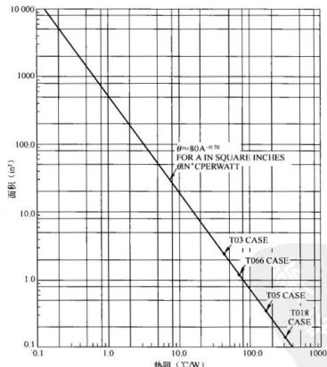

(a)

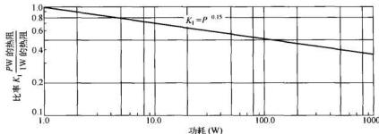

(b)

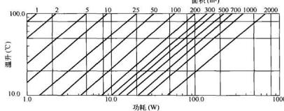

(c)

图7.4 根据变压器的等效散热片面积(两个侧面面积与磁心边缘面积之和)计算温升。(a)热阻与散热片面积的关系。该面积为平板状散热片两侧的面积或片状散热片叶片两侧的面积。所示曲线对应的功率损耗为1W，对于其他功率等级，应乘以图7.4(b)所示的系数。(b)标准散热片热阻与功率损耗的关系。(c)不同散热片面积的温升与功率损耗的关系。将图7.4(b)中的 $K_{i}=P-0.15$ 与图7.4(a)中的 $80A-0.70$ 结合，可以得到不同变压器的损耗和辐射表面积与温升的关系，即 $T=80A-0.70P+0.85$ 。 

表 7.4 磁心热阻

<table><tr><td rowspan="2">磁心</td><td rowspan="2">辐射表面面积</td><td colspan="2">热阻°C/W</td></tr><tr><td>厂商测量值</td><td>由(式7.2a)计算得到的值</td></tr><tr><td>EC35</td><td>5.68</td><td>18.5</td><td>23.7</td></tr><tr><td>EC41</td><td>7.80</td><td>16.5</td><td>19.0</td></tr><tr><td>EC52</td><td>10.8</td><td>11.0</td><td>12.6</td></tr><tr><td>EC70</td><td>22.0</td><td>7.5</td><td>9.2</td></tr></table>

综合图 7.4(a) 和图 7.4(b) 可得到图 7.4(c)，该图使用起来更为直接。它提供了不同散热面积(对角线)和功率损耗情况下的散热片温升值。前面已经给出了总损耗和总辐射表面积，因此可以直接从图中读出变压器表面的温升。通过图 7.4(c) 再来看看 7.3.5.1 小节中讨论过的两种磁心的温升。已经知道 E55 磁心的体积为 $43.5 \, cm^2$ ，工作在 1600G 和 200kHz 时，功率损耗为 30.5W。根据前面的定义，该磁心的辐射面面积为 $16.5 \, in^2$ ，如果完全忽略铜损，从图 7.4(c) 可以看出，该磁心的温升为 $185^\circ C$ 。 

813E343型磁心较小，体积为 $1.64\mathrm{cm}^3$ ，工作在1600G和 $200\mathrm{kHz}$ 时磁心损耗为1.15W。如前所述，它的辐射表面积为 $1.90\mathrm{in}^2$ 。同样，如果完全忽略铜损，它的温升只有 $57^{\circ}\mathrm{C}$ 。这就证 明了高频和1600G条件下，图7.2(a)、(b)中磁心体积越小，越容易耗散功率。 

如果有兴趣,可以比较一下由厂家提供的磁心热阻测量值和通过图7.4(a)计算所得的值 $(R_{t}=80A^{-0.70}$ ，见表7.4)之间的差别。 

## 7.5 变压器中的铜损

## 7.5.1 引言

在7.3节中曾指出，在选择绕线尺寸时，都是以电流密度为500圆密耳每安培为前提的，并且假设铜损的计算公式为 $(I_{\mathrm{rms}})^2 R_{\mathrm{dc}}$ 。其中， $R_{\mathrm{dc}}$ 为所选导线的直流电阻，通过导线的长度和每英寸的阻抗值（导线规格表可以查得）可以计算得到。 $I_{\mathrm{rms}}$ 为电流有效值，根据电流波形(2.2.10.2节、2.2.10.3节)可以计算出来。 

由于集肤效应和邻近效应的影响,绕组损耗往往比 $(I_{\mathrm{ms}})^{2}R_{\mathrm{de}}$ 大许多。 

当变化的磁场穿过线圈时会产生涡流，集肤效应和邻近效应都是由涡流产生的。集肤效应对应的涡流是由导线自身电流所产生的磁场导致的，而邻近效应对应的涡流是相邻的导线或者导线层的电流所产生的磁场导致的。 

由于集肤效应的影响,电流流过导体时趋向于集中在导体表面。集肤深度或者说环形导电面积与频率的平方根成反比。因此,频率越高,导线损失的导电面积越大,从而交流电阻也越大,铜损越多。 

低频时集肤效应带来的导线阻抗并不明显，例如，当频率为25kHz时，导线集肤深度为17.9密耳。 

但是，在传统的开关电源中电流波形都为矩形波，按傅里叶展开其高频分量很大。因此，即使频率较低，如25kHz，由高频谐波产生的交流电阻也很大，这种情况下还是必须考虑集肤效应的。 

有关集肤效应的定量分析将在下面的章节给出。 

相邻导线或者线圈层与层之间的邻近效应产生的铜损有可能比集肤效应大得多。多层绕组的邻近效应损耗是相当大的，一部分原因是感应的涡流迫使净电流只流经导线截面的一小部分，增加了交流损耗。最为重要的原因是涡流比原来流经导线或者线圈层的净电流的幅值有可能大好几倍。在下面的章节将做定量分析。 

## 7.5.2 集肤效应

集肤效应早已被人熟知 $^{[9\sim17]}$ ，1915年就有人推导出了集肤深度与频率之间的关系式 $^{[9]}$ 。从图7.5所示圆形导线的截面图可以看出，受涡流的影响电流只流经导线表面极薄的一部分。主电流的流通方向为OA，如果没有集肤效应的影响，电流将分布均匀地流过导线。 

现在所有沿 OA 方向的电流都已被垂直于 OA 轴的磁力线包围。设想有一束电流流经 OA 轴，根据弗莱明右手定则，这部分电流产生的磁通线方向如图中箭头所示，从 1 到 2 到 3 再返回到 1。 

假设 X 和 Y 为导线内的两个水平环路，它们位于导线的直径面上，并且延伸至导线的整个长度。两条环路对称分布在导线轴的两侧。磁通线从 X 环路穿出（图 7.5 中用“·”表示），从 Y 轴穿进（图 7.5 中用“×”表示）。 

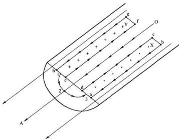

图7.5 圆形导线的涡流导致集肤效应——导线中心没有电流，并且电流趋向于集中在导体表面。流经导线的电流产生的磁场感应出如abcd和efgh环的电动势，这些电动势在其环路周围产生涡流，并且这些涡流与流经环内侧(dc和ef)的主电流反方向，而与流经环外侧(ba和gh)的主电流同方向。因此，电流在导线内部被抵消，并集中到导线表面。

根据法拉第定律,当一个变化的磁场穿过某区域时,将会在包围该区域的闭合导线上产生感应电流。根据楞次定律,闭合回路中感应电流的方向,总是使得它所激发的磁场来阻碍引起感应电流的磁通量的变化。 

因此，在环路X和环路Y中都将产生感应电流，其流向如图7.5所示。根据右手定则，X环路中的电流方向为顺时针方向，即 $\mathrm{d} - \mathrm{c} - \mathrm{b} - \mathrm{a} - \mathrm{d}_0$ 。这个方向的电流产生的磁场从环路的中心进入平面，与沿OA轴方向主电流产生的磁场方向相反。Y环路情况类似，涡流方向为逆时针方向，即 $\mathrm{e} - \mathrm{f} - \mathrm{g} - \mathrm{h} - \mathrm{e}_0$ 。产生的磁场从环路的中间穿出平面，与沿OA轴方向主电流产生的磁场方向相反。 

注意,沿 dc 和 ef 的涡流与沿 OA 轴电流的方向相反,且有抵消主电流的趋势;而沿 ba 和 gh(绕线外表层)的涡流与沿 OA 轴主电流的方向相同,有增强主电流的趋势。 

因此净电流(涡流和主电流之和)在绕线中心相互抵消,在绕线外表面被增强。所以,高频时绕线流过电流的实际面积小于导线总面积,交流阻抗大于直流阻抗。交流阻抗大小由集肤深度决定。 

## 7.5.3 集肤效应——定量分析

集肤深度定义为导体中电流密度减小到导体截面表层电流密度的 $1 / \mathrm{e}$ （e为自然底数 $\mathbf{e} =$ 2.71828183）或 $37\%$ 处的深度。很多文献[9]都推导出了集肤深度与频率的关系式， $70^{\circ}C$ 时铜线的集肤深度为 

$$
S = \frac {2 8 3 7}{\sqrt {f}}\tag{7.19}
$$

式中, 厚度 S 的单位是 mil, 频率 f 的单位为 Hz。 

表 7.5 给出了由式(7.19)计算得到的 $70^{\circ}$ C 时不同频率下铜线的集肤深度。 

表 7.5 ${70}^{ \circ  }\mathrm{C}$ 时铜线的集肤深度

<table><tr><td>频率, kHz</td><td>集肤深度,mils*</td></tr><tr><td>25</td><td>17.9</td></tr><tr><td>50</td><td>12.7</td></tr><tr><td>75</td><td>10.4</td></tr><tr><td>100</td><td>8.97</td></tr><tr><td>125</td><td>8.02</td></tr><tr><td>150</td><td>7.32</td></tr><tr><td>175</td><td>6.78</td></tr><tr><td>200</td><td>6.34</td></tr><tr><td>225</td><td>5.98</td></tr><tr><td>250</td><td>5.67</td></tr><tr><td>300</td><td>5.18</td></tr><tr><td>400</td><td>4.49</td></tr><tr><td>500</td><td>4.01</td></tr></table>

* 根据式(7.19)，集肤深度 $S = \frac{2837}{\sqrt{f}}$ 。式中， $S$ 的单位为 mil，频率 $f$ 的单位为 Hz。 

假设导体横截面为圆形，直流阻抗为 $R_{dc}$ ，集肤效应带来的交流阻抗为 $R_{ac}$ ，阻抗变化量为 $\Delta R$ ，则有 

$$
\begin{array}{r l} R _ {\mathrm{ac}} & = R _ {\mathrm{dc}} + \Delta R = R _ {\mathrm{dc}} \left(1 + \frac {\Delta R}{R _ {\mathrm{dc}}}\right) = R _ {\mathrm{dc}} (1 + f) \\ & \frac {R _ {\mathrm{ac}}}{R _ {\mathrm{dc}}} = 1 + f \end{array}
$$

或 

(7.20) 

从式(7.19)可以看出,任何频率、任何尺寸下都可以计算出导线 $R_{ac}/R_{dc}$ 的值。而绕组的阻抗与导通面积成反比,若导线集肤深度为S,半径为r,直径为d,导通平面的内半径为(r-S),则有 

$$
\begin{array}{r l} \frac {R _ {\mathrm{ac}}}{R _ {\mathrm{dc}}} & = \frac {\pi r ^ {2}}{\pi r ^ {2} - \pi (r - S) ^ {2}} \\ & = \frac {(r / S) ^ {2}}{(r / S) ^ {2} - (r - S) ^ {2} / S ^ {2}} \\ & = \frac {(r / S) ^ {2}}{(r / S) ^ {2} - (r / S - 1) ^ {2}} \\ & = \frac {(d / 2 S) ^ {2}}{(d / 2 S) ^ {2} - (d / 2 S - 1) ^ {2}} \end{array}\tag{7.21}
$$

式(7.21)表明了导线交流、直流阻抗之比 $\frac{R_{ac}}{R_{dc}}=(1/f)$ 仅与导线直径和集肤深度的比值有关， $R_{ac}/R_{dc}$ 与d/S的关系如图7.6所示。 

## 7.5.4 不同规格的线径在不同频率下的交/直流阻抗比

由于集肤效应的存在,圆形导线的交/直流阻抗比取决于导线径和集肤深度的比值(见式(7.21))。此外,导线集肤深度又与频率的平方根成反比,所以不同尺寸的导线,其交/直流阻抗比也不同。这个比值会随着频率的增大而增大。 

表 7.6 给出了频率为 25kHz、50kHz、100kHz 及 200kHz 时，线径为偶数的导线的交/直流 阻抗比值。在该表中， $d / S$ （导线直径与集肤深度比）中的 $d$ 为导线表中提供的最大裸线直径， $S$ 可由式(7.19)计算得出，见表7.5。有了这些 $d / S$ 值，就可以通过式(7.21)或图7.6得到 $R_{\mathrm{ac}} / R_{\mathrm{dc}}$ 的值了。 

从表7.6可见，导线直径越大，其交/直流阻抗比的值越大，且随着频率的增加而增加。例如，频率为 $25\mathrm{kHz}$ 时，14号线的直径为64.7密耳，集肤深度为17.9密耳（见表7.5），此时导线的 $d / S$ 值为3.6，由图7.6可知其交/直流阻抗比已经达到1.25了。但是如果将频率提高到 $200\mathrm{kHz}$ ，绕线集肤深度将变为6.34密耳， $d / S$ 值将变为10.2，从而由图7.6得到的此时的交/直流阻抗比增加了3.3。 

然而，要注意正确理解表7.6。虽然图7.6表明 $R_{sc}/R_{dc}$ 的值随导线直径的增加（即d/S增加）而增加，但实际上， $R_{sc}$ 却是随着直径的增加而减小的，导线直径越大，其铜损越小。这是因为 $R_{dc}$ 与 $d^{2}$ 成反比，而 $R_{sc}$ 与深度为S的环形表面的面积d成反比，所以当d增加时， $R_{dc}$ 减小的速率远大于 $R_{sc}$ 减小的速率。 

高频时，导线直径越大，其损耗越大。因此往往采用多股线并绕来取代同样面积（圆密耳）的单股线，因为这样增加了导线的环形表层面积。例如，两股线并联后，虽然其圆密耳面积与一单股线的圆密耳面积相等，但是其直径却为 $D/\sqrt{2}$ （D为并联前每股线的直径）。 

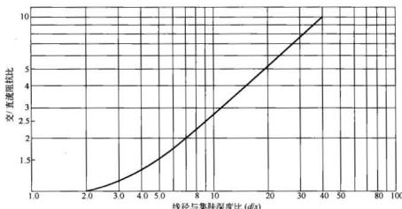

图 7.6 圆形导线的交/直流阻抗比与导线线径和集肤深度比 $(d/S)$ 的关系(由式(7.21)得到)

设集肤深度为 S，并联前每股线的环形表层面积为 $\pi DS$ ，由于表层厚度只与频率有关（式(7.20)），与绕线直径无关，并联后整个表面面积为 $2\left[\pi(D/\sqrt{2})S\right]=\pi\sqrt{2}DS$ 。这样并联后，虽然直流时的集肤深度和圆密耳面积没有改变，但导通面积却是并联前的 $\sqrt{2}$ 倍，即增加了 41%。 

考虑到这一点,用户往往使用利兹(Litz)线 $^{[16]}$ 。利兹线是由多股细小且绝缘良好的单线并绕而成的,并采用网状绕制的方式,以使在中间和边缘的绕线都有相同的长度。这样做可以减小集肤效应和邻近效应 $^{[12]}$ 。 

利兹线比普通的实心线约贵5%，除此之外，其缺陷主要在于这种线生产起来比较困难。生产时，必须确保所有的单股线（通常是28～50 AWG）在两端都焊接良好。因为如果有些线破损了或者在两端没有焊接好，并联后的损耗将会大大增加，而且还有可能产生其他问题，如 

噪声和振动等。 

通常在开关频率低于 50kHz 时应尽量避免使用利兹线。当然偶尔也会在 100kHz 时使用，但此时必须权衡一下，且最多不能超过 4 根并绕。 

关于这方面的评估可以参考表7.6。以18号线为例，由于集肤效应，频率为25kHz时其交流阻抗只比直流阻抗高5%。此时差别并不明显，但是当频率为50kHz时，这个差值将上升到15%，100kHz和200kHz时分别为40%和85%。 

在大多数开关电源拓扑中，电流波形为矩形波，其大部分能量都位于高频谐波中，这些数据可以不予考虑。但是当考虑电流方波中高频谐波的损耗时，表7.6中的交/直流阻抗比值将显著增大，这将在接下来的章节中加以讨论。 

对大电流(一般指次级,高于15~20A)而言,应采用薄铜箔,而不是利兹线或多股实心线并联。铜箔被切割得和骨架一样宽(如果考虑VDE安规标准,应稍窄一点),厚度应大于额定开关频率下导线集肤深度的37%。铜箔的外面应绕一层1密耳厚的塑料(聚酯片),将铜箔卷绕在骨架上,绕到所需匝数即可。 

## 7.5.5 矩形波电流的集肤效应 $^{[14]}$

导线交/直流阻抗之比与直径和集肤深度之比密切相关，如图7.6所示，而集肤深度又与频率有关，见式(7.19)。在大多数开关电源拓扑中，电流都为矩形波，其谐波中包含大量能量，因此面临的一个问题就是该选择多大的频率来计算集肤深度。Venkatramen对这个问题做了严谨的论证[4]。这里为了简化分析，对交/直流阻抗比值进行了近似估算，以便于计算铜损。 

假设方波电流中的能量都集中在前三次谐波中，则由式(7.19)可计算出常用开关频率(25kHz、50kHz、100kHz、200kHz)下三种谐波各自的集肤深度S。 

为了简化分析,取这些开关频率下集肤深度的平均值 $S_{av}$ 。根据平均集肤深度,可以计算出所有线径为偶数的导线的 $d/S_{av}$ 平均值。利用所得结果,从图7.6可以读到对应的 $R_{ac}/R_{dc}$ 值,结果见表7.7。 

如果这种近似是有效的(这种可能性的程度主要取决于电流方波三次以上的谐波中储存了多少能量)，则可以根据表7.6来估计方波电流产生的集肤效应损耗，表7.8对18号线的两个 $R_{sc}/R_{dc}$ 值(分别来自表7.6和表7.7)进行了比较。 

## 7.5.6 邻近效应

相邻导线流过电流时会产生可变磁场,从而形成邻近效应(参考文献 $[11\sim15]$ ),如果是属于多层线圈层间的邻近效应,则其危害性更大。 

邻近效应比集肤效应更严重，因为集肤效应只是将绕线导电面积限制在表面的一小部分，增加了铜损。它没有改变电流幅值，只是改变了绕线表面的电流密度。相反，邻近效应中由相邻线圈层电流产生的可变磁场引起的涡流，其大小却随线圈层数的增加按指数规律而增加。 

## 7.5.6.1 邻近效应产生的机理

邻近效应产生的原理如图7.7所示。在两个平行导体中分别有电流流过，电流方向相反（AA'和BB'）。为了简化分析，假设图中的两个导体的横截面为很窄的矩形，距离较近，且导体可能是两个圆导线也可能是变压器线圈中两个紧密相邻的导线层。 

根据法拉第定律,穿过平面5678的可变磁场将在位于该平面的任何导体上感应出电压。 

表 7.6 由集肤效应产生的交/直流阻抗比

<table><tr><td rowspan="2">线号</td><td rowspan="2">直径 <eq>{d}_{1}/\mathrm{{mils}}</eq></td><td colspan="3">25kHz</td><td colspan="3">50kHz</td><td colspan="3">100kHz</td><td colspan="3">200kHz</td></tr><tr><td>集肤深度 <eq>{S}_{1}/\mathrm{{mils}}</eq></td><td><eq>d/S</eq></td><td><eq>{R}_{\mathrm{w}}/{R}_{\mathrm{{bi}}}</eq></td><td>集肤深度 S, mila</td><td><eq>d/S</eq></td><td><eq>{R}_{\mathrm{w}}/{R}_{\mathrm{{bi}}}</eq></td><td>集肤深度 S, mila</td><td><eq>d/S</eq></td><td><eq>{R}_{\mathrm{w}}/{R}_{\mathrm{{bi}}}</eq></td><td>集肤深度 S, mila</td><td><eq>d/S</eq></td><td><eq>{R}_{\mathrm{w}}/{R}_{\mathrm{{bi}}}</eq></td></tr><tr><td>12</td><td>81.6</td><td>17.9</td><td>4.56</td><td>1.45</td><td>12.7</td><td>6.43</td><td>1.85</td><td>8.97</td><td>9.10</td><td>2.55</td><td>6. 34</td><td>12.87</td><td>3.50</td></tr><tr><td>14</td><td>64.7</td><td>17.9</td><td>3.61</td><td>1.30</td><td>12.7</td><td>5.09</td><td>1.54</td><td>8.97</td><td>7.21</td><td>2.00</td><td>6. 34</td><td>10.21</td><td>2.90</td></tr><tr><td>16</td><td>51.3</td><td>17.9</td><td>2.87</td><td>1.10</td><td>12.7</td><td>4.04</td><td>1.25</td><td>8.97</td><td>5.72</td><td>1.70</td><td>6. 34</td><td>8.09</td><td>2.30</td></tr><tr><td>18</td><td>40.7</td><td>17.9</td><td>2.27</td><td>1.05</td><td>12.7</td><td>3.20</td><td>1.15</td><td>8.97</td><td>4. 54</td><td>1.40</td><td>6. 34</td><td>6.42</td><td>1.85</td></tr><tr><td>20</td><td>32.3</td><td>17.9</td><td>1.80</td><td>1.00</td><td>12.7</td><td>2.54</td><td>1.05</td><td>8.97</td><td>3.60</td><td>1.25</td><td>6. 34</td><td>5.09</td><td>1.54</td></tr><tr><td>22</td><td>25.6</td><td>17.9</td><td>1.43</td><td>1.00</td><td>12.7</td><td>2.02</td><td>1.00</td><td>8.97</td><td>2.85</td><td>1.10</td><td>6. 34</td><td>4.04</td><td>1.30</td></tr><tr><td>24</td><td>20.3</td><td>17.9</td><td>1.13</td><td>1.00</td><td>12.7</td><td>1.60</td><td>1.00</td><td>8.97</td><td>2.26</td><td>1.04</td><td>6. 34</td><td>3.20</td><td>1.15</td></tr><tr><td>26</td><td>16.1</td><td>17.9</td><td>0.90</td><td>1.00</td><td>12.7</td><td>1.27</td><td>1.00</td><td>8.97</td><td>1.79</td><td>1.00</td><td>6. 34</td><td>2.54</td><td>1.05</td></tr><tr><td>28</td><td>12.7</td><td>17.9</td><td>0.71</td><td>1.00</td><td>12.7</td><td>1.00</td><td>1.00</td><td>8.97</td><td>1.42</td><td>1.00</td><td>6. 34</td><td>2.00</td><td>1.00</td></tr><tr><td>30</td><td>10.1</td><td>17.9</td><td>0.56</td><td>1.00</td><td>12.7</td><td>0.80</td><td>1.00</td><td>8.97</td><td>1.13</td><td>1.00</td><td>6. 34</td><td>1.59</td><td>1.00</td></tr><tr><td>32</td><td>8.1</td><td>17.9</td><td>0.45</td><td>1.00</td><td>12.7</td><td>0.64</td><td>1.00</td><td>8.97</td><td>0.90</td><td>1.00</td><td>6. 34</td><td>1.28</td><td>1.00</td></tr><tr><td>34</td><td>6.4</td><td>17.9</td><td>0.36</td><td>1.00</td><td>12.7</td><td>0.50</td><td>1.00</td><td>8.97</td><td>0.71</td><td>1.00</td><td>6. 34</td><td>1.01</td><td>1.00</td></tr></table>

注：集肤深度取自表7.5； $R_{ac}/R_{de}$ 的值由式(7.21)计算得到。 

表 7.7 4 种常用开关频率下方波电流的由集肤效应产生的交/直流阻抗比

<table><tr><td rowspan="2">线号</td><td rowspan="2">直径 <eq>{d}_{1}/\mathrm{{mils}}</eq></td><td colspan="3">25kHz</td><td colspan="3">50kHz</td><td colspan="3">100kHz</td><td colspan="3">200kHz</td></tr><tr><td>集肤深度 <eq>{S}_{\text{mils }}</eq></td><td><eq>d/S</eq></td><td><eq>{R}_{\mathrm{m}}/{R}_{\mathrm{b}}</eq></td><td>集肤深度 5 ,mils</td><td><eq>d/S</eq></td><td><eq>{R}_{\mathrm{m}}/{R}_{\mathrm{b}}</eq></td><td>集肤深度 <eq>{S}_{\text{mils }}</eq></td><td><eq>d/S</eq></td><td><eq>{R}_{\mathrm{m}}/{R}_{\mathrm{b}}</eq></td><td>集肤深度 <eq>{S}_{\text{mils }}</eq></td><td><eq>d/S</eq></td><td><eq>{R}_{\mathrm{m}}/{R}_{\mathrm{b}}</eq></td></tr><tr><td>12</td><td>81.6</td><td>13.2</td><td>6. 18</td><td>1.85</td><td>9.66</td><td>8.45</td><td>2.40</td><td>6.83</td><td>11.95</td><td>3.30</td><td>4.83</td><td>16.89</td><td>4.50</td></tr><tr><td>14</td><td>64.7</td><td>13.2</td><td>4.90</td><td>1.50</td><td>9.66</td><td>6.70</td><td>1.90</td><td>6.83</td><td>9.47</td><td>2.65</td><td>4.83</td><td>13.40</td><td>3.70</td></tr><tr><td>16</td><td>51.3</td><td>13.2</td><td>3.89</td><td>1.25</td><td>9.66</td><td>5.31</td><td>1.59</td><td>6.83</td><td>7.51</td><td>2.12</td><td>4.83</td><td>10.62</td><td>2.90</td></tr><tr><td>18</td><td>40.7</td><td>13.2</td><td>3.08</td><td>1.13</td><td>9.66</td><td>4.21</td><td>1.35</td><td>6.83</td><td>5.96</td><td>1.75</td><td>4.83</td><td>8.43</td><td>2.36</td></tr><tr><td>20</td><td>32.3</td><td>13.2</td><td>2.45</td><td>1.05</td><td>9.66</td><td>3.34</td><td>1.17</td><td>6.83</td><td>4.73</td><td>1.45</td><td>4.83</td><td>6.69</td><td>1.90</td></tr><tr><td>22</td><td>25.6</td><td>13.2</td><td>1.94</td><td>1.00</td><td>9.66</td><td>2.65</td><td>1.07</td><td>6.83</td><td>3.75</td><td>1.25</td><td>4.83</td><td>5.30</td><td>1.56</td></tr><tr><td>24</td><td>20.3</td><td>13.2</td><td>1.54</td><td>1.00</td><td>9.66</td><td>2.10</td><td>1.01</td><td>6.83</td><td>2.97</td><td>1.12</td><td>4.83</td><td>4.20</td><td>1.35</td></tr><tr><td>26</td><td>16.1</td><td>13.2</td><td>1.22</td><td>1.00</td><td>9.66</td><td>1.67</td><td>1.00</td><td>6.83</td><td>2.36</td><td>1.04</td><td>4.83</td><td>3.33</td><td>1.17</td></tr><tr><td>28</td><td>12.7</td><td>13.2</td><td>0.96</td><td>1.00</td><td>9.66</td><td>1.31</td><td>1.00</td><td>6.83</td><td>1.86</td><td>1.00</td><td>4.83</td><td>2.63</td><td>1.07</td></tr><tr><td>30</td><td>10.1</td><td>13.2</td><td>0.77</td><td>1.00</td><td>9.66</td><td>1.05</td><td>1.00</td><td>6.83</td><td>1.48</td><td>1.00</td><td>4.83</td><td>2.09</td><td>1.01</td></tr><tr><td>32</td><td>8.1</td><td>13.2</td><td>0.61</td><td>1.00</td><td>9.66</td><td>0.84</td><td>1.00</td><td>6.83</td><td>1.19</td><td>1.00</td><td>4.83</td><td>1.68</td><td>1.00</td></tr><tr><td>34</td><td>6.4</td><td>13.2</td><td>0.48</td><td>1.00</td><td>9.66</td><td>0.66</td><td>1.00</td><td>6.83</td><td>0.94</td><td>1.00</td><td>4.83</td><td>1.33</td><td>1.00</td></tr></table>

注：这是一种简单的近似。假设方波中的能量大部分储存在前3次谐波内，则方波电流产生的平均集肤厚度就为表7.5中的前3次谐波集肤厚度值的平均值。根据这个平均值可以计算出 $d / S$ ，就可以从图7.6中读出 $R_{\mathrm{sc}} / R_{\mathrm{dc}}$ 值。 

由楞次定律可得,沿感应电压的方向在该区域的边界将产生感应电流,感应电流的方向总是使得它所激发的磁场来阻碍引起感应电流的磁通量的变化。 

因此，平面5678上的电流方向应是逆时针的。在平面的下层，电流方向(7到8)与上导体的主电流方向(B到B')相同，有增强主电流的趋势；而在平面的上层，电流方向(5到6)与主电流相反，有减弱主电流的趋势。在导体宽度范围内任何与平面5678平行的平面都会发生这样的现象。 

这样导致的后果是，沿着上导体的下表面有涡流径向流过，方向是从7到8，然后它会沿着导体上表面返回。但在上表面，涡流被主电流抵消了。 

表 7.8 18 号线的交/直流阻抗比

<table><tr><td>频率,kHz</td><td><eq>{R}_{\mathrm{{sc}}}/{R}_{\mathrm{{dc}}}</eq>(表 7.6) 正弦电流</td><td><eq>{R}_{\mathrm{{sc}}}/{R}_{\mathrm{{dc}}}</eq>(表 7.7) 矩形波电流</td></tr><tr><td>25</td><td>1.05</td><td>1.13</td></tr><tr><td>50</td><td>1.15</td><td>1.35</td></tr><tr><td>100</td><td>1.40</td><td>1.75</td></tr><tr><td>200</td><td>1.85</td><td>2.36</td></tr></table>

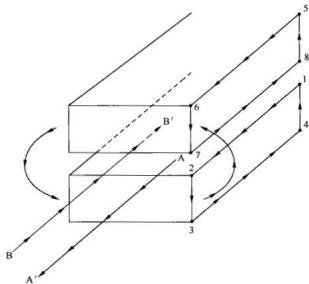

图7.7 导体中电流产生的磁场在相邻导体间感应出电压。感应源的涡流与导体导体向在导体上、下表面流动。位于下方的导体，上表面的涡流与主电流方向相同(AA')，对主电流起增强作用。而对于下面来说，涡流与主电流流向相反，两者相互抵消。同样，位于上方的导体其下表面的涡流与主电流流向相同，使电流增大，上表面的涡流与主电流相互抵消，电流减小。最后导致的结果就是涡流集中于两导体的接触面表面上，位于下面的导体被包围在磁场中，磁力线从其侧面1234穿出后进入上面导体的侧面，然后从对面穿出，最后又往下回到下面导体。根据弗莱明右手定则，磁场的方向是进入上面导体侧面5678的方向。 

下导体的情形与此相似，在下导体的上表面有涡流径向流过，该涡流增强了上表面流过的主电流，但在导体的下表面，由于涡流与主电流方向相反，涡流被主电流抵消了。 

因此,两个导体上的电流被限制在两者接触面表层的一小部分上,与集肤效应一样,表层的厚度与频率有关。 

## 7.5.6.2 变压器线圈相邻层间的邻近效应

由于变压器绕组同一层绕线中流过的电流是相互平行且同向的，那么可以将这些电流看成是流过一块很薄的矩形薄片，薄片的厚度等于绕线的直径，宽度等于骨架宽度。因此整个绕组都将产生感应涡流。和先前讨论过的相邻平行导体间的邻近效应一样，这些涡流只在线圈层间接触面的表面流动。 

值得注意的是,涡流的大小会随着层数的增加而按指数规律递增。因此,邻近效应比集肤效应要严重得多。 

Dowell 有关邻近效应影响的分析 $^{[13]}$ 比较经典，很具有参考价值。论文给出了交/直流阻抗 $(R_{\mathrm{sc}}/R_{\mathrm{dc}})$ 与绕组层数及绕组集肤深度的直径比之间的函数关系。限于文章篇幅，这里不再对 Dowell 的结论做详细讨论，有兴趣可以参考 Senlling 的文献 $^{[12]}$ 。在 Dixon 的论文 $^{[11]}$ 中，还对 Dowell 曲线做了深入分析，从物理意义上解释了 $R_{sc}/R_{dc}$ 为什么会随着层数的增加而按指数规律递增。 

下面将在 Dixon 方法的基础上简单介绍 Dowell 曲线的用法及意义。 

图7.8(a)中的磁心为EE型，其初级绕组有3层。每层都可以看做是独立的薄片，流过的电流 $I = Nl_{1}$ 。其中， $N$ 是每层绕组的匝数， $I_{\mathrm{r}}$ 为每匝流过的电流。根据安培定律，有 $\oint Hdl = 0.4\pi I$ ，或者说Hdl在任一闭合回路上的积分值为 $0.4\pi I$ ，其中 $I$ 为该闭环包围的总电流。这在磁路上是与欧姆定律等效的。欧姆定律指出，任何闭环上所施加的电压等于该闭环一周所有电压之和。 

沿着图7.8(b)中的abcd环绕一周进行线性积分，可得到路径bcd上的磁阻(模拟电路中的阻抗)。由于采用了高磁导率的铁氧体材料，其阻值很低。因此，大部分的磁场强度都处于薄片1和薄片2之间的路径ab上，薄片1左侧面的磁场强度几乎为零。由于只是导体表层的磁场强度感应出集脉电流，所以薄片1上的所有电流 $I$ 都只流过薄片右侧面，而左侧面没有电流流过，电流方向如图7.8中的“+”号所示（也可从图中的原点看出）。 

现在来看薄片2(图7.8(a))上的电流，并设所有绕组中的电流都为1A。图7.7所示邻近效应将产生涡流，涡流流过薄片的左侧面和右侧面，厚度等于该频率下的集肤深度。但是这个深度不会超过薄片1右侧面的集肤深度，也不会超过薄片2左侧面的集肤深度。 

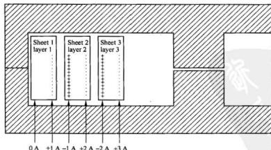

(a)

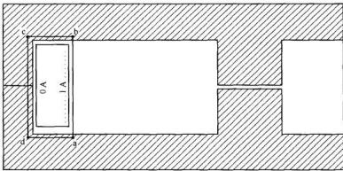

(b)

图 7.8 (a) 多层线圈表面涡流按指数规律递增。(b) 根据安培定律, 流过第一层导线的电流将集中在远离铁氧体材料的那一面。

如果沿闭环 efgh(穿过薄片 1 和 2 的中心) 对 Hdl 进行积分, 由于该平面上的磁场强度为零, 根据安培定则, 该平面上包围的电流也为零。既然流过薄片 1 右侧面的电流为 1A(沿 “+” 号方向), 那么流过薄片 2 左侧面的电流必定也为 1A, 方向以 “-” 号(或 “×” 号) 表示。 

但是流过每个薄片的净电流为1A,所以必定有-1A的电流流过薄片2的左侧面,右侧面的电流为+2A。 

同理可得，薄片3左侧面的电流为-2A，右侧面的电流为+3A。 

从以上分析可以推断出，邻近效应产生的涡流大小随着线圈层数的增加而按指数规律递增，下节中Dowell的分析 $^{[13]}$ 将从数量上证明这个结论。 

## 7.5.6.3 Dowell曲线表示邻近效应产生的交/直流阻抗比

根据Dowell分析可以得到如图7.9所示的Dowell曲线[13]。它描述了交/直流阻抗比 $(F_{\mathrm{R}} = R_{\mathrm{sc}} / R_{\mathrm{dc}})$ 与系数 $\frac{h\sqrt{F_l}}{\Delta}$ 的关系。式中， $h$ 为圆导线的有效高度， $h = 0.866d;\Delta$ 为集肤深度，见表7.5； $F_{l}$ 为铜层系数， $F_{i} = N_{i}d / w(N_{i}$ 为每层匝数， $w$ 为绕组层宽度， $d$ 为绕组直径，对于铜箔， $F_{l} = 1)$ 。 

由于这个线性积分值与最里层初级绕组的距离成正比,所以距离越远,其包围的安匝数越多。因此在次级-初级绕组的交界面, $\oint hdl$ 已经达到最大值,并开始线性下降。在传统的变压器中(不同于反激变换器),次级安匝数往往与初级安匝数方向相反。换一种说法就是,如果初级电流是从“·”端流进的,则次级电流必定是从“·”端流出的。当对最后一层次级绕组进行线性积分时, $\oint hdl$ 已经降为零。这可以理解为次级所有安匝数抵消了初级的安匝数(除了初级很小的励磁电流以外)。 

因此，“部分”就是指磁化力从零到峰值的区域。对排列顺序如图7.10(a)所示的双层初级、双层次级的变压器来说，每部分p的层数为2。图7.9中，若假设 $\frac{h\sqrt{F_{l}}}{\Delta}$ 为4，则 $R_{ac}/R_{dc}$ 约为13。 

图 7.10(a) 中每半个次级绕组的安匝数为初级总安匝数的一半。如果将初级和次级两个绕组层按图 7.10(b) 那样交叉排列，则其低频磁动势如图所示分布。此时磁动势从零到峰值区域内的绕 组层数仅为1,同样取 $\frac{h\sqrt{F_{t}}}{\Delta}$ 值为4(根据图7.9所示),则每部分 $R_{sc}/R_{dc}$ 的比值从原来的13降为4。也就是说,初级和次级绕组的交流阻抗都只有直流阻抗的4倍(而不是原来的13倍)。 

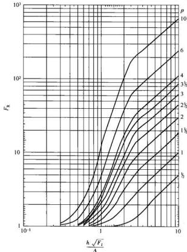

$F_{R}$ 为 $\frac{h\sqrt{F_{l}}}{\Delta}$ 和层数的函数，p 为每个绕组所占的比例

$$
\begin{array}{r l} & {R _ {\mathrm{AC}} = R _ {\mathrm{de}} F _ {\mathrm{R}}} \\ & {\text {当} \frac {h \sqrt {F _ {l}}}{\Delta} > 5 \text {时}} \\ & {F _ {\mathrm{R}} \xrightarrow [ 3 ]{2 p ^ {2} + 1} \cdot \frac {h \sqrt {F _ {l}}}{\Delta}} \end{array}
$$

图7.9 邻近效应产生的交/直流阻抗比。图中给出了不同 $p$ 值下的交直流阻抗比， $p$ 是指每部分所含的线圈层数。“部分”经常会被误解，所以在这里需要解释一下。这里的“部分”定义为低频磁动势 $(\oint Hdl = 0.4\pi Ni)$ 从零变化到峰值之间的区域。假设初级和次级都为多层绕组，初级位于骨架最里面，次级位于其上，如图7.10(a)所示。现由磁心中心柱向外移动，则磁动势 $(\oint Hdl = 0.4\pi Ni)$ 会线性增加(参见文献[1]) 

注意到图7.9中每部分的层数减为1/2，从图7.11可以看出这种绕组结构的优势。这种情况下，如果次级只有一层，则次级绕组中心处的低频磁动势为零。对于图7.10(b)所示的结构，同样取 $\frac{h\sqrt{F_{t}}}{\Delta}$ 等于4，从图7.9可以看出，此时 $R_{sc}/R_{de}$ 为2而不是4。 

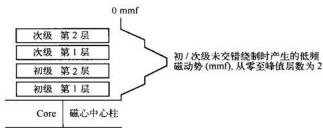

(a)

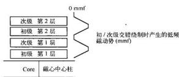

(b)

图7.10 (a)对于双层初/次级变压器来说，如果初/次级层没有交错排列，则低频磁动势就会累积。“部分”定义为磁动势从零到峰值之间的区域。这里每部分有两层，“每部分层数”的差异如图7.9所示。(b)初/次级层交错排列，每部分的层数减少为1，交/直流阻抗比显著减小，如图7.9所示。

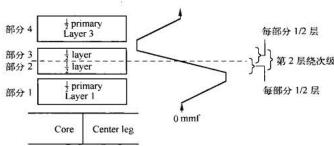

图 7.11 每“部分”只有半层，如图 7.9 所示。单层的次级夹在两个半初级之间，初级的安匝数被次级的电流分为两半。根据图 7.9 中的“每部分层数”的概念可知，半个次级的每部分层数为半层。

在选择初级线径或次级铜箔厚度时可以参考图7.9，而不是先前按电流密度500圆密耳/Arms选择导线。根据电流密度选择通常会导致高频时 $h / \Delta$ 很大，从图7.9可以看出，此时 $R_{\mathrm{sc}} / R_{\mathrm{de}}$ 值很大。 

通常选择导线时会选择直径较小的绕线或厚度较小的铜箔，以使 $\frac{h\sqrt{F_{t}}}{\Delta}$ 小于1.5。虽然这样会使 $R_{dc}$ 增加，但由于 $R_{ac}/R_{dc}$ 减小了，因此 $R_{ac}$ 也会减小，从而减小了铜损。 

当推挽电路的两个初级和次级都采用交叉绕线结构时，同时导通的那组初级和次级绕组当推挽电路的两初级和次级都采用交叉绕线结构时，同时导通的那组初级的次级绕组应该按图7.12(a)所示结构排列。如果按图7.12(b)所示结构将不导通的半个次级绕组紧靠导通的初级绕组层，即使次级不导通，也会感应出涡流。可以将不导电的次级绕组放在导电的次级绕组外侧，其所处区域内，半个初级和半个次级绕组的安匝数在每半个周期的导电时间内相互抵 消,因此线性积分 $\oint Hdl$ 为零,磁动势为零。这样,当另外半个次级绕组导通时,不导通的次级绕组中没有涡流产生。 

值得注意的是，在反激电路中，初级绕组和次级绕组的电流不是同时导通的，因此，初/次级交叉排列的绕组结构对邻近效应没有什么影响。此时只能根据“500圆密耳/Arms”的规则，采用最少的层数，选择更好的导线来减小邻近效应。虽然此时直流阻抗增加了，但从图7.9可以看出 $R_{sc}/R_{do}$ 减小了。 

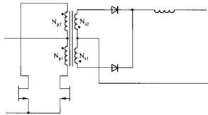

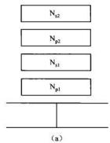

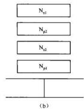

图 7.12 推挽电路变压器层数的正确排序。(a)与不正确排序(b)。由于邻近效应,如图 7.12(b) 所示的排序将比图 7.12(a) 所示的排序产生更多的涡流损耗。

## 7.6 引言: 利用面积乘积(AP)法进行电感及磁性元件设计

在前面的章节中, Pressman 先生将任何带感性的卷绕式元件称之为“电感器”。在这一点上, 我们将打破惯例引入另外一个概念: “扼流圈”。在这里, 这一传统而又多少被人忽略的概念专指那些可以通过大量 DC 偏置电流而 AC 纹波电流和电压分量相对较少的卷绕式元件。其典型应用为开关电源中的低通输出滤波器。 

在本章中“电感器”仅限定为传递交流电流和电压的卷绕式元件，而无需承载大量的DC偏置电流，直流“电感器”用“扼流圈”表示。 

之所以用两个不同的概念来描述,是因为电感的设计方法和扼流圈的设计方法有很多不 同。此外，两者采用的材料也可能大不一样。由于包含大量相互联系的杂散变量，扼流圈的设计相对来说更加复杂，设计者必须协调好这些参数。因此扼流圈的设计本质上讲是一个不断迭代调整的过程。尽管磁心制造商提供的各种数据表格可以简化优化设计中不可避免的大量迭代过程，但还是不能完全消除这一工作。 

以下章节将根据应用场合来介绍磁性元件的设计方法。由于各种杂散变量的存在，某一特定的场合中，工程师将根据最重要的参数对设计的结果进行折中处理。这些可能考虑的参数包括：最便宜的成本，最小的体积，最小的损耗，最大的电流以及最大的电感量等。鉴于对这些基本要求的优化条件各不相同，最终的权衡结果将取决于工程师。设计的挑战也就在于，对于一个特定的应用场合怎样才能获得最佳的权衡结果。 

本章将利用图形、图表、曲线、表格来确定各种未知变量的取值。尽管这种方法看上去没有前面章节采用公式计算来的精确，但其方法更为实用。因为在电感和扼流圈的设计中，由于生产的差异，总会存在一定的工程误差，最终的取值都只是一个近似的结果。这些图表给出了一些典型应用的取值趋势，而不是绝对的计算值。生产商在不断地改进他们的材料，因此，在实际应用中工程师必须根据厂家提供的最新资料来获得最佳的设计。 

采用曲线图、表格和索引的方法能更快得到结果，各种变量的变化趋势也显而易见。在进行电感及磁元件设计时，即使是经验不足的工程师也可以很快地利用这种直观的方法得到必要的参数。Colonel Wm. T McLyamn 在 Jet Propulsion 实验室工作多年，对磁性材料进行了大量的测试和研究。他提出了一些有用的公式和图表，并在业界得到了广泛的应用。最后设计者会发现“Colonel”（这里是指他的名字，而不是他发明的专利）所钟爱的 AP 法是一个很有用的设计工具，下面简单的介绍一下“面积乘积”法。 

## 7.6.1 AP法的优点

接下来的章节将利用 Colonel Wm. T McLyamn 所提出的面积乘积(AP)法给出电感器及扼流圈的设计实例。AP 法是一个很实用的设计工具,很多类型的磁心都能适用,这极大地简化了设计过程。 

简单来讲，AP 就是指磁心有效截面积和线圈有效窗口面积（用于绕组和绝缘）的乘积。若面积都以平方厘米为单位，则 AP 的单位为厘米的 4 次方。 

文献[17,18,19]表明，利用面积乘积法可以计算出变压器磁心的额定功率大小，在设计扼流圈时也可以用来选择磁心的尺寸。此外，AP值还可以用于变压器其他重要参数如表面积、温升、绕线匝数以及电感量等的计算。 

如今很多磁心厂家的数据手册中都给出了 AP 值。即使没有给出，通过下面的公式也可以很快的计算出所需要的磁心尺寸： 

$$
A P = A _ {e} A _ {w}
$$

式中，AP 为面积乘积 $\left(\mathrm{cm}^{4}\right)$ ; $A_{w}$ 为线圈有效窗口面积 $\left(\mathrm{cm}^{2}\right)$ (E 型磁心取其中一个窗口的面积); $A_{e}$ 为磁心有效截面积 $\left(\mathrm{cm}^{2}\right)$ 。 

AP值是磁性元件设计的一个重要参数，在后面扼流圈设计一节中对其优点有更详细的说明。 

后面各节中所用到的公式、图表和曲线的计算公式在本章末所列的参考文献中都给出了详细的推导过程。在进行开关电源中各种卷绕式元件的设计时，工程师若能完全掌握这些理论和实践的要求将是一笔不小的收获。 

## 7.6.2 电感器设计

电感器的理解和设计要相对简单一些,首先就从开关电源中一些经常用到的电感器开始。掌握了这些方法以后,再进行复杂烦琐的扼流圈设计(7.7节至7.10节)就相对容易一些了。 

开关电源中的电感器(无需传递 DC 偏置电流的卷绕式元件)通常包括以下几种类型： 

- 信号级的小功率电感,不含直流分量 

- 共模输入滤波电感(一种特殊绕制的双绕线电感,可以流过较大的对称工频电流) 

- 差模输入滤波电感(可以流过较大的不对称工频电流) 

- 电感棒(磁心为棒状铁氧体或磁粉芯的小电感) 

## 7.6.3 信号级小功率电感

此处仅考虑那些一般用于信号场合的电感，它们对DC电流没有要求，甚至所承受的AC电流和电压应力都很小。这种电感通常用作信号级的电流谐振或滤波器，其设计相对来说比较简单。工作频率比较高的场合，磁心材料一般都选择铁氧体。选定磁心型号后，通过厂家提供的电感系数 $A_{1}$ 可以直接算出电感值和所需的匝数。信号级的小功率场合，铜损不是考虑的关键因素，因此如果需要很大电感值的话可以增加线圈匝数。 

厂家提供的电感系数 $A_{t}$ 值必须给出磁心每匝线圈的电感量，包括磁心材质以及气隙的影响（如果厂家可以提供的话）等。值得注意的是，任何卷绕式元件的电感值都是与 $N^{2}$ （匝数的平方）成正比的，因此最终的电感值为 

$$
L _ {n} = N ^ {2} A _ {n}
$$

提示：注意，由于厂家提供的 $A_{i}$ 值可能是一匝线圈的电感值，也可能是 $N$ 匝（通常是100匝甚至是1000匝）的电感值，为避免错误，此处将 $A_{i}$ 值统一折算成每匝线圈的电感值，因此有 

$$
A _ {l 1} = A _ {l m} / N ^ {2}\tag{—K. B}
$$

信号级电感在开关电源设计中很少用到,此处不再进行详细的介绍,通过上式可以计算其电感值。 

## 7.6.4 输入滤波电感

开关电源中的输入滤波电感是一种低通的RFI滤波器。开关电源中的开关器件会产生大量的电气噪声，输入滤波器的作用在于减小或抑制这些高频噪声回馈到输入电网。 

图 7.13(a) 所示为一个典型的输入滤波器的基本原理图。这种滤波器在离线式开关电源中通常用来抑制传导 RFI 噪声以满足 FCC 标准。滤波电路包括一个对称的共模电感 L1（两个绕组完全相等），两个共模电容 C1 和 C2。L2 为差模电感，C3、C4 为解耦的差模电容。 

## 7.6.4.1 共模输入滤波电感

共模电感 Li(a,b) 的感量一般都取得比较大,考虑到体积和成本的因素,一般都选择高磁导率的磁心(大于 $5000\mu m$ ),因为高磁导率意味着每匝获得的电感量大。一般来讲,在电感设计中磁心损耗越小越好,但在此处却并非考虑的重点。高频时 AC 应力一般都比较低,因此在设计共模输入滤波电感时可以不用考虑磁心损耗的影响。 

共模电感的情况比较特殊,虽然它可以流过直流电流以及低频的交流电流,但是由于两个绕组在同一磁心上绕制反相,直流或低频交流产生的磁场将相互抵消。 

## 7.6.4.2 采用磁环绕制共模输入滤波电感器

图 7.13(b) 所示为一个典型的采用高磁导率环形铁氧体磁心绕制的共模电感。由两个分离的线圈绕在同一磁环上分别构成电感 L1(a) 和 L1(b)，电感之间紧密耦合形成一个双绕组的共模输入滤波电感。为了使绝缘和爬电距离满足安全规则要求，绕组之间以及绕组与磁环之间必须采用绝缘材料隔离。 

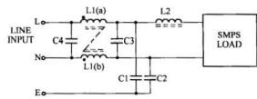

(a)

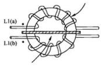

(b)

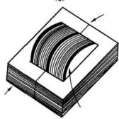

(c)

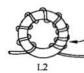

(d)

图 7.13 (a) 由共模和差模滤波元件构成的典型的 RFI 输入滤波电路。这种电路经常用在开关电源中的输入端，以抑制开关器件产生的 RFI 干扰。(b) 采用高磁导率环形磁心绕制的共模输入滤波电感。(c) 用 E 型磁心绕制的共模输入滤波电感。(d) 采用高损耗的铁粉芯磁环绕制的差模输入滤波电感。

这两个绕组之间相互隔离且匝数相等，在低频的60Hz差模输入电流回路上其相位完全相反(注意，此处所提到的反相是指正常的60Hz电流从上侧电感的起始端流入，然后从下侧的电感输入端流出，反之亦然)。因此工频差模AC输入电流(或者DC变换器中的DC输入电流)所产生的磁场在磁心中完全抵消。通过这种耦合方式，工频输入电流所流过的电感量仅来自于两个绕组之间的漏感，而由磁环产生的电感量很小很小。因此，正常的差模输入电流几乎可以不受影响地流过共模电感。 

采用这种反相连接的方式,低频的 AC(或 DC)差模输入电流不会使磁心饱和。因此可以采用高磁导率的磁心材料而不用担心饱和的问题,当然也没有开气隙的必要。环形磁心无法开气隙,其磁导率一般都比较高,因此只要绕上几匝线圈就能获得很高的电感量。 

但是对共模噪声(高频的噪声电流或电压同时在开关电源的两条输入线上流动,两者相位相同,最后流回大地E)来讲,两个绕组相互并联且同相,开关电源的噪声源与两条输入线L和N之间表现为很大的感抗。因此由开关器件产生的共模噪声大部分都可以通过C1和C2被旁路到大地上。这种滤波电路可以有效地抑制共模RFI噪声反馈回电网。 

共模电感的设计方法很简单。选择一个大小合适的高磁导率磁环，根据最大输入 RMS 电 流选择导线，将两根导线按照图7.13(b)所示的方法单层并绕在磁环上。由于磁心损耗可以忽略不计，导线散热好，因此电流密度可以设计得很大 $(700\sim 1000\mathrm{A} / \mathrm{cm}^2)$ 。采用多层并绕的方式也可以，但是这样会增加绕组跨绕线电容，降低自谐振频率，从而减小高频噪声抑制比，因此并不推荐这种方式。 

根据线圈的匝数和所选磁心的 $A_{i}$ 值可以计算出有效的电感值。考虑到两组线圈的并联关系以及共模抑制作用，计算中仅选择其中一组线圈的匝数值，从而有 

$$
L _ {n} = N ^ {2} A _ {n}
$$

提示: 在样机调试阶段, 实际所需共模电感的感量一般是不确定的, 这是由于 RFI 水平受众多因素的影响, 而这些因素在样机阶段都是不确定的。最终的设计最好根据频谱分析仪测试的传导 RFI 电流的结果来确定。测试过程中应包括机壳或机箱、所有的散热片、开关器件以及所应包含的固件。如果测试结果不能满足要求, 则需进一步衰减干扰, 可以在一定的范围内调节 C1 和 C2。 

如果调节 C1 和 C2 仍不能满足要求, 可以考虑采用更大的磁心。如果是用在医疗器械上的专用电源, 由于其对地面反射电流有非常严格的要求, 因此对解耦电容 C1 和 C2 的最大值都有规定。此时工程师应该选择更大的共模 RFI 探流圈。 

— K. B. 

## 7.6.4.3 采用 E 形磁心绕制共模输入滤波电感器

E形磁心通常也被用来绕制共模输入滤波电感器，如图7.13(c)所示。一般来讲，E形磁心更容易绕制，生产成本也更低。其主要的不足在于E形磁心的电感量不好控制，磁导率低，跨绕线电容比较大。 

提示: E形磁心的电感量一般比环形磁心的变化量更大, 这是因为所有的 E形磁心都由两部分构成, 而两部分之间不可能完全匹配, 因此不可避免地存在一定气隙。对于高磁导率的磁心材料来讲, 即使是很小的气隙也会对装配后的磁导率产生很大的影响。此外气隙间任何一点点的杂质也会带来很大的影响, 例如玻莫材料采用 E 形结构时, 其磁导率可能下降多达 60%, 相应的电感量也将按相同的比例下降。鉴于成本上的优势, 即使有上述缺陷的存在, 共模滤波电感通常还是采用 E 形磁心绕制。有些厂家能提供表面采用抛光处理的磁心, 这种磁心如果装配环境比较干净的话能够很好的耦合, 从而保留较高的磁导率。为了获得最佳的结果, 通常这种磁心都是匹配好成对提供的。 

—K. B. 

## 7.6.5 设计举例:60Hz 共模输入滤波电感

在下面的设计实例中将采用一种简单而高效的设计方法。首先根据一般设计对体积和成本的要求选择一个合适的 E 形磁心。对于样机设计来讲，由于滤波的要求还没有完全确定，这种方法是合理的。根据所选高磁导率的 E 形铁氧体磁心，假设所需电感量为该磁心所能得到的最大电感量，同时温升不能超过 30℃。 

共模滤波电感中的高频噪声电压很小，磁心损耗可以忽略不计，因此在计算温升的时候仅考虑铜损的影响。为了保证两个绕组之间有效隔离，不失一般性的此处选择双槽型骨架。每个槽分别用相同型号的分立导线绕满，并且相互隔离。 

本设计中必须保证所选导线规格在流过满载电流时温升不超过 $30^{\circ}\mathrm{C}$ 。由于计算时取的是最大匝数，因此所设计出来的结果为在选定磁心和设定温升的前提下的最大电感量。采用 

开关电源设计

<table><tr><td rowspan="2">AWG</td><td colspan="7">AWG Winding Data (Copper, Wire, Heavy Insulation)</td></tr><tr><td>Diameter, copper, cm</td><td>Area, copper, <eq>{\mathrm{{cm}}}^{2}</eq></td><td>Diameter, insulation, cm</td><td>Area, insolation, <eq>{\mathrm{{cm}}}^{2}</eq></td><td><eq>\mathrm{f}/\mathrm{{cm}}</eq> 20°C</td><td><eq>\mathrm{f}/\mathrm{{cm}}</eq> 100°C</td><td>A for 450 A/cm2</td></tr><tr><td>10</td><td>0.259</td><td>0.052620</td><td>0.273</td><td>0.058572</td><td>0.000033</td><td>0.000044</td><td>23.679</td></tr><tr><td>11</td><td>0.231</td><td>0.041729</td><td>0.244</td><td>0.046738</td><td>0.000041</td><td>0.000055</td><td>18.778</td></tr><tr><td>12</td><td>0.205</td><td>0.033092</td><td>0.218</td><td>0.037309</td><td>0.000052</td><td>0.000070</td><td>14.892</td></tr><tr><td>13</td><td>0.183</td><td>0.026243</td><td>0.195</td><td>0.029793</td><td>0.000066</td><td>0.000088</td><td>11.809</td></tr><tr><td>14</td><td>0.163</td><td>0.020811</td><td>0.174</td><td>0.023800</td><td>0.000083</td><td>0.000111</td><td>9.365</td></tr><tr><td>15</td><td>0.145</td><td>0.016504</td><td>0.156</td><td>0.019021</td><td>0.000104</td><td>0.000140</td><td>7.427</td></tr><tr><td>16</td><td>0.129</td><td>0.013088</td><td>0.139</td><td>0.015207</td><td>0.000132</td><td>0.000176</td><td>5.890</td></tr><tr><td>17</td><td>0.115</td><td>0.010319</td><td>0.124</td><td>0.012164</td><td>0.000166</td><td>000222</td><td>4.671</td></tr><tr><td>18</td><td>0.102</td><td>0.008231</td><td>0.111</td><td>0.009735</td><td>0.000209</td><td>0.000280</td><td>3.704</td></tr><tr><td>19</td><td>0.091</td><td>0.006527</td><td>0.100</td><td>0.007794</td><td>0.000264</td><td>0.000353</td><td>2.937</td></tr><tr><td>20</td><td>0.081</td><td>0.005176</td><td>0.089</td><td>0.006244</td><td>0.000333</td><td>0.000445</td><td>2.329</td></tr><tr><td>21</td><td>0.072</td><td>0.004105</td><td>0.080</td><td>0.005004</td><td>0.000420</td><td>0.000561</td><td>1.847</td></tr><tr><td>22</td><td>0.064</td><td>0.003255</td><td>0.071</td><td>0.004013</td><td>0.000530</td><td>0.000708</td><td>1.465</td></tr><tr><td>23</td><td>0.057</td><td>0.002582</td><td>0.064</td><td>0.003221</td><td>0.000668</td><td>0.000892</td><td>1.162</td></tr><tr><td>24</td><td>0.051</td><td>0.002047</td><td>0.057</td><td>0.002586</td><td>0.000842</td><td>0.001125</td><td>0.921</td></tr><tr><td>25</td><td>0.045</td><td>0.001624</td><td>0.051</td><td>0.002078</td><td>0.001062</td><td>0.001419</td><td>0.731</td></tr><tr><td>26</td><td>0.040</td><td>0.001287</td><td>0.046</td><td>0.001671</td><td>0.001339</td><td>0.001789</td><td>0.579</td></tr><tr><td>27</td><td>0.036</td><td>0.001021</td><td>0.041</td><td>0.001344</td><td>0.001689</td><td>0.002256</td><td>0.459</td></tr><tr><td>28</td><td>0.032</td><td>0.000810</td><td>0.037</td><td>0.001083</td><td>0.002129</td><td>0.002845</td><td>0.364</td></tr><tr><td>29</td><td>0.029</td><td>0.000642</td><td>0.033</td><td>0.000872</td><td>0.002685</td><td>0.003587</td><td>0.289</td></tr><tr><td>30</td><td>0.025</td><td>0.000509</td><td>0.030</td><td>0.000704</td><td>0.003386</td><td>0.004523</td><td>0.229</td></tr><tr><td>31</td><td>0.023</td><td>0.000404</td><td>0.027</td><td>0.000568</td><td>0.004269</td><td>0.005704</td><td>0.182</td></tr><tr><td>32</td><td>0.020</td><td>0.000320</td><td>0.024</td><td>0.000459</td><td>0.005384</td><td>0.007192</td><td>0.144</td></tr><tr><td>33</td><td>0.018</td><td>0.000254</td><td>0.022</td><td>0.000371</td><td>0.006789</td><td>0.009070</td><td>0.114</td></tr><tr><td>34</td><td>0.016</td><td>0.000201</td><td>0.020</td><td>0.000300</td><td>0.008560</td><td>0.011437</td><td>0.091</td></tr><tr><td>35</td><td>0.014</td><td>0.000160</td><td>0.018</td><td>0.000243</td><td>0.010795</td><td>0.014422</td><td>0.072</td></tr><tr><td>36</td><td>0.013</td><td>0.000127</td><td>0.016</td><td>0.000197</td><td>0.013612</td><td>0.018186</td><td>0.057</td></tr><tr><td>37</td><td>0.011</td><td>0.000100</td><td>0.014</td><td>0.000160</td><td>0.017165</td><td>0.022932</td><td>0.045</td></tr><tr><td>38</td><td>0.010</td><td>0.000080</td><td>0.013</td><td>0.000130</td><td>0.021644</td><td>0.028917</td><td>0.036</td></tr><tr><td>39</td><td>0.009</td><td>0.000063</td><td>0.012</td><td>0.000106</td><td>0.027293</td><td>0.036464</td><td>0.028</td></tr><tr><td>40</td><td>0.008</td><td>0.000050</td><td>0.010</td><td>0.000086</td><td>0.034417</td><td>0.045981</td><td>0.023</td></tr><tr><td>41</td><td>0.007</td><td>0.000040</td><td>0.009</td><td>0.000070</td><td>0.043399</td><td>0.057982</td><td>0.018</td></tr></table>

提示:所谓面积乘积就是磁心有效截面积 $A_{c}$ 和线圈有效窗口面积 $A_{wh}$ 的乘积(E型磁心仅包括其中一个窗口的面积),都以 $cm^{2}$ 为单位。如果采用骨架绕制,为保守起见,取骨架内部线圈面积而不是磁心线圈面积,见图7.16,此处包括骨架的两个槽。 

—K. B. 

表 7.9 导线尺寸规格 (AWG10 ~ AWG41)，扼流圈和变压器设计导线电流密度取典型值为 $450 \, A/mm^2$ 。AWG 值每增加或减 3，导线铜面积按因数 2 发生改变，例如，两根 AWG18 号线的面积与一根 AWG15 号线的面积相等。 

面积乘积(AP)定义为 

$$
\mathrm{AP} = A _ {\mathrm{e}} A _ {\mathrm{w}} \left(\mathrm{cm} ^ {4}\right)
$$

式中， $A_{e}$ 是磁心截面积 $(\mathrm{cm}^{2})$ ， $A_{wb}$ 是骨架内部线圈面积 $(\mathrm{cm}^{2})$ 。 

## 7.6.5.2 步骤2：计算热阻和损耗上限

一般来讲,将上一步所得到的 AP 值代入图 7.14 所示的曲线就能查到对应的温升。AP 值与温升曲线的交点向左投影到纵轴上就可以得到预期的电感热阻 ( $R_{th}$ ) 值。 $R_{th}$ 的单位为 $^{\circ}C/W$ , 假设环境温度为 $25^{\circ}C$ 。 

设所允许的最大温升 $(\Delta T)$ 为 $30^{\circ}\mathrm{C}$ ，根据所查得的 $R_{\mathrm{th}}$ 值可以计算出最大绕组损耗 $(W_{\mathrm{cu}})$ 为 

$$
W _ {\mathrm{cu}} = \Delta T / R _ {\mathrm{th}} (\mathrm{W})
$$

此处假设选择 EC35 型磁心，AP 有效值为 $1.3 \, cm^{4}$ 。采用骨架绕制，为保守起见取 AP = $1.1 \, cm^{4}$ 。代入图 7.14 中查得温升为 $30^{\circ}C$ 时对应的热阻值为 $20^{\circ}C/W$ 。注意，根据该计算图表所得到的 $R_{ab}$ 值是在环境温度为 $25^{\circ}C$ 的基础上温升为 $30^{\circ}C$ 时的结果。假设磁心损耗为零，则绕组损耗所允许的最大值为 

$$
W _ {\mathrm{cu}} = \Delta T / R _ {\mathrm{th}} = 3 0 / 2 0 = 1. 5 \mathrm{W}
$$

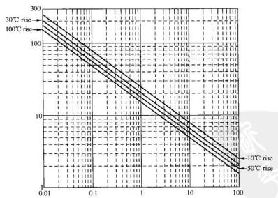

图 7.14 标准 E 形磁心 AP 值与热阻的关系曲线(环境温度为 $25^{\circ}C$ , 自然冷却)

## 7.6.5.3 步骤3：计算绕线电阻

设 60Hz 输入电流有效值为 5A, 铜损 1.5W 时所允许的最大绕线电阻 $R_{wp}$ 为 

$$
R _ {\mathrm{wp}} = W _ {\mathrm{cu}} / 1 ^ {2} = 1. 5 / 2 5 = 6 0 \mathrm{m} \Omega (\text {或} 0. 0 6 \Omega)
$$

得到整个骨架的绕线电阻后，就可以计算出填满整个骨架所需的导线尺寸和匝数（此处绕线分成两组，每组 $30\mathrm{m}\Omega$ ）。根据绕组匝数和 $A_{l}$ 可以得到电感量。 

## 7.6.5.4 步骤4：根据图7.15选择绕组匝数和导线尺寸

大多数厂家提供的数据表都给出了各种导线绕满骨架后的阻值,本例将根据图7.15直接给出导线尺寸和绕组匝数,具体方法如下。 

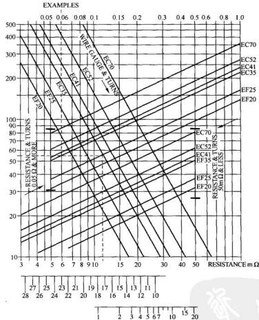

图 7.15 电感和扼流圈设计中最小铜损计算表。通过这个图表可以很快计算出 E 型磁心骨架的线圈匝数和导线最优尺寸。

在顶部横坐标方向的电阻轴上找到电感的阻值(0.06Ω)，投影到向上方向的“电阻和匝数”斜线(斜率为正)上找到EC35型磁心，如图所示。两者的交点投影到纵坐标上即为电感的匝数——本例中为56匝。向右投影到“导线规格和匝数”（斜率为负）的斜线上找到EC35型磁心，其交点投影到下面的横坐标上即为导线规格——此处约为17AWG。 

提示:为了方便绕制,也可以采用多股规格小一些的导线并绕。表7.9给出了10～41 AWG的电阻值。注意到AWG值每增加3,导线横截面积减半,因此,两股20 AWG线的面积与17 AWG线的相等。这种关系适用于整个AWG导线规格表。 

—K. B. 

如果导线电阻小于50mΩ,则从底部的电阻轴向上投影到“电阻和匝数”斜线上。对于共模电感来讲,绕组平分为相等的两部分。选择17 AWG线,每个绕组绕28圈,或者两股20 AWG线并绕。 

## 7.6.5.5 步骤5：计算绕组匝数和导线规格

如果首选的话,导线规格和绕组匝数一般还是通过计算的方法求得。 

在这个例子中仅考虑一组线圈和骨架中的一个槽，如图7.16所示。除去绝缘材料的空间，可用的窗口面积为 $30mm^{2}$ 。如果采用圆形的磁导线，填充系数一般取60%，这其中包括了导线间的绝缘以及圆形导线不能完全填充横截面的因素。从而实体铜导线的线圈有效窗口面积 $A_{cu}$ 为 

$$
A _ {\mathrm{cu}} = 0. 6 A _ {\mathrm{w}} = 0. 6 \times 3 0 = 1 8 \mathrm{mm} ^ {2} (0. 1 8 \mathrm{m} ^ {2})
$$

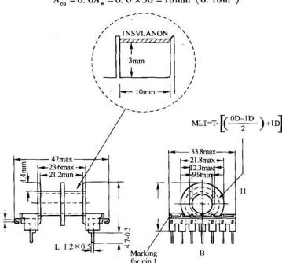

图 7.16 $A_{wb}$ 为双槽骨架的线圈有效窗口面积，骨架挡墙和绝缘所占的空间将减小磁心的 AP 值。每匝线圈平均长度（MLT）用来计算导线的长度，进而可以计算出导线电阻。

骨架的平均直径为1.6cm，因此每匝线圈平均长度（MLT）为5.02cm。 

现在利用铜的标称电阻率可以求出铜导线绕完骨架线圈有效面积一圈时电阻的理论值 $R_{x}$ ：70℃时，铜的电阻率为 $\rho=1.9\mu\Omega cm$ ，因此有 

$$
R _ {\mathrm{x}} = \frac {\rho \mathrm{MLT}}{A _ {\mathrm{w}}} = \frac {1 . 9 \times 1 0 ^ {- 6} \Omega \mathrm{cm(5.02cm)}}{0 . 1 8 \mathrm{cm} ^ {2}} = 5 3 \mu \Omega
$$

前面分析了当最大允许温升为 $30^{\circ}\mathrm{C}$ 时，绕满整个骨架所允许的总导线电阻为 $60\mathrm{m}\Omega$ ，即每个槽为 $30\mathrm{m}\Omega$ 。单匝线圈电阻为 $53\mu \Omega$ ，则绕满骨架一个槽所需的线圈匝数为 

$$
N = (R _ {w} / R _ {x}) ^ {1 / 2} = (3 0 \mathrm{m} \Omega / 5 3 \mu \Omega) ^ {1 / 2} = 2 4 \mathrm{匝}
$$

提示:由于骨架面积必须绕满,因此匝数每增加一倍则导线截面积减半,进而每匝线圈电阻也要加倍,因此导线电阻与 $N^{2}$ (匝数的平方)成正比。 

——K. B. 

得到绕组匝数后就可以选择合适的导线截面积以填满整个骨架，计算公式为 

$$
A _ {\mathrm{cuw}} = A _ {\mathrm{cu}} / N = 0. 1 8 / 2 4 = 0. 0 0 7 5 \mathrm{cm} ^ {2}
$$

根据表 7.9, 所得面积介于 18AWG 号线和 19AWG 号线之间。 

选择线径稍大的 18AWG 号线, 利用表格中所示 18AWG 的 $\Omega/\mathrm{cm}$ 可以计算整个绕组的导线电阻为 

$$
R _ {\mathrm{cu}} = N (\mathrm{MLT}) \left(1 8 \mathrm{AWG} \frac {\Omega}{\mathrm{cm}}\right) = 2 4 (5. 0 2 \mathrm{cm}) \left(0. 0 0 0 2 4 \frac {\Omega}{\mathrm{cm}}\right) = 2 9 \mathrm{m} \Omega
$$

最终得到的每槽线圈的导线电阻(29mΩ,全部线圈的电阻为58mΩ)与前面采用计算图表的方法所得结果相近。 

## 7.6.6 差模输入滤波电感

图 7.13(a) 中 L2 与 60Hz 输入线串联, 这样对差模 RFI 电流来讲 L2 表现为高阻抗。这些噪声电流从电网或者说输入端 L 线流经开关电源, 然后通过 N 线流回电网, 反之亦然。 

前面已经分析了共模电感由于其两个绕组反相的关系，对差模电流来讲L1相当于短路，因此需要一个分立电感来滤除差模电流。即使如此，此处的L2也不用承受DC电流，而是流过很大的工频(60Hz)尖峰电流，以及电流在两端产生的感应电压。另外，由于AC电流脉冲峰值的持续时间要远大于开关电源的开关周期，因此可以认为电感与一个工频输入的电流源串联。同DC电流(在DC/DC变换器中为直流电流)一样，输入电流尖峰也可能造成电感饱和。但是如果电感量太小，对于60Hz或DC电流来讲影响不大。 

提示:由于输入整流电路为容性,L2的电流峰值通常很难计算。以典型的离线式输入整流电路为例,由于输入电容一般都选的很大,当整流二极管导通时,对应于交流电压的波峰将有一个很大的尖峰电流流过。此时应该保证L2能够承受足够的电流尖峰而不饱和。峰值电流的大小取决于很多不确定的因素,包括输入电源的内阻、电路阻抗、输入电容的ESR、以及整个回路的寄生电感。一般来讲,最好测量一下输入电流,并且计算出磁心的峰值磁通密度。考虑到元件以及输入线路阻抗的差异,需留取30%的安全裕量。当系统含有功率因数校正电路时,电流就很容易确定,而且峰值也会小很多。 

——K. B. 

为防止 L2 饱和，有必要在铁氧体磁心上加气隙，或者采用磁导率较低的铁粉芯。如果电流最大值已知，则差模电感的设计与后文所提到的扼流圈的设计过程是一样的。在 DC/DC 变换器中采用 DC 电流最大值进行计算，此处设计则取 AC 电流的峰值而不是 DC 电流值。总之，差模输入滤波电感 L2 的设计方法与扼流圈的一样（见 7.7 节）。 

如果 L2 的电感量小于 $50 \mu H$ （很多场合这个电感量已经足够），可以采用棒状磁心电感，其优点在于简单，低成本，并且不会饱和。 

## 7.6.6.1 铁氧体和铁粉芯电感棒

在电感量要求很低，如 $5\sim 50\mu \mathrm{H}$ 的场合，工程师可以考虑使用简单的开路型铁氧体或者棒状铁粉芯，绕有线圈的骨架，或者轴型的铁氧体磁珠。 

如果线圈的跨绕线电容能够控制的很小(比如绕线和棒状线圈骨架之间的绝缘采用间绕 绕组),采用开路型磁棒绕制成的RFI电感的自谐振频率可以做的很高。现在简单介绍一下怎样用棒状磁心设计电感L2。 

图 7.17(a) 给出了电感棒/扼流棒的实例, 当这种电感与低 ESR 的电容组成 RFI 滤波器时, 可以有效地抑制高频噪声尖峰。通常这种高频 AC 电流要比 60Hz 或者 DC 电流的平均值 要小很多,因此由这些开路型的电感棒、线圈或骨架产生的高频电磁辐射(这类电感最大的缺陷)不是很大,一般不会造成 EMI 问题。 

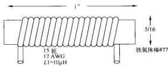

(a)

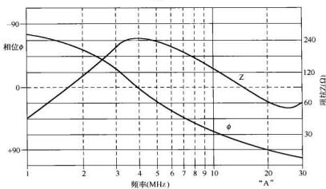

(b)

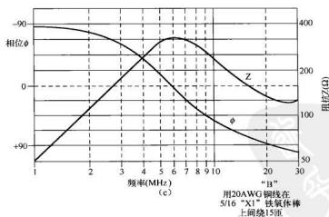

图 7.17 (a) 电感棒/扼流棒实例。(b) 电感棒/扼流棒的阻抗和相移随频率的改变而改变, 最大阻抗出现在 4MHz 的位置。(c) 采用间绕绕组减小了跨绕线电容, 此时最大阻抗移至 6MHz 附近, 改善了电感棒/扼流棒的高频衰减特性。

一般的铁氧体材料都可以用作电感棒，由于空气的磁路很长，即使采用高磁导率的材料也不用担心磁心饱和的问题。下一小节将介绍棒状磁心电感怎样优化设计，以获得最大的高频阻抗。 

## 7.6.6.2 棒状磁心电感的高频特性

任何卷绕式元件自身的电感与绕组跨绕线电容并联组成了一个 LC 电路,由于跨绕线电容很小,因此电感自谐振频率很高。 

一旦超过这个谐振频率,电感更多的表现为容性,且阻抗非常低,因此如果噪声的频率足够高就可以通过电感。为了获得最好的高频衰减特性,应该尽量减小跨绕线电容。 

图 7.17(a) 给出了一个 1 英寸长, 直径为 5/16 英寸的铁氧体电感棒, 绕组为 15 匝, 采用 17AWG 线。图 7.17(b) 为电感阻抗和相移与频率变化的关系曲线。可以看出自谐振频率为 4MHz 时, 相移为 $0^{\circ}$ , 此时阻抗最大。与并联谐振电路一样, 当频率超过或者低于这个值时, 阻抗减小。 

从图7.17(c)所示的阻抗特性曲线可以看出，减小跨绕线电容可以改善高频衰减特性。将图7.17(b)中的电感绕组改用间绕方式，并在磁心棒上加一层10密耳厚的聚酯胶带隔离，就得到了图7.17(c)所示阻抗曲线。所选导线为20号标准线，绕15圈，每圈之间间隔一定间隙。从曲线可以看出，由于减小了跨绕线电容，阻抗增加，自振荡频率移位到6.5MHz附近。这样可以加宽噪声抑制的频谱范围。 

## 7.6.6.3 棒状磁心电感的计算

图 7.18 给出了棒状磁心电感相对于磁心材料初始磁导率的有效磁导率(以几何比例 L/R 为参数)。相对于磁心的磁导率,电感的感量大小更多取决于磁心的窗口尺寸。 

在很多实际应用中，磁心长宽比一般都是3:1或者更大。而磁心材料的初始磁导率对电感最终的有效磁导率影响不大，因此大部分实际应用中，电感值的大小与磁心材料的磁导率相关度不大。所给曲线为铁粉芯材料的曲线，不过如果允许小量的误差，它也同时适用于高磁导率的铁氧体材料。 

知道有效磁导率后，根据磁心结构和几何比例就可以利用图7.18所给的公式计算出电感量。而棒状电感外部的气隙则可以防止高磁导率的铁氧体磁心饱和。即使直流电流很大，此类电感也能满足作为扼流圈对直流偏置的要求，某些场合甚至可以当做RF扼流圈使用。 

选择导线的时候应注意在额定工作电流下应该满足损耗和温升的要求，电流密度一般取 $600\sim1000A/cm^{2}$ 。也可以采用铁粉磁心做棒状电感，因为气隙很大减小了初始磁导率的作用，即使磁心初始磁导率低也是可以接受的。由于高频磁通偏移很小，磁心损耗一般都不大。对于铁粉芯材料来讲，虽然增加了磁心损耗，但是抗饱和特性好。 

有关“电感器”的介绍就到此为止，下一节将介绍“扼流圈”的设计。扼流圈的设计与电感有很大不同，因为扼流圈涉及到更多不确定的变量。 

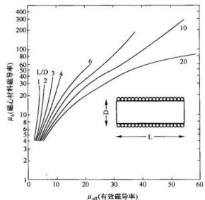

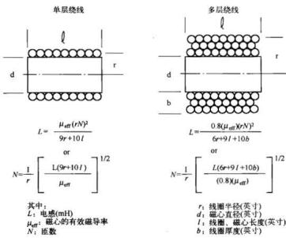

图 7.18 棒状磁心电感有效磁导率与磁心材料初始磁导率, 磁心长宽比之间的函数关系 (Micrometals Inc.)。

## 7.7 磁学:扼流线圈简介——直流偏置电流很大的电感

扼流线圈(直流偏置电流很大的电感)广泛地应用在开关电源中。小到开关晶体管或二极管驱动电流的整形磁珠,大到在输出端用的滤波器,都是扼流线圈的应用范围。图7.19给出一些用于开关模式扼流线圈的典型例子。 

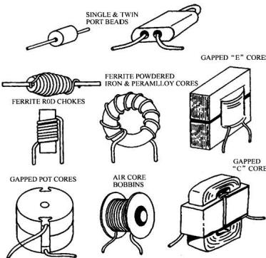

图 7.19 用于 Buck、Boost、低通滤波器及反激变换器的变压器设计的电感器和扼流圈例子

为了得到好的结果,需要深入了解扼流线圈的设计步骤。为设计出性价比较好的扼流线圈,电源设计工程师需要做大量的工作来选择磁心型号、材料、设计和体积,以及线圈设计。这个问题非常多样化,没有理想的设计方法,因为没有理想的磁性材料。 

本节将讨论加 E 型气隙的铁氧体磁心、磁粉芯和环形磁粉芯，因为这几种是最常用于高频扼流线圈的磁心。 

## 7.7.1 公式、单位和图表

在前一章中, Pressman 先生应用大量公式来解释线绕式器件的设计。在本章, 将采用 B/H 磁化曲线和各种图表、曲线图及表格形象地得到需要的解决方案。 

由于大多数的工程师都是根据特定应用场合来设计,他们更关心已经定义好了的实际磁心,所以这里用磁通密度 B 来作为一个设计参数,而不是总的磁通量 $\Phi$ ,即 

$$
B (\text { 特   斯   拉 }) = \Phi / A _ {\circ}
$$

其中， $A_{e}$ 是有效磁心面积，单位为 $mm^{2}$ 。 

在很多例子中,作者已经修正了这些公式,并且化简单位后得到更方便的方法。这里也大量采用了在 Jet Propulsion 实验室做了许多关于磁性材料测量和研究工作的 Colonel Wm. TMcLyman 改进的一些公式。想深入分析的读者若希望了解各种磁学公式、本节用到的计算图表及解释这些图表的公式都可参考文献[17、18、19]。 

在前一节中发现电感的设计相当简单易懂,这是因为其中的直流偏置很小,甚至没有。为了更好地理解设计扼流圈时所受的限制,则当扼流圈中存在很大的直流偏置时,需要根据一些 典型磁心材料的饱和特性以及气隙的影响来重新核对 B/H 曲线。 

## 7.7.2 有磁化直流偏置的磁化曲线特征

对于低磁导率的铁粉芯和不加气隙的铁氧体，图7.20是它们典型B/H曲线的第一象限图。首先水平轴H(奥斯特)和直流偏置电流量成正比，竖直轴B是磁心的磁通密度，单位为T。(1T=10000高斯/10kG，所以1毫T=10高斯(1mT=10G))。 

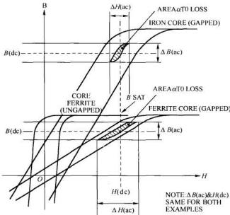

图7.20 单端(不包括推挽变换器)应用场合,加气隙或没加气隙的铁氧体和铁粉芯材料B/H曲线的第一象限。平均磁通密度 $(B_{\mathrm{dc}})$ 是磁场强度(H)的函数,其中后者由绕组中平均直流偏置电流、磁导率和扼流圈磁心气隙产生。B/H曲线包围的面积是引起磁心损耗的原因,并且磁通密度变化量 $\Delta B$ 只是交流应力的函数。

注意到对于任意的直流偏置量，若磁场强度 $H_{\mathrm{d}}$ 如图垂直虚线所示，这会使不加气隙的铁氧体磁心进入饱和区。同时注意到铁氧体磁心饱和时，B/H曲线的斜率为0（水平的）。这意味着此时不加气隙的铁氧体磁心的有效磁导率是0，则扼流圈的电感量近似为0。很明显，若流过这么大的直流偏置电流，则扼流圈磁心不能用没有加气隙的铁氧体磁心。 

对于初始磁导率小很多的铁粉芯(斜率更小)在同样的 $H_{dc}$ 处不会饱和,即 $H_{dc}$ 附近的B/H曲线有效斜率仍有意义,所以扼流圈仍然有一定的电感量。注意到同样是铁氧体磁心,但是若加了气隙,在 $H_{dc}$ 处也不会饱和,所以加气隙的铁氧体磁心保留了部分电感量。 

对于同样的磁场强度 $(H_{\mathrm{dc}})$ ， $B_{\mathrm{dc}}$ （即由偏置电流感应的磁通密度）在铁氧体中更大。这意味着铁粉芯磁心可以承受更大范围的 $\Delta B$ （磁通密度的摆幅）而不饱和，所以铁粉芯材料有能力承受更大的交流伏秒数。这种材料可以储存更多的能量，并且可以适应大范围的纹波电压和纹波电流。 

铁粉芯的 B/H 曲线包围的面积比加了气隙的铁氧体更大,所以铁粉芯磁心的磁心损耗也 更大。但是，高磁心损耗并不是必然的，因为在最终设计中实际的工作损耗主要由磁通密度偏移量 $\Delta B$ （磁通密度的摆幅）和开关频率决定。因此，铁粉芯磁心可以也应该用在扼流圈中，因为其成本较低。 

现在研究控制磁心磁场强度 $H_{dc}$ 的参数。 

## 7.7.3 磁场强度 $H_{\mathrm{dc}}$

为了更好地理解磁场强度 H，我们再次回到 B/H 曲线。在这个曲线中，其水平轴就是磁场强度 $H^{[17\sim19]}$ ，按照国际单位制 H 的表达式为： 

$$
H = \frac {0 . 4 \pi N I}{l}
$$

其中，H 为磁场强度（单位：奥斯特）；N 为匝数；l 为磁心的磁路长度（cm）；I 为绕组中的直流偏置电流（A）。 

在扼流圈设计完成后，N 和 l 都是确定的，所以 $H \propto I$ ，即磁场强度 $H_{dc}$ 与直流偏置量 $I_{dc}$ 成正比。 

这里是第一个折中选择。对于一个特定的磁心材料，给定体积和匝数，直流偏置电流越大，需要防止磁心饱和的 $B / H$ 曲线斜率越小。因此，必须选择一种低磁导率的磁心材料或者增加磁心中气隙的长度，这两种方法均可以得到较低的有效磁导率。由于磁导率较低，每匝的电感量也很小。所以必须在承受较大的直流偏置和得到一定的电感量两者之间寻求平衡——增加一个，则减小另一个。 

## 7.7.4 增加扼流圈电感或者额定直流偏置量的方法

在设计中怎么才能增加电感量并/或增加偏置电流呢？若磁心不是接近饱和，则增加匝数会有效，因为电感量以 $N^{2}$ 的比例增加，而H以N的比例增加。但是若磁心已经接近饱和，则增加匝数就没有效果。因为若电流增加，则H以同样的方式增加。这将使磁心进入深度饱和，导致磁心的磁导率降低，这时必须减小匝数。 

电感量的公式如下 $^{[17\sim19]}$ : 

$$
L = \frac {N A _ {\mathrm{e}} \Delta B}{\Delta I}
$$

其中，L 为电感量（亨）；N 为匝数； $A_{e}$ 为磁心的截面积（mm²）； $\Delta I$ 为偏置电流上的电流小波动（A）； $\Delta B$ 为相应的磁通密度的变化量。 

在磁心的工作点(所选磁心的工作磁导率), B/H 曲线的斜率与 $\Delta B/\Delta I$ 成正比, 因此剩下的变量是 N 和 $A_{e}$ 。所以, 

$$
L \propto N A _ {g}
$$

为了防止磁心直流饱和，N不能够增加的太多，所以增加电感的唯一方法就是增加 $A_{e}$ （磁心截面积）。所以对于一种特定的磁心材质，得到较大的电感量或者承受较大的直流偏置的唯一方法就是采用更大的磁心。稍后会发现磁心的体积决定了存储能量W，即 

$$
W = \frac {1}{2} L I ^ {2} (\mathrm{J})
$$

同样地，增加 $\Delta B/\Delta I$ 斜率或者磁心工作磁导率同样可以增加电感量，但是从图 7.20 发现，这要求磁心有更高的饱和磁导率。即使存在合适的材料，但是这样会导致很大的磁心损耗，这也将会成为一个限制因素。 

## 7.7.5 磁通密度 $\Delta B$

现在研究 B/H 曲线竖直轴(磁通密度 B)。但是在此之前,首先根据一个扼流圈来研究 B 与工作交流应力的关系。 

图 7.21(a) 是典型 Buck 调整器的功率电路部分, 其中扼流圈为 L1。图 7.21(b) 是连续导通模式下扼流圈的期望电流波形。注意到此波形是以直流负载电流为中心的三角波波形。 

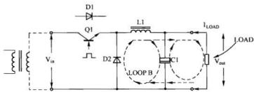

(a)

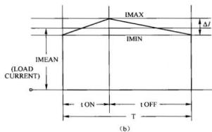

图 7.21 （a）典型 Buck 变换器的例子，图中包括扼流圈 L1 和 Q1、D1、C1 及输出电流流通回路。
(b) 连续导通模式的典型波形。

稳态时，该电流波形由 Q1 的开关动作、扼流圈 L1 的工作状态、二极管 D1、输出电容 C1 及负载电流决定。 

稳态时，当Q1开通时，输入电压作用于扼流圈L1的左边，而右边是C1上的直流输出电压，小于输入电压。所以施加于扼流圈L1上的正向电压为 $V_{\mathrm{L1}} = V_{\mathrm{in}} - V_{\mathrm{out}}$ ，而L1的电流以 $\mathrm{d}i / \mathrm{d}t = V_{\mathrm{L1}} / L1$ 的斜率线性增加。 

当 Q1 关断时，L1 的左边电压被导通的 D2 钳位近似为 0，L1 承受反向电压为 $V_{out}$ 加二极管压降，所以其电流线性下降。 

在本例中，扼流圈工作在连续状态，因为其电流从没有到0，电感的平均电流就是负载电流。刚才提到的平均负载电流就是所设计的扼流圈的直流偏置电流。 

由 B/H 曲线(图 7.20) 可知, 磁通密度的平均值 $B_{dc}$ 由磁场强度 $H_{dc}$ 和 B/H 曲线的斜率及其形状决定。现在考虑交流状态, 即晶体开关管开关过程施加于其扼流圈上的纹波电压。 

对于交流状态,由据平均直流电流决定的 $B_{dc}$ 沿 B 轴左端开始可以很方便地做出 B/H 曲 线。以 $B_{\mathrm{dc}}$ 为中心，磁心的磁通密度在开关管开通时增加，所以在交流电压作用下，磁通密度（绕组中的磁链）的变化量如下： 

$$
\Delta B = \frac {V _ {\mathrm{LI}} t}{N A _ {*}} (\mathrm{特斯拉})
$$

其中， $\Delta B$ 为磁通密度的变化量(T)； $V_{\mathrm{LI}}$ 为扼流圈L1的正向电压(V)； $t$ 为电压施加的时间(Q1的开通时间， $\mu \mathrm{s}$ )； $N$ 为匝数； $A_{e}$ 为扼流圈磁心截面积（ $\mathrm{mm}^2$ ）。 

同样，在开关管关断时，由于 $V_{LI}$ 为负，磁通密度以负的斜率变化，电流和磁心磁通返回到 Q1 开通时的值。 

提示: 注意到上式, 由于在设计中 N 和 A, 都是常量, 磁通密度的摆幅 $\Delta B$ 由伏秒数决定 (Vt)。因此, 磁通密度的变化量或摆幅也是常量, 它不是磁心材料、磁心气隙或者磁导率的函数。换而言之, 磁通所需要的变化量 $\Delta B$ 与磁心没有关系, 其变化量由所施加的伏秒数决定。 

因此，对于交流电压应力，从B轴左端的 $B_{dc}$ 处开始，在其之上叠加一个以 $B_{dc}$ 为中心，由伏秒数决定的磁通密度变化变量 $\Delta B$ 。B/H曲线的斜率（磁导率）决定了H相应的变化量，因此纹波电流与纹波电压相关。如果磁心接近饱和，磁通密度就不能再增加，即这时没有反向电动势来抵消所施加的伏秒数，则扼流圈就像是一个短路线圈。这时，仅仅由扼流圈的电阻限制电流增加，电流迅速增加。因此，所设计的扼流圈必须有足够的饱和裕量，以满足由于直流偏置电流产生的磁通密度 $B_{dc}$ 与施加交流电压所引起增量 $\Delta B/2$ 的和。 

—K. B. 

现在研究 Buck 调整器完整的工作状态, 以及其与 B/H 曲线的相互作用, 然后在铁氧体和磁粉芯间寻找权衡。若设计者能够很好的理解下面三个图, 就会立即明白在设计扼流圈时仅仅根据磁心材料的 B/H 曲线就可以选择磁心材料。 

如图7.20所示， $H$ 曲线由 $H_{\mathrm{dc}}$ 开始，在 $H$ 轴上找到 $H_{\mathrm{dc}}$ ，沿虚线向上找到与铁粉芯 $B / H$ 曲线的交点则就可得到其平均直流工作点 $B_{\mathrm{dc}}$ 。这是由绕组直流偏置电流产生的粉芯平均工作磁通密度。注意到平均电流相同时，加气隙的铁氧体磁心磁导率更低，则其平均工作点 $B_{\mathrm{dc}}$ 低于粉芯的 $B_{\mathrm{dc}}$ 。 

现在在工作点 $B_{\text{上}}$ 上叠加一个交流部分 $\Delta B$ （由于Q1开通或关断产生的交流方波电压引起的磁通密度变化量或摆幅）。如图所示，磁心扫过小的 $B / H$ 曲线。当磁通摆动时， $H$ 的变化量 $\Delta H$ 如图所示。电流变化引起 $\Delta H$ 变化，将这种变化转化成电流则成图7.21(b)所示的三角波。如果把 $B / H$ 曲线描绘出来，则发现纹波电流将会呈现同样的曲线。如果磁心趋近饱和，则 $B / H$ 曲线的斜率迅速减小，导致 $H$ 也迅速增加，这将使电流迅速增加。因此，若将要发生饱和，则会在电流纹波的正向峰值处会看到电流的突然增加夹刺。 

注意到由于 B/H 曲线的斜率较小，在加气隙的铁氧体磁心较小直流工作点 $B_{\Delta}$ 上叠加同样的磁通密度摆幅，产生的磁场强度摆幅 $\Delta H$ 更大。施加同样的纹波电压（其波形没有画出）将产生更大的纹波电流。换而言之，在同样的工作点，加入气隙后铁氧体磁心的电感要比铁粉芯磁心的电感量小，则纹波电流更大。虽然铁氧体磁心的 B/H 曲线更宽，而实际上曲线包围的面积更小，磁心损耗也更小。所以仅由 B/H 曲线就可预知扼流圈材料的性能，并可判断其是否具有设计需要的性能。 

现在考虑第二个权衡。设计者可选择低损耗加气隙的铁氧体磁心，但由于其饱和磁通密度较低，所以电感量更小和纹波电流更大。因此，同样体积的磁心、在同样的直流偏置电流作 用下，加气隙的铁氧体磁心电感更小。稍后将看到，磁心可储存的能量 $(1/2Li^{2})$ 将磁心体积与电感量和额定直流偏置电流联系起来。 

## 7.7.6 气隙的作用

现在要问一下读者对气隙基本作用的理解程度。在这里强调这点是因为设计者经常不能很好地理解气隙功能并存在许多混淆。如果读者对本节内容非常精通，可以直接跳过本节到7.7.7节。 

由 B/H 曲线(图 7.20)及下式可知,对于直流电流部分, $B_{dc}$ 的平均值是 $H_{dc}$ 的函数,它与直流偏置电流关系如下: 

$$
H = \frac {0 . 4 \pi N I}{l} (\mathrm{奥斯特}) ^ {[ 1 7, 1 8, 1 9 ]}
$$

所以对于水平轴而言， $H_{dc} \propto I_{dc}$ ，直流感应磁通密度 $B_{dc}$ 是磁化特性决定的受控量。因此，磁心材料的磁导率（B/H 曲线斜率）、气隙或者直流偏置电流的任何一个变化都会引起直流感应磁通密度 $B_{dc}$ 变化。 

但是，对于交流状态， $B$ 的变化量 $(\Delta B)$ 不受上面因素的限制，而由下式决定： 

$$
\Delta B = \frac {\Delta V t}{N A _ {e}} (\mathrm{特斯拉})
$$

对于交流状态，由于 N 和 $A_{e}$ 都是常量，所以交流感应磁通密度 $\Delta B$ 仅仅是外部施加的伏秒数的函数，而与磁心材料无关。因此，变化量 $\Delta B$ 与所施加交流量成比例，事实上， $\Delta B$ 叠加在由直流偏置电流决定的工作点 $H_{de}$ 上。磁通密度交流摆幅 $\Delta B$ 由外部需要抵消的幅秒数决定。上式中没有磁导率，所以改变平均电流、磁导率或者气隙，不会引起磁通密度摆幅 $\Delta B$ 的变化。 

但是改变磁导率会改变 B/H 曲线的斜率，即改变 $\Delta B$ 与 $\Delta H$ 的比例。这会导致纹波电流的变化。换而言之，改变磁心磁导率就改变了扼流圈的电感量，因此会影响到纹波电流。 

改变材料磁导率或者气隙长度都不会改变交流磁通 $\Delta B$ ，也不会改变交流饱和磁通密度。但是，通过降低磁导率来降低B/H曲线的斜率，可以降低电感量，则由直流偏置电流决定的磁通量会降低，可避免磁通量直流部分和交流部分总和饱和。从图7.20中没加气隙和加了气隙的铁氧体B/H曲线可明显地看出这点。 

总之，气隙或磁导率的改变会引起电流直流部分产生的磁通密度变化，但不引起磁通交流摆幅的变化。 

## 7.7.7 温升

最后，扼流圈设计中最重要的也许就是温升的限制。一般的，扼流圈的铜损比铁损大，这是因为较大的直流偏置电流会产生 $I^{2}R$ 的损耗。所以，大多数场合磁心损耗比铜损小，并且实际上有些情况下磁心损耗相当小。但是，温升是总损耗的函数，必须考虑磁心损耗，尤其是磁心损耗占的比重较大时。 

温升是很多个变量的函数,其中包括扼流圈安装的位置、空气流动速度及可能会影响到温升的其他环境因素。这里用到的各种图表和曲线图均假设在自然冷却条件下,所以表面积和辐射特性决定了温升。这些图表假设热量的45%靠对流冷却,而55%靠辐射冷却(发射率为0.95)。由于布局和热设计引入其他很难控制的热影响,所以任何时候,最终扼流圈的温度都需要在实际的工作条件下加以验证。下面考虑材料特性。 

## 7.8 磁设计——扼流圈磁心材料简介

本节详细分析设计扼流圈用到的各种磁心材料的更重要的特性。 

通常,设计中所选择的磁心材料要满足设计者认为的一些最重要参数。这包括工作频率、直流偏置电流相对交流纹波电流的比例、需要的电感量、温升、饱和磁密、成本及其他特殊的机械要求。因为参数要求相互制约,选择时需要折中考虑,所以即使不考虑成本因素也很难找到一种磁心材料同时满足所有要求。 

直流偏置电流的饱和影响使设计扼流圈更加困难，并严格限制了设计者获得大电感量的能力。因此，扼流圈的设计过程是一个平衡磁心材料、磁心体积、磁心损耗、绕线损耗、额定电流、电感量和温升的过程。在最终设计中必须使所有这些相互依赖相互限制的变量达到最佳组合。 

根本没有磁心材料的选择是理想的,它主要由应用场合和其他一些因素,比如设计者的技术和经验决定。但事实是,作为一个纯电感器时,磁心可提供数毫亨的电感量;而作为扼流圈时,其电感量仅是数微亨。 

## 7.8.1 适用于低交流应力场合的扼流圈材料

一些场合，选择扼流圈材料很简单。当交流纹波电流或频率很低（如60Hz时母线串模输入滤波器）时，磁心损耗不再是一个关键因素。在这些应用场合，应该选择低成本、高磁导率、高饱和磁通密度的材料。这时可以选择铁粉芯材料或者加气隙的硅磁化铁片变压器。这两种材料的优点是饱和磁通密度高、磁导率高并且价格低。高磁导率使得较少的匝数就可以获得所需要的电感量，并且即使更大的直流偏置电流也可以使磁心远离饱和磁通密度。减少匝数有助于减少绕组损耗。而这些情况下磁心损耗通常不会成为问题。 

## 7.8.2 适用于高交流应力场合的扼流圈材料

但是在工作频率和交流纹波电流都很大的场合，必须考虑磁心损耗，所以需要选择低损耗的材料。这包括各种低磁导率、低损耗的材料，如铁粉芯、MPP、Kool Mμ和加气隙的铁氧体。所有这些材料的磁导率很低，为获得需要的电感量就需要更多匝数，因此绕组损耗和磁心损耗更大。 

## 7.8.3 适用于中等范围的扼流圈材料

在这两个极限状态之间的情况,磁心材料和几何结构的最优选择就不是这么明显。即在磁心损耗和铜耗间进行折中。本节中将研究一些材料的基本特性,并比较它们的一些本质特征,首先从饱和特性开始。 

## 7.8.4 磁心材料饱和特性

图7.22是一些磁心材料的典型饱和特性。水平轴 $H$ (奥斯特)与直流偏置电流和匝数成比例，概括地讲，竖直轴表明每种材料磁通密度的平均值都对应着的 $H_{\mathrm{Fe}}$ 。在铁氧体的例子中，引入气隙后磁导率大约为60。本节中要注意的重要参数是在材料饱和点磁通密度的数量。这取决于材料特性，并且每种材料磁导率的范围不会改变太多。与普通观念相反，气隙不会改变饱和磁通密度。磁心材料的饱和磁通密度由下向上依次为： 

① 所有铁氧体材料在 0.35T 附近饱和； 

② MPP 的饱和范围为 $0.65 \sim 0.8T$ ; 

③ Kool Mμ 在 1.0T 附近饱和； 

④ 铁粉芯材料在 1.2T 以上饱和。
特斯拉与高斯的转换关系为： $1T=10^{4}G$ 。 

图 7.22 为设计者提供选择磁心所需的参数。很明显，如果没有其他约束条件，设计者会选择饱和磁通密度最大的材料，但是现在必须考虑磁心损耗。 

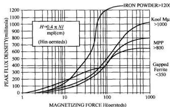

图 7.22 铁粉芯、Kool Mμ、MPP、加气隙的铁粉芯材料磁心典型饱和特性

## 7.8.5 磁心材料损耗特性

对上面提到的材料，图7.23给出由于交流磁通分量 $\Delta B$ 产生的磁心损耗。这里，假设在 

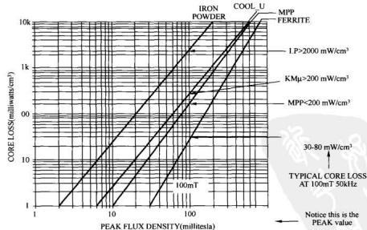

图 7.23 铁粉芯、Kool Mμ、MPP 和加气隙铁氧体材料磁心损耗的典型特性

50kHz 处有一个峰值为 100mT（即峰 - 峰值为 200mT）的交流磁通。注意到该图是以指数形式的坐标轴，所以图的顶部比底部的值要大的多。 

磁心损耗是交流状态,即磁通密度摆幅和频率的函数。根据图中所示的交流条件,磁心材料损耗由下到上依次为: 

① 对于加气隙的铁氧体，磁心损耗接近 $30 \, mW/cm^{3}$ ; 

② 对于 MPP, 其磁心损耗一般比铁氧体损耗的 3 倍还要多, 接近 $100 \, mW/cm^{3}$ ; 

③ Kool Mμ 磁心一般比铁氧体损耗的 6 倍还要多, 磁心损耗接近 $200 \, mW/cm^{3}$ ; 

④ 铁粉芯材料的磁心损耗铁氧体损耗的65倍还要多，磁心损耗接近 $2000mW/cm^{3}$ 。 

从图中可以看出,磁心损耗从 $30 \, mW/cm^{3}$ 到 $2000 \, mW/cm^{3}$ 变化很大,近 65:1 的跨度。这些都是归纳结果,仅仅作为设计指导,但是趋势是显而易见的。 

提示: 图7.24中磁心损耗的例子是在交流磁通密度 $(B_{ac})$ 的峰值为100mT处得到的。在供应商磁心损耗的说明书中通常假设磁心工作在推挽状态, 所以损耗曲线图中假设交流摆幅 $\Delta B$ 的峰—峰值为200mT。图中不包括直流磁通密度 $(B_{ac})$ 的影响, 这是因为直流磁通对磁心损耗没有贡献。 

——K. B. 

饱和磁通密度高的磁心材料相应的磁心损耗却很大。而扼流圈设计者只需要折中考虑相互限制变量中的两个。很明显，选择饱和磁通密度最高的材料与需要降低磁心损耗相矛盾。因此，由于目前磁性材料的限制，最终的选择总需平衡这两个因素。 

## 7.8.6 材料饱和特性

必须保证磁心在最大直流偏置电流、所有过流状态及交流磁通的总和下不饱和。所以饱和特性的形状(B/H曲线的曲率)是一个很重要选择依据。此参数显示了所选择的磁心的承受磁场强度而不饱和能力。 

图 7.24 比较了加气隙的铁氧体与各种粉芯材料的饱和曲线。随着磁场强度的增加，加气隙的铁氧体仍然维持相对磁导率为常数。这意味着随负载电流的增加，电感量变化很小，但是它会突然进入饱和。当用加气隙的铁氧体设计扼流圈时，一定要保证在最大电流的情况下磁心不饱和。所以应该选择适当的气隙，以保证足够的安全裕量。 

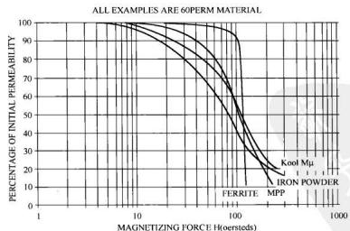

图 7.24 以直流励磁强度为变量,给出铁粉芯、Kool Mμ、MPP 和加气隙铁氧体材料的磁心饱和特性

## 7.8.7 材料磁导率参数

选择好最合适的材料后,现在需考察在不同直流和交流工作状态下所选择材料的性能变化。 

通常每类材料可提供很大范围的磁导率。但是，对于铁氧体磁心，工作磁导率由气隙厚度决定。用作扼流圈时，气隙通常比较大，所以铁氧体材料初始磁导率在加气隙的磁心中仅起很小的作用。若忽略气隙边缘的影响，则随着气隙的变化，铁氧体磁心损耗并无明显变化。 

粉芯材料有很宽范围的磁导率，这主要由生产者混合各种粉末和黏结剂时控制。因此，铁粉芯材料的气隙分布在磁心的各个部分，通常高磁导率材料的磁心损耗也很高。 

图 7.25 是环形 Kool Mμ 材料的典型磁化特性，其磁导率一般在 26μ 和 125μ 之间。但是磁导率越高，饱和时的磁场强度越低。例如，100 奥斯特时，初始磁导率为 90μ 的材料只有其初始磁导率的 25%，而初始磁导率为 26μ 材料的磁导率仍然在其初始磁导率的 90% 以上。B/H 磁化曲线的形状是产生这些差别的原因，而与其固有的饱和值变化无关。各种磁导率的 Kool Mμ 磁心的饱和磁通密度都很接近。铁粉芯材料有类似特性。 

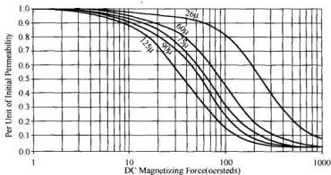

图 7.25 环形 Kool Mμ 磁心材料的磁化特性, 图中显示当励磁强度(直流偏置电流)增加时磁导率将降低(美国微金属公司)

在上面例子中，磁导率分别为 $90\mu$ 和 $26\mu$ 的磁心材料区别并不像看起来那么大，因为 $25\mu$ 的 $80\%$ 是 $20\mu$ ，而 $90\mu$ 的 $25\%$ 是 $22.5\mu$ 。所以，当磁场强度为100奥斯特时，对于同样的匝数，每种磁心材料的电感量都很接近。 

另外要注意特性曲线。它反映了磁导率是如何随磁场强度变化而变化的。可以看出相比于初始磁导率为 $26\mu$ 材料，初始磁导率为 $90\mu$ 的材料的工作磁导率在更低的直流偏置电流下就开始变化。其他粉芯材料有类似的特性。设计摆动扼流圈时可利用磁导率的这种变化（或摆动）优化设计。 

## 7.8.8 材料成本

成本通常是选择磁心一个很重要的标准。因为材料价格总在变化，只能比较相对成本。之前价格最高的材料是 MPP 和铁氧体，因为其未加工的材料和制造成本很高。紧跟其后的是 Kool Mμ 材料，但其价格变化很大。铁粉芯一般是最便宜的材料。 

但是铁粉芯材料在高温下比其他材料老化的更快，所以设计者必须核对最新材料的这种特性，并确保设计的扼流圈在温度限制之内（不同生产厂家间会有所不同）。 

## 7.8.9 确定最佳的磁心尺寸和形状

所有设计的第一步都是选择磁心尺寸和结构。这会令人困惑，因为有很多种磁心拓扑和磁心尺寸，对于某种应用场合很难从中选择一个最佳的尺寸和形状。 

磁心类型的选择就稍微易懂一点。如果能找到一种合适的磁心，那么任何形状都可以用，但本节只以E形磁心和环形磁心为例做介绍。之前所介绍的所有材料都可有环形磁心。铁粉芯磁心和Kool Mμ磁心也有E形和棒状磁心。而MPP磁心有环形磁心，因为这种材料很难加工。铁氧体磁心有很多种形状。 

一般的，设计者根据自己的偏爱和其他特殊机械要求选择磁心的形状和类型。环形磁心很难绕制，并且对铁氧体来讲不方便加气隙。E形和棒状磁心适用于大电流的场合，这时经常用铜带绕制。 

## 7.8.10 磁心材料选择总结

综上，在一些情况下，磁心材料的选择很令人迷惑。如果直流偏置电流远大于交流，或者工作频率很低，那么一般选择高饱和磁通密度的材料（如铁粉芯）以减少匝数。这种情况下，磁心损耗并不重要，因为铜耗可能是磁心损耗的很多倍。 

另一种情况，交流电压应力和工作频率很大，或者电感量很大而直流偏置电流很小，磁心损耗将成为限制因素。所以很明显，这时应该选择损耗更小的粉芯材料或者加气隙的铁氧体材料。这两种极端之间的情况，很多其他因素会决定选择，而一些完全不同的选择方法常会得到类似的结论。 

## 7.9 磁学:扼流圈设计例子

## 7.9.1 扼流圈设计例子:加了气隙的铁氧体磁心

下面例子中,采用 E 形加气隙的铁氧体磁心来设计扼流圈。首先从磁心尺寸选择开始。首先引入面积乘积 $^{[17\sim19]}$ 的概念以帮助理解,磁心的面积乘积(AP)提供了可帮助选择磁心体积和其他参数的图表。虽然很多其他方法也可以用来确定最佳的磁心体积,但是下面例子中还是用 AP 法。 

用 E 形加气隙的铁氧体磁心来设计如图 7.21 所示的 Buck 调整器的扼流圈 LI。可以用加气隙的 E 形铁氧体磁心的曲线图确定磁心的 AP 值，进而确定其磁心尺寸。这种方法为普通的设计要求提供了一种快速、简单并有效的方法。它推荐一种典型的折中设计方法可轻松地应付一些典型的要求。 

图 7.26 中的曲线图 $^{[17]}$ 根据 E 形加气隙的铁氧体所得。它表明，若以需要的电感量作为参数，则磁心的面积乘积及磁心体积是负载电流的函数。更进一步讲，AP 法为电感量和磁心损耗，进而温升建立了联系。 

该曲线图假设周围的环境温度为 $20^{\circ}C$ ，并在此基础上有 $30^{\circ}C$ 的温升，磁心最大的磁通密度是 250mT，线圈的填充系数为 0.6，即只有 60% 的窗口面积被铜线占据。对于这类设计，这些都是典型值。 

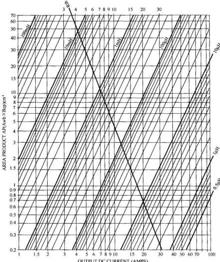

图 7.26 以电感量为参数, E 形加气隙铁氧体磁心的面积乘积(及磁心体积)与

平均扼流圈电流关系的曲线图

此曲线图中，面积乘积是根据磁心的截面积和骨架有效窗口面积（而不是磁心窗口面积）的乘积。由于用到骨架，这是一种保守的方法，因为骨架和绝缘材料占据了部分窗口面积，导致面积乘积下降很多（设计者可以调整填充系数来补偿骨架的影响）。下面的例子给出了曲线图的用法。假设Buck变换器的电气性能指标如下。

Buck 变换器的性能指标：

<table><tr><td>输入电压=25V</td></tr><tr><td>输出电压=5V</td></tr><tr><td>最大负载=10A</td></tr><tr><td>频率=25kHz</td></tr><tr><td>最大电流纹波=最大电流的20%(峰—峰值为2A)</td></tr><tr><td>最大温升=环境基础上增加30°C</td></tr></table>

## 7.9.2 步骤一: 确定 20% 纹波电流需要的电感量

20%的纹波电流所需的电感量设计如下。 

如图 7.21(b) 所示的电流波形, 是最大输入电压时的满载波形。纹波电流波形以 10A 平均电流为中心, 可按下面的方法由电流波形斜率得到所需的电感量 (如果需要更小的电流纹波, 则需要更大的电感量)。 

频率 $f=25kHz$ 。 

因此整个周期时间为 $T = 1/f = 40 \mu s$ 

输出电压 $= 5\mathrm{V}$ 

输入电压=25V 

Q1 开通时间 $(t_{\mathrm{on}})$ : 

对于Buck变换器，占空比 $D$ 为 $t_\mathrm{on} / T$ ，稳态时，这与电压传输率 $V_{\mathrm{out}} / V_{\mathrm{in}}$ 相同 

$$
t _ {\mathrm{on}} = \frac {T V _ {\mathrm{out}}}{V _ {\mathrm{in}}} = \frac {4 0 \times 5}{2 5} = 8 \mu \mathrm{s}
$$

且 

$$
t _ {\mathrm{off}} = T - t _ {\mathrm{on}} = 4 0 - 8 = 3 2 \mu \mathrm{s}
$$

由图7.21(a)可知,稳态时在Q1关断期间,B曲线显示这时电流处于续流状态。这期间二极管D1正向偏置导通,电感L1左端承受大约0.6V负压。而由于较大电容C1存储的能量,电感右端电压仍然保持在+5V附近。由于在闭环控制系统中,输出电压保持为常数,所以在Q1关断期间扼流圈两端电压也为常数,用这段时间确定其电感量。 

在续流阶段,扼流圈两端的电压为输出电压加二极管压降,即 $5+0.6=5.6V$ ,故计算电感量如下: 

$$
V _ {\mathrm{LI}} = \frac {L \Delta I}{\Delta t} = 5. 6 \mathrm{V}
$$

因此 

$$
L = \frac {V _ {\mathrm{LI}} \Delta t}{\Delta I} = \frac {5 . 6 (3 2 \times 1 0 ^ {- 6})}{2} = 8 7 \mu \mathrm{H}
$$

## 7.9.3 步骤二: 确定面积乘积(AP)

根据额定电流及计算所得电感量,用图 7.26 所示曲线图求磁心所需的 AP 值,进而得到磁心体积。 

在曲线图底部找到要求的电流10A，然后向上找到 $90\mu \mathrm{H}$ 电感量附近的交点，可得AP值大约为1.5。此值在EC35磁心（ $\mathrm{AP} = 1.3$ ）和EC41磁心（ $\mathrm{AP} = 2.4$ ）间。由于EC41磁心的磁心体积和AP值比EC35大很多，因此通常温升不是问题。 

本例中选用更大的EC41磁心。 

## 7.9.4 步骤三: 计算最小匝数

线圈绕制在磁心上以得到所需的电感量，并使磁通密度不超过250mT，下式给出最小的匝数的计算方法。 

$$
N _ {\min} = \frac {L I _ {\max} 1 0 ^ {4}}{B _ {\max} A _ {e}}
$$

其中， $N_{\min}$ 为最小匝数；L 为所需的电感量(H)； $I_{\max}$ 为最大电流(A)； $B_{\max}$ 为最大磁通密度(T)； $A_{e}$ 为磁心截面积( $mm^{2}$ )。 

本例中， 

$$
N _ {\mathrm{min}} = \frac {9 0 \times 1 0 ^ {- 6} (1 1) 1 0 ^ {4}}{2 5 0 \times 1 0 ^ {- 6} (1 0 6 \times 1 0 ^ {- 2})} = 3 7 (\text { 匝 })
$$

## 7.9.5 步骤四：计算磁心气隙

本例中，磁心用 E 形铁氧体磁心，为防止磁心在直流电流状态下饱和需要加气隙。铁氧体磁心材料初始磁导率远大于气隙的磁导率。因此可假设大部分磁势在气隙中。 

提示:磁心的磁路主要由磁导率在2000～6000的铁氧体磁心材料组成。铁氧体磁心与磁导率仅为1的气隙串联。虽然气隙长度远小于磁心长度,但是磁导率非常低的气隙掩盖了磁心的作用,因此计算时可忽略磁心磁导率。这是用加气隙的铁氧体作为扼流圈时常遇到的情况。 

——K. B. 

气隙长度 $l_{g}$ (忽略边缘的影响) 如下式所示: 

$$
l _ {s} = \frac {\mu_ {n} \mu_ {0} N ^ {2} A _ {e} 1 0 ^ {2}}{L}
$$

其中， $l_{g}$ 为总的气隙长度(mm)； $\mu_{0}=4\pi\times10^{-7}$ ; $\mu_{r}$ 为1(空气的相对磁导率)；N为匝数； $A_{e}$ 为中柱有效的截面积；L为电感量(H)。 

本例中， 

$$
l _ {\mathrm{g}} = \frac {4 \pi \times 1 0 ^ {- 1} (3 7 ^ {2}) (1 0 6 \times 1 0 ^ {- 2}) 1 0 ^ {- 1}}{9 0 \times 1 0 ^ {- 6}} = 2 \mathrm{mm(0.078in)}
$$

这是磁心中需要加的气隙总长度,如果可能,尽量将气隙加在中柱,以使外部磁场辐射最小。但对于这种扼流圈,通常纹波电流很小,并且气隙也许覆盖整个磁心(对接气隙),所以磁场辐射不会很大。对接气隙是总气隙的一半,本例中是1mm——中柱和边柱各1mm。 

提示:如果想有效地降低外部剩余磁势,可用铜带包住气隙部分,如图7.27所示。对于EC磁心,中柱的截面积小于边柱截面积的总和,如果中柱和边柱都加气隙,则边柱的气隙长度将以中柱和边柱截面积比例降低一些。但是由于忽略磁心磁导率和边缘磁通的影响,所以必须通过对气隙进行调整以得到最佳结果。 

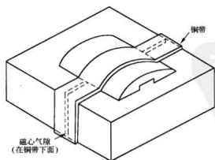

图 7.27 在铁氧体 E 形磁心的气隙外部包一层铜带以减小气隙处的 EMI 辐射和边缘效应。 $^{[17]}$

交流应力很大时，在边缘磁通作用下，气隙处的绕线增加了涡流和集肤效应，这将使绕组中出现局部热点。这种情况下，中柱和边柱都加气隙有助于降低热点的影响。 

—K. B. 

## 7.9.6 步骤五: 确定最佳线径

由于扼流圈中的直流电流比变压器的大，所以设计扼流圈选择线径的原则与设计变压器所用原则不同。这意味着铜耗通常远超磁心损耗。由于通常纹波电流很小，集肤效应和邻近效应并不像变压器那么严重。因此，为使铜耗最小，应使线径最大。为达到此目的，所需的匝数应将窗口全部可用的空间充满（功率因数调整器的扼流圈是个例外，其高频纹波电流很大，集肤效应不忽略）。 

提示：骨架或磁心供应商通常会提供线径、将骨架绕满需要的匝数和绕组电阻等相关信息。 

——K. B. 

图 7.28 中的曲线图给出面积乘积与用 10 AWG 到 28 AWG 的线径绕满骨架所需匝数间的关系。它适用于标准 E 形磁心。 

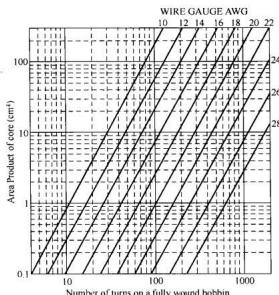

图 7.28 适用于设计 E 形磁心的扼流圈,本图将面积乘积、匝数及绕满骨架所需的线径间建立了联系 $^{[17]}$ 。

根据图7.28所示，在竖直轴找到所选磁心的面积乘积（本例中是 $1.6\mathrm{cm}^4$ ）并在水平轴找到需要的匝数（本例中是37匝）。由图可知，其交点处在14AWG和16AWG之间。 

提示:为方便绕制,设计者更喜欢用多股更细的线并绕,这增加了填充因数并可降低集肤效应。通常,线径规格下降三位,则绕线的线径下降为原来的50%。因此,两根18 AWG线与一根15 AWG线的线径一样。AWG表中的线径都满足此关系,所以本例中可用4根21 AWG线并绕。 

—K.B. 

## 7.9.7 步骤六: 计算最佳线径

如果需要,绕满骨架所需的线径可用下式计算 

$$
d = \frac {\left(A _ {w} K _ {u}\right) ^ {1 / 2}}{N}
$$

其中，d 为线的直径(mm)； $A_{w}$ 为总的绕线窗口面积( $mm^{2}$ )； $K_{u}$ 为绕组填充系数；N 为匝数。 

$$
A _ {w} = 1 3 8 \left(\mathrm{mm} ^ {2}\right) (\mathrm{EC41});
$$

$K_{u}=0.6$ （圆导线）； 

$$
N = 3 7
$$

因此， 

$$
d = \frac {(1 3 8 \times 0 . 6) ^ {1 / 2}}{3 7} = 1. 5 \mathrm{mm}
$$

根据表7.9,选择15 AWG线。 

## 7.9.8 步骤七: 计算绕组电阻

扼流圈的直流绕线电阻可由骨架制造商提供的信息得到，也可由绕线骨架的平均直径、匝数和线径计算得到。但是无论如何，扼流圈设计完成之后都应测量该值。因为绕线技术会影响绕线间的应力和填充系数，这些都会影响到最终的总电阻。切记，温度超过20℃时，铜导线电阻随温度的变化率是0.43%/℃。所以当温度为100℃时，有效电阻增加34%，计算绕线工作电阻和铜耗时设计者应该考虑这点。 

绕线的长度和电阻可根据一些基本原则,由骨架的平均直径和匝数确定如下: 

EC41 骨架的平均直径 $d_{b}=2cm$ 

每匝的平均长度(MLT)是 $\pi d_{b}$ 

绕线的总长度 

$$
l _ {w} = \mathrm{MLTN} = \pi (2) 3 7 = 2 3 3 \mathrm{cm}
$$

由表7.9,20℃和100℃时14AWG线的电阻率分别是83mΩ/cm和110mΩ/cm，所以本例中总绕线在19.3～25.8mΩ之间。 

## 7.9.9 步骤八: 确定功率损耗

纹波电流很小,所以集肤效应和邻近效应的影响都可忽略。因此,用平均直流电流和直流电阻计算损耗产生的误差很小。铜耗可用 $I^{2}R_{e}$ 计算,所以扼流圈的功率损耗是 

$$
P = I ^ {2} R _ {\mathrm{e}} (\mathbf {W})
$$

本例中，电流是 $10\mathrm{A}, R_{\mathrm{c}}$ 在 $19.3 \sim 25.8\mathrm{m}\Omega$ 之间，所以 $I^{2}R_{\mathrm{c}}$ 在 $1.9 \sim 2.6\mathrm{W}$ 之间。因此铜线的功率损耗 $(W_{\mathrm{cu}})$ 在 $1.9 \sim 2.6\mathrm{W}$ 之间，这主要由工作温度决定。 

## 7.9.10 步骤九:预测温升——面积乘积法

温升由总功率损耗(铜耗加磁心损耗)、表面积、磁心的热辐射系数和应用状态下空气的流通速度决定。为简化设计,这里假设在自然对流状态下并忽略二阶效应,因为这样预测的温升误差很小。 

但是无论如何，扼流圈的温升应该在工作条件下验证，因为电路板布局和热设计增加了预测温升的难度。文献[17、18、19]中指出了E形结构磁心的最终的表面积与其面积乘积相关。 

图 7.29 中的曲线图有两个作用: ①给出 E 形磁心的表面积与面积乘积的函数关系(上面 的水平轴和 AP 的虚斜线); ②给出以表面积为参数可预测的温升与损耗的函数关系(下面的水平轴和温升的实斜线)。此曲线图可预测 EC41 磁心铜线最大损耗为 2.6W 时的温升。 

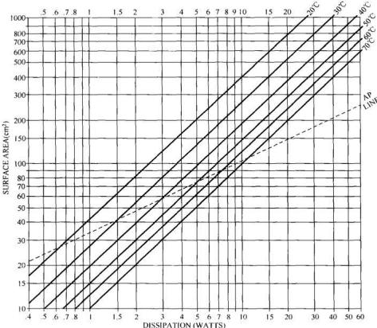

图 7.29 E 形磁心电感设计用的曲线图，给出表面积与面积乘积、内部损耗和温升的函数关系 $^{[17]}$ 。

由图 7.10 知 EC41 磁心的面积乘积是 $2.4 \, cm^{4}$ 。若用骨架则窗口面积会减少，面积乘积下降到近 1.6，在顶部找到面积乘积为 1.6 的点，然后向下找到其与 AP 线（虚斜线）的交点。由此交点可在左边竖直轴找到相应的表面积（本例中是 $42 \, cm^{2}$ ）。 

在曲线图下面的水平轴找到总损耗(2.6W)，并向上找到其与表面积的斜线 $(42\mathrm{cm}^{2})$ 的交点，离该点最近的实斜线可预测温升。本例中，可预测扼流圈温度在环境温度的基础上会上升40℃。这高于设计时假设的30℃的温升，但是这是因为设计中用了骨架使绕组窗口面积减少，所以预测的这个温升值偏高。 

如 7.6 节所示,也可用图 7.14 确定温升。 

## 7.9.11 步骤十:核查磁心损耗

如前所述，用面积乘积法预测温升时忽略了磁心损耗。你会发现对于加气隙的铁氧体磁心通常这个假设是正确的。现在对此假设检验。可用如下方法计算磁心损耗。 

磁心损耗主要包括涡流损耗和磁滞损耗，这两种都随频率和交流磁通的增加而增加。而损耗因数由材料决定，并可在材料供应商的手册中找到。 

提示:供应商都假设在推挽状态下给出磁心损耗与磁通密度峰-峰值的关系。因此,这种 图表假设磁通密度的偏移量关于零对称， $B_{max}$ 是峰值，它是推挽状态下磁通密度摆幅峰－峰值的一半。因此，当计算 Buck、Boost 和反激变换器等这些只利用 B/H 曲线第一象限的扼流圈损耗时，故从供应商提供曲线图中查损耗数据时应将峰值磁通密度 $B_{max}$ 减半，即用 $B_{max}/2$ 。 

—K. B. 

表 7.10 标准 E 形铁氧体磁心设计扼流圈时所需的参数(详细数据参见供应商提供的完整数据清单)

<table><tr><td>Core Type</td><td>Core Size cm</td><td><eq>{A}_{\mathrm{s}}</eq> ( <eq>{\mathrm{{cm}}}^{2}</eq> )</td><td><eq>{A}_{\text{WR }}</eq> ( <eq>{\mathrm{{cm}}}^{2}</eq> )</td><td>AP <eq>{\mathrm{{cm}}}^{4}</eq></td><td>MPL cm</td><td>MLT cm</td><td>Volume <eq>{\mathrm{{cm}}}^{3}</eq></td></tr><tr><td>E 100</td><td>100/27</td><td>7.38</td><td>9.75</td><td>72</td><td>27.4</td><td>14.8</td><td>202</td></tr><tr><td>E 80</td><td>80/20</td><td>3.92</td><td>10.2</td><td>40</td><td>18.4</td><td>11.9</td><td>72.3</td></tr><tr><td>F 11</td><td>72/19</td><td>3.68</td><td>5.44</td><td>20</td><td>13.7</td><td>11.5</td><td>50.3</td></tr><tr><td>Din 5525</td><td>55/25</td><td>4.20</td><td>3.15</td><td>13.2</td><td>12.3</td><td>8.9</td><td>52.0</td></tr><tr><td>Din 5521</td><td>55/21</td><td>3.53</td><td>3.15</td><td>11.12</td><td>12.4</td><td>8.5</td><td>44.0</td></tr><tr><td>E 60</td><td>60/16</td><td>2.48</td><td>3.51</td><td>8.7</td><td>11.0</td><td>9.0</td><td>27.2</td></tr><tr><td>E 175</td><td>56/19</td><td>3.37</td><td>2.08</td><td>7.0</td><td>10.7</td><td>8.5</td><td>36.0</td></tr><tr><td>Din 4220</td><td>42/20</td><td>2.33</td><td>2.18</td><td>5.0</td><td>9.7</td><td>8.4</td><td>22.7</td></tr><tr><td>Din 4215</td><td>42/15</td><td>1.78</td><td>2.18</td><td>5.0</td><td>9.7</td><td>7.5</td><td>17.3</td></tr><tr><td>E 1625</td><td>47/15</td><td>2.34</td><td>1.64</td><td>3.83</td><td>8.9</td><td>6.5</td><td>20.8</td></tr><tr><td>E core</td><td>42/9</td><td>1.07</td><td>2.24</td><td>2.40</td><td>9.8</td><td>5.8</td><td>10.5</td></tr><tr><td>E 121</td><td>40/12</td><td>1.49</td><td>1.33</td><td>1.98</td><td>7.7</td><td>6.1</td><td>11.5</td></tr><tr><td>E 1375</td><td>34/9</td><td>0.87</td><td>1.31</td><td>1.14</td><td>6.9</td><td>5.2</td><td>5.6</td></tr><tr><td>E 2627</td><td>31/9</td><td>0.83</td><td>0.85</td><td>0.70</td><td>6.2</td><td>4.6</td><td>5.1</td></tr><tr><td>Din 307</td><td>30/7</td><td>0.60</td><td>0.99</td><td>0.59</td><td>6.7</td><td>4.0</td><td>4.0</td></tr><tr><td>E 2425</td><td>25/6</td><td>0.74</td><td>0.60</td><td>0.45</td><td>7.3</td><td>3.8</td><td>3.0</td></tr><tr><td colspan="8">EC CORES</td></tr><tr><td>EC 35</td><td>34/9</td><td>0.84</td><td>1.55</td><td>1.3</td><td>7.74</td><td>5.</td><td>6.5</td></tr><tr><td>EC 41</td><td>40/11</td><td>1.21</td><td>2.0</td><td>2.4</td><td>8.93</td><td>6</td><td>10.8</td></tr><tr><td>EC 52</td><td>52/13</td><td>1.80</td><td>3.0</td><td>5.4</td><td>10.5</td><td>7.3</td><td>18.8</td></tr><tr><td>EC 70</td><td>70/16</td><td>2.79</td><td>6.38</td><td>17.8</td><td>14.4</td><td>9.5</td><td>40.1</td></tr></table>

表中， $A_{e}$ 为磁心截面积( $cm^{2}$ )； $A_{sh}$ 为骨架的有效窗口面积( $cm^{2}$ )；AP 为面积乘积( $cm^{4}$ )；MPL 为平均磁路长度(cm)；MLT 为每匝的平均长度(填充系数:40%)(cm)；Volume 为磁心体积(用作损耗计算)( $cm^{3}$ )。 

在之前的例子中，交流磁通密度为 

$$
\Delta B _ {\mathrm{sc}} = \frac {V _ {\mathrm{LI}} t _ {\mathrm{off}}}{N A _ {\mathrm{s}}}
$$

其中， $\Delta B_{ac}$ 为交流磁通密度摆幅(T)； $V_{L1}$ 为电感电压(V)； $t_{eff}$ 为 Q1 的关断时间(us)；N 为匝数； $A_{e}$ 为磁心中柱有效截面积( $mm^{2}$ )。 

对上面的例子， 

$$
\begin{array}{r l} & V _ {\mathrm{LI}} = 5. 6 \mathrm{V}; \\ & t _ {\mathrm{off}} = 3 2 \mathrm{us}; \\ & N = 3 7; \\ & A _ {\mathrm{e}} = 7 1 \mathrm{mm} ^ {2} \end{array}
$$

因此 

$$
\begin{array}{r l} \Delta B _ {\mathrm{ac}} & = \frac {5 . 6 (3 2)}{3 7 (7 1)} = 6 8 \mathrm{mT(680G)} \\ B _ {\mathrm{peak}} & = \Delta B _ {\mathrm{ac}} / 2 = 3 4 0 \mathrm{G} \end{array}
$$

典型铁氧体材料工作在磁通密度为340G，开关频率为20kHz时，磁心损耗最小是 $2mW/cm^{3}$ （根据图7.30）。EC41磁心的体积是 $10.8cm^{3}$ ，所以总的磁心损耗是22mW，可忽略。因此，除了高频大纹波的情况，通常假设铁氧体磁心损耗可忽略都是正确的。 

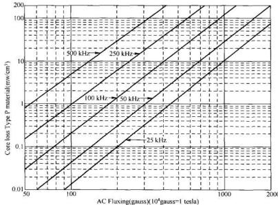

图7.30 以工作频率为参数,Magnetics公司典型P形铁氧体材料磁心损耗与峰值交流磁通密度的函数关系。参见供应商最新的数据信息。注意:供应商假设扼流圈工作在推挽状态,所以磁通摆幅的峰—峰值( $\Delta B$ )是其峰值的两倍。若将这种图表用于单端变换器时,如Buck变换器的扼流圈,应将 $\Delta B$ 除以2。

虽然铁氧体磁心的磁心损耗可忽略，但是即使是同样的条件，却不能忽略铁粉芯材料的磁心损耗。因此，用铁粉芯材料设计扼流圈时，应计算实际的磁心损耗，如果其占的比重很大，则应用铜耗和磁心损耗的总损耗预测温升。切记，这是在自然冷却状态下计算的，但是最终设计中，扼流圈与其他器件的距离和风速会影响温升。完成产品后，测量实际温升能为优化设计提供指导。 

## 7.10 磁学:用粉芯磁心材料设计扼流圈——简介

可用磁导率更低的材料代替加气隙的铁氧体材料,这样就不用加气隙。本节将比较各种粉芯材料的基本特性,并研究如何用它们设计扼流圈。 

上节扼流圈的例子中，为防止较大直流偏置电流时磁心饱和必须用低磁导率材料。对于铁氧体磁心，需要在磁路中加入气隙以得到低磁导率，因为铁氧体的磁导率很大。铁氧体材料的初始磁导率在 $100\sim 5000\mu$ 之间。根据不同的应用场合，加气隙可有效地将扼流圈磁心的磁导率降到 $10\sim 500\mu$ 之间。 

可用其他磁导率更低的铁粉芯材料代替加气隙的铁氧体。粉芯磁心是在很大压力下将独立的铁磁体颗粒压缩成各种形状和体积。磁性材料和非磁材料载体结合在一起，这种电绝缘材料可降低涡流效应。因此，有效气隙均匀地分散在材料体内。这种分散气隙可有效地降低 初始磁导率，而通常初始磁导率在 $10\sim 500\mu$ 间的磁心材料可用来设计扼流圈。 

因为磁导率是由加工过程决定,而不是可调整的分散气隙,所以铁粉芯材料磁导率通常是不连续的。由于铁粉芯材料比铁氧体材料的饱和磁通密度更高,并且磁导率更小,铁粉芯材料储存能量的能力比加气隙的铁氧体材料更大。所以对于这种材料,扼流圈可用体积较小的磁心,这样可有效降低磁心损耗。 

与上节加气隙的铁氧体扼流圈相比，离散气隙还具有消除磁路的突然断续的优点。由于辐射磁场更均匀，相比于加气隙的铁氧体会在气隙处产生局部过热有很大的优势。虽然E形铁粉芯磁心可通过加气隙进一步降低有效磁导率，但是一般很少这么做，因为磁导率和损耗都更小的铁粉芯材料通常是更佳的选择。 

## 7.10.1 影响铁粉芯磁心材料选择的因素

许多粉芯材料都可用做扼流圈磁心，但对于开关模态的扼流圈，一般选择更普通的类型，其中包括铁粉芯、MPP磁心及Kool $\mathrm{M}\mu$ 磁心。这些材料有环形、E形、C形和棒状形。由7.8节可知，选择的磁心材料要满足几个相互限制的性能参数，其中包括工作频率、磁心损耗、饱和磁密、直流偏置电流与交流纹波电流比例、需要的电感、电流范围、温升和一些特殊的机械要求。 

为什么这些参数会相互限制？由于这时很多材料都可以用，那么必然要在这些参数中寻求折中，若优化一个就会损害另一个。例如，选择低磁导率的材料可降低磁心损耗，但是增加了铜耗。所以为了得到最佳的选择，必须评估不同材料的相关参数，并根据应用条件最重要的要求来选择。为了提醒大家需注意哪些参数，下面回顾一下7.8节提到的一些重要参数。 

## 7.10.2 粉芯材料的饱和特性

在用粉芯材料设计扼流圈之前，首先仔细研究可用作扼流圈磁心的各种材料，并比较它们的基本特性。图7.22给出了加气隙的铁氧体、铁粉芯、MPP和Kool $\mathbf{M}\mu$ 等材料的饱和曲线。 

图中水平轴 H(奥斯特)与直流偏置电流或平均电流与匝数的乘积成正比,竖直轴 B(mT)表明每种材料的平均磁通密度由 $H_{dc}$ 决定。 

设计扼流圈需要考虑的最重要参数是磁心饱和磁通密度。在铁氧体的例子中，通过引入气隙使磁导率降到 $60\mu$ 。 

提示:与普通观念相反,铁氧体中的气隙并不改变饱和磁通密度 B,它只改变了磁心饱和时的磁场强度 H。 

——K. B. 

由图 7.22 可知, 各种磁心的饱和磁通密度由下到上依次为 

① 铁氧体:0.35T; 

② MPP:0.65T ~ 0.8T; 

③ Kool Mμ: 近 1.0T; 

④ 铁粉芯: 超过 1.2T; 

⑤ HigH flux(图中未给出):1.5T。 

其中，T 与 G 的转换关系为： $1T = 10^{4}G$ 。 

很明显,若其他条件一样,那么应选择饱和磁通密度更高的材料,因为这样电感量更大,铜耗更低,但是,现在必须考虑材料损耗,再次分析图7.23。 

## 7.10.3 粉芯材料的损耗特性

图7.23给出了上节所述的各种典型磁心材料的损耗特性。图中显示磁心损耗由交流磁通密度分量 $\Delta B$ 和施加于扼流圈的交流应力决定，它是磁通密度的摆幅和频率的函数。本例中， $50\mathrm{kHz}$ 处交流磁通的峰一峰值为 $200\mathrm{mT}$ 。可以看出各种磁心的典型损耗由下到上依次为 

① 铁氧体: 近 $30 \, mW/cm^{2}$ ; 

② MPP: 大约是铁氧体损耗的 3 倍, 近 $100 \, mW/cm^{2}$ ; 

③ Kool Mμ: 大约是铁氧体损耗的 6 倍, 近 200mW/cm²; 

④ 铁粉芯: 大约是铁氧体损耗的 65 倍, 超过 $2000 \, mW/cm^{2}$ 。 

由此可知,选择磁心损耗最小的材料与选择饱和特性最大材料完全矛盾。实际上这两种选择直接冲突,所以必须在这两种选择之间折中考虑。 

那么如何着手呢？幸运的是，大多数情况下选择还是很简单的，所以下面仔细分析设计中常碰到的两种极端情况。第一种情况，交流应力很小，磁心损耗也很小，这时铜耗是限制设计的主要因素；另一种情况，交流应力很大，这时磁心损耗是限制设计的主要因素。 

对于交流应力在大范围变化的情况，在同一图表中绘制各种材料最小选择时的损耗曲线，就可更好地得到各种材料相关性能对照表。 

图 7.31 以交流磁通为变量, 给出了工作频率为 50kHz 时, 粉芯材料和铁氧体材料的损耗曲线。本图为各种材料损耗特性提供了最直接的比较。 

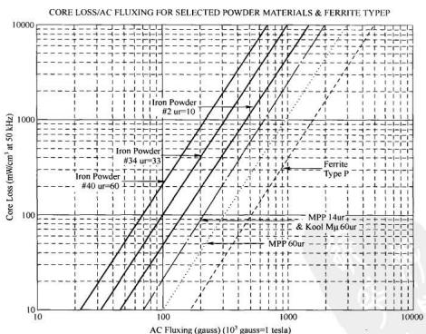

图 7.31 50kHz 时以交流磁通为变量,铁粉芯、MPP、Kool Mμ 和典型 P 型铁粉芯材料的损耗曲线。对于同样的磁心种类,材料的磁导率越高损耗越大。并不是所有的材料都是这样,所以对于某种特殊的磁心,设计者应参考制造商的数据。

虽然也有一些例外,但是通常情况下,粉芯材料磁导率越高,损耗也越大。即使对于同一类材料也有非常大的差异,这主要由工作条件决定。但是,若考察50kHz时交流磁通峰值为700G(峰—峰值1400G)的情况,损耗分别如下: 

<table><tr><td>材料</td><td>相对磁导率</td><td>损耗(mW/cm3)</td></tr><tr><td>P型铁氧体</td><td>2500</td><td>100</td></tr><tr><td>铁氧体14μ和KoolMμ</td><td>60</td><td>500</td></tr><tr><td>MPP 60μr</td><td>60</td><td>1100</td></tr><tr><td>铁粉芯#2</td><td>10</td><td>2100</td></tr><tr><td>铁粉芯#34</td><td>33</td><td>5000</td></tr><tr><td>铁粉芯#60</td><td>60</td><td>10000</td></tr></table>

可以看出，这些材料的损耗变化了20倍。加气隙铁氧体的磁心损耗最小，并且磁导率变化时磁心损耗变化也最小。这是因为对于铁氧体磁导率主要由气隙决定，而磁心损耗是由铁氧体材料的其他因素决定。各种粉芯材料和MPP磁心的磁心损耗随磁导率的变化，发生了很大的变化，这是因为材料的结构发生了变化。铁粉芯材料的损耗最大，并且变化也最大，而Kool $\mathbf{M}\mu$ 材料的损耗最小，并且变化也比较小（图中未给出）。 

注意,由于一些特殊材料(本文未给出)可能并不具备这些规律,所以这时应参考磁心制造商提供的数据。 

## 7.10.4 铜耗——低交流应力时限制扼流圈设计的因素

有时，选择磁心材料很简单。例如，当交流纹波电流和/或频率很低时，如用于60Hz输入RFI滤波器的扼流圈，磁心损耗不是主要的限制因素，所以可选择磁导率最高的铁粉芯甚至加气隙的硅钢片。这些材料的优点是饱和磁通密度 $(B_{\mathrm{sat}})$ 高，磁导率高并且成本低。 

采用这种磁导率较高的磁心，只需较少匝数就可得到所需要的电感量，从而可降低铜耗。磁心的磁通密度较高意味着在较大直流偏置电流中磁心仍然不饱和。这种情况下，频率和纹波电流都很低，则磁心损耗不是重要因素。因为即使是磁心损耗很高的材料，铜耗也可能远超过磁心损耗。因此，设计受铜耗限制。设计时最重要的是使绕组电阻最小。对于这种情况，通常选用磁导率较高的铁粉芯材料，但是也需要在最终的设计中重新计算损耗。7.11节将用Kool M $\mu$ 粉芯研究受铜耗限制设计的例子。 

## 7.10.5 磁心损耗——高交流应力时限制扼流圈设计的因素

在另外一种极端情况,其工作频率和/或交流电流都很大,磁通密度的摆幅也更大,磁心损耗占主要地位,成为限制磁心材料选择的决定因素。 

扼流圈用于高交流应力的典型例子是高电压、高开关频率的有源Boost功率因数调整器的扼流圈。对于这种情况，磁导率、损耗、饱和磁通密度都很低的MPP、Kool $\mathbf{M}\mu$ 和加气隙的铁氧体等材料是优选材料。选用这种低磁导率的材料就需要更多的匝数，以满足电感量的要求，因此铜耗也很大。 

在这种磁心损耗是设计扼流圈的限制因素的情况下，即使材料损耗很低，铜耗与磁心损耗的总和可能比低交流应力要大的多。对这种情况，因为磁心损耗占主要部分，所以应参考磁心损耗设计扼流圈。这时应选用MPP、Kool Mμ和加气隙的铁氧体等损耗较低的材料。再次强 调,选择并不是显而易见的,需要计算扼流圈实际的铜耗和磁心损耗,以确定选择的材料是否最佳。下面7.12节将介绍一个受磁心损耗限制的例子。 

## 7.10.6 中等交流应力时的扼流圈设计

如上文所述,磁心类型和磁心材料的选择受很多因素限制。最佳选择通常并不明显,并且不同材料和设计会得到类似的结论。所以需要计算实际的磁心损耗和铜耗,并通过反复调整它们以得到最佳结果。有的文献写的设计计算过程很好,对于这种反复优化的过程都是理想的,但是一定要确定此过程包括所有的已知变量。 

Kool Mμ 材料可简化设计过程, 因为其磁心损耗很低, 并且在整个磁导率范围内基本保持常数, 这就减少了一个参数。另外, 这种磁心的价格比含镍很高的 MPP 材料低。对交流应力不是很大的情况, 应考虑这种磁导率较低的铁粉芯材料, 它不仅满足设计要求, 而且最便宜。 

## 7.10.7 磁心材料饱和特性

限制磁心选择的另一个重要因素是磁心能够承受直流偏置电流而不饱和的能力，即磁心是否能够承受直流偏置电流，加上交流电流和过流状态下电流的总和。图7.24比较了加气隙的铁氧体与其他各种粉芯材料的饱和特性。注意到铁氧体会突然饱和，因此，当用加气隙的铁氧体设计扼流圈时，一定要保证过流状态下磁心不饱和。选择足够的气隙可使其有足够的安全裕量。 

当电流增加时,粉芯材料的磁导率虽然降低但是却也有进步性,虽然电感也有变化,但即使在过流状态下也总能保持最小电感量,所以过流时粉芯材料可提供更好的安全增益。 

各种粉芯材料的磁化曲线表明,随着磁场强度变化,磁导率也变化很大,而磁化曲线与负载电流成正比,这种磁导率的摆动可用来设计摆动扼流圈。 

## 7.10.8 磁心的几何结构

选择磁心的几何结构就简单很多。这里，只考虑 E 形磁心、环形磁心、C 形磁心和棒状磁心。所有粉芯材料都有环形磁心。铁粉芯材料和 Kool Mμ 材料还有 E 形磁心、C 形磁心和棒状磁心。而铁氧体材料有很多种磁心形状。由于 MPP 材料很难加工，故这种材料只有环形磁心。 

提示:据了解,最近有家生产厂商正计划未来制造 E 形 MPP 磁心。由于这种材料损耗很低,当有 E 形磁心上市时设计中可考虑这种磁心。 

—K. B. 

E形磁心、C形磁心和棒状磁心的优点是当电感量较大需要很多匝数时方便绕线圈。典型的例子是共模RFI滤波器。棒状粉芯有多种装配方式允许设计者自行设计。这些磁心尤其适合于较大电流的场合，常用铜带绕制。 

## 7.10.9 材料成本

由于价格总在变化,所以这里只比较相对成本。从以往来看,MPP 是成本最高的材料,因为其原材料成本比较高。MPP 材料的 79% 是镍,而这种材料是有限资源,其成本一直很高。铁氧体材料成本紧随其后。一般铁粉芯材料的成本最低。Kool Mμ 材料不含镍,其成本很低,但是价格受市场因素和制造成本的影响比其自身原材料成本的影响还要大,所以其价格经常 变化。E形磁心、C形磁心和棒状磁心的制造成本较大，但是其绕制成本较低。 

粉芯材料的磁导率变化范围很大,注意这是由制造过程中加入的各种磁性粉末和非磁性颗粒决定的。因此,有效气隙分散在磁心材料内部。但是当铁氧体材料用于扼流圈时,其最终的磁导率由气隙决定。气隙磁阻通常占磁路磁阻的大部分,铁氧体的初始磁导率对加气隙磁心的磁导率作用很小。因此,对加气隙的扼流圈,选择价格高、损耗低、磁导率高的铁氧体材料没有任何优势。 

提示:目前已知,当温度超过90℃时,铁粉芯材料比其他粉芯材料更容易老化。其老化过程与包扎材料的性能有关,所以提高这方面的技术很重要。如果用这种材料,应检查实际应用场合的温度,并查看最小材料的高温特性。不同制造商的产品性能差别很大。 

——K. B. 

下面研究一些用粉芯设计扼流圈的例子。 

## 7.11 扼流圈设计例子:用环形 Kool Mμ 材料设计受铜耗限制的扼流圈

## 7.11.1 引言

本节将研究用 Kool Mμ 粉芯材料设计受铜耗限制的扼流圈。同样的方法也适用于其他低磁导率材料，如环形和 E 形铁粉芯及钼坡莫合金材料设计扼流圈。 

这时绕线扼流圈的铜耗占大部分总功率损耗。由于平均直流负载电流与交流纹波电流的比值很大，大多数用于开关状态的扼流圈设计时都受铜耗限制。特别是加气隙的铁氧体、Kool M $\mu$ 或者MPP粉芯更是如此，因为通常这些材料的磁心损耗远小于铜耗。事实上，这种情况的设计过程一般忽略磁心损耗。 

设计者面对的第一个选择是确定合适的磁心体积。所选择的磁心体积应满足平均负载电流、电感量和温升的要求。有几种方法可用来选择磁心体积。制造商通常提供许多图表以方便选择磁心体积，其与磁心所储存能量有关。其他方法采用图表或曲线图将电流和电感量与磁心体积和其他参数如温升、匝数、线径等联系起来。 

本例用面积乘积法选择磁心体积,因为这种方法具有通用性,并且这种方法用于各种磁心材料、体积和形状,可得到适用于各种情况的图表。 

## 7.11.2 根据所储存能量和面积乘积法选择磁心尺寸

首先介绍扼流圈一个新的参数——磁心存储的能量 $(1/2Ll^{2})$ 。一些扼流圈的设计方法首先确定磁心储存的能量。对此，必须定义平均直流电流和实际需要的电感量。然后可用下式计算所储存的能量： 

$$
W = \frac {1}{2} L I ^ {2}
$$

其中，W 是所储存的能量(mJ 或 mW·s)；L 是电感量(mH)；I 是平均负载电流(A)。 

很明显，在能量完全传递的系统，如断续反激变换器中，磁心储存的能量与每个周期传输的能量有关。在这种系统中，磁心在每个周期开始时储存能量，周期结束时将能量全部转移到输出端，所以磁心储存能量与输出端功率相等。 

对工作在连续状态的扼流圈,如开关变换器输出 LC 滤波器,则扼流圈储存的能量与其磁 心体积就不那么明显。磁心储存的大部分能量是直流平均电流的能量，而这些能量从一个周期到下一个周期仍然保持在磁心中。但是铜耗与 $I^{2}R$ 相关。文献[17、18、19]指出磁心储存能量的能力与磁心体积有关，尤其在连续工作模式下。 

确定磁心储存的能量后，可根据图7.32将其与环形磁心的面积乘积联系起来。本图包括另一个参数——预测的温升。用图中斜的温升线，可选择面积乘积的值，然后根据磁心储存的能量和预计的温升选择磁心体积。本图包括从 $20^{\circ}\mathrm{C}$ 到 $50^{\circ}\mathrm{C}$ 几种温升情况。其他的磁心类型，如E形磁心，由于表面积和面积乘积的比例完全不同，图表也不同。 

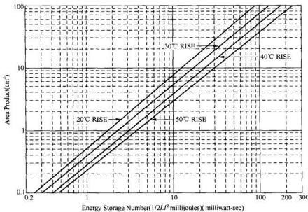

图 7.32 对环形 Kool Mμ 磁心材料, 本图以温升为参数给出储存的能量 $(1/2Ll^{2})$ 与面积乘积间的关系, 为设计环形扼流圈时选择面积乘积和磁心提供了依据

## 7.11.3 受铜耗限制的扼流圈设计例子

本节以图 7.21 中 Buck 变换器的扼流圈 L1 为例,介绍环形 Kool Mμ 扼流圈的设计过程。 

首先做如下假设： 

① 平均负载电流为 10A; 

② 需要的电感量为 1.2mH; 

③ 温升不超过 $40^{\circ}$ C。 

## 7.11.3.1 步骤1:计算储存的能量

储存的能量为 $W = 1/2LI^{2}$ 。 

因此， $W=1/2LI^{2}=1/2(1.2\times10^{-3})\times10^{2}=60mJ$ 。 

## 7.11.3.2 步骤2:确定面积乘积并选择磁心尺寸

根据磁心需要储存的能量和图 7.32, 可确定面积乘积, 并进而确定磁心体积。 

在水平轴找到刚计算出的磁心储存的能量值,然后向上找到与所预测温升斜线的交点。由这个交点可从竖直坐标轴找到相应的面积乘积值。根据此值,可由磁心制造商提供的面积乘积值或图7.11选择磁心体积。或者也可根据上节介绍的用所选磁心的窗口面积和磁心截面积计算面积乘积。 

本例中，从图7.32水平轴找到磁心应储存的能量60mJ，然后向上找到与40℃斜线的交点，由此交点可在竖直轴找到相应的面积乘积值为 $28cm^{4}$ 。 

由表 7.11 制造商给出的环形 Kool Mμ 磁心数据可看出, 最接近此值的磁心是 77868, 其面积乘积是 31.8cm $^{4}$ , 故选择此磁心。 

## 7.11.3.3 步骤3：计算初始匝数

首先用所选磁心材料的磁导率确定匝数。本例中，对于这么大的磁心尺寸，只有一个磁导率可选择——#26。根据表7.11，这种材料的 $A_{l}$ 为 $30mH/1000^{2}=30\times10^{-9}$ ，初始匝数可用下式计算。 

一般， $L = N^{2}A_{l}$ 

因此 

$$
N = \sqrt {\frac {L}{A _ {i}}} = \sqrt {\frac {1 . 2 \times 1 0 ^ {- 3}}{3 0 \times 1 0 ^ {- 9}}} = 2 0 0 (\text { 匝 })
$$

图 7.25 的曲线给出不同直流励磁强度 $H_{\mu}$ 下 Kool Mμ 材料的磁导率，它其实反映了 B/H 曲线的曲率。此曲率表明，初始磁导率随励磁强度的增加而降低，所以计算匝数是反复迭代的过程（在计算匝数前并不知道 H 的值，所以也不知道相应的磁导率，而在知道最终磁导率前，也就不能确定最终匝数。如果有此曲线的公式，就可直接求出最终的值。）。 

表 7.11 用环形 Kool Mμ 磁心设计扼流圈时的基本磁性参数(参见制造商详细的数据清单)

<table><tr><td>Core#</td><td>Core Size cm</td><td><eq>{A}_{\mathrm{e}}</eq> <eq>{\mathrm{{cm}}}^{2}</eq></td><td><eq>{A}_{\mathrm{w}}</eq> <eq>{\mathrm{{cm}}}^{2}</eq></td><td>AP <eq>{\mathrm{{cm}}}^{6}</eq></td><td>MPL cm</td><td>MLT cm</td><td>Volume <eq>{\mathrm{{cm}}}^{3}</eq></td><td><eq>{A}_{2}</eq> #26</td><td><eq>{A}_{1}</eq> #60</td></tr><tr><td>77908</td><td>79/17</td><td>2.27</td><td>18</td><td>40.8</td><td>20</td><td>7.5</td><td>45.3</td><td>37</td><td></td></tr><tr><td>77868</td><td>79/14</td><td>1.77</td><td>18</td><td>31.8</td><td>20</td><td>6.9</td><td>34.7</td><td>30</td><td></td></tr><tr><td>77110</td><td>58/15</td><td>1.44</td><td>9.5</td><td>13.7</td><td>14.3</td><td>6.2</td><td>20.7</td><td>33</td><td>75</td></tr><tr><td>77716</td><td>52/14</td><td>1.25</td><td>7.5</td><td>9.38</td><td>12.7</td><td>5.8</td><td>15.9</td><td>32</td><td>73</td></tr><tr><td>77090</td><td>47/16</td><td>1.34</td><td>6.1</td><td>8.19</td><td>11.6</td><td>5.9</td><td>15.6</td><td>37</td><td>86</td></tr><tr><td>77076</td><td>37/11</td><td>0.68</td><td>3.6</td><td>2.47</td><td>9.0</td><td>4.3</td><td>6.1</td><td>24</td><td>56</td></tr><tr><td>77071</td><td>34/11</td><td>0.67</td><td>2.9</td><td>1.97</td><td>8.1</td><td>4.3</td><td>5.5</td><td>28</td><td>61</td></tr><tr><td>77894</td><td>28/12</td><td>0.65</td><td>1.6</td><td>1.02</td><td>6.35</td><td>4.1</td><td>4.1</td><td>32</td><td>75</td></tr><tr><td>77351</td><td>24/10</td><td>0.39</td><td>1.5</td><td>0.58</td><td>5.88</td><td>3.34</td><td>2.3</td><td>22</td><td>51</td></tr><tr><td>77206</td><td>21/7</td><td>0.23</td><td>1.1</td><td>0.26</td><td>5.09</td><td>2.64</td><td>1.2</td><td>14</td><td>32</td></tr><tr><td>77120</td><td>17/7</td><td>0.19</td><td>0.7</td><td>0.14</td><td>4.11</td><td>2.44</td><td>0.79</td><td>15</td><td>35</td></tr></table>

表中， $A_{e}$ 为磁心截面积 $(\mathrm{cm}^{2})$ ; $A_{w}$ 为窗口面积 $(\mathrm{cm}^{2})$ ; AP 为面积乘积 $(\mathrm{cm}^{4})$ ; MPL 为平均磁路长度(cm); MLT 为每匝的平均长度(填充系数:40%) (cm); Volume 为磁心体积(用作损耗计算) $(\mathrm{cm}^{3})$ ; $A_{1}\#26$ 为#26 材料的电感因数 $(\mathrm{mH}/1000^{2})$ ; $A_{1}\#60$ 为#60 材料的电感因数 $(\mathrm{mH}/1000^{2})$ 

## 7.11.3.4 步骤4：计算直流磁场强度

可根据下式计算 $H_{\mathrm{dc}}$ 的初始值 

$$
H _ {\mathrm{dc}} = \frac {0 . 4 \pi N I}{\mathrm{MPL}}
$$

其中， $H_{dc}$ 为磁场强度(T)；N 为初始匝数；I 为直流电流(A)；MPL 为磁路长度(cm)。 

由图 7.11, 环形磁心 77868 的 MPL 为 20cm, 所以初始 $H_{dc}$ 为 

$$
H _ {\mathrm{dc}} = \frac {0 . 4 \pi (2 0 0) 1 0}{2 0} = 1 2 6 (\mathrm{奥斯特})
$$

## 7.11.3.5 步骤 5: 确定新的相对磁导率并调整匝数

由图 7.25 可知，#26 材料的相对磁导率下降为初始值的 85%，所以这时磁导率为 $30 \times 0.85 = 25.5$ ，匝数必须增加到： 

$$
N = \sqrt {\frac {L}{A _ {l}}} = \sqrt {\frac {1 . 2 \times 1 0 ^ {- 3}}{2 5 . 5 \times 1 0 ^ {- 6}}} = 6 9 (\text { 匝 })
$$

本例中，匝数取为70匝。为得到更精确的结果，需要重复上述迭代过程。 

## 7.11.3.6 步骤6:确定线径

因为假设铜耗限制了扼流圈的设计（即铜耗远大于磁心损耗），下面设计中在可用窗口面积内方便安装的前提下，通过采用最大线径，使绕组电阻最小。因为交流纹波电流相对于平均直流电流很小，故集肤效应和邻近效应都很小。因此，通常选用最大的线径（但是为方便绕制，一般用多股线并绕的方法得到同样的铜面积）。 

对于环形磁心，圆导线绕制的填充系数一般为 $40\%$ ，下面就用此值计算线径。根据图7.11,77868磁心的窗口面积为 $18\mathrm{cm}^2$ 。因此，窗口面积 $(7.2\mathrm{cm}^2)$ 的 $40\%$ 用作铜线面积 $(A_{\mathrm{wcu}})$ 。对于70匝绕线，单匝铜线面积为： 

$$
\begin{array}{r l} A _ {\mathrm{weu}} & = 7. 2 / N = 1 0. 3 3 \mathrm{mm} ^ {2} \\ N & = 7 0 \end{array}
$$

由表7.9可知，最接近此值的导线是17AWG，其截面积是 $12.2\mathrm{mm}^2$ ，故选择此导线。 

提示:环形磁心的填充系数是40%,必须留出磁心内径30%的空间以方便绕制,所以选择线径需要有一些弹性。 

—K. B. 

## 7.11.3.7 步骤7: 确定铜耗

为确定铜耗,需要知道绕组电阻。根据表7.10,对于填充系数为40%的77868磁心,导线的平均长度是6.9cm。因此,绕组导线总长度为 

$$
6. 9 \times 7 0 = 4 8 3 \mathrm{cm} = 4. 8 3 \mathrm{m}
$$

17 AWG 线(或总面积相同的多股线并联)的电阻率为 $0.01657 \Omega/m$ ，则总绕组电阻 $(R_{cu})$ 为 $4.83 \times 0.07657 = 0.08 \Omega$ 。 

因此，铜耗 $\left(I^{2}R_{cu}\right)$ 为 $10^{2}\times0.08=8W$ 。 

## 7.11.3.8 步骤8：用能量密度法确定扼流圈温升

由图 7.32 可知最初选择的面积乘积, 然后假设温升不超过 $40^{\circ}$ C 来选择磁心体积。现在可以用如下方法来检查此选择。 

扼流圈的温升由总损耗和绕线器件有效表面积决定。 

表 7.11 显示, 填充系数为 40% 的 77868 磁心表面积为 $203 \, cm^{2}$ 。其铜耗为 8W, 则表面积的热量密度为 $0.039 \, W/cm^{2}$ 。 

图 7.34 以温升为参数, 环形磁心总损耗(磁心损耗和铜耗)与面积乘积间的关系 77868 磁心的面积乘积是 $31.8 \, cm^{4}$ , 铜耗是 8W。根据这些值可预测温升为 $30^{\circ}C$ 。

在图7.33中的竖直轴上找到能量密度为 $0.039\mathrm{W / cm^2}$ 的点，由其与 $25^{\circ}C$ 环境温度线的交点可看出，在环境温度为 $25^{\circ}C$ 时温度大约上升 $31^{\circ}C$ （本例中最小的温升在最大磁心和最大线径下得到）。 

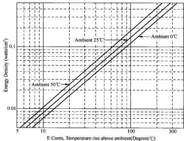

图 7.33 对 E 形磁心, 随环境温度变化热量密度 $\left( {\mathrm{W}/{\mathrm{{cm}}}^{2}}\right)$ 与预测温升的关系

## 7.11.3.9 步骤9:面积乘积法预测温升

也可用面积乘积法预测温升。图 7.34 以功率损耗和面积乘积为参数预测温升。图中以表面积为参数。 

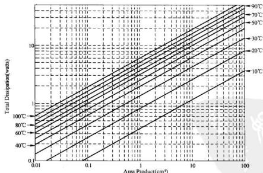

## 7.11.3.10 步骤 10: 确定磁心损耗

在此之前一直假设忽略磁心损耗。为完成本例，现在计算实际的磁心损耗，并证明这个假设是正确的。 

这里以图7.21中的Buck调整器为例，计算磁心损耗。在7.7.5节已经指出，通常Buck变换器的峰值交流应力 $(B_{\mathrm{sc}})$ 为 

$$
B _ {a c} = \frac {e t _ {\text { off }}}{N A _ {e}}
$$

其中，e 为扼流圈两端电压； $t_{off}$ 为 Q1 关断时间（ $\mu s$ ）； $A_{e}$ 为磁心截面积（ $mm^{2}$ ）； $B_{sc}$ 为峰值磁通密度（T）。 

本例中，V 为 $5.6 \, V, t_{off}$ 为 $32 \, \mu s, N$ 为 $70, A_{e}$ （磁心截面积）为 $177 \, mm^{2}$ 。 

因此， 

$$
B _ {\mathrm{ac}} = \frac {5 . 6 \times 3 2}{7 0 \times 1 7 7} = 0. 0 1 4 5 \mathrm{T(145G)}
$$

图7.35是制造商给出的磁心损耗曲线，对于单端应用场合，应该将此峰值除2，则有效峰值为73高斯(峰-峰值为145高斯)。本图给出 $50\mathrm{kHz}$ 下，交流磁通密度为73高斯的Kool $\mathbf{M}\mu$ 磁心的损耗不超过 $10\mathrm{mW / cm^2}$ ，因此正如预期的那样可忽略磁心损耗。实际上，损耗越大，则设计中可选择成本越小的粉芯磁心材料。 

图 7.35 Kool Mμ 材料的曲线图,以频率为参数给出磁心损耗与 AC 磁通密度峰值的关系曲线(Magnetics 公司提供)。

注意:对于单端应用的扼流圈(例如 Buck 整流器),在该图表根据 AC 磁通密度幅值 $\Delta B$ 读取损耗时,相应的损耗要除以 2。

## 7.12 用各种 E 形粉芯设计扼流圈的例子

## 7.12.1 引言

在同样电气条件下，本节用三种不同E形粉芯材料设计扼流圈，以示范不同磁心材料的区别。第一个例子是研究受磁心损耗限制的设计。由于磁心损耗很高，故选用成本低而损耗高 的铁粉芯材料。第二个例子中，采用磁导率更低、损耗更低的铁粉芯材料，以使磁心损耗降低到可以接受的水平。第三个例子中，在同样条件下用Kool $\mathbf{M}\mu$ 材料设计扼流圈。 

## 7.12.2 第一个例子:用#40E形铁粉芯材料设计扼流圈

这里用 E 形铁粉芯材料设计受磁心损耗限制的扼流圈。同样的方法也适用其他 E 形或环形低磁导率材料，如 Kool Mμ 和 MPP 的磁心来设计扼流圈。 

这种受磁心损耗限制的设计，磁心损耗占总损耗的大部分。但是不像受铜耗限制的设计，必须同时考虑磁心损耗和铜耗，因为通常铜耗也很大。因此，在这种设计中温升是磁心损耗和铜耗共同作用的结果。磁心损耗由磁心材料、磁心体积、电感量和交流磁通共同决定。 

再次说明,设计者首先要选择合适的磁心。该磁心必须满足电感量(即纹波电流要求)、平均负载电流和温升的要求。因为面积乘积法的通用性,并且适用于E形和环形磁心,所以这里仍然用此法。 

本节设计如图7.36所示的Boost变换器的扼流圈。注意到，功率因数校正的扼流圈也属于此范畴。本例中，输入电压为 $100\mathrm{V}$ ，输出电压为 $200\mathrm{V}$ ，开关频率为 $50\mathrm{kHz}$ 的Boost变换器的扼流圈。这时，扼流圈L1的交流纹波应力很高，磁心损耗很大。之前已经介绍过磁心损耗是磁心材料和交流纹波应力的函数。 

首先做如下假设： 

① 平均负载电流 $(I_{\mathrm{dc}})=10\mathrm{A}$ ; 

② 纹波电流 $\left(\Delta I_{\mathrm{L}}\right)=15\%\left(\text{峰}-\text{峰值为}1.5\mathrm{A}\right)$ ; 

③ 开关频率 = 50kHz; 

④ 温升不超过 $40^{\circ}$ C。 

## 7.12.2.1 步骤 1: 计算 1.5A 纹波电流所需的电感量

首先需要计算 L1 的值, 以保证在平均负载电流为 10A 时, 纹波电流的峰 - 峰值不超过 1.5A。 

如图 7.36 所示, 稳态时输入电压为 100V, 输出电压为 200V, 则占空比为 50%, 所以一个周期 Q1 开通的时间为 $10\mu s$ 。在此 $10\mu s$ 中, 电感两端电压为 100V, 电流从 9.25A 上升到 10.75A (如图 7.36(b) 所示电流波形)。由此, 可以计算电感量如下。 

通常 $V_{L}=Ldi/dt$ ，并且本例中电流线性变化，所以其关系为 

$$
V = \frac {L \Delta I _ {\mathrm{L}}}{\Delta t}
$$

所以， 

$$
L = \frac {V \Delta t}{\Delta I _ {\mathrm{L}}} = \frac {1 0 0 \times 1 0 \times 1 0 ^ {- 6}}{1 . 5} = 0. 6 6 6 \mathrm{mH}
$$

## 7.12.2.2 步骤2: 计算磁心储存的能量

由上面计算的电感量和平均直流电流(10A)，可以计算磁心储存的能量为 

$$
W = \frac {1}{2} L I ^ {2}
$$

其中，W 为储存的能量(mJ)；L 为电感量(mH)；I 为平均负载电流(A)。 

(a)

(b)

图 7.36 (a) 典型 Boost 变换器；(b) 平均负载电流为 10A 时，连续工作状态下扼流圈 L1 的电流波形。

本例中,电感量为0.666mH,负载电流为10A,因此, 

$$
W = \frac {1}{2} (0. 6 6 6 \times 1 0 ^ {- 3}) (1 0 ^ {2}) = 3 3. 3 3 \mathrm{mJ}
$$

根据储存的能量,由图7.37可确定面积乘积和磁心体积。 

## 7.12.2.3 步骤3：确定面积乘积并选择磁心尺寸

图 7.37 给出标准 E 形磁心储存的能量值和面积乘积间的关系。同样的面积乘积，E 形磁心的表面积比环形磁心的稍大，所以对于同样应用场合，E 形磁心的温升稍低。 

在假定磁心损耗可忽略的条件下，可用图7.37预测的温升。而当磁心损耗占的比重很大时，温升就是总损耗的函数。因为在第一步中，我们认为磁心损耗占的比重很大，所以这里用30℃面积乘积线而不是40℃的线，以留有一定的裕量，这样可得到更大的磁心并可承受一定额外的损耗。 

在图 7.37 的水平坐标轴找到磁心应储存的能量 31mJ，向上找到与 $30^{\circ}$ C 温升时面积乘积斜线的交点。由此交点可以在左边坐标轴找到相应的面积乘积为 $14cm^{4}$ 。 

由此面积乘积值,可由制造商提供的面积乘积值来选择磁心体积,如表7.12所示,也可根据用所选磁心的窗口面积和截面积计算磁心的面积乘积。由表中制造商给出的E形铁粉芯磁心的数据,可看出最接近的磁心为E220,其面积乘积为 $14.2cm^{4}$ ,故选择此磁心。 

图 7.37 以温升为参数，E 形磁心存储的能量 $1/2LI^{2}$ 和面积乘积间的关系。这样可确定面积乘积和磁心体积。

表 7.12 用于设计扼流圈的 E 形铁粉芯磁心的基本参数 (美国微金属公司)

<table><tr><td>Core# 0OK</td><td>Core Size cm</td><td><eq>{A}_{\mathrm{c}}</eq> <eq>{\mathrm{{cm}}}^{2}</eq></td><td><eq>{A}_{\mathrm{p}}</eq> <eq>{\mathrm{{cm}}}^{2}</eq></td><td>AP <eq>{\mathrm{{cm}}}^{3}</eq></td><td>MPL cm</td><td>MLT cm</td><td>Volume <eq>{\mathrm{{cm}}}^{3}</eq></td><td><eq>{A}_{1}</eq> #40</td><td><eq>{A}_{1}</eq> #2</td></tr><tr><td>E 450</td><td>114/35</td><td>12.2</td><td>12.7</td><td>155</td><td>22.9</td><td>22.8</td><td>280</td><td>480</td><td>132</td></tr><tr><td>E 305</td><td>77/31</td><td>7.5</td><td>8.1</td><td>60</td><td>18.5</td><td>16.3</td><td>139</td><td>339</td><td></td></tr><tr><td>E 305</td><td>77/23</td><td>5.6</td><td>8.1</td><td>45</td><td>18.5</td><td>15.5</td><td>104</td><td>255</td><td>75</td></tr><tr><td>E 220</td><td>56/21</td><td>3.6</td><td>4.1</td><td>14</td><td>13.2</td><td>11.5</td><td>47.7</td><td>240</td><td>69</td></tr><tr><td>E 225</td><td>57/19</td><td>3.58</td><td>2.87</td><td>10</td><td>11.5</td><td>11.4</td><td>40.8</td><td>290</td><td>76</td></tr><tr><td>E 168</td><td>43/20</td><td>2.41</td><td>2.87</td><td>6.9</td><td>10.4</td><td>8.85</td><td>24.6</td><td>196</td><td>55</td></tr><tr><td>E 187</td><td>47/16</td><td>2.48</td><td>1.93</td><td>4.8</td><td>9.5</td><td>9.50</td><td>23.3</td><td>240</td><td></td></tr><tr><td>E 162</td><td>41/13</td><td>1.61</td><td>1.7</td><td>2.7</td><td>8.4</td><td>8.26</td><td>13.6</td><td>175</td><td>105</td></tr><tr><td>E 137</td><td>35/10</td><td>0.91</td><td>1.55</td><td>1.4</td><td>7.4</td><td>6.99</td><td>6.72</td><td>113</td><td>32</td></tr><tr><td>E 118</td><td>30/7</td><td>0.49</td><td>1.27</td><td>0.63</td><td>7.14</td><td>5.38</td><td>4.60</td><td>80</td><td></td></tr><tr><td>E 100</td><td>25/6</td><td>0.43</td><td>0.806</td><td>0.32</td><td>5.08</td><td>5.08</td><td>2.05</td><td>81</td><td>21</td></tr></table>

表中： $A_{n}$ 为磁心截面积 $(\mathrm{cm}^{2})$ ; $A_{w}$ 为窗口面积 $(\mathrm{cm}^{2})$ ; AP 为面积乘积 $(\mathrm{cm}^{4})$ ; MPL 为平均磁路长度 (cm); MLT 为每匝的平均长度（填充系数：40%）(cm); Volume 为磁心体积（用作损耗计算） $(\mathrm{cm}^{3})$ ; $A_{1}\#40$ 为 #40 材料的电感因数 $(\mathrm{nH}/\mathrm{N}^{2})$ ; $A_{1}\#2=\#2$ 材料的电感因数 $(\mathrm{nH}/\mathrm{N}^{2})$ 

## 7.12.2.4 步骤4：计算初始匝数

采用所选磁心及这种磁心材料的磁导率确定初始匝数。本例中采用#40混合材料。由表7.12可知，对#40混合材料，E220磁心的 $A_{t}$ 为 $275nH/N^{2}$ ，修正因子是87%，所以初始磁导率为 $275\times10^{-9}\times0.87=240\times10^{-9}$ 。由此可计算出初始匝数 

$$
L = N ^ {2} A _ {l}
$$

所以， 

$$
N = \sqrt {\frac {L}{A _ {l}}} = \sqrt {\frac {0 . 6 6 6 \times 1 0 ^ {- 3}}{2 4 0 \times 1 0 ^ {- 9}}} = 5 3 (\text { 匝 })
$$

图7.38给出了不同直流磁场强度下#40铁粉芯材料的相对磁导率。该图表明了B/H曲线的曲率。由于磁导率有变化，所以计算匝数变为一个迭代的过程。计算匝数之前并不知道H的值，所以也不知道相对磁导率，而在知道最终的磁导率之前，也不能定后最后匝数。但对本例，只要求近似的匝数，以得到近似的磁心损耗，所以接下来计算磁心损耗而不做迭代计算。 

图 7.38 铁粉芯材料的磁化特性(美国微金属公司)

## 7.12.2.5 步骤5:计算磁心损耗

在7.7节已知磁心损耗是开关频率和B/H曲线扫过面积的函数，而后者由正比于所施加伏秒数的磁通密度摆幅 $B_{交流}$ 产生。 

如图 7.36 所示的 Boost 变换器, 当 Q1 开通时, 电感两端的电压为 100V 的输入电压, 其左端电压为正。当 Q1 关断时, 二极管 D1 导通, L1 左端电压是输入电压, 电感两端的电压是输入电压和输出电压的差, 也是 100V, 但是极性相反。 

假设稳态时，在Q1开通的 $10\mu s$ 中，输入电压作用于L1，电流从最小的9.25A上升到最大的10.75A。故可计算 $B_{sc}$ 如下， 

$$
B _ {\mathrm{ac}} = \frac {V t _ {\mathrm{on}}}{N A _ {\mathrm{e}}}
$$

其中，V 为 Q1 开通时作用于 L1 两端的电压 (V); $t_{on}$ 为电压作用的时间 ( $\mu s$ ); N 为匝数; $A_{e}$ 为磁心截面积 ( $mm^{2}$ )。 

本例中， $V=100V, t_{on}=t_{off}=10\mu s, N=53, A_{e}=360mm^{2}$ 。因此， 

$$
B _ {a c} = \frac {1 0 0 (1 0)}{5 3 (3 6 0)} = 0. 0 5 2 4 \mathrm{T} = 5 2 4 \mathrm{G}
$$

提示:由于交流状态引起的磁通变化以平均磁通为中心,后者由直流输出电流决定,本例中为10A。直流电流产生的磁通密度是磁导率的函数,但是磁通密度变化量由交流应力决定,而与磁心本身的特性无关。 

—K. B. 

图 7.39 给出了铁粉芯材料的磁心损耗曲线。在水平坐标轴找到 524G，则#40 材料在 524G50kHz 的损耗为 $600mW/cm^{3}$ 。 

图 7.39 以频率为参数,铁粉芯材料磁心损耗与交流磁通密度的关系(美国微金属公司)

图中是在推挽状态下给出的损耗，磁通密度的摆幅是峰值的两倍。对于单端场合，损耗为此值的一半，即 $300\mathrm{mW / cm^3}$ 。E220磁心的体积是 $47.7\mathrm{cm}^3$ ，所以总损耗为 

$$
4 7. 7 \times 3 0 0 \times 1 0 ^ {- 3} = 1 3. 4 \mathrm{W}
$$

磁心损耗看起来很大。在比较磁心损耗和铜耗之前，需要先确定线圈的电阻并计算铜耗。本例中，近似值也可接受，可以继续用53匝。 

## 7.12.2.6 步骤6:确定线径

为使铜耗最小,设计中在可利用窗口面积内方便绕制条件下,采用线径最大的导线,以使绕组电阻最小。 

由于 E 形磁心用骨架,根据结构和绝缘的不同要求,用圆导线绕制时填充系数最大是 87%,最小是 40%。本例中用理想情况下的平均值 60%。 

由表7.12知，E220磁心的窗口面积为 $4.09\mathrm{cm}^2$ 。窗口面积的 $60\%$ 可用做铜面积，即 $2.45\mathrm{cm}^2$ 。本例中绕组有53匝，所以每匝的截面积为 

$$
A _ {\mathrm{cu}} / N = 2. 4 5 / 5 3 = 0. 0 4 6 2 \mathrm{cm} ^ {2}
$$

由表7.9知，#11 AWG线 $(0.0464\mathrm{cm}^2)$ 的线径最接近此值，其电阻为 $4.13\mathrm{m}\Omega /\mathrm{m}$ 

由于交流应力很大,所以必须考虑集肤效应,通常用多股细线并绕得到同样的铜面积,而不是只用一根大直径的线。并且,#11 AWG 线也很难绕制。 

## 7.12.2.7 步骤7:确定铜耗

为计算铜耗,需要知道绕组电阻。由表7.12可知,对E220磁心每匝绕组的平均长度为11.5cm。因此绕组的最长度为 

$$
N \times \mathrm{MLT} = 5 3 \times 1 1. 5 = 6 1 0 \mathrm{cm}
$$

#11 AWG 线或者截面积相同的多股并绕线的电阻率为 $4.13 \, m\Omega/m$ ，故绕组总电阻 $R_{cu}$ 为 $6.095 \times 0.00413 = 0.025 \, \Omega$ 。 

因此，铜耗 $I^{2}R_{cu}=10^{2}\times0.025=2.5W$ 。 

正如我们预料的，13.4W 的磁心损耗超过 2.5W 的铜耗很多。很明显这不是最佳设计。遇到这种情况，有下面几个解决方法。 

① 磁心损耗和铜耗近似相等时效率最佳。在原有的磁心上增加匝数，铜耗虽然增加，但是磁心损耗将降低，从而达到最佳效率点。这样还能增加电感量减少电流纹波。这种方法也许可以在现有磁心和材料的基础上得到最佳设计，也许这样会令人满意，但是需要较大的电感量，并可能超过温度限制。 

② 更好的方法是采用磁导率较低的材料以降低磁心损耗,这样可保持原来的电感量并降低磁心损耗。下面研究第二种方法,用#8E形铁粉芯材料代替。 

## 7.12.3 第二个例子:用#8E形铁粉芯磁心设计扼流圈

现在用#8铁粉芯材料完成同样的扼流圈设计。#8材料的磁心损耗更小，但是磁导率也更小。因此必须重新计算匝数，以得到所需的电感量。 

## 7.12.3.1 步骤 1: 计算新匝数

对 E220 磁心，#40 材料的 $A_{l}$ 值为 $275 ~nH/N^{2}$ 。#8 材料的校准因数为 51%，所以其初始磁导率为 $275 \times 10^{-9} \times 0.51 = 140 \times 10^{-9}$ 。初始匝数为 

$$
N _ {1} = \sqrt {\frac {L}{A _ {l}}} = \sqrt {\frac {0 . 6 6 6 \times 1 0 ^ {- 3}}{1 4 0 \times 1 0 ^ {- 9}}} = 6 9 (\text { 匝 })
$$

下面计算磁心损耗。 

## 7.12.3.2 步骤2:计算#8材料的磁心损耗

$$
B _ {a c} = \frac {V t _ {\text { off }}}{N A _ {r}}
$$

其中，V=100V； 

$t_{\mathrm{off}} = t_{\mathrm{on}} = 10~\mu \mathrm{s};$ 

$$
A _ {\mathrm{e}} = 3 6 0 \mathrm{mm} ^ {2}
$$

本例中， $N = 69$ ，所以 

$$
B _ {\mathrm{sc}} = \frac {1 0 0 (1 0)}{6 9 (3 6 0)} = 4 0 \mathrm{mT} = 4 0 0 \mathrm{G}
$$

图 7.39 给出#8 材料在 50kHz 和 400G 条件下的磁心损耗为 $190 \, mW/cm^{3}$ 。对于单端场合，应采用此值的一半，即 $95 \, mW/cm^{3}$ 。E220 磁心的体积是 $47.7 \, cm^{3}$ ，故总磁心损耗为 

$$
4 7. 7 \times 9 5 \times 1 0 ^ {- 3} = 4. 5 3 \mathrm{W}
$$

——K. B. 

## 7.12.3.3 步骤3:确定铜耗

很容易就可确定铜耗,因为可用的 $A_{cu}$ 被绕线完全填满。如果想让匝数加倍,必须减少绕线的截面积,这使电阻加倍,并且匝数加倍电阻也加倍,因此总电阻就增加了4倍。 

通常，对于充满绕组的骨架，电阻以 $(N_{2} / N_{1})^{2}$ 的比例变化，所以新绕组的电阻大约是 

$$
(6 9 / 5 2) ^ {2} \times 0. 0 2 5 = 1. 7 6 \times 0. 0 2 5 = 0. 0 4 4 \Omega
$$

因此，铜耗为 $I^{2}R_{cu}=10^{2}\times0.044=4.4W$ 。 

由于此时磁心损耗和铜耗近似相等，可认为这是效率最佳的设计。为完善设计，还需要调整匝数，以减少工作电流处磁导率的损失。但是，#8材料的B/H曲线曲率很小，不必对匝数调整。 

## 7.12.3.4 步骤4：计算效率和温升

现在确定温升如下： 

磁心损耗和铜耗总共为 $4.5 + 4.4 = 8.9\mathrm{W}$ 

对于环形磁心,图7.34是面积乘积与温升的关系。面积乘积相同的E形磁心表面积比环形磁心大15%,故用E形磁心时温升大约减少15%。 

在图 7.34 上找到面积乘积为 $14.2 \, cm^{4}$ 和损耗为 8.9W 的交点，可知环形磁心温升大约为 $47^{\circ}C$ ，所以 E 形磁心的温升比此值少了 15%，约为 $40^{\circ}C$ 。 

所以温升满足设计要求，并且由于铜耗和磁心损耗近似相等，可认为这是效率最佳设计，非常令人满意。 

## 7.12.4 第三个例子:用#60 E形Kool Mμ磁心设计扼流圈

再次说明,用 Kool Mμ 材料设计扼流圈时,也可用面积乘积法选择磁心体积。对于这种材料,磁心损耗在整个磁导率范围内变化很小。 

表 7.13 E 形铁粉芯磁心的基本参数 (美国微金属公司)

<table><tr><td>Core #00K</td><td>Core Size cm</td><td><eq>{A}_{\mathrm{e}}</eq> <eq>{\mathrm{{cm}}}^{2}</eq></td><td><eq>{A}_{\text{ab }}</eq> <eq>{\mathrm{{cm}}}^{2}</eq></td><td>AP <eq>{\mathrm{{cm}}}^{4}</eq></td><td>MPL cm</td><td>MLT cm</td><td>Volume <eq>{\mathrm{{cm}}}^{3}</eq></td><td><eq>{A}_{1}</eq> #60</td><td><eq>{A}_{2}</eq> #40</td></tr><tr><td>8020E</td><td>80/20</td><td>3.89</td><td>11.2</td><td>43.3</td><td>18.5</td><td>15.8</td><td>72.1</td><td>190</td><td></td></tr><tr><td>6527E</td><td>65/27</td><td>5.40</td><td>5.4</td><td>29.0</td><td>14.7</td><td>14.18</td><td>79.4</td><td></td><td></td></tr><tr><td>7728E</td><td>72/19</td><td>3.68</td><td>6.0</td><td>22.2</td><td>13.7</td><td>14.38</td><td>50.3</td><td></td><td></td></tr><tr><td>5530E</td><td>55/25</td><td>4.17</td><td>3.8</td><td>15.9</td><td>12.3</td><td>12.4</td><td>51.4</td><td>261</td><td></td></tr><tr><td>5528E</td><td>55/20</td><td>3.50</td><td>3.8</td><td>13.3</td><td>12.3</td><td>11.6</td><td>43.1</td><td>219</td><td></td></tr><tr><td>4022E</td><td>43/20</td><td>2.37</td><td>2.8</td><td>6.60</td><td>9.84</td><td>10.1</td><td>23.3</td><td>194</td><td>281</td></tr><tr><td>4020E</td><td>43/15</td><td>1.83</td><td>2.8</td><td>5.10</td><td>9.84</td><td>9.2</td><td>180</td><td>150</td><td>217</td></tr><tr><td>4017E</td><td>43/11</td><td>1.28</td><td>2.8</td><td>3.56</td><td>9.84</td><td>8.26</td><td>12.6</td><td>105</td><td>151</td></tr><tr><td>4317E</td><td>41/12</td><td>1.52</td><td>1.64</td><td>2.49</td><td>7.75</td><td>8.16</td><td>11.8</td><td>163</td><td>234</td></tr><tr><td>Core #00K</td><td>Core Size cm</td><td><eq>{A}_{\mathrm{c}}</eq> <eq>{\mathrm{{cm}}}^{2}</eq></td><td><eq>{A}_{\mathrm{{sb}}}</eq> <eq>{\mathrm{{cm}}}^{2}</eq></td><td>AP <eq>{\mathrm{{cm}}}^{4}</eq></td><td>MPL cm</td><td>MLT cm</td><td>Volume <eq>{\mathrm{{cm}}}^{3}</eq></td><td><eq>{A}_{1}</eq> #60</td><td><eq>{A}_{1}</eq> #40</td></tr><tr><td>3515E</td><td>35/9</td><td>0.84</td><td>1.52</td><td>1.28</td><td>6. 94</td><td>6.86</td><td>5.83</td><td>102</td><td>146</td></tr><tr><td>3007E</td><td>30/7</td><td>0.60</td><td>1.25</td><td>0.75</td><td>6. 56</td><td>5.36</td><td>3. 94</td><td>71</td><td>92</td></tr><tr><td>2510E</td><td>25/6</td><td>0.38</td><td>0.78</td><td>0.30</td><td>4.85</td><td>5.00</td><td>1.87</td><td>70</td><td>100</td></tr><tr><td>1808E</td><td>19/5</td><td>0.23</td><td>0.52</td><td>0.117</td><td>4.10</td><td>3.78</td><td>0.914</td><td>48</td><td>69</td></tr><tr><td>1207E</td><td>13/4</td><td>0.13</td><td>0.23</td><td>0.030</td><td>2.96</td><td>2.48</td><td>0.385</td><td></td><td></td></tr></table>

表中， $A_{e}$ 为磁心截面积 $(\mathrm{cm}^{2})$ ； $A_{w}$ 为窗口面积 $(\mathrm{cm}^{2})$ ；AP 为面积乘积 $(\mathrm{cm}^{4})$ ；MPL 为平均磁路长度(cm)；MLT 为每匝的平均长度(填充系数：40%)(cm)；Volume 为磁心体积(用作损耗计算) $(\mathrm{cm}^{3})$ ； $A_{1}\#60$ 为#60 材料的电感因数 $(\mathrm{mH}/1000\mathrm{N}^{2})$ ； $A_{1}\#40$ 为#40 材料的电感因数 $(\mathrm{mH}/1000\mathrm{N}^{2})$ 

## 7.12.4.1 步骤 1: 选择磁心尺寸

之前已经知道了在本条件下存储的能量值为 33.3mJ，最佳的面积乘积为 $14.2cm^{4}$ 。为了得到同样的纹波电流，电感量为 0.666mH。 

由图7.13知，Kool Mμ磁心中面积乘积最接近此值的是5528E磁心，其面积乘积为 $13.3\mathrm{cm}^4$ 。这比此前的E220磁心略小，但是还是尝试用此磁心，因为下一个磁心的尺寸相当大。 

## 7.12.4.2 步骤2:计算匝数

因为随磁导率变化，磁心损耗几乎不变，所以选择磁导率最高的#60材料，以使匝数最小。#60材料初始磁导率为219，则为得到要求的电感量，匝数至少为 

$$
N = \sqrt {\frac {0 . 6 6 6 \times 1 0 ^ {- 3}}{2 1 9 \times 1 0 ^ {- 9}}} = 5 5 (\text { 匝 })
$$

#60 材料的 B/H 曲线的曲率相对较大, 随着磁场强度 H 的增加, 其磁导率下降的很快。因此, 最后需要调整匝数以补偿磁导率的减小。 

## 7.12.4.3 步骤3: 计算直流励磁强度

计算 $H_{\mathrm{dc}}$ 的初始值如下 

$$
H _ {d c} = \frac {0 . 4 \pi N I}{\mathrm{MPL}}
$$

其中， $H_{dc}$ 为磁场强度(T); N 为初始匝数; I 为直流电流(A); MPL 为磁路长度(cm)。 

由表7.13可知，5528E形磁心的MPL为 $12.5\mathrm{cm}$ ，所以初始 $H_{\mathrm{dc}}$ 为 

$$
H _ {\mathrm{dc.}} = \frac {0 . 4 \pi 5 5 (1 0)}{1 2 . 5} = 5 5 (\mathrm{奥斯特})
$$

## 7.12.4.4 步骤 4: 确定相对磁导率并调整匝数

由图7.25可知，55奥斯特时，#60材料相对磁导率是219的 $70\%$ ，因此这时 $\mu_{r} = 153\mathrm{nH / N^{2}}$ 计算新匝数 $N_{2}$ 

$$
N _ {2} = \sqrt {\frac {L}{\mu_ {r}}} \sqrt {\frac {0 . 6 6 6 \times 1 0 ^ {- 3}}{1 5 3 \times 1 0 ^ {- 9}}} = 6 6 (\text { 匝 })
$$

## 7.12.4.5 步骤 5: 计算 #60 Kool Mμ 材料的磁心损耗

其磁心截面积 $A_{\mathrm{e}}$ 是 $350\mathrm{mm}^2$ 

因此，交流磁通摆幅为 

$$
B _ {\mathrm{ac}} = \frac {V t}{N A _ {e}} = \frac {1 0 0 (1 0)}{6 6 (3 5 0)} = 0. 0 4 3 3 \mathrm{T} = 5 2 4 \mathrm{G}
$$

由图7.35可知，当开关频率为 $50\mathrm{kHz}$ 和磁通密度摆幅的峰-峰值为433G时，#60材料工作在推挽状态下的磁心损耗是 $60\mathrm{mW/cm^3}$ ，则在单端场合的磁心损耗是 $30\mathrm{mW/cm^3}$ 。此磁心的体积是 $43.1\mathrm{mm}^3$ ，所以其损耗为 

$$
4 3. 1 \times 3 0 = 1. 3 \mathrm{W}
$$

## 7.12.4.6 步骤6:确定线径

由图7.13可知，5528Kool $\mathrm{M}\mu$ 磁心的窗口面积 $A_{\mathrm{w}}$ 是 $3.81\mathrm{cm}^2$ 。窗口面积的 $60\%$ 是有效铜线截面积，即 $A_{\mathrm{cu}} = 2.28\mathrm{cm}^2$ 。对于66匝，每匝铜线占的面积是 

$$
A _ {\mathrm{cu}} / N = 2. 2 8 / 6 6 = 0. 0 3 4 5 \mathrm{cm} ^ {2}
$$

由表7.9知，#12 AWG线的截面积 $(0.037\mathrm{cm}^2)$ 最接近此值，其电阻率是 $0.00522\Omega /\mathrm{m}$ 。由于交流应力很大，所以必须考虑集肤效应，通常用多股细线并绕得到同样的铜面积，而不是只用一根大直径的线，并且#12 AWG线也很难绕制。 

## 7.12.4.7 步骤7:确定铜耗

为了计算铜耗,需要知道绕组的电阻。由表7.13知,5528磁心的平均每匝绕组长度(MLT)是10.37cm。因此绕组总长度为 

$$
6 6 \times 1 0. 7 3 = 7 0 8 \mathrm{cm}
$$

#12 AWG 线或者截面积相同的多股并绕线的电阻率为 $0.00522 \Omega/m$ ，则绕组总电阻 $R_{cu} = 7.08m \times 0.00522 \Omega/m = 0.037 \Omega$ 。 

因此，铜耗 $I^{2}R_{cu}=10^{2}\times0.037=3.7W$ 。 

1.3W 的磁心损耗比铜耗小很多,所以设计受铜耗限制。采用磁导率更高的材料可减少匝数及铜耗。但是此磁心体积没有更高磁导率的材料,所以在不减少匝数和电感量,也不增加纹波电流的条件下,这是最好的方法。 

## 7.12.4.8 步骤8：确定温升

下面确定温升。 

磁心损耗和铜耗总共为 $1.3 + 3.7 = 5W$ 。 

对于环形磁心,图7.34所示的是面积乘积与温升的关系。面积乘积相同的E形磁心表面积比环形磁心大15%,故用E形磁心时,温升大约减少15%。 

在图 7.34 上找到面积乘积为 $13.3 \, cm^{4}$ 和损耗为 5W 的交点，可知对于环形磁心温升大约为 $35^{\circ}C$ ，所以 E 形磁心的温升比此值少了 15%，约为 $30^{\circ}C$ 。 

第三个设计用 Kool Mμ 磁心, 不仅体积更小, 而且总损耗更低, 效率更高, 温升更低。 

## 7.13 变感扼流圈设计例子:用 E 形 Kool Mμ 磁心设计受铜耗限制的扼流圈

## 7.13.1 变感扼流圈

变感扼流圈通常工作在连续导通状态,随 DC 偏置电流(负载电流)减少其电感量增加,具有降低轻载时的纹波电流的优点,这扩大了电流工作在连续状态时的范围。其“电感量摆幅”是 B/H 曲线非线性曲率的函数。 

由图 7.40 可知, E 形 Kool Mμ 磁心的磁导率在 26μ 和 90μ 间变化, 并且磁导率随励磁强度的增加而降低。这种特性称为磁导率摆动, 利用这种特性可设计变感扼流圈。 

另外，与之前介绍的一样，磁导率越高，接近饱和时的励磁强度越低。例如，100 奥斯特处，初始磁导率为 $90 \mu$ 的材料的磁导率降为初始值的 32%。然而初始磁导率更低的 $26 \mu$ 材料仍然保持有原来的 87%。如果用 $90 \mu$ 的材料设计扼流圈，最大负载时 H 为 100 奥斯特，则当负载电流降为最大负载的 5% 时（5 奥斯特），磁导率和有效电感量大约增加了 55%。即工作磁导率和有效电感量随平均负载电流的变化而变化。 

具有这种特性的扼流圈叫做变感扼流圈。它可以保证扼流圈的电流在很大范围内工作在连续状态。很明显，在一些应用场合这种扼流圈有很大的优势。但缺点是负载电流最大时，需要更多匝数和更大体积，以提供足够的电感量，因为初始磁导率为 $90\mu$ 的材料随电流增加，磁导率降低很多。结果是，变感扼流圈的匝数和铜耗更大，而饱和裕量更小。 

图 7.40 E 形 Kool Mμ 磁心材料的磁化特性, 磁心磁导率随励磁强度 (直流偏置电流) 的增加而减少 (美国微金属公司)

## 7.13.2 变感扼流圈设计例子

下面设计变感扼流圈的例子中，由于需要更多的匝数以保证扼流圈工作在磁导率线性变化区域，所以采用E形Kool Mμ粉芯。当需要很多匝数时，E形磁心的骨架可方便绕制。 

下面以图 7.21 中 Buck 变换器的变感扼流圈 L1 为例,介绍设计过程,做如下假设: 

① 最大负载电流为 10A； 

② 需要的电感量 1mH; 

③ 温升不超过 $40^{\circ}$ C。 

## 7.13.2.1 步骤1: 计算磁心储存的能量

磁心储存的能量为 $W = 1/2LI^{2} = 1/2(1 \times 10^{-3})(10^{2}) = 50 \, \text{mJ}$ 。 

## 7.13.2.2 步骤2：确定面积乘积并选择磁心体积

根据磁心需要储存的能量和图7.32，可确定面积乘积和磁心体积。 

在图中的水平坐标轴上找到磁心应储存的能量(50mJ)，然后找到其与40℃温升线的交点。由此交点，可在竖直坐标轴找到需要的面积乘积值，AP=16。由此面积乘积值，可由制造商提供的面积乘积值来选择磁心体积，如表7.13所示，也可根据所用选磁心的窗口面积和截面积计算磁心的面积乘积。 

根据表7.13，5530E形磁心的面积乘积 $(15.9\mathrm{cm}^4)$ 最接近此值，故选此磁心，其参数如下： 

面积乘积 $AP = 15.9\mathrm{cm}^4$ 磁路长度 $\mathrm{MPL} = 12.3\mathrm{cm}$ 平均每匝的长度 $= 12.4\mathrm{cm}$ 骨架绕组窗口面积 $A_{ab} = 3.8\mathrm{cm}^2$ 中柱截面积 $A_{c} = 4.17\mathrm{cm}^2$ #60μ材料的电感因数/匝 $A_{i0} = 261\mathrm{nH / N^2}$ 

## 7.13.2.3 步骤3: 计算100奥斯特时的匝数

为使电感摆幅最大,通常选择磁导率最大材料。对于这种磁心体积,最大磁导率是 $60\mu$ ,所以选择此材料。 

在额定电流处,应该用如图7.40所示B/H曲线曲率最大时计算匝数,选择工作在100奥斯特/10A时的磁导率计算匝数,这时的磁导率是其最大值的52%。在100奥斯特/10A处计算匝数如下: 

$$
N = \frac {\mathrm{MPI}}{0 . 4 \pi I} = \frac {1 0 0 (1 2 . 3)}{0 . 4 \pi 1 0} = 9 8 (\text {匝})
$$

## 7.13.2.4 步骤4:计算电感量

由表7.13可知，初始磁导率为 $60\mu$ 的材料 $A_{10} = 261\mathrm{nH / N^2}$ $(261\times 10^{-9})$ 。磁场强度为100奥斯特时，相对磁导率降为初始值的 $52\% ,A_{10}$ 也以同样的比例降低，变为 $136\mathrm{nH / N^2}$ 。电感量计算如下。 

通常， 

$$
L = N ^ {2} A _ {I}
$$

因此， 

$$
L = (9 8) ^ {2} (1 3 6 \times 1 0 ^ {- 9}) = 1. 3 3 \mathrm{mH(电流为10A)}
$$

也许还需要调整匝数、磁心尺寸或者磁心材料,但是本设计可满足设计要求,所以对上述计算不做调整。 

由图7.40可知，当电流为20A(200奥斯特)时，磁导率降低到 $25\%$ ；而当电流为2A(20奥斯特)时，磁导率仍然为初始值。所以电感量在 $0.65\mathrm{mH}(20\mathrm{A})$ 和 $2.5\mathrm{mH}(2\mathrm{A})$ 间摆动，比例为5:1。 

## 7.13.2.5 步骤 5: 计算线径

由于设计时认为扼流圈受铜耗限制，即铜耗远大于磁心损耗，故应在方便绕制的条件下，充分利用骨架窗口面积选择直径最大的导线，以使绕线电阻最小。由于交流纹波电流相对于平均直流电流很小，可忽略集肤效应和邻近效应。因此，通常用线径最大的导线。但是为了方便绕制，也可用截面积相同的多股铜线并绕。 

对于 E 形磁心骨架,通常圆导线的填充系数近 70%, 下面将用此值计算线径。由表 7.13 可知,5530 E 形磁心骨架的窗口面积是 $3.8 \, cm^{2}$ 。因此,有效铜面积 $A_{cu}$ 是窗口面积的 70%, 即 $2.66 \, cm^{2}$ 。则每匝铜线占的截面积为 

$$
A _ {\mathrm{wou}} / N = 2. 6 6 / 9 8 = 0. 0 2 6 \mathrm{cm} ^ {2}
$$

由表7.9可知，#13 AWG线的截面积 $(0.026\mathrm{cm}^2)$ 最接近此值，故选此线。 

## 7.13.2.6 步骤6:确定铜耗

计算铜耗前需首先确定绕线电阻。由表7.10可知，若骨架绕满线圈，则绕组平均长度MLT是 $12.4\mathrm{cm}$ 。因此线圈总长度为 

$$
\mathrm{NMLT} = 9 8 \times 1 2. 4 = 1 2 1 5 \mathrm{cm}
$$

#13 AWG 线或截面积相同的多股并绕铜线的电阻率为 $0.0007 \Omega/m$ ，故绕组总电阻 $R_{cu} = 12.15 \times 0.007 = 0.085 \Omega$ 。 

因此，铜耗 $I^{2}R_{cu}=10^{2}\times0.085=8.5W$ 。 

## 7.13.2.7 步骤7:用热阻法核对温升

选择面积乘积和磁心体积时,假设温升不超过40℃,下面将验证此选择。 

扼流圈的温升由总损耗和绕线器件的表面积决定。由图7.14可知，面积乘积为16的5530E形磁心热阻是 $4.6^{\circ}C/W$ ，铜耗为8.5W时可预测温升是 $39^{\circ}C$ ，所以满足设计要求。 

## 7.13.2.8 步骤8:确定磁心损耗

到目前为止,总是假设可忽略磁心损耗,为完成本例,下面将计算实际磁心损耗,并验证此假设的正确性。 

用图 7.21 中的 Buck 变换器计算磁心损耗。如 7.75 节所示，通常 Buck 变换器的峰值交流应力 $B_{ac}$ 为 

$$
B _ {a c} = \frac {V t _ {\text { off }}}{N A _ {e}}
$$

其中，V 为扼流圈两端的电压(V); $t_{off}$ 为 Q1 关断时间( $\mu s$ ); $A_{e}$ 为磁心截面积( $mm^{2}$ ); $B_{ac}$ 为磁通密度峰-峰值(T)。 

本例中， $V = 5.6\mathrm{V},t_{\mathrm{eff}} = 32\mu \mathrm{s},N = 98,A_{e} = 177\mathrm{mm}^{2}$ 

所以 

$$
B _ {a c} = \frac {5 . 6 (3 2)}{9 8 (4 1 7)} = 0. 0 0 4 3 8 \mathrm{T} = 4 3. 8 \mathrm{G}
$$

工作频率为 50kHz, 交流磁通为 43.8G 时, Kool Mμ 材料的磁心损耗小于 $1mW/cm^{3}$ , 所以可忽略磁心损耗。 

## 参考文献

1. Ferroxcube-Philips Catalog, Ferrite Materials and Components, Saugerties, NY. 

2. Magnetics Inc. Catalog, Ferrite Cores, Butler, PA. 

3. TDK Corp. Catalog, Ferrite Cores, M. H. & W. International, Mahwah, NJ. 

4. Siemens Corp. Catalog, Ferrites, Siemens Corp., Iselin, NJ. 

5. MMPA Publication PC100, Standard Specifications for Ferrite Pot Cores, MMPA, 800 Custer St., Evanston, IL. 

6. MMPA Publication UE 1300 Standard Specifications for Ferrite U, E And I Cores, MMPA, 800 Custer St., Evanston, IL. 

7. IEC Publications 133, 133A, 431, 431A, 647, American National Standards Institute, 1430 Broadway, New York. 

8. A. I. Pressman, Switching and Linear Power Supply, Power Converter Design, pp. 116120, Switchtronix Press, Waban, MA, 1977. 

9. A. Kennelly, F. Laws, and P. Pierre, "Experimental Researches on Skin Effect in Conductors," Transactions of AIEE, 34: 1953, 1915. 

10. F. Terman, Radio Engineer's Handbook, p. 30, McGraw-Hill, New York, 1943. 

11. L. Dixon, Eddy Current Losses in Transformer Windings and Circuit Wiring, Unitrode Corp. Power Supply Design Seminar Handbook, Unitrode Corp., Watertown MA, 1988. 

12. E. Snelling, Soft Ferrites, pp. 319–358, Iliffe, London, 1969. 

13. P. Dowell, "Effects of Eddy Currents in Transformer Windings," Proceedings IEE (U.K.), 113(8): 1387-1394, 1966. 

14. P. Venkatramen, "Winding Eddy Currents in Switchmode Power Transformers Due to Rectangular Wave Currents," Proceedings Powercon 11, 1984. 

15. B. Carsten, "High Frequency Conductor Losses in Switchmode Magnetics," High Frequency Power Converter Conference, pp. 155–176, 1986. 

16. A. Richter, "Litz Wire Use in High Frequency Power Conversion Magnetics," Powertechnics Magazine, April 1987. 

17. Keith Billings, Switchmode Power Supply Handbook, Chapter 3.64, McGraw-Hill, New York, 1989. 

18. Colonel Wm. T. McLyman, Transformer and Inductor Design Handbook, Marcel Dekker, New York, 1978. 

19. Colonel Wm. T. McLyman, Magnetic Core Selection for Transformers and Inductors, Marcel Dekker, New York, 1982. 

20. Jim Cox, "Power Conversion & Line Filter Applications," Micrometals Catalog, Issue 1, Feb. 1998. 

# 第 8 章 双极型大功率晶体管的基极驱动电路

## 8.1 引言

20 世纪 80 年代以来, 开关电源领域中, 随着绝缘栅型场效应晶体管 (MOSFET 管, 或仅仅是 FET 管) 的发展, 双极型大功率晶体管逐渐被 FET 管取代。在以后的设计中, 将会更多地使用 FET 器件。 

然而，仍然有一些场合会继续使用双极型晶体管（如线性整流器和低功率场合）。因为它的价格相对较低，应用在线性整流器场合仍然表现出优势。由于双极型晶体管在少数场合仍然表现出优势，并且某些应用中的绝大多数开关电源最初都是使用双极型晶体管的，所以对于一个设计者来说，熟悉它们的主要特性，了解早期的设计方式，对解决可能发生的故障是非常重要的。 

采用双极型晶体管设计开关电源，首先要合理地选择器件的电压和电流额定值。器件的最大电压和电流应力取决于所选的拓扑、输入电压及其波动范围和输出功率。本章对每个拓扑进行分析时都给出了这些应力的计算公式及其推导过程。 

对于功率器件的整体可靠性来说,双极型晶体管基极驱动电路的设计方法和晶体管电压和电流额定值的选择同样重要。下面将讨论基极驱动电路设计的一般规则及典型设计方案。 

补充：FET 为电压驱动型器件，在驱动脉冲的上升沿和下降沿，电流分别流入和流出门极。在驱动高频大功率器件时，瞬态驱动电流可能会很大，而且导通状态门极电压也可能很高，有些器件高达 8V 左右。因此，驱动大功率 FET 会比想象中要困难。而且，FET 完全导通和关断时才比较可靠，当它应用在线性场合时，由于开关管只是部分导通，功率损耗不理想。所以 FET 适用于开关电路中。 

与MOSFET相比，双极型晶体管为电流驱动型器件，基极电流与集电极电流成比例变化，该比例被定义为晶体管的增益。基极需要的驱动电压很小，大概在0.6V左右，基极特性类似于二极管。双极性晶体管多用于线性场合，在其他一些电路中也有应用。将来，双极型晶体管的需求一定不会减少。 

—K. B. 

## 8.2 双极型晶体管的理想基极驱动电路的主要目标

一个好的基极驱动电路应当具有8.2.1节至8.2.6节所描述的标准和参数。 

## 8.2.1 导通期间足够大的电流

基极输入电流应足够大,使得晶体管在增益最小的情况下,在最大输入电流、最小输入电压时使用最小 $\beta$ 值的晶体管,并用这个电流驱动晶体管,集电极—发射极电压将达到饱和值, 

约为0.5～3.0V。 

设计时必须考虑到，晶体管的 $\beta$ 值具有4倍的变化范围。厂商器件手册（图8.1）中的电流电压曲线 $(I_{\mathrm{ce}} - V_{\mathrm{ce}})$ 通常对应于典型或常用的 $\beta$ 值。可以假设，最小 $\beta$ 值是曲线中给出的典型值的一半，最大 $\beta$ 值为典型值的两倍。 

图 8.1 典型高压大电流双极型晶体管 2N6676(15A,450V) 的 $(I_{ce}-V_{ce})$ 曲线。这样的曲线通常是具有典型 $\beta$ 值的管子的曲线。基于厂商提供的产品资料，最低 $\beta$ 值的管子的 $\beta$ 值大约是图中所示 $\beta$ 值的一半，最高 $\beta$ 值的管子则大约是其两倍。

补充:对开关管的过驱动会增加存储时间,这个问题会影响晶体管在开关电路中的应用,而不会影响到它在线性整流器中的应用。图8.6所示的贝克钳位电路可以防止过驱动,适用于开关电路中。 

—K. B. 

在大多数拓扑中，大功率晶体管的电流波形具有从零开始的斜坡形状，或者从某个值开始的斜坡形状。因此基极电流应当足够大，以满足在输入电压最小、负载最大、晶体管的 $\beta$ 值最小且 $I_{e}$ 达到斜坡峰值时， $V_{em}$ 电压约为0.5～1.0V。对于工作于不连续模式且峰值电流比平均电流大很多的反激变换器来说，基极驱动电流的要求更是如此。 

## 8.2.2 导通瞬间基极过驱动峰值输入电流 $I_{b1}$

为了保证迅速导通集电极电流,需要有一个持续时间很短,且峰值约为导通期间平均值2~3倍的基极尖峰电流供给基极。该尖峰的持续时间仅为最小导通时间的2%~3%,如图8.2(a)所示。 

图 8.2(b) 给出了这种“导通过驱动”效应的图示。如果对导通速度没有要求，则为了获得要求的集电极电流 $(I_{\mathrm{cl}})$ 所需要的基极输入电流 $(I_{\mathrm{bl}})$ ，只要满足将电压 $V_{\mathrm{ce}}$ 降低到集电极负载线和 $I_{\mathrm{c}}/V_{\mathrm{ce}}$ 曲线的交点处的饱和电压 $V_{\mathrm{ce(sat)}}$ 的水平上就可以了。 

在满足上面要求的 $I_{bl}$ 的作用下，集电极电流将以某个时间常数 $t_{n}$ 呈指数上升，并且在 $3t_{n}$ 的时间内进入 $I_{cl}\pm5\%$ 的范围内。 

然而，若基极电流为 $2I_{bl}$ （过驱动系数为2），集电极电流将迅速上升，直至 $2I_{cl}$ 。如果没有电源电压和负载阻抗的限制，它将在相同的时间 $3t_{a}$ 后达到 $2I_{cl}$ 。但由于集电极电流受电源电压和负载 

$$
I _ {b} = 3 (I _ {c} / \beta)
$$

$$
I _ {b} = 3 (I _ {c} / \beta)
$$

$$
I _ {c}
$$

$$
I _ {\mathrm{c}}
$$

$$
I _ {\mathrm{b}} = I _ {\mathrm{c}} / \beta
$$

$$
I _ {c}
$$

(b) 

图 8.2 (a) 最优的基极电流波形；(b) 通过基极电流过驱动加快集电极电流上升的速率 

阻抗的限制，它只能达到 $I_{cl}$ 。因此集电极电流仅需要 $0.69t_{a}$ 的时间内达到期望值 $I_{cl}$ ，而非 $3t_{a}$ 。 

类似地，如果过驱动系数为 $3(I_{\mathrm{b}} = 3I_{\mathrm{bl}})$ ，则集电极电流会迅速上升，直到接近于 $3I_{\mathrm{cl}}$ ，它将在相同的时间 $3t_{\mathrm{a}}$ 后达到 $3I_{\mathrm{cl}}$ 。但事实上，集电极电流受到限制，它只能达到 $I_{\mathrm{cl}}$ 。因此，集电极电流是在 $0.4t_{\mathrm{a}}$ 时间内达到期望值 $I_{\mathrm{cl}}$ 的，而非 $3t_{\mathrm{a}}$ 。 

为加速晶体管的导通,过驱动系数通常选为2～3。这个过驱动系数用于具有典型 $\beta$ 值的晶体管。 $\beta$ 值低的晶体管速度很快,不需要高的过驱动系数。而 $\beta$ 值高的晶体管速度慢,其相应的过驱动系数大约为典型 $\beta$ 值晶体管的两倍,即4。 

补充: 图 8.6 所示的贝克钳位电路解决了过驱动问题, 但是它并没有增加导通期间的驱动, 因此也不会增加存储时间。 

—K. B. 

## 8.2.3 关断瞬间反向基极电流尖峰 $I_{b2}$

如果在晶体管关断时,基极输入电流下降到零,则集电极电流在一段时间(储存时间 $t_{s}$ )内将维持不变,集电极电压将仍然保持为其饱和电压(约为0.5V)。当该电压开始上升的时候,速度也相对较慢。 

出现这种现象是因为基射极间的电路就像被充了电的电容。集电极电流在关断后的短时间内持续流通，直到储存在基极的电荷通过外部基射极之间的电阻被抽走为止。而在通常情况下，为使 $\beta$ 值最小的晶体管的集射极间的电压在工作时降低至0.5V左右，基极输入电流一般都比较大，从而造成基极储存了过量电荷。所以， $\beta$ 值较大甚至有正常 $\beta$ 值的晶体管都会有过大的基极电流和很长的储存时间。 

因此，双极型晶体管需要一个短暂的反向基极尖峰电流 $I_{12}$ 抽走基极储存的电荷，这样就可以减小储存时间，提高开关频率，同时能够显著地减小关断期间的功率损耗。 

(b)

由图 8.3(a) 所示的关断期间的 $I_{c}/V_{ce}$ 曲线可知， $V_{ce}$ 开始迅速上升前的 $t_{1} \sim t_{2}$ 时间里，晶体管缓慢退出饱和状态，同时集电极电流维持在峰值上。在这期间，集射极间电压比饱和值（为 $0.5 \sim 1.0V$ ）要高出很多。 

(a)

(c)

图 8.3 (a) 大功率晶体管(集电极无缓冲器)关断时, 典型的集电极电流下降和集射极间电压上升过程。(b) 典型的高压大电流双极型晶体管 2N6836(15A、850V) 的开关时间 (Motorola 公司提供)。

关断损耗在双极型晶体管的总损耗中占了很大的比例。反向基极电流尖峰(图8.2(a))可以减小这个损耗，因为它缩短了 $t_{1}\sim t_{2}$ 的时间。缩短了储存时间，管子就可以工作在更高的频率下。 

通常厂商会提供在不同的集电极电流的情况下， $I_{c}/I_{b1}$ 和 $I_{c}/I_{b2}$ 的取值在 $5 \sim 10$ 之间的晶体管储存时间及上升、下降时间的曲线（图 8.3(b) 和图 8.3(c)）。 

## 8.2.4 关断瞬间基射极间的 -1 ~ -5V 反向电压尖峰

双极型晶体管有三个重要的集射极间的电压额定值，即 $V_{ceu}$ 、 $V_{cer}$ 和 $V_{cev}$ 。其中， $V_{ceu}$ 是在关断期间，当基射极开路的时候，集射极间能够承受的最大电压。它是器件的最小额定电压。 

如果基射极间的电阻很小(50～100Ω)，那么在关断状态下晶体管能够承受一个更高的电压 $V_{ceer}$ 。 

晶体管能够安全承受的最高电压为 $V_{ces}$ 。这是在关断的瞬间出现漏感尖峰时（图2.1和图2.10）晶体管能够承受的最大电压。只有在关断期间，如图8.4所示，基极存在一个-1～-5V的反向尖峰电压时，晶体管才能承受这个电压。反向偏置的基极电压或电压尖峰必须由基极驱动电路提供，其持续时间必须大于漏感尖峰的持续时间。 

图 8.4 2N6836 的反向偏置安全工作区域(RBSOA)。在关断期间, $I_{c}-V_{ce}$ 曲线不能越过给出的边界。就算是一次越界也可能损坏晶体管,因为电流会集中在芯片的某个小部分,导致局部过热。若在关断瞬间加上 -1 ~ -5V 的反偏电压,则晶体管可工作在边界 OABC 以内。若关断时 $V_{be}=0$ , 则晶体管只能工作在 ODE 区域内(Motorola 公司提供)。

## 8.2.5 贝克(Baker)钳位电路(能同时满足高、低 $\beta$ 值的晶体管工作要求的电路)

产品的 $\beta$ 值的离散性很大, 可能相差 4 倍之多。如果基极电流可以较好的驱动 $\beta$ 值低的晶体管, 那么它将对 $\beta$ 值高的晶体管造成很强的过驱动, 导致过长的储存时间。如果要缩短过长的储存时间, 需要的反向基极电流就会相当大。 

## 8.2.6 对驱动效率的改善

由于集电极额定电流大的晶体管的 $\beta$ 值通常较小, 所以要求其基极传输大电流。如果该电流不是经由降压变压器得到的, 而直接由高压电源获得的, 其效率就会很低。 

例如，高速大功率晶体管2N6836，其额定电流为15A， $V_{cev}$ 为850V。当它应用在离线式变换器中，由于额定电流为15A，最小电流增益为5，所以需要至少3A的基极电流。 

如果这个基极电流来自6V的电压源，使用推挽电路提供，假定基极驱动的占空比为80%，则基极的驱动损耗(在电压源侧)会高至14.4W(总占空比为0.8)，这是不允许的。因此，一个好的基极驱动电路应通过一个降压一增流式变压器从辅助电源上获得能量。图8.6所示的贝克钳位电路解决了这个问题。 

## 8.3 变压器耦合的贝克(Baker)钳位电路

变压器驱动Baker钳位[1-4]是一种广泛使用的基极驱动电路，使用元器件少，成本低，且满足 $8.2.1\sim 8.2.6$ 节提到的全部6个要求。 

Baker钳位电路是由变压器驱动的，能够很好地解决输出地上的脉宽调节芯片（PWM芯片和辅助电源在离线式变换器中最好与输出共地）与输入地上的功率晶体管基极（见图6.19和6.6.1节)耦合的问题。 

由于引入了变压器,获取10倍以上的降压—增流比是比较容易的。次级提供给基极的电压约为1～1.8V,初级从约为12～18V的辅助电源中获取电流。 

在前面提到的例子中,对于10:1的降压一增流比,若变压器次级需要提供3A的基极电流,则其初级只需从与输出共地的辅助电源获取约为300mA的电流。 

如图 6.19 所示, Baker 钳位电路位于 T2 次级, 接在功率晶体管的集电极和基极之间。下面介绍其工作原理。 

通常，NPN型晶体管工作时，其集电极和基极之间的PN结是反偏的，集电极电压高于基极电压。但当它完全导通，进入饱和状态的时候，集电极电压低于基极电压，该PN结正偏，晶体管此时相当于一个导通的二极管。 

这从图8.5(a)和图8.5(b)可以看出。对于快速晶体管2N6386（15A、450V），图8.5(a)给出了在 $\beta$ 量 $(B_{\mathrm{f}} = I_{\mathrm{e}} / I_{\mathrm{h}})$ 和温度值确定时，不同集电极电流所对应的通态集射极间电压曲线。显然， $V_{\mathrm{ce}}$ 依赖于 $I_{\mathrm{e}}, B_{\mathrm{f}}$ 和温度。在通常的运行条件下， $I_{\mathrm{c}} = 10\mathrm{A}, V_{\mathrm{f}} = 5$ ，结温为 $100^{\circ}\mathrm{C}$ ，此时 $V_{\mathrm{ce}}$ 约为 $0.2\mathrm{V}_{\mathrm{o}}$ 图8.5(b)表明，对应于10A和 $100^{\circ}\mathrm{C}$ 结温的条件，基射极间电压约为 $0.9\mathrm{V}$ 。 

由于在基集极间的PN结上出现了0.7V的正偏电压，以致基极储存了过量的电荷。因此，在基极电流下降为零时，这种超快速双极型晶体管的储存时间仍然长达 $3\mu \mathrm{s}$ （图8.5(c))。 

Baker钳位改善了这个问题，它不允许基集极间的PN结承受正偏电压，在最坏的情况下，最多也只允许 $0.2\sim 0.4\mathrm{V}$ 的正偏电压，这已可以防止过长的存储时间。 

Baker钳位可以将存储时间缩短 $5\sim 10$ 倍[4]。它可以在温度很高且集电极电流变化范围较大的条件下良好地工作，更重要的是，即使晶体管 $\beta$ 值的离散度大到相差4倍，它也能很好地工作。下一节将介绍它的工作原理（请参看图8.6）。 

$I_{c}$ ，集电极电流(A)

(a)

$I_{c}$ ，集电极电流(A)

(b)

(c)

图 8.5 (a)、(b) 对应两个不同 $\beta$ 值时，晶体管 2N6836 的结电压。(c) 没有 Baker 钳位的晶体管 2N6836 的存储时间。

图 8.6 Baker 钳位。Baker 钼位的目的在于防止 Q1 导通期间，其集电极与基极之间的 PN 结被正向偏置，从而可以减小甚至消除存储时间。如果 D2 上的上升电压等于 D3 的下降电压，则 $V_{cr}$ 刚好等于 $V_{bc}$ 。D2 和 D3 正向压降的微小变化允许在集基结上出现小的正向偏置，但不会导致过长的存储时间。 $I_{2}$ 和 $I_{3}$ 的负反馈自动分流使 $I_{2}$ 足够大，使而保持 $V_{cr}$ 足够低且 D3 为正向偏置。 $I_{1}$ 的平衡分量 ( $I_{3}$ ) 流经 D3 和 Q1 的集电极后回到地。

## 8.3.1 Baker钳位的工作原理

在图8.6中，驱动电流 $I_{1}$ 加到D2的阳极上，该电流足够大，有足够的过驱动能力，即使Q1是 $\beta$ 值较小的晶体管，也能以要求的速度导通Q1至最大电流。当Q1开始导通的时候，D3反偏，没有电流流过，在电路里不起作用。 $I_{1}$ 全部通过D2流进基极，使集电极电流上升得很快。 

然而，当集电极电压下降到足够低，使D3正偏时，电流 $I_{1}$ 通过D3分流。这时只有分量 $I_{2}$ 经D2进入Q1的基极。另一分量 $I_{3}$ 经D3进入Q1的集电极，然后经过发射极流入地。 

Baker钳位电路具有负反馈功能。当负载电流改变，或者采用不同 $\beta$ 值的晶体管时，Q1基极需要经D2由 $I_{1}$ 获取足够大的电流以使D3正偏。因为在一个非常大的负载电流变化范围内，D2和D3上的正偏压降的改变仅为数十毫伏，故Q1集电极的电位改变不大。 

现在讨论 Q1 的结电压。由于二极管 D3 需要承受两倍电源电压加上漏感尖峰电压，所以必须选用高压快速恢复二极管。二极管 D2 的速度要求和 D3 一样，但它需要承受的反向电压不会高于 0.8V(D1 正向电压)。因此，D3 采用 MUR450 型二极管(450V、3A，反向恢复时间为 75ns)，而 D2 采用 MUR405 型二极管(50V、4A，反向恢复时间为 35ns)。 

假设 D2 和 D3 的正向压降跟流过的正向电流和温度无关, 均为 0.75V。由表 8.1 可以看出, 这是一个比较合理的假设值, 实际值与之微小的差别对下面的讨论影响不大。 

在图8.6中，D3导通时，D2和D3的正向压降约为0.75V。Q1的基射极间电压 $V_{\mathrm{in}}$ 为1.0V，则D2阳极电压 $(V_{\mathrm{in}})$ 为+1.75V。又因Q1集电极的电压为1.0V，则Q1的基极和集电极之间没有正向偏置电压，储存时间可以忽略。当温度上升时，D2的正向压降下降，但D3的正向压降也跟着下降，集基极间的PN结仍然不会正向偏置。 

现在假设 Q1 是一只 $\beta$ 值最大的管子，其 $I_{1}$ 为 3.5A，且基极电流为 0.5A，剩余的 3.0A 电流从 D3 流过。表 8.1 表明，在 100℃ 时，D2 的压降为 0.61V，D3 在 3A、100℃ 时压降为 0.95V。这将在 Q1 的基极和集电极间引起 0.34V 的正向偏置电压——但不会引起 Q1 内部的基集极间的二极管导通。在这样的正向偏置下，储存时间仍然可以忽略。 

表 8.1 两种超快速二极管的正向压降 (图 8.6 中的 D2、D3)

<table><tr><td rowspan="2"><eq>{I}_{\mathrm{b}}\left( \mathrm{A}\right)</eq></td><td colspan="2">MUR450 <eq>{V}_{\mathrm{r}}\left( \mathrm{V}\right)</eq></td><td colspan="2">MUR405 <eq>{V}_{\mathrm{r}}\left( \mathrm{V}\right)</eq></td></tr><tr><td>25°C</td><td>100°C</td><td>25°C</td><td>100°C</td></tr><tr><td>0.5</td><td>0.89</td><td>0.75</td><td>0.71</td><td>0.61</td></tr><tr><td>1.0</td><td>0.93</td><td>0.80</td><td>0.74</td><td>0.65</td></tr><tr><td>2.0</td><td>1.01</td><td>0.90</td><td>0.78</td><td>0.70</td></tr><tr><td>3.0</td><td>1.10</td><td>0.95</td><td>0.80</td><td>0.73</td></tr></table>

注意: Baker 钳位将集电极到发射极之间的电压维持在约 1V 的水平上, 而没有 Baker 钳位时, 该电压为 0.2 ~ 0.5V。这将增加晶体管在导通期间的损耗, 但从导通到关断转换过程中, 交流损耗降低了, 而且其降低的损耗比增加的要大(见 8.2 节和图 8.3(a))。 

所以，Baker 错位很好地解决了前面提到的两个主要问题。它防止了基集极间的 PN 节的过度正偏，减小了储存时间；而且输入电流可以根据基极的需要，在 D2 和 D3 间进行分配，使电路在较大的负载电流变化范围内及晶体管放大倍数变化时都能够很好地工作。 

然而在 Q1 关断瞬间,该电路同样需要提供加快关断所需的反向基极电流,并提供 $-1 \sim -5V$ 的基极反向偏置电压。但 D2 的单向导通阻止了这种反偏,通过给 D2 并联一个二极管 D1,就可以满足要求了。接下来需要做的就是寻找一个简单的电路,为导通提供正向大电流 $I_{S1}$ ,为关断提供反向大电流 $I_{S2}$ 和基极反偏电压。下面章节所介绍的变压器耦合电路能够很容易地做到这一点。 

## 8.3.2 使用变压器耦合的 Baker 钳位电路

## 8.3.2.1 变压器电压、匝比的选取和初/次级电流的限制

图 8.7 所示的电路提供了 Baker 锉位电路要求的所有驱动特性——当提供给 Q2 基极较高的正向和反向驱动电压时，它从辅助电源 $V_{h}$ 所获得的初级电流较小。它可以提供 Q2 基极反向驱动电压，使其能够承受 $V_{cerv}$ 。下面介绍它的工作原理。 

首先将 T1 的匝比 $N_{p}/N_{s}$ 选择得足够大，使其在给次级提供所需的电流时，从初级获得的电流较小。通常由辅助电源 $V_{h}$ 给初级供电，该电源同时也给 PWM 芯片供电，故 $V_{h}$ 应尽量小，以保证 PWM 芯片的损耗较低。 

如果为了获取 T1 的大电流增益把匝比 $N_{p}/N_{s}$ 选择得太高，就会导致需要很高的 $V_{h}$ 。而对 PWM 芯片而言，将 $V_{h}$ 选择为 $15 \sim 18V$ 是比较合理的。这样就极大地限制了 $N_{p}/N_{s}$ 的选择范围。另外，由于 R1（它是电路的主要部分之一）的存在，T1 初级电压 $V_{p}$ 通常小于 $V_{h}$ 。 

T1 次级电压 $V_{s}$ 被钳位为等于 $V_{\mathrm{be(Q2)}}$ 加上 D2 正向压降 $V_{D2}$ ，即 

$$
V _ {\mathrm{s}} = V _ {\mathrm{be(Q2)}} + V _ {\mathrm{D2}} = 1. 0 + 0. 7 5 = 1. 7 5 \mathrm{V}
$$

T1 初级电压为 

$$
V _ {\mathrm{ps}} = \frac {N _ {\mathrm{p}}}{N _ {\mathrm{s}}} V _ {\mathrm{s}} + V _ {\mathrm{ce(Q1)}} = \frac {N _ {\mathrm{p}}}{N _ {\mathrm{s}}} 1. 7 5 + V _ {\mathrm{ce(Q1)}} \approx \frac {N _ {\mathrm{p}}}{N _ {\mathrm{s}}} 1. 7 5 + 1. 0 \mathrm{V}\tag{8.1}
$$

如图 6.19 所示, $V_{h}$ 由一个较便宜的 60Hz 的小变压器次级所接的线性调节器来稳压, $V_{h}$ 的地为输出地。 

图 8.7 一种变压器驱动的 Baker 锉位电路。变压器 T1 提供了初级到次级的大电流增益，使初级流过约 600mA 的电流时，次级就可以获得 2～3A 的电流。这样 Q1 就可以使用又小又便宜的 TO-18 封装的晶体管。由于在 $N_{p}$ 中存储有励磁电流，在 Q2 关断瞬间， $N_{s}$ 就可以获得一个很大的反向电流。电阻 R1 用于初级限流。

若由温度变化引起 $V_{be}$ 和 $V_{D2}$ 发生变化，则 $V_{s}$ 也会跟着发生改变。这时， $V_{pt}$ 也应当维持在低于 $V_{h}$ 的数值上，以便给 R1 提供一个相对稳定的电压 $V_{R1}$ 。维持 $V_{R1}$ 恒定的原因是 R1 要满足 

$$
I _ {\mathrm{p(Q1)}} = \frac {V _ {\mathrm{h}} - V _ {\mathrm{pt}}}{R 1} = \frac {V _ {\mathrm{h}} - (N _ {\mathrm{p}} / N _ {\mathrm{s}}) V _ {\mathrm{s}} - 1 . 0}{R 1}\tag{8.2}
$$

因此，需要合理选择 R1，以限制 T1 的初级电流，进而限制次级电流和流进 D2 的电流。尽管通过 Baker 二极管 D3 的负反馈对进入 Q2 的电流进行分流，可以提供给基极所需要的电流并维持 D3 导通；但是 T1 次级流入的部分电流会经 D3 进入 Q2 的集电极而被浪费掉。 

因此需要通过选择比 $(N_{p}/N_{s})V_{s}$ 大的 $V_{h}$ ，使R1基本表现为一个与 $V_{s}$ 变化（与温度相关）无关的恒流源。 

做一个初始的假设。假设 $N_{p}/N_{s}=5,V_{s}$ 典型值为1.75V，则 $I_{pn}$ 的正常值为 

$$
I _ {\mathrm{pn}} = \frac {V _ {\mathrm{h}} - 5 V _ {\mathrm{s}} - 1 . 0}{R 1}
$$

$I_{\mathrm{pn}}$ 的变化量（即 $\mathrm{d}I_{\mathrm{pn}}$ ）为 $\mathrm{d}I_{\mathrm{pn}} = 5\mathrm{d}V_{\mathrm{s}} / R1$ ，这里 $\mathrm{d}V_{\mathrm{s}}$ 为预期的 $V_{\mathrm{s}}$ 随温度的变化量，则 $I_{\mathrm{pn}}$ 的变化为 

$$
\frac {\mathrm{d} I _ {\mathrm{pn}}}{I _ {\mathrm{pn}}} = \frac {5 \mathrm{d} V _ {\mathrm{s}}}{V _ {\mathrm{h}} - 5 \times 1 . 7 5 - 1 . 0} = \frac {5 \mathrm{d} V _ {\mathrm{s}}}{V _ {\mathrm{h}} - 9 . 7 5}\tag{8.3}
$$

因此，假设由于温度变化， $dV_{s}$ 为 0.1V, $I_{pm}$ 的允许变化量为 0.1，则由式(8.3)可得 

$$
0. 1 = \frac {5 \times 0 . 1}{V _ {\mathrm{h}} - 9 . 7 5}
$$

$$
V _ {\mathrm{h}} \approx 1 4. 7 5 \mathrm{V} = 1 5. 0 \mathrm{V}
$$

即 

所以,如果需要限制 Q1 的初级电流为 $I_{pe}$ , 则 R1 应该选择为 

$$
R 1 = \frac {1 5 - (5 \times 1 . 7 5) - 1 . 0}{I _ {\mathrm{pm}}}\tag{8.4a}
$$

$$
R 1 = \frac {5 . 2 5}{I _ {\mathrm{pn}}}\tag{8.4b}
$$

## 8.3.2.2 由驱动变压器的反激作用得到功率晶体管反向基极电流

T1初级的小励磁电感可以使图8.7所示电路中的功率晶体管Q2的基极在关断时刻获得一个大的反向电流。在Q1导通期间，流进T1初级的电流由R1限流，该电流的一部分乘以匝比 $N_{\mathrm{p}} / N_{\mathrm{s}}$ 后耦合到次级，给Q2提供基极驱动。 

但初级的部分电流流经初级励磁电感 $L_{m}$ ，不会进入次级电流。它仅仅是以速率 $dL_{m}/dt=(V_{pt}-1)/L_{m}$ 线性上升。初级电流在关断前达到峰值 $I_{pm}=(V_{pt}-1)t_{mn}/L_{m}$ ，并将能量存储在励磁电感中。 

当 Q1 关断时，励磁电流 $I_{pm}$ 通过反激作用在次级产生一个大小为 $I_{\mathrm{pm}}(N_{\mathrm{p}}/N_{\mathrm{s}})$ 的反向电流脉冲（注意 T1 初级和次级的同名端）。该反向电流脉冲由 Q2 基极流出，经过二极管 D1 后流入次级。 

基极电流变化阶段结束后，基极阻抗通常非常高。T1次级残留的能量会导致Q2基极承受过的高负电压，可能会使Q2损坏。为了避免出现这种情况，使用两个串联二极管D4和D5，将Q2基极的反向偏置电压钳位在1.6V左右。这个反向电压使Q2能够承受电压 $V_{cev}$ 。 

## 8.3.2.3 限制驱动变压器的初级电流以获得导通期间结束时相等的正向和反向基极电流

图 8.8 给出了 T1 的主要电流波形和流经 R1 的电流波形。对于 $V_{h}=15V, N_{p}/N_{s}=5$ ，可由式(8.4b)求得典型峰值电流为 $I_{pn}=5.25/R1$ 。 

如果在关断瞬间，基极反向电流等于关断前的基极正向电流，则可以通过正确选择励磁电感来允许T1初级励磁电流在导通结束时刻达到 $I_{pn}/2$ 。 

图8.8(b)给出了初级励磁电流波形。Q1的初级负载电流波形为图8.8(a)所示电流波形与图8.8(b)所示电流波形的差值，如图8.8(c)所示。在Q2导通期间，T1次级电流等于图8.8(c)中的T1初级电流乘以 $N_{p}/N_{s}$ ，其幅值在导通结束时为 $(N_{p}/N_{s})I_{pm}/2$ 。按照在集电极电流最大时仍能够驱动 $\beta$ 值最小的晶体管的设计要求，将T1初级电流开始导通时刻的初始值设置为导通结束时刻的两倍，这样可以获得很快的导通速度。 

在 Q1 导通结束时刻，T1 励磁电感 $L_{m}$ 中的励磁电流为 $I_{pn}/2$ 。Q1 关断后，这个电流折算到 T1 次级给 Q2 提供反向基极电流，其值等于关断时刻前的正向偏置电流，即 $(N_{\mathrm{p}}/N_{\mathrm{s}})I_{\mathrm{pn}}/2$ （图 8.8(b)）。 

## 8.3.2.4 设计实例——变压器驱动 Baker 钳位

假设有一个工作于115V交流输入电压的500W正激变换器，并假设负载最小时，整流后 直流输入电压为 160V，负载最大时，整流后最小直流输入电压值为 $0.85 \times 160 = 136V$ 。由式(2.28)，初级峰值电流为 

图 8.8 适当选择 T1 的初级励磁电感,使 Q2 基极通过 T1 反激作用得到的反向驱动电流等于其正向驱动电流。

$$
I _ {\mathrm{pft}} = \frac {3 . 1 3 P _ {\mathrm{o}}}{V _ {\mathrm{dc(min)}}} = \frac {3 . 1 3 \times 5 0 0}{1 3 6} = 1 1. 5 \mathrm{A}
$$

Q2采用2N6836型管，它的额定电流为15A，额定电压为 $450\mathrm{V}(V_{\mathrm{ceo}}), V_{\mathrm{cev}}$ 额定值为 $850\mathrm{V}$ 。电流10A时，其最小 $\beta$ 值为8。对于匝比 $N_{\mathrm{p}} / N_{\mathrm{s}}$ 为5的变压器T1，其初级负载电流为 $1.64 / 5 = 0.328\mathrm{A}$ ，这就是开关管关断前的基极电流。 

在图 8.8(a) 中，R1 的电流(图 8.7)必须为 T1 励磁电流(用于提供 Q2 反向基极驱动)的两倍。由式(8.4b)，当 $V_{h}=15V$ 时， $R1=5.25/2\times0.328=8.0\Omega$ 。 

导通结束时，T1励磁电感必须可以流通0.328A的峰值励磁电流。下面根据Q1的最小导通时间来计算励磁电感。 

假设开关频率为 50kHz，交流输入电压最小时，最大导通时间为 0.8T/2，即 $8\mu s$ 。设交流输入变化范围为，Q1 的最小导通时间应为 $0.8 \times 8 = 6.4\mu s$ ，则 

$$
L _ {\mathrm{m(Tl)}} = \frac {(N _ {\mathrm{p}} / N _ {\mathrm{s}}) V _ {\mathrm{s}} t _ {\mathrm{on(min)}}}{0 . 3 2 8} = \frac {5 \times 1 . 7 5 \times 6 . 4 \times 1 0 ^ {- 6}}{0 . 3 2 8} = 1 7 1 \mu \mathrm{H}
$$

采用铁氧体磁心1408A3153C8，其形状类似于一个小药盒，直径为0.551in，高度为0.328in，每千匝电感毫亨数 $(A_{\mathrm{i}})$ 为315（图8.9）。对于初级 $0.171\mathrm{mH}$ 的电感量，采用该磁心所需要的初级匝数为 $N_{\mathrm{p}} = 1000\sqrt{0.171 / 315} = 23$ 。设计变压器匝比为5，为了方便，初级匝数取为25，则次级 $N_{\mathrm{s}} = 5$ 。初级励磁安匝数为 $0.328\times 25 = 8.2$ 。 

图 8.9 给出了这种磁心 $(A_{i}=315)$ 的 $A_{i}$ -安匝曲线，可以读出该磁心在 12 安匝时开始饱和，所以上边的计算结果是可行的。 

图 8.9 对于铁氧体 1408PA3C8 罐状磁心，每千匝的电感量 $A_{i}$ 。该磁

心适合于图 8.7 所示电路中的变压器 T1。

晶体管 Q1 需要承受的峰值电流为 $2 \times 328 = 656 \, mA$ 。可以选用 2N2222A 型管（800mA、40V），其上升和下降时间均小于 60ns，并采用较便宜的 TO-18 封装。 

## 8.3.3 结合集成变压器的 Baker 钳位

通过将图8.7中的电路简化为图8.10中的电路，可以进一步提高Baker钳位电路的性能。不用增大 $V_{h}$ 就可以将T1的电流增益增大一倍，并在更宽的温度范围内获得更好的性能。图8.7所示电路的问题，即在电流较大变化范围内，D2电流增加，D3电流却下降，在图8.10所示的电路中不复存在。图8.10所示的电路工作过程如下所述。图8.10中的T1次级是带中心抽头的 $(N_{\mathrm{sl}} = N_{\mathrm{Q2}})$ ，因此 $V_{\mathrm{N}_{\mathrm{sl}}} = V_{\mathrm{N}_{\mathrm{Q2}}} = V_{\mathrm{be(Q2)}}$ 。当D3导通时，可以得到 

$$
\begin{array}{r l} V _ {\mathrm{ce(Q)}} & = V _ {\mathrm {N_ {a1}}} + V _ {\mathrm {N_ {a2}}} - V _ {\mathrm{D3}} = 2 V _ {\mathrm{be(Q2)}} - V _ {\mathrm{D3}} \\ & = 2 \times 1. 0 - 1. 0 = 1. 0 \end{array} \quad (\text {见表8.1和图8.5(b)})
$$

由于 $V_{be}=1.0V$ ，基集结上没有正偏电压，此时存储时间最小。 

实际中，电压 $V_{be}$ 和 $V_{D3}$ 会跟随电流和温度的变化而变化，但是由于仅有一个二极管（而图8.7所示电路中有两个），Q2的基集结的最大正向压降也相应小于图8.7所示电路中的对应值。 

由于不再需要 D2(图 8.7 所示电路中, D2 的压降用于补偿 D3 的压降), 二极管 D1 也不再需要了。 

图 8.10 所示电路的最大优点在于, $V_{\mathrm{b}}$ 大约为 1.0V, 而不是图 8.7 所示电路中的 1.75V。则在 $V_{\mathrm{h}}$ 不必增加的情况下, 匝比 $N_{\mathrm{p}} / N_{\mathrm{st}}$ 就能翻倍。因此, 在要求传送相同的 T2 基极电流的条件下, Q1 和 T1 初级的电流仅需为原先的一半。图 8.10 所示电路的优点也可以通过重复 8.3.2.4 节中讲过的设计例子来说明。 

## 变压器型 Baker 钳位电路的设计实例

对于图8.10所示的电路，有 $V_{\mathrm{pt}} = (N_{\mathrm{p}} / N_{\mathrm{sl}})V_{\mathrm{N}_{\mathrm{ss}}} + V_{\mathrm{ce(Q1)}}$ 。选择 $N_{\mathrm{p}} / N_{\mathrm{sl}} = 10$ （图8.7所示电路中该值为5）。由于T1匝比变大时， $I_{Q1}$ 变小，因此假设 $V_{\mathrm{ce(Q1)}}$ 为0.5V（图8.7所示电路中该 值为1.0V）。这样，就有 $V_{pt}=10\times1.0+0.5=10.5V$ ，取 $V_{h}=15.75V$ 以保证R1上能得到相同的电压5.25V(式(8.4b))。先前例子中，Q2的基极电流为1.64A，根据 $N_{p}/N_{a1}=10$ ，T1初级负载电流现在仅为164mA。 

图 8.10 变压器型 Baker 钳位电路

正如8.3.2.4节中所讲的，为了合理选择导通末期的T1励磁电流，使其等于初级负载电流（图8.8），就需要合理选择 $R_{1}$ 将电流限制为328mA，则 $R_{1}=5.25/0.328=16\Omega$ 。T1初级电压为10V，对于相同的6.4μs，励磁电感为 $L_{m}=(10\times6.4\times10^{-6})/0.164=390\mu H$ 。 

对于相同的铁氧体磁心 1408PA3153C8, $A_{1}$ 值为 315 毫亨每千匝，初级需要的匝数为 1000 $\sqrt{0.390/315}=35$ 。匝比为 10 时， $N_{s1}$ 和 $N_{s2}$ 需要 3.5 匝。 

对于罐形磁心，匝数可能只需一半，但会引出其他问题。选择 $N_{s1}=N_{s2}=4$ 和 $N_{p}=40$ ，则励磁电感为 $(40/35)^{2}\times390=509\mu H$ ，尖峰励磁电流为 $(390\times509)\times164=126mA$ 。匝比为10:1时，Q2的反向基极电流为1.26A（而非1.64A）。这已经足够减小存储时间了。 

T1 初级安匝数为 $0.126 \times 40 = 5.04$ 安匝，仍然低于图 8.9 所示曲线的临界值，该计算值是安全的。 

## 8.3.4 达林顿管(Darling $t_{on}$ )内部的Baker钳位电路

在达林顿晶体管中,输出晶体管 Q2 自动被驱动晶体管 Q1 的基射结二极管钳位,基射结二极管工作原理与图 8.7 所示电路中的 D2 相似,其基集结二极管工作原理与图 8.7 所示电路中的 D3 相似。这由图 8.11(a) 和图 8.11(c) 可以看出。 

既然达林顿管中的输出晶体管的基集极间的正向偏置电压可以忽略，那么存储时间也应该很短。但达林顿集成电路的数据手册表明，存储时间高达 $3\sim 4\mu \mathrm{s}$ 。这主要是由于达林顿管的驱动晶体管存储时间较长。可以通过由分立的晶体管给达林顿管提供驱动来降低高达 $3\sim 4\mu \mathrm{s}$ 的存储时间。 

(b)

(c)

图 8.11 在达林顿管的结构中，Q1 基极与集电极间的二极管和基极与发射极间的二极管的工作分别类似于图 8.7 中的 D3 和 D2。为输出晶体管 Q2 提供了内在的 Baker 错位功能。达林顿管有存储时间是因为驱动它的驱动晶体管不具有 Baker 错位功能。图 8.11(b) 给出了 Q1 晶体管的结构图。

通过使用分立的晶体管来驱动达林顿管，驱动晶体管可以选用快速器件，这样尽管基极和集电极间有正向偏置电压，仍然可以使存储时间最小化。 

绝大多数集成电路中的达林顿管都有内置二极管，即图8.7所示电路中的D1，可以允许辅输出晶体管基极拉出电流，以加快关断速度。 

## 8.3.5 比例基极驱动 $^{[2-4]}$

这种基极驱动电路(图 8.12 给出)广泛地应用在大输出功率场合,或者在晶体管电流超过 5～8A 时使用。 

该电路并不是通过使用 Baker 钳位电路防止功率晶体管进入饱和的，而是通过提供很大的反向基极电流来减小存储时间，它产生一个跟输出电流成比例的基极驱动电流。 

在输出电流较大时,比例基极电路的基极驱动电流相当大,当输出电流由其最大值降到最小值时,输入基极电流也会发生相同的变化。这样就不会在低输出电流时导致过驱动,存储时间在整个负载电流范围内都可以维持在一个合理的低水平上。 

该电路的一个特别有价值的特点是,基极电流由集电极电流通过正反馈得到。在大的输出电流需要大的基极驱动电流时,这种获取基极电流的方法比从辅助电源获得的方法引起的损耗低很多。 

电路的具体工作方式将在下面的章节讨论。 

## 8.3.5.1 比例驱动电路的详细工作原理

图 8.12 中, 变压器 T1 的绕组 $N_{e}$ 和 $N_{b}$ 间 (注意同名端) 是一个正反馈, 形成匝比等于 $N_{e}/N_{b}$ 的电流变压器。若 Q2 导通, 则会有一个电流 $I_{c}$ (约等于 $I_{e}$ ) 流入 $N_{e}$ , 相应产生一个基极电流 $(N_{\mathrm{e}}/N_{\mathrm{b}})I_{\mathrm{c}}$ 流入 $N_{b}$ 。 

若 $N_{\mathrm{c}} / N_{\mathrm{b}} = 0.1$ ，且 $I_{\mathrm{c}} = 10\mathrm{A}$ ，则Q2的基极电流为1A。若 $I_{\mathrm{c}}$ 降到1A，则Q2基极电流仅为 $0.1\mathrm{A}$ 。当Q2要关断时，必须根据基极驱动电流为0.1A来放掉存储在基极上的电荷，而不是1A。而在输出电流为1A时，则会更加迅速地关断Q2。 

现在的问题在于,如何导通 Q2 和如何在 Q2 关断时对 $N_{c}$ 和 $N_{b}$ 间紧紧耦合的正反馈环进行解耦,并提供一个大的反向基极电流以减小 Q2 的存储时间和关断时间。 

图 8.12 比例基极驱动。当 Q1 关断时，T1 的存储在 $N_{p}$ 中的励磁电流通过反激作用给 Q2 的导通提供了一个短暂脉冲。之后由 $N_{c}$ 到 $N_{b}$ 的正反馈维持 Q2 导通。选择合适的匝比 $N_{b}/N_{c}$ ，使它与 Q2 的最小 $\beta$ 值相等。当 Q1 导通时，耦合到 $N_{b}$ 的负向脉冲使 $N_{c}$ 到 $N_{b}$ 再次产生相应的关断正反馈。

导通和关断晶体管 Q2 的方法很多。一些设计者通过导通辅助晶体管 Q1 来导通 Q2，关断 Q1 来关断 Q2。但在这个电路中是通过关断 Q1 来导通 Q2 的。这样通过反激 作用(注意 $N_{p}$ 和 $N_{b}$ 的同名端)，存储在 T1 初级线圈的励磁电流乘以 $N_{p}/N_{b}$ 后，传递到 $N_{b}$ 来导通 Q2。 

由 $N_{p}$ 到 $N_{b}$ 的激励仅能维持很短一段时间——仅需要能够使 Q2 集电极电流上升到足够在 $N_{c}$ 和 $N_{b}$ 间建立起稳定的正反馈环的程度。而在导通期间的基极电流是由变压器 $N_{c}$ 和 $N_{b}$ 的耦合作用产生的。 

为了关断 Q2，要使 Q1 导通。假设电容 C1 上的电压 $V_{t}$ 已经被充至电源电压 $V_{b}$ 。当 Q1 导通时， $N_{b}$ 的同名端电位相对于异名端为负（注意同名端的方向），则 Q2 关断。匝比 $N_{p}/N_{b}$ 应这样选择，当 Q2 关断时，在 $N_{b}$ 上能够获得 2V 的反偏电压，以使 Q2 能够承受电压 $V_{cev}$ 。 

$R1, C1, V_{\mathrm{h}}$ 和 $N_{\mathrm{p}}$ 的励磁电感及T1的匝比参数对于设计是非常重要的。这些参数的计算将在下面的章节中具体介绍。 

## 8.3.5.2 比例基极驱动电路参数的定量计算

首先要做的是确定匝比 $N_{\mathrm{b}} / N_{\mathrm{e}}$ （图8.12），按照Q2最小放大倍数进行设计，可得 

$$
\frac {N _ {\mathrm{b}}}{N _ {\mathrm{c}}} = \beta_ {\min (\mathrm{Q2})}\tag{8.5}
$$

比例基极驱动通常用于给 Q2 提供 5～8A 的电流，在这个水平上，晶体管的放大倍数为 5～10。故 $N_{b}/N_{e}$ 通常选择为 5～10。 

接着选择确定 $N_{p}/N_{b}$ 。当 Q1 导通时，电容 C1 顶端的电压 $V_{c}$ 等于电源电压 $V_{h}$ ，并要给 Q2 的基极提供一个 2V 的反向偏置电压。这样可以使 Q2 承受 $V_{cev}$ 电压，以及防止“二次击穿”。因此， 

$$
\frac {N _ {\mathrm{p}}}{N _ {\mathrm{b}}} = \frac {V _ {\mathrm{h}}}{2}\tag{8.6}
$$

当所有匝比都确定后，变压器就基本设计完了。 $N_{c}$ 一旦选定，按照匝比也就能确定 $N_{b}$ 和 $N_{p}$ 的匝数。下面讨论磁心和气隙的选择。 

当 Q2 导通最大电流 $I_{c(\max)}$ 时，维持集电极电流的基极电流来自 $N_{p}$ 和 $N_{b}$ 的正反馈。为了开始这个正反馈过程，在 Q1 关断时刻通过反激作用传递的电流脉冲需要足够大，以保证正反馈环能够稳定。若来自 $N_{p}$ 的脉冲的幅值或宽度太小，则 Q2 有可能导通后又马上关断。 

为保证不会出现这种情况，由 $N_{p}$ 传给 $N_{b}$ 的脉冲必须等于正反馈环稳定建立起来时由 $N_{c}$ 传给 $N_{b}$ 的脉冲。通过正确选择 $R_{1}$ 可使 $I_{1}$ 的值满足下式。 

$$
I _ {1} = \frac {N _ {\mathrm{b}}}{N _ {\mathrm{p}}} \frac {I _ {\mathrm{c(max)}}}{\beta_ {\min}} = \frac {N _ {\mathrm{b}}}{N _ {\mathrm{p}}} \left[ I _ {\mathrm{c(max)}} \left(\frac {N _ {\mathrm{c}}}{N _ {\mathrm{b}}}\right) \right]\tag{8.7a}
$$

$$
I _ {1} = I _ {\mathrm{c}} \frac {N _ {\mathrm{c}}}{N _ {\mathrm{p}}}\tag{8.7b}
$$

$I_{1}$ 的值可通过合理选择 $N_{\mathrm{p}}$ 电感值来确定。若 $N_{\mathrm{p}}$ 电感值选得足够小，Q1导通结束时 $N_{\mathrm{p}}$ 的电感电压下降到零，则 $I_{1}$ 可由 $V_{\mathrm{h}}$ 和R1确定 

$$
I _ {1} = \frac {V _ {\mathrm{b}}}{R 1}\tag{8.8a}
$$

由式(8.7b)可得 

$$
R 1 = \frac {V _ {\mathrm{h}}}{I _ {\mathrm{c}}} \frac {N _ {\mathrm{p}}}{N _ {\mathrm{c}}}\tag{8.8b}
$$

## 8.3.5.3 保证功率晶体管关断的浮充电容(图8.12中的C1)的选择

在 Q1 导通末期，Q1 的导通时间已经足够长，以使 $N_{p}$ 上的电压下降至零，这时 $N_{p}$ 上的电流为 $V_{h}/R1$ 。Q1 关断时，这个电流由反激作用传递给 $N_{b}$ ，使得 $N_{c}$ 和 $N_{b}$ 的反馈环重新建立。 

Q1开始导通的时刻，它需要的电流必须大于 $I_{\mathrm{f}}$ 。在 $N_{p}$ 中的这个初始电流有两个任务。Q1刚开始导通时，它的电流首先必须抵消 $I_{b}$ （即Q2基极正向电流）并破坏由 $N_{b}$ 和 $N_{c}$ 所建立的正反馈环。然后以最小的存储时间快速关断Q2，接着送出一个与 $I_{b}$ 相等的反向电流。因此，在 $N_{p}$ 中的电流必须达到 $2I_{b}(N_{b}/N_{p})$ ，送给 $N_{b}$ 的电流才能达到 $-2I_{b}$ 。 

而在传送 $-2I_{\mathrm{f}}$ 的电流给 $N_{\mathrm{b}}$ 时， $N_{\mathrm{p}}$ 的上端电压必须保持为 $V_{\mathrm{h}}$ ，以确保给Q2基极传送前面提到的2V反向偏置电压。如果没有电容C1和电阻R1，就无法确保 $N_{\mathrm{p}}$ 的上端电压为 $V_{\mathrm{h}}$ ，也无法提供 $2I_{\mathrm{h}}(N_{\mathrm{r}} / N_{\mathrm{p}})$ 的电流给初级。因此，需要在R1和 $N_{\mathrm{p}}$ 的连接处增加电容C1，将 $V_{\mathrm{c}}$ 维持足够长的时间，以确保Q2的关断。 

下面确定电容 C1。C1 上的电压维持在 $V_{h}$ ，所提供的 $2I_{\mathrm{b}}(N_{\mathrm{b}}/N_{\mathrm{p}})$ 电流的维持时间至少应等于 Q2 的关断时间 $t_{off}$ 。这样需要存储于 C1 上的能量为 

$$
\frac {1}{2} C 1 \left(V _ {\mathrm{h}}\right) ^ {2} = 2 I _ {\mathrm{b}} \frac {N _ {\mathrm{b}}}{N _ {\mathrm{p}}} V _ {\mathrm{h}} t _ {\text { off }} = 2 I _ {\mathrm{c}} \frac {N _ {\mathrm{c}}}{N _ {\mathrm{b}}} \frac {N _ {\mathrm{b}}}{N _ {\mathrm{p}}} V _ {\mathrm{h}} t _ {\text { eff }}
$$

或 

$$
\frac {1}{2} C 1 \left(V _ {\mathrm{h}}\right) ^ {2} = 2 I _ {\mathrm{e}} \frac {N _ {\mathrm{c}}}{N _ {\mathrm{p}}} V _ {\mathrm{h}} t _ {\text { off }}\tag{8.9a}
$$

或 

$$
C 1 = 4 \left(\frac {I _ {\mathrm{c}}}{V _ {\mathrm{h}}}\right) \frac {N _ {\mathrm{c}}}{N _ {\mathrm{p}}} t _ {\text { off }}\tag{8.9b}
$$

对大电流双极型晶体管而言,平均关断时间通常为 $0.30\mu s$ ,有了这个参数就可以确定 $C_{1}$ 了。 

选定了 R1 和 C1 之后还必须注意的是，在导通 Q1 关断 Q2 的时刻，电压 $V_{c}$ (图 8.12) 已经升至 $V_{h}$ 。在前一个导通期间（图 8.12）， $N_{p}$ 的电感应选择得较小，以使 $V_{c}$ 下降至零，且在 R1 上能够建立起电流 $I_{t}$ 。在 Q1 开始关断的时刻， $V_{c}$ 为零，应在最小的关断时间内使 $V_{c}$ 重新升至 $V_{h}$ 。 

因此,为了使 C1 重新充至 $V_{h}$ (误差在(5%之内),必须使 3R1C1 等于 Q1 的最小关断时间。 

若前面选择的时间常数 R1C1 过大, C1 可通过 Dixon 建议的射随器快速充电, 如图 8.13 所示 $^{[6]}$ 。 

图8.13 用于比例基极驱动的C1快速充电电路。在图8.12中，如果C1两端电压不能在Q2的最小导通时间内充电至 $V_{\mathrm{b}}$ ，射随器Q3就会被接入RI和C1之间提供快速充电。

## 8.3.5.4 基极驱动变压器初级电感和磁心的选择

Q1 导通时刻, $V_{c}$ 等于 $V_{h}$ ; 在导通结束时刻, $V_{c}$ 下降到零, 以便在 $N_{p}$ 存储电流 $I_{1}$ 。假设在 Q1 的最小导通时间 ( $t_{\text{on(min)}}$ ) 内, $V_{c}$ 由 $V_{h}$ 线性下降至零, 则在导通结束时刻, $N_{p}$ 必须承担电流 

$$
I (N _ {\mathrm{p}}) = I _ {R 1} + I _ {C 1} = \frac {V _ {\mathrm{h}}}{R 1} + \frac {C 1 V _ {\mathrm{h}}}{t _ {\mathrm{on(min)}}}\tag{8.10}
$$

在 $t_{on}$ 期间， $N_{p}$ 上的电压线性下降至零。这等效于在 $N_{p}$ 的电感 $L_{p}$ 上施加一个持续时间为 $t_{on}$ 的电压 $V_{h}/2$ 。在 $t_{on}$ 期间，电感 $L_{p}$ 的电流上升至 $I_{1}=V_{h}t_{on}/2L_{p}$ ，它必须等于式(8.10)中的 $I(N_{\mathrm{p}})$ ，故有 

$$
\begin{array}{r l} & \frac {V _ {\mathrm{h}} t _ {\mathrm{on}}}{2 L _ {\mathrm{p}}} = \frac {V _ {\mathrm{h}}}{R 1} + \frac {C 1 V _ {\mathrm{h}}}{t _ {\mathrm{on(min)}}} \\ & L _ {\mathrm{p}} = \frac {t _ {\mathrm{on}}}{2 (1 / R 1 + C 1 / t _ {\mathrm{on(min)}})} \end{array}
$$

即 

(8.11) 

## 8.3.5.5 基极比例驱动的设计实例

下面对图8.12中的正激变换器的基极驱动电路进行设计。假设Q2集电极电流为12A，电路为一个由115V的交流线电压供电的离线式变换器，交流线电压经整流后可得到145V的直流电压。由式(2.28)可得，12A的集电极电流对应的输出功率为 $12 \times 145 / 3.13 = 556 \mathrm{~W}$ 。 

假设 Q2 为 15A 的器件，在 12A 时，其放大倍数值最小，为 6。由式(8.5)可知， $N_{b}/N_{c}=6$ 对应于 $N_{c}=1, N_{b}=6$ 。再假设辅助电源电压 $V_{b}$ 为 12V，由式(8.6)可得， $N_{p}/N_{b}=V_{b}/2=6, N_{p}=6N_{b}=36$ 。 

由式(8.7b)可得， $I_{1}=I_{c}(N_{c}/N_{p})=12/36=0.33A$ ，由式(8.8b)可得 

$$
R 1 = \left(V _ {\mathrm{h}} / I _ {\mathrm{e}}\right) \left(N _ {\mathrm{p}} / N _ {\mathrm{e}}\right) = (1 2 / 1 2) (3 6 / 1) = 3 6 \Omega
$$

根据式(8.9b)，已知Q2关断时间 $t_{off}$ 为0.3μs，则有 

$$
C 1 = 4 \frac {I _ {\mathrm{c}}}{V _ {\mathrm{h}}} \frac {N _ {\mathrm{c}}}{N _ {\mathrm{p}}} t _ {\text { eff }} = 4 \left(\frac {1 2}{1 2}\right) \left(\frac {1}{3 6}\right) (0. 3 \times 1 0 ^ {- 6}) = 0. 0 3 3 \mu \mathrm{F}
$$

假设开关频率为 $50 \, kHz$ 。由图 8.11 可知，Q1 最小导通时间出现在 Q2 导通时间最大的时候，可以假设为一个半周期，即 $10 \, \mu s$ 。由式(8.11)可得 

$$
L _ {\mathrm{p}} = \frac {t _ {\mathrm{on(min)}}}{2 (1 / R 1 + C 1 / t _ {\mathrm{on}})} = \frac {1 0 \times 1 0 ^ {- 6}}{2 [ 1 / 3 6 + (0 . 0 3 3) \times 1 0 ^ {- 6} / 1 0 \times 1 0 ^ {- 6} ]} = 1 6 2 \mu \mathrm{H}
$$

由于已算出 $N_{\mathrm{p}}$ 为36，故 $A_{\mathrm{l}}$ （每1000匝的电感量）为 $(1000 / 36)^2\times (0.162) = 125$ （毫亨每千匝）。最后，由图8.9，可选择铁氧体磁心1408PA3C8-100，其Al为100（毫亨每千匝）。 

补充:比例驱动电路是一种高效的驱动电路,但是它对晶体管的增益要求较高。如果器件的增益较高就会过驱动,增加存储时间。将比例驱动电路和贝克钳位电路中的抗饱和电路结合就可以解决这一问题,从而使器件选择和驱动设计更为灵活。这种电路的动态性能使得增益的变化得到补偿,确保器件的驱动处于最佳状态。 

-K. B. 

## 8.3.6 其他类型的基极驱动电路

在过去的几年里，出现了许多专门用于驱动双极型晶体管的电路。它们大多应用于低功率场合，这些电路通过各种方法来达到以下两个目标：①用最少的元器件获得反向基极电压和反向基极电流，或者在关断和导通的过程中将基极和发射极短路；②在主电路电流最大的时候，正向基极电流足够驱动 $\beta$ 值小的晶体管，同时不会在主电路电流最小时驱动 $\beta$ 值大的晶体管而产生存储时间过长的问题。下面将给出一些例子。 

图 8.14 (a) Wood 基级驱动电路。当 N $_{n}$ 的同名端为正，Q2 导通时，其基极电流被 R1 限制。电压 V $_{r}$ 的选择应满足使在流过已知基极电流的时候 R1 上约有 4V 的电压。若 R1 上的电压为 4V，则 C1 通过 D1 充电至 3V。当 N $_{r}$ 上有电压时，Q1 被反向偏置而关断。当 N $_{p}$ 上的电压跌落至零时，N $_{r}$ 上的电压也跌落至零。C1 上的 3V 电压通过电阻 R1 和 R2 将 Q1 导通。这样就给 Q2 的基极施加上 -3V 的反向偏置电压，并令其迅速关断。(c) 在电路中增加 D3、Z1 和 D2，允许 T1 直接连接到 3524 芯片的输出晶体管集电极上。

P. Wood 设计了如图 8.14(a) 所示的电路，用在 1000W 的离线式电源中 $^{[7]}$ 。该电路的主要特性是，在 Q2 将将关断时导通 Q1，并通过变压器 T1 将电流和 2V 反向基极偏置电压提供给功率晶体管 Q2。它即可驱动下桥臂的功率晶体管，也可驱动上桥臂的晶体管。这个电路在低功率场合也得到了广泛应用。它的工作原理如下：假设（图 8.14(b)）在上半个周期里，N，同名端的电压在 Q2 导通时为正，其余时间内 Q2 将关断（Q2 的死区），N，上的电压被钳位为零。在下半个周期里，N，上的电压反向对磁心进行复位。 

将 $\mathrm{UnI}_{\mathrm{i}}$ rode公司生产的UC3525A芯片的输出脚11和输出脚14连接于T1的初级，就可以获得所需的波形了。适当选择变压器T1的匝比，使次级电压 $V_{\mathrm{s}}$ 约为 $4\mathrm{V}$ 。再选择合适的电阻R1，给Q2基极限流，并能够以要求的速度将 $\beta$ 值最小的晶体管驱动至饱和 

导通，即 

$$
R 1 = \frac {V _ {\mathrm{s}} - V _ {\mathrm{be}}}{I _ {\mathrm{b(max)}}} = \frac {(V _ {\mathrm{s}} - 1) \beta_ {(\min)}}{I _ {\mathrm{c(max)}}}\tag{8.12}
$$

N, 上的电压约为 4V, R1 上的电压约为 3V, C1 左端被充电到相对 Q2 发射极为 -2V, R1 左端电位相对于 Q2 发射极为 -3V。当 R1 上有 3V 电压时, Q1 有 -1V 反偏电压, 处于关断状态。在死区初始时刻, V, 跌落至零, Q2 快速关断, 其存储时间越小越好。C1 给由 R1、R2 和 Q1 的基射极串联构成的电路供电, 同时使得 Q2 导通, 或将 Q2 基极电压降为 -2V, 从而使 Q2 关断。Q2 基极的反向电流具体是多少并不能确定。Q1 为 2N2222A 型管, 它是一种流过 500mA 电流时, 最小增益为 50 的快速晶体管, 这足够令 Q2 快速关断了, 且存储时间也足够小。在 N, 的同名端再次为正时, Q1 因基极反偏而关断。 

如图 8.14(c) 所示, 该电路用更为便宜的 SG3524 芯片取代了 UC3525。在这里, 当 $V_{s}$ 极性反向时, 稳压二极管 Z1(3.3V) 和二极管 D2 对其进行钳位, 并在设定的时间内对磁心进行复位。为了避免被 Q1 钳位, 二极管 D3 用来阻断复位电压。 

C1 被充至一个浮充偏置电压, 它通过 R1 和 R2 的串联电路导通 Q1。Q1 导通时, 将 Q2 基极电压拉低到 -2V, 从而关断 Q2。由于增加了二极管 D3, T1 的匝比需要根据使 $V_{s}$ 获得约 5V 电压的要求进行选择。 

如图8.15所示，若对功率晶体管的反向基极偏置电压要求不严格，则可以采用UC3525芯片实现驱动。那么Wood电路中的Q1、C1和D1这些元件就可以省略了。尽管这个电路不提供反向基极偏置电压，但它在功率晶体管关断后的瞬间，立即给基极提供了一个较短的死区短路，减小了存储时间和关断时间。但由于不能提供基极反向偏置电压，因而晶体管不能承受电压 $V_{\mathrm{cev}}$ 。 

图 8.15 通过变压器给桥上臂和下臂的晶体管提供基极驱动，这个变压器的初级由 UC3525 的输出直接驱动。

图8.15给出了半桥的上、下桥臂晶体管的基极驱动电路，或者说，给一对推挽晶体管提供驱动[8]。电阻R1用于限流，为使其工作为一个恒流源，其上的电压应当独立于内部电源电压变化及第11和第14引脚的驱动电流。 

UC3525 在驱动级输出电流和吸收电流为 200mA 时都会产生 2V 的压降。因此在 $V_{s}=1V$ 和电流增益为 10 时，第 11 脚和第 14 脚间的初级电压为 10V。由于初级电流由芯片流出，经过驱动吸收后流回地，所以初级电压为 10V 时，驱动供电电压应为 14V。为了使 R1 工作为一 个恒流源,其电压设定为6V,则辅助电源的电压 $V_{h}=20V$ 。 

由上可知,为了使初级电流限制为200mA,则 $R1=6/0.2=30\Omega$ 。由于匝比为10:1,功率晶体管可以得到2A的基极电流。由于UC3525的两个输出端在关断时立即短路,所以即使功率晶体管流过最大电流,关断延迟和其存储时间也会大大减小。 

注意:该驱动电路跟 Baker 钳位电路或者比例驱动电路不同,无论集电极电流是大还是小都会给功率晶体管提供相同的基极电流。因此,如果基极电流在集电极电流最大的时候相当大,则在集电极电流最小的时候会造成严重的过驱动,导致过长的关断延迟和存储时间。 

图 8.16 给出了一个有很多良好特性的方案。导通驱动来自 PNP 射极跟随器 Q2 (2N2907A 型快速晶体管 800mA)。电阻 R3 按照 Q4 需要的最大基极电流 $\left[I_{R3} = \left(V_{h} - 2\right)/R3\right]$ 进行选择。PWM 输出晶体管 Q1 导通 Q2，Q2 再导通 Q4。 

Q3 通常是关断的,它不会从 Q4 的基极获得电流。当需要关断 Q4 时,应先关断 Q1,撤销 Q2 的基极驱动。Q2 集电极电流消失,Q4 的正向基极驱动也被撤销,这样 Q4 就开始关断了。 

当 Q1 开始关断时, 其集电极电压上升得很快。通过 C1 的耦合作用, 有一个正向脉冲 

图8.16 直流耦合功率晶体管基极驱动电路。当PWM芯片中的Q1导通时，Q2也导通，则 $V_{\mathrm{b}}$ 通过Q2和R3导通Q4。Q1关断时，通过C1的耦合，将一个正向电压尖峰送至Q3基极，将Q4的基极拉到地电位并将其迅速关断。Q1的关断同样给Q2的基极送出一个正向电压尖峰，并将其迅速关断。

分量流进 Q3 的基极并将 Q3 瞬时导通，Q4 基极瞬时对地短路。这样就减小了存储时间和电流下降时间。 

在 Q1 开始关断时，Q2 并没有完全关断，直至 R2 的底端电压上升至 $V_{h}$ 。为了加快 Q4 关断，除了通过 C1 给 Q3 的基极送出一个耦合的正向脉冲分量外，还要通过 C2 给 Q2 的基极送出另一个耦合正向脉冲分量，以加快其关断。 

图8.17给出了最后一种基极驱动电路，Q1为PWM芯片的输出晶体管，而Q4为功率晶体管，Q2和Q3组成一个NPN-PNP射极跟随图腾柱。Q2选用2N2222A型管，Q3选用2N2907A型管。这个图腾柱电路可以在Q2导通时提供 $800\mathrm{mA}$ 的电流，在Q3导通时获得 $800\mathrm{mA}$ 的电流。Q2和Q3都是 $300\mathrm{MHz}$ 的快速晶体管。Q2导通时，Q3基极有 $0.6\mathrm{V}$ 的反向偏置电压使其关断。Q3导通时，Q2基极也有 $0.6\mathrm{V}$ 的反向偏置电压使其关断。 

图8.17中，Z1为 $3.3\mathrm{V}$ 的稳压二极管。当Q1和Q2都导通时，C1充电至 $3.3\mathrm{V}$ 。R2用于限制Q4的基极电流，即 $[V_{\mathrm{h}} - V_{\mathrm{ce(Q2)}} - V_{\mathrm{be(Q4)}} - V_{\mathrm{Zl}}] / R2$ 。 

Q1 关断时,由于图腾柱晶体管的基极电容非常小,R1 迅速将 Q2 和 Q3 的基极电压拉到地电位。Q3 发射极电压降低到 0.6V。此时,由于 C1 上 3.3V 的反向电压将 Q4 基极电压拉至 -3.3V,从而迅速地将 Q4 关断。 

图 8.17 PWM 芯片中的输出晶体管发射极的直接耦合驱动。Q1 导通时，图腾柱驱动晶体管 Q2 导通功率晶体管 Q4, Q4 的基极电流由 R2 和 Z1 限制。电容充电至稳压值，约为 3.3V。Q1 关断时，Q3 发射极和电压跌落至约 0.6V，C1 使 Q4 基极承受约 -3V 的反压将 Q4 迅速关断。

## 参考文献

1 A. I. Pressman, Switching and Linear Power Supply, Power Converter Design, pp. 322-323, Switchtronix Press, Waban, MA, 1977. 

2 K. Billings, Switchmode Power Supply Handbook, pp. 1.132–1.133, McGraw-Hill, New York, 1989. 

3 G. Chryssis, High Frequency Switching Power Supplies, 2d ed., pp. 68–71, McGraw-Hill, New York, 1989. 

4 P. Wood, High Efficiency, Cost Effective Off Line Inverters, TRW Power Semiconductor Application Note 143-1978, Lawndale, CA, 1978. 

5 R. Carpenter, "A New Universal Proportional Base Drive Technique for High Voltage Switching Transistors," Proceedings Powercon 8, 1981. 

6 L. Dixon, "Improved Proportional Base Drive Circuit," Unitrode Power Supply Design Seminar, Unitrode Corp., 1985. 

7 P. Wood, "Design of a 5 Volt, 1000 Watt Power Supply," TRW Power Semiconductor Application Note 122, Lawndale, CA, 1975. 

8 Unitrode Corp. Application Note 89-1987, Unitrode Corp., Watertown, Mass. 

# 第9章 MOSFET和IGBT及其驱动电路

## 9.1 MOSFET 概述

自从20世纪90年代早期，功率MOSFET(金属—氧化层—硅—场效晶体管)的技术已经取得了重大进步，大大地促进了电子工业的发展，甚至引发了开关电源工业的革命。开关电源使用双极型晶体管时开关频率一般达到50kHz，由于MOSFET管具有更快的开关速度，使用MOSFET时开关电源的开关频率可以提高到MHz级。同时也使得开关电源的体积变得更小，由此产生了大量使用小型电源的新产品。个人计算机和手提电脑的不断小型化就是技术进步的典型例子。 

开关电源工作频率的不断提高促使电子元件工业发生了广泛的变革。半导体工业首当其冲，更多的研究经费投入于MOSFET管的研究。MOSFET管的额定电压和额定电流得到了显著提高，成本却逐渐下降，使它可以应用于大量新的场合。 

## 9.1.1 IGBT概述

在20世纪80年代末期，半导体设计师研发了绝缘栅双极型晶体管，该管是将一个小型容易驱动的MOSFET和一个双极型功率晶体管结合制成。这种结合的优点是两种开关管均有各自封装。在该管问世之初，由于大量拖尾电流的存在使得它并不适用于开关电源中。通过不断的研究发展，IGBT的性能也逐渐完善，到20世纪90年代中期，IGBT在一些应用场合已经可以替代MOSFET和双极型晶体管。 

由于改善了IGBT的驱动性能，并且它具有很小的导通损耗，在大电流和高电压应用场合，IGBT成了双极型晶体管的最佳替代品。通过对开关速度、导通损耗和不平衡度等因素的折中考虑，对IGBT管进行优化，使它进入了高频高效电路领域，而在这些领域一直都是MOSFET处于主导地位。事实上，电源工业在21世纪的发展趋势是IGBT逐渐取代MOSFET，除了那些小电流应用场合。为了帮助大家理解那些均衡条件并帮助工程师选择应用合适的IGBT器件，9.3节概述了IGBT工艺技术。 

## 9.1.2 电源工业的变化

目前，工作于高频高磁通密度下的低损耗磁性材料已经产生，提供高频PWM波的芯片也已生产出来。随着变压器体积的减小和滤波电容的减小，现在电源工业的发展重点在于生产工艺的完善，如表面贴装技术的发展。 

谐振模式电路的出现，使得电源业进入新的研发领域。尽管数年前，谐振模式电路工作在20～30kHz时就已使用晶闸管整流器，但是FET类高频器件的生产促进了新的谐振电路拓扑的研究，该拓扑的工作频率达0.3MHz，甚至可高达5MHz。 

## 9.1.3 对新电路设计的影响

在低频电路中，寄生因素的影响可被忽略，但在高频电路中需要仔细考虑这些因素。在高 频电路中，变压器线圈的集肤效应和临近效应损耗在变压器总损耗中占据很大的比例。在电路中电流上升的越快，电感电压即 $L_{di}/dt$ 的对地峰值越高，输电线路更易受到干扰，因此，我们要重视电路布线，降低输电线路的寄生电感，并在电路的关键点对寄生电容进行解耦。 

尽管 MOSFET 和 IGBT 现已开发出很多新特性,但是电源工程师只要熟悉那些开关管的一般性能,就可以很快设计出一个使用 MOSFET 和 IGBT 的电路。MOSFET 内部的固态物理结构决定了它的性能,但那不是工程师要考虑的问题,也不是本书的重点。 

工程师非常关心开关管的功能特性,如直流伏安特性、端子电容、温度特性、开关速度等特性,它们都是电路设计时要考虑的因素。而逆变电路拓扑使用 MOSFET 和 IGBT 作为开关管可以大大简化电路。 

MOSFET 和 IGBT 的门极由完全绝缘氧化层构成，因此门极输入阻抗很高。对于小功率 MOSFET 和 IGBT 的门极驱动电路比前面章节讨论的双极型晶体管的门极驱动电路简单很多。大功率器件的门极有效电容会很大，MOSFET 的门极有效电容达 nF 级，而 IGBT 最大约为 1nF。因此有必要为大功率器件设计专门的驱动电路。MOSFET 门极没有存储时间，复杂的贝克钳位电路和比例基极驱动电路都不适于作为它的驱动电路，问题就在于 MOSFET 没有增益再生传播的优点，而双极性晶体管具有这个特点。 

在 MOSFET 关断的暂态过程中, 下降的开关电流和上升的开关管电压的重叠区发生在很小的开关电流下, 这样减小了电压电流重叠区的面积, 进而减小了交流开关损耗。这样就缓解了缓冲电路的介入, 同时也简化了线性负载电路的设计(线性负载电路和缓冲电路将在第 11 章中介绍)。 

MOSFET 的一些基本特性和设计技术将在下一节中详细讨论。 

## 9.2 MOSFET 管的基本工作原理

MOSFET管[1,2]是三端电压控制型开关器件（双极型晶体管是三端电流控制型开关器件），在开关电源电路中，MOSFET管的使用与双极型晶体管类似。当栅极有驱动电压时MOSFET管完全导通，驱动电压需要满足尽可能减小导通压降的要求。栅极无驱动电压时MOSFET管关断，此时MOSFET管承受输入电压或其值的几倍。 

MOSFET 管的符号如图 9.1(a) 所示, 图 9.1(b) 是其简化符号。 

N 沟道型 MOSFET 管（相当于 N 型双极晶体管）通常由正电源供电。负载连接在电源正极和漏极之间。漏极电流由正的栅源电压控制，从正供电母线流入通过负载阻抗到漏极，然后从源极返回到负供电母线，如图 9.2(a) 所示。 

大部分 MOSFET 管都是 N 沟道型的。它还可以进一步分为两种截然不同的类型，即增强型和耗尽型。对于 N 沟道增强型管，当栅源极间电压为零时，漏源极间电流为零。它需要一个正的栅源极间电压来建立漏源极间电流。 

对于 N 沟道耗尽型管，当栅源极间电压为零时，漏源极间电流最大。它需要一个负的栅源极间电压来关断漏源间电流。耗尽型 MOSFET 管不用做功率晶体管，也很少应用在单管小电流电路中，现在它多用于对电路中重要器件的敏感输入端的接地保护电路中。 

## 9.2.1 MOSFET 管的输出特性( $I_{d}-V_{ds}$ )

图 9.3(a) 所示是 Motorola MTM7N45(7A、450V) 的输出特性曲线。它与图 8.1 所示双极 图9.1 (a) N型MOSFET管的符号。二极管是它的结构里固有的，它的正向电流和反向电压额定值即为MOSFET管的相应值。(b) 简化的N型MOSFET管的符号。MOSFET的三个端子分别称为漏极、门极和源极，对应于双极型晶体管的集电极、基极和发射极。正因为有双极性，MOSFET可以工作于正或负供电电源。 

(a)

(b)

(a)

(b)

图9.2 (a) 漏极接负载的N型MOSFET管。(b) 漏极接负载的P型MOSFET管。漏极电流由负的栅源电压控制，从正供电母线流入源极，从漏极流出，然后通过负载阻抗回到负供电母线。

型晶体管的 $I_{e}-V_{ee}$ 曲线一致。注意，MOSFET管是电压控制型器件，栅源极间正电压控制漏极电流导通。图9.3(b)所示的转移特性清楚地表明了它的压控特性，显示了漏源极间电流随栅源极间电压的变化情况。 

从转移特性可以看出 MOSFET 管相对于双极型晶体管的一些优点。在图 9.3(b) 中，漏极电流直到栅极间电压达到约 2.5V 时才开始导通。这样未达到 2.5V 阈值电压的栅极正电压噪声尖峰不会误导通漏极电流。而对于双极型晶体管，它的基极—发射极输入电压特性类似于二极管，所以只能允许噪声电压尖峰小于 0.6V 甚至更低（当温度超过 25℃）。 

补充: 尽管 MOSFET 管的门极阈值电压相对于双极型晶体管更高, 但是它的门极输入阻抗也很高, 这就使得 MOSFET 管更易受到干扰信号的影响, 因此在电路布线时要合理布局, 尽量抑制干扰信号的传播。为了减小噪声信号的接收和避免寄生振荡, 通常在 MOSFET 管的门极端子串联一个电阻。在高压大功率应用场合, 在 MOSFET 管关断后要在门极加上一个小的负偏置电压, 这一点对于防止 IGBT 的擎住效应尤为重要 (9.3 节有介绍)。 

—K. B. 

(a)

(b)

(c)

(d)

图9.3 (a)典型MOSFET管MTMTN45(7A、450V)的 $I_{d}-V_{ds}$ 特性曲线。(b)MTMTN45型管的 $I_{d}-V_{ds}$ 曲线（即转移特性曲线）。(c)、(d)MTM15N40型管的 $I_{d}-V_{d}$ 曲线和转移特性曲线(Motorola提供)。

## 9.2.2 MOSFET 管的通态阻抗 $r_{ds(on)}$

在图 9.3(a) 中, 类似于双极型晶体管, MOSFET 管漏极电流特性也有一个拐点。当 $V_{ds}$ 超过拐点电压值, 漏源极间电压在一个较大范围内变化时, 漏极电流保持不变, 它的值取决于栅源极间电压。拐点前方, 不同栅源极间电压值的 $I_{d} - V_{d}$ 曲线斜率都渐近地收敛于一个常数, 这个渐近斜率 (dV/dI) 称为 $r_{ds}$ 。 

从图 9.3(a) 可以看出，10V 的栅源极间电压足够使漏源极间导通压降下降到以 $r_{ds}$ 为斜率的负载线与 $I_{d}-V_{d}$ 曲线的交叉处（P1 点）。此后，增加栅源极间电压，导通压降 $V_{ds}$ 的下降不明显，除非工作电流接近最大额定电流，这时 $I_{d}-V_{d}$ 曲线会偏离斜率 $r_{ds}$ 而弯曲。 

对于双极型晶体管来说，集射极间的导通电压在集电极电流较大的变化范围内都保持为 $0.3 \sim 0.5\mathrm{V}$ 。而MOSFET管的漏极导通压降等于 $I_{\mathrm{ds}}r_{\mathrm{ds}}$ 。一般来说，因为 $I_{\mathrm{ds}}$ 与最大额定电流 $I_{\mathrm{ds}}$ 成反比，为了得到大约1V的 $V_{\mathrm{ds}}$ 导通压降，应选择最大额定电流约为 $3I_{\mathrm{d}}$ 到 $5I_{\mathrm{d}}$ 的MOSFET管。 

图 9.3(a) 为 MTM7N45 型管 (7A, 450V, $r_{ds} = 0.8\Omega$ ) 的输出特性曲线。源源极间电压为 10V，且 $I_{d} = 7A$ 时由图读出 $V_{ds}$ 为 7V。这样，导通期间将产生过高损耗 (49W)，这是不能接受的。图 9.3(c) 和图 9.3(d) 分别是 MTM15N4 型管 (15A, 400V, $r_{ds} = 0.4\Omega$ ) 的输出特性曲线和转移特性曲线。当 $V_{gs} = 10V$ 且 $I_{d} = 7A$ 时，它的 $V_{ds}$ 仅为 2.5V。 

通常保持双极型晶体管导通压 $V_{ce}$ 为1V甚至更小以获得较低功耗。双极型晶体管的总损耗由重叠损耗和交流开关损耗组成，导通损耗 $(I_{\mathrm{e}}V_{\mathrm{ce}})$ 只占总损耗的 $1/3\sim1/2$ 。而MOS-FET管可以在 $V_{dc}$ 为 $2\sim3V$ 的条件下工作，且漏极电流断时间很短，这样下降电流和上升电压重叠造成的损耗可以忽略。所以导通损耗 $I_{dc}V_{dc}(t_{\mathrm{ce}}/T)$ 占总损耗的大部分。 

## 9.2.3 MOSFET 管的输入阻抗米勒效应和栅极电流

MOSFET 管的直流输入阻抗特别高。 $V_{gs}$ 为 10V 时，栅极只流过纳安数量级的电流。因此一旦栅极电压建立起来之后，栅极的驱动电流就可以忽略。 

然而在栅源极之间有一个不能忽略的电容。为了快速地导通或关断漏极电流，需要较大的电流驱动栅极电压上升或下降。所需的栅极驱动电流的计算在下面介绍。 

补充: 米勒效应对于高压大功率 MOSFET 和 IGBT 的性能有着重大影响, 因为它们的栅源极和漏源极内部的寄生元件都是极间电容, 然而栅漏极间的电容 (图 9.4 中的 C2) 也有以下影响: 当开关管导通时, 栅极电流流入栅源极间电容 C1, 漏极电压下降。漏极电压下降使得 C2 放电, 而栅极驱动电路所提供的驱动电流给栅源极电容 C1 充电。漏极电压下降的越快, C2 放电也越快。事实上, 当开关管在导通阈值电压 (典型值为 5V) 的驱动下, 棘极的输入阻抗变得很小。在开关管的驱动波形图中, 这一暂态电压就是那个电压平台。 

图 9.4 栅极驱动电流 $I_{1}$ 向 C1 供电，电流 $I_{2}$ 向 C2 供电。由于米勒效应（Miller effect），即使 C1 可能是 C2 的 10 倍， $I_{2}$ 仍可能大于 $I_{1}$ 。

开关管栅极的内部结构限制了栅极的最大驱动电流，米勒效应就是引起MOSFET导通延迟的主要原因，这在高压应用场合表现更为明显。高压IGBT的寄生栅极寄生电容很小，所以它受米勒效应的影响也很小。 

——K. B. 

如图9.4所示，栅极电压从0V上升到10V的过程中，栅极电流 $I_{g}$ 包括 $I_{1}$ 和 $I_{2}$ 两部分，它们分别对应于流过C1和C2两个电容的电流。C1是从栅极到源极的电容，用“ $C_{rms}$ ”表示，即输入电容；C2是从栅极到漏极的电容，用“ $C_{rms}$ ”表示，即反向传输电容。 

在 $t_{r}$ 时间内栅极驱动电压达到 10V，所需要的电流平均值 $I_{1}$ 为 

$$
I _ {1} = \frac {C 1 \mathrm{d} V}{\mathrm{d} t} = \frac {C 1 \times 1 0}{t _ {\mathrm{r}}}\tag{9.1}
$$

然而，栅极驱动电压达到10V时，漏极导通，漏源极间电压由供电电压 $V_{dc}$ （图2.10）下降到导通压降 $V_{ds}$ 。为了简化，可认为导通压降 $V_{ds}$ 足够小。这样，C2的上端电压下降了 $V_{dc}$ ，它的下端电压上升10V。完成这个过程所需的电流是 

$$
I _ {2} = C 2 \frac {\mathrm{d} V}{\mathrm{d} t} = \frac {C 2 (V _ {\mathrm{dc}} + 1 0)}{\mathrm{d} t}\tag{9.2}
$$

下面通过一个例子来具体说明这些电流的计算。假设一个离线式正激变换器工作于交流115V（有（10%的误差），那么整流后最大直流电压为 $1.1 \times 115 \times 1.41 = 178V$ 。假设MTM7N45型管的C1=1800pF，C2=150pF，栅极电压上升时间为50ns，那么由式(9.1)可得 

$$
I _ {1} = \frac {1 8 0 0 \times 1 0 ^ {- 1 2} \times 1 0}{5 0 \times 1 0 ^ {- 9}} = 3 6 0 \mathrm{mA}
$$

由式(9.2)可得 

$$
I _ {2} = \frac {(1 5 0 \times 1 0 ^ {- 1 2}) (1 7 8 + 1 0)}{5 0 \times 1 0 ^ {- 9}} = 5 6 4 \mathrm{mA}
$$

需要的总驱动电流为 $I_{g}=I_{2}+I_{2}=(0.36+0.564)=0.924A$ 。可以看出，较小的电容 C2 分担的充电电流超过总电流的 50%。这一现象就是著名的米勒效应，即计算输入电容时， $C_{ns}$ 需要乘以 MOSFET 管的增益。根据米勒效应通过简单的计算，也可以得到需要的驱动电流为 0.924A。 

一般来说，耐压等级越高，MOSFET管的输入电容值 $C_{int}$ 越高，反向传输电容值 $C_{rms}$ 越低。而且，在较低的母线电压供电的情况下，由于电容 $C_{rms}$ 上的电压变化幅度小，电容 $C_{rms}$ 上的米勒效应也相应减小。 

对 MTH15N20 管(15A、200V)来说,假设它工作在 48V 的通信工业电源下,电源电压的最小值是 38V,最大值是 60V。电容 $C_{iss}=2000pF$ , $C_{res}=200pF$ 。那么总输入电容(假设在供电电压为 60V 时导通)为 

$$
C _ {\mathrm{in}} = C _ {\mathrm{iss}} + \left(\frac {7 0}{1 0}\right) C _ {\mathrm{rss}} = 2 0 0 0 + 7 \times 2 0 0 = 3 4 0 0 \mathrm{pF}
$$

若要求输入电容电压在 50ns 内上升到 10V, 则栅极输入电流为 

$$
I _ {\mathrm{g}} = C _ {\mathrm{in}} \mathrm{d} v / \mathrm{d} t = 3 4 0 0 \times 1 0 ^ {- 1 2} (1 0 / 5 0 \times 1 0 ^ {- 9}) = 0. 6 8 \mathrm{A} 。
$$

尽管栅极输入电流比较大,但持续时间只有50ns(持续时间为栅极的上升时间 $t_{r}$ ),所以其损耗并不大。但是,由于驱动电流为脉冲波,很可能超过开关器件所需要的最大驱动电流,所以脉冲驱动电流才是电路设计中的一个难点。 

## 9.2.4 计算栅极电压的上升和下降时间已获得理想的漏极电流上升和下降时间

尽管快的开关速度可以减少开关损耗，但是漏极电流上升和下降太快会在地线和电源线上引起较大的 $Ldi/dt$ 尖峰电压，并在邻近的线路或节点上耦合出大的 $CdV/dt$ 浪涌电流。有些大功率器件需要限制漏极电流变化率 $di/dt$ 和电压变化率 $dV/dt$ 。如果IGBT的漏极电压电流变化超过了这些限定值就会被击穿，开光管导通状态不再受栅极电压的控制。 

由此引出的问题是，为了尽可能将漏极电流的上升率限制在最大值以内，具体需要多大的栅极电压上升速度。图9.3(b)和图9.3(d)的传输特性曲线中给出了答案。对于MOSFET管，漏极电流从0A上升到 $I_{\mathrm{f}}$ 的时间对应于栅极电压 $V_{\mathrm{p}}$ 从阈值电压 $V_{\mathrm{th}}$ 上升到 $V_{\mathrm{p}^{\prime}}$ 的时间，如图9.3(b)所示。栅极电压从0V上升到阈值(约为2.5V)的时间为MOSFET管的导通延迟时间。漏极电流导通速度并不能像双极型晶体管那样通过在输入端施加过驱动来加速(见8.2节和图8.2(b))。 

补充: 如果以一个低阻抗且电压值相对较高的电压源来驱动栅极, 较大的栅极电流将增加由米勒效应引起的漏极电压电流响应滞后时间。大多数器件对漏极电流变化率 $d_{f}/d_{r}$ 和电压变化率 $dV/d_{r}$ 都有最大限值, 我们要注意使用器件时不超过这些限定值。钳位二极管的存在将会限制栅极驱动电压超过最大值。为了防止高频寄生振荡发生, 器件制造商建议将钳位二极管或稳压二极管安装在栅极电阻的输入端, 远离栅极端子, 而栅极电阻则安装在栅极端子周围。制造商通常会表明栅极电阻的最小值, 具值值为 $5 \sim 50\Omega$ 。 

——K. B. 

另外，MOSFET管没有存储时间，只有一个关断延迟时间。关断延迟时间是栅极电压从最高电压（约为10V）下降到关断电压 $V_{\theta}$ （图9.3(b)）所需的时间。在这个时间段内，漏极电流 $I_{d}$ 保持不变，当栅极电压下降到 $V_{\theta}$ 时，MOSFET管开始关断。所以漏极电流下降时间是栅极电压从 $V_{\theta}$ 下降到阈值 $V_{\alpha}$ 的时间。IGBT的导通是少数载流子和空穴共同作用的结果，需要很长的存储时间，就是电流拖尾时间。随着IGBT性能的逐渐完善，电流拖尾时间已经缩短了很多，现在IGBT和MOSFET已经势均力敌，同样受到工程师的青睐。 

下面讨论 MTM7N45 管从关断状态到漏极电流 $I_{d}$ 上升到 2.5A 的导通过程。在栅极电压从 0V 上升至 2.5V 的 50ns 时间里，漏极电流 $I_{d}$ 为 0V，如图 9.3(b) 所示。随后在栅极电压上升到 5V 的过程中，漏极电流 $I_{d}$ 将逐渐从 0A 上升至 2.5A。 

因此,若栅极电压从0V上升至10V需要 

图9.5 若栅极电压上升时间为50ns，则漏极电流上升时间为12.5ns。栅极电压从0V上升到2.5V的阈值电压的时间只是一个延迟时间。当栅极电压达到5～7V时，大部分漏极电流已经建立起来了。

50ns, 则漏极电流从 0A 上升至 2.5A 的时间约为 $(2.5 \div 10) \times 50 = 12.5\text{ns}$ ，如图 9.5 所 示。因为漏极电流的上升时间仅仅是栅极电压上升时间的一小部分，因此10V栅极电压的上升时间是漏极电流上升时间的2～3倍。栅极电流只需要为前面计算值的1/3～1/2就可以了。 

## 9.2.5 MOSFET 管栅极驱动电路

如上所述，栅极驱动电路必须能输出电流，即成为“源”。同时，为了提供栅极反向电压，驱动电路必须能从栅极抽取电流，即成为“汇”。 

大部分早期的 PWM 芯片(SG1524 系列)的驱动电路,不能同时抽取和输出电流。即不能同时成为漏极导通和关断的“源”和“汇”。图 9.6(a) 中的电路说明了这一点。 

(b)

(a)

(c)

图9.6 (a) PWM芯片SG1524和它的输出晶体管(11脚、12脚、13脚和14脚)。输出晶体管能提供或吸收 $200\mathrm{mA}$ 的电流。(b)驱动高输入电容MOSFET管的晶体管发射极驱动电路。 $200\mathrm{mA}$ 的驱动电流可以快速的导通MOSFET管。关断时，R1为栅极下拉电阻，它在时间 $3R1C_{\mathrm{m}}$ 内将栅极电压拉低。(c)用做吸收栅极电流的PNP射极跟随器和作为 $200\mathrm{mA}$ 驱动“源”的片内输出晶体管。此时电阻R2的阻值可以很大。

SG1524型PWM芯片输出级由发射极和集电极都悬空的晶体管构成。当输出级的晶体管导通，它能从集电极抽取或从发射极输出 $200\mathrm{mA}$ 的电流。当利用晶体管的发射极驱动MOSFET管的栅极时，发射极电阻能从栅极抽取电流，降低栅极电压来关断MOSFET管。通常当片内输出晶体管导通时，功率晶体管也要立即导通。图9.6(b)给出了一个N型MOSFET管的驱动电路，它的栅极由SG1524型PWM芯片的发射极驱动。当发射极作为电源提供栅极电流时，需要一个下拉电阻在驱动晶体管关断时，将栅极电流分流，从而关断MOSFET。该发射极作为电源应能为驱动电路提供 $200\mathrm{mA}$ 的电流，快速导通MOSFET管。 

如9.2.2节所述，50ns内需要0.924A的电流去驱动MTM7N45管栅极电压使之上升到10V。可以推导，SG1524型PWM芯片输出200mA电流时，栅极电压从0V上升到10V只需 $(0.924/0.2)\times50=231\mathrm{ns}$ 。又如9.2.3节所述，漏极电流上升时间对应于栅极电压从2.5V上升到5V所用的上升时间，漏极电流上升时间就只有 $(2.5\div10)\times231=58\mathrm{ns}$ 。初始的2.5V栅极电压上升到阈值电压只产生了58ns的延迟。这虽然降低了最大开关频率，但它不会引起任何开关损耗。 

栅极电压从0V到10V的上升时间(231ns)已经足够短了，但在图9.6(b)所示电路中，因为没有恒定电流给电容放电，所以栅极电压下降时间只取决于发射电阻 $R_{e}$ 和栅极输入电容。当芯片内输出晶体管的基极为低电平时，输出晶体管发射极的电压由于MOSFET管的大输入电容而依然维持为高电平。输出晶体管关断后，只剩下输出发射极电阻给MOSFET管输入电容提供放电回路。对应的电容值(9.2节)为输入电容加上米勒电容，即 $1800+(180\div10)\times150=4500pF_{o}$ 。这样，对于标称值为 $200\Omega$ 的发射极电阻，MOSFET管栅极电压下降时间为 $3R1C_{m}=3\times200\times4500=2.70\mu s$ 。如果开关频率达到100kHz以上，则 $2.70\mu s$ 的栅极电压下降时间显然太长了，因此需要用双向驱动电路来驱动MOSFET管，该电路可以输出或吸收200mA或更大的电流。 

就 SG1524 型 PWM 芯片来说，它拥有输出或吸收电流的能力，但是不能同时应用。大多数情况下，简单而实用的 MOSFET 管的栅极驱动电路就是使用 NPN—PNP 图腾柱式射极跟随器。如图 8.17 所示，晶体管 Q2 和 Q3 分别是 2N2222A 和 2N2907A，采用 TO—18 封装，价格不超过 10 美分。它们可以输出或抽取 800mA 的电流，上升时间约为 60ns。图腾柱上方的晶体管可以用 PWM 芯片输出级的晶体管代替，如图 9.6(c) 所示。虽然它的驱动能力 (200mA) 比 2N2222A 管小，但一般情况下已经足够了。 

第二代 PWM 芯片，如 Unitrode 公司生产的 UC1525A $^{[3]}$ ，具有内置图腾柱结构，它由 NPN 型反相器叠加 NPN 型射板跟随器组成。如图 9.7(a) 所示，射板跟随器和反相器由相位相差 $180^{\circ}$ 的信号驱动，交错导通。通过使用具有两个互相隔离的次级的变压器（图 9.7(b)）驱动具有不同直流电压水平的半桥或全桥电路的上下两只晶体管。类似地，推挽电路也可以驱动具有相同直流电压的 MOSFET 管。 

在图9.7(b)中，变压器初级连接到PWM芯片的11脚和14脚。在半周期的导通时间内，11脚相对于14脚为正，并输出200mA电流。11脚电位对地约为 $+ (V_{\mathrm{b}}-2)\mathrm{V}$ ，14脚电位对地约为 $+2\mathrm{V}$ 。在半周期的死区时间内，11脚和14脚都对地短路。在下半周期，11脚和14脚的极性颠倒。若初级电压为 $\pm 10\mathrm{V}$ ，则供电电压 $V_{\mathrm{b}}$ 应约为 $14\mathrm{V}$ 。 

(a)

(b)

图 9.7 (a) 具有图腾柱输出(输出 A 和 B) 的第二代 PWM 芯片 UC1525A。它可以吸收或供给较大的栅极驱动电流(Unitrode 提供)。(b) A 和 B 的图腾柱输出可以驱动大输入电容 MOSFET 管，即可以直接驱动源极共地的推挽电路，或通过一个变压器驱动源极不共地的半桥或全桥电路。

## 9.2.6 MOSFET 管 $r_{ds}$ 温度特性和安全工作区 $^{[4],[5]}$

二次击穿是双极型晶体管最常见的失效模式，这是由于它们的导通压降 $V_{\mathrm{ce(sat)}}$ 随着温度 升高而降低引起的。因此必须保证晶体管在关断过程中不能超越 $I_{c}-V_{ce}$ 的安全工作极限曲线(图8.4的RBSOA曲线)。任何超出制造厂家提供的安全工作极限曲线的工作状态都可能引起双极型晶体管的二次击穿。 

对于 MOSFET 管来说，由于其导通压降，即 $r_{ds}$ 上的压降，随着温度升高而增加，因此不会受到二次击穿的危害，相应地就有更大的开关安全工作区（SOA），如图 9.8 所示。在导通或关断时，工作在超出极限边界曲线的时间超过 $1 \mu s$ ，就会损坏功率晶体管。边界极限曲线是由器件的最大尖峰电流 ( $I_{dts\_pulsed}$ ) 和最大漏源极间电压 $V_{dts}$ 决定的。下面将解释为什么双极型晶体管的 $V_{ce}$ 的负温度系数特性会引起二次击穿，而 MOSFET 管漏源极间电压 $V_{a}$ 的正温度系数特性却可以防止二次击穿的发生。双极型晶体管的二次击穿是由芯片局部温升造成局部过热引起的。局部热点的温升比考虑了芯片热阻和芯片损耗计算出来的平均节点温升要高很多，后者的计算是基于电荷均匀穿过集电极区域并将产生的损耗均匀分布的假设基础上的。双极型晶体管的关断引起电流集中流向芯片内部电流减小的地方。因为某些原因使电流分配不均匀，且仅集中在集电极区域的一小部分，那么这部分的温升就会比周围的快。另外，由于双极型晶体管集射极间的电阻随温度升高而降低，那么热点部分的电阻就会因为温度的升高而降低，从周围吸收更多电流，引起局部热点温度更高，直到局部热点电流密度值到达一定极限或其温度达到极限温度（高于 $200^{\circ}C$ ）而引起功率器件的损坏。 

图 9.8 MOSFET 管 (4A, 400V) 的安全工作区。它远大于双极型晶体管 (4A, 400V) 的安全工作区。MOSFET 管的安全工作区是一个由 $I_{dsc}$ (额定最大峰值电流) 和 $V_{dsc}$ (额定最大漏源极间电压) 确定的矩形边界, $I_{dsc}$ 是 $I_{d}$ (额定最大连续电流) 的 2～3 倍。安全工作区是器件安全工作不发生损坏的负载区域。安全工作区由额定最大峰值偏电流 $I_{dsc}$ 最小漏源极间击穿电压 $V_{(bdc)}$ 和最大额定结点温度围成。这个边界对上升或下降时间小于 1μs 的器件的导通和关断过程都适用 (Motorola 提供)。

MOSFET管没有这种电流集中的现象，因为它具有正温度系数 $r_{db}$ ，能抑制局部温升，消除器件的局部热点或者使其降温。当功率器件局部某点的初始工作温度略高于周围温度时，它在长时间工作后的温升依然很小。这是因为 $r_{db}$ 具有正温度系数，热点处的电阻随着电流的增大而增大，使电流流入周围区域，从而抑制温升。所以MOSFET管的安全工作区SOA(图9.8)远大于双极型晶体管的安全工作区(图8.2)。 

图9.9为MTM15N45管(15A、450V)的 $r_{ds}$ 随温度和漏极电流变化的曲线。 $r_{ds}$ 随温度的变化与MOSFET管的额定电压有关。如图9.10所示，额定电压高的MOSFET管的 $r_{ds}$ 比额定电压低的具有更大的正温度系数。 

图 9.9 MTM15N45 型管的 $r_{\mathrm{da(on)}}$ 随漏极电流和温度变化的曲线（Motorola 提供）

图 9.10 结点温度对不同额定电压等级 MOSFET 管的导通电阻变化的影响 (Motorola 提供)

## 9.2.7 MOSFET管栅极阈值电压及其温度特性[4,5]

许多 MOSFET 管生产商对栅极阈值电压 $V_{gsh}$ 有不同的定义。有些厂家定义 $V_{gsh}$ 为：当 $V_{ds} = V_{gs}$ 时，流过漏极的电流 $I_{ds} = 1 ~mA$ 时的栅源极间电压 $V_{gs}$ 。还有一些厂家定义为：当 $V_{ds} = V_{gs}$ 时，流过漏极的电流 $I_{ds} = 0.25 ~mA$ 时的栅源极间电压 $V_{gs}$ 。无论怎样定义， $V_{gsh}$ 都有 $1\% \sim 2\%$ 的误差。 

栅极阈值电压 $V_{gsh}$ 具有负温度系数，每升高 $25^{\circ}C$ ，阈值电压 $V_{gsh}$ 下降 5%，如图 9.11 所示。而且在辐射环境中，阈值电压会迅速下降到 $0V^{[6]}$ 。为了在辐射环境下关断 MOSFET 管，需要在栅源极之间施加反向电压。其转移特性曲线与辐射类型、持续时间和辐射强度密切相关，如图 9.12 所示。本文不讨论 MOSFET 管工作在辐射环境下的情况。 

图 9.11 栅极阈值电压随温度变化的曲线 (Motorola 提供)

图 9.12 典型的栅极阈值电压与总辐射强度的关系曲线。在辐射条件下，关断 MOSFET 管需要在栅极加反向偏置电压。栅极阈值电压与辐射类型、辐射强度和持续时间密切相关 (Unitrode 提供)。

## 9.2.8 MOSFET 管开关速度及其温度特性

MOSFET管的开关速度与温度毫无关系。漏极电流上升和下降时间只取决于栅极电压通过由栅极阈值电压 $V_{\mathrm{poh}}$ 和 $V_{\mathrm{gi}}$ 组成的过渡区域的时间，如图9.3(b)所示。栅极电压上升和下降时间由图腾柱式驱动电路的输出电阻和有效栅极输入电容决定。输出电阻通常是一个分立的外部低温度系数电阻。 

由于栅极输入电容与温度无关，MOSFET管导通和关断延迟与温度有一定关系。导通延迟是栅极电压从0V变化到阈值电压 $V_{\mathrm{psh}}$ 的延迟时间。由于温度每升高25℃， $V_{\mathrm{gsh}}$ 值就下降5%，导通延迟时间也随温度升高而下降。同样由于 $V_{\mathrm{psh}}$ 存在1%～2%的误差，即使在相同的温度下，导通延迟时间也会因器件的不同而不同。不过即使如此，在导通大电流的情况下， $V_{\mathrm{gsh}}$ 的较大变化并不会引起导通延迟时间的大幅度变化。因为在 $V_{\mathrm{gi}}$ 不变的情况下，转移特性曲线尾部转折点也会有明显的改变。 

关断延迟时间是栅极电压从通常的10V下降到 $V_{gi}$ 的时间。由于栅极阈值电压和跨导随温度而变化，所以栅极关断延迟也随温度的改变而改变。为了确保MOSFET管并联使用时均分电流，要重点考虑它的导通和关断延迟现象问题。 

## 9.2.9 MOSFET 管的额定电流

对于双极型晶体管，由于电流增益随输出电流的上升急剧下降，当集电极电流显著增加时，其基极电流的增加是无法接受的，所以最大输出电流受到限制。图9.13给出了2N6542双极型晶体管(5A、400V)电流增益与集电极电流的关系曲线。对于MOSFET管，输出/输入增益（即跨导 $d_{\mathrm{dc}}/\mathrm{d}v_{\mathrm{re}}$ ）不会随输出电流的增加而下降，如图9.14所示。这样限制漏极电流的唯一因素就是损耗，即MOSFET管的最大结点温度。制造商明的电流等级是依据器件结构给定的，他们定义 $l_{a}$ 为器件载流能力，称为器件漏极最大持续电流。 

图9.13 双极型晶体管2N6542/3的直流增益曲线。双极型晶体管的增益随着输出电流的增大而减小，而MOSFET管不存在这种情况，MOSFET管最大电流只受结点温升的限制（Motorola提供）。

许多制造商将最大持续电流 $I_{d}$ 定义为，在最大导通压降 $V_{\mathrm{db(on)}}$ 和占空比为 100% 时，产生的功率损耗使 MOSFET 管结点温度上升到最大值 $150^{\circ}\mathrm{C}$ （外壳温度为 $100^{\circ}\mathrm{C}$ ）时的漏极电流。因此 

$$
\mathrm{d} T = 5 0 = P D R _ {\mathrm{th}} = V _ {\mathrm{ds(on)}} I _ {\mathrm{d}} R _ {\mathrm{th}}
$$

即 

$$
I _ {\mathrm{d}} = \frac {5 0}{V _ {\mathrm{ds(on)}} R _ {\mathrm{th}}}
$$

式中， $V_{ds(on)}$ 是 $150^{\circ}C$ 时最大漏源极间导通压降； $R_{th}$ 为热阻，单位为 $^{\circ}C/W$ 。 

图 9.14 不同温度下 IRF330 管的跨导与漏极电流的关系曲线。双极型晶体管的增益随输出电流的增大而减小，而 MOSFET 管不存在这种情况。MOSFET 管最大电流只受结点温升的限制（International Rectifier 提供）。

在开关电源设计中通过给定的最大尖峰电流来选择MOSFET管时， $I_{d}$ 值不能作为参考值，因为实际使用中占空比不会达到100%。出于可靠性的考虑，希望结点温度的设计值为125℃或105℃（军用）。但 $I_{d}$ 值可以说明不同MOSFET管在占空比为100%的工作情况下的相对载流能力。 

一般来说,输出功率确定时,有两种方法可以选择MOSFET管。首先,根据输出功率和最小直流输入电压,计算出等效的初级电流 $I_{pB}$ 值,推挽变换器、正激变换器、半桥及全桥电路的 $I_{pB}$ 电流值可分别由式(2.9)、式(2.28)、式(3.1)及式(3.7)计算得出。从得出的电流值就可以计算出MOSFET管的 $r_{ab}$ 值,能使导通漏源极间电压 $(I_{\mathrm{ph}}r_{\mathrm{m}})$ 不超过最小直流输入电压的2%,即导通电压不超过变压器最小初级电压的2%。 

根据前面计算出的 $r_{ds}$ 值选择器件, 应注意表 9.1 中的数据是在温度为 $25^{\circ}C$ 的条件下给出的。由于 $r_{ds}$ 受温度等参数影响较大, 所以选择 MOSFET 管时要注意图9.9和图9.10中 $r_{ds}$ 随温度和器件额定电压变化的曲线。图9.10说明额定电压为400V的MOSFET管在温度为100℃的条件下的 $r_{ds}$ 是25℃时的1.6倍。 

下面以一个工作于115V线电压的150W正激变换器为例进行说明。假设整流后最大和最小直流线电压分别是184V和136V，由式(2.88)计算出等效平顶波电流 $I_{ph}=3.13\times(150\div136)=3.45A$ ，那么由于MOSFET管导通电压占最小电源电压的2%， $V_{on}=0.02\times136=2.72=I_{ph}\times r_{ds}=3.45\times r_{ds}$ ，即 $r_{ds}=0.79\Omega(100^{\circ}C)$ 或 $r_{ds}=0.79\div1.6=0.49\Omega(25^{\circ}C)$ 。 

表 9.1 给出了 Motorola 公司生产的塑料封装、额定电压为 450V 的 MOSFET 管的各种数据。 

表 9.1 Motorola 公司生产的 MOSFET 管的参数

<table><tr><td>Device</td><td><eq>{I}_{\mathrm{d}},\mathrm{A}</eq></td><td><eq>{V}_{\text{dom }},\mathrm{\;V}</eq></td><td><eq>{r}_{\mathrm{{dr}}},\Omega</eq> at <eq>{25}^{ \circ  }\mathrm{C}</eq></td></tr><tr><td>MTH7N45</td><td>7</td><td>450</td><td>0.8</td></tr><tr><td>MTH13N45</td><td>12</td><td>450</td><td>0.4</td></tr></table>

对于设计人员来说,选择器件要兼顾性能和成本。额定电流为7A的MTH7N45管工作在漏极电流为3.45A时,其导通压降为2.72V。这会使它的工作温度比MTH13N45管的高一些,但如果要求不高也可以使用,因为MTH7N45管有成本低的优势。 

选择 MOSFET 管还有一个方法, 就是按照我们需要的可靠性定义一个最大结点温度, 每当温度上升 $10^{\circ}$ C 记录一次可靠性降低的情况。例如, 将最大结点温度设为 $100^{\circ}$ C, 然后选择合适的散热片使得 MOSFET 管结点到外壳的温升最小。 

在本例中假定合理的结点到外壳的温升为 $5^{\circ}\mathrm{C}$ ，则有 $\mathrm{dT} = 5 =$ 功率损耗 $\times$ 热阻（结点到外壳），若假设交流开关损耗可以忽略，则又有 

即 

$$
\begin{array}{r l} \mathrm{d} T & = (I _ {\mathrm{rms}}) ^ {2} (r _ {\mathrm{ds}}) R _ {\mathrm{th}} \\ r _ {\mathrm{ds}} & = \frac {5}{(I _ {\mathrm{rms}}) ^ {2} R _ {\mathrm{th}}} \end{array}
$$

式中， $I_{mm}$ 是 MOSFET 管的有效电流。 

对于一个正激变换器，每个周期的最大导通时间是0.8T/2，有效电流是 $I_{\mathrm{p}}(\sqrt{t_{\mathrm{on}} / T}) = 0.632I_{\mathrm{p}}$ 。那么对于上面的例子中，功率为150W且 $I_{\mathrm{p}} = 3.45\mathrm{A}$ 的正激变换器，有 

$$
r _ {\mathrm{ds}} = \frac {5}{(0 . 6 3 2 I _ {\mathrm{p}}) ^ {2} R _ {\mathrm{th}}}
$$

这种额定电流和封装尺寸下的 MOSFET 管热阻一般为 $0.83^{\circ}$ C/W，则 $r_{ds}$ 为 

$$
r _ {\mathrm{ds}} = \frac {5}{(0 . 6 3 2 \times 3 . 4 5) ^ {2} \times 0 . 8 3} = 1. 2 6 \Omega
$$

这是在结点温度为 $100^{\circ}C$ 时的 $r_{ds}$ ，当尖峰电流为 3.45A 且导通比为 0.4% 时，它产生了 $5^{\circ}C$ 的结点到外壳的温差。结点温度为 $25^{\circ}C$ 时， $r_{ds}=1.26\div1.6=0.78\Omega$ 。 

这样，在结点到外壳的温差为 $5^{\circ}C$ 时，表 9.1 表明 MTH7N45 管是一个合适的选择。如果不考虑成本，MTH13N45 管会是更加合适的选择。 

## 9.2.10 MOSFET 管并联工作 $^{[7]}$

MOSFET 管并联工作时，需要考虑两个问题：① 满载时，并联器件完全导通时的静态电流分配是否均衡；② 通断转换过程中，它们的动态电流是否分配均衡。静态电流分配不均衡是由并联器件的 $r_{ds}$ 不相等引起的。 $r_{ds}$ 较低的器件分担了比平均值更大的电流——就像一组并联电阻，阻值最小的分担了最多的电流。MOSFET 管在并联情况下，无论是静态还是动态情况，如果一个 MOSFET 管 分担了不均衡的电流，它发热将会更厉害，很容易损坏或者造成长期的可靠性隐患。 

前面已经解释过，因为MOSFET管的 $r_{ab}$ 具有正温度系数，所以MOSFET管不会发生二次击穿。如果芯片中的一小部分区域吸收了更多的电流，则它将发热得更厉害些。 $r_{ab}$ 增大，就把部分电流转移到相邻区域，以平衡电流密度。这个机制在一定范围内也适用于并联的分立MOSFET管。但仅仅靠自身机制并不足以降低较热器件的工作温度。这是因为， $r_{ab}$ 的温度系数并不是很大，需要较大的器件温差来转移较大的过剩电流。但如果器件之间需要的温差太大，那么较热器件的温度就需要很高，这正是可靠性降低的原因，也是必须避免的情况。这个机制在单个芯片内效果较好，是因为芯片内的所有区域都是热耦合的。但在分立MOSFET管中，因为各个器件外壳独立而共用散热器，甚至散热器也是独立的，其间的热耦合非常弱，这个机制的工作效果却不理想。 

为了提高静态电流的均衡程度，具有独立外壳的 MOSFET 管并联工作时应置于同一个散热片上，且尽可能靠近。现在很多厂家都提供这种多个 MOSFET 管封装在一起且共用一个衬底和一个散热器的产品。如果只能用独立封装的 MOSFET 管，而且距离较远不能使用同一个散热器，那么就需要严格匹配并联器件的 $r_{ds}$ 才可以保证电流均衡。 

对于动态均流，并联器件的跨导曲线必须重合，如图9.15所示。如果所有并联工作器件的栅极在同一时间具有相等的电压，但跨导曲线不是重合的，那无论是导通还是关断，各个器件漏极在同一时刻都会承担不同的电流。栅极阈值电压的匹配就没那么重要。如果使用n个器件并联承担总电流 $I_{r}$ ，即使栅极阈值电压存在较大的失配，在同样的栅极电压下它们也将匹配并分担尽可能相同的电流 $I_{r}/n$ 。 

对称的电路设计对平衡动态电流也是很重要的(图9.16)。从栅极驱动器共同的输出点到栅极端子的引线长度应该相等。从MOSFET管源极端子到共同结点的引线应相等。而且这个共同结点应尽可能地置于地线的同一结点上。地线结点应该和辅助电源的地线等电位，且它们之间的连线应尽量短。最后，为防止并联的MOSFET管发生振荡，需要在栅极驱动线路上串联 $10\sim20\Omega$ 的电阻或铁氧体磁珠。 

图 9.15 MTPBN20 管(共测试了 250 件)跨导曲线的离散度。为了保证动态均流,并联工作 MOSFET 管的跨导曲线必须重合(Motorola 提供)。

图 9.16 并联 MOSFET 管动态均流的对称电路设计。为了保证并联的 MOSFET 管的动态均流，电路设计必须对称。要求 AB = AC, GI = HI, DF = EF。

## 9.2.11 推挽拓扑中的 MOSFET 管

在推挽拓扑中使用MOSFET管，可以大大减少变压器的磁通不平衡问题。2.2.5节中，变压器在半周期内施加的伏秒数不等于另半周期内施加的伏秒数，变压器磁心就会向一个方向磁化。经过多个周期以后，磁心已远离磁化曲线中心点并达到饱和，不能再承受电源电压，导致开关管损坏。 

基于以下两个原因，MOSFET管可以减少推挽拓扑中磁通不平衡问题。首先，MOSFET管没有存储时间，在交替的半周期内，对于相等的栅极导通次数，漏极电压导通次数总是相等。因此在交替的半周期中施加到变压器上的伏秒数相等。而对于双极型晶体管，由于存储时间的不相等，在交替的半周期中伏秒数也不相等。 

其次，对于MOSFET管， $r_{\mathrm{a}}$ 的正温度系数形成的负反馈阻止了磁通不平衡问题的产生，从而减少了静态饱和问题。如果存在一定的不平衡磁通，磁心就会沿着磁化曲线向上移动，从而产生了磁化电流。因此半周期内的总电流比另一个半周期内的总电流要大（图2.4(b)和图2.4(c)）。但MOSFET管在更大的尖峰电流作用下，发热会增加，它的 $r_{\mathrm{a}}$ 增大，导通压降也增大。这个增大的压降导致半初级电压被消耗一部分，造成伏秒数下降，磁心又向磁化曲线的中心复位。 

上面两个效应都试图阻止严重的磁通不平衡的发生。但是这两种效应不能保证在所有功率等级、温度和磁心材料的情况下都产生效果。通常解决磁通不平衡问题的办法是使用电流 

模式拓扑(2.2.8.5节)。但如果因为某种原因不能用电流模式拓扑，就可以使用由MOSFET管构成的传统的推挽电路来解决磁通不平衡问题，很多设计人员已经成功地运用了这个方案使电路的功率等级达到150W。 

由 MOSFET 管构成的推挽电路的优点，如图 9.17 所示。这个简单的结构可以彻底消除由于 $r_{th}$ 不同带来的剩余磁通不平衡。当磁通不平衡时，一个晶体管的电流将大于另一个晶体管的电流（图 2.4(b) 和图 2.4(c)）。具有更大电流的 MOSFET 管将产生更大的伏秒数。磁通不平衡也可以通过将一个依靠经验选择的小电阻 rb 串连到有较大电流的 MOSFET 管栅极来校正，电路如图 9.17 所示。通过该电阻与输入电容形成的积分效应使栅极导通脉冲的前沿变陡，使等效脉宽变窄，达到两边伏秒数相等的效果，并在交替的周期中调整尖峰电流相等。这个电路唯一的缺陷就是当其中任何一个开关管更换后，必须通过新的测试来选择电阻。在没有相应的测试设备时，就无法使用这 

图9.17 基于MOSFET管推挽电路的磁通不平衡校正电路。选择一个经验电阻串联接入有更大尖峰电流的MOSFET管栅极。强制使流经Q1和Q2的电流正好相等。它是通过积分效应使栅极驱动脉冲变窄，强制使变压器每半个周期的伏秒数相等做到这一点的。

个方案。随着器件使用时间和温度的变化会引起理想磁通平衡状态发生变化，而军用方案不允许用经验测试的方法去选择元器件。 

补充:根据第5章介绍的内容,工程师应该注意推挽电路工作在电流控制模式下,磁通不平衡问题是可以完全被忽略的。 

—K. B. 

## 9.2.12 MOSFET 管的最大栅极电压

大部分 MOSFET 管指定了最大栅源极间电压 ( $\pm20V$ )。如果超过这个限制，器件就容易被损坏。当 MOSFET 管工作时使用栅极输入电阻，并在一个具有较大供电电压的电路中快速关断，器件内部的米勒电容就会耦合一个电压尖峰到栅极，引起栅极电压超限的问题。 

以一个工作于直流线电压为 160V（最大可为 186V）电路中的正激变换器为例进行分析。当 MOSFET 管在最大线电压下关断，它的漏极电压上升到 2 倍线电压即 372V。这个正向电压前沿的一部分耦合回来，由 $C_{rms}$ 和 $C_{ins}$ 分压。对于 MTH7N45 管， $C_{rms} = 150pF$ ， $C_{ins} = 1800pF$ 。那么耦合回栅极的电压是 $372 \times 150 \div (150 + 1800) = 29V$ 。 

这个电压值超过了最大栅源极间电压，会损坏栅极。栅极电阻会减小电压的幅值，但如果考虑线电压瞬态过程和漏感尖峰，则这个耦合回栅极的电压很可能达到损坏器件的临界点。因此，较好的设计方法是用一个18V的齐纳二极管来限制栅极电压。一些制造商建议钳位二极管安装在驱动输入端与栅极串联电阻之间，而这个栅极串联电阻值参考值为 $5\sim 50\Omega$ 。值得注意的是，如果串联电阻值选用过大，漏极到栅极的容性反馈容易引发高频振荡。 

## 9.2.13 MOSFET管源漏极间的体二极管

MOSFET 管的内部结构中, 漏源极之间存在一个固有的寄生二极管——体二极管, 如图 9.18 所示。 

(a) 体二极管的 N 型 MOSFET

(b) 体二极管的 P 型 MOSFET

图 9.18 N 型和 P 型 MOSFET 管中的体二极管。对于 N 沟道 MOSFET 管，二极管阻止负的漏源极间电压，对于 P 沟道 MOSFET 管，二极管阻止正的漏源极间电压。

体二极管的极性可以阻止反向电压通过 MOSFET 管，其正向电流承受能力和反向额定电压与 MOSFET 管的标称值一致。它的反向恢复时间比普通的交流电源整流二极管短，比快恢 复型二极管的长。生产商数据表列出了各种MOSFET管的体二极管的反向恢复时间。由于在漏源极之间一般不会施加反向电压(对于N型MOSFET管,漏极相对源极为负;对于P型MOSFET管,漏极相对源极性为正),所以这个寄生二极管对大部分开关电源拓扑是没有什么影响的。但有一些情况下也需要MOSFET管承受反压,尤其是在如图3.1和图3.3所示的半桥和全桥拓扑中。不过在这些拓扑中几乎都有一个死区时间,这个死区时间是从体二极管导通的时刻(储存在变压器漏感中的能量反馈到电网时)到它被施加反向电压的时刻。死区使正向电流和反向电压之间有延迟,所以MOSFET管的二极管较弱的反向恢复特性是没什么影响的。 

然而,如果一个全新的电路拓扑需要 MOSFET 管承受反向电压,则必须在漏极串连一个阻断二极管。由于体二极管的存在,电动机驱动电路或具有电感负载的电路可能会存在问题。高频谐振电路拓 

图9.19 当必须允许反向电流流过MOSFET管时，应避免使用体二极管。为阻止电流流经体二极管（它的反向恢复特性不好），要附加阻断二极管D1串联到漏极。将反向恢复特性更好的D2并联在D1阳极和Q1源极上。

扑(第13章)通常要求开关管必须能在承受正向电流以后立即承受反向电压。这时可以使用如图9.19所示的电路。二极管D1阻止正向电流流过MOSFET管中的体二极管，快速反向恢复二极管D2为正向电流提供通路。 

补充:从20世纪90年代中期之后,很多制造商都会生产具有特定正反向特性二极管,如果在电路中采用这种二极管,前面所述的很多辅助电路都不再需要。 

—K. B. 

## 9.3 绝缘栅双极型晶体管(IGBT)概述

Jonathan Dodge 和 John Hess 的论文对本章节有很大贡献 $^{[10]}$ ，书中如有任何错误均由本人造成。书中用到的数据和图表用于介绍一般 IGBT 的特性，而并非特指某一器件的特性。在设计时通常需要参考生产商提供的器件数据。 

在 20 世纪 80 年代中期,由易驱动的 MOSFET 管和低导通损耗的双极型晶体管组成的 IG-BT 开始用于大电流和高电压开关电源设备。 

开关速度和导通损耗以及稳定度之间的平衡协调继续发展，IGBT正在朝超过电力MOSFET管的高频、高效领域发展。将来行业趋势就是在除了特小电流外的应用场合用IGBT替换电力MOSFET管。 

为了帮助设计人员了解器件选择时如何综合权衡，下面对IGBT技术进行简单综述，介绍IGBT技术资料以及选择IGBT的方法。这个环节特意放到了应用技术课程前面。认真考虑以下几个重要问题，有助于为特定应用场合选择合适的IGBT。 

## 9.3.1 选择合适的IGBT

在选择器件前,设计者必须先考虑以下问题。 

## 1. 非穿通型器件(NPT)和穿通型器件(PT)的区别有哪些?

给定一个 $V_{CE(on)}$ ，PT 型 IGBT 的开关速度更快，开关损耗也小。这与高增益和少子寿命衰减有关，少子寿命衰减加速了拖尾电流的消失。 

NPT型IGBT开关速度较慢，但具有较高的坚固性（耐受电流过载、电压过冲的能力），一般可以承受短路电流，而PT型器件通常不能。NPT型IGBT比PT型IGBT可以吸收更多的雪崩能量。NPT技术具有较高的坚固性是因为采用了较宽的基极和较低增益的PNP双极型晶体管。 

## 2. 最大工作电压是多少？

IGBT 可以承受的最大电压应小于 $V_{CES}$ 额定值的 80%。 

## 3. 应该用 PT 器件还是 NPT 器件？

这个要由设计中是硬开关还是软开关以及问题4和5的答案决定。PT型器件因拖尾电流和开关损失较小更适合于高频开关，可能NPT型器件在应用时也可以运转良好，而且具有较高的坚固性，只是开关损耗较大。 

## 4. 应用中想要达到的开关频率是多少？

如果是“越快越好”，PT 器件更合适些。图 9.30 是采用硬性开关时集电极电流和可用频率关系图。 

## 5. 短路电流是否达到要求的功能？

如果用于电动机驱动,这时开关频率相对较低,坚固性较高的 NPT 器件可能是较好的选择。不过在开关电源通常不要求具有短路功能的情况下,频率更高的 PT 型器件更合适。 

## 6. IGBT 的额定电流如何选择？

这取决于流过器件电流的大小。在软开关情况下，电流 $I_{G2}$ 可以作为启动点。对于硬开关的场合，用频率和电流关系图(图9.30)有助于判断器件是否符合设计要求。测试条件和应用条件的差别也要考虑进来。 

## 9.3.2 IGBT构造概述

N 沟道 IGBT 是在 P 型材料基底上构建的 N 沟道电力 MOS 管，图 9.20 为 N 沟道 IGBT 横截面图。所以 IGBT 的操作与电力 MOSFET 相似。加在发射极和栅极间的正向偏压将导致基区电子向栅极移动。如果栅极和发射极间的电压不小于阈值电压，将有足够的电子聚集到栅极形成横贯基底的导通带，电流从集电极流向发射极。准确地说是电子从发射极流向集电极。这些电子吸引正离子或空穴从 P 型基底流向漂移区，然后流向发射极。这样可以得到 IGBT 的如下一些简化等价电路。 

图 9.20 N 沟道 IGBT 横截面图 (PT-IGBT 具有附加的 N+ 层, 将在后面介绍)

图 9.21 左面的电路是以达林顿结构由 N 沟道电力 MOSFET 直接驱动 PNP 型双极晶体管。优点在于场效应管提供高输入电阻特性，场效应管的结构小输入电容也小。场效应管驱动 PNP 电力晶体管在低饱和状态下控制功率。这样就同时获得两者的优点。 

## 等效电路

图 9.21 右侧的电路是一个二极管串联到 N 沟道 

图 9.21 IGBT 简化的等效电路

电力MOSFET的漏极。这时开通状态的两端压降将会比没有二极管的电路的压降高出一个二极管的导通压降。尽管其在导通状态至少有一个二极管导通压降，但与同样大小的电力MOSFET工作在同样的温度和电流的情况下的压降相比已经明显降低了。 

## 9.3.3 IGBT工作特性

普通N沟道MOS管是单极性器件只有电子在流动。在IGBT复合型结构里，P型基底把空穴注入漂移区，所以IGBT里电流是由电子和空穴共同形成的。空穴的注入明显地降低了漂移区的电阻，增加了电导率。导通状态压降的减小和高门电阻是IGBT的主要优点。同时低导通电压的代价是开关频率的降低，因为开关损耗特别是关断损耗受拖尾电流的影响变大了。 

## 9.3.3.1 IGBT的关断特性

在关断过程,可以通过把驱动电压 $U_{CE}$ 降到阈值电压之下来快速截断电子流,同电力 MOS 管关断原理一样。不过空穴会存留在漂移区,只有通过电压使之漂移并与电子复合掉。这样在关断后直到所有空穴被清除或复合掉的时间内,IGBT 会存在拖尾电流。 

多年来,电流拖尾问题一直将 IGBT 限制在低频的应用场合。不过复合的速度可以通过附加 N+缓冲层来控制(见图 9.20),这个缓冲层能在关断期间快速吸收空穴。新型 PT-IGBT 可以在高频工作条件下使用。 

## 9.3.3.2 PT型IGBT和NPT型IGBT的区别

并不是所有的 IGBT 都有缓冲层, 有缓冲层的称为穿通型(PT)或非对称 IGBT; 没有缓冲层的成为非穿通型(NPT)或对称型 IGBT。 

## 9.3.3.3 PT-IGBT 和 NPT-IGBT 的导通特性

同一开关频率下 NPT 技术的 IGBT 导通压降 $V_{CE(m)}$ 高于 PT 型。更严重的是 NPT 型器件有正温度效应，随着温度的增加， $V_{CE(m)}$ 变大；而 PT 型器件具有负温度效应，温度增加， $V_{CE(m)}$ 减小。IGBT 器件不论是 PT 型还是 NPT 型在开关损耗和 $V_{CE(m)}$ 之间有平衡关系，频率越高， $V_{CE(m)}$ 越大；频率越低， $V_{CF(m)}$ 也越小。所以，用于高开关频率的 PT 型器件与用于低开关频率的 NPT 型器件相比也会存在更高的 $V_{CE(m)}$ 。 

## 9.3.3.4 PT-IGBT 和 NPT-IGBT 中坚固性与开关损耗的关系

同一压降下，PT型器件开关频率高、开关损耗低，这得益于高增益和N+缓冲层终止拖尾电流造成的空穴寿命缩短。 

NPT 型器件频率低些,但属于短路系列,它可以吸收更多的雪崩能量,也因为宽基底、低增益 PNP 型双极晶体管的存在而具有较高的坚固性。将 PT 技术的高开关速度和 NPT 技术的低速、高坚固性特点综合处理可以获得最大优点。 

通常很难制造 $V_{CES}$ 大于 600V 的 PT-IGBT，而用 NPT 技术可以容易达到。不过现在也有一些公司制造出了频率很高的 1200V 的 PT-IGBT。 

## 9.3.3.5 IGBT 的擎住效应

擎住效应是 IGBT 不能通过栅极关断的一种失控状态。误操作会引发 IGBT 的擎住效应。擎住效应发生的机理需要进一步解释。 

IGBT的低导通压降需要代价。如果设计不良，当IGBT工作在规格书以外的情况下就有可能发生擎住效应。IGBT的基本结构类似于晶闸管的PNPN串联起来的半导体结构。在N沟道电力MOS管内存在寄生NPN型双极晶体管，这个晶体管的基极是体区，体区与发射极短路防止寄生NPN晶体管导通。然而，体区存在“体区扩散电阻”。P型基底、漂移区、体区形成IGBT的PNP部分。PNPN结构产生了寄生晶闸管，结果是NPN型晶体管一旦导通，两个晶体管的增益之和大于1时，寄生晶闸管会导通，擎住效应发生。 

通常擎住效应可以通过 IGBT 的设计避免。通过优化掺杂率、各层的几何形状（如图 9.20 所示），使 PNP 型和 NPN 型晶体管的增益之和小于 1。当温度增加时，晶体管的增益和体区的扩散电阻会增加。结区的过度加热使寄生晶闸管的增益增加到大于 1。接下来集电极大电流使体区产生足够大的压降来导通寄生 NPN 晶体管。这样寄生晶闸管就会导通，IGBT 的栅极无法控制关断，这就是静态擎住效应。过电流发热会导致 IGBT 的损坏。 

关断时的高 du/dt 伴随集电极过电流同样会提高增益，使寄生 NPN 型晶体管导通，这称为动态擎住效应。正是动态擎住效应限制了安全工作区，与静态擎住效应相比，它可以在相对较低的集电极电流下发生，而且主要的诱发原因是关断时的 du/dt。 

只要在最大电流内和安全工作范围内，不论关断时 du/dt 的大小，静态和动态擎住效应都不会发生。需要注意的是，外部电路电感、栅极电阻和不合理的线路布局都会产生开和关时的 du/dt、过冲和振荡的现象。 

## 9.3.3.6 温度效应

PT型和NPT型IGBT的开通速度和损耗基本不受温度的影响。而外部二极管的反向恢 复电流通常随着温度一起增加，所以外部电路中的二极管的温度效应会影响IGBT的导通损耗。NPT型IGBT的关断速度和开关损耗在温度过高时保持常量，而PT型器件关断速度降低并且开关损耗会随着温度增加。由于PT型器件良好的拖尾电流消耗功能而使开关损耗很小，温度效应的影响也极小。 

## 9.3.4 IGBT 并联使用

前面提到 NPT 型器件的正温度效应适合于并联使用。正温度效应适合并联是因为温度高的器件流过的电流小于温度低的器件，这样并联的器件会自动趋于均分电流。 

有个错误的观点认为具有负温度效应的 PT 型器件不能并联使用。实际上，以下原因说明，如果小心使用，PT 型器件也可以并联。 

① PT 型器件的温度效应接近于 0，在大电流通过时也会是正温度效应。 

② 共用散热器的话器件会均分电流，热的器件会导热给旁边的器件，并降低它们的导通压降。 

③ 器件之间影响温度系数的参数一致性更好。 

作为电路设计人员，选择合适的器件和预计它在具体电路中的工作状态的能力是设计可靠电路的基本要素。附录提供的图表有助于设计者从一种工作条件推算出其他的情况。需要注意的是，测试结果对电路的依赖性强，特别是集电极寄生电感、发射极寄生电感、栅极驱动电路设计和布局方面的影响。不同的测试电路会产生不同的结果。 

## 9.3.5 技术参数和最大额定值

$V_{CES}$ —集射极额定电压 这是常温下栅极短路到发射极时，集电极和发射极之间能承受的最大电压。 $V_{CES}$ 与温度有关，高温下的最大电压值更大，可以参考9.3.6节 $BV_{CES}$ 的描述。 

$V_{GE}$ —栅射极额定电压 $V_{GE}$ 是栅极和发射极之间所允许的最大连续电压值, 这个额定值是为了防止栅极氧化层击穿和限制短路电流。 

通常栅极氧化层击穿电压远远大于这个限制额，栅射极电压保持在 $V_{GE}$ 之内可以保证应用系统的稳定性。 

$V_{GEM}$ —栅射极额定脉冲电压 $V_{GEM}$ 是栅极和发射极之间可以承受的最大脉冲电压。这个额定值也用于防止栅极氧化层击穿。栅极击穿可能通过栅极驱动信号引发，更易通过栅极驱动电路分布电感或栅极集电极间电容产生的米勒反馈引发。 

如果测试中发现栅极上电压有超过 $V_{CEM}$ ，就有必要降低电路的分布电感，同时（或者）增加栅极电阻，以减缓开关速度。不单主电路布局，栅极电路布局同样可以通过减小驱动电路的面积来降低分布电感。 

如果使用了齐纳二极管,将它连接在栅极驱动和栅极电阻之间比直接连在栅极端更好,栅极驱动并非必须使用负电压,不过可以使用负电压达到最大开关速度,同时避免电压变化导致器件导通。 

集电极连续电流额定值 $I_{\mathrm{C}}$ 和 $I_{\mathrm{G}}:I_{\mathrm{C}}$ 是在25℃集电极可以流过的最大连续直流电流， $I_{\mathrm{C}}$ 是最高结温时的最大电流。它们的值与器件外壳温度、集电极连续直流电流和结区到外壳热阻有关。电流最大值限定正是取决于导致结区加热到额定结温的内部能量损耗，并不包括开关损耗。 

温度的降额因为散热片温度高于环境温度， $I_{C1}$ 和 $I_{C2}$ 必须降额使用。为了帮助设计者选择合适的器件，大多数生产商提供集电极最大电流和外壳温度关系图。 

例如,图 9.22 给出 APT 公司的 100A 电力 MOS7 IGBT 器件的典型降额曲线。图中显示器件可以承受的最大连续直流电流,这个理论值是通过结区到外壳之间的热阻和散热片工作温度计算的。可以看出,在低温情况下电流被限制到 100A,与结温没有直接关系。虽然图 9.22 并没有包括开关损耗,主要提供用于器件比较的理论数据,但确实为选择器件打了基础。无论硬开关还是软开关,器件都要安全的流过或多或少的电流,损耗取决于如下参数:开关损耗、占空比、开关频率、开关速度、散热能力、热阻和热导。 

不要以为开关电源变换器所用器件能够安全的传送与 $I_{C1}$ 或 $I_{C2}$ 一样大小的电流，或图9.22中所示的最大电流，开关损耗造成的电流消耗必须要考虑到。 

图 9.22 集电极最大电流的典型温度降额。水平线上的 100A 限制值是器件固有的额定值。 

$I_{CM}$ 集电极额定脉冲电流 这个最大值指示器件能够承受的最大脉冲电流。脉冲电流值远大于连续直流值，这个数值的作用如下。 

图 9.23 IGBT 的转移特性

① 维持 IGBT 工作在转移特性的线性区。从图 9.23 所示的 IGBT 的转移特性中可以看到在相应的栅射电压下 IGBT 可以通过的最大集电极电流。 

注意:在给定栅射电压下,如果工作点超过线性区转折点(见图9.23),集电极电流稍有增加将导致集射电压急剧增加,导通损耗也增加甚至有损坏器件的危险。所以,对于栅极驱动典型电压值下的 $I_{CM}$ 值均设在转折点以下。 

②为了防止击穿或擎住效应。即使理论上脉冲宽度不能使结区过热，但是电流超过 $I_{CM}$ 过多会造成结区受热导致击穿点或擎住效应。 

③ 为了防止结区过热。“最大结温限制脉冲宽度”的标注说明 $I_{\mathrm{CM}}$ 是在温度限制下依据脉宽确定的，原因如下。 

a. $I_{CM}$ 保留一定裕量以防止潜在的损坏原因，而不是为了防止结温超过最大值。 

b. 不论损坏的机制到底是什么, 最终结果总是过热烧坏。 

$I_{CM}$ 限制温升的最大值,但以下原因也可以提高结区温度。 

- 脉宽 

- 脉冲周期 

- 散热 

- 栅射导通压降 

## - 脉冲形状和幅值

即使电流保持在 $I_{CM}$ 以内，也不能保证结区温度不会超过最大值。 

$I_{LM}$ RBSOA, FBSOA 和开关安全工作区 (SSOA) 这些额定值相互关联。 $I_{LM}$ 是在硬性开关中 IGBT 器件能够安全开关的钳位感性负载电流。厂商对与相应的最大值有关的电路参数详细列出，包括外壳温度、栅极电阻和钳位电压。假设栅极是从正偏压转向无偏压或负偏压的， $I_{LM}$ 的额定值受限于关断瞬态值。因此 $I_{LM}$ 的额定值与反偏安全工作区 (RBSOA) 相似。 $I_{LM}$ 额定值是最大电流，而 RBSOA 边界是一系列最大电流对应的电压值。 

开关安全工作区(SSOA)是整个 $V_{CE}$ 电压额定值下的反偏安全工作区。正偏安全工作区(FBSOA)包括整个开通期间，比反偏安全工作值大很多，所以一般不列在IGBT规格书里。从IGBT可靠性方面考虑，只要工作参数不超过以上几个限制，就不必担心缓冲电路、最小栅极电阻和dr/dr限制等问题。 

$E_{AS}$ ——单脉冲雪崩能量值 任何具有雪崩能量额定值的器件必有 $E_{AS}$ 额定值，雪崩能量额定值与非钳位感性开关 (UIS) 额定值同义。 $E_{AS}$ 受温度限制和结构缺陷限制，它表示在外壳温度为 25℃且芯片温度小于或等于最大额定结温时，器件所能吸收的最大反向雪崩能量。现代器件采用的单元结构减轻了结构缺陷对 $E_{AS}$ 的限制。另一方面，相邻单元结构的缺陷会导致单元在雪崩情况时发生擎住效应。因此，在全面测试前切勿故意让 IGBT 器件工作在雪崩区域。 

$E_{AS}$ 额定值等于 $1/2 LI_{C}^{2}$ ，“L”是峰值电流 $I_{C}$ 流经的任何外部电感的值。 

为了测出 $E_{AS}$ 额定值，要将外部感应电流突然引入待测器件集电极。此时感应电压超过 IGBT 的击穿电压，器件进入雪崩击穿状态，电感电流流入 IGBT，尽管 IGBT 处于深度关断状态。 

存储在外部电感里的能量，包括电路相关漏能或分布电感储能，会耗费在待测器件上。如果漏感和分布电感引起的脉冲尖峰不超过击穿电压，器件不会出现雪崩现象也不用消耗雪崩能量。满足雪崩能量额定值的器件已在器件额定电压和系统电压之间留有安全裕量，这包括暂态过程的情况。 

$P_{D}$ ——总功率损耗 这是 IGBT 器件消耗的最大功率的额定值, 它与最大结温和结区到外壳间的热阻有关, 当外壳温度是 $25^{\circ}C$ 时, 

$$
P _ {\mathrm{D}} = (T _ {\mathrm{J(max)}} - 2 5 ^ {\circ} \mathrm{C}) R _ {\theta \mathrm{JC}}
$$

$T_{J}, T_{STG}$ ——工作和储藏的结温范围 这是工作和储藏时的结温范围，限制这个范围是为了保证器件的工作寿命至少符合要求。凭以往经验，在最大值限额之下，结温每下降10℃，器件寿命加倍。 

## 9.3.6 静态电学特性

$BV_{CES}$ ——集射极击穿电压 $BV_{CES}$ 具有正温度效应, 温度从 $25^{\circ}C$ 到 $150^{\circ}C$ , 集射极击穿电压上升 10%, 对于固定的漏电流, 温度高的 IGBT 器件比温度低的 IGBT 器件承受的击穿电压高。 

$\mathrm{RBV}_{\mathrm{CES}}$ ——反向集射极击穿电压 这是射极电压高于集电极电压时的击穿电压。在IGBT中，对 $\mathrm{RBV}_{\mathrm{CES}}$ 没有规定额定值，因为在设计中，不会让IGBT承受反偏压。因为 $\mathbf{N}+$ 型缓冲层的存在，PT型IGBT不能承受非常大的反向电压。 

$V_{GE(th)}$ ——栅极阈值电压 这是集电极开始有电流流入时的栅极电压。测试条件如集电极电流、集射极电压、结温等都有具体设定。所有的 MOS 门控制器件的 $V_{GE(th)}$ 都有所不同，所 以用最大值最小值可标出 $V_{GE(th)}$ 的分布范围。 $V_{GE(th)}$ 具有负温度特性，结温升高，器件导通的栅射极电压降低。同电力 MOSFET 一样，温度系数是 -12mV/℃。 

$V_{\mathrm{CE(m)}}$ ——集射极导通电压 这是在一定的集电极电流、栅射极电压和结温条件下 IGBT 集射极电压。 $V_{\mathrm{CE(m)}}$ 与温度相关，分为常温和高温两种。多数生产商提供集射极导通电压与集电极电流、栅射极电压和结温等条件的关系图。电路设计人员可以从图中估计导通损耗和 $V_{\mathrm{CE(m)}}$ 的温度系数。导通功率损耗等于 $V_{\mathrm{CE(m)}}$ 乘于 $I_{\mathrm{C}}$ 。温度系数是 $V_{\mathrm{CE(m)}}$ 对温度的变化率。NPT-IGBT有正温度系数，随着结温升高 $V_{\mathrm{CE(m)}}$ 增加，PT-IGBT温度系数却略为负。两只器件温度系数随着集电极电流增加变大，PT-IGBT的温度系数会从负变到正。 

$I_{CES}$ ——集电极关断电流 这是在一定集射极电压和栅射极电压下，器件关断后从集电极流向发射极的漏电流。由于漏电流随温度增加， $I_{CES}$ 分为室温和高温条件下的两种情况。漏电流产生的功率损耗等于 $I_{CES}$ 乘于集射极电压。 

$I_{CES}$ ——栅射极漏电流 这是在一定栅射极电压下，流过栅极的漏电流。 

## 9.3.7 动态特性

图 9.24 为 IGBT 的寄生电容, 图中输入、输出和反向传输电容都是由电容组成的。 

图 9.24 IGBT 的寄生电容。IGBT 的等效模型，包含各极之间的电容。

$C_{ies}$ ——输入电容 $C_{ies}$ 是集射极间交流信号短路时，栅极和发射极之间的输入电容。 $C_{ies}$ 由栅极—集电极间电容 $(C_{\mathrm{CC}})$ 和栅极—发射极间电容 $(C_{\mathrm{GE}})$ 并联得到，因此 $C_{ies} = C_{GE} + C_{CC}$ 。 

在器件导通前输入电容先充电到预置电压,同样在关断前先放电降到稳定低电压。所以,驱动电路的电阻和输入电容值与开、关延迟有直接关系。 

$C_{\mathrm{ces}}$ ——输出电容值 $C_{\mathrm{ces}}$ 是栅射极间交流信号短路时，集电极到发射极间的输出电容。 $C_{\mathrm{ces}}$ 由集射极间电容 $(C_{\mathrm{CE}})$ 和栅集电容 $(C_{\mathrm{CC}})$ 并联组成，即 $C_{\mathrm{ces}} = C_{\mathrm{CE}} + C_{\mathrm{CC}}$ 。 

在软开关电路中， $C_{\infty}$ 非常重要，因为它影响电路的谐振。 

$C_{res}$ ——反向传输电容 $C_{res}$ 是发射极接地后集电极和栅极间的反向传输电容。反向传输电容等于栅极到集电极间的电容，因此 $C_{res} = C_{GC}$ 。 $C_{res}$ 也叫做米勒电容，是影响开关过程中电压升降变化时间的主要因素。 

图 9.25 是典型的 $C_{res}$ 与集射电压关系图。在一段范围内随着集射电压升高各电容值降低，特别是输出电容和反向传输电容。电容的变化特性是栅极驱动信息的基础。 

$V_{GEP}$ ——坪电压 图9.26是栅射极电压与栅极电压关系图，测量栅极电压的方法在JEDEC标准24-2中有介绍。栅极坪电压 $V_{GEP}$ 定义为开通过程中，在恒定栅极电流驱动下，栅射电压变化率第一次达到极小值时的栅射极电压。换句话说，就是栅极电压曲线第一次转折后的栅射极电压，如图9.26所示。有时可以把关断后曲线的最后一个转折点电压定义为 $V_{GEP}$ 。坪电压随着电流而增加，与温度无关。用IGBT器件代替MOSFET时需要注意，10V或者12V的栅极驱动电压可以很好地驱动高压电力MOSFET。而驱动IGBT时，根据它的坪电压，如果电流较大，在开通过程中开通速度可能很慢或者根本不能开通，除非增加栅极驱动电压。 

$Q_{GE}, Q_{GC}$ ，和 $Q_{G}$ ——栅极充电过程 参考图9.26, $Q_{GE}$ 是从起点到曲线第一次转折点之间的充电过程， $Q_{GC}$ （米勒充电）是第一次转折点到第二次转折点之间的充电过程， $Q_{G}$ 从开始充电到栅射电压达到最大驱动电压之间的过程。充电过程随集电极电流和集射极电压变化，与温度无关。规格书中包含具体测量条件和栅极充电过程曲线图，介绍固定集电极电 

图 9.25 反向传输电容 $C_{re}$ 与集射极间电压的关系曲线

图 9.26 $Q_{GE}, Q_{GC}$ ，和 $Q_{G}$ ——栅极充电过程对应的 $V_{GE}$

流和不同集射极电压下栅极充电曲线。栅极充电过程反映出器件内部电容存储的电量，常用来设计栅极驱动电路，它包含了开关瞬态过程中电容和电压的变化。 

开关的时间和能量 通常开通的速度和能量基本与温度无关,温度上升时开通速度有极小上升(能量下降)。外部二极管反向恢复电流随温度增加,造成 $E_{\mathrm{an2}}$ 随温度上升。 $E_{\mathrm{an1}}$ 和 $E_{\mathrm{an2}}$ 将在后面定义。关断时,因关断能量随温度增加而使关断速度变慢。随着栅极电阻的增加,开关能量增大,从而使开断速度降低。开关能量可以通过实际测量电压与规格书中测量电压的比例关系直接求得。如果规格书测试电压是400V,应用中电压是300V,可以用规格书中开关能量乘以300/400,求得应用中的开关能量。 

开关时间和能量受主电路和栅极驱动电路分布电感的影响很大。特别是串联在发射极的分布电感严重影响开关时间和能量。所以规格书里开关的时间和能量数据仅是典型值，可能与实际测量结果有差别。 

$t_{d(cm)}$ ——开通延迟时间 开通延迟时间是从栅射极电压上升到驱动电压幅值10%的时刻，到集电极电流上升到规定值幅值10%的时刻的时间段。 

$t_{\delta(off)}$ ——关断延迟时间 关断延迟时间是从栅射极电压脉冲后沿下降到幅值90%的时刻起，到集电极电流下降到规定值幅值90%的时刻为止的时间段。 

$t_{r}$ ——电流上升时间 电流上升时间是集电极电流从规定值幅值的10%到90%所需时间。 

$t_{f}$ ——电流下降时间 电流下降时间是集电极电流从规定值幅值的90%到10%所需时间。 

$g_{fe}$ ——正向跨导 正向跨导是集电极电流与栅射极电压的比值。正向跨导随随集电极电路、集射电压和温度变化。高跨导将产生低坪电压和较短的电流上升、下降时间。 

栅射极电压较高时，MOSFET 和 IGBT 增益相对较高。与 MOSFET 不同的是，即使在栅极高电压和大电流下，IGBT 保持对集电极电流的控制，见图 9.27。 

IGBT 器件通过增加栅射极电压加快电子和空穴的流动，并调制结区有效电阻。这个参数提供了测量和防止超出预定工作区间的瞬间过电流的简易方法。 

当驱动电流远超过工作范围时,可以通过驱动调节 IGBT 到关断状态达到有效的瞬间过流保护。瞬间集电极电流增加使 IGBT 进入本 

图 9.27 典型的集电极电流与栅极电压的关系

征电流限制区(图 9.9)，并在检测到栅射电压开始增加时限制栅极电压最大值。不过这个方法对电力 MOSFET 不太有效，因为 MOSFET 完全处于导通状态时，漏极电流对栅极电压的变化不敏感。 

## 9.3.8 温度和机械特性

$R_{0JC}$ ——结区到外壳热阻 这是从芯片结区到器件外壳之间的热阻。热量都由器件基底功率损耗产生，而热阻与功率损耗造成的芯片温度相关。图9.28的热电阻模型用来预测稳态功率损耗下温度上升值，因此称 $R_{0JC}$ 为热阻。 

图 9.28 热电阻模型

器件功率损耗 图9.28中,功率损耗表示为电流流经热阻产生的压降。这个压降的增大类似于温度上升。其余电阻也可构成外壳到散热器的热阻和散热器到空气的热阻,然后串联到 $R_{\mathrm{BJC}}$ 构成热电阻电路模型。不同分布点的温度,可以利用该点的热电阻电路模型的电压来模拟。因此,在稳定状态下,结温可由下式计算而得, 

$$
T _ {\mathrm{J}} = T _ {\mathrm{C}} + P _ {\text { Loss }} \left(R _ {\theta \mathrm{JC}}\right)
$$

器件功率损耗包括开关损耗、通态损耗和漏电流损耗。通常漏电流损耗很小可以忽略。外壳到散热器的热阻和散热器到环境的热阻决定于实际应用情况（发热材料、散热器类型等），只有 $R_{8\mathrm{C}}$ 会在规格中列出。外壳到空气的热阻通常包括装配硬件和散热器，这也要计入总的有效电阻 $R_{8\mathrm{HA}}$ 来预测温升值。最大连续直流电流、总功率损耗和频率对电流的关系都以最大 $R_{8\mathrm{C}}$ 为基础来估算。所采用的 $R_{8\mathrm{C}}$ 最大值包含的裕量可以弥补生产差异和提供应用时所需裕量。 

$Z_{\mathrm{abc}}$ ——结一壳热阻抗 热阻抗是热阻的动态模拟。热阻抗重视储热容量和制造基底或芯片材料的用量。 $Z_{\mathrm{abc}}$ 将芯片材料温度增加和芯片材料瞬间能量消耗联系起来。经过较长的周期，芯片热量都被导出，使有效热阻抗降低，如图 9.29 所示。热阻抗可以用来估计由功率损耗、不同占空比脉冲加载或瞬态环境温度造成的瞬间结温。 

瞬态热阻抗取决于加载到器件上的功率脉冲的幅值和持续时间。不同情况下可以得到一系列热阻抗曲线，如图9.29所示。需要注意的是，这些曲线是在 $R_{40K}$ 取最大值时得到的，前面提到过这个最大值已经包含裕量。从图9.29中可以看到计算最大结温的方法。对于非矩形脉冲可以采用矩形脉冲线性近似替换的方法。 

图 9.29 典型的结—壳热阻抗

在感性硬开关应用中，开关频率受到最小和最大脉冲宽度，以及通态和开关损耗的限制。芯片的瞬间温度响应限制脉宽。紧连的开关动作使芯片没有时间在相邻硬开关功率损耗尖峰之间散热。同时前面开关响应还未停止又接连开启，重复下去，芯片会过热。即使占空比很小，受工作温度和瞬间热阻抗影响，芯片结温也会过热。最小占空比的限制对电动机驱动（如电动车）来说是一种挑战，当运转功率很小时会需要特别小的占空比，除非将开关频率降低到听觉范围或者采用跳周期的方式，才能输出很小的功率。 

从上面的参数中可以得到一个更有用关系,就是图 9.30 中描述的集电极电流和最大工作频率的关系。 

典型最大工作频率与集电极电流的关系曲线(见图9.30)是规格书中最有用的参数之一。即使是在一定条件下得到的曲线，它也能大概提供器件在实际应用中的工作迹象。行业中趋向于把这个参数作为器件比较的一个标准，而不再仅仅用 $I_{C1}$ 、 $I_{C2}$ 等参数。 

为了保证最小脉宽所对应的频率值能够实现,一家主要生产商(APT)规定脉宽取最小值时开关总时间(开通时间和关断时间之和)不得超过开关周期的5% $^{[10]}$ 。经过瞬 

图 9.30 典型最大工作频率与集电极电流的关系

态温度分析，在大部分情况下， $5\%$ 是一个合理的限制。问题在于开关总时间如何计算？可以把开通延迟时间、关断延迟时间、电流上升时间和下降时间相加求得开关总时间的近似值。开通时电压的下降时间因为太短没有计算。开关周期的 $5\%$ 的限制给这个近似值留下很大余 地，通常频率受温度的限制，除非在电流很小时才受到5%的限制。 

栅源极间电阻效应 开关损耗与栅源极间电阻也有关,图9.31所示为典型的开关损耗与栅源极间电阻的关系。电阻值增加减缓开关速度,栅极输入电容充、放电时间变长导致开关损耗增加。 

图 9.32 为典型的集射极电压与集电极电流的关系,该图给出了导通状态时电压的温度效应。 

图9.31 典型的开关损耗与栅源极间电阻的关系

图9.32 典型的集射极电压与集电极电流的关系

## 参考文献

1 International Rectifier Power MOSFET Data Book, HDB-3, International Rectifier, El Segundo, CA. 

2 Power MOSFET Transistor Data, Motorola Inc., Motorola Literature Distribution, Phoenix, AZ. 

3 Linear Integrated Circuits Databook—PWM chip UC3525A, Unitrode Corp., Merrimack, NH. 

4 Reference 1, Chaps. 1, 4. 

5 Reference 2, Chap. 2. 

6 Radiation Resistance of Hexfets, Ref. 1, p. B10. 

7 Reference 1, Chap. 1; Ref. 2, Chap. 7; International Rectifier Application Note AN-941. 

8 "Hexfet's Integral Body Diode," Ref. 1, p. A65. 

10 Jonathan P.E. Dodge and John Hess, Advanced Power Technology Application Note, APT 0201, July 2002. 

9 Reference 1, page A65. 

# 第 10 章 磁放大器后级调节器

## 10.1 引言

提示:磁放大器在应用中已经成为一个专业术语,但是准确地说,它在电路中的作用相当于饱和电抗器(即磁性开关)。事实上,磁放大器主要控制主功率绕组的交流电流,而用于控制的各辅绕组上只流过很小的电流。在半导体元件应用之前,磁放大器有着广泛的应用,只是本书中不对此进行探讨。 

—K. B. 

在2.2.1节和2.3.3节中讨论了多输出推挽和正激变换器。两种拓扑中反馈电路都是接到主输出(一般是最大电流输出或5V电压输出)的。当电网电压或者负载变化时，反馈电路保持主输出电压的恒定。 

在功率变压器上增加绕组可以得到不同的辅输出，辅输出电压大小与其绕组的匝数成正比。这些辅输出开环工作，其导通时间受主输出反馈环控制，这样主输出电压恒定，但是辅输出绕组的导通时间与辅输出电流和电压无关。 

当线电压变化时,辅输出和主输出都能自动调整,但辅输出对主输出负载变化或辅输出本身负载变化,都不能很好地调整。由主输出负载的变化引起辅输出电压改变的现象称为交叉影响。当主输出电流变化最大时,辅输出的电压变化可能高达±8%。 

如果主输出和辅输出的输出电感都工作在连续模式下,则由辅输出负载改变引起的辅输出电压波动可以不考虑。如果主输出或者任何一个辅输出电感工作在不连续模式下,则该辅输出的波动可能达到50%。 

提示:如果采用耦合输出线圈(绕在同一磁心上的多路副边绕组之一),电路可以得到更好的交叉调节,并使得电流变化范围更宽。 

——K. B. 

如果输出电感值选得很大,就会使输出电感工作在连续模式下,但是过大的输出电感,会在负载突变时使输出电压有较严重的瞬态过程。 

处于开环状态的辅输出电压不能精确控制,其误差只能控制到额定值的百分之几。 

输出电压设定精度由磁心上单匝线圈的电压伏数确定。由于初级绕组和次级绕组的匝数都只能是整数，所以输出电压只能粗调。由法拉第定律可知，每匝伏数与开关频率成正比，所以频率越高，辅输出电压精确程度越低。 

这种只有主输出能对网压和负载变化进行自动调节，而辅输出对于主输出或自身负载变化的稳压性能不理想的多输出变换器拓扑已经不再广泛使用了。 

通常，主输出（一般为5V）向主逻辑电路供电，这些逻辑电路的供电电源要求不受网压和负载的影响。辅输出一般向磁碟机及磁带机中的电动机供电，这类负载性能不受供电电压波动影响，一般偏离1～2V都没问题。例如电动机，电压的轻微波动只对它的加速时间有轻微影响。各种线性电路，供电电压的变化只对其内部有轻微影响。 

但仍有一些应用场合要求辅输出必须很精确而且稳压性能要好，对于网压和负载的变化，其调整精度应在1%之内。目前，当需要精确稳定的辅输出时，一般采用多加一级稳压电路的方法对辅输出再次稳压。当输出电流小于1.5A时采用线性稳压器，当输出电流大于1.5A时采用Buck电路。 

这些方案的优缺点后面将会介绍。一种更好的解决方案是磁放大后级调节技术，它的原理很简单。它采用现有技术及先进磁性材料和简单电路。它的应用在7年前异军突起，并迅速被整个工业界采用。 

## 10.2 线性调整器和Buck后级调整器

电流小于1.5A时最好使用线性调整器作为后级调整输出。1.5A的输出限制是因为考虑了成本和损耗。 

TO220 是市场上可买到的输出电流小于 1.5A 的线性调整器, 价格大约为 50 美分。工作时除了一个小滤波电容外不再需要其他外部器件。通常这类芯片需要 2V (最坏的情况下该值为 3V) 的输入/输出电压差或称为压差裕量 (1.2.3 节)。因此, 当输出电流为 1.0A, 电压差为 3V 时, 器件内部消耗的功率为 3.0W。 

TO66 和 TO3 是能承受更高电流的线性调整器,但是过高的结温需要散热器,同时过大的内部损耗会导致电源整体效率下降,通常它们不用于电流高于 1.0A 的场合。 

具有 0.5V 和 1.0V 输入/输出电压差的线性调整器也已经研制成功(1.2.5 节)，不过价格是相当高的。 

当电流大于1.5A或3.0A时，一般使用Buck调节电路作为后级调节器，变压器次级电压通常比设定输出值高4V，然后通过Buck电路降压(1.3.1节)，得到要求的输出电压。 

这种方法比线性整流器的效率要高很多,不过也要贵很多,而且使用的元件比线性整流器多,占用空间大。另外,Buck 电路的开关管工作频率不同于主开关管频率,也带来 RFI 问题,并可能与主开关管频率发生互扰问题。 

下面将介绍电流高于1.5A、性能优于Buck调节器的磁放大器后级调节技术，它也可以成功用于电流小于1.5A的后级调节。 

## 10.3 磁放大器概述

从2.1节和2.10节可知，对主输出电压的控制是通过调节开关管D4的有效导通时间（即占空比）实现的，也就是通过调整副边绕组正电压的持续时间实现的。逆变电路输出的矩形脉冲波由电感和输出电容滤波，再经过闭环控制开关管D4的占空比，最终输出稳定的直流电压。开关管D4的导通时间是受主输出反馈环路控制的，而辅输出处于开环状态，不能很好地稳压。如果有独立的反馈环路控制辅输出的导通时间，其电压将会稳定。 

一个正激变换器的辅输出绕组的占空比可以通过如图10.1所示的开关S1来控制。开关S1和辅输出绕组整流二极管D1串联。通过独立调节它的导通和关断时间就能调节供给辅输出LC滤波器的电压占空比，从而控制辅输出电压。注意，我们只能减小S1的占空比，因此只能减小输出电压。而辅输出绕组上的电压会比所需的电压大，只能通过减小占空比来减小辅输出绕组上的电压。 

(a)

(b)

(c)

(d)

图 10.1 使用开关 S1 对辅输出进行脉宽调制。如果 S1 的开关时间可以通过一个独立的反馈来调节，而与 Q1 的导通和关断无关，则辅输出可以独立于主输出进行调节。

如图 10.1 所示, 假设辅输出导通时间为 $t_{h}$ , 周期为 $T, t_{h}$ 是由主反馈回路根据维持输出电压稳定的条件确定的, 则有 

$$
V _ {\mathrm{cm}} = \left[ \left(V _ {\mathrm{dc}} - V _ {\mathrm{ce}}\right) \frac {N _ {\mathrm{sm}}}{N _ {\mathrm{p}}} - V _ {\mathrm{D4}} \right] \frac {t _ {\mathrm{h}}}{T}\tag{10.1a}
$$

$$
V _ {\mathrm{om}} \approx \left[ (V _ {\mathrm{dc}} - 1) \frac {N _ {\mathrm{sm}}}{N _ {\mathrm{p}}} - 1 \right] \frac {t _ {\mathrm{h}}}{T}\tag{10.1b}
$$

在 $t_{\mathrm{h}}$ 时间里，设开关S1在 $t_\mathrm{b}$ 时间先断开， $V_{\mathrm{sp}}$ 在 $t_\mathrm{b}$ 时间内不能通过D1给负载供电（图10.1(c))，接着开关在 $t_\mathrm{f}$ 时间内导通（图10.1(d))，则辅输出级的输出电压为 

$$
V _ {\mathrm{os}} = \left(V _ {\mathrm{sp}} - V _ {\mathrm{D1}}\right) \frac {t _ {\mathrm{f}}}{T}\tag{10.2a}
$$

$$
V _ {\mathrm{os}} \approx (V _ {\mathrm{sp}} - 1) \frac {t _ {\mathrm{f}}}{T}\tag{10.2b}
$$

式中， $t_{f} + t_{p} = t_{h}$ ，即 

$$
t _ {f} = t _ {\mathrm{h}} - t _ {\mathrm{b}}\tag{10.3}
$$

由式(10.2)，可以通过控制 $t_{f}$ 来使辅输出电压保持恒定。实际上是通过控制开关S1的关断时间 $t_{b}$ 来达到这个目的。 

因此在式(10.2a)中，输入电压 $V_{dc}$ 升高，辅输出的次级峰值电压 $V_{\mathrm{sp}} = (V_{\mathrm{dc}} - V_{\mathrm{Q1}})(N_{\mathrm{s}} / N_{\mathrm{p}})$ 也升高，通过增加 $t_{b}$ 来降低 $t_{f}$ ，使输出电压稳定。 

在本例中,开关 S1 就是一个磁放大器(准确地说是一个饱和电抗器),是在具有方形磁滞回线的环形磁心上绕制线圈而成的,其工作原理将在下面介绍。 

## 10.3.1 用作快速开关的方形磁滞回线磁心

图 10.2 所示是一个典型的方形磁滞回线磁心(Toshiba MB 非晶磁心材料)的磁滞回线曲线图。在磁放大器中使用的其他方形磁滞回线磁心材料将在后面讨论。 

提示: 在图 10.2 中, 纵轴表示的是磁通密度 B, 它是每匝伏秒数的函数。从点 0 到点 6 所示的曲线是磁心饱和的变化曲线, 该过程所需时间是副边绕组电压、副边绕组匝数和磁心横截面积的函数。以 SI 单位制计算该时间的公式为 

$$
t _ {\mathrm{d}} = \frac {N \Delta B A _ {\mathrm{e}}}{V _ {\mathrm{s}}}
$$

式中， $t_{d}$ 为延迟时间( $\mu s$ )；N 为线圈匝数； $\Delta B$ 为磁通变化量(T)； $A_{e}$ 为磁心有效面积( $mm^{2}$ )； $V_{s}$ 为副边电压 

如果 $N, A_{e}$ 和 $V_{s}$ 都已确定，那么 $t_{d}$ 仅是 $\Delta B$ 的函数， $t_{d}$ 的大小取决于在正脉冲波开始时，磁心状态在磁滞回线上所处的位置。 

图10.2的横轴表示的是磁场强度 $H$ ，它与电流的大小成比例。在磁滞回线从点0变化到点7时，纵轴坐标的变化量较大，而横轴的变化量很小，因为电流变化很小。当开关管关断时，从以上的公式可看出磁通密度和延迟时间是正比例的。当磁滞回线到达点7时，磁场强度迅速地沿曲线从点7变化到点5，这是由于电流随着磁心的饱和迅速增大引起的，这也是磁放大器又名饱和电抗器的缘由。对于开关管导通时的情况，在参考文献[16]中有进一步介绍。 

—K. B. 

磁滞回线的斜率 $(\mu=\mathrm{dB}/\mathrm{d}H)$ 就是磁心的磁导率。绕制在磁心上的线圈的阻抗与磁导率 $\mu$ 成正比，因此在磁滞回线的垂直段，它的磁导率和阻抗都非常大。这等效为开关在断开的位置。 

当磁心处于饱和状态，即工作于磁滞回线水平部分(4点以后)时，这个部分的磁滞回线的斜率dB/dH，即磁导率接近于零，磁放大器的阻抗很小，磁放大器相当于有相同匝数的空心线圈，此时磁放大器相当于单刀开关工作在闭合状态。 

使用这种磁心绕制就构成了图 10.1 中的开关 S1。图 10.3 给出了利用误差放大器和辅助电路构成的磁放大器开关控制电路。 

一个开关周期内(图10.4中的 $t_{0}$ 到 $t_{3}$ 段)，磁心经过了一个所谓的最小磁滞回线环路，即如图10.2中的路径01234567890。控制磁放大器开关的关断时间 $t_{b}$ 和导通时间 $t_{f}$ 的方法如下。假设在一个周期开始的时刻 $t_{0}$ ，磁心被复位到图10.2中的B1位置。当Q1导通时，电压 $V_{\mathrm{sp}} \approx (V_{\mathrm{dc}} - 1)N_{\mathrm{m}} / N_{\mathrm{p}}$ ，加在辅绕组的次级。 

图 10.2 Toshiba MB 非晶磁心材料, 100kHz 下的磁滞回线。在磁放大器工作过程中, 磁心沿着路径 01234567890 磁化。从 1 点到 4 点的过程中, 磁心位于磁滞回线斜率很大的位置, 此时磁心的阻抗很大。在 4 点位置, 磁心饱和阻抗为零。在 Q1 关断之前 (图 10.1) 磁心位到 B1 位置, 从 B1 沿着磁滞回线到 +B₂ 的时间就是开关关断时间。B1 的位置越低, 阻隔时间或开关导通时间越长。B1 的复位是由 Q2 流向磁放大器的反向电流控制的 (图 10.3)。这个电流由误差放大器控制。 

图 10.3 使用磁放大器调节的辅输出。图 10.1 中的开关 S1 被磁放大器代替。磁放大器在没有饱和时，磁滞回线斜率很大，其阻抗很大。保持高阻抗的时间受到 Q1 关断时间内反向加于磁放大器的复位电流的控制。磁放大器简单地说就是由线圈绕制在方形磁滞回线的磁心上。

$t_{0}$ 之前 D2 是导通的，并且阴极电压比地低一个二极管压降。在 $t_{0}$ 时刻，电压 $(V_{\mathrm{sp}}+1)$ 加在磁放大器及串联的 D1 上，使磁心趋于饱和点（图 10.2 中的 4 点）。 

在磁心到达饱和点之前，只有很小的“漏电流”流过磁放大器和D1。这个漏电流比续流二极管D2的电流小很多，因此D2导通，其阴极电压仍比地低一个二极管压降。同时电压 $V_{sp}$ 被阻断，不会加到输出电感 $L_{s}$ 上。 

二极管 D1 流过磁放大器的漏电流。相对于 D2 的电流来说，D1 的电流很小。设 D1 和 D2 的正向压降均为 1V，则加在磁放大器上的电压为 $V_{sp}$ ，磁放大器的右端电压等于地电位。此时磁放大器处于阻断状态，持续时间为 $t_{b}$ 。 $t_{b}$ 就是磁放大器沿着磁滞回线从 B1 到 +Bs 的时间。 

图 10.4 图 10.3 所示电路中的开关管导通关断时序图

一旦磁心进入饱和状态(4点位置),磁放大器的阻抗 就可以忽略，电流经磁放大器流入负载。在Q1导通时间内，D2的阳极电压等于 $V_{sp}$ 减去二极管导通压降。 

从磁放大器开始饱和到 Q1 关断时刻的时间为 $t_{f}$ 。LC 输出滤波器上承受一个值为 $(V_{\mathrm{sp}} - V_{\mathrm{Dl}})$ 的电压，其占空比为 $t_{f}/T$ ，则平均输出电压为 $(V_{\mathrm{sp}} - V_{\mathrm{Dl}}) t_{f}/T$ 。 

由上述可知,可以通过调节 $t_{f}$ 来实现输出电压的调整,实际使用中可以通过控制 $t_{b}$ 来控制输出电压。 

## 10.3.2 磁放大器中的关断和导通时间

关断时间 $t_{\mathrm{b}}$ 可由法拉第定律计算得到 

$$
\begin{array}{r l} V _ {\mathrm{sp}} & = N _ {\mathrm{m}} A _ {\mathrm{e}} \frac {\mathrm{d} B}{\mathrm{d} T} 1 0 ^ {- 8} \\ & = N _ {\mathrm{m}} A _ {\mathrm{e}} \frac {(B _ {\mathrm{s}} - B 1)}{t _ {\mathrm{b}}} 1 0 ^ {- 8} \\ t _ {\mathrm{b}} & = N _ {\mathrm{m}} A _ {\mathrm{e}} \frac {(B _ {\mathrm{s}} - B 1)}{V _ {\mathrm{sp}}} 1 0 ^ {- 8} \end{array}\tag{10.4}
$$

式中， $N_{m}$ 为磁放大器的线圈匝数； $A_{e}$ 为磁放大器的磁心面积，单位为 $cm^{2}$ ; $B_{s}$ 为饱和磁通密度，单位为 G; B1 为起始磁通密度，单位为 G; $V_{sp}$ 为辅输出绕组峰值电压，单位为 V; $t_{b}$ 为关断时间，单位为 S（图 10.4）。 

从式(10.2b)可得 $V_{\mathrm{os}} = (V_{\mathrm{sp}} - 1)t_{\mathrm{f}} / T$ ，从式(10.3)可得 $t_{f} = t_{h} - t_{h}$ 。 

如果 $V_{sp}$ 升高， $V_{os}$ 可以通过减少导通时间 $t_{f}$ （式(10.3)）保持恒定。从式(10.2)可知，减少 $t_{f}$ 可以通过增加 $t_{b}$ 来实现。从式(10.4)可知，增加 $t_{b}$ 可以通过将 B1 复位到磁滞回线更低的位置来实现。同样，如果由于某种原因使 $V_{os}$ 减小，则必须通过减小 $t_{b}$ 来增加 $t_{f}$ ，这可以通过提高初始磁通密度 B1 实现，这样磁心到达饱和的时间 $t_{b}$ 会更短。 

## 10.3.3 磁放大器磁心复位及稳压

到目前为止，只讨论了磁心从初始磁通密度 B1 到达饱和的暂态过程，在 $t_{f}$ 时间内，磁放 

大器的阻抗为零且向输出 LC 滤波器供电。 

从 Q1 关断到下一次导通之前这个时间段内，磁心必须被复位到 B1 位置，这是为在下一个开关周期内能关断做准备。如果在导通时间结束后没有反向电流流入磁放大器将其复位，则磁放大器磁心将保持在 +B₁ 位置。 

在本例中，磁心通过一种电流复位技术将磁通密度复位到B1位置。在实际应用中，磁心被复位到需要的磁通密度是通过电压复位或电流复位实现的。在电压复位技术里，磁心是通过一个反压伏秒值来复位的（由法拉第定律， $dB=Ed/NA_{e}$ ）。在有些电路中，使用电流复位会更简单。 

一般通过图10.3中的电压误差放大器、二极管D3和压控电流源Q2来使磁心复位到B1，同时实现在网压和负载变化时的稳压。磁心被复位到B1位置，因此有一个关断时间 $t_{\mathrm{b}}$ ，改变导通时间 $t_{\mathrm{f}}$ 可以调节输出电压。 

电流复位是通过在 Q1 关断后给磁放大器加一个反向直流电流实现的。 

Q1 导通后, D3 承受反压关断, Q2 关断, 主电路停止给负载供电。Q1 关断, $N_{ss}$ 的上端为负, 电流通过 Q2 的集电极加到磁放大器的异名端。电流是通过误差放大器来控制的, 误差放大器使采样电压与给定电压一致。 

如果输出电压上升，则 $t_{f}$ 必须减小，即 $t_{b}$ 必须上升。因此，如果输出电压上升，误差放大器的输出就会下降，Q2的集电极电流增大，复位电流增加。这将使初始磁通密度B1更低，由式(10.4)可知， $t_{b}$ 会增加使 $t_{f}$ 减小，输出电压也会降低到正常值。 

同样， $V_{os}$ 的减小引起误差放大器输出电压的增加，同时减小了磁复位电流。当 B1 升高时， $t_{f}$ 减小， $t_{f}$ 增加， $V_{os}$ 也上升到了正常值。 

所有这些过程都发生在几个开关周期之内,执行时间的长短完全由误差放大器的带宽决定。 

提示:值得注意的是,在实际应用中不会考虑简化电路。当 D3 阻断 Q2 的集电极电流时,Q2 的发射极电流与基极电流立即相等。因为误差放大器提供基极电流,而不提供发射极电流,当误差放大器内部电路饱和时,基极与发射极电流就相等了。在这种情况下,运放并没有损坏,这是一种不希望出现的工作状态,可以通过完善电路设计避免发生。 

—T. M. 

负反馈环路的稳定性在这里不讨论,请参考 C. Jamerson $^{[4]}$ 及 C. Mullett $^{[2]}$ 的著作。 

## 10.3.4 利用磁放大器关断辅输出

迄今为止，磁放大器只是用来调节辅输出电压。它通过控制初始磁通密度 $B1$ 来控制输出。 $B1$ 越低，关断时间 $t_b$ 越长，即导通时间 $t_f$ 越短，直流输出电压越低。 

通过将初始磁通密度从 +B1 变到 $-B_{s}$ ，磁放大器可以完全关断直流输出电压。由式(10.4)可知 $t_{b}=N_{M}A_{e}(2B_{s})10^{-8}/V_{sp}$ ，选择合适的 $A_{e}$ 和绕组匝数 $N_{m}$ 可以使关断时间 $t_{b}$ 比 Q1 的最大导通时间还要长（实现了磁放大器彻底关断直流输出电压）。 

可通过不同的方法使 Q2 的电流足够大来将磁通密度 B1 降低到 -B。因此，需要将误差放大器的输出端强制为低阻抗和低电压源。也可将误差放大器参考电压 $V_{ref}$ 直接接地，并在参考电压源与误差放大器的参考电压输入端接入隔离电阻，以免参考电压源过载。 

需要注意,如果磁放大器仅仅用作调节器(一般情况下都这样使用),如图10.2所示,则磁心磁滞曲线只包围很小的面积,仅仅是整个磁滞回线面积的一小部分。这个面积和初始磁通密度B1有关,而B1是由最大和最小输出电压和负载电流决定的。 

磁放大器作为调节器使用时,磁心磁滞曲线包围的面积一般是磁滞回线面积的四分之一左右。由于磁心损耗与磁心磁滞曲线包围的面积成比例,这种情况下磁放大器的损耗和温升都比较小。 

然而，当磁放大器被用来完全关断辅输出时，它的磁心磁滞曲线覆盖了从 $+B_{s}$ 到 $-B_{s}$ 的大部分面积，这将产生较高的磁心损耗和温升，损耗和温升可以通过制造厂商提供的磁心损耗曲线来计算。 

同时请注意图 10.3, 误差放大器和 Q2 的电源就是辅输出本身, 如果设计成完全关断辅输出, 那误差放大器和 Q2 就需要其他电源供电, 比如另一个辅输出。 

提示:磁放大器可以通过延迟上升时间控制开关管的导通占空比,或者控制开关管关断前的下降时间来调节导通时间。磁放大器有磁心置位和复位两种类型。前者是由高磁导率的金属磁心构成,这种磁心在高频状态下磁心损耗大。后者采用低损耗的铁氧体磁心材料,更适合用于高频情况下 $^{[16]}$ 。 

——K. B. 

## 10.3.5 方形磁滞回线磁心特性和几种常用磁心

20 世纪 70 年代,磁放大器重新引起人们的兴趣时,只有少数磁性材料满足磁放大器磁心材料的特性,可以用来制造高效高频磁放大器。 

数年来，冷轧、晶态、高磁导率的磁心材料被用于制作脉冲变压器及其同类产品。这种材料是一种含有79%镍、17%铁、4%钼的合金。很多磁心厂商都有此类产品。Magnetics和Pennsylvania是美国著名的磁心供应商，可以提供各种规格的磁心，适合做磁放大器的磁心型号是Square Permalloy 80。其他公司的同类产品有4-79 Molypermalloy、Square Mu 79、Square Permalloy和Hy Ra 80。 

Magnetics 公司提供的 Square Permalloy 80 磁心分为 0.5mil、1.0mil、2.0mil、4.0mil、6.0mil 和 14.0mil 几种厚度。这种材料是可导电的，涡流损耗是损耗的主要部分，为了减小损耗，频率越高使用的磁心厚度越小。 

一般来说,1mil的厚度适合使用的最高频率为50kHz,0.5mil的厚度适合使用的频率为50~100kHz。超过100kHz就要使用非晶磁心,以得到更低的磁心损耗。 

一个高效率、高频率的磁放大器需要具有以下两个特性，即接近完全方形的磁心磁滞曲线和达到峰值磁密时有较低的损耗。0.5mil的磁心要比1mil的磁心贵很多。如果磁放大器仅用于后级调节，则磁滞曲线仅为磁滞回线的一小部分。1mil厚度的磁心也可以用在频率高于50kHz的场合。 

方形磁滞回线是使磁心在饱和情况下阻抗极低的必要条件。如果磁滞回线不够方正，它的磁导率（饱和时候的dB/dH，如图10.2所示）不是接近于零，则需要考虑其阻抗，而且其阻抗会比同匝数空心电感大很多。 

因此，在图10.3中，磁放大器的输出电压会比 $V_{sp}$ 略小，且磁放大器上的压降是由次级电流决定的。如果磁滞回线不是方形的，就要考虑从高阻抗到低阻抗的转换时间，这限制了其在高频条件下的使用。 

图 10.5(a) 和图 10.5(b) 是 1mil 和 0.5mil 方形磁滞曲线材料以峰值磁密和工作频率为参数的磁心损耗曲线(损耗单位为瓦特每匝)。曲线中的磁通密度是磁通密度峰—峰值的一半。Magnetics 公司没有给出每个磁心的重量, 不过可以通过磁心面积、等效磁路长度和材料密度 $(8.75\mathrm{g/cm^{3}})$ 计算得到。 

磁放大器外部温升可通过如图7.4(a)和图7.4(c)所示的热阻和磁心损耗来估计。磁心和外表面的温差在15℃左右是比较合理的。Square Permalloy材料的最高工作居里温度为460℃，那么磁心工作时应可以承受如此高的温升。限制磁心损耗的因素为绕线耐温等级或磁放大器的效率。 

磁心损耗(瓦/磅)

(c)

(d)

图 10.5 (a) 1mil Square Permalloy 材料的磁心损耗曲线(由 Magnetics 公司提供)。(b) 0.5mil Square Permalloy 的磁心损耗曲线(由 Magnetics 公司提供)。(c) 非晶材料 Metglas 2714A 的磁心损耗曲线(由 Magnetics 公司提供)。(d) Toshiba 公司的磁放大器材料的磁心损耗曲线。(W/LB = 56.8 W/cm³)(由 Magnetics 公司提供)。

提示: 在磁性材料的研发应用中, 非晶态磁性材料被意外的发现在某些应用中具有独特的优越性。在 20 世纪 70 年代, 人们在研究一种更好的方法生产一种用于加固自行车轮胎的薄金属条时, 发现了这种非晶态磁性材料。在金属条的生产流程中, 熔融的金属直接被喷射到一个快速旋转的超速冷却的金属滚筒上, 就可以生产出一种连续的薄金属条。快速的冷却使得晶体结构的金属无法形成。而非晶态的金属为玻璃状, 并被发现具有额外的磁性特性。德国的 Vacuumschmelze 迅速地开发了这种磁性材料, 即 Vitrovac 6025, 该材料的磁导率高达 $2 \times 10^{6}$ 。与此同时, 美国的 Allied Signal 开发了同类产品 Sq Metglas。 

—K. B. 

磁放大器的研究重新引起大家的兴趣之后不久，一种新型的磁性材料出现了。这种材料不是晶体状态的，而是非晶的，且拥有更低的磁心损耗，同时在高频时的磁滞曲线比 Square Permalloy 材料更趋近于方形。虽然 0.5mil 的 Square Permalloy 材料可以工作在频率为 100kHz 的情况下，但如果需要更高的工作频率，则使用新材料效果会更好。新泽西州 Parsippany 市的 

(a)

Allied Signal 公司和 Toshiba Corporation(美国的代理是纽约的 Mitsui 公司)可以提供这种非晶材料。 

Allied的产品名称是Metglas 2714A。Toshiba有磁放大器(MA)材料和MB非晶磁性材料两种材料。MB材料和Metglas 2714A材料在磁心损耗、矫顽力、磁滞回线的方形程度等特性方面很相似。磁放大器材料的特性处于0.5mil的Square Permalloy材料和MB材料之间。Magnetics公司使用Metglas 2714A材料制造标准磁放大器的磁心。 

图 10.5(c) 所示的是 Metglas 2714A 材料在不同频率、不同磁通密度下的磁心损耗曲线。图 10.5(d) 给出了 Toshiba 公司的磁放大器材料、MB 材料和 0.5mil 的 Square Permalloy 材料在最大磁通密度为 2000G 时随着频率变化的磁心损耗曲线。注意图中的损耗单位是瓦特每立方厘米，磁放大器和 MB 材料密度为 8.0g/cm³，因此瓦特每磅的损耗即为 56.8 乘以瓦特每立方厘米的损耗。 

随着频率的增加，磁滞曲线上会出现一个特征：矫顽力随着频率的增加而增加，饱和磁密保持不变。损耗与磁滞曲线包围的面积成正比，这也解释了损耗随着频率的升高而增加的原因。Toshiba公司的磁放大器、MB材料和Square Permalloy材料的矫顽力随着频率变化的曲线如图10.6(b)所示。 

(b)

(c)

图 10.6 (a) 100kHz 时的磁滞曲线(由 Toshiba 公司提供)。(b) 矫顽力—频率曲线(由 Toshiba 公司提供)。(c) 1mil 和 0.5mil 的 Square Permalloy 材料及 Metglas 2714A 材料 100kHz 时的磁滞曲线(由 Magnetics 公司提供)。

Toshiba 公司标准尺寸的磁放大器和 MB 磁心产品参数如图 10.7(a) 和图 10.7(b) 所示。Magnetics 公司的 Metglas 2417A 磁心产品参数如图 10.8(a) 所示，Allied Signal 公司的 Metglas 2417A 磁心产品参数如图 10.8(b) 所示。 

<table><tr><td rowspan="2">型号</td><td colspan="3">标准磁心尺寸(mm)</td><td colspan="3">成品尺寸(mm)</td><td rowspan="2">有效截面积<eq>\left( {\mathrm{{mm}}}^{2}\right)</eq></td><td rowspan="2">等效磁路长度(mm)</td><td rowspan="2">峰值磁密<eq>{2\phi }/\left( {\times {10}^{-9}\mathrm{{WB}}}\right)</eq></td><td rowspan="2">绝缘材料</td></tr><tr><td>外径</td><td>内径</td><td>高度</td><td>外径</td><td>内径</td><td>高度</td></tr><tr><td>MA26×16×4.5W</td><td>26</td><td>16</td><td>4.5</td><td>29.5max.</td><td>13.0min</td><td>8.0 max.</td><td>16.9</td><td>66.0</td><td>1800</td><td>Resin casing</td></tr><tr><td>&quot; 22×14×4.5W</td><td>22</td><td>14</td><td>4.5</td><td>25.5 &quot;</td><td>11.0 &quot;</td><td>8.0 &quot;</td><td>13.5</td><td>56.5</td><td>1440</td><td>&quot;</td></tr><tr><td>&quot; 18×12×4.5X</td><td>18</td><td>12</td><td>4.5</td><td>20.5 &quot;</td><td>10.2 &quot;</td><td>8.0 &quot;</td><td>10.1</td><td>47.1</td><td>1080</td><td>Epoxy resin coating</td></tr><tr><td>&quot; 14×8×4.5X</td><td>14</td><td>8</td><td>4.5</td><td>16.3 &quot;</td><td>6.3 &quot;</td><td>7.5 &quot;</td><td>10.1</td><td>34.6</td><td>1080</td><td>&quot;</td></tr><tr><td>&quot; 10×6×4.5X</td><td>10</td><td>6</td><td>4.5</td><td>12.3 &quot;</td><td>4.4 &quot;</td><td>7.5 &quot;</td><td>6.75</td><td>25.1</td><td>720</td><td>&quot;</td></tr><tr><td>&quot; 8×6×4.5X</td><td>8</td><td>6</td><td>4.5</td><td>10.0 &quot;</td><td>4.4 &quot;</td><td>7.5 &quot;</td><td>3.38</td><td>22.0</td><td>360</td><td>&quot;</td></tr><tr><td>&quot; 7×6×4.5X</td><td>7</td><td>6</td><td>4.5</td><td>9.0 &quot;</td><td>4.4 &quot;</td><td>7.5 &quot;</td><td>1.69</td><td>20.4</td><td>180</td><td>&quot;</td></tr></table>

(a)

<table><tr><td rowspan="2">型号</td><td colspan="3">标准磁心尺寸(mm)</td><td colspan="3">成品尺寸(mm)</td><td rowspan="2">有效截面积<eq>\left( {\mathrm{{mm}}}^{2}\right)</eq></td><td rowspan="2">等效磁路长度(mm)</td><td rowspan="2">峰值磁密<eq>{2\phi }\left( {\times {10}^{-9}\mathrm{{WB}}}\right)</eq></td><td rowspan="2">绝缘材料</td></tr><tr><td>外径</td><td>内径</td><td>高度</td><td>外径</td><td>内径</td><td>高度</td></tr><tr><td>MB21×14×4.5</td><td>21</td><td>14</td><td>4.5</td><td>24.0 max.</td><td>12.0 min.</td><td>8.5 max.</td><td>11.8</td><td>55.0</td><td>1105</td><td>Epoxy resin coating</td></tr><tr><td>” 18×12×4.5</td><td>18</td><td>12</td><td>4.5</td><td>20.5&quot;</td><td>10.2&quot;</td><td>8.0&quot;</td><td>10.1</td><td>47.1</td><td>935</td><td>&quot;</td></tr><tr><td>” 15×10×4.5</td><td>15</td><td>10</td><td>4.5</td><td>17.5&quot;</td><td>8.3&quot;</td><td>7.5&quot;</td><td>8.44</td><td>39.3</td><td>790</td><td>&quot;</td></tr><tr><td>” 12×8×4.5</td><td>12</td><td>8</td><td>4.5</td><td>14.3&quot;</td><td>6.3&quot;</td><td>7.5&quot;</td><td>6.75</td><td>31.4</td><td>629</td><td>&quot;</td></tr><tr><td>” 10×7×4.5</td><td>10</td><td>7</td><td>4.5</td><td>12.3&quot;</td><td>5.4&quot;</td><td>7.5&quot;</td><td>5.06</td><td>26.7</td><td>476</td><td>&quot;</td></tr><tr><td>” 9×7×4.5</td><td>9</td><td>7</td><td>4.5</td><td>11.0&quot;</td><td>5.4&quot;</td><td>7.5&quot;</td><td>3.38</td><td>25.1</td><td>315</td><td>&quot;</td></tr><tr><td>” 8×7×4.5</td><td>8</td><td>7</td><td>4.5</td><td>10.0&quot;</td><td>5.4&quot;</td><td>7.5&quot;</td><td>1.69</td><td>23.6</td><td>158</td><td>&quot;</td></tr><tr><td>” 15×10×3W</td><td>15</td><td>10</td><td>3.0</td><td>17.0&quot;</td><td>8.0&quot;</td><td>5.0&quot;</td><td>5.63</td><td>39.3</td><td>526</td><td>Resin casing</td></tr><tr><td>” 12×8×3W</td><td>12</td><td>8</td><td>3.0</td><td>14.0&quot;</td><td>6.0&quot;</td><td>5.0&quot;</td><td>4.5</td><td>31.4</td><td>420</td><td>&quot;</td></tr></table>

(b)

图 10.7 （a）磁放大器用 MA 非晶磁心（由 Toshiba 公司提供）。

(b) 磁放大器用 MB 非晶磁心（由 Toshiba 公司提供）。 

<table><tr><td rowspan="3">器件型号</td><td colspan="6">尺寸</td><td rowspan="3">磁心损耗(W)@50kHz2000 gauss(Max.)</td><td rowspan="3">m1cm</td><td rowspan="3">Acm2</td><td rowspan="3">Wacrm</td><td rowspan="3">磁心重量</td><td rowspan="3">Wakcr m cm2(×109)</td></tr><tr><td colspan="2">内径</td><td colspan="2">外径</td><td colspan="2">高</td></tr><tr><td>磁心</td><td>外壳</td><td>磁心</td><td>外壳</td><td>磁心</td><td>外壳</td></tr><tr><td>50B10-5D</td><td>0.650</td><td>0.580</td><td>0.900</td><td>0.970</td><td>0.125</td><td>0.200</td><td>0.118</td><td>6.18</td><td>0.051</td><td>348000</td><td>2.7</td><td>0.0177</td></tr><tr><td>50B10-1D</td><td>0.650</td><td>0.580</td><td>0.900</td><td>0.970</td><td>0.125</td><td>0.200</td><td>0.22</td><td>6.18</td><td>0.076</td><td>348000</td><td>4.0</td><td>0.0264</td></tr><tr><td>50B10-1E</td><td>0.650</td><td>0.580</td><td>0.900</td><td>0.970</td><td>0.125</td><td>0.200</td><td>0.092</td><td>6.18</td><td>0.076</td><td>348000</td><td>3.5</td><td>0.0264</td></tr><tr><td>50B11-5E</td><td>0.500</td><td>0.430</td><td>0.625</td><td>0.695</td><td>0.125</td><td>0.200</td><td>0.044</td><td>4.49</td><td>0.025</td><td>194000</td><td>1.0</td><td>0.0048</td></tr><tr><td>50B11-1D</td><td>0.500</td><td>0.430</td><td>0.625</td><td>0.695</td><td>0.125</td><td>0.200</td><td>0.083</td><td>4.49</td><td>0.038</td><td>194000</td><td>1.5</td><td>0.0074</td></tr><tr><td>50B11-1E</td><td>0.500</td><td>0.430</td><td>0.625</td><td>0.695</td><td>0.125</td><td>0.200</td><td>0.034</td><td>4.49</td><td>0.038</td><td>194000</td><td>1.3</td><td>0.0074</td></tr><tr><td>50B12-5D</td><td>0.375</td><td>0.305</td><td>0.500</td><td>0.570</td><td>0.125</td><td>0.200</td><td>0.035</td><td>3.49</td><td>0.025</td><td>99000</td><td>8</td><td>0.0025</td></tr><tr><td>50B12-1D</td><td>0.375</td><td>0.305</td><td>0.500</td><td>0.570</td><td>0.125</td><td>0.200</td><td>0.066</td><td>3.49</td><td>0.038</td><td>99000</td><td>1.2</td><td>0.0038</td></tr><tr><td>50B12-1E</td><td>0.375</td><td>0.305</td><td>0.500</td><td>0.570</td><td>0.125</td><td>0.200</td><td>0.027</td><td>3.49</td><td>0.038</td><td>99000</td><td>1.04</td><td>0.0038</td></tr><tr><td>50B45-5D</td><td>0.500</td><td>0.430</td><td>0.750</td><td>0.820</td><td>0.250</td><td>0.325</td><td>0.194</td><td>4.99</td><td>0.101</td><td>194000</td><td>4.4</td><td>0.0143</td></tr><tr><td>50B45-1D</td><td>0.500</td><td>0.430</td><td>0.750</td><td>0.820</td><td>0.250</td><td>0.325</td><td>0.363</td><td>4.99</td><td>0.151</td><td>194000</td><td>6.6</td><td>0.0214</td></tr><tr><td>50B45-1E</td><td>0.500</td><td>0.430</td><td>0.750</td><td>0.820</td><td>0.250</td><td>0.325</td><td>0.149</td><td>4.99</td><td>0.151</td><td>194000</td><td>5.7</td><td>0.0214</td></tr><tr><td>50B66-5D</td><td>0.500</td><td>0.430</td><td>0.750</td><td>0.820</td><td>0.125</td><td>0.200</td><td>0.097</td><td>4.99</td><td>0.050</td><td>194000</td><td>2.2</td><td>0.0071</td></tr><tr><td>50B66-1D</td><td>0.500</td><td>0.430</td><td>0.750</td><td>0.820</td><td>0.125</td><td>0.200</td><td>0.182</td><td>4.99</td><td>0.076</td><td>194000</td><td>3.3</td><td>0.0108</td></tr><tr><td>50B66-1E</td><td>0.500</td><td>0.430</td><td>0.750</td><td>0.820</td><td>0.125</td><td>0.200</td><td>0.075</td><td>4.99</td><td>0.076</td><td>194000</td><td>2.9</td><td>0.0108</td></tr></table>

器件型号代码

图 10.8 （a）磁放大器用 Square Permalloy 80 和 Metglas 2714A 磁心（由 Magnetics 公司提供）

<table><tr><td>50</td><td>B10</td><td>-</td><td>1 or 5</td><td>D or E</td></tr><tr><td>尼龙外壳</td><td>尺寸代码</td><td colspan="2">1—1 mil5—1/2mil</td><td>D—坡莫合金E—2714A合金</td></tr></table>

<table><tr><td></td><td>2714A 合金</td><td>1/2mil 坡莫合金</td><td>1mil 坡莫合金</td></tr><tr><td>Bm(gauss min.)</td><td>5000</td><td>7000</td><td>7000</td></tr><tr><td>Br/Bm(min.)**</td><td>0.9</td><td>0.83</td><td>0.80</td></tr><tr><td>H1(øersted max.)**</td><td>0.025</td><td>0.045</td><td>0.040</td></tr><tr><td>Core loss(w/lb.max @50kHz,2000gauss)</td><td>12</td><td>20</td><td>25</td></tr></table>

**测量条件：400Hz CCFR测试

<table><tr><td rowspan="2">磁心型号</td><td colspan="4">尺寸</td><td rowspan="2">(cm)</td><td rowspan="2">A (cm&#x27;)</td><td rowspan="2">质量 (g)</td><td rowspan="2">磁通量 2σ (u Wb)</td><td rowspan="2">W (cm),</td><td rowspan="2">WA (cm&#x27;)</td></tr><tr><td>外径</td><td>内径</td><td>高度</td><td></td></tr><tr><td>MP1303</td><td>CORE CASE</td><td>12.8 14.6</td><td>9.5 7.9</td><td>3.2 5.1</td><td>3.50</td><td>0.041</td><td>1.1</td><td>4.7</td><td>0.49</td><td>0.021</td></tr><tr><td>MP1603</td><td>CORE CASE</td><td>15.9 17.8</td><td>12.7 11.1</td><td>3.2 5.1</td><td>4.50</td><td>0.041</td><td>1.4</td><td>4.7</td><td>0.96</td><td>0.039</td></tr><tr><td>MP1903</td><td>CORE CASE</td><td>19.2 21.0</td><td>12.7 11.1</td><td>3.2 5.1</td><td>5.00</td><td>0.082</td><td>3.1</td><td>9.3</td><td>0.96</td><td>0.079</td></tr><tr><td>MP2303</td><td>CORE CASE</td><td>22.9 25.0</td><td>16.4 14.6</td><td>3.2 5.1</td><td>6.19</td><td>0.081</td><td>3.8</td><td>9.2</td><td>1.68</td><td>0.14</td></tr><tr><td>MP1305</td><td>CORE</td><td>12.5</td><td>9.5</td><td>4.8</td><td>3.46</td><td>0.057</td><td>1.5</td><td>6.5</td><td>0.49</td><td>0.028</td></tr><tr><td>MP1505</td><td>CORE</td><td>15.1</td><td>9.5</td><td>4.8</td><td>3.87</td><td>0.11</td><td>3.1</td><td>12</td><td>0.49</td><td>0.049</td></tr><tr><td>MP1805</td><td>CORE CASE</td><td>18.4 20.8</td><td>12.7 10.8</td><td>4.8 6.7</td><td>4.88</td><td>0.11</td><td>4.0</td><td>12</td><td>0.92</td><td>0.10</td></tr><tr><td>MP1906</td><td>CORE CASE</td><td>19.1 21.3</td><td>12.7 10.7</td><td>6.4 8.4</td><td>4.99</td><td>0.16</td><td>6.1</td><td>18</td><td>0.90</td><td>0.14</td></tr><tr><td>MP3506</td><td>CORE CASE</td><td>35.2 37.3</td><td>25.4 23.4</td><td>6.4 8.4</td><td>9.52</td><td>0.241</td><td>17.4</td><td>27.5</td><td>0.49</td><td>1.04</td></tr><tr><td>MP2510</td><td>CORE CASE</td><td>25.6 27.8</td><td>19.1 17.0</td><td>9.5 11.8</td><td>7.01</td><td>0.241</td><td>12.8</td><td>27.5</td><td>2.28</td><td>0.552</td></tr></table>

图 10.8（续）（b）磁放大器用标准 Metglas 2714A 非晶磁心（由 Allied Signal 公司提供）

开关电源设计

一个很有意思的现象就是任何面积的磁心的温升(由图10.7(b)计算)在图10.12中Toshiba公司给出的温升和从图7.4(c)中计算得到的温升相当接近。 

磁通变化量(单位为麦克斯韦)等于磁密变化量(单位为高斯)乘以磁心面积(单位为平方厘米)。因此,磁通变化量(单位为韦伯)除以磁心面积即可得到磁密变化量。曲线中磁通变化的最大值对应磁心从负方向最大值 $-B_{s}$ 变化到正方向最大值 $+B_{s}$ 。Toshiba 公司的磁放大器和 MB 材料的 $B_{s}$ 值分别为 6500G 和 6000G。 

图 10.9 到图 10.11 中, 最大磁通变化情况下的损耗对应于磁放大器工作在磁滞回线的全路径, 这时磁放大器用来完全关断辅输出电压。在磁通密度变化较小的情况下的损耗对应磁心工作于部分磁滞曲线上, 如图 10.2 所示, 此时磁放大器仅用于调整辅输出。 

图 10.9 磁通变化最大时的磁心损耗曲线，磁心材料为 Toshiba 公司的 MB，其尺寸为 $21 \times 14 \times 4.5$ ；截面积为 $0.118 \, cm^{2}$ ; $\Delta B = \Delta \phi (\text{maxwells}) / 0.118$ 。(由 Toshiba 公司提供)

Toshiba 公司的磁放大器材料、MB 材料和 0.5mil 的 Square Permalloy 材料工作在 100kHz 下的磁滞曲线如图 10.6(a) 所示。图 10.6(c) 所示为 Metglas 2417A、0.5mil 和 1mil 的 Permalloy 在 100kHz 下的磁滞曲线。 

## 10.3.6 磁心损耗和温升的计算

Toshiba 公司提供了计算磁心温升的曲线图。图 10.9、图 10.10 和图 10.11 是该公司最大的 3 个 MB 材料磁心的以最大磁通变化（单位为韦伯）为参数的磁心损耗曲线。 

图 10.10 磁通变化最大时的磁心损耗曲线, 磁心材料为 Toshiba 公司的 MB, 其尺寸为 $18 \times 12 \times 4.5$ ; 截面积为 $0.101 \, cm^{2}$ ; $\Delta B = \Delta \phi (\text{max-wells}) / 0.101$ (由 Toshiba 公司提供)。

图 10.11 磁通变化最大时的磁心损耗曲线，磁心材料为 Toshiba 公司的 MB，尺寸为 $15 \times 10 \times 4.5$ ；截面积为 $0.0843 \, cm^2$ ; $\Delta B = \Delta \phi$ (maxwells)/0.0843（由 Toshiba 公司提供）。

因此，不管磁通变化的路径是怎样的，图10.9到图10.11给出了每个磁心在不同磁通变化下的磁心损耗，按照这个损耗，从图10.12可以读出磁心温升。实际上，图10.12中的曲线是对各个磁心热阻进行计算得到的，计算中需要知道磁心的辐射表面积，这可以从图10.7(b)给出的外部尺寸计算得到。 

## 10.3.7 设计实例——磁放大器后级整流

如图 10.13(a) 所示为正激变换器输出级磁放大器后级整流装置，其参数如下。 

正激变换器开关频率： 100kHz  
辅输出电压： 15V  
辅输出电流： 10A 

主输出电压 $V_{\mathrm{on}} = V_{\mathrm{dc}} \left( N_{\mathrm{sm}} / N_{\mathrm{p}} \right) \left( t_{\mathrm{on}} / T \right)$ 。为了保持主输出电压 $V_{on}$ 的恒定，主反馈回路必须保持伏秒数 $V_{dc} t_{on}$ 的恒定，因此当 $V_{dc}$ 最小时， $t_{on}$ 最大。 

一般情况下，T1的复位绕组 $N_{r}$ 的匝数和初级绕组 $N_{p}$ 的匝数相同。这样在Q1导通和关断时， $N_{p}$ 上的电压值是相等的（方向是相反的）。 

图 10.12 Toshiba 公司的 MB 磁心的温升—损耗曲线(由 Toshiba 公司提供)

在一个开关周期里，Q1导通时在绕组 $N_{p}$ 上的伏秒数必须等于Q2关断时在绕组 $N_{p}$ 上的伏秒数。否则根据法拉第定律，磁心会沿着磁滞回线单方向磁化，磁心将不会回到磁滞回线的起始点。经过几个开关周期，磁心就会饱和，甚至损坏开关管。 

因此在输入电压最小的情况下，Q1最大导通时间不能超过0.5T或5μs，这样才能保证 $+V_{dc}t_{en}=-V_{dc}t_{off}$ 。 

为了确保磁心在输入交流电压突然减小到最小值时仍可以复位，按照对 $V_{om}$ 的分析， $N_{sm}$ 的值必须使 $V_{om}$ 在 $V_{dc}$ 最小时，最大导通时间为0.4T或4μs，这样就有0.1T或1μs的安全裕量。 

因此输入直流电压最低时，有磁放大器的辅输出绕组电压峰值 $V_{sp}$ 将保持 $4\mu s$ 。磁放大器在时间 $t_b$ 内会阻止这个电压输出（图10.13(c)），磁放大器饱和之后，电压 $V_{sp1}$ 将加到输出滤波器上，并保持一段时间 $t_f$ 。 

如果磁放大器饱和之后的阻抗为零，则 $V_{\mathrm{sp1}} = V_{\mathrm{sp}}$ 。设整流二极管D1正向压降为1V，则磁放大器饱和后加在输出电感 $L_{s}$ 前端的电压为 $(V_{\mathrm{sp}} - 1)$ 。当初级输入电压 $V_{dc}$ 很低时，辅输出次级线圈电压为 $V_{\mathrm{sp}}$ 的时间是 $4\mu s$ 。假设 $t_f = 3\mu s$ ，则 $t_b = 1\mu s$ 。在负载变化时，通过改变 $t_1$ （图10.13(b)）来稳压。 

若辅输出为 15V, 则有 

$$
1 5 = (V _ {\mathrm{sp}} - 1) \left(\frac {t _ {\mathrm{f}}}{T}\right) = (V _ {\mathrm{sp}} - 1) \left(\frac {3}{1 0}\right), \text {则} V _ {\mathrm{sp}} = 5 1 \mathrm{V}
$$

此时，选择适当的磁放大器线圈匝数和磁心面积以阻断 $V_{sp}=51V$ 。设磁放大器需要完全 关断辅输出,则磁放大器不是只在 $1 \mu s$ 内阻隔电压 $V_{sp}$ , 而是可以在 $V_{sp}$ 持续的最大时间内 $(4 \mu s)$ 完全阻隔。 

图 10.13 磁放大器后级调节器设计实例。磁放大器阻断 $V_{so}$ 的时间为 $t_{b}$ ，零阻抗的时间为 $t_{f}$ 。这样就有 $V_{\infty} = V_{\infty}(t_{f}/T)$ 。导通时间 $t_{f}$ 是由 Q2、 $D_{m}$ 和误差放大器组成的负反馈电路控制的。

设计一个工作在100kHz且使用Toshiba公司的MB非晶磁心材料(图10.7(b))的磁放大器。对于给定的磁通变化,要在4μs内阻隔51V电压,选定一个最大面积的磁心(这样的磁心需要最少的线圈匝数,这样就减小了磁放大器饱和时的漏感,所以选择MB21×14×4.5的磁心,磁心截面积为0.118cm²)。 

根据法拉第定律,为了减少绕组匝数,磁通变化量应该最大,即磁心应沿着磁滞曲线的全路径磁化(从 $-B_{s}$ 到 $+B_{s}$ )。从图10.6(a)可见,Toshiba公司MB材料的 $B_{s}$ 值为6000G。由法拉第定律,使用磁心面积为 $0.118cm^{2}$ 的磁心在 $4\mu s$ 内阻断51V电压所需的匝数最少应为 

$$
\begin{array}{r l} E & = 5 1 = N A _ {e} \frac {\mathrm{d} B}{\mathrm{d} t} 1 0 ^ {- 8} \\ & = 5 1 = N (0. 1 1 8) \frac {2 B _ {s}}{4 \times 1 0 ^ {- 6}} 1 0 ^ {- 8} \end{array}
$$

即 N=14 匝。 

输出电流为10A时，磁放大器必须在 $3\mu s(t_{i}$ 最大值）内导通10A的电流。电流有效值为 $10\sqrt{3/10}=5.48A$ 。每有效安培需要的导线面积为500圆密耳，则需要选择截面积为2739圆密耳的导线。 

19号导线两股并绕提供了 $2 \times 1290 = 2580$ 的截面积，这已足够了。Toshiba公司的MB $21 \times 14 \times 4.5$ 磁心的内部周长为 $\pi \times 0.55 = 1.73\mathrm{in}$ 。19号导线的直径为0.0391in，磁心骨架一层可以绕制 $1.73 / 0.0391 = 44$ 匝线圈，满足绕14匝线圈的要求。 

磁放大器工作于完全关断辅输出电压的情况下，磁心每周期都要全路径磁化。由图10.9可以得到，磁心材料MB $21\times 14\times 4.5$ 全路径磁化时，磁通变化为 $1400\mathrm{Mx}$ 或 $12000\mathrm{G}$ （从 $-B_{s}$ 到 $+B_{s}$ ）。磁心损耗为1W，从图10.12可以读出磁心的温升仅为 $40^{\circ}\mathrm{C}$ 

## 10.3.8 磁放大器的增益

磁放大器饱和后，其阻抗接近为零。通过它的电流仅由输出阻抗和输出电压决定。为了使磁放大器到达临界导通状态，需要一个两倍于矫顽电流 $I_{e}$ 的电流，使磁心在磁滞曲线上从左边移动到右边，如图10.2所示，这个电流来自辅输出次级电压 $V_{sp}$ 。同时，当磁心复位到磁滞曲线左边时，如图10.2所示，矫顽电流必须由Q2提供给磁心。 

磁放大器从 Q2 到输出的增益为 $I_{o}/I_{c}$ 。由安培定则可知，磁场强度 $H_{c}=0.4\pi N_{m}I_{c}/L_{p}$ ，式中， $N_{m}$ 为匝数， $I_{c}$ 为复位电流， $L_{p}$ 是等效磁心长度（单位为厘米）。 

例如，MB磁心工作在 $100\mathrm{kHz}$ ，则复位矫顽力大小为0.18Oe（图10.6(b)）。由图10.7(b)可得， $\mathrm{MB}21\times 14\times 4.5$ 磁心的等效磁路长度 $L_{\mathrm{p}}$ 为 $5.5\mathrm{cm}$ ，则当 $N_{\mathrm{m}}$ 为14匝时，复位电流为 

$$
\begin{array}{r l} I _ {\mathrm{c}} & = \frac {H _ {\mathrm{c}} L _ {\mathrm{p}}}{0 . 4 \pi N _ {\mathrm{m}}} \\ & = \frac {0 . 1 8 \times 5 . 5}{0 . 4 \pi \times 1 4} \\ & = 5 6. 3 \mathrm{mA} \end{array}
$$

因此，Q2 提供 56.3mA 磁放大器电流可以控制 10A 的输出电流。或者说，磁放大器的增益是 10/0.056 = 178。 

磁放大器和普通的可饱和的器件不同。在磁放大器的使用中，当控制电流（来自Q2）复位时，由于D1反向偏置，没有任何负载电流流过D1，因此控制电流没有“抵消”负载电流。 

在受外部电流控制的可变电感器件与负载串联在一起的电路中,负载电流和控制电流是同时流通的。因此,控制线圈的安匝数必须抵消负载电流的安匝数,这样增益就会很低。 

## 10.3.9 推挽电路的磁放大器输出

对于全波输出的电路(推挽、半桥拓扑)，一般使用图10.14所示的输出拓扑。但是它在死区时间、磁放大器、初级磁化电流(图2.6)等方面有一些严重的问题。这些在参考文献15中有详细介绍。 

图10.14 推挽电路使用同一个EA驱动和PNP电流源的两个磁放大器磁心

## 10.4 磁放大器脉宽调制器和误差放大器

到目前为止，在本章中，对磁放大器都是作为后级调节装置进行讨论的。在这一节中，将讨论使用磁放大器构成的脉宽调制器和误差放大器。 

或许这会让人产生疑惑,为什么在集成脉宽调制和误差放大器的半导体芯片日趋廉价的今天,还要去研究使用磁放大器去实现这些功能呢? 

下面将讨论的电路是有其优越性和特殊使用场合的，尤其是半导体芯片由于种种原因没有办法在这样的场合下工作。这个电路仅仅由方形磁滞回线磁心和绕在其上的线圈构成，比集成电路具有更高的可靠性。 

磁放大器比集成电路更容易在一些特殊环境(如极高的温度)下使用。既然耐高温的分立的晶体管很容易找到,那么一个由分立晶体管和磁放大器构成的 PWM 误差放大器电路要比由集成 PWM 芯片构成的电路更稳定。 

磁放大器构成的这个电路为一个普遍存在于开关电源中的问题提供了解决方法。这个问题就是怎样在输出地上采样电压信号，并传递 PWM 信号到输入地上的开关管上，而且不需要辅助电源为在输出地上的误差放大器供电。 

## 10.4.1 磁放大器脉宽调制及误差放大器电路 $^{[9]}$

电路如图 10.15 所示, 最初由 Dulskis 和 Estey 发明的该电路 $^{[9]}$ , 使用传统的推挽拓扑和达林顿管。图中通过变压器 T1 在 AB 之间加载一个 40kHz、±8V、占空比为 50% 的方波电压。 

这个电路的核心是磁放大器 M1。它由两个方形磁滞回线磁心叠加组成。线圈由两个匝数相等的开关线圈 $\left(N_{g1}\right.$ 和 $N_{g2}$ ）和一个控制线圈 $N_{c}$ 组成。开关线圈 $N_{g1}$ 绕制在磁心 A 上，开关线圈 $N_{g2}$ 绕制在磁心 B 上，控制线圈与两个磁心均耦合。 

假设在前半个周期内，持续时间为 $12.5\mu \mathrm{s}$ ，值为 $+8\mathrm{V}$ 的电压加在A、B两端，A为正端，则 $8\mathrm{V}$ 电压被D1、Q3、Q1的b-e结和R5分压，电阻R5有限流作用。 

在开始的半个周期内，磁放大器 M1A 工作在磁滞回线的垂直位置，即图 10.16(a) 中 B $_{0}$ 。 

此时它具有很高的阻抗，Q3基极保持高电平。约为 $(V_{\mathrm{dc}} - 1)$ 的电压通过达林顿管Q3、Q1加载到T2初级的半绕组上。 

磁放大器 M1A 上的电压为 Q1 和 Q3 的 b-e 结压降之和，大约为 1.6V。这个电压使 M1A 沿着磁滞回线 $B_{0}-B_{1}-B_{2}-B_{3}-B_{4}$ 运动并逐步趋向饱和。当磁通密度达到 $B_{s}$ 时，M1A 达到饱和，Q3 基极无驱动，达林顿管 Q3 和 Q1 关断。由法拉第定律要可知，Q3 和 Q1 的导通时间为 

$$
t _ {\mathrm{on(Q1,Q3)}} = \frac {N _ {\mathrm{g}} A _ {\mathrm{r}} (B _ {\mathrm{s}} - B _ {0})}{1 . 6} 1 0 ^ {- 8}
$$

式中， $N_{g}$ 为磁放大器 M1A 的线圈匝数； $A_{e}$ 为磁心面积； $B_{0}$ 为初始磁通密度；1.6 为 M1A 上的电压。 

图10.15 磁放大器控制的开关稳压器。磁放大器有脉宽调制器和误差放大器双重功能。控制线圈 $\mathbf{N}_{\mathrm{c}}$ 上的直流电流决定了开关线圈上的初始磁通密度，即控制了它们到达饱和的时间，从而控制了达林顿管的导通时间。

从上面的公式可知， $B_{0}$ 与 $B_{s}$ 差得越多，导通时间越大。导通时间可以通过控制初始磁通密度 $B_{0}$ 来实现，也就是控制正半周导通之前磁心的复位程度 $B_{0}$ 。 

当 M1A 被加在其 $N_{g}$ 线圈上的 1.6V 电压推向饱和时，同时耦合到线圈 $N_{c}$ 上的电压为 $(N_{c}/N_{g})$ 1.6。由匝比可知，加在 M1B 上的电压为 1.6V。但是由于线圈绕制方向不同，此电压将 M1B 复位到 $B_{0}$ 位置。 

(b) 

因此，在前半个周期内，M1A沿着磁滞回线从 $\mathrm{B_0}$ 到 $\mathbf{B}_s$ ，由它驱动的达林顿管为导通状态。同时，M1B沿着磁滞回线从 $\mathbf{B}_s$ 运动到 $\mathbf{B}_0$ 。但是由于D2反向偏置，M1B驱动的达林顿管关断。接下来的半个周期内，正好相反，M1B从 $\mathbf{B}_0$ 运动到 $\mathbf{B}_s$ ，它驱动的达林顿管导通，M1A从 $\mathbf{B}_s$ 运动到 $\mathbf{B}_0$ 。达林顿管的导通时间是由初始磁通密度 $\mathbf{B}_0$ 确定的，而控制绕组 $\mathbf{N}_{e}$ 上的电流决定了 $B_{0}$ 的大小。 

图10.16 磁放大器磁心的磁滞回线轨迹。当磁心M1A由 $\mathbf{B}_0$ 运动到 $\mathbf{B}_{\mathrm{s}}$ 时，磁心M1B由 $\mathbf{B}_{\mathrm{s}}$ 复位到 $\mathbf{B}_0$ 。由 $\mathbf{B}_0$ 运动到 $\mathbf{B}_{\mathrm{s}}$ 的时间就是开关管的导通时间。导通时间由 $\mathbf{B}_0$ 在磁滞回线上的初始位置决定。而 $\mathbf{B}_0$ 由控制线圈 $\mathbf{N}_{\mathrm{c}}$ 上流过的与输出电压成正比的电流决定。

根据绕组的极性， $N_{c}$ 上不流过交流电流，其电压处于输出电压和参考电压之间。如果输出电压上升，门极绕组磁通密度将会被复位到更接近于 $B_{s}$ 的位置，这样磁心饱和所需的时间减少了，即绕组驱动的达林顿管导通时间减小，输出电压将降低。 

因此，可以认为控制线圈具有误差放大器的功能。它辅输出地上采样电压，且其输出电流用于控制开关绕组的初始磁通密度 $B_{0}$ ，从而控制接在输入地上的达林顿管的导通时间，这就是这个电路最有用的特征。电阻R7和R8可以调整线性误差放大器的增益。 

图 10.15 中的磁放大器的磁心是用 0.25mil 的方形磁滞回线材料缠绕在外径为 0.290in、内径为 0.16in、高为 0.175in 的骨架上制成的。开关绕组（线圈 1-3）只与磁心 A 耦合，线圈 2-3 只与磁心 B 耦合，它们都由 40 匝 35 号的导线绕制而成。线圈 4-5 与磁心 A 和磁心 B 都耦合，采用 250 匝 37 号的导线绕制而成。 

## 参考文献

1. C. Mullett, "Design and Analysis of High Frequency Saturable Core Magnetic Regulators," Proceedings Powercon 10, 1983. 

2. C. Mullett, "Design of High Frequency Saturable Reactor Output Regulators," High Frequency Power Conversio Conference Proceedings, 1986. 

3. Toshiba Corp. Bulletin, Toshiba Amorphous Magnetics Parts, Mitsui & Co., New York. 

4. C. Jamerson, "Calculation of Magnetic Amplifier Post Regulator Voltage Control Loop Parameters," High Frequency Power Conversion Conference Proceedings, 1987. 

5. Magnetics, Inc. Bulletin TWC 300S, Butler, PA. 

Poderon 10, 1983.
14. A. Pressman, "Antorhous Magnetic Parts for High Frequency Power Supplies," APEC Conference 1990 (Toshiba Sentur), Mitsui & Co., New York.
15. C. Jamerson and D. Chen, "Magamp Post Regulators for Symmetrical Topologies with Emphasis on Half Bridge Conjugation," Applied Power Electronics Conference, (APEC). 1991.
16. Keith Billings, Southminder Power Supply Handbook, Chapter 2.1.4, McGaw Hill, New York, 1998.
17. H. Matsuo and K. Harada, "New Energy Storage DC-DC Converter with Multiple Outputs," Solid State Power Conversion, November 1978, PP: 54–56. 

10. R. Taylor, "Optimizing High Frequency Control Magamp Design," Proceedings Poweron 10, 1983.
11. R. Hiramatsu, K. Handa, and T. Nhomiya, "Switchmode Converter Using High Frequency Magnetic Amplifies," International Telecommunications Energy Conference, 1979.
12. S. Takeda, K. Hasegawa, "Designing Improved Saturable Reactor Regulators with Amorphous Magnetic Materials," Proceedings Poweron 9, 1982.
13. R. Hiramatsu and C. Mullett, "Using Saturable Reactor Control in 500 kHz Converter Design," Proceedings 

## 第10章 磁放大器后级调节器

# 第 11 章 开关损耗分析与负载线 整形缓冲电路设计

## 11.1 引言

对于变压器绕组或电感与功率晶体管串联的拓扑，存在功率晶体管开通和关断时其电压和电流重叠所引起的开关损耗。其中，关断损耗占晶体管损耗的大部分。 

关断损耗为关断和开通时间内的积分 $\int I(t)V(t)\mathrm{d}t$ ，持续时间约为 $0.2 \sim 2\mu s$ （双极型晶体管）。用于减小关断时电压和电流重叠面积的电路，称为关断缓冲电路或负载线（load-line）整形电路。这些电路是本章主要讨论的内容。 

开关损耗通常会有很高的损耗尖峰。甚至对开关损耗取平均值后，其平均损耗也可能大于晶体管导通时的平均导通损耗。开关频率越高，每个周期的开关损耗占总的晶体管损耗的比例越大。这也是使用双极型晶体管工作在50kHz开关频率以上时的主要制约因素。 

对带功率变压器的拓扑而言，开通期间内的损耗会比较小，因为变压器漏感可抑制开通时电流的上升斜率。在开通的瞬间，漏感产生的高瞬态阻抗使得晶体管上的压降迅速降为零，而同时漏感会使电流上升斜率变缓。由于晶体管上的压降近似为零，因此电压电流重叠引起的开关损耗非常小。 

但在Buck电路中(图1.4)，晶体管导通和关断时均有很大的电流电压重叠。Buck晶体管开通时，由于Buck电路中续流二极管D1的阻抗很小，重叠的上升电流和下降电压产生很大的瞬时尖峰损耗。Buck晶体管的关断损耗则可以通过与变压器型拓扑中一样的关断缓冲电路来减小(开通缓冲电路在1.3.4节和5.6.6.3～5.6.6.8节中讨论)。 

MOSFET 的关断损耗比双极性晶体管要小很多。它的电流下降时间非常短，因此一个小的缓冲电路就可以满足要求。在 MOSFET 漏源极的寄生电容上的电压显著上升前，其电流已经急剧下降了。 

虽然 MOSFET 管依然使用关断缓冲器，但它的作用不是减少关断重叠损耗，而是降低变压器漏感尖峰电压。由于变压器漏感尖峰电压与 dI/dt 成正比，所以 MOSFET 比双极型晶体管更快的电流下降速率会引起更高的漏感尖峰电压。所以，MOSFET 虽然也需要关断缓冲电路，但缓冲电路上的损耗不会像双极型晶体管上的那么高。 

MOSFET管存在相当可观的开通损耗，但这并非是由电流和电压的重叠引起的，而是由于它相对较大的漏源极输出电容 $C_{\mathrm{e}}$ 。关断时，该电容通常被充电至输入电压的两倍，故储存了 $\frac{1}{2} C_{\mathrm{s}}(2V_{\mathrm{dc}})^{2}$ 的能量。接下来，在晶体管开通时，该能量以MOSFET损耗的形式释放，在一个周期内的平均损耗为 $\frac{1}{2} C_{\mathrm{s}}(2V_{\mathrm{dc}})^{2} / T_{\circ}$ 

遗憾的是,用于减小 MOSFET 所承受的漏感尖峰电压的缓冲电路也会增加这一损耗,原因是缓冲电路会增加晶体管输出端的电容量。本章后文将讨论到通用 RCD(电阻,电容,二极管)型关断缓冲电路,相信读者了解后将会对这些不利影响了然于心。 

## 11.2 无缓冲电路的晶体管的关断损耗

以图 11.1(a) 中的正激电路为例, 电路中采用了典型的 RCD 关断缓冲电路(由 R1、C1、D1 组成)。假设该电路由 115V 交流电压供电, 输出功率为 150W。对离线式电源来说, 整流后的直流输入电压范围通常是 136 ~ 184V。 

图 11.1 (a) 由 R1、C1、D1 组成的正激变换器的缓冲电路。Q1 关断时，集电极电压开始上升，D1 随导导通，C1 抑制集电极电压上升的速度，减小上升电压和下降电流的重叠，从而降低晶体管 Q1 的损耗。在下次晶体管关断之前，C1 必须在 Q1 的导通时间内将上一次关断时充的 $V_{d}$ 放完，放电路径为 R1、Q1。(b) 无缓冲电路时，集电极电压瞬时升高，Q1 的损耗是 $(2V_{dc}I_{p}/2)(t_{f}/T)$ 。

由式(2.28)可知，Q1的峰值电流为 

$$
I _ {\mathrm{p}} = 3. 1 3 P _ {0} / V _ {\mathrm{dc}} = 3. 1 3 \times 1 5 0 / 1 3 6 = 3. 4 5 \mathrm{A} 。
$$

假设 Q1 为快速双极型晶体管，如第三代 Motorola 2N6836，其额定电压 $V_{ceo}$ 为 450V（850V $V_{cev}$ ），额定电流为 15A。器件手册上给出，在 5V 基极反向偏置条件下，集电极电流由 3.5A 下降到 0A 的时间为 0.15μs。实际计算中，假设最坏情况下的下降时间是手册中数据的两倍，即 0.3μs。 

首先分析不存在 R1、D1、C1 缓冲网络的情况。对于复位绕组和初级绕组匝数相同的正激变换器，在关断瞬间，储存在励磁电感和漏感中的能量释放，电感两端电压极性反向，使正激变换器的晶体管集电极电压迅速上升到 $2V_{dc}$ 。 

由于集电极输出电容比较小，故电压的上升是瞬时的。假设峰值母线电压 $V_{dc}$ 为 184V，如图 11.1(b) 所示，晶体管集电极电压迅速上升到 368V，电流在 0.3μs 内由 3.45A 线性下降到 0A。 

这一过程会在 $0.3\mu \mathrm{s}$ 的开关时间内平均产生 $3683.45 / 2 = 635\mathrm{W}$ 的重叠损耗。假设开关频率为 $100\mathrm{kHz}$ ，则每周期内平均损耗为 $6350.3 / 10 = 19\mathrm{W}$ 。如此高的损耗需要很大的散热器来保证晶体管的结温不至于过高，而通常满足条件的散热器的体积是不能接受的。 

但需注意,以上计算是在假设的理想状态下得出的。1.3.4节中指出,估算的损耗是依赖于电流关断时间的假设而做出的。实际上,电流在下降之前会在很短的一段时间内保持为峰值,因此实际损耗大约比计算出的19W要多出50%。 

图 11.1(a) 中, R1、Cl、DI 组成的缓冲器通过减缓集电极电压的上升速度, 使下降的电流波形同上升的电压波形之间的重叠尽量小, 以达到减小开关损耗的目的。下面介绍其工作原理和元器件选择。 

## 11.3 RCD 关断缓冲电路

在图 11.1(a) 中, 当 Q1 开始关断时, 变压器漏感会维持 Q1 的峰值电流, 阻止其减小。该电流继续流过正在关断的晶体管, 另一部分电流经过 D1 流过电容 C1。 

流过电容 CI 的那一部分 $I_{e1}$ 减缓了集电极电压的上升。通过选取足够大的 CI，大大减小了上升的集电极电压与下降的集电极电流的重叠部分，从而显著地降低了晶体管的损耗。 

C1 的大小是有限制的。如图 11.2 所示，在关断前，即 A1 时刻，电容 C1 必须未被充电。在完全关断时刻（B 时刻），C1 减缓了电压的上升速度，但被充电到 $2V_{dc}$ （忽略了该时刻的漏感尖峰）。 

图11.2 缓冲电容C1减缓了集电极电压的上升速度。在下一个关断时刻A2到来之前，电容C1必须把上一关断过程中所储存的 $2V_{\mathrm{dc}}$ 电量放完，放电是在前一个导通时间 $t_\mathrm{an}$ 内完成的。有缓冲电路时，Q1的损耗等于 $(2V_{\mathrm{dc}}I_{\mathrm{p}} / 12)(t_{\mathrm{f}} / T)$ 。

由于在下一次关断的开始时刻（A2时刻），C1两端应保证没有电压，因此，在B时刻到A2时刻之间的某时间段内，C1必须被放电。实际上，C1在C到A2这段时间内通过R1放电。当Q1在C时刻开始导通时，C1的上端瞬间连接到地，通过Q1和R1构成了放电回路。 

因此,当选择了一个足够大的 C1 来延长集电极电压的上升时间后,R1 应使 C1 在最小导通时间 $t_{on}$ 内放电至所充电荷的 5% 以下,则 

$$
3 R 1 C 1 = t _ {\text { on(min) }}\tag{11.1}
$$

在 Q1 关断瞬间, 若 C1 上的电压为 $2V_{dc}$ , 则它储存的能量为 $0.5C1(2V_{\mathrm{dc}})^{2}$ 焦耳。若该能量全部消耗在 R1 上, 则每周期内消耗在 R1 上的能量为 (T 的单位为秒) 

$$
P D _ {\mathrm{R1}} = \frac {0 . 5 C 1 (2 V _ {\mathrm{dc}}) ^ {2}}{T}\tag{11.2}
$$

下面的章节会介绍,式(11.2)决定的 R1 上的功耗使得 C1 的电容值选取不能过大,即限制了增大 C1 的值来延长集电极电压上升时间的程度。 

## 11.4 RCD 缓冲电路中电容的选择

式(11.2)表示，R1上的能量损耗与C1的大小成比例，因此需要选择大小合适的C1，能在适当延长集电极电压的上升时间的同时，减少R1上的能量损耗。 

并没有绝对的选择 C1 的最佳法则。不同的设计者使用不同的方法，以达到不同的要求——依据或者对 C1 充电的 Q1 峰值电流，或者 Q1 集电极电压的上升时间，或者集电极电流下降到零的时间。后者与所用晶体管的关断速度和基极反向驱动电压关系密切。对于双极型晶体管，下边给出了一个较好的选择电容 C1 的方法。 

提示: 现在很多示波器有实时或数字 VI 乘法运算功能, 可以测量出实际的开关损耗, 并得到整个开关周期中功率分布的波形。通过功率波形, 可有助于缓冲器元件参数的优化。 

——K. B. 

当 Q1 开始关断时，一部分集电极峰值电流流过 C1，同时 C1 两端的电压开始上升。假设最初的峰值电流 $I_{p}$ 的一半流过 C1，另一半仍然流过逐渐关断的 Q1 集电极（假设变压器中的漏感使得总电流在一定时间内仍然维持为 $I_{p}$ ）。 

通过选择电容 C1，使集电极电压在集电极电流从初始值下降到零的时间 $t_{f}$ 内上升到 $2V_{dc}, t_{f}$ 可以从晶体管数据手册上查寻。则有 

$$
C 1 = \frac {I _ {\mathrm{p}}}{2} \frac {t _ {\mathrm{f}}}{2 V _ {\mathrm{dc}}}\tag{11.3}
$$

电容 C1 的值可以由式(11.3)计算得到, 当最小导通时间已知时, 电阻 R1 可以由式(11.1)计算得到, 电阻 R1 上的损耗可以通过式(11.2)计算得到。 

Q1 的重叠损耗可以按 1.3.4 节所述的方法估计出来。假设在 Q1 的关断时间 $t_{f}$ 内，Q1 电流从 $I_{p}/2$ 开始下降，同时 Q1 两端电压也开始上升。当 Q1 电流下降到零时，集电极电压同时上升到 $2V_{dc}$ 。 

由 1.3.4 节可知, 时间 $t_{f}$ 内的重叠损耗为 

$$
\frac {I _ {\max} V _ {\max}}{6} = \frac {I _ {\mathrm{p}}}{2} \frac {2 V _ {\mathrm{dc}}}{6}
$$

则每周期内晶体管的平均损耗为 

$$
\frac {(I _ {\mathrm{p}} / 2) (2 V _ {\mathrm{dc}}) t _ {f}}{6 T}\tag{11.4}
$$

## 11.5 设计范例——RCD 缓冲电路

下面介绍如何为11.2节中的正激变换器设计RCD缓冲电路。已知Q1关断前的电流峰值 $I_{p}$ 为3.45A，晶体管关断时间为0.3μs，没有缓冲电路时的晶体管损耗为19W。由式(11.3)可得 

$$
\begin{array}{r l} C 1 & = \frac {(I _ {\mathrm{p}} / 2) t _ {\mathrm{f}}}{2 V _ {\mathrm{dc}}} \\ & = \frac {(3 . 4 5 / 2) (0 . 3 \times 1 0 ^ {- 6})}{2 \times 1 8 4} \end{array}
$$

$$
= 0. 0 0 1 4 \mu \mathrm{F}
$$

又由式(11.1)，可得 

$$
R = \frac {t _ {\mathrm{on(min)}}}{3 C 1}
$$

对正激电路而言，当直流母线输入电压最小时，晶体管导通时间最长，通常设计为0.8T/2。工作频率为100kHz时，导通时间为4μs。但是在11.2节中，最大和最小输入电压分别高于和低于额定值的15%，因此 $t_{\mathrm{on(min)}} = 4 / 1.3 = 3\mu \mathrm{s}$ ，从式(11.1)可得出 

$$
\begin{array}{r l} {R 1} & {= \frac {3 \times 1 0 ^ {- 6}}{3 \times 0 . 0 0 1 4 \times 1 0 ^ {- 6}}} \\ & {= 7 1 4 \Omega} \end{array}
$$

由式(11.2)可得 

$$
\begin{array}{r l} \mathrm {PD_ {R1}} & = \frac {0 . 5 C 1 (2 V _ {\mathrm{dc}}) ^ {2}}{T} \\ & = \frac {0 . 5 (0 . 0 0 1 4 \times 1 0 ^ {- 6}) (2 \times 1 8 4) ^ {2}}{1 0 \times 1 0 ^ {- 6}} \\ & = 9. 5 \mathrm{W} \end{array}
$$

由式(11.4)可得Q1的重叠损耗为 

$$
\begin{array}{r l} \mathrm {PD_ {Q1}} & = \frac {(I _ {\mathrm{p}} / 2) (2 V _ {\mathrm{dc}}) t _ {\mathrm{f}}}{6 T} \\ & = \frac {(3 . 4 5 / 2) (2 \times 1 8 4) (0 . 3 \times 1 0 ^ {- 6})}{6 \times 1 0 \times 1 0 ^ {- 6}} \\ & = 3. 2 \mathrm{W} \end{array}
$$

因此，虽然 R1 上的损耗为 9.5W，但晶体管上的损耗已经减小很多（从 19W 减小到 3.2W）。实际上，晶体管重叠损耗可能大于计算出的 3.2W。因为以上的计算是基于理想的电流下降时间和电压上升时间的（见 1.3.4 节）。 

如果 Q1 温度偏高, 可以通过适当增大 C1 来减小 Q1 上的损耗, 但同时会增加 R1 上的损耗。不过这仍然比增加 Q1 的损耗要好很多。 

虽然似乎可以通过减小 R1 来减小其上的损耗,但从式(11.2)可知这是不可行的。减小 R1 只能使 C1 中的能量释放得更快(在图 11.2 中的 A2 时刻之前)。而 R1 上的损耗等于每周期内存储在 C1 中的能量(通过 R1 释放)。这个能量只与关断时间内 C1 和 C1 上电压的平方成比例,所以 R1 上的损耗与 R1 的阻值无关。 

## 11.5.1 接电源正极的 RCD 缓冲电路

RCD 缓冲电路通常连接到电源正极，如图 11.3 所示。它的工作方式和图 11.1 中将能量回馈到地的 RCD 缓冲器是一样的。晶体管关断时，D1 导通，C1 充电电流流入 $V_{dc}$ ，集电极电压的上升时间变长。接下来的开通时间内，C1 通过 Q1 和供电电源 $V_{dc}$ 放电。 

R1、D1接到 $V_{dc}$ 的好处是使C1上的电压应力仅为 $V_{dc}$ ，而不是R1、D1接地时的 $2V_{dc}$ 。 

图11.3 接电源正极的RCD缓冲电路，电容C1的电压应力是馈地型（图11.1）缓冲电路的一半

## 11.6 无损缓冲电路 $^{[1\sim7]}$

对于工作频率超过50kHz的开关电源,传统RCD缓冲电路的损耗通常为10W或者更高。这一附加损耗带来的问题不仅仅是损耗本身,还有缓冲电阻的大小和所占的位置。实际应用中,选择功率电阻的功率降额系数为1/2。这样,10W的损耗需要一个20W的功率电阻。 

20W 的功率电阻体型较大,通常其位置的选择是比较困难的。而且 10W 的损耗使它的温升会影响周边元件,这就更难为它选择一个合适的位置了。 

图 11.4 中给出了一种“无损缓冲电路”。虽然它的结构比较复杂,但是为以上问题提供了一个比较好的解决方法。与传统的 RCD 缓冲器一样,它是通过使用电容减缓晶体管集电极电压上升速度来达到缓冲目的的。但是它不会通过电阻将电容的电能释放掉,这样就避免了能量损耗。 

无损缓冲器将电容 C1 储存的静电能转化为电流流过电感时产生的电磁能。在下一开关周期开始之前，电容和电感通过谐振的形式使电容放电，并将储存的能量回馈到输入直流母线。因此，整个过程没有任何能量损失——首先能量储存到缓冲电容上，然后无损地回馈到输入母线上。 

如图11.4所示，当Q1关断时，其集电极电压开始上升，D1导通。C1的缓慢充电减缓了集电极电压的上升速度。C1下端电压上升到 $2V_{de}$ ，C1上端电压被D1钳位为 $V_{de}$ ，因此电流从变压器的下端向C1和D1流动，从而减缓了Q1上电压的变化速度。电容上储存的能量为 $0.5\mathrm{C}1(V_{\mathrm{dc}})^{2}$ 。 

图11.4 无损缓冲电路。电容C1减缓了Q1集电极电压的上升速度，当Q1导通时，前半个振荡周期内储存在C1的能量转换为以电感电流形式存在的磁场能量。在后半个振荡周期，A点电压变为正，电感将储能无损地回馈给 $V_{dc}$ 。

当 Q1 再次开通时，C1 下端的电位从 $2V_{de}$ 被拉到地，由于电容两端电压不能突变，C1 上端的电位变为 $-V_{de}$ 。这一负压会加在串联的 L1 和 D2 上，使得电容的放电电流可经由 D2，从 L1 的下端流向上端。这一过程中产生的振荡频率为 $f_{r}=1/2\pi\sqrt{L1C1}$ 。 

在半个振荡周期后，以电压形式储存在电容C1上的静电能，转变为以电流形式储存在电感L1中的电磁能。此时，L1的电流达到其最大值。在下半个振荡周期，L1上端的电压因谐振升高一倍，使得D1导通，L1中的电流通过D1返回输入母线。如果L1是高 $Q$ 值的电感，则在前半个振荡周期中储存的能量将全部在后半个周期返回输入 $V_{\mathrm{dc}}$ 。 

首先,要选择足够大的 C1,以保证 Q1 集电极电压上升时间满足需求。然后,电感的选择应使振荡周期小于 Q1 最小导通时间。 

## 11.7 负载线整形(减少尖峰电压以防止晶体管二次击穿的缓冲器)

除了能够减缓晶体管电压的上升速度，缓冲器另一个很重要的优点是减小了晶体管的平均损耗，防止了二次击穿。当瞬态电压、电流超出基极反向偏置安全工作区（RBSOA），将会发生二次击穿。RBSOA的数据在晶体管的用户使用手册中给出(图11.5)。 

图 11.5 15A,450V 快速晶体管 2N6836 的反向偏置安全工作区 (RBSOA)。晶体管关断时，变压器漏感会在一定时间内维持电流（由 A 到 B 的漏感尖峰）。如果没有基极反向电压偏置，晶体管将超出安全工作区，发生二次击穿而被损坏。RCD 缓冲器可以减小开关重叠损耗，同时也可以减小漏感尖峰的幅值。（图由 Motorola 公司提供）

在晶体管关断的瞬间，漏感尖峰可能会超出该安全边界（图2.10）。晶体管制造商声称，仅一次超出边界都可能引起二次击穿，造成元件失效。 

不借助计算机是不可能对关断瞬间集电极电压变化的顺序和大小进行确切分析的，但通过下面的近似讨论，可以知道问题的严重性，和怎样通过缓冲电容来减小漏感尖峰。 

当 Q1 关断时, 变压器的漏感可以保持通过 Q1 的电流短时间内不变。根据上面的假设, 近似认为一半的电流是流过正在缓慢关断的晶体管, 另一半则流入了缓冲器电容 C1。 

在图11.6中，当Q1关断时，励磁电感上的电压反向，并使得复位绕组 $N_{2}$ 上的电压反向。 $\mathrm{N_r}$ 的上端电压立刻变负，并被D4钳位到地。因为绕组匝数 $N_{\mathrm{p}} = N_{\mathrm{r}}$ ，所以 $\mathrm{L_m}$ 上的电压被钳位到 $V_{\mathrm{dc}}$ ，A点的电压升高到 $2V_{\mathrm{dc}}$ 。 

前半个周期的振荡，即漏感尖峰，叠加在数值为 $2V_{dc}$ 的A点电压上。 $\sqrt{L1 / C1}$ 为LC电路的特征阻抗，因而增大C1可以使集电极电压的上升时间变长，同时也可以减小漏感尖峰。 

尖峰电流的一半 $I_{\mathrm{p}} / 2$ 会流经漏感L1、缓冲电容C1和二极管D1，这将引起正弦振荡，振荡周期为 $2\pi \sqrt{L1Cl}$ 。前半个周期的振幅近似为 $1 / 2\pi (\sqrt{L1 / Cl})$ 。 

基于上述研究,计算漏感尖峰的幅值是非常有意义的。对于在11.4节中所举的例子中的100kHz变压器,其漏感大约为 $15\mu H$ ,则LC电路的特征阻抗为 

$$
\sqrt {L 1 / C 1} = \sqrt {1 5 \times 1 0 ^ {- 6} / 0 . 0 0 1 4 \times 1 0 ^ {- 6}} = 1 0 3 \Omega
$$

图11.6 漏感尖峰大约比 $2V_{\mathrm{dc}}$ 高出 $(I_{\mathrm{p}} / 2)(L1 / C1)^{1 / 2}$

若 Q1 关断之前流过它的峰值电流为 3.45A，则漏感尖峰幅值为 $(3.45/2) \times 103 = 178V$ 。因此，晶体管承受的的峰值电压为 $2V_{dc} + 178 = 547V$ 。虽然上述计算并非非常精确，但这一漏感尖峰的值足以解释产生二次击穿的原因了。 

图 11.5 中，关断前 Q1 工作在集电极电压—电流曲线的 A 点，电流值为 3.45A，电压值近乎为 0V。晶体管关断时，它的负载线轨迹为 ABCD。关断瞬时漏感维持总电流大小不变，但是原先流过晶体管 Q1 的电流 $I_{p}$ 的一半流向 C1，剩下的 1.73A 的电流仍流过 Q1。晶体管集电极电压—电流工作点沿着 AB 轨迹线水平移动。在 B 点，电流仍然为 1.73A，而电压为 547V。短暂的漏感尖峰持续时间后，集电极电压恢复到 2V $_{dc}$ ，直到磁心复位之后，集电极电压才恢复到 $V_{dc}$ ，并保持到下一次导通之前（见图 2.10）。由图 11.5 可知，如果关断时晶体管上有 5V 反向电压，则 547V、1.73A 时晶体管仍工作在 RBSOA 曲线内，二次击穿是不会发生的。如果不在基极加反向电压，晶体管工作状态就会超越 RBSOA 曲线，就有可能二次击穿。 

因此，虽然缓冲电容的首要作用是延长集电极电压的上升时间，但还需要选择比式(11.3)计算出来的值大的电容来减小漏感尖峰。当输出功率较大时，即使有5V的基极反向驱动来加速关断，但由于关断负载曲线水平部分的电流很大，漏感尖峰仍然可能超出RB-SOA曲线。这就更需要容值更高的缓冲电容。 

## 11.8 变压器无损缓冲电路

图11.7中带RCD缓冲电路的电路可以显著减小甚至消除漏感尖峰，该电路不需要增大缓冲电容，也就不会增加缓冲电阻上的损耗。 

这种缓冲电路只是需要增加一个小变压器 T1，但仍然需要保留传统的 RCD 缓冲器，但此时 C1 可以选得相对较小。其工作原理如下：如图 11.7 所示，T1 是个匝比为 1:1 的小变压器。T1 磁心面积和匝数的选择依据是，必须能承受 Q1 关断时 T2 初级线圈上的最大伏秒数。选用较小的有效横截面积的磁心，但需较多的匝数，这样可以选用体积较小的磁心。并且 T1 需要转换的能量很小，绕组的线径也可以适当小一些，这样更允许使用较小的磁心。 

注意 T1 的初次级的同名端。只有当 Q1 的集电极电压达到 $2V_{dc}$ 时，T1 初级线圈两端电压上升到 $V_{dc}$ （同名端为正）， $N_{s}$ 的同名端电压升到 $V_{dc}$ 时，二极管 D1 才能导通。 

图11.7钳位漏感尖峰的RCD缓冲电路。T1为匝比1:1的小变压器。当集电极电压超过 $2V_{dc}$ 时，D2导通，使D1导通，并将 $V_{\mathrm{ce(Q1)}}$ 钳位于 $2V_{dc}$ 。只要变压器T1的漏感很小，Q1集电极就不会有高于 $2V_{dc}$ 的漏感尖峰，这样就不需要使用大容量的C1了。

因此，当Q1的集电极电压达到 $2V_{\mathrm{dc}}$ 时，D1开始导通，将 $\mathbf{N}_{\mathrm{s}}$ 上的电压钳位为 $V_{\mathrm{dc}}$ 。由于变压器的匝数比为1:1，所以集电极的电压就被钳位于 $2V_{\mathrm{dc}}$ ，即集电极上没有漏感尖峰。为了保证该缓冲电路的钳位效果，T1的漏感要非常小。 

D1 导通时,存储在 T2 漏感中的能量将无损地回馈到 $V_{dc}$ 输入母线。 

## 参考文献

1. E. Whitcomb, "Designing Non-Dissipative Current Snubbers for Switched Mode Converters," Proceedings Powercon 6, 1979. 

2. W. Shaunessy, "Modeling and Design of Non-Dissipative LC Snubber Networks," Proceedings Powercon 7, 1980. 

3. L. Mears, "Improved Non-Dissipative Snubbers for Buck Regulators and Current Fed Inverters," Proceedings Powercon 9, 1982. 

4. M. Domb, R. Redl, and N. Sokal, "Non-Dissipative Turn Off Snubber Alleviates Switching Power Dissipation, Second Breakdown Stress," PESC Record, 1982. 

5. T. Ninomiya, T. Tanaka, and K. Harada, "Optimum Design of Non-Dissipative Snubber by Evaluation of Transistor's Switching Loss," PESC Record, 1985. 

6. T. Tanaka, T. Ninomiya, and K. Harada, "Design of a Non-Dissipative Snubber in a Forward Converter," PESC Record, 1988. 

7. Keith Billings, Switchmode Power Supply Handbook, Chapter 2.32, McGraw-Hill, New York, 1999. 

## 第 12 章 反馈环路的稳定

## 12.1 引言

在详细讨论反馈环路的稳定性问题之前,首先定性分析一下反馈环路为什么会振荡。 

图 12.1 所示为正激变换器的典型负反馈环路。一般脉宽调制芯片不仅有基本的误差放大器和 PWM 调制器功能，同时也有其他一些功能。不过分析系统稳定性问题，暂且只考虑误差放大器和脉宽调制功能。 

图 12.1 正激变换器的典型闭环反馈环路

由网压输入或负载的改变引起 $V_{\mathrm{e}}$ 的微小、缓慢变化，该变化通过由 $\mathbf{R}_1, \mathbf{R}_2$ 组成的电阻分压采样网络检测，输入到误差放大器EA的反相端，与EA同相输入端的参考电压 $V_{\mathrm{ex}}$ 进行比较。EA输出端相对缓慢变化的电压 $V_{\mathrm{ex}}$ 随之改变，并输入到PWM调制器的A输入端。PWM调制器将A端输入的直流电压 $V_{\mathrm{ex}}$ 与B端输入的幅值大约为 $0 \sim 3\mathrm{V}$ 的三角波 $V_{\mathrm{i}}$ 进行比较后，在输出端得到矩形脉冲（PWM脉冲）。PWM脉冲的宽度 $t_{\mathrm{ex}}$ 为三角波开始时刻 $t_0$ 到直流电压 $V_{\mathrm{ex}}$ 与B端三角波相交时刻 $t_1$ 的时间。此脉冲的宽度决定了PWM芯片输出晶体管的导通时间，也就决定了功率晶体管的导通时间。例如，输入电压 $V_{\mathrm{dc}}$ 的缓慢升高将导致 $V_{\mathrm{r}}$ 的缓慢升高，由于输出电压 $V_{\mathrm{o}} = V_{\mathrm{r}} t_{\mathrm{em}} / T_{\mathrm{s}}$ 从而也引起 $V_{\mathrm{o}}$ 的缓慢升高。 $V_{\mathrm{o}}$ 的升高会引起采样电压 $V_{\mathrm{s}}$ 升高， $V_{\mathrm{ex}}$ 随之降低。因为 $t_{\mathrm{em}}$ 是从三角波开始时刻到 $V_{\mathrm{ex}}$ 与三角波相交的时刻 $t_1$ 的一段时间，故 $V_{\mathrm{ex}}$ 的降低将导致 $t_{\mathrm{em}}$ 的减小，使 $V_{\mathrm{o}}$ 恢复到它的原始值。同理， $V_{\mathrm{dc}}$ 的下降将导致 $t_{\mathrm{em}}$ 的增加，以保持 $V_{\mathrm{o}}$ 不变，满足输出电压稳定的要求。 

功率晶体管的驱动信号通常来自 PWM 芯片内输出晶体管的射极或集电极，即信号已在芯片内部经过一级电流放大基极驱动电路。无论从集电极输出还是发射极输出，都必须保证极性正确，即当输出 $V_{n}$ 上升时，导通时间 $t_{m}$ 缩短。注意，大部分 PWM 芯片的输出晶体管在 $t_{0}$ 到 $t_{1}$ 时间内都是导通的。使用这类 PWM 芯片时， $V_{n}$ 要接到 EA 的反相输入端。采用 NPN 型 功率晶体管作为开关管时,其基极(N沟道MOSFET管则称为门极)应由PWM芯片输出晶体管的发射极来驱动。 

图 12.1 所示电路是考虑低频信号作用时的负反馈稳压系统。然而环路中可能存在低电平的噪声电压或暂态电压，它们的正弦傅里叶分量的频谱很宽。这些傅里叶分量经过输出滤波器的 $L_{x}$ 、 $C_{p}$ 、误差放大器，以及 PWM 调制器 ( $V_{m}$ 到 $V_{m}$ ) 后的增益变化和相移都是不一样的。若某一傅里叶分量的环路增益是 1，额外的相移为 $180^{\circ}$ （第一个 $180^{\circ}$ 来源于负反馈连接），总的相移为 $360^{\circ}$ ，则反馈后的信号将会与输入同相，即会变成正反馈，而不是所期望的负反馈，从而引起下面所说的振荡。 

## 12.2 系统振荡原理

以图 12.1 中的正激变换器反馈环路为例，假设在某一时刻，环路在误差放大器的反相端 B 点断开。在环路断开前，所有的傅里叶分量从 B 点到 $V_{ca}$ ，从 $V_{ca}$ 到平均电压 $V_{sr}$ ，再从平均电压 $V_{sr}$ 通过 $L_{a}$ 、 $C_{a}$ 滤波器返回到 $B_{b}$ （即环路的断开处）的过程中，都有增益变化和相移。 

假设此时有一频率为 $f_{1}$ 的干扰信号进入B点，经过上述的路径后返回到 $B_{n}$ ，得到的响应信号(echo)的相位和增益与原B点信号相比都发生了变化。倘若响应信号正好与原信号同相位且幅值相等，而此时环路恢复正常的闭合状态( $B_{n}$ 与B相连)，并且外部注入的干扰信号消失，电路中仍将存在频率为 $f_{1}$ 的持续振荡。引起并维持振荡的干扰信号就是噪声谱中频率为 $f_{1}$ 的傅里叶分量。 

## 12.2.1 电路稳定的增益准则

稳定环路的第一个准则是:在开环总增益为1的穿越频率处,系统的总开环相移必须小于360°。这里包括了负反馈带来的180°相移。在穿越频率处,总相移小于360°的角度称为相位裕量。 

为了保证系统在各元件的参数发生变化的最恶劣情况下仍然保持环路稳定，通常的设计准则是使系统至少有 $35^{\circ} \sim 45^{\circ}$ 的相位裕量。 

## 12.2.2 电路稳定的增益斜率准则

本节将介绍一些常用的与增益斜率相关的稳定准则。增益 $V_{o}/V_{m}$ 随频率的变化曲线通常用半对数坐标(dB)表示，如图12.2所示。增益变化20dB(即代数变化10倍)时，频率变化10倍，则该增益的变化率为20dB/dec，斜率为 $\pm1$ 。因此，增益变化率为 $\pm20dB/dec$ 的电路也称为 $\pm1$ 增益斜率电路。 

图 12.2（a）为 RC 积分电路，在极点 $f_{p}=1(2\pi RIC1)$ 后的增益斜率 $dV_{e}/dV_{m}$ 为 -20dB/dec，即频率变化 10 倍时，增益变化 20dB。-20dB/dec 即是 -1 增益斜率，这种电路也称为 -1 斜率电路。 

图 12.2(b) 为 RC 微分电路，在零点 $f_{z}=1(2\pi R2C2)$ 前的增益斜率为 +20dB/dec，零点处有 $X_{C1}=R_{2}$ 。零点后增益渐近逼近 0dB。频率每变化 10 倍频，增益变化 20dB，+20dB/dec 为 +1 的增益斜率，这种电路也称为 +1 斜率电路。 

图 12.2(c) 为 L/C/R 滤波电路，在临界阻尼 ( $R_{o} = \sqrt{L_{o}C_{o}}$ ) 情况下，增益 $dV_{o}/dV_{in}$ 在转折 频率 $f_{\mathrm{corr}} = 1 / (2\pi \sqrt{L_0C_0})$ 前为1（即0dB）。转折频率后，增益的斜率变成-40dB/dec，这是因为频率每增加10倍， $X_{\mathrm{L}}$ 变大10倍，而 $X_{\mathrm{C}}$ 减小10倍。频率变化10倍时，增益变化40dB，-40dB/dec的增益斜率为-2，这种电路也称为-2斜率电路。 

图 12.2(a) 所示的 RC 积分电路就是典型的增益斜率为 -1（穿越频率后）的电路。图 12.2(b) 中的 RC 微分电路在穿越频率前的增益斜率是 +1，或者说增益变化率为 20dB/dec。因为当频率每增加或减少 10 倍时，容抗也增加或减少 10 倍，但电阻的阻抗保持不变，所以这类电路只有 20dB/dec 的增益变化率。 

不考虑输出电容中的等效串联电阻(ESR)时,输出 LC 滤波电路(图 12.2(c))具有 -2 (或者说 -40dB/dec) 的增益斜率。这是因为,当频率增大 10 倍时,电感的感抗增大 10 倍,与此同时,电容的容抗减小 10 倍。 

(a)

(b)

(c)

图 12.2 典型网络及其传递函数。

(a) R/C 网络；(b) C/R 网络；(c) L/C/R 网络

图 12.3(a) 和图 12.3(b) 所示的是对应于不同输出阻抗 $R_{o}$ 值时， $L_{o}C_{o}$ 滤波器的幅频特性曲线和相频特性曲线。图中的曲线是对应于不同比率 $k_{1}=f/F_{o}(F_{o}=1/(2\pi\sqrt{L_{o}C_{o}}))$ 和 $k_{2}=R_{o}/\sqrt{L_{o}/C_{o}}$ 的归一化曲线。 

图 12.3(a) 表明, 无论 $k_{2}$ 取何值, 所有的增益曲线在频率高于转折频率 $F_{0}=1(2\pi\sqrt{L_{0}C_{0}})$ 时, 斜率渐近于 -2(-40dB/dec)。 $k_{2}=1.0$ 的电路, 称为临界阻尼电路。临界阻尼电路的增益具有非常小的谐振峰值, 在穿越频率 $F_{0}$ 后会立即以 -2 的斜率开始下降。 

$k_{2}>1.0$ 的电路称为欠阻尼电路。欠阻尼 LC 滤波器的增益在频率 $F_{o}$ 处，有一个非常大的谐振峰值。 

$k_{2}<1.0$ 的电路是过阻尼电路。从图 12.3(a) 可以看出，过阻尼的 LC 滤波器也渐近地趋近 -2 增益斜率。但若是对于严重过阻尼 $(k_{2}=0.1)$ 的滤波器，幅频曲线直到穿越频率 $F_{o}$ 的 20 倍处，增益斜率才接近 -2。 

(a)

(b)

图 12.3 （a）开关调整器的 LC 滤波器幅频特性；（b）开关调整器的 LC 滤波器相频特性（图由 Switchtronix 出版社提供）

图 12.3(b) 所示为不同比值 $k_{2}=R_{0}/\sqrt{L_{0}/C_{0}}$ 下，相移与归一化频率 $(f/F_{0})$ 的关系曲线。

从图中可以看出，对任意 $k_{2}$ 值，在转折频率 $F_{\circ}=1/(2\pi\sqrt{L_{\circ}C_{\circ}})$ 处，输出相对于输入的相移都是90°。但是对于严重欠阻尼滤波器 $(R_{\circ}>5\sqrt{L_{\circ}/C_{\circ}})$ ，相移随频率变化得很快。对 $R_{\circ}=5\sqrt{L_{\circ}/C_{\circ}}$ 的相频曲线来说，1.5F $_{\circ}$ 频率处的相移已经接近170°。 

相比之下，-1 增益斜率电路的相移不会超过 $90^{\circ}$ ，其相移的变化率远低于增益斜率为 -2 的电路，如图 12.3(b)。 

由此得出系统稳定的第二条准则。第一个准则是，穿越频率处（开环增益为1即0dB，增益曲线过零点）总开环相移小于 $360^{\circ}$ 的角度，即相位裕量，通常至少要大于 $45^{\circ}$ 。 

系统稳定的第二个准则是，为防止-2增益斜率电路相位的快速变化，系统的总开环增益在穿越频率处的斜率应为-1。总增益为回路中所有环节增益的对数和。这一准则可以防止相移随频率变化速度过快，而-2增益斜率电路本身便具有相移变化速度快的特性，如图12.4所示。 

图 12.4 总开环增益和相移。通常使得穿越频率为开关频率的 1/4 或者 1/5。为了使系统稳定，相位裕量应该尽量大，应该至少有 $45^{\circ}$ 。总开环增益在穿越频率时的斜率应为 -1。

应当注意,并不是要求开环增益曲线在穿越频率附近的增益斜率必须为(1,但是这能够保证当环路中某些环节的相位变化被忽略而没有被计算在内时,仍能有足够的相位裕量。 

稳定电路的第三条准则是,提供所需的相位裕量,在此(图 12.4)规定为 $45^{\circ}$ 。 

要满足上述的三条准则,必须知道怎样计算图 12.1 中的所有环节的增益和相移。对此,将在下面进行说明。 

## 12.2.3 输出 LC 滤波器的增益特性(输出电容含/不含 ESR)

除反激变换器(只含有一个输出滤波电容)外,这里讨论的所有电路拓扑中都含有输出LC滤波器。LC输出滤波器幅频特性是非常重要的,必须首先计算,因为它决定了该如何调整误差放大器的频率特性曲线的形状,以满足系统稳定的三条准则。 

图 12.3(a) 为不同的输出负载电阻下，输出 LC 滤波器的增益特性。这里假设输出电容不含等效串联电阻 (ESR)。为了便于讨论，假设输出滤波器处于临界阻尼，即 $R_{a}=1.0\sqrt{L_{a}/C_{a}}$ 。如果系统在临界阻尼点 $R_{a}=1.0\sqrt{L_{a}/C_{a}}$ 是稳定的，那么在其他负载情况下也是稳定的。然而，在轻载作用 ( $R_{a}\geqslant1.0\sqrt{L_{a}/C_{a}}$ ) 的情况下，因为在 LC 转折频率 ( $F_{a}=1/2\pi\sqrt{L_{a}C_{a}}$ ) 处，增益曲线上存在谐振峰值，需对此种情况着重说明。这将在下面详细论述。 

没有 ESR 的 LC 输出滤波器的增益特性如图 12.5(a) 曲线中 12345 段所示。从图 12.5 中可以看出，在频率小于转折频 $F_{\circ} = 1/2 \pi \sqrt{L_{\circ} C_{\circ}}$ 率的低频段内，增益为 0dB（代数增益为 1）。在直流以及频率低于 $F_{\circ}$ 的低频段， $C_{\circ}$ 的阻抗远大于 $L_{\circ}$ 的阻抗，同时输出/输入的增益为 1。 

(a)

(b)

图 12.5 （a）临界阻尼的 LC 滤波器的增益特性（输出电容不含等效串联电阻 ESR）。

(b) 临界阻尼的 LC 滤波器的增益特性(输出电容含 ESR)。

频率高于转折频率 $F_{o}$ 以后， $C_{o}$ 的容抗以 20dB/dec 的速率减小，同时 $L_{o}$ 的感抗以 20dB/dec 的速率增大，使增益以 -40dB/dec 的速率，或者说以 -2 的斜率下降。当然，增益曲线在转折频率 $F_{o}$ 处并非陡峭地由 0dB 变到 -2 斜率。实际的增益曲线在之前平滑地从 0dB 下降，在 $F_{o}$ 之后快速渐近至 -2 斜率。 

但是，如图12.5(b)所示，大部分滤波电容都有内在的串联等效电阻 $R_{\mathrm{esr}}$ ，串联在两个引脚之间，这将改变输出与输入间的增益特性。 

当频率刚开始高于 $F_{w}$ 时， $C_{u}$ 的阻抗仍远大于 $R_{eur}$ 。这时，从 $V_{u}$ 到地真正有效的阻抗只有 $C_{u}$ 的阻抗。在这一频率范围内，增益仍以-2斜率下降。在更高的频率处， $C_{u}$ 的阻抗会小于 $R_{eur}$ ，从 $V_{u}$ 到地的有效阻抗变为只有 $R_{eur}$ 。因此，在这个频率范围内，电路可认为是LR电路而不是LC电路。此时， $L_{v}$ 的阻抗以20dB/dec的速率增大，而 $R_{eur}$ 保持不变。故在此频率范围内，增益以-1斜率下降。 

增益斜率由-2变为-1的转折点在频率 $F_{esr}=1/(2\pi R_{esr}C_{o})$ 处，此时 $C_{o}$ 的容抗等于 $R_{esr}$ 。增益曲线如图12.5(b)中的曲线123456段所示，图中的 $F_{esr}$ 即为斜率转折点。实际上增益斜率由-2到-1的转折是平滑的，但可将其假设为如图12.5所示的突变过程。 

## 12.2.4 脉宽调制器的增益

在图 12.1 中,从误差放大器的输出端到平均电压 $V_{sr}$ (输出电感的输入端电压) 的增益,称为 PWM 增益,用 $G_{pwm}$ 表示。 

PWM 增益是一种电压增益。这是因为， $V_{ca}$ 处的电压是轻微变化的，并与误差放大器的 B 点输入电压成正比。而 $V_{sr}$ 处为幅值固定，脉宽变化的 PWM 脉冲，脉宽又与 $V_{ca}$ 成正比。 

下面将介绍增益 $G_{\mathrm{pwm}}$ 的意义和幅值大小。在图12.1中，PWM脉宽调制器将直流电压 $V_{\mathrm{eq}}$ 与幅值为3V的三角波 $V_{\mathrm{i}}$ 进行比较。对于可以输出两路相位相差 $180^{\circ}$ 且脉冲的脉宽可调（用来驱动推挽、半桥或全桥电路）的PWM芯片，每个三角波周期对应一个脉冲，最大导通时间即高电平时间为半个周期。在PWM之后，脉冲分两路输出，交替地发送到两个独立的输出端（图5.2(a)）。对于正激变换器，只需要其中的一路输出。 

对于 ESR 很大的 $C_{o}$ ，增益斜率依然是在 $F_{estr}$ 处由水平变为 -2 斜率。但是在频率 $F_{estr} = 1 / (2\pi R_{estr} C_{o})$ 处，增益曲线变为 -1，因为在 $F_{estr}$ 处，有 $X_{co} = R_{estr}$ ，而且相比 $R_{estr}$ 而言， $C_{o}$ 随频率增大而越来越小。频率高于 $F_{estr}$ 时，电路由 LC 电路变为 LR 电路。随着频率升高，LR 电路的增益斜率降为 -1，因为 L 的感抗会随频率升高而变大，但电阻 R 的阻抗不会随着频率而改变。 

图 12.1(b) 中，当 $V_{ea}$ 等于三角波的最低电压时， $V_{ar}$ 处的脉冲导通时间或脉宽为零。此时 $V_{ar}$ 处的平均电压 $V_{av}$ 也是零，这是因为 $V_{av} = (V_{sp} - 1)(t_{\mathrm{on}} / T)$ ，其中 $V_{sp}$ 是次级线圈上的峰值电压。当 $V_{ea}$ 升高至 3V 三角波的最高电压时，有 $t_{\mathrm{on}} / T = 0.5, V_{\mathrm{av}} = 0.5(V_{\mathrm{sp}} - 1)$ 。因此， $V_{ar}$ 和 $V_{ca}$ 之间的调制器增益 $G_{m}$ 为 

$$
G _ {\mathrm{m}} = \frac {0 . 5 (V _ {\mathrm{sp}} - 1)}{3}\tag{12.1}
$$

该增益与频率无关。 

在图 12.1 中，由于采样网络 R1、R2 的存在，会有增益衰减（负增益） $G_{s}$ 。大部分常用的 PWM 芯片的误差放大器 A 点的输入参考电压为 2.5V。因此在图 12.1 中，当采样 +5V 的输出电压时，若 R1 = R2， $V_{s}$ 和 $V_{o}$ 之间的增益 $G_{s}$ 是 -6dB。 

## 12.2.5 LC 输出滤波器加调制器和采样网络的总增益

如上所述，输出 LC 滤波器增益 $G_{f}$ 加上调制器增益 $G_{m}$ ，再加上采样网络增益 $G_{s}$ ，所得的总增益 $G_{t}$ （以分贝表示）如图 12.6 所示。从直流到 $F_{0}=1/(2\pi\sqrt{L_{0}C_{0}})$ 的低频范围内，总增益 $G_{t}$ 等于 $G_{m}+G_{s}$ 。在转折频率 $F_{o}$ 处，增益 $G_{t}$ 的斜率变为 -2，并保持 -2 斜率直到频率 $F_{esr}$ 。当频率等于 $F_{esr}$ 时， $C_{o}$ 的容抗等于 $R_{esr}$ 。在频率 $F_{esr}$ 处，增益 $G_{s}$ 的斜率变为 -1。 

图 12.6 总增益 $G_{t} = (\text{LC 滤波器增益} + \text{PWM 调制器增益} + \text{输出电压采样电阻增益})$ 。 $G_{t}$ 决定了误差放大器的增益。在穿越频率处，误差放大器的增益为 $G_{t}$ 的相反数，在 $F_{co}$ 附近为水平直线。增益曲线斜率增大的转折频率为 $F_{x}$ （零点），斜率减小的转折频率为 $F_{p}$ （极点）。 $F_{x}$ 和 $F_{p}$ 的位置决定了系统的相位裕量。

通过这条曲线,再根据系统稳定的三个准则,就可以决定误差放大器的增益和相频特性。 

## 12.3 误差放大器幅频特性曲线的设计

系统稳定的第一条准则是，在穿越频率 $F_{co}$ 处（总开环增益 0dB 处），总开环相移必须小于 $360^{\circ}$ 。在这里，相位裕量取为 $45^{\circ}$ 。 

设计步骤:首先确定系统开环增益为0dB时的频率,即穿越频率 $F_{\infty}$ ;然后选定误差放大器增益,使系统总开环增益在此频率处为0dB;下一步是设定误差放大器增益斜率,使系统总开环增益曲线在穿过穿越频率时的斜率为-1(图12.4);最后调整误差放大器的增益曲线,以获得所需的相位裕量。 

根据采样定理,为了保证系统稳定,穿越频率 $F_{co}$ 必须小于开关频率的1/2。但实际上, $F_{co}$ 必须远远小于开关频率的1/2,否则在输出中将会有很大的开关纹波。因此,通常将 $F_{co}$ 选 

取为开关频率的 $1/4 \sim 1/5$ 。 

参考图 12.6, 总增益是由 LC 滤波器加上 PWM 调制器再加上采样网络的增益总和。假设图 12.6 中输出滤波器的电容含有 ESR, 这使得在频率 $F_{\text{esr}} = 1/2 \pi R_{\text{esr}} C_{\text{o}}$ 处, 增益斜率从 -2 变为 -1。假设此时穿越频率 $F_{\text{co}}$ 为开关频率的 1/5, 并确定这点的分贝数。 

在大多数情况下，输出电容含有 ESR, $F_{esr}$ 低于穿越频率 $F_{co}$ 。因此，在穿越频率 $F_{co}$ 处，增益曲线 $G_{t} = (G_{\mathrm{lc}} + G_{\mathrm{pwm}} + G_{\mathrm{s}})$ 的斜率为 -1。 

当增益用对数坐标(分贝)来表示时,各串联环节的增益和增益斜率是相加的。因此,要使穿越频率为开关频率的1/5,应使得误差放大器在 $F_{cs}$ 的增益等于此频率处增益 $G_{t}=(G_{1c}+G_{pwm}+G_{s})$ 的相反数(代数上,两者是倒数关系)。 

将穿越频率 $F_{co}$ 设计在期望的频率点后，如果误差放大器在 $F_{co}$ 的增益斜率是水平的，那么由于增益 $G_{t}$ 的曲线在 $F_{co}$ 处的斜率已经为 -1，因此，误差放大器曲线斜率加上增益 $G_{t}$ 曲线斜率之和后，在穿越频率 $F_{co}$ 处的斜率仍为 -1，即同时满足了系统稳定的第二个准则。 

在 $F_{\mathrm{ex}}$ 处，误差放大器的增益等于 $G_{\mathrm{i}}$ 的相反数，同时斜率为0（图12.6）。这时的增益特性，可以用图12.7(a)所示的具有一个输入电阻和一个反馈电阻的运算放大器实现，此类运算放大器的增益为 $G_{\mathrm{ex}} = Z / 2 / Z1 = R2 / R1$ 。但是，该如何确定此恒定增益的频率范围呢（左、右边界，即斜率变化的频率点）？ 

系统总开环增益等于误差放大器增益与增益 $G_{1}$ 的和。如果误差放大器的增益从直流(频率为零)开始始终保持恒定，那么在频率为120Hz(美国交流电网整流后的纹波频率)处的系统开环增益将不会太大。但是一般希望在输出端，电网纹波(120Hz)能够衰减到非常低的水平。为使频率120Hz的纹波衰减到足够小，在此频率处的开环增益应当尽可能的大。因此，从穿越频率 $F_{\infty}$ 左端的某一频率开始，误差放大器的增益应迅速增加。 

这可以由将电容 C1 与电阻 R2 串联来实现(图 12.7(b))。此时,暂时忽略 C2 的影响,可得到如图 12.6 所示的低频段增益特性。在 C1 的阻抗小于 R2 的频率范围内,增益曲线是水平的,大小等于 R2/R1。在频率较低时,C2 的阻抗远大于 R2,故电阻 R2 可忽略,增益大小为 $X_{\mathrm{cl}} / R1$ 。增益此时的斜率为 $-20\mathrm{dB} / \mathrm{dec}$ ,在频率 $120\mathrm{Hz}$ 处可获得较大的增益。在频率 $F_{\mathrm{x}} = 1 / (2\pi R2C1)$ 处,斜率由 -1 转为水平。 

图 12.7 (a) 带反馈电阻 R2 和输入电阻 R1 的误差放大器, 其增益在运放的开环增益开始下降前与频率无关, 大小恒等于 R2/R1。(b) 采用带电容的反馈网络来调整增益和相位曲线。这种结构的误差放大器, 其增益 - 频率曲线如图 12.6 所示。

如果误差放大器增益曲线在 $F_{\mathrm{cs}}$ 的右端仍保持水平（图12.6），那么总的开环增益在高频处仍然比较高。但是，在高频段并不希望有很高的增益，因为这样会使高频噪声干扰经过反馈后在系统中被放大，并传递到输出端。因此在高频范围内，增益应当降低。 

在 R2、C1 串联支路并联地放置电容 C2(图 12.7(b)) 可以使高频增益下降。在 $F_{eo}$ 处， $X_{el}$ 与 $R2$ 相比已经很小，C1在电路中不起作用。在较高频率范围内， $X_{\mathrm{c2}}$ 相比 $R2$ 小很多，R2在电路中不起作用，因此增益为 $X_{\mathrm{c2}} / R1$ 。从图12.6看出，从频率 $F_{\mathrm{ca}}$ 到频率 $F_{\mathrm{p}} (= 1 / 2\pi R2C2)$ 段，增益特性是水平的，在频率 $F_{\mathrm{p}}$ 处，增益斜率变为-1。在高频范围内较低的增益可以防止高频噪声尖峰传递到输出端。 

选择转折频率 $F_{z}$ 和 $F_{p}$ ，使它们满足 $F_{co}/F_{z}=F_{p}/F_{co}\cdot F_{g}$ 与 $F_{p}$ 离得越远，在穿越频率 $F_{co}$ 处的相位裕量越大。大的相位裕量是设计中所期望的，但是如果 $F_{p}$ 选得太低，在 120Hz 处的低频增益将会不足（图 12.8）。这样，对 120Hz 纹波的衰减效果将会很差。如果 $F_{p}$ 选得太高，高频增益将会过高，高频噪声尖峰将被放大。 

图 12.8 转折频率 $F_{z}$ 和 $F_{p}$ 的设置。 $F_{z}$ 和 $F_{p}$ 相距越远，相位裕量就越大。这样会使低频增益减小，削弱低频纹波的衰减效果。同样高频增益增大，就会放大高频噪声尖峰。如果 $F_{s}$ 在 $F_{s2}$ 而不在 $F_{s1}$ ，则在低频 $F_{1}$ 的增益是 $G_{1}$ 而不是 $G_{2}$ ；如果 $F_{p}$ 在 $F_{p2}$ 而不在 $F_{p1}$ ，则在高频 $F_{h}$ 的增益是 $G_{1}$ 而不是 $G_{2}$

因此,必须在两者之间折中。为了更好地理解这一折中设计和更精确的计算,下面将介绍传递函数、极点和零点的概念。 

## 12.4 误差放大器的传递函数、极点和零点

图 12.9 所示的误差运算放大器电路，在输入端有一个复阻抗 Z1，在反馈端有一个复阻抗 Z2，增益为 -Z2/Z1。如果 Z1 是纯电阻 R1，且 Z2 是纯电阻 R2，如图 12.7(a) 所示，则增益是 -R2/R1，且与频率无关。因为输入端是运放的反相端，所以 $V_{o}$ 和 $V_{in}$ 之间的相移是 $180^{\circ}$ 。 

将阻抗 Z1 和 Z2 用复变量 $s = j2\pi f = j\omega$ 表示，则电容 C1 的阻抗是 1/sC1，电阻 R1 和电容 C1 的串联阻抗是 $(R1 + 1/sC1)$ 。 

那么，R1 和 C1 串联后与电容 C2 并联得到的总阻抗为 

$$
Z = \frac {(r + 1 / s C 1) (1 / s C 2)}{r + 1 / s C 1 + 1 / s C 2}\tag{12.2}
$$

将误差放大器的传递函数用复阻抗 Z1 和 Z2 的形式写出, 即以复变量 s 表示, 得到 $G(s) = -Z2(s)/Z1(s)$ 。通过代数运算后, 把 $G(s)$ 表示 $G(s) = N(s)/D(s)$ 的形式, 然后将分子和分母进行因式分解, 得到 

(b)

(c)

(a)

图 12.9 当输入阻抗和反馈阻抗支路由不同的 RC 电路构成时，可以得到不同的幅频特性和相频特性曲线。将阻抗 Z1 和 Z2 用 $s = j\omega$ 表示，经过一系列的数学运算，将会得到增益的简化式。由简化的增益表达式（传递函数）就可以绘制幅频特性和相频特性曲线。

$$
G (s) = \frac {N (s)}{D (s)} = \frac {(1 + s z _ {1}) (1 + s z _ {2}) (1 + s z _ {3})}{s p _ {0} (1 + s p _ {1}) (1 + s p _ {2}) (1 + s p _ {3})}\tag{12.3}
$$

式中，z 和 p 的值是 RC 乘积，对应着使各因子等于 0 的频率。令因子为 0，可得到这些频率，即 

$$
1 + s z _ {1} = 1 + s (\mathrm{j} 2 \pi f z _ {1}) = 1 + \mathrm{j} 2 \pi f R _ {1} C _ {1} = 0 \quad \text {或} \quad f _ {1} = 1 / 2 \pi R 1 C 1
$$

与 z 值相对应的频率称为零点频率，而与 p 值相对应的频率称为极点频率。在分母中总是存在一个没有加 1 的因子式（如上式中的 $sp_{0}$ ），这点是很重要的极点频率 $F_{po} = 1/2\pi R_{a}C_{a}$ ，称为初始极点。 

从初始极点、零点和极点频率的位置，可以描绘出下面讨论的误差放大器的增益曲线。 

## 12.5 零点、极点频率引起的增益斜率变化规则

零点、极点就是误差放大器增益斜率的变化点。一个零点表示增益斜率将会 $+1$ 。如果零点出现前增益斜率为0，那么它将使增益斜率变为 $+1$ （图12.10(a)）。如果出现前原增益斜率为-1，那么增益斜率将变为0（图12.10(b)）。若在原增益斜率是-1的同一个频率上有两个相同的零点(式(12.3)的分子中含有两个相同的RC乘积因式时，那么第一个零点将使增益斜率变为0，在相同频率上的第二个零点将使增益斜率变为 $+1$ （图12.10(c)）。 

图 12.10 （a）原斜率为水平的增益曲线上出现一个零点，使增益曲线的斜率变为 +1，即 +20dB/dec。（b）原斜率为（1）的增益曲线上出现一个零点，使增益曲线变为水平。（c）在增益曲线的同一频率上的两个零点，使之前（1 斜率的增益曲线斜率变为 +1。（d）原为水平的增益曲线上出现一个极点，使增益曲线的斜率变为 -1，即（20dB/dec。（e）在增益曲线的同一频率上的两个极点，使 +1 斜率的增益曲线斜率变为 -1。

一个极点表示增益斜率为-1。如果极点出现在原增益斜率为0的增益曲线上，会使增益斜率变为-1（图12.10(d)）。或者如果在原增益斜率为+1的同一频率处有两个相同的极点，那么第一个极点使斜率变为0，第二个极点使斜率变为-1（图12.10(e)）。 

初始极点和其他极点一样，表示的增益斜率为-1。它也表示在该频率点的增益为1dB或0dB。因此，可按如下方法从初始极点开始绘制误差放大器的增益曲线。首先，从初始极点频率 $F_{\mathrm{pe}} = 1 / (2\pi R_1C_0)$ 开始(在频率 $F_{\mathrm{pe}}$ 处的增益为0dB)，向低频方向(左侧)绘制一条斜率为-1的直线(图12.11)。如果传递函数在这条直线上的某一位置有零点 $F_{\mathrm{e}} = 1 / (2\pi R1C1)$ ，使 $F_{\mathrm{r}}$ 之后的增益斜率变为0，那么从零点开始绘制一条向右延伸的水平直线。如果传递函数在更高的频率 $F_{\mathrm{p}} = 1 / (2\pi R2C2)$ 处有极点，则在 $F_{\mathrm{p}}$ 后水平线的斜率变为-1(图12.11)。 

图 12.11 由式(12.3)的传递函数画出的图 12.7(b)中误差放大器的增益曲线

传递函数水平部分的增益是 R2/R1，用分贝表示时，等于穿越频率 $F_{co}$ 处增益对数值 $G_{t}$ 的相反数（图 12.6）。 

因此，对于含有一个初始极点，之后有一个零点，接着有另一个极点的误差放大器，其增益曲线的形状如图12.11所示，其实现电路如图12.7(b)所示。剩下的问题仅仅是选择零点、极点频率的位置，以获得所需要的相位裕量。下面将讨论这一问题。 

## 12.6 只含单零点和单极点的误差放大器传递函数的推导

如上所述,如果误差放大器含有一个零点、一个初始极点和另一个极点,它的增益特性曲线,如图12.11所示。 

下面介绍误差放大器传递函数的推导过程。如图 12.7(b) 所示，电路含有一个零点、一个极点和一个初始极点。图 12.7(b) 中的误差放大器传递函数（忽略极性）为 

$$
\begin{array}{r l} G & = \frac {\mathrm{d} V _ {\mathrm{o}}}{\mathrm{d} V _ {\mathrm{i}}} = \frac {Z 2}{Z 1} \\ & = \frac {(R 2 + 1 / \mathrm{j} \omega C 1) (1 + \mathrm{j} \omega C 2)}{R 1 (R 2 + 1 / \mathrm{j} \omega C 1 + 1 / \mathrm{j} \omega C 2)} \end{array}
$$

引入复变量 $s = j\omega$ ，有 

$$
G = \frac {(R 2 + 1 / s C 1) (1 / s C 2)}{R 1 (R 2 + 1 / s C 1 + 1 / s C 2)}
$$

整理可得 

$$
G = \frac {1 + s R 2 C 1}{s R 1 (C 1 + C 2) (1 + s R 2 C 1 C 2 / (C 1 + C 2))}
$$

通常 $C2 \ll C1$ ，故 

$$
G = \frac {1 + s R 2 C 1}{s R 1 (C 1 + C 2) (1 + s R 2 C 2)}\tag{12.4}
$$

图 12.7(b) 中的误差放大器的传递函数表达式为式(12.4)，根据威纳波尔(Venable)的经典文章 $^{[1]}$ ，此类放大器通常被称为2型放大器。2型误差放大器通常用于 $G_{t}$ 曲线以-1斜率经过穿越频率 $F_{co}$ ，即输出滤波电容含有ESR的情况(图12.6)。 

对图 12.7(b) 中电路的传递函数, 可直接绘制它的增益特性曲线(图 12.11)。式(12.4)说明, 该电路在频率 $F_{\mathrm{po}} = 1 / (2\pi R1(C1 + C2))$ 处有一个初始极点。因此, 从初始极点频率的 0dB 点, 向低频方向绘制一条 -1 斜率的直线。 

从式(12.4)可得,电路在频率 $F_{z}=1/(2\pi R2C1)$ 处有一个零点,它使得刚刚绘制的斜率为 -1 的直线从该点开始变为水平线。同时,电路在频率 $F_{p}=1/(2\pi R2C2)$ 处有一个极点,使得刚才的水平线在 $F_{p}$ 处变为 -1 斜率的直线。 

既然可以通过零点、极点频率绘制2型误差放大器传递函数的增益曲线，也同样可以通过选择R1、R2、C1、C2来得到需要的零点、极点位置，来获得所需的相位裕量。这将在下面说明。 

## 12.7 根据 2 型误差放大器的零点、极点位置计算相移

根据威纳波尔的方法，选定比值 $F_{\mathrm{co}} / F_{\mathrm{z}} = F_{\mathrm{p}} / F_{\mathrm{co}} = K$ 。 

零点, 比如说 RC 微分器(图 12.2(b)), 会使得相位超前。极点, 比如说 RC 积分器(图 12.2(a)), 会使得相位滞后。 

由零点 $F_{z}$ 引起频率 $F$ 超前的相位是 

$$
\theta_ {\mathrm{ld}} = \tan^ {- 1} \frac {F}{F _ {z}}
$$

我们更关注的是，零点 $F_{\mathrm{r}}$ 引起的穿越频率 $F_{\mathrm{co}}$ 的相位超前是 

$$
\theta_ {\mathrm{ld}} \left(\mathrm{at} F _ {\mathrm{co}}\right) = \tan^ {- 1} K\tag{12.5}
$$

由极点 $F_{p}$ 引起频率 F 滞后的相位是 

$$
\theta_ {\mathrm{log}} = \tan^ {- 1} \frac {F}{F _ {\mathrm{p}}}
$$

极点 $F_{\mathrm{p}}$ 引起的穿越频率 $F_{\infty}$ 的相位滞后是 

$$
\theta_ {\mathrm{lag}} (\mathrm{at} F _ {\mathrm{co}}) = \tan^ {- 1} \frac {1}{K}\tag{12.6}
$$

在频率 $F_{\mathrm{r}}$ 处的零点引起相位超前，而在 $F_{\mathrm{p}}$ 处的极点引起相位滞后。因此 $F_{\mathrm{cu}}$ 处系统的总相移为式(12.5)与式(12.6)之和。 

零点和极点引起的相移要与误差放大器初始极点带来的低频相移相加，且误差放大器是反相器，其本身有 $180^{\circ}$ 的相位滞后。 

初始极点会引起 $90^{\circ}$ 的相移,可以理解为,电路在低频段是一个电阻输入、电容反馈的积分器,如图12.7(b)所示。在低频段,C1的阻抗远大于R2,因此,反馈支路仅仅是C1和C2.相并联。 

因此，误差放大器反相输入引起的 $180^{\circ}$ 相位滞后，加上初始极点引起的相位滞后 $90^{\circ}$ ，总的相位滞后（包括零点引起的相位超前和极点引起的相位滞后）是 

$$
\theta_ {(\text { total   lag })} = 2 7 0 ^ {\circ} - \tan^ {- 1} K + \tan^ {- 1} \frac {1}{K}\tag{12.7}
$$

表 12.1 不同 $K\left( =F_{\mathrm{co}}/F_{z} = F_{\mathrm{p}}/F_{\mathrm{co}} \right)$ 值对应的 2 型误差放大器的相位滞后 

注意,总相移纯粹是相位滞后,因为当 K 值无穷大(零点和极点频率相隔很远)时,零点引起的相位超前为最大值 $90^{\circ}$ ,而极点引起的相位滞后趋于 $0^{\circ}$ 。 

表 12.1 中给出了由式(12.7)计算得出的经过误差放大器后的总相位滞后。 

<table><tr><td>K</td><td>延迟角度(由式(12.7))</td></tr><tr><td>2</td><td>233°</td></tr><tr><td>3</td><td>216°</td></tr><tr><td>4</td><td>208°</td></tr><tr><td>5</td><td>202°</td></tr><tr><td>6</td><td>198°</td></tr><tr><td>10</td><td>191°</td></tr></table>

## 12.8 考虑 ESR 时 LC 滤波器的相移

总的开环相移等于误差放大器与输出 LC 滤波器的相移之和，而脉宽调制器对相移的影响很小，可以忽略不计。图 12.3(b) 中，当 $R_{o}=20\sqrt{L_{o}/C_{o}}$ ，且输出滤波电容不含 ESR 时，在 $1.2F_{o}$ 频率处 LC 滤波器的相位滞后已有 $175^{\circ}$ 。 

图 12.5(b) 中, 如果输出电容含有 ESR, LC 滤波器的相位滞后将有明显改变。在图中, 增益斜率在 ESR 零点频率 $F_{\text{env}} = 1 / (2\pi R_{\text{evr}} C_{\text{e}})$ 处从 -2 转折为 -1。前面提过, 在 $F_{\text{evr}}$ 处, $C_{\text{e}}$ 的阻抗等于 $R_{\text{evr}}$ 。频率高于 $F_{\text{evr}}$ 时, $C_{\text{a}}$ 的阻抗变得比 $R_{\text{evr}}$ 小, 电路变为 LR 电路, 而不再是 LC 电路。而且, LC 电路最大的相位滞后是 $180^{\circ}$ , 但 LR 电路最大的相位滞后只有 $90^{\circ}$ 。 

因此，ESR 零点对 LC 滤波器的最大 $180^{\circ}$ 相移而言是起了相位超前的作用。 $F_{esro}$ 处的 ESR 零点使频率 F 的相位滞后等于 

$$
\theta_ {\mathrm{lc}} = 1 8 0 ^ {\circ} - \tan^ {- 1} \frac {F}{F _ {\mathrm{esro}}}
$$

而我们感兴趣的是， $F_{esro}$ 处的零点使穿越频率 $F_{ro}$ 处的相位滞后为 

$$
\theta_ {\mathrm{lc}} = 1 8 0 ^ {\circ} - \tan^ {- 1} \frac {F _ {\mathrm{co}}}{F _ {\mathrm{euro}}}\tag{12.8}
$$

不同的 $F_{co}/F_{esro}$ 值下，具有 ESR 零点的 LC 滤波器的相位滞后列于表 12.2 中（由公式 12.8 算得）。 

通过使误差放大器增益曲线(图12.6)水平部分的增益大小等于 $G_{t}$ (图12.6)在 $F_{cs}$ 处增益的相反数，可以保证穿越频率 $F_{cs}$ 位于合适的位置。因为 $F_{cs}$ 位于增益 $G_{t}$ 曲线的-1斜率段，所以开环增益曲线会以-1斜率穿越点 $F_{cs}$ 。根据表12.1和表12.2，选择恰当的K值(零点和极点的位置)会得到所需的相位裕量。 

表 12.2 $F_{\mathrm{esro}}$ 处零点在 $F_{\mathrm{oo}}$ 处引起的相位滞后

<table><tr><td><eq>{F}_{co}/{F}_{mm}</eq></td><td>Phase lag</td><td><eq>{F}_{co}/{F}_{mm}</eq></td><td>Phase lag</td></tr><tr><td>0.25</td><td>166°</td><td>2.5</td><td>112°</td></tr><tr><td>0.50</td><td>153°</td><td>3</td><td>108°</td></tr><tr><td>0.75</td><td>143°</td><td>4</td><td>104°</td></tr><tr><td>1.0</td><td>135°</td><td>5</td><td>101°</td></tr><tr><td>1.2</td><td>130°</td><td>6</td><td>99.5°</td></tr><tr><td>1.4</td><td>126°</td><td>7</td><td>98.1°</td></tr><tr><td>1.6</td><td>122°</td><td>8</td><td>97.1°</td></tr><tr><td>1.8</td><td>119°</td><td>9</td><td>96.3°</td></tr><tr><td>2.0</td><td>116°</td><td>10</td><td>95.7°</td></tr></table>

## 12.9 设计实例——含有2型误差放大器的正激变换器反馈环路的稳定性

下面介绍的设计实例将证明前面章节所讨论的内容是相互联系的。 

$$
V _ {\circ}
$$

为参数如下的正激变换器设计反馈环路使电路稳定。 

$$
5. 0 \mathrm{V}
$$

$I_{o(nom)}$ 10A $I_{o}$ 最小值 1A
开关频率 100kHz 

最小输出纹波(峰—峰值) 50mV 

假设输出滤波电容的 ESR 很大, 同时 $F_{oo}$ 位于 LC 滤波器的增益曲线斜率为 -1 处。因此, 用 2 型误差放大器(增益特性图 12.6 所示) 是合适的。电路, 如图 12.12 所示。 

图 12.12 正激变换器反馈稳定环路设计原理图

首先，计算 $L_{\circ}$ 和 $C_{\circ}$ ，同时画出输出滤波器的增益特性曲线。根据式(2.47)，有 

$$
\begin{array}{r l} L _ {\mathrm{o}} & = \frac {3 V _ {\mathrm{o}} T}{I _ {\mathrm{on}}} \\ & = \frac {3 \times 5 \times 1 0 ^ {- 5}}{1 0} \\ & = 1 5 \times 1 0 ^ {- 6} \mathrm{H} \end{array}
$$

并根据式(2.48)，有 

$$
C _ {\mathrm{o}} = 6 5 \times 1 0 ^ {- 6} \frac {\mathrm{d} I}{V _ {\mathrm{cr}}}
$$

其中，dI等于最小输出电流的两倍 $= 2\times 1 = 2\mathrm{A}$ ，输出纹波电压 $V_{\mathrm{or}} = 0.05\mathrm{V}$ ，可得 $C_0 = 65\times 10^{-6}\times$ $2 / 0.05 = 2600\mu \mathrm{F}_{\circ}$ 

由 12.2.3 节可知, 输出 LC 滤波器的转折频率为 

$$
\begin{array}{r l} F _ {\mathrm{o}} & = 1 / 2 \pi \sqrt {L _ {\mathrm{o}} C _ {\mathrm{o}}} \\ & = 1 / 2 \pi \sqrt {1 5 \times 1 0 ^ {- 6} \times 2 6 0 0 \times 1 0 ^ {- 6}} \end{array}
$$

$$
= 8 0 6 \mathrm{Hz}
$$

同时由12.2.3节可知，ESR零点频率为 

$$
\begin{array}{r l} F _ {\mathrm{est}} & = 1 / 2 \pi R _ {\mathrm{est}} C _ {\mathrm{o}} \\ & = 1 / 2 \pi (6 5 \times 1 0 ^ {- 6}) \\ & = 2 5 0 0 \mathrm{Hz} \end{array}
$$

如2.3.11.2节所述，这里假设对大多数铝电解电容器而言， $R_{\mathrm{cu}}C_{\mathrm{o}}$ 为一常数，且等于 $65\times10^{-6}$ 。由式(12.1)可知，调制器增益 $G_{\mathrm{m}}=0.5(V_{\mathrm{sp}}-1)/3$ 。当占空比为0.5且 $V_{\mathrm{o}}=5V,V_{\mathrm{sp}}=11V$ 时，由 $V_{\mathrm{o}}=(V_{\mathrm{sp}}-1)T_{\mathrm{on}}/\mathrm{T}$ ，可得 $G_{\mathrm{m}}=0.5(11-1)/3=1.67=+4.5dB$ 。 

对于常用的 SG1524 型 PWM 芯片，误差放大器的输入参考电压为 2.5V。若 $V_{o}=5V$ ，有 $R_{s1}=R_{s2}$ ，则采样网络的增益是 $G_{s}=-6dB$ 。因此 $G_{m}+G_{s}=+4.5-6.0=-1.5dB$ 。 

除误差放大器以外所有环节的总开环增益是 $G_{1}=(G_{\mathrm{lc}}+G_{\mathrm{pwm}}+G_{\mathrm{s}})$ ，如图12.13所示的曲线段ABCD。从A点到转折频率806Hz(B点)，增益等于 $G_{m}+G_{s}=-1.5dB$ 。在B点，曲线的斜率变为-2。直到2500Hz(C点)的ESR零点时，曲线的斜率才变为-1。 

图 12.13 设计实例——图 12.2 对应的反馈稳定环路

穿越频率选为开关频率的1/5，即20kHz。如 $G_{\mathrm{r}}$ 曲线所示，20kHz处的增益是-40dB（即代数增益为1/100）。要使穿越频率等于20kHz，误差放大器在20kHz时的增益应等于+40dB。误差放大器增益加上ABCD段曲线的开环增益后的总开环增益必须以-1斜率穿过穿越频率点M，因为曲线段ABCD在 $F_{\mathrm{ex}} = 20\mathrm{kHz}$ 处的斜率已经是-1，所以误差放大器增益曲线EFGH从F点到G点的曲线斜率必须为0。 

2型误差放大器增益曲线的水平部分(F点到G点)的增益是 $R2 / R1$ ，如果 $R1$ 取为 $1\mathrm{k}\Omega$ 那么 $R2$ 应选 $100\mathrm{k}\Omega$ 。 

在 $F_{z}$ 处设置一个零点来增加低频增益，并以此衰减 120Hz 的电网纹波。在 G 点设置一个极点来减小高频增益，从而减小输出端的高频噪声尖峰。零点和极点的设置要能提供所期望的相位裕量。 

假设相位裕量等于 $45^{\circ}$ ，那么在20kHz穿越频率时，系统的总相移等于 $360^{\circ}-45^{\circ}=315^{\circ}$ 。LC滤波器自身带来的相位滞后由式(12.7)给出。从式中可以看出，当 $F_{co}=20kHz$ 和 $F_{evo}=2500Hz$ 时，相位滞后是 $97^{\circ}$ （表12.2）。因此，误差放大器只允许有 $315^{\circ}-97^{\circ}=218^{\circ}$ 的相位滞后。见表12.1，当K值略小于3时，误差放大器的相位滞后可以满足 $218^{\circ}$ 的要求。 

为保证更充足的相位裕量，假设 K 值为 4，那么相位滞后为 $208^{\circ}$ ，再加上 LC 滤波器带来的 $97^{\circ}$ 相位滞后，得到 $305^{\circ}$ 的总开环相位滞后，那么在穿越频率 $F_{co}$ 处的相位裕量为 $360^{\circ}-305^{\circ}=55^{\circ}$ 。 

当 K 值等于 4 时，零点频率为 $F_{x}=20/4=5kHz$ 。由式(12.3)得知， $F_{x}=1/(2\pi R2C1)$ ，由于 R2 前面已经确定为 $100k\Omega$ ，因此 $C1=1/2\pi(100k)(5k)=318\times10^{-12}$ 。 

此外，当 $K$ 值等于4时，极点频率为 $F_{\mathrm{po}} = 20\times 4 = 80\mathrm{kHz}$ 。由式（12.3）可得， $F_{\mathrm{po}} = 1 / (2\pi R2C2)$ 。由于 $R2 = 100\mathrm{k}\Omega, F_{\mathrm{po}} = 80\mathrm{kHz}$ ，所以 $C_2 = 1 / (2\pi(100\mathrm{k})(80\mathrm{k})) = 20\times 10^{-12}$ 。这样整个设计就完成了，最终的总开环增益曲线为图12.13所示的IJKLMNO曲线段，即曲线段ABCD与EFGH之和。 

## 12.10 3型误差放大器的应用及其传递函数

在2.3.11.2节中已经指出，输出电压纹波 $V_{or}=R_{o}dI$ 。其中， $R_{o}$ 为输出滤波电容 $C_{o}$ 的ESR，dI等于最小直流电流的两倍。大多数铝电解电容都含有ESR，许多电容制造商的产品目录表明，此类电容的 $R_{o}C_{o}$ 为一常数，平均等于 $65\times10^{-6}$ 。 

因此，使用常规的铝电解电容时，减小输出纹波的唯一途径是减小 $R_{0}$ ，这可以通过增大来 $C_{0}$ 实现。然而，这会增大电容器的尺寸，所以这一方法有时难以采纳。 

在过去的几年里,电容器的制造商已经能够(以相当大的成本)生产出零 ESR 的铝电解电容,以满足那些输出纹波必须非常小的应用场合。 

使用这种零 ESR 电容的电路对设计误差放大器反馈回路会有很大的影响。当输出滤波电容含有 ESR 时，穿越频率 $F_{eo}$ 通常位于输出滤波器的增益曲线斜率为 -1 的部分。这就需要使用 2 型误差放大器，因为其增益特性曲线在 $F_{eo}$ 点具有水平斜率（图 12.6）。 

对于零 ESR 电容，LC 滤波器的增益特性曲线在转折频率 $F_{o}=1/2\pi \sqrt{L_{o}C_{o}}$ 后，一直以 -2 斜率下降（图 12.14 中的曲线段 ABCD）。在期望的 $F_{co}$ 点处，误差放大器的增益仍然要等于 LC 输出滤波器在 $F_{co}$ 处增益的相反数。但是，为了使系统的开环增益曲线能够以 -1 斜率穿过 $F_{co}$ 点，误差放大器的增益曲线在频率 $F_{co}$ 的斜率必须为 +1（图 12.14 中的曲线段 EFGH）。 

误差放大器在低频段需要有足够的增益，否则就不能有效地减小120Hz电网纹波。同时， $F_{on}$ 处的总开增益必须等于0，且误差放大器的增益斜率为+1。因此，频率低于 $F_{2}$ 时（图12.14），误差放大器的增益斜率必须是-1。如12.5节所述，在误差放大器传递函数的同一频率( $F_{s}$ )上放置两个相同的零点便可满足这个要求。频率低于 $F_{s}$ 时，因为存在一个初始极点，增益以-1斜率下降。在 $F_{s}$ 点处，第一个零点使增益斜率转为水平，第二个零点使它变为+1斜率。 

图12.14 当输出电容没有ESR时，其增益曲线一直以-2斜率下降。为了使系统的总开环增益曲线以-1斜率穿过 $F_{\mathrm{co}}$ ，要求误差放大器增益曲线在 $F_{\mathrm{co}}$ 处的斜率为 $+1$ 。为了得到上述的误差放大器增益曲线，在 $F_{\mathrm{s}}$ 处需要有两个零点和在 $F_{\mathrm{p}}$ 处有两个极点。

当频率超过穿越频率 $F_{\mathrm{co}}$ 后，误差放大器的增益曲线不允许一直以+1斜率继续上升，否则在高频段的增益将会很大，这样噪声尖峰就能传输到输出端。因此，如12.5节所述，需在点H即频率 $F_{\mathrm{p}}$ 处设置两个极点。第一个极点使斜率由+1变为0，第二个极点使斜率变为-1。 

增益曲线如图 12.14 中曲线段 EFGH 的误差放大器, 被称为 3 型误差放大器。同样, 这一命名来自于广泛使用的威纳波尔命名的名称 $^{[1]}$ 。 

和2型误差放大器一样， $F_{z}$ 处两个零点和 $F_{p}$ 处两个极点的位置决定了穿越频率 $F_{co}$ 处的相位滞后。 $F_{z}$ 和 $F_{p}$ 之间的距离越远，相位裕量越大。 

如同2型误差放大器， $F_{z}$ 频率过低时，低频增益会降低，不能有效减小120Hz的电网纹波。而 $F_{p}$ 频率过高时，高频增益就会增大，从而使高频噪声尖峰的幅值增大。 

再次采用比例因子 K 来决定 $F_{p}$ 和 $F_{z}$ 的位置。K 的值满足 $K = F_{co}/F_{z} = F_{p}/F_{co}$ 。在接下来的章节中，将计算由 $F_{z}$ 处的双零点在 $F_{co}$ 处产生的相位超前，以及由 $F_{p}$ 处的双极点在 $F_{co}$ 处产生的相位滞后。 

## 12.11 3型误差放大器零点、极点位置引起的相位滞后

在12.7节中已经指出，由零点 $F_{z}$ 在穿越频率 $F_{co}$ 处引起的相位超前为 $\theta_{zh}=\tan^{-1}(F_{co}/F_{z})=\tan^{-1}K$ （式(12.4)）。如果频率 $F_{z}$ 处有两个零点，那么超前的相位将相互叠加。这样，两个相同的零点 $F_{z}$ 在穿越频率 $F_{co}$ 处产生的超前相位是 $\theta_{zh}=2\tan^{-1}K$ 。 

同理，由极点 $F_{\mathrm{p}}$ 在穿越频率 $F_{\infty}$ 处引起的相位滞后为 $\theta_{\mathrm{lp}} = \tan^{-1}(1 / K)$ （式（12.5）。 

$F_{p}$ 处有两个极点时，引起的相位滞后也是相互叠加的。因此，在 $F_{co}$ 处的相位滞后是 $\theta_{2tp} = 2\tan^{-1}(1/K)$ 。滞后相位和超前相位，加上固有的低频 $270^{\circ}$ 滞后相位（ $180^{\circ}$ 的反相，加上初始极点的 $90^{\circ}$ 滞后），得到经过 3 型误差放大器后的总相位滞后为 

$$
\theta_ {\mathrm{tl}} = 2 7 0 ^ {\circ} - 2 \tan^ {- 1} K + 2 \tan^ {- 1} (1 / K)\tag{12.9}
$$

通过式(12.9)，可计算出在不同的 K 值时，经过 3 型误差放大器后的总相位滞后（见表 12.3）。 

对比表 12.3 和表 12.1 可以看出, 含有两个零点和两个极点的 3 型误差放大器, 比只含单一极点和单一零点的 2 型误差放大器的相位滞后少得多。 

由于不含 ESR 的 LC 滤波器本身具有较高的相位滞后,而 3 型误差放大器有较低的相位滞后,因此 3 型误差放大器适用于不含 ESR 的 LC 滤波器,以减小相位滞后。 

表 12.3 不同 $K\left( {{F}_{\mathrm{{co}}}/{F}_{z} = {F}_{\mathrm{p}}/{F}_{\mathrm{{co}}}}\right)$ 值

对应的3型误差放大器的相位滞后

<table><tr><td>K</td><td>延迟角度(由式(12.9))</td></tr><tr><td>2</td><td>196°</td></tr><tr><td>3</td><td>164°</td></tr><tr><td>4</td><td>146°</td></tr><tr><td>5</td><td>136°</td></tr><tr><td>6</td><td>128°</td></tr></table>

## 12.12 3型误差放大器的原理图、传递函数及零点、极点位置

对于图12.14中的3型误差放大器的增益曲线，其对应的原理图，如图12.15所示。其传递函数同样可用12.6节中2型误差放大器传递函数的推导方法获得。同样，反馈阻抗 $Z_{2}$ 和输入阻抗 $Z_{i}$ 的阻抗用 $s$ 因子表达式表示，得到传递函数 $G(s) = -Z_{2}(s) / Z_{1}(s)$ 。通过数学运算，可得到下列的传递函数表达式 

$$
\begin{array}{r l} G (s) & = \frac {\mathrm{d} V _ {\mathrm{o}}}{\mathrm{d} V _ {\mathrm{in}}} \\ & = \frac {- (1 + s R 2 C 1) [ 1 + s (R 1 + R 3) C 3 ]}{s R 1 (C 1 + C 2) (1 + s R 3 C 3) [ 1 + s R 2 C 1 C 2 / (C 1 + C 2) ]} \end{array}\tag{12.10}
$$

该传递函数有： 

(a) 一个初始极点, 频率等于 

图12.15 3型误差放大器有一个初始极点以及两个零点和两个极点。它的传递函数是

$$
G (s) = \mathrm{d} V _ {o} / \mathrm{d} V _ {i} = \frac {- (1 + s R 2 C 1) (1 + s (R 1 + R 3) C 3)}{s R 1 (C 1 + C 2) (1 + s R 3 C 3) [ 1 + s R 2 C 1 C 2 / (C 1 + C 2) ]}
$$

$$
F _ {\mathrm{po}} = 1 / \left[ 2 \pi R 1 (C 1 + C 2) \right]\tag{12.11}
$$

在此频率处，R1 的阻抗等于并联的 C1 和 C2 的容抗。 

(b) 第一个零点, 频率等于 

$$
F _ {z 1} = 1 / 2 \pi R 2 C 1\tag{12.12}
$$

在此频率处，R2的阻抗等于C1的容抗。 

(c) 第二个零点, 频率等于 

$$
\begin{array}{r l} F _ {2} & = 1 / 2 \pi (R 1 + R 3) C 3 \\ & \approx 1 / 2 \pi R 1 C 3 \end{array}\tag{12.13}
$$

在此频率处，R1 和 R3 的阻抗和等于 C3 的容抗。一般来说，R1 的阻值远大于 R3 的阻值。 

(d) 第一个极点, 频率等于 

$$
\begin{array}{r l} F _ {\mathrm{pl}} & = \frac {1 / 2 \pi R 2 (C 1 C 2)}{C 1 + C 2} \\ & \approx 1 / 2 \pi R 2 C 2 \end{array}\tag{12.14}
$$

在此频率处，R2 的阻抗等于 C1 和 C2 串联后的阻抗。一般来说，C1 的容值远大于 C2 的容值。 

## (e) 第二个极点, 频率等于

$$
F _ {\mathrm{p} 2} = 1 / 2 \pi R 3 C 3\tag{12.15}
$$

在此频率处，R3的阻抗等于C3的容抗。 

为了得到图12.14所示的增益曲线，要选择合适的RC乘积，使 $F_{\mathrm{st}} = F_{\mathrm{s2}}$ 且 $F_{\mathrm{pl}} = F_{\mathrm{pl2}}$ 。通过选择合适的K值，确定双极点和双零点的位置，从而获得所需的相位裕量。在图12.14中，误差放大器增益曲线的+1斜率曲线段在所期望的穿越频率 $F_{\infty}$ 处的增益大小应等于LC滤波器（图12.14）此处增益的相反数。 

下面的章节将举例说明如何通过表 12.3 和式(12.10)的传递函数确定 RC 的值,从而确定所需的零点、极点的位置。 

## 12.13 设计实例——通过 3 型误差放大器反馈环路稳定正激变换器

需要设计反馈环路的正激变换器参数如下。 

<table><tr><td><eq>V_o</eq></td><td>5.0V</td></tr><tr><td><eq>I_{o(nom)}</eq></td><td>10A</td></tr><tr><td><eq>I_{o(min)}</eq></td><td>1.0A</td></tr><tr><td>开关频率</td><td>50kHz</td></tr><tr><td>输出纹波(峰—峰值)</td><td>&lt;20mV</td></tr></table>

这里假设输出电容不含 ESR。 

首先计算输出 LC 滤波器的参数和它的转折频率。参考图 12.15, 由式(2.47)可得出 

$$
\begin{array}{r l} L _ {\circ} & = \frac {3 V _ {\circ} T}{I _ {\circ}} \\ & = \frac {3 \times 5 \times 2 0 \times 1 0 ^ {- 6}}{1 0} \\ & = 3 0 \times 1 0 ^ {- 6} \mathrm{H} \end{array}
$$

若假设输出电容不含ESR，则由ESR引起的纹波应该为0。但是仍会存在很小的容性的纹波分量(见1.2.7节)。通常这一纹波电流是非常小的，因此所采用的滤波电容器的容值可以远小于在2型误差放大器设计实例中采用的 $2600\mu \mathrm{F}$ 。但是为了谨慎起见，在此设计中仍使用同样的 $2600\mu \mathrm{F}$ 电容，但不含ESR，那么 

$$
\begin{array}{r l} F _ {\circ} & = 1 / 2 \pi \sqrt {L _ {\circ} C _ {\circ}} \\ & = 1 / 2 \pi \sqrt {3 0 \times 1 0 ^ {- 6} \times 2 6 0 0 \times 1 0 ^ {- 6}} \\ & = 5 7 0 \mathrm{Hz} \end{array}
$$

和2型误差放大器的设计实例一样，假设调制器加上采样分压电阻的增益是-1.5dB。LC滤波器、调制器和采样电阻的增益之和如图12.16中的曲线段ABC。直到570Hz的转折频率B点前，增益斜率为水平，增益为-1.5dB。在转折频率后，增益斜率突变为-2。因为电容不含ESR，即无ESR零点，所以在B点后增益会一直保持这个斜率下降。 

穿越频率 $F_{os}$ 选为开关频率的 1/5，即 $50/5 = 10kHz$ 。在图 12.16 中的曲线段 ABC 上，10kHz 处的增益损耗等于 -50dB。为了使 $F_{os}$ 等于 10kHz，误差放大器在 10kHz 处的增益必须等于 +50dB（图 12.16 中的 F 点）。同时，误差放大器在穿越频率 $F_{os}$ 处必须有 +1 的增益斜率，使 LC 滤波器的 -2 斜率叠加了误差放大器增益斜率后，能够得到 -1 的总增益斜率。因此，在 F 点绘制一条 +1 斜率的直线，往低频的方向延伸到双零点频率 $F_{x}$ 处，往高频方向延伸到双极点频率 $F_{p}$ 处。由能够获得足够相位裕量所需的 K 值，来确定频率 $F_{x}$ 和 $F_{p}$ 的大小（表 12.3）。 

假设相位裕量为 $45^{\circ}$ ，则在 $F_{\infty}$ 处，误差放大器加上 LC 滤波器后的总相位滞后等于 $360 - 45 = 315^{\circ}$ 。但是，不含有 ESR 的 LC 滤波器有 $180^{\circ}$ 的相位滞后，这只允许误差放大器有 $315 - 180 = 135^{\circ}$ 的相位滞后。从表 12.3 可以看出， $K$ 值为 5 时有 $136^{\circ}$ 的相位滞后，这足够满足要求。当 $F_{\infty} = 10\mathrm{kHz}, K = 5$ 时，零点 $F_{z}$ 为 $2\mathrm{kHz}$ ，而极点 $F_{p}$ 为 $50\mathrm{kHz}$ 。因此，在图 12.16 中，+1 斜率的直线延伸到 $2\mathrm{kHz}$ 的 E 点。在这点，初始极点引起的 -1 斜率的增益曲线由于双零点的缘故变为 +1 斜率。零点频率 $F_{y}$ 后，增益曲线以 +1 的斜率延伸到 $50\mathrm{kHz}$ 双极点。此时增益曲线由于双极点的缘故变为 -1 斜率。 

图 12.16 增益曲线——12.13 节中的设计实例。输出电容不含 ESR 且使用 3 型误差放大器。

IJKLMN 曲线段表示的是总开环增益，等于曲线段 ABC 与 DEFGH 之和。可以看出在 10kHz(穿越频率 $F_{co}$ ) 处的增益等于 0dB，并以 -1 斜率穿过 $F_{co}$ 。K 值为 5 时，可得到所需的 45° 相位裕量。为了获得图 12.16 中的误差放大器增益曲线 DEFGH，接下来要做的就是选择参数合适的元件。 

## 12.14 3型误差放大器元件的选择

为了得到所需的3型误差放大器增益曲线，需要选择6个元件(R1、R2、R3、C1、C2、C3)的值，以及根据4个公式(式(12.12)～式(12.15))来确定零点和极点频率。 

假设 $R1 = 1\mathrm{k}\Omega$ 。第一个零点出现在 $R2 = X_{\mathrm{cl}}$ 时（频率 $2000\mathrm{Hz}$ 处），频率大于该零点频率时，反馈支路的阻抗主要是 $R2$ 。因此，图12.6的增益在 $2000\mathrm{Hz}$ 处渐近等于 $R2 / R1$ 。由图12.16可知，误差放大器在 $2000\mathrm{Hz}$ 处的增益等于 $+37\mathrm{dB}$ ，即代数增益等于 $70.8$ 。那么，当 $R1 = 1\mathrm{k}\Omega$ 时， $R2 = 70.8\mathrm{k}\Omega$ ，则由式(12.12)得 

$$
\begin{array}{r l} C 1 & = 1 / 2 \pi R 2 F _ {2} \\ & = 1 / 2 \pi (7 0 8 0 0) 2 0 0 0 \\ & = 0. 0 1 1 \mu \mathrm{F} \end{array}
$$

由式(12.14)得 

$$
\begin{array}{r l} C 2 & = 1 / 2 \pi R 2 F _ {\mathrm{p}} \\ & = 1 / 2 \pi (7 0 8 0 0) (5 0 0 0 0) \\ & = 4 5 \mathrm{pF} \end{array}
$$

由式(12.13)得 

$$
\begin{array}{r l} C 3 & = 1 / 2 \pi R 1 F _ {z} \\ & = 1 / 2 \pi (1 0 0 0) (2 0 0 0) \\ & = 0. 0 8 \mu \mathrm{F} \end{array}
$$

最后，由式(12.15)得 

$$
\begin{array}{r l} {R 3} & {= 1 / 2 \pi C 3 F _ {\mathrm{p}}} \\ & {= 1 / 2 \pi (0. 0 8 \times 1 0 ^ {- 6}) (5 0 0 0 0)} \\ & {= 4 0 \Omega} \end{array}
$$

## 12.15 反馈系统的条件稳定

反馈系统在正常工作条件下运行可能是稳定的，但在开机或输入网压产生瞬态变化时可能会受到冲击，造成连续振荡。这种特殊的情况被称为条件稳定，可以通过图12.17(a)和图12.17(b)来理解。 

图 12.17(a) 和图 12.17(b) 分别为系统总开环相频特性和增益特性图。如果同时有两个频率 (A 点和 C 点) 的总开环相移都等于 $360^{\circ}$ ，则可能出现条件稳定，如图 12.17(a) 所示。 

前面提过,振荡的标准是,总开环增益等于1即0dB,总开环相移等于 $360^{\circ}$ 。但如果在某给定频率处,开环相移等于 $360^{\circ}$ ,而开环增益大于1,那么系统仍然是稳定的。 

如果在某一频率处,通过环路返回的信号响应与初始信号完全同相而且幅值增大,那么每一次经过环路后的振幅都会增大。因此,它会建立起有一定幅值的振荡,并持续振荡。但数学 证明,这种情况不会发生。本书将不详细讨论这一问题,所以我们在这里假设,当总开环相移等于 $360^{\circ}$ 时,如果总开环增益大于1时,振荡就不会发生。 

因此，在图12.17(a)中的B点，系统是无条件稳定的。因为在B点，虽然开环增益等于1，但开环相移比 $360^{\circ}$ 小 $40^{\circ}$ ，即有 $40^{\circ}$ 的相位裕量。在C点，系统也是稳定的，虽然C点的开环相移等于 $360^{\circ}$ ，但增益小于1，即在C点有增益裕量。在A点，系统则是条件稳定的，此时的开环相移等于 $360^{\circ}$ ，但其增益大于1（大约为 $+16\mathrm{dB}$ ），所以系统在这种条件下是稳定的。 

然而，在某些条件下，比如说在开机后系统还没有稳定时，开环增益在频率A点瞬间下降了16dB——满足了振荡的条件：增益等于1，同时相移等于360°，电路进入振荡状态，并持续振荡。C点则不太可能发生条件振荡，因为它的增益不可能突然增大。 

图 12.17 如果系统在两个频率下的总开环相移都等于 $360^{\circ}$ ，则系统可能是条件稳定的。电路在 A 点是条件稳定的，如果 A 点增益突然降至 0dB（大多数出现在开机的瞬态过程），那么就有可能满足振荡的条件；同时具有 $360^{\circ}$ 的总开环相移和 0dB 的增益。一旦振荡产生，就会持续下去。电路在 C 点是无条件稳定的，因为该点的增益不可能突然增大。

如果条件稳定存在(大多数出现在刚刚开机时)，它最有可能出现在轻载时输出 LC 滤波器的转折频率处。从图 12.3(a) 和图 12.3(b) 可以看出，轻载时，LC 滤波器增益曲线在转折频率处有很高的谐振尖峰，并且有非常高的相移。在 LC 的转折频率处，这种高相移可导致 LC 滤波器转折频率附近的总相移达到 $360^{\circ}$ 。开通瞬间的总开环增益很难估算，但有可能某一瞬间等于 1，然后环路进入振荡状态。 

通过计算来判断系统是否会发生条件稳定是很困难的。避免振荡的最安全的方法是，在LC滤波器的转折频率处设置一个零点使相位增加，抵消系统的相位滞后。这点很容易实现，经输出电压反馈采样网络上面的电阻并联一个电容就可以了(图12.12)。 

## 12.16 不连续模式下反激变换器的稳定

## 12.16.1 从误差放大器端到输出电压节点的直流增益

在开始本节内容前，读者应该区分以下章节中的一些符号与前面章节中的区别。本节中， $R_{o}$ 表示变换器的负载阻抗，而前面的章节里， $R_{o}$ 表示输出滤波电容内部的 ESR 电阻。本节的反激电路中，用 $R_{o}$ 表示输出电容的 ESR 电阻，见图 12.18。 

(a)

(b)

(c)

图 12.18 不连续模式下反激变换器反馈环路。注意，正文中的 R。即是图中的 R。

系统环路的基本元件如图 12.18(a) 所示。设计反馈环的第一步是计算从误差放大器的输出端到输出电压节点 $V_{0}$ 的直流增益和低频增益。假设效率为 80%，那么，由式(4.2a) 可得 

$$
P _ {\mathrm{o}} = \frac {0 . 8 (1 / 2 L) (I _ {\mathrm{p}}) ^ {2}}{T} = \frac {(V _ {\mathrm{o}}) ^ {2}}{R _ {\mathrm{o}}}\tag{12.16}
$$

因为 $I_{\mathrm{p}} = V_{\mathrm{dc}}\overline{T}_{\mathrm{on}} / L_{\mathrm{p}}$ ，则 

$$
P _ {\mathrm{o}} = \frac {0 . 8 L _ {\mathrm{p}} (V _ {\mathrm{dc}} \overline {{T _ {\mathrm{on}}}} / L _ {\mathrm{p}}) ^ {2}}{2 T} = \frac {(V _ {\mathrm{o}}) ^ {2}}{R _ {\mathrm{o}}}\tag{12.17}
$$

如图 12.18(b) 所示, PWM 调制器将误差放大器的输出 $V_{ca}$ 和一个 0～3V 的三角波进行比较, 产生矩形脉冲。脉冲的脉宽 ( $T_{on}$ , 如图 12.18(c) 所示) 为从三角波开始时刻到三角波与直流电压 $V_{ca}$ 的交点时刻。 $T_{on}$ 就是开关管 Q1 的导通时间。从图 12.18(b) 可以看出, $V_{ca}/3 = T_{on}/T$ 或 $T_{on} = V_{ca} T/3$ , 代入式 (12.16), 得 

$$
P _ {\mathrm{o}} = \frac {0 . 8 L _ {\mathrm{p}} (V _ {\mathrm{dc}} / L _ {\mathrm{p}}) ^ {2} (V _ {\mathrm{ea}} T / 3) ^ {2}}{2 T} = \frac {(V _ {\mathrm{o}}) ^ {2}}{R _ {\mathrm{o}}}
$$

或 

$$
V _ {\mathrm{o}} = \frac {V _ {\mathrm{dc}} V _ {\mathrm{ea}}}{3} \sqrt {\frac {0 . 4 R _ {\mathrm{o}} T}{L _ {\mathrm{p}}}}\tag{12.18}
$$

从误差放大器的输出端到输出电压节点的低频增益为 

$$
\frac {\Delta V _ {\mathrm{o}}}{\Delta V _ {\mathrm{ea}}} = \frac {V _ {\mathrm{dc}}}{3} \sqrt {\frac {0 . 4 R _ {\mathrm{o}} T}{L _ {\mathrm{p}}}}\tag{12.19}
$$

## 12.16.2 不连续模式下反激变换器的误差放大器输出端到输出电压节点的传递函数

假设将一个频率为 $f_{n}$ 的小正弦信号串入到误差放大器的输出端，来改变脉宽调制的导通时间 $T_{on}$ 。对T1初级峰值为 $I_{p}$ 的三角波电流脉冲进行正弦调制，从而对次级瞬间幅值为 $I_{p}N_{p}/N_{s}$ 的三角波电流脉冲进行正弦调制。 

T1 次级的三角脉冲电流同样被频率为 $f_{n}$ 的正弦信号调制。因此，会有频率为 $f_{n}$ 的正弦电流流入 $R_{o}$ 和 $C_{o}$ 的并联网络。因此，从频率 $F_{p}=1/(2\pi R_{o}C_{o})$ 开始， $C_{o}$ 两端的输出电压幅值以 -20dB/dec，即 -1 的斜率下降。 

换而言之，从误差放大器的输出端到输出电压节点的传递函数在 $F_{\mathrm{p}}$ 处有一个极点 

$$
F _ {\mathrm{p}} = 1 / 2 \pi R _ {\mathrm{o}} C _ {\mathrm{o}}\tag{12.20}
$$

式(12.19)给出了低于该极点频率时的直流增益。 

这和带 LC 输出滤波器的拓扑是不一样的。对于带 LC 输出滤波器的拓扑，在误差放大器输出端接入正弦电压信号将使 LC 滤波器输入端电压为正弦电压。该电压通过 LC 滤波器后，幅值以 -40dB/dec，即 -2 的斜率下降。就是说，LC 滤波器在输出端有双极点的下降率。 

反激变换器输出电路是以-1斜率或单极点下降的，这使其用于反馈稳定环路的误差放大器的传递函数不同于正激变换器。在大多数情况下，反激变换器的输出滤波电容在下面的频率处有一个ESR零点 

$$
F _ {z} = 1 / 2 \pi R _ {\mathrm{e}} C _ {\mathrm{o}}\tag{12.21}
$$

要完整地分析系统稳定性问题，就应该考虑到直流输入电压的最大值和最小值，以及 $R_{\mathrm{e}}$ 的最大值和最小值。式(12.19)表明，低频增益与 $V_{\mathrm{dc}}$ 和 $R_{\mathrm{o}}$ 的平方根成正比。同时，输出电路的极点频率与 $R_{\mathrm{o}}$ 成反比。在下面的图表分析中，应考虑到 $V_{\mathrm{dc}}$ 和 $R_{\mathrm{o}}$ 所有的4种组合，因为输出电路的传递函数随它们的变化而明显变化。 

对于输出电路的传递函数(电网电压和负载不变的情况下)，设计误差放大器传递函数是为了得到所期望的穿越频率 $F_{co}$ ，并使总增益曲线以-1斜率穿过 $F_{co}$ 。但必须注意，当电网电压和负载改变时，总增益曲线不再以-2斜率穿越 $F_{co}$ ，并且有可能会引起振荡。 

本例中,考虑到 $V_{dc}$ 的变化小到可以忽略,因此可按式(12.19)计算低频增益,按式(12.20)计算输出电路极点频率。此时假设 $R_{o(\max)} = 10R_{o(\min)}$ 。 

图12.19中的曲线ABCD对应着 $R_{\mathrm{c(max)}}$ 时输出电路的传递函数。从A点到B点的增益可由式(12.19)算出。在B点，由式(12.20)得出的输出极点，斜率变为-1。在C点，因为有输出电容的ESR零点，斜率变为水平。C点的频率由式(12.21)确定。在12.7节中提过，对于大多数额定耐压和容值等级的铝电解电容， $R_{\mathrm{o}}C_{\mathrm{o}}$ 为 $65\times 10^{-6}$ 

图 12.19 中的另一条曲线 EFGH 是负载等于 $R_{\mathrm{o(min)}} = R_{\mathrm{o(max)}} / 10$ 时输出电路的传递函数。因为 $F_{p}$ 与 $R_{o}$ 成反比，所以它的极点频率是 $R_{\mathrm{o(max)}}$ 时的 10 倍。由于增益与 $R_{o}$ 的平方根成正比，所以当频率小于 F 时，低频增益比 $R_{\mathrm{o(max)}}$ 时 B 点的增益小 $10 \, \text{dB} (20 \lg \sqrt{10} = 10 \, \text{dB})$ 。 

负载为 $R_{\mathrm{u(min)}}$ 时，输出电路传递函数的绘制描述如下。首先将点F定在B点频率的10倍且增益低于其10dB的位置。从F点向低频段绘制一条水平线（线段FE）。然后从F点向右侧绘制一条斜率为-1(-20dB/dec)的直线，直到ESR零点频率G点。再从G点向高频方向绘制一条水平线。 

通过图 12.19 中输出电路传递函数曲线 ABCD 和 EFGH, 可绘制出误差放大器增益或传递函数曲线, 如下所述 (12.17 节)。 