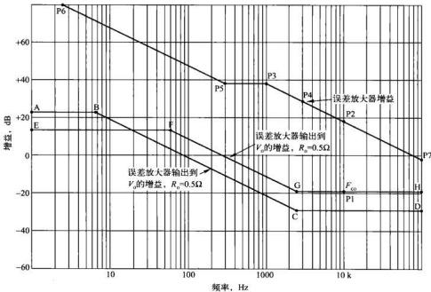

图 12.19 不连续模式下反激变换器的稳定反馈环路的增益曲线(12.18节中的设计实例)

## 12.17 不连续模式下反激变换器误差放大器的传递函数

图 12.19 中 $R_{o(\min)}$ 对应的曲线 EFGH，如 12.3 节所述，穿越频率 $F_{co}$ 设定为开关频率 (P1 点，本例中为 10kHz) 的 1/5。通常， $F_{co}$ 位于输出电路传递函数的水平斜率段。 

所设计的误差放大器要使得在 $F_{\infty}$ 处的增益(P2点)等于在P1点输出电路增益的相反数。因为曲线EFGH在 $F_{\infty}$ 处的斜率是水平的，所以误差放大器在P2点的增益斜率必须为-1。 

因此，确定P2点的位置后，往低频段以-1斜率绘制一条直线，反向延伸到稍低于C点的频率处(P3点)。当负载为 $R_{o(\max)}$ 时，输出电路传递函数的曲线是ABCD。由于此时的总增益曲线也必须以-1斜率穿过 $R_{o(\max)}$ 对应的新的穿越频率 $F_{co}$ 。在新的穿越频率 $F_{co}$ 处，水平线CD的增益应等于误差放大器增益曲线-1斜率段上P4点增益的倒数。 

点 P3 的频率不是很严格,但它必须低于 C 点的频率,以确保负载为 $R_{o(\max)}$ 时,最大增益损耗能够被误差放大器增益曲线 -1 斜率段上某一点的增益所补偿或抵消。 

在 P3 处设置一个极点 $F_{p}$ 。采用 2 型误差放大器，输入电阻 R1（图 12.18(a)）可以选择足够高的任意阻值，以免影响采样电阻网络（图中并未画出采样电阻）。 

从图中可读出，水平部分(P3-P5)的增益等于 $R2 / R1$ （图12.18(a))。这样，就确定了电阻R2的值。再根据极点 $F_{\mathrm{p}}$ 和 $R2$ ，图12.18(a)中C2的值确定为 $C2 = 1 / (2\pi F_{\mathrm{p}}R2)$ 。 

现在，增益曲线沿着水平线 P3-P5 延伸，在点 P5 引入一个零点，以增加低频增益，并提供超前的相位。在 P5 点，零点 $F_{x}$ 的频率不是很严格，大约为 $F_{p}$ 的 1/10 即可。零点 $F_{x}$ 由 $C1 = 1/(2\pi R2F_{x})$ 确定。 

下一节将举例说明上述的内容。 

## 12.18 设计实例——不连续模式下反激变换器的稳定

针对4.6.3节中的例子设计反馈环路，使系统稳定。假设输出电容含有ESR，因此选用2型误差放大器，电路如图12.18(a)所示。电路参数如下。 

<table><tr><td><eq>{V}_{\mathrm{o}}</eq></td><td>5V</td></tr><tr><td><eq>{I}_{\mathrm{o}\left( \text{nom }\right) }</eq></td><td>10A</td></tr><tr><td><eq>{I}_{\mathrm{o}\left( \min \right) }</eq></td><td>1.0A</td></tr><tr><td><eq>{V}_{\mathrm{{dc}}\left( \max \right) }</eq></td><td>60V</td></tr><tr><td><eq>{V}_{\mathrm{{dc}}\left( \min \right) }</eq></td><td>38V</td></tr><tr><td><eq>{V}_{\mathrm{{dc}}\left( \mathrm{{av}}\right) }</eq></td><td>49V</td></tr><tr><td>开关频率</td><td>50kHz</td></tr><tr><td><eq>{L}_{\mathrm{p}}</eq>(计算见4.3.2.7节)</td><td>56.6μH</td></tr></table>

在4.3.2.7节中，已计算出 $C_{\mathrm{o}}$ 等于 $2000\mu \mathrm{F}$ ，并且，在开关管关断的瞬间，66A的次级尖峰电流将会在 $2000\mu \mathrm{F}$ 电容约 $0.03\Omega$ 的ESR上引起 $66\times 0.03 = 2\mathrm{V}$ 的尖峰电压。可以用LC电路滤掉这一尖峰电压，或者增大 $C_{\mathrm{o}}$ 以降低它的ESR。 

在这里，两种方法都被采用。电容 $C_{o}$ 增大到5000μF以使 $R_{c}$ 减少到(2/5)0.03=0.012Ω（因为 $R_{o}$ 与 $C_{o}$ 成反比）。Q1关断时的初始尖峰等于66×0.012=0.79V，可以通过一个较小的不会影响到反馈环路的LC电路，将此尖峰电压降低到可接受的水平。 

首先,绘制 $R_{o(\min)} = 5/10 = 0.5\Omega$ 时输出电路的增益曲线。由式(12.19)得,低频增益为 

$$
\begin{array}{r l} G & = \frac {V _ {\mathrm{dc}}}{3} \sqrt {\frac {0 . 4 R _ {\mathrm{o}} T}{L _ {\mathrm{p}}}} \\ & = \frac {4 9}{3} \sqrt {\frac {0 . 4 \times 0 . 5 \times 2 0 \times 1 0 ^ {- 6}}{5 6 . 6 \times 1 0 ^ {- 6}}} \\ & = 4. 3 \end{array}
$$

由式(12.20)，可得极点频率 

$$
\begin{array}{r l} F _ {\mathrm{p}} & = 1 / 2 \pi R _ {\mathrm{o}} C _ {\mathrm{o}} \\ & = 1 / 2 \pi 0. 5 \times 5 0 0 0 \times 1 0 ^ {- 6} \\ & = 6 3. 7 \mathrm{Hz} \end{array}
$$

由式(12.21)，可得 ESR 零点频率 

$$
\begin{array}{r l} F _ {\mathrm{osm}} & = 1 / 2 \pi R _ {\mathrm{c}} C _ {\mathrm{o}} \\ & = 1 / 2 \pi 6 5 \times 1 0 ^ {- 6} \\ & = 2 5 0 0 \mathrm{Hz} \end{array}
$$

那么， $R_{o}$ 等于 $0.5\Omega$ 时对应的输出电路增益曲线如图 12.19 中的 EFGH 曲线所示。低频段直到 $F_{p}=63.7Hz$ ，水平部分的增益值为 +12.8dB。在 $F_{p}$ 处，曲线转折成 -1 斜率下降，直到频率为 2500Hz 的 ESR 零点。接下来，将绘制误差放大器的增益曲线。 

将穿越频率 $F_{co}$ 选定为开关频率的 1/5，即等于 50/5 = 10kHz。在曲线 EFGH 上，10kHz 处的增益是 -19dB。因此，误差放大器在 10kHz 处的增益应为 +19dB。在 10kHz 增益为 +19dB 处（P2 点），向低频方向绘制一条斜率为 -1 (-20dB/dec) 的直线，反向延伸这条线到比 $F_{exm}$ 低的频率处——比如说延伸到1kHz、+39dB的P3点。在P3点，再绘制一条水平线到频率为300Hz的P5点（零点的位置）。 

对零点位置的要求也不是很严格。在12.17节中已经提到，建议P5点的零点频率等于P3点频率的1/10。实际上，一些设计者会忽略P5点的零点（见参考文献5），但是，在这里设置零点可以提供超前的相位。因此，在P5点，朝低频方向绘制斜率为-1的直线。 

现在要验证, 当 $R_{0(\max)}$ 等于 $5\Omega$ 时, 总增益曲线(输出电路加上误差放大器传递函数)仍以 -1 斜率经过穿越频率 $F_{co}$ 。 

当 $R_{o}=5\Omega$ 时，由式(12.19)可知，直流增益等于13.8，也就是+23dB。由式(12.20)计算出的极点频率为6.4Hz。ESR零点频率仍是2500Hz。因此，在 $R_{o}=5\Omega$ 时，输出电路传递函数曲线是ABCD。 

新的穿越频率 $F_{co}$ 就是误差放大器增益等于输出电路增益曲线 ABCD 上增益的相反数时的频率。可以看出，在 P4 点 (3200 Hz)，输出滤波器的增益是 -29 dB，而误差放大器的增益是 +29 dB。由此可得，误差放大器的增益和曲线 ABCD 的增益之和以斜率 -1 穿过 $F_{co}$ 。 

然而,应该注意的是,如果 $R_{0}$ 稍大一些,整个 ABCD 曲线的增益将会下降到更低的值。那么,先前确定的误差放大器增益等于输出滤波器损耗增益相反数的频率点会出现在两条曲线斜率同时为 -1 的频段。 

系统总增益曲线将以-2斜率穿越新的截止频率 $F_{cc}$ ，并可能会产生振荡。因此，规定来说，应该保证不连续模式下反激变换器在最小负载电流 $(R_{0}$ 最大)的情况下的稳定性。 

下面，根据传递函数增益曲线 P6-P5-P3-P7 选择误差放大器的具体元件。图 12.18(a) 中，任选 R1=1000Ω。从图 12.19 可以看出，P3 点的增益为 +38dB，即代数增益为 79。因此，R2/R1=79，则 R2=79kΩ。对 1kHz 处 P3 点的极点， $C2=1/(2\pi F_{p}R2)=2000\mathrm{pF}$ 。对 300Hz 处误差放大器的零点， $C1=1/(2\pi F_{s}R2)=6700\mathrm{pF}$ 。 

由于输出电路的单极点下降特性,它的最大相位滞后是 $90^{\circ}$ 。但由于ESR零点的存在,相位滞后将会大大减小。因此,不连续模式下的反激变换器很少存在相位裕量问题。 

对于 $R_{0}=0.5\Omega$ 的情况，由 64Hz 处的极点和 2500Hz 处的 ESR 零点在 $F_{\mathrm{eo}}(10\mathrm{kHz})$ 处引起的相位滞后为 

$$
\begin{array}{r l} \text { 输出电路相位滞后 } & = \tan^ {- 1} \left(\frac {1 0 0 0 0}{6 4}\right) - \tan^ {- 1} \left(\frac {1 0 0 0 0}{2 5 0 0 0}\right) \\ & = 8 9. 6 - 7 6. 0 \\ & = 1 3. 6 ^ {\circ} \end{array}
$$

在 300Hz 处的零点和在 1kHz 处的极点引起的误差放大器在 10kHz 的相位滞后（见图 12.20，曲线 P6-P5-P3-P7）为 

$$
2 7 0 - \tan^ {- 1} \left(\frac {1 0 0 0 0}{3 0 0}\right) + \tan^ {- 1} \left(\frac {1 0 0 0 0}{1 0 0 0}\right) = 2 7 0 - 8 8 + 8 4 = 2 6 6 ^ {\circ}
$$

那么，在 $10\mathrm{kHz}$ 处，系统总相位滞后是 $13.6^{\circ} + 266^{\circ} = 280^{\circ}$ 。从而得到 $F_{\mathrm{co}}$ 处 $80^{\circ}$ 的相位裕量。 

## 12.19 跨导误差放大器

很多常用的 PWM 芯片(1524、1525、1526 系列)采用跨导型误差放大器。跨导 $g_{m}$ 是指每 

单位输入电压变化引起的输出电流的变化,即 

$$
g _ {\mathrm{m}} = \frac {\mathrm{d} I _ {\mathrm{o}}}{\mathrm{d} V _ {\mathrm{in}}}
$$

对误差放大器输出端到地的阻抗 $Z_{0}$ ，有 

$$
\mathrm{d} V _ {\mathrm{o}} = \mathrm{d} I _ {\mathrm{o}} Z _ {\mathrm{o}} = g _ {\mathrm{m}} \mathrm{d} V _ {\mathrm{in}} Z _ {\mathrm{o}}
$$

或，增益G为 

$$
G = \frac {\mathrm{d} V _ {\circ}}{\mathrm{d} V _ {\mathrm{in}}} = g _ {\mathrm{m}} Z _ {\circ}
$$

1524、1525 系列的放大器空载时，开环低频增益额定值为 +80dB，且在 300Hz 处有一个极点。在此极点频率以后，增益以 -1（或 -20dB/dec）斜率下降，如图 12.20(a) 中曲线 ABCD 所示。 

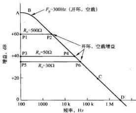

(a)

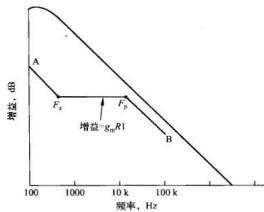

(c)

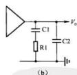

图 12.20 (a) 不带负载的 PWM 芯片 1524 系列和 1525 系列的开环增益曲线。当带电阻负载时，增益稳定为 $G = g_{\mathrm{m}} R_{\mathrm{o}}$ 。(b) 2 型跨导误差放大器输出并联网络结构图。(c) 图 12.20(b) 所示电路的增益曲线 ( $A \sim F_{\mathrm{r}} \sim F_{\mathrm{p}} \sim B$ )。 $F_{\mathrm{r}} = 1 / (2\pi R1C1), F_{\mathrm{p}} = 1 / (2\pi R1C2)$ 。

误差放大器的输出端到地之间并联着一个纯电阻 $R_{\mathrm{u}}$ ， $R_{\mathrm{u}}$ 使增益从直流开始直到与曲线ABCD(图12.20(a))的交点前恒等于 $g_{m}R_{\mathrm{u}}$ 。对于1524、1525系列芯片， $g_{\mathrm{m}}$ 额定值为 $2\mathrm{mA / V}$ 。因此， $R_{\mathrm{u}}$ 等于 $500\mathrm{k}\Omega$ 、 $50\mathrm{k}\Omega$ 和 $30\mathrm{k}\Omega$ 时，增益分别为1000、100和60，如图12.20(a)中的曲线P1-P2、P3-P4、P5-P6所示。 

大多数情况下采用的是2型误差放大器，可由图12.20(b)所示的网络实现。 

在低频段， $X_{C1}$ 远大于 R1。这时相当于 C1、C2 与产生 300Hz 开环极点的内部 100pF 电容并联接地。这使原本位于 300Hz 的极点移到更低的频率点，且在这个频率更低的极点之后，增益继续以 -1 的斜率下降。在 $X_{C1}=R1$ 时的频率 $F_{s}=(1/2\pi R1C1)$ 处有一个零点，使增益斜率变为水平线，幅值等于 $g_{m}R1$ 。而在 $X_{C2}=R1$ 时频率 $F_{p}=1/2\pi R1C2$ 处的极点使增益斜率变为 -1。 

图 12.20(b) 中电路的增益曲线如图 12.20(c) 所示。 

通常,1524、1525 系列 PWM 芯片中的误差放大器输出端采用如图 12.20(b) 所示的补偿网络并联到地,而不是像传统的运算放大器那样将负反馈补偿网络接在输出端和反相输入端之间。 

无论是如图 12.20(b) 中的补偿网络并联接地，还是像传统方式一样返回到运算放大器的反相输入端，由于芯片内部误差放大器不能输出或输入超过 $100 \mu A$ 的电流，所以对 R1 的大小都会有所限制。当 PWM 比较器采用 3V 的三角波来做比较时，误差放大器的输出电压在负载或网压的突变时有可能会于最高电压 3V。若 R1 小于 $30 k\Omega$ ，快速变化的 3V 电压需要的电流可能超过 $100 \mu A$ 。对于负载或网压的快速变化，误差放大器响应速度将会比较慢。 

由于输出电流有 $100 \mu A$ 的限制，许多工程师倾向于不使用芯片内部误差放大器。由于误差放大器的输出端通常作为芯片的某一管脚，所以某些设计者更愿意在芯片外部使用性能更好的误差放大器，且将该外部误差放大器的输出与芯片内部误差放大器输出对应的管脚相连接。 

然而，从控制成本的角度出发，可能只允许使用内部误差放大器。在穿越频率 $F_{\mathrm{co}}$ 已经确定的前提下，若计算的R1必须小于30kΩ，才能使跨导误差放大器的增益匹配变换器输出滤波器在 $F_{\mathrm{co}}$ 处的负增益，则可以选定R1为30kΩ，通过增大输出滤波器在 $F_{\mathrm{co}}$ 处的负增益实现设计。为此，可以增大输出滤波电感或滤波电容，使滤波器的极点频率更低，从而得到 $F_{\mathrm{co}}$ 处更高的输出滤波器负增益。 

## 参考文献

1 D. Venable, "The K Factor: A New Mathematical Tool for Stability Analysis and Synthesis," Proceedings Powercon 10, 1983. 

2 A. Pressman, Switching and Linear Power Supply, Power Converter Design, pp. 331-332, Switchtronix Press, Waban, Mass., 1977. 

3 K. Billings, Switchmode Power Supply Handbook, Chap. 8, McGraw-Hill, New York, 1989. 

4 G. Chryssis, High Frequency Switching Power Supplies, 2d ed., Chap. 9, McGraw-Hill, New York, 1989. 

5 Unitrode Corp., Power Supply Design Seminar Handbook, Apps. B, C, Watertown, Mass., 1988. 

## 第 13 章 谐振变换器

## 13.1 引言

体积很小的新型多功能集成电路的出现，对开关电源的小型化具有重要意义。开关电源小型化主要依靠提高开关频率来减小变压器和输出滤波器的体积。另外，开关电源也通过提高效率减小散热器体积来减小自身体积。 

目前开关电源技术的一个主要目标是使电源工作频率比现在通用的 $100 \sim 200kHz$ 进一步提高。 

然而，对前面讨论的传统的矩形波拓扑，随着开关频率的提高，开关管的关断损耗和开通损耗都会增加。MOSFET管输出电容的充放电(11.1节)造成的开通损耗在开关频率高于1MHz时非常明显。 

正如第1章和第11章中所讨论的，在开关关断期间，下降的电流和上升的集电极电压之间出现重叠，产生一个很大的关断损耗。随着开关频率的升高，开关管的关断损耗会变得非常严重。开关管的损耗增加，会使所需的散热器体积增大。因此，虽然频率提高使变压器和输出滤波器的体积减小了，但电源的总体积并未减小。而且，结一壳温度会上升，通常 $1^{\circ}C/W$ 的结一壳热阻仍会导致严重的晶体管结温。 

在开关管的漏源极间(或集射极间)加缓冲器可以降低开关管的开关损耗(第11章)。如果使用耗能型RCD缓冲电路(11.3节)，它并不能降低总开关损耗，只是简单地将开关管的损耗转移到了缓冲电路的电阻中。无损缓冲电路(11.6节)能降低开关管的开关损耗，但当频率高于200kHz时还是会出现问题。 

## 13.2 谐振变换器

因此，要想在较高频率下工作并使电源体积更小，必须设法从根本上降低开关管的开关损耗。这可以使用谐振变换器来实现。谐振变换器是由开关管加上谐振 LC 电路构成的，它使流过开关管的电流变为正弦波而不是方波。然后设法使开关管在正弦电流过零处导通和关断。因此，关断时刻的下降电流和上升电压之间及导通时刻的上升电流和下降电压之间只有微小的重叠，从而大大降低了开关损耗。使开关管在电流为零的时刻导通或关断的电路称为零电流开关（Zero Current Switching, ZCS）电路 $^{[1]}$ 。 

我们之前在11.1节看到，即使开关管在正弦电流的过零处关断，上升电压和下降电流之间也没有重叠。开关管可以没有关断损耗，但仍然有导通损耗。在11.1节曾指出，有相当大的一部分能量 $0.5C_{\mathrm{a}}(2V_{\mathrm{dc}})^{2}$ 储存于MOSFET管的较大的输出电容中。当MOSFET管每周期(T)内导通一次时，就在MOSFET管上消耗了 $0.5C_{\mathrm{a}}(2V_{\mathrm{dc}})^{3}/T\mathrm{W}$ 的能量。能够解决这种问题的电路称为零电压开关（Zero Voltage Switching, ZVS）电路 $^{[2]}$ 。 

ZVS 电路是通过让开关管输出电容成为电路中某个 LC 谐振电路的电容来实现零电压开关的。那么开关管关断时存储在电容上的能量将毫无损失地回馈到电源母线上。其工作方式类似于 11.6 节中所述的无损缓冲电路。 

20世纪80年代中期，工业界开始广泛关注谐振变换器。从那时起，很多研究人员进入了这个领域，并发表了许多这方面的文章。提出了许多新的谐振变换器拓扑，并都对其进行了数学分析。这当中的大部分已被实际应用，并且有很高的效率 $(80\% \sim 97\%)$ 和很高的功率密度。有些据说已经达到了 $50\mathrm{W / in}^3$ ，如此高的功率密度可用于DC/DC变换器，这种变换器没有离线式变换器都必须有的大的输入滤波电容。 

然而,这些高功率密度转换器通常需要通过外加散热器来散热,但此散热器的体积和冷却方式在计算功率密度时很少被考虑在内。 

本章不可能讨论所有谐振变换器拓扑及它们的工作方式，因此只概括地讨论某些已被证明的拓扑及其工作模式，以作为谐振模式可参照的例子。 

值得注意的是，在这个领域里，有的文章会提出一个新方法，很快就会有相关评论出现，如在电源及负荷变动较大或元件应力较大的场合的应用有局限性。在来年的会议上不仅会提出新技术，而且其他的研究人员会给出上一年问题的解决办法，诸如此类。这只是简单地反映了一个事实，即尽管谐振变换器在一些应用场合有很大的优势，至今谐振变换器依然不具有PWM变换器的灵活性，它们不能很好地处理电源不稳定和负载变动的问题。并且，与相同输出功率的传统PWM方波变换器相比，它们要承受很大的开关管峰值电流，在某些电路中，还要承受很大的电压应力。 

## 13.3 谐振正激变换器

首先介绍最简单的谐振变换器——谐振正激变换器。我们主要关注晶体管如何实现开关管的零电流关断及精确开关管关断时间。图 13.1 给出一个工作于不连续模式的简单谐振正激变换器 $^{[3]}$ 。 

在不连续模式下，LC回路中的电流不是连续的正弦波，而是被一个大的时间间隔 $T_{s}$ 所分隔的半周或整周正弦电流所组成的脉冲序列，如图13.1所示。 

电路的谐振频率为 $F_{r}=0.5/(t_{1}-t_{0})$ ，它由无源谐振元件 $L_{r}$ 和电容 $C_{r}$ 折算到初级的值 $(C_{r})(N_{s}/N_{p})^{2}$ 来确定，因而电路谐振频率为 

$$
F _ {r} = 1 / 2 \pi \sqrt {L _ {r} C _ {r} (N _ {s} / N _ {p}) ^ {2}}\tag{13.1}
$$

式中， $L_{r}$ 是变压器漏感，有时包括外接的一个小电感。产品差异会使漏感不同，加上这个小电感就是为了使总的 $L_{r}$ 相对固定。 

开关管 Q1 以频率 $F_{s}=1/T_{s}$ 导通，电路工作原理如下。首先， $L_{r}$ 和 $(C_{r})(N_{s}/N_{p})^{2}$ 构成串联谐振电路，其初始电流是次级直流电流通过变压器匝比折算到初级后的值。在谐振变换器术语中，由于负载与谐振电容并联，这种电路称为并联谐振变换器（Parallel Resonant Converter, PRC）。后面将要介绍另外一些电路，这些电路的负载和串联谐振 LC 元件相串联，称为串联谐振变换器（Series Resonant Converter, SRC）。 

因为电路工作于不连续模式，故在开关管 Q1 导通之前，谐振电路中无电流流通。例如，两个正弦半波之间有一个很长的时间间隔，如图 13.1 所示。因此，当 $t_{0}$ 时刻 Q1 导通时，谐振 电路中开始有正弦半波电流流过。因为导通以前谐振电路中没有电流流通，所以 $t_{0}$ 时刻的电流值为零。 

开关管流过第一个正半周电流后，在 $t_1$ 时刻电流又过零并且反向。初级谐振电容上储存的电压使此负向电流继续流通。它流过D2的阳极，通过电源 $V_{\mathrm{dc}}$ 形成一个闭合回路。在电流流过D2的半个周期里，Q1的漏极一直被钳位为-1V（D2的正向压降）。在 $t_1 \sim t_2$ 时刻期间，Q1中没有电流流过，此时可以关断Q1。Q1导通时间只要介于谐振正弦电流的半个周期与一个周期之间即可。 $t_2$ 时刻，流过D2的负半周电流返回到零，而此时变压器T1激磁电感中的电流使开关管Q1的漏极电压上升到 $2V_{\mathrm{dc}}$ ，从而使铁心复位。励磁电感和从变压器次级折算过来的电容构成另外一个谐振回路。当漏极电压在 $t_2$ 时刻上升到最大时，一个负半周正弦电压通过谐振电路，恰好使铁心磁滞曲线复位到起始处。 

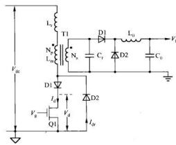

(a)

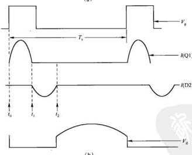

(b)

图 13.1 谐振正激变换器。 $C_{r}$ 折算到初级的电容与漏感 $L_{r}$ 谐振。MOSFET 管在其漏极电流第一个正半周过零之后不久就关断。D2 流过其第一个负半周电流后截止，MOSFET 管漏极电压上升，在 $C_{r}$ 折算到初级的电容与变压器励磁电感 $L_{m}$ 所构成的谐振环的半个周期内，使变压器 T1 的铁心复位。

零电流关断已经实现,因此不会产生关断损耗。D2的反向恢复时间很短,故其反向恢复损耗可忽略不计(尤其是当开关管漏极电压上升为 $2V_{dc}$ 时,二极管中的电流早已降到零或接近零)。 

在谐振第一个正半周期 $(t_{1}\sim t_{0})$ 内，初级传递脉冲功率给次级和负载，改变脉冲序列的时间间隔，即改变开关频率 $F_{s}=1/T_{s}$ 来调整直流输出电压。若 $V_{dc}$ 上升或输出负载电流下降，则必须增大脉冲序列的时间间隔（降低开关频率 $F_{s}$ ）；相反，若 $V_{dc}$ 下降或输出负载电流上升，则要升高开关频率 $F_{s}$ 。 

改变开关频率 $F_{s}$ 调压的方法可认为是谐振变换器的一个主要缺点。在许多谐振电路拓扑中，其脉宽恒定（谐振 LC 电路的半个周期），而频率通过变化来调节。 

许多场合不能采用变频调节方法。当有计算机时，计算机操作员常常要求电源的开关频率与计算机时钟频率的某个倍数同步，以降低电源噪声尖峰在计算机逻辑电路里产生错误0或1的可能性。传统的PWM变换器中，开关频率保持恒定，而导通脉冲的宽度改变了。 

而且，当有阴极射线管(CRT)显示屏时，应将电源的开关频率锁定，使之与CRT的水平扫描频率同步。当它不同步时，开关电源的噪声尖峰可能会在屏幕上以随机的方式产生连续的干扰。而当开关频率恒定且与CRT水平扫描频率保持一致时，噪声尖峰的影响只会保持在屏幕上的固定位置，从而大大减小了对操作者的干扰。 

## 13.3.1 某谐振正激变换器的实测波形

图 13.2(a) 所示的是一个输出功率为 $32 \mathrm{~W}(5.2 \mathrm{~V}, 6.2 \mathrm{~A})$ 的正激变换器。此电路的输入电压 $V_{dc}$ 等于 150V，开关频率为 856kHz，变压器匝比为 10:1。为了更好地理解以上所讨论的谐振正激变换器的工作原理，下面分析一组实测波形。图 13.2(b) 中的波形来自参考文献 3，该图是征得作者 F. Lee 和 K. Liu 的许可后翻印的。 

在图 13.2(b) 中，波形 3 是漏极电流的波形，它是半个正弦波，其谐振半周期为 $0.2\mu s$ ( $F_{r}=2.5MHz$ )。次级电容为 $0.15\mu F$ ，折算到初级后为 $0.15 \times (0.1)^{2} = 0.0015\mu F$ 。当 $F_{r} = 2.5MHz$ 时，变压器漏感加上其他分立电感后的总和为 

$$
L _ {r} = 1 / 4 \pi^ {2} (F _ {r}) ^ {2} C = 1 / 4 \pi (2. 5) ^ {2} (0. 0 0 1 5) 1 0 ^ {- 6} = 2. 7 \mu \mathrm{H}
$$

在图 13.2(b) 所示的波形 1 中, 正弦电流第一个正半周过零后, MOSFET 管的门极很快被关断, 从而达到了零电流关断的目的。从波形 4 可以看出漏极电压在流过 D2 的负电流返回到零后开始上升, 如前所述。 

在波形2中，从初级励磁电感上的电压感应而来的次级电容电压极性变负，如前所述，这样可以使铁心复位。此波形还给出了最大开关频率 $(F_{\mathrm{s}})$ 。Q1导通脉冲间的最小间隔的确定是要使波形2的负半周在磁心完全复位后能够返回到零。 

以上表明，让谐振变换器工作在输入和负载变动较大的情况下会有一定的困难。现在来考虑前面计算出的 $2.7\mu \mathrm{H}$ 的谐振电感。这个电感很小，当导线长度或变压器走线改变时，这个电感在总电感中所占的比重就会发生很大变化。对于一个 $2.7\mu \mathrm{H}$ 的小电感，即使是很小的变压器制造误差都会使其在漏感值中所占的百分比发生很大的改变。若电感变大，则谐振半周期变大。若MOSFET管的导通时间(应该大于谐振半周期)太小，则可能导致MOSFET管在谐振半周结束前关断，即在正弦波过零前关断。 

适当增大 $L_{\mathrm{r}}$ ，使其所占的百分比不易随变压器的制造误差、导线长度或其走线的变化而变化。这将使谐振半周期增大，并降低最大开关频率，直至足够使变压器磁心完全复位。 

现在，若增大 $L_{r}$ 并减小 $C_{r}$ 以保持谐振半周期不变，则 $L_{r}/C_{r}$ 就要变大。而Q1的正弦电流峰值(图13.2(b)中的波形3)与 $\sqrt{L_{r}/C_{r}}$ 近似成反比。因此若 $L_{r}/C_{r}$ 增大，则设计所要求的最大峰值电流和最大输出电流都可能无法实现。 

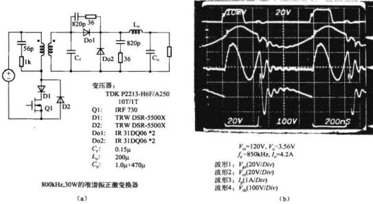

图 13.2 图 13.1 所示电路的实测波形图(由 F. Lee 和 K. Liu 提供)

当然,可以通过特殊方法解决这些问题。上面讨论的内容表明,即使这样一个简单的谐振变换器,对比方波电路,在处理不同规格、输入和负载变化及制造误差等方面都欠缺灵活性。 

值得注意的是，传统的正激变换器运行在相对较低的频率，且即使初级电流比图13.2(b)所示的电流还要小也能产生相同的输出功率。如图13.2(b)所示， $V_{in}=120V$ ，输出功率为 $15W(V_{o}=3.56V,I_{n}=4.2A)$ 时的峰值电流为1.5A（对于全波模式）。 

式(2.28)给出了传统 PWM 方波正激变换器的初级峰值电流的计算公式为 $I_{p}=3.13P_{o}/V_{dc}=3.13\times15/120=0.39A$ 。从表 7.2a 可以看出，比 2213 号铁心小一号的铁心可以用在图 13.2(b) 所示电源中，而且频率可以更低。表 7.2a 表明，采用 1811 号铁心，正激变换器就可以在频率为 150kHz 的条件下输出 19.4W 的功率。 

这里只是将谐振变换器与传统的、被证实了的拓扑进行比较。 

## 13.4 谐振变换器的工作模式

## 13.4.1 不连续模式和连续模式；过谐振模式和欠谐振模式

如图 13.1 所示, 谐振变换器可运行在连续模式或不连续模式下。如前所述, 在不连续模式下, 变换器通过调整开关频率实现对输出电压的调整。此时功率间断地被传送到负载端, 其持续时间小于周期时间。 

若因 $V_{dc}$ 下降或负载电流上升而必须升高输出电压，则开关频率（离散脉冲）的重复率就要增加；相反，若输出电压由于输入电压或输出负载阻抗的上升而升高，则离散脉冲的重复率就要降低。 

许多年来，在20～30kHz的频率范围内，可控硅谐振变换器可以很好地运行在不连续模式下（正如第6章所讨论的）。然而，在不连续模式下，负载和输入的剧烈波动会引起开关频率的剧烈波动。改进措施是使变换器工作于连续模式下。连续模式下，电路中连续正弦电流或开关管连续方波电压脉冲间的间隙可以忽略不计。 

傅里叶已证明任何方波的基波是一个频率等于方波的正弦波。LC谐振回路的阻抗一频率特性曲线，如图13.3所示。为了实现连续模式的幅值控制，在谐振曲线上的欠谐振侧或过谐振侧可以确定平均开关频率。 

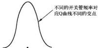

图13.3 沿着谐振曲线的斜坡

改变开关频率以调整输出电压

连续模式下的直流输出电压,与谐振电容的交流电压峰值成正比,或者与 LC 串联谐振回路的交流电流峰值成正比。沿谐振特性曲线移动改变开关频率可以改变输出幅值,从而实现输出电压的调整。 

电路工作频率高于谐振曲线谐振峰值处的频率,称为过谐振模式(Above Resonace Mode, ARM);电路工作频率低于谐振曲线谐振峰值处的频率,称 

为欠谐振模式(Below Resonance Mode, BRM)。从图13.3可以看出，谐振曲线(Q特性曲线)非常陡(高Q值)，频率稍有变化，输出就会发生很大的变化。 

应该注意,平均开关频率高于谐振峰值处的频率时,必须降低开关频率以提高输出;平均开关频率低于谐振峰值处的频率时,必须提高开关频率以提高输出电压或输出电流。 

现在我们可以考虑谐振变换器的一个问题。许多文章都倾向于使用连续工作模式，因为在该模式下，达到所要求的负载和输入调整需要更小的频率范围。但是若ARM设计了反馈系统，则系统从ARM模式漂移到BRM模式后会产生严重的问题，因为此时控制进入错误的方向。 

对于工作于ARM模式的电路，输出电压降低后，可以通过改变控制环振荡器的频率来降低开关频率，使其工作点在谐振曲线上向上移动，从而对输出电压进行校正。然而，因为谐振曲线相对比较陡，所以由于生产误差产生的谐振元件上和C的微小变化都会使谐振频率发生偏移。若谐振峰值偏移过大，就可能使原来工作在ARM模式下的电路变为工作在BRM模式下，此时一旦反馈环采样发现输出电压下降，就会降低开关频率对输出进行校正。这会导致输出电压的进一步下降，使负反馈变成正反馈。 

## 13.5 连续模式下的谐振半桥变换器 $^{[4]}$

大多数电流谐振变换器的发展都集中在半桥拓扑方面,本节也将讨论这个拓扑。下面的讨论是基于 R. Steigerwald 的著作的 $^{[4]}$ 。 

## 13.5.1 并联谐振变换器(PRC)和串联谐振变换器(SRC)

我们已经看到输出功率可以通过下面两种方式中的任意一种从 LC 谐振回路中获得。当 折算后的输出负载(折算到变压器初级)和谐振电容并联,此电路称为并联谐振变换器(Parallel Resonant Converter,PRC);当折算后的负载与谐振 LC 电路串联,此电路称为串联谐振变换器(Series Resonant Converter,SRC)。 

图 13.4(b) 所示的是并联负载谐振半桥变换器， $C_{n}$ 和 $C_{e2}$ 是输入滤波电容。在交流输入为 120V 或 220V 时，如图 5.1 所示，这两个电容用于产生 320V 的整流电压。它们的值很大，仅仅用于分担输出整流电压，与谐振 LC 回路无关。 

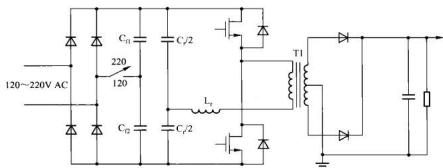

(a)

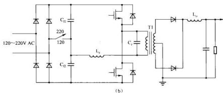

图 13.4 (a) 串联负载谐振半桥变换器。电感 I，和电容 C，谐振。负载经变压器 T1 折算到初级与谐振电路串联。开关管在谐振电流第一个半周期结束后直接关断，以实现零电流开关（Zero Current Switching, ZCS）。在串联负载电路中，输出滤波器是容性的。(b) 并负载负载谐振半桥变换器。电感 I，和电容 C，谐振。负载经变压器 T1 折算到初级与谐振电容并联。在并联负载电路中，为了避免降低谐振电路的 $\theta_{值}$ ，输出滤波器除电容外还包括一个高阻抗电感。

并联在变压器初级的电容 $C_{r}$ ，同外接电感 $L_{r}$ 谐振，谐振频率为 $F_{r}=1/2\pi\sqrt{L_{r}\overline{C}_{r}}$ 。输出电感 $L_{n}$ 非常大，在谐振频率 $F_{r}$ 处阻抗很高，不会降低 $C_{r}$ 的负荷能力，也不会减小谐振 LC 电路的 Q 值。 $L_{n}$ 很大，从而使电路可以工作在连续模式下（1.3.6 节）。 $C_{r}$ 处的阻抗（不含 $C_{r}$ ）为输出电阻乘匝比的平方。变压器 T1 的励磁电感比这个阻抗大很多，因此它不会影响电路的正常工作。 

串联负载谐振半桥变换器(SRC)如图13.4(a)所示。这里，外接电感 $L_{r}$ 与两个电容值为 $C_{r}/2$ 的等效电容(等于 $C_{r}$ )谐振。 $C_{r}$ 为滤波电容，与谐振回路无关。负载电阻通过匝比平方 折算到初级后与谐振 LC 电路串联,成为串联谐振变换器的负载。在串联谐振电路中,变压器次级的电感一般都可以忽略不计。 

由于不需要输出电感,所以串联谐振变换器一般应用于高压电源中。高压输出所需的输出电感体积很大。并联谐振变换器(SRC)电路一般应用于低压大电流电路中,输出电感可以抑制输出电容中的纹波电流。 

下面将讨论工作在连续模式下的串/并联谐振半桥变换器。因为可通过改变频率来调节输出直流电压，所以有必要了解当频率随着工作点在特性曲线上移动而变化时，折算到初级负载上的交流电压如何变化。整流直流输出电压与折算到初级电阻两端的交流电压成正比。 

## 13.5.2 连续模式下串联负载和并联负载谐振半桥变换器的交流等效电路和增益曲线 $^{[4]}$

图 13.5(a) 和图 13.5(b) 分别给出了图 13.4(a) 和图 13.4(b) 所示串/并联负载谐振半桥变换器的交流等效电路。这些电路的输入是由开关管产生的幅值为 $\pm V_{dc}/2$ 的方波。按照 Steigerwald 的分析 $^{[4]}$ ，只考虑此方波的基波频率，计算出的输出电压和输入电压之间的比率（增益）是频率的函数。 

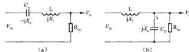

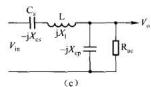

图 13.5 (a) 串联负载谐振半桥变换器的交流等效电路(图 13.4(a))。(b) 并联负载谐振半桥变换器的交流等效电路(图 13.4(b))。(c) 串联/并联负载谐振半桥变换器的交流等效电路, 常称为 LCC 电路。上述三种电路的输出相对于输入的交流增益使直流输出电压和直流输入电压的一半的比值恒定。(由 R. Steigerwald 提供)。

从图 13.5 所示的等效电路可以看出,串/并联负载电路的比值分别为 

串联负载： 

$$
\frac {V _ {\mathrm{o}}}{V _ {\mathrm{in}}} = \frac {1}{1 + \mathrm{j} \left[ \left(X _ {\mathrm{l}} / R _ {\mathrm{ac}}\right) - \left(X _ {\mathrm{c}} / R _ {\mathrm{ac}}\right) \right]}\tag{13.2}
$$

并联负载： 

$$
\frac {V _ {\mathrm{o}}}{V _ {\mathrm{in}}} = \frac {1}{1 - (X _ {1} / X _ {\mathrm{o}}) + \mathrm{j} (X _ {1} / R _ {\mathrm{sc}})}\tag{13.3}
$$

式中， $R_{L}$ 是次级负载折算到初级后的值，串联负载 $R_{ac}=8R_{L}/\pi^{2}$ ，并联负载 $R_{ac}=\pi^{2}R_{L}/8$ 。 

从这些关系式中，Steigerwald 绘制出了 $NV_{odc}/0.5V_{in}$ 的比例图，其中，N 是变压器的匝比， $V_{in}$ 是输入电源电压， $V_{odc}$ 是直流输入电压。 

对于图13.6中的串联负载， $Q = \omega_{\mathrm{o}}L / R_{\mathrm{L}},\omega_{\mathrm{o}} = 1 / \sqrt{LC_{\mathrm{s}}}$ 。对于图13.7中的并联负载， 

$Q = R_{\mathrm{L}} / \omega_{\mathrm{o}}L,\omega_{\mathrm{o}} = 1 / \sqrt{LC_{\mathrm{p}}}$ 

从图 13.6 和图 13.7 可以看出, 谐振变换器存在一些问题。 

## 13.5.3 连续模式(CCM)下串联负载谐振半桥变换器的调节

Steigerwald 指出由于诸多因素,串联负载谐振半桥变换器在过谐振(ARM)模式下的工作特性优于工作在欠谐振模式下的工作特性。 

图 13.6 给出了连续模式下串联负载谐振半桥变换器电路是如何进行调节的。若电路的初始工作点是 A 点，此时 Q=2，归一化频率是 1.3，输出电压和输入电压的比值为 0.6。现在若负载阻抗 $R_{L}$ 下降，使 Q 上升到 5，则此时归一化的开关频率将不得不下降到约 1.15(B) 点，以产生相同的输出电压。对于相同的输出电压，若 $R_{L}$ 上升使 Q=1，则电路的工作点不得不转移到 C 点，该点对应的归一化频率约为 1.62。 

很明显，随着负载 $R_{L}$ 的上升，Q下降，增益曲线将趋近于水平线，这使频率变化太大而不现实。同样，若Q曲线没有谐振尖峰或者“选择性”，则开路调节将无法实现。 

图 13.6 所示的增益曲线上的实际工作点取决于 DC 输入电源电压和输出电压。例如，对于给定的输出电压，若输入电压从 A 点下降至 D 点，则电路工作点也将从同一条 Q 曲线上的归一化频率 $F_{1}$ 处下降到 $F_{2}$ 处。因此，在 Q 曲线上电路工作特性呈非线性。某些输入和负载的要求甚至无法实现。显而易见，Q 曲线上实际工作点的选择是非常需要技巧的。 

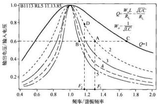

图 13.6 图 13.5(a) 所示的交流等效电路的串联谐振变换器的增益曲线（由 R. Steigerwald 提供）

反馈环可在 Q 曲线上自动选择正确的工作点，以产生合适的输出电压。但该点可能会非常不稳定，因为它可能会太靠近谐振峰值点。在低 Q 值曲线上，选择性和谐振峰值太小，而在高 Q 值特性曲线的尾部，频率变化又太大。 

这种方案对谐振元件的偏差非常敏感。工作点接近谐振峰值，开关在输入或负载瞬变的情况下，会使工作点跳变到峰值的另一侧，从而使负反馈变成了一个正反馈。 

## 13.5.4 连续模式下并联负载谐振半桥变换器的调节

根据式(13.3)，Steigerwald绘出了并联负载谐振半桥变换器的增益曲线，如图13.7所示。从该图可以看出，此电路可工作于重载或空载情况下。若初始工作点为A点（此处 $Q = 2$ ，归 一化频率为1.1)，增加 $R_{L}$ ，使 $Q=R_{L}/\omega_{0}L=5$ ，则工作点将上移至归一化频率为1.23的B点。从Q曲线的形状可以看出，非常大的Q值或开路运行都能够实现。 

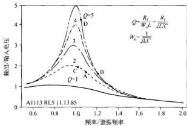

图 13.7 图 13.5(b) 所示的交流等效电路的并联谐振变换器的增益曲线（由 R. Steigerwald 提供）

并联谐振变换器电路存在一个问题,即如果电路工作在低 Q 值曲线的谐振峰值附近(如 C 点),且若此时负载暂时开路或者负载变化很大(使 Q=5),则在反馈回路起作用以前,输出电压可能会上升到 D 点,这是很危险的。 

有的文章说并联谐振变换器电路具有自动的短路保护功能，即当输出短路时，变压器初级会短路，如图13.4(b)所示，而谐振电感限制了开关管的电流。 

然而进一步的研究表明,这样的情况根本不会发生。电路工作于过谐振模式,若输出短路,为了使输出增加,反馈会强制工作点上移到Q曲线上更高的位置,如图13.3所示。 

这会使开关频率进一步下降,最后越过Q曲线的峰值进入正反馈区。但反馈环并不“清楚”这一点,它会继续起作用,使开关频率继续下降,并“认为”频率下降会使工作点上升到最高点(谐振峰值处)。 

另外，频率下降后，谐振电感的阻抗变低，这会导致开关管上流过的电流增加。采取钳位技术限制最小开关频率的方法并不可行，因为谐振元件L和C微小的制造偏差都会导致谐振峰值频率发生很大变化。 

## 13.5.5 连续模式下串联/并联谐振变换器

并联谐振变换器电路的一个缺点是，当负载很轻时（如图13.4(b)所示，电容 $C_{r}$ 并联一个大的电阻），谐振回路的电流（流过开关管的电流）并不比重载时的小。在任意情况下，折算后和 $C_{r}$ 并联的有效阻抗必须很大，才不会降低电路的Q值。若重载时情况如此，则轻载时的情况更是如此。简单地说，轻载时流过和 $C_{r}$ 并联的折算电阻的电流是流过 $C_{r}$ 的电流的很小一部分，所以开关管的损耗在轻载时并不会减少，从而使电路在轻载时效率很低。 

在串联谐振变换器电路中,情况则有所不同。当串联在 LC 谐振回路中的负载电阻两端的输出电压恒定时,随着负载电流的下降,流过负载电阻的电流(流过开关管的电流)也会跟着下降。所以,在串联谐振变换器中,轻载(低输出功率)时的效率依然很高。 

图 13.5(c) 给出了一个既具有串联谐振变换器电路轻载时的高效率, 又具有并联谐振变 换器电路在轻载或空载时调节能力的连续模式下的串联/并联谐振变换器。这种电路也称为LCC电路[5]。从图13.5(c)可以看出，此电路既有串联电容 $C_{\mathrm{r}}$ ，又有并联电容 $C_{\mathrm{p}}$ 。选择合适的 $C_s$ 和 $C_p$ 值，就可以使电路兼备并联谐振变换器和串联谐振变换器的优点了。注意，若 $C_p$ 为零，电路就是串联谐振变换器型。随着 $C_p$ 的增大，当它的值超过 $C_t$ 时，电路就呈现出并联谐振变换器电路的性质。若 $C_p$ 比 $C_s$ 大，轻载时电路就会显示出并联谐振变换器电路的低效率性。 

从 Steigerwald 的文章可以看出 $^{[4]}$ ，LCC 电路的交流增益特性可以从图 13.5(c) 所示的交流等效电路计算得到 

$$
\frac {V _ {\mathrm{o}}}{V _ {\mathrm{in}}} = \frac {1}{1 + (X _ {\mathrm{cs}} / X _ {\mathrm{cp}}) - (X _ {1} / X _ {\mathrm{cp}}) + \mathrm{j} [ (X _ {1} / R _ {\mathrm{ac}}) - (X _ {\mathrm{cs}} / R _ {\mathrm{ac}}) ]}
$$

由于 $Q_{\mathrm{s}} = X_{1} / R1$ ，则 $R_{\mathrm{ac}} = 8R1 / \pi^2,\omega_0 = 1 / \sqrt{LC_s}$ ，R1是根据匝比平方折算到初级的直流输出阻抗，折算到初级的直流输出电压和输入电源电压一半的比值为 

$$
\frac {N V _ {\mathrm{adc}}}{0 . 5 V _ {\mathrm{in}}} = \frac {8 / \pi^ {2}}{1 + (C _ {\mathrm{p}} / C _ {\mathrm{s}}) - (\omega^ {2} L C _ {\mathrm{p}}) + \mathrm{j} Q _ {\mathrm{s}} [ (\omega / \omega_ {\mathrm{s}}) - (\omega_ {\mathrm{s}} / \omega) ]}
$$

$C_{s}=C_{p}$ 和 $C_{s}=2C_{p}$ 时的曲线分别如图 13.8(a) 和图 13.8(b) 所示。 

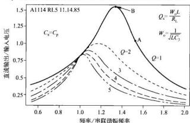

(a)

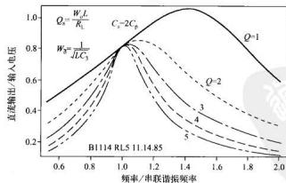

(b)

图 13.8 (a) 图 13.5(c) 所示的串联/并联谐振半桥变换器(LCC) 在 $C_{s} = C_{p}$ 时的增益曲线。(b) 图 13.5(c) 所示的串联/并联谐振半桥变换器(LCC) 在 $C_{s} = 2C_{p}$ 时的增益曲线(由 R. Steigerwald 提供)。

从图 13.8(a) 和图 13.8(b) 可以看出, Q=1 或更小时, 增益曲线上依然有较高的谐振峰值和较好的“选择性”, 因此可以实现空载运行。这样就避免了串联谐振变换器电路的一大缺点: 轻载或空载时无法调节 (对比图 13.6 所示的串联谐振变换器电路)。 

图 13.8(a) 和图 13.8(b) 举例说明了连续模式的微妙性和复杂性。 

如图 13.8(a) 所示, 设 A 点是工作点, 直流负载阻抗和 Q 值恒定, 直流输入电压的下降会使输出电压有轻微的下降。反馈环试图校正这种情况, 通过使工作点沿同一条曲线向上移动来使输出变大。为做到这一点, 开关频率就要降低。如果开关频率降低太多, 工作点会越过谐振峰值 B 点, 而导致频率和输出的进一步下降。 

为避免这种情况发生，必须保证在直流输入最低，Q最小时，电路工作所要求的频率不低于图13.8(a)中的B点所对应的频率。连续模式(CCM)下实际问题的一个较好的评估方法就是尝试让电路在LC元件误差引起的谐振峰值频率和幅值变化范围内工作。 

Steigerwald 认为, $C_{\mathrm{p}} = C_{\mathrm{s}}$ 时, 电路工作状况最佳。若要进一步分析、理解上述 LCC 电路, 可见参考文献 $6 \sim 9$ 。 

## 13.5.6 连续模式下零电压开关准谐振变换器

上面讨论的零电流开关谐振变换器利用谐振强制开关管中的电流为正弦波电流，在正弦波电流正半周结束过零时关断开关管（或者在电流刚刚反向并流入反并联二极管后不久关断开关管，如图13.1所示），电流和电压之间没有重叠，从而消除关断损耗。 

然而，即使因为漏感加快了漏极（或集电极）电压的下降并延缓了漏电流的上升使电压电流在开关管导通时没有重叠，电路中依然存在导通损耗。因为在每个周期内，漏极电容都要存储 $0.5C(V_{\mathrm{max}})^2$ （在关断期间）的能量，而这些能量又在下次导通时消耗在开关管中。这种情况每个周期发生一次，导致有 $0.5C(V_{\mathrm{max}})^2 / T$ 的能量损失。设计者为了减小电源的体积，必须提高开关频率。当频率超过 $500\mathrm{kHz} \sim 1\mathrm{MHz}$ 范围时，导通损耗将变得十分显著，这就成了一个问题。 

一种新技术,零电压开关,可以避免上面提到的问题。这种拓扑曾应用于单端(反激或buck)电路 $^{[10]}$ ,但它的优点主要体现在半桥电路中。 

图 13.9 所示是一个零电压开关半桥电路 $^{2}$ 。它的基本工作原理是利用 MOSFET 管的输出电容作为谐振 LC 电路的部分电容。此电容在每个周期的一段时间内储存电压（能量），在接下来的一段时间内，通过谐振电感将其储存的能量没有任何损耗地返还给电源母线。下面的讨论基于参考文献 2。 

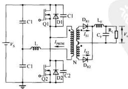

图 13.9 零电压开关谐振半桥变换器(由 Jovanovic、Tabisz、Lee 提供)

如图 13.9 所示，当 Q1 导通、Q2 关断时，C2 两端电压被充电至 $V_{c}$ 。Q1 先关断，变压器 T1 的励磁电流继续通过 C1 续流，使 $V_{C1}$ 上升， $V_{C2}$ 下降。当 $V_{C2}$ 下降至 0.5V，时，变压器极性改变，次级两个整流管同时导通，使变压器次级和初级都短路，因此变压器初级电压为零。在变压器次级，输出电感会尽量维持输出电流不变。 

此时，C2上储存的能量经变压器初级短路绕组、谐振电感L和底部滤波电容 $C_{a}$ ，到C2负极放电。因为回路中没有电阻，故放电过程不会产生损耗。L与C2谐振，C2电压下降至零，此时Q2即可实现零电压导通。 

电容 C1 有效地延缓了 Q1 电压的上升速度, 所以 Q1 关断时不会同时产生大的电压和电流。 

连续模式下，此电路工作在由 L、C1 和 C2 并联组成的谐振电路 Q 曲线的斜坡上。Jovanovic 等人给出了此电路的直流电压变换曲线（相当于图 13.5、图 13.6、图 13.7 和图 13.8），如图 13.10 所示 $^{[2]}$ 。 

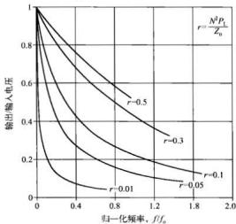

图 13.10 图 13.9 所示的零电压开关电路的增益曲线（由 Jovanovic、Tabisz、Lee 提供）

尽管有许多文章讨论连续模式，但都采用沿谐振Q曲线的斜坡移动改变频率的方法来调节。Jovanovic等人认为这种方案不可靠。对于成批生产的开关电源，当谐振元件参数漂移或当图13.5、图13.6、图13.7和图13.8及图13.10中的 $V_{dc}$ 、 $R_{L}$ 范围受限时，连续模式下可能会产生不可预料的结果。 

## 13.6 谐振电源小结

对于那些必须决定是否将谐振电源作为下一个设计对象的工程师来说,必须考虑以下几点。 

① 可否让谐振电源每立方英寸都和传统的 200～300kHz 的 PWM 电源一样高效？复杂性增加、母线和负载容量受限及最坏情况设计困难才使得谐振电源效率有可能提高 3%～6%，这是否值得？ 

② 从同一生产线上生产出的元件是否都具有同样的特性？或者说，因为制造误差和元件参数的漂移，是否要求对每个或大部分产品都进行微调？ 

③谐振电源是否会因为其输入为正弦波而不是方波(方波的di/dt很大)从而产生较少的射频干扰(RFI)?考虑到相同功率下谐振电源的正弦波电流幅值是传统PWM电源方波电流幅值的3~4倍,谐振电源的RFI问题是否会因为正弦波过零时di/dt与电流幅值成正比而同样严重? 

④ 当大部分谐振电源采用变频调节时产生的问题有多严重？用户会不会认同这一点？或者坚持要求开关电源和它们提供的时钟信号同步？ 

⑤ 如果决定尝试谐振设计，应该采用哪种拓扑更加安全？对于连续模式拓扑，为方便调节而将工作点置于陡峭的Q特性曲线的斜坡上，这会不会导致其电路特性难以预测？人们似乎都认同不连续模式具有可重复性和预测性，然而，不连续模式所需要的较大频率范围是不是一个重大缺陷？ 

⑥ 毫无疑问，有关高频谐振电源的研究和改进会继续进行下去。但是，只有新电路结构的发现使谐振电源自身变得简单，使元件误差、布线、寄生电感和电容在最坏情况设计时与传统 PWM 电源一样不那么灵敏，否则，高频谐振电源不会广泛应用，当然也不会大量的生产。在开关电源领域，它们的应用范围非常有限，只适用于造价较高、使用的元件较好且布线合理的场合。 

总之，在含有开关电源的任何设计中，复杂性也就意味着高成本和不可靠。 

## 参考文献

1 F. Lee, "High Frequency Quasi-Resonant and Multi Resonant Converter Topologies," Proceedings of the International Conference on Industrial Electronics, 1988. 

2 M. Jovanovic, W. Tabisz, and F. Lee, "Zero Voltage Switching Technique in High Frequency Inverters," Applied Power Electronics Conference, 1988. 

3 K. Liu and F. Lee, "Secondary Side Resonance for High Frequency Power Conversion," Applied Power Electronics Conference, 1986. 

4 R. Steigerwald, "A Comparison of Half Bridge Resonant Topologies," IEEE Transactions on Power Electronics, 1988. 

5 R. Severn, "Topologies for Three Element Resonant Converters," Applied Power Electronics Conference, 1990. 

6 F. Lee, X. Batarseh, and K. Liu, "Design of the Capacitive Coupled LCC Parallel Resonant Converter," IEEE IECON Record, 1988. 

7 X. Bhat and X. Dewan, "Analysis and Design of a High Frequency Converter Using LCC Type Commutation," IEEE IAS Record, 1986. 

8 X. Batarseh, K. Liu, F. Lee, and X. Upadhyay, "150 Watt, 140 kHz Multi Output LCC Type Parallel Resonant Converter," IEEE APEC Conference, 1989. 

9 B. Carsten, "A Hybrid Series-Parallel Resonant Converter for High Frequencies And Power Levels," HFPC Conference Record, 1987. 

10 W. Tabisz, P. Gradski, and F. Lee, "Zero Voltage Switched Quasi-Resonant Buck and Flyback Converters," PESC Conference, 1987. 

11 F. Lee, Ed., "High Frequency Resonant Quasi-Resonant and Multi-Resonant Converters," Virginia Power Electronics Center, 1989. 

12 Y. Kang, A. Upadhyay, and D. Stephens, "Off Line Resonant Power Supplies," Powertechnics Magazine, May 1990. 

13 Y. Kang, A. Upadhyay, and D. Stephens, "Designing Parallel Resonant Converters," Powertechnics Magazine, June 1990. 

14 P. Todd, "Practical Resonant Power Converters—Theory and Application," Powertechnics Magazine, April–June 1986. 

15 P. Todd, "Resonant Converters: To Use or Not to Use? That Is the Question," Powertechnics Magazine, October 1988. 

第3部分 

# 典型波形

# 第 14 章 开关电源的典型波形

## 14.1 引言

在前面的章节中，已给出各拓扑关键点的电压和电流波形（如图2.1、图2.10、图3.1和图4.1）。在许多情况下这些都是理想波形。开关电源设计的初学者可能会问，实际波形与这些作为绝大部分设计基础的理论波形究竟有多接近。 

至于这些波形是如何随电网电压和负载电流波动变化的；接地总线上是否有噪声尖峰等问题将会产生；由于实测形态，设计者会问电压、电流是否有波形的瞬态衰减振荡；波形的前后沿是否有抖动。他们还会问，变压器或电感的置位伏秒数和复位伏秒数是否完全相等；漏感尖峰的形状如何；既然输出电感和反激变压器设计是要获得特定的电流波形，那么得到的实际波形与理论波形有多接近；既然高频下大部分功率开关管的损耗是由导通和关断时高电压和大电流的重叠造成的，那么这种现象是否可以在示波器中观察到；是否会看到某一类的波形畸变等。对刚开始学习高频开关电源波形的设计者来说，给出某些主要拓扑的关键点实际波形或许是非常有益的。以下波形都取自功率回路，即从功率管输入到输出滤波器输出的回路。因为这是大部分能量流通的路径，是绝大部分故障容易发生的地方。 

下面所选拓扑的电路波形都是常见拓扑的波形，如正激变换器、推挽变换器和反激变换器。这些表明了输出电感工作在连续或不连续模式对电路的影响，如图1.6和图1.7所示的波形图。 

这里未考虑电网供电的 AC 120V 或 220V 输入的离线式变换器。那些使用网压整流供电的电源与通信电源相比，相应各点上的波形基本相同。只是网压整流供电电压比通信电源的高，使电压波形幅值增大，电流幅值减小。 

所选电路的工作频率都高于100kHz，由通信用直流电源供电——这种电源的额定电压为48V，最低电压为38V，最高电压为60V。所有情况下的输出功率都低于100W，因为功率更高时，电压及电流波形只是幅值有所不同，形状基本不变。由于这里给出的波形都取自通信电源直流输出，所以波形的相位与幅值抖动比由网压整流供电的力。离线式变换器使用的整流电压中有电网频率脉动，将造成幅值纹波。反馈环在纠正输入网频纹波时会造成脉宽抖动。 

由于所有波形均采集自 MOSFET 管的电路, 因此没有展现开关管的存储时间延迟的影响。所有情况下反馈环都开环, 功率开关管由预定频率脉冲驱动。对应不同的直流输入电压 (38V、48V、60V), 采用手动调整脉宽, 以使 5V 主输出等于 5.00V, 就类似闭环反馈。同时, 将不同脉宽下主输出为 5.00V 时的对应辅输出电压测量记录下来。 

所有图中的功率管都由控制芯片UC3525驱动。通过直流稳压电源给误差放大器的输出端(芯片9脚)供电，以保证不同直流输入电压下 $+5\mathrm{V}$ 主输出等于 $5.00\mathrm{V}$ 。 

## 14.2 正激变换器波形

波形采集电路的原理图如图 14.1 所示。该正激变换器输出功率为 100W，频率为 

125kHz。图14.1中给出的是80%和40%满载下的波形。满载输出为5V/10A和13V/3.8A。下面分别给出了额定输入电压为48V，最低为38V和最高为60V时的波形。变压器磁心从表7.2a中选出，匝数和线径由2.3.2～2.3.10节给出。输出滤波器（L1、C2和L2、C3）由2.3.11节中的关系式确定。 

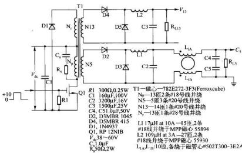

图 14.1 125kHz 正激变换器 (+5V 输出/10A 额定电流, +13V 输出/3.8A 额定电流)

## 14.2.1 80%额定负载下测得的 $V_{\mathrm{ds}}$ 和 $I_{\mathrm{d}}$ 的波形

图 14.2 中的照片 1～3 分别示出最低、额定和最高直流输入电压下的开关管漏源极间电压和漏极电流的波形。 

由于变换器次级接有 LC 输出滤波器, 开关管漏极电流具有阶梯斜坡特征, 漏极电流是依匝数比折算到初级的次级电流之和。由于两个次级都有产生阶梯斜坡电流的输出电感 (1.3.2 节), 因此折算到初级的电流是阶梯斜坡状的。 

漏极电流的斜坡中心值(式(2.28)) $I_{pft}=3.12P_{o}/V_{dc}$ 。输出为80W，最低直流电压为38V时，峰值电流为6.57A。由图14.2中的照片1、2、3可见，显示电流斜坡中心值与计算值相等。 

当电源电压上升时,照片显示脉宽(开关管导通时间)变窄,但是峰值电流和电流斜坡中心值保持不变。理论上也应如此。 

漏源极间的电压波形也与理论波形一致。可以看出，低压 $(V_{\mathrm{dc}}=38\mathrm{~V})$ 时的开关管导通时间非常接近半周期的80%，如2.3.2节所述。这并不总是那么精确，因为在次级匝数计算中，小数部分总会舍去而取最接近的整数。 

对于该变压器,计算得到的次级匝数为4.5匝,取5匝。这就产生了更高的次级幅值电压,而导通时间将比由式(2.25)确定的时间短。 

由图 14.2 中的照片 1、照片 2、照片 3 可以看见关断瞬间狭窄且不太清晰的漏感尖峰。 $V_{dc}$ 为 60V 时，漏感尖峰仅比 $2V_{dc}$ 高约 20%。但在 $V_{dc}$ 等于 38V 时，漏感尖峰约比 $2V_{dc}$ 高 64%。 

漏源极间的电压波形显示，关断瞬间的 $V_{ds}$ 在漏感尖峰后马上下降到 $2V_{dc}$ ，并保持为该值直到置位伏秒数等于复位伏秒数，即 $(V_{\mathrm{dc}}t_{\mathrm{on}})=(2V_{\mathrm{dc}}-V_{\mathrm{dc}})t_{\mathrm{reset}}$ 。伏秒数相等后，漏源极间电压下降到 $V_{dc}$ 。 

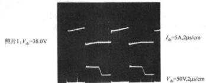

<table><tr><td><eq>{V}_{\mathrm{{dc}}},\mathrm{V}</eq></td><td><eq>{I}_{\mathrm{{dc}}},\mathrm{A}</eq></td><td><eq>{P}_{\text{int }},\mathrm{W}</eq></td><td><eq>{V}_{5},\mathrm{V}</eq></td><td><eq>{R}_{5},\Omega</eq></td><td><eq>{I}_{5},\mathrm{A}</eq></td><td><eq>{P}_{5},\mathrm{W}</eq></td><td><eq>{V}_{13},\mathrm{V}</eq></td><td><eq>{R}_{13},\Omega</eq></td><td><eq>{R}_{13},\mathrm{A}</eq></td><td><eq>{P}_{13},\mathrm{W}</eq></td><td><eq>{P}_{\text{(total) }},\mathrm{W}</eq></td><td>Efficiency,%</td></tr><tr><td>38.0</td><td>2.45</td><td>93.1</td><td>5.000</td><td>0.597</td><td>8.375</td><td>41.9</td><td>13.64</td><td>5.00</td><td>2.728</td><td>37.2</td><td>79.1</td><td>84.9</td></tr></table>

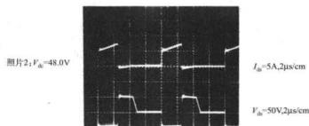

<table><tr><td><eq>{V}_{\mathrm{{dc}}},\mathrm{V}</eq></td><td><eq>{I}_{\mathrm{{dc}}},\mathrm{A}</eq></td><td><eq>{P}_{\text{in }}\mathrm{W}</eq></td><td><eq>{V}_{5},\mathrm{\;V}</eq></td><td><eq>{R}_{5},\Omega</eq></td><td><eq>{I}_{5},\mathrm{\;A}</eq></td><td><eq>{P}_{5},\mathrm{\;W}</eq></td><td><eq>{V}_{13},\mathrm{\;V}</eq></td><td><eq>{R}_{13},\Omega</eq></td><td><eq>{R}_{13},\mathrm{\;A}</eq></td><td><eq>{P}_{13},\mathrm{\;W}</eq></td><td><eq>{P}_{\left( \text{total}\right) }\mathrm{W}</eq></td><td>Efficiency,%</td></tr><tr><td>48.0</td><td>1.38</td><td>87.8</td><td>5.003</td><td>0.597</td><td>8.38</td><td>41.9</td><td>13.66</td><td>5.00</td><td>2.73</td><td>37.3</td><td>79.2</td><td>90</td></tr></table>

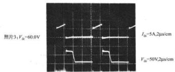

<table><tr><td><eq>{V}_{\mathrm{{dc}}},\mathrm{V}</eq></td><td><eq>{I}_{\mathrm{{dc}}},\mathrm{A}</eq></td><td><eq>{P}_{\text{in }},\mathrm{W}</eq></td><td><eq>{V}_{5},\mathrm{V}</eq></td><td><eq>{R}_{5},\Omega</eq></td><td><eq>{I}_{5},\mathrm{A}</eq></td><td><eq>{P}_{5},\mathrm{W}</eq></td><td><eq>{V}_{13},\mathrm{\;V}</eq></td><td><eq>{R}_{13},\Omega</eq></td><td><eq>{R}_{13},\mathrm{\;A}</eq></td><td><eq>{P}_{13},\mathrm{\;W}</eq></td><td><eq>{P}_{\text{(total) }},\mathrm{W}</eq></td><td>Efficiency,%</td></tr><tr><td>59.5</td><td>1.55</td><td>92.2</td><td>5.004</td><td>0.597</td><td>8.382</td><td>41.9</td><td>13.70</td><td>5.00</td><td>2.74</td><td>37.5</td><td>79.4</td><td>86.1</td></tr></table>

图 14.2 图 14.1 中的正激变换器(125kHz、100W)80% 额定负载下测得的波形

如图 14.2 所示, $V_{dc}$ 为 38～60V 时, 平均效率等于 87%。这是在磁心材料为铁氧体软磁性材料 3F3, 峰值磁密为 1600G 的条件下得到的。磁心温升小于 25℃。 

高损耗磁心材料 3C8 在约 5 年前使用很广泛,但它在频率高达 125kHz 且峰值磁密为 1600G 的条件下得不到这么高的效率。即使是使用 7.3.5.1 节讨论的较低损耗的 3F3 材料,且使用大体积磁心时,也不能在 125kHz 的条件下选择 1600G 的峰值磁密。此时,峰值磁密可能不得不减小到 1400G 甚至 1200G。 

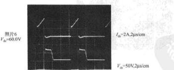

## 14.2.2 40%额定负载下的 $V_{\mathrm{dc}}$ 和 $I_{\mathrm{ds}}$ 的波形

图 14.3 中的照片 4～6 与图 14.2 中的照片 1～3 一样，都是漏源极间电压和漏极电流的波形。输出电流和功率较小时，在最低、额定和最高直流输入电压下的平均效率为 90%。 

可见漏感尖峰相对较小,开关管导通时间也略有缩短。这是因为输出电流降低使输出整流二极管的压降也降低了。这就提高了5V整流二极管阴极的方波电压的幅值,从而缩短了获得5V输出所需的导通时间。 

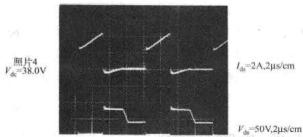

<table><tr><td><eq>{V}_{dc}</eq> ,V</td><td><eq>{I}_{dc}</eq> ,A</td><td><eq>{P}_{10}</eq> ,W</td><td><eq>{V}_{5}</eq> ,V</td><td><eq>{R}_{5},\Omega</eq></td><td><eq>{I}_{5}</eq> ,A</td><td><eq>{P}_{5}</eq> ,W</td><td><eq>{V}_{13}</eq> ,V</td><td><eq>{R}_{13},\Omega</eq></td><td><eq>{I}_{13}</eq> ,A</td><td><eq>{P}_{13}</eq> ,W</td><td><eq>{P}_{\text{(total) }}</eq> ,W</td><td>Efficiency,%</td></tr><tr><td>38.0</td><td>1.15</td><td>43.5</td><td>4.998</td><td>1.18</td><td>4.24</td><td>21.17</td><td>13.3</td><td>10.0</td><td>1.33</td><td>17.69</td><td>38.86</td><td>89</td></tr></table>

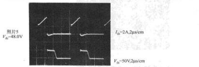

<table><tr><td><eq>V_{dc}</eq>,V</td><td><eq>I_{dc}</eq>,A</td><td><eq>P_{im}</eq>,W</td><td><eq>V_{s}</eq>,V</td><td><eq>R_{s}</eq>,Ω</td><td><eq>I_{s}</eq>,A</td><td><eq>P_{s}</eq>,W</td><td><eq>V_{13}</eq>,V</td><td><eq>R_{13}</eq>,Ω</td><td><eq>I_{13}</eq>,A</td><td><eq>P_{13}</eq>,W</td><td><eq>P_{total}</eq>,W</td><td>Efficiency,%</td></tr><tr><td>48.0</td><td>0.853</td><td>40.9</td><td>5.007</td><td>1.18</td><td>4.24</td><td>21.24</td><td>12.88</td><td>10.0</td><td>1.28</td><td>16.46</td><td>37.7</td><td>92</td></tr></table>

<table><tr><td><eq>{V}_{\mathrm{{dc}}},\mathrm{V}</eq></td><td><eq>{I}_{\mathrm{{dc}}},\mathrm{A}</eq></td><td><eq>{P}_{1\mathrm{\;m}},\mathrm{W}</eq></td><td><eq>{V}_{5},\mathrm{\;V}</eq></td><td><eq>{R}_{5},\Omega</eq></td><td><eq>{I}_{5},\mathrm{A}</eq></td><td><eq>{P}_{5},\mathrm{W}</eq></td><td><eq>{V}_{13},\mathrm{\;V}</eq></td><td><eq>{R}_{13},\Omega</eq></td><td><eq>{I}_{13},\mathrm{A}</eq></td><td><eq>{P}_{15},\mathrm{\;W}</eq></td><td><eq>{P}_{\text{total }}/\mathrm{W}</eq></td><td>Efficiency,%</td></tr><tr><td>59.6</td><td>0.736</td><td>43.8</td><td>5.014</td><td>1.18</td><td>4.49</td><td>22.5</td><td>13.2</td><td>10.0</td><td>1.32</td><td>17.5</td><td>40.0</td><td>91</td></tr></table>

图 14.3 图 14.1 所示正激变换器(125kHz、100W)

工作于 $40\%$ 额定负载下测得的波形 

## 14.2.3 导通/关断过程中漏源极间电压和漏极电流的重叠

导通/关断过渡过程中，高电压和大电流的重叠会造成较高的瞬时功率损耗峰值。尽管该高损耗尖峰很窄，特别是使用MOSFET管时，但是当开关频率很高时，平均损耗就会很高，可能超过导通损耗 $V_{ds}I_{ds}t_{os}/T$ 。 

导通时的重叠损耗不如关断时的严重。导通时，功率变压器的漏感在短时间内呈现极大的阻抗，使漏源极间电压很快下降。但这个漏感阻止了电流的快速上升。因此，下降的电压 $V_{ds}$ 与上升的电流交点很低，导通时间内积分 $\int V_{ds}I_{ds}dt$ 的值很小，整个周期的平均损耗就很小。这可以从图14.4中的照片7所示的波形观察到。 

然而，关断时(图14.4中的照片8)，在 $V_{ds}$ 上升至 $V_{ds}$ 附近的这段时间内，漏极电流将在峰值维持一段时间（因为漏感在保持电流恒定）。因此在 $I_{d}$ 明显降至峰值以下之前， $V_{ds}$ 继续快速上升至 $2V_{ds}$ 。从图14.4中的照片8可以看出，关断期间的积分 $\int V_{ds}I_{ds}dt$ 的值比导通期间的积分值大很多。 

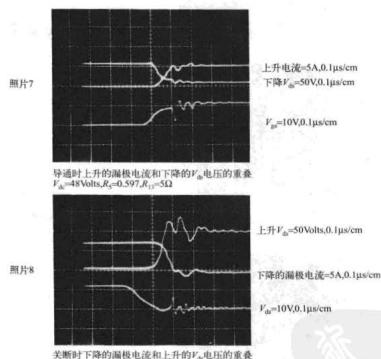

图 14.4 导通期间上升的漏极电流 $I_{ds}$ 与下降的电压 $V_{ds}$ 及关断时下降的漏极电流 $I_{ds}$ 与上升的电压 $V_{ds}$ 的重叠。导通/关断过渡过程中，电压和电流同时很大会造成交流开关损耗。由于关断时电流下降得很慢而电压上升很快，所以关断时的损耗很大。

对上述两个积分式,根据波形进行积分可得,关断时下降的电流和上升的电压的重叠造成的平均损耗为2.18W。导通时上升的电流与下降的电压造成的平均损耗为1.4W。 

## 14.2.4 漏极电流、漏源极间的电压和栅源极间的电压波形的相位关系

如图 14.5 中的照片 9 所示, 导通和关断过程中栅源极间的电压波形与漏源极间的电压和漏极电流波形之间基本没有相位滞后。 

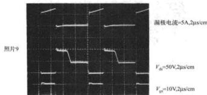

图 14.5 图 14.1 中的正激变换器的漏极电流、漏源极间电压和栅源极间电压的波形。变换器参数为 $V_{dc}=48V, R5=0.597\Omega, R_{13}=5\Omega$ 。

## 14.2.5 变压器的次级电压、输出电感电流的上升和下降时间与功率晶体管漏源电压波形

图 14.6 中的照片 10 所示为输出电感电流在开关管导通时斜坡上升和在关断时斜坡下降的波形。当 L1 为 $17 \mu H$ ，变压器次级电压为 16V 且导通时间为 $2.4 \mu s$ 时，斜坡电流幅值为 $\mathrm{d}I = (16 - 5)2.4 / 17 = 1.55 \mathrm{~A}$ 。从照片 10（图 14.6）可以近似精确地读出，斜坡幅值为 1.4A。考虑到屏幕分格线的影响，这个计算值与测量值之间已是比较吻合的了。 

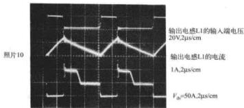

图 14.6 变压器次级电压、输出电感纹波电流和开关管漏源极间电压的波形

## 14.2.6 图14.1中的正激变换器的PWM驱动芯片(UC3525A)的关键点波形

下面要说明芯片 UC3525A 是如何产生宽度与直流电源电压成反比的驱动脉冲的, 如图 14.7 所示。 

在芯片内部,每半个开关周期产生一个峰—峰值为3V的三角波(0.5~3.5V)。这个三角波电压输入到电压比较器,与内置误差放大器输出的直流电压相比较。该误差放大器输出的电压是需调节的直流输出电压的采样电压(加到反相输入端)与参考电压比较的结果。 

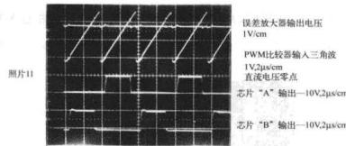

图14.7 脉宽调制控制芯片UC5325的主要波形。芯片内部产生的峰-峰值为3V的三角波在电压比较器中与内置误差放大器输出的直流电压进行比较。电压比较器在芯片的输出端A和B产生两个相位相差 $180^{\circ}$ 的方波脉冲。这些脉冲开始了三角波的起点，终止于三角波与误差放大器输出的直流电压的交点。误差放大器输出电压不同将使其与三角波上升沿的交点发生变化（误差放大器的输出与内部参考电压和需调节的输出电压分压的差值有关），使输出端A和B的输出脉宽也不同。

电压比较器会产生相位差为 $180^{\circ}$ 的方波脉冲。这些脉冲开始于三角波的起点，终止于三角波与误差放大器输出的直流电压的交点。 

因此，若已调节的输出电压的分压略有升高，则误差放大器的输出就会变小，三角波与较低的直流电压提前相交，PWM比较器输出脉宽就变窄。同样，误差放大器采样输入下降会引起误差放大器输出电压升高，三角波与较高的电压推迟相交，比较器的脉宽变宽。 

这些脉宽可调的脉冲由二进制计数器控制，交替输出至芯片的两个输出端，以驱动推挽拓扑的开关管。对于图14.1中的正激变换器，只用这些脉冲输出中的一组即可。 

## 14.3 推挽拓扑波形概述

下面给出的是推挽拓扑的主要波形,其电路原理如图 14.8 所示。 

该电路为 200kHz 的 DC/DC 变换器, 最大输出功率为 85W, 最小输出功率为最大输出功率的 20%, 用额定电压为 48V, 最高电压为 60V, 最低电压为 38V 的标准通信电源供电。输出为 5V/8A 和 23V/1.9A。 

这里给出的分别是最大、标称、最小电源电压，及最大输出电流条件下和不同电源电压20%最大输出电流条件下的主要波形。同时还给出了输出功率为100W时（超过最大功率5W）的波形，以此说明即使在这个功率水平，效率仍然很高，变压器的温升也可以接受，而且波形能保持正常。 

该设计中,变压器磁心可从表7.2a中选出,可根据2.2.9节和2.2.10节中的关系式设计变压器(确定其峰值磁密、匝数和线径)。输出滤波器时参数可根据2.2.14节中的关系式选择。 

工作频率应选为 200kHz。当工作频率高于 200kHz 时，变压器和输出滤波器的体积以及效率都迅速下降，变压器磁心和绕组损耗急剧上升。超过 200kHz 时，频率提高所实现的变压器体积的减少和所带来的损耗增加及变压器温升相比是否值得还是个问题。 

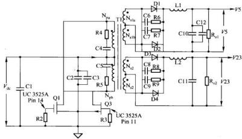

R2, R3 300Ω 1/2W 1 L1.1.65mH (5 瓶, 3 条 #20 线并绕了 Magnetics Inc. MPP 磁心 55120
R4 to R9 24Ω 1W 1 L2.14.1mH (14 瓶, #18 线并绕了 Magnetics Inc. MPP 磁心 55120
C1 60μM, 100F T1 磁心: Ferroscube 813E3433F3 1mil 间隙
C2 22μM, 100V
C3 6800pF N $_{pt}$ : 6 虹, 2 条 #22 线并绕第一层; N $_{pt}$ : 6 虹, 2 条 #22 线并绕第四层
C4 to C9 100P
C10 3200μF, 16V N $_{stk}$ : 1 虹, 4 条 #22 线并绕第二层
C11 1000μF, 50V 双线并绕
D1, D2, MBR 1545 N $_{thk}$ : 1 虹, 4 条 #22 线并绕第二层
D3, D4 MUR415
Q1, Q2Bua31 N $_{st}$ : 4 虹, 2 条 #24 线并绕且双线并绕第三层 

图 14.8 DC/DC 变换器(200kHz、85W)(5V 输出/8.0A 额定电流,23V 输出/1.9A 额定电流) 

图 14.1 中的正激变换器的反馈环开环。在不同的直流输入电压下，手动调整脉宽，正如 14.1 节所述，使 5V 主输出精确输出 5.00V，并在此脉宽下将辅输出电压测量记录下来。 

## 14.3.1 最大、额定及最小电源电压下，负载电流最大时变压器中心抽头处的电流和开关管漏源极间的电压

在变压器中心抽头检测到的交替电流脉冲与两个开关管(Q1和Q2)的交替导通对应。 

这些波形表明，由于两个输入的脉宽相等，且MOSFET管没有存储时间，因此不会出现磁通不平衡问题。如2.2.5节中所讨论的，若在变压器中心抽头处检测到的电流脉冲幅值不等，则将导致磁通不平衡，如图2.4(b)和图2.4(c)所示。 

由图 14.9 中的照片 PP1 ~ PP3 可以看出, 所有电源电压下的交替电流脉冲幅值均相等。这种结果是在实验之前未匹配 MOSFET 管 Q1、Q2 的 $r_{ds}$ 的条件下得到的。 

由 $V_{ds}$ 的波形可以看出, 导通结束时刻有不大的漏感尖峰。最大的漏感尖峰 ( $V_{dc}=41V$ ) 仅比 $2V_{dc}$ 大约 5V, 如图 14.10 中的照片 PP5 所示。 

由于变压器高频工作绕组的匝数很少且漏感较小，并且初次级耦合比低频时要好，所以漏感尖峰可以忽略。而且两个初级和次级之间的三文治绕法也有助于减少漏感。 

由图 14.9 中的照片 PP1 ~ PP3 可以看出, 当电源电压升高时, 导通时间必须下降以保持 5.00V 输出电压的恒定。由于直流输出电流不变, 电流峰值也保持恒定, 只是脉宽会随电源电压改变。 

初级电流有阶梯斜坡的特征。这是因为初级电流是阶梯斜坡次级电流(依匝数比折算)和初级三角波(图2.4(c))励磁电流的总和。又因为所有输出都接有电感,所以次级电流波形也是阶梯斜坡。 

应该指出，图14.9中的照片PP1～PP3中的电流峰值相等，说明Q1和Q2导通时的峰值电流相等。但这些照片中所示的并不是开关管电流的真实值，尤其是在死区时间内。这是由于在变压器中心抽头处串接磁性耦合电流探头检测电流造成的。 

显然，由于开关管交替导通之间只有短暂的死区，电流探头磁体没有足够的时间恢复到其磁滞回线的初始磁通点，所以测出的电流绝对值会有偏差。 

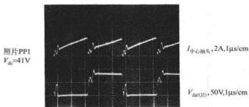

<table><tr><td><eq>{V}_{dc},\mathrm{\;V}</eq></td><td><eq>{I}_{dc},\mathrm{A}</eq></td><td><eq>{P}_{\text{int }},\mathrm{W}</eq></td><td><eq>{V}_{5},\mathrm{\;V}</eq></td><td><eq>{R}_{01},\Omega</eq></td><td><eq>{I}_{5},\mathrm{A}</eq></td><td><eq>{P}_{5},\mathrm{W}</eq></td><td><eq>{V}_{25},\mathrm{\;V}</eq></td><td><eq>{R}_{02},\Omega</eq></td><td><eq>{I}_{25},\mathrm{A}</eq></td><td><eq>{P}_{25},\mathrm{W}</eq></td><td><eq>{P}_{\text{total }},\mathrm{W}</eq></td><td>Efficiency,%</td></tr><tr><td>41.0</td><td>2.46</td><td>100.9</td><td>5.00</td><td>0.615</td><td>8.09</td><td>40.3</td><td>23.55</td><td>12.46</td><td>1.91</td><td>44.9</td><td>85.2</td><td>84.4</td></tr></table>

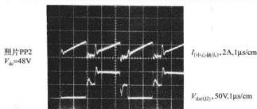

<table><tr><td><eq>{V}_{\mathrm{{dc}}},\mathrm{V}</eq></td><td><eq>{I}_{\mathrm{{dc}}},\mathrm{A}</eq></td><td><eq>{P}_{10},\mathrm{\;W}</eq></td><td><eq>{V}_{5},\mathrm{\;V}</eq></td><td><eq>{R}_{01},\Omega</eq></td><td><eq>{I}_{5},\mathrm{\;A}</eq></td><td><eq>{P}_{5},\mathrm{\;W}</eq></td><td><eq>{V}_{25},\mathrm{\;V}</eq></td><td><eq>{R}_{02},\Omega</eq></td><td><eq>{I}_{23},\mathrm{\;A}</eq></td><td><eq>{P}_{23},\mathrm{\;W}</eq></td><td><eq>{P}_{\text{local }},\mathrm{W}</eq></td><td>Efficiency,%</td></tr><tr><td>48.0</td><td>2.16</td><td>103.7</td><td>5.00</td><td>0.615</td><td>8.13</td><td>40.6</td><td>23.74</td><td>12.46</td><td>1.91</td><td>45.2</td><td>85.8</td><td>82.7</td></tr></table>

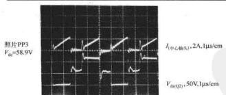

<table><tr><td><eq>{V}_{\mathrm{{dc}}},\mathrm{V}</eq></td><td><eq>{I}_{\mathrm{{dc}}},\mathrm{A}</eq></td><td><eq>{P}_{\text{in }},\mathrm{W}</eq></td><td><eq>{V}_{5},\mathrm{\;V}</eq></td><td><eq>{R}_{01},\Omega</eq></td><td><eq>{I}_{5},\mathrm{\;A}</eq></td><td><eq>{P}_{5},\mathrm{\;W}</eq></td><td><eq>{V}_{23},\mathrm{\;V}</eq></td><td><eq>{R}_{02},\Omega</eq></td><td><eq>{I}_{23},\mathrm{\;A}</eq></td><td><eq>{P}_{23},\mathrm{\;W}</eq></td><td><eq>{P}_{\text{(total) }},\mathrm{W}</eq></td><td>Efficiency,%</td></tr><tr><td>58.9</td><td>1.79</td><td>195.4</td><td>5.00</td><td>0.615</td><td>8.13</td><td>40.6</td><td>23.72</td><td>12.46</td><td>1.90</td><td>45.1</td><td>85.7</td><td>81.3</td></tr></table>

图 14.9 最小、额定及最大输出电压(图 14.9 中的照片 PP1 ~ PP3)下，输出电流最大时 Q2 的漏源极间电压和变压器中心抽头处的电流的波形

测量开关管精确的电流幅值的正确方法是用同一探头检测漏极电流，如图14.10中的照片PP6所示。从该照片可以看出，电流脉冲间的时间间隔更长（超过半个周期），峰值电流为4.4A。与之相比，在相同的电源电压和输出负载电流下，图14.9中的照片PP2所示的电流只有2.4A。 

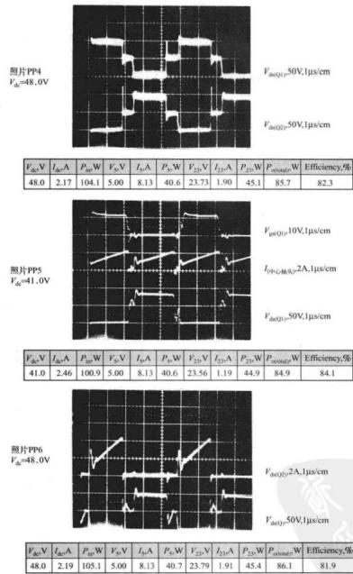

<table><tr><td><eq>{V}_{dc},\mathrm{\;V}</eq></td><td><eq>{I}_{dc},\mathrm{A}</eq></td><td><eq>{P}_{10},\mathrm{\;W}</eq></td><td><eq>{V}_{5},\mathrm{\;V}</eq></td><td><eq>{I}_{5},\mathrm{A}</eq></td><td><eq>{P}_{5},\mathrm{\;W}</eq></td><td><eq>{V}_{23},\mathrm{\;V}</eq></td><td><eq>{I}_{23},\mathrm{\;A}</eq></td><td><eq>{P}_{25},\mathrm{\;W}</eq></td><td><eq>{P}_{\text{total }}/\mathrm{W}</eq></td><td>Efficiency,%</td></tr><tr><td>41.0</td><td>2.46</td><td>100.9</td><td>5.00</td><td>8.13</td><td>40.6</td><td>23.56</td><td>1.19</td><td>44.9</td><td>84.9</td><td>84.1</td></tr></table>

<table><tr><td><eq>{V}_{\mathrm{{dc}}},\mathrm{V}</eq></td><td><eq>{I}_{\mathrm{{dc}}},\mathrm{A}</eq></td><td><eq>{P}_{10},\mathrm{\;W}</eq></td><td><eq>{V}_{5},\mathrm{\;V}</eq></td><td><eq>{I}_{5},\mathrm{\;A}</eq></td><td><eq>{P}_{5},\mathrm{\;W}</eq></td><td><eq>{V}_{23},\mathrm{\;V}</eq></td><td><eq>{I}_{23},\mathrm{\;A}</eq></td><td><eq>{P}_{23},\mathrm{\;W}</eq></td><td><eq>{P}_{\text{external }},\mathrm{W}</eq></td><td>Efficiency,%</td></tr><tr><td>48.0</td><td>2.19</td><td>105.1</td><td>5.00</td><td>8.13</td><td>40.7</td><td>23.79</td><td>1.91</td><td>45.4</td><td>86.1</td><td>81.9</td></tr></table>

图 14.10 图 14.8 中的变换器(200kHz、85W)的主要波形

通过测量与开关管源极串联的小阻值检测电阻上的压降，证实了将电流探头串联于漏极测量出的电流幅值，如照片PP6所示，将比用同一个探头串联于变压器中心抽头处测量出的值(照片PP1～PP3)更准确。电流探头串联于漏极测得的电流值与通过测量源极串联的已知电阻的压降求得的电流值完全相同。 

从图 14.10 可见, 在三种不同的电源电压下, 即使主/辅输出都输出最大电流, 变换器效率也会超过 81.9%。如果选择更大型号的导线并尽可能地降低峰值磁密, 则效率可以再提高 3%~4%。但是对于工作频率为 200kHz, 峰值磁密为 1600G 的变换器来说, 这个效率已经相当不错了。 

## 14.3.2 两开关管 $V_{ds}$ 的波形及死区期间磁心的磁通密度

图 14.10 中的照片 PP4 所示为 Q1 和 Q2 漏源极间电压的波形。它们与预期的标准波形一致。一个开关管导通时，其漏源极间电压下降到接近于零，另一个开关管的漏源极间电压则上升至 $2V_{dc}$ 。 

一个开关管漏源极导通到另一个开关管漏源极承受高压之间没有延迟。叠加在 $2V_{dc}$ 的最高漏感尖峰约为20V（如图14.17中的照片PP24所示）。该照片中电路的总输出功率已增至112W(5V/4.85A和21V/4.05A)。 

可见，在开关管关断时，死区起始处出现漏感尖峰，之后漏源极间电压立即下降到 $V_{dc}$ 。漏源极间电压将保持为 $V_{dc}$ ，直到另一个开关管导通，而后该电压上升至 $2V_{dc}$ 。 

可能有人会问，两个开关导导通之间的死区期间，变压器磁心磁密的值是多少？到导通结束时，磁密已经变化了 $2B_{\max}$ （比如说从 $-B_{\max}$ 升到 $+B_{\max}$ ），那么，在开关管均关断的死区期间，磁密是保持为 $+B_{\max}$ 还是下降到对应于0 Oe时的剩磁（图2.3）？ 

如果磁密下降到等于剩磁(约100G, 图2.3), 则在下次导通结束时, 同样的 $2B_{max}$ 的变化将使磁密上升至峰值 $(100+2B_{\max})$ 。这会使磁心饱和并损坏开关管。 

并非如此,某一个开关管导通结束时,磁心磁密若已升到 $+B_{max}$ ,则会在整个死区时间内保持这个值。死区结束时,另一个开关管导通,磁密从 $+B_{max}$ 下降至 $-B_{max}$ ,这个过程周而复始地进行。 

可能又有人会问,死区时两个开关管都不导通,那么保持磁密为 $+B_{max}$ 或 $-B_{max}$ 的电流从何而来?为了保持这个磁密水平,必须有一定的磁场强度支持。而且因为磁场强度与匝数成正比,所以死区时间内要有一定的电流流过。 

由于死区期间两个开关管都不导通，保持磁心为 $+B_{max}$ 或 $-B_{max}$ 的电流必定流过次级。该电流是折算到次级的磁心初级励磁电流。 

开关管导通期间，如图2.4(e)所示，直流输入电压提供初级负载电流（所有次级电流按匝数比折算到初级的总电流）和初级励磁电感的励磁电流。 

然而，由于电感中的电流不能突变，当导通的开关管关断时，维持存储能量的电流必须继续流动。励磁电流此时将在另一个闭合通路中续流。 

这条闭合通路在次级。当开关管关断时，次级输出电感中的电流不能突变。因此开关导通结束时，所有输出电感的电压极性反向。如果像正激变换器那样有续流二极管（图2.10），则输出电感电流将沿这些二极管续流。 

在推挽电路中，输出整流二极管起续流作用(2.2.10.3节)。输出电感极性反向，当其前端电位为比地电位低一个二极管导通压降(或相对于负输出电压，高一个二极管压降)时，整 流二极管导通，起续流二极管作用，流过输出电感电流。 

流过二极管的不止是输出电感电流。由于反激作用，导通期间在初级建立的励磁电流根据匝数比折算到一个半次级即之前还没有流过电流的那个半次级。死区期间，正是在这个半次级流过的电流使磁心磁密保持为 $B_{max}$ 。 

这样，在死区时间内，输出电感电流在两个半次级绕组中继续流动，整流二极管起到续流作用。如2.10.3节所述，这个台阶状电流在两个半次级里近似均分（如图2.6(d)和图2.6(e)所示）。其中一个台阶电流始终比另一个大，这可在图14.15中清楚地看出。 

初级励磁电流并不造成严重损耗。它只是在一个开关管导通时沿一个方向上升，死区时转向次级，并有略微的下降，然后再转回。当另一个开关管导通时，该电流在初级反向，重复先前半个周期的工作过程。 

如前所述,死区期间输出电感电流划分在两个半次级中。由于次级阻抗很小,电流流过时不会产生压降。因此这两个半次级上都没有压降,死区期间两个关断晶体管的漏源极间电压也必然等于 $V_{dc}$ ,如图14.10中的照片PP4和图14.9中的照片PP1～PP3所示。 

## 14.3.3 栅源极间电压、漏源极间电压和漏极电流的波形

如图 14.10 中的照片 PP5 所示, 门极电压上升、下降时间与对应的漏极电流和电压之间基本没有延迟。 

## 14.3.4 漏极处的电流探头与变压器中心抽头处的电流探头各自测量得到的漏极电流波形的比较

14.3.1节中讨论过，漏极处的电流探头可绝对正确地测量漏极电流，如图14.10中的照片PP6所示。 

然而，如图 14.9 中的照片 PP1 所示，将电流探头串联于变压器中心抽头测量时，短暂的死区时间内不能使电流探头的变压器磁场复位。这样测量测得的死区电流不为零，得不到电流的真实值。 

## 14.3.5 输出纹波电压和整流器阴极电压

图 14.11 中的照片 PP7 为输出纹波电压(5V)和峰—峰值约为 80mV 的噪声的波形。这种等级的信号要准确测量十分困难，因为它们会被共模噪声所掩盖。 

提示: 共模噪声是同时出现在相对于公共线(一般指地线,或示波器的公共线)的两输出端的噪声电压。这种噪声通常是由电流流入示波器探头的地线产生的。这种噪声可以通过撤掉探头的地线并将它直接接到测试点来鉴别。共模噪声会产生RFI。在产生高频方波的变换器中,这种共模噪声很难消除,要特别注意它和底盘耦合的位置。一般耦合的位置在开关元件与底盘接合以散热的地方。(参见文献[1]) 

—K. B. 

这种共模噪声会影响负载,可以通过如图 14.1 所示的共模滤波器抑制共模噪声。 

为了分辨一种噪声电压是差模的还是共模的,将电压探头的探针与其最近的地线端短接,然后将两者接到电源输出地端。 

如果示波器仍显示大约相同的噪声电压(大多数情况下都是如此)，则这就是共模噪声。其幅值会随示波器的地线端与电源输出地端接点不同及两地端连接长度不同而改变。 

测量输出电压纹波应使用高频共模抑制率强的差分探头。由于 MOSFET 管上升和下降时间很短，高于 50kHz 时会在地线上出现共模“振铃”噪声。 

图 14.11 中的照片 PP7 所示为 5V 输出时整流器阴极电压的波形。这个电压经 LC 输出滤波器平滑，产生所需的直流输出电压。 

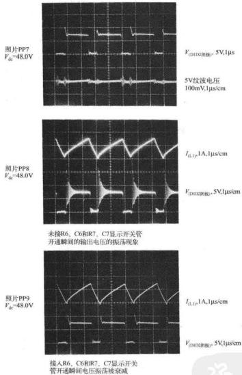

图 14.11 图 14.8 所示的 200kHz 变换器的主要波形

如果该波形在基本波形上有缺口、凸起或奇异的边沿，这些面积就会影响其平均电压值。反馈环将改变开关管导通时间，使整流器阴极输出的平均伏秒面积等于所需的直流电压。 

因此，不管主输出整流器阴极波形在死区及上升、下降期间是否有异常的凸起、缺口或台阶，主输出电压总能保持不变。但是辅输出整流器阴极电压不一定能有与主输出同样的凸起或缺口波形，所以，辅输出直流电压将与主辅匝比所确定的电压值不同。 

为使辅输出电压与主输出电压成匝比关系，主/辅输出整流器阴极电压都应有陡峭的垂直沿（图14.11中的照片PP9），且在死区期间都不应有可能改变伏秒面积的凸起或缺口。图14.12中的照片PP11及图14.14中的照片PP18所示是整流器阴极电压波形畸变的实例。后面将解释这些波形畸变形成的原因。 

## 14.3.6 开关管导通时整流器阴极电压的振荡现象

这种现象如图 14.11 中的照片 PP8 和图 14.12 中的照片 PP10 所示, 这种现象的消除如照片 PP9 和 PP11 所示。 

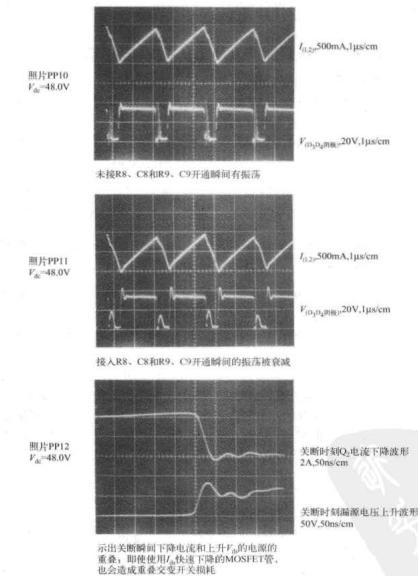

图 14.12 图 14.8 的 200kHz 变换器的主要波形

开关管导通瞬间，处在导通过程中的整流二极管（图14.8中的D1）使另一个二极管（图14.8中的D2）的续流电流下降。当D2的正向电流下降至零且其阴极电压开始上升时，共阴极处会发生指数衰减振荡（“振铃”）。 

“振铃”的频率由正在关断的二极管D2的寄生电容和输出电感确定。“振铃”的幅值和持续时间由整流二极管反向恢复时间和直流输出电流确定。 

“振铃”会导致产生RF1问题，使整流二极管承受的反压接近于其最大反压额定值，并且使损耗增加。但这种振荡很容易通过在二极管两端接RC缓冲电路(R6、C6;R7、R8、R9、C9)消除，如图14.8所示。未接缓冲电路的阴极波形如图14.11中的照片PP8和图14.12中的照片PP10所示，接了缓冲电路的阴极波形如图14.11中的照片PP9和图14.12中的照片PP11所示。 

## 14.3.7 开关管关断时下降的漏极电流和上升的漏源极间电压重叠产生的交流开关损耗

从图 14.12 中的照片 PP12 可见,由于 MOSFET 管的存储时间可以忽略,电流关断时间很短,关断曲线很接近 1.3.4 节中所述的最佳情况。 

在该曲线中，电流从漏源极间电压开始上升的时刻就开始下降，并在该电压上升至最大值时下降至零。如1.3.4节中所提到的，在这种情况下，电流下降时期间的平均交流开关损耗为 $\int_{0}^{t}I\mathrm{d}t=\mathrm{I}_{\max}\mathrm{V}_{\max}/6=4.2\times85\div6=59.5\mathrm{W}$ 。在开关周期为 $5\mu s$ ，电流下降时间约为40ns的情况下，整个周期内的平均交流开关损耗仅为 $59.5\times0.04\div5=0.48\mathrm{W}$ 。 

## 14.3.8 20%最大输出功率下漏源极间电压和在变压器中心抽头处测得的漏极电流的波形

图 14.13 中的照片 PP13 ~ PP15 所示的是输出电流为最大值的 20%（常用的额定最小输出电流）时测得的波形。 

如图 14.13 所示, 在此功率下效率仍接近于 80%。即使在效率最低时 (78.7%, $V_{dc}$ 为 59.8V), 总内耗也仅为 4.3W。这已经很好了。 

这里展示的照片和下面的一些照片表明了一个很值得注意并且很微妙的问题。它虽然不会使电源不能工作，但会使辅输出电压明显偏离预计值。这个问题是由于变压器初级励磁电流过大或是输出的直流电流过低而引起的。激磁电流变得比初始设计值大的原因，可能是由于疏忽使变压器的两个绕组耦合不好而减小了励磁电感。如果为获得所需的励磁电感而使用了过大的变压器气隙，或者最小负载电流低于励磁电流原始设计对应的最小电流，问题同样会产生。 

从图 14.13 中的照片 PP13 ~ PP15 中可以看出该问题。照片中,死区时间开始时刻的漏洞极间电压(在照片 PP14 中应严格等于 $V_{\text{de}}$ )为 $V_{\text{de}}$ ,但在死区时间结束之前却逐渐升高。这种结果是问题的一种表现而不是问题的根本原因。根本原因可从图 14.14 中的照片 PP18 看出,其中 5V 输出整流器阴极电压在死区时间内并没有正常地钳位于地,而是从地逐渐升高。从而形成了 14.3.5 节中所说的凸起或台阶。而正是这个整流器阴极电压经 LC 输出滤波器平滑后产生 5V 输出电压的。若该电压在开关管正常导通之前的死区时间内有一个凸起,它的伏秒面积就会增加。这样,反馈环(保持 5V 输出精确等于 5.00V)会缩短正常的导通时间。辅输出没有因其输出整流器阴极电压凸起引起的伏秒数增加,所以辅输出的直流输出电压就 

会比预计值低。 

不像图14.14中的照片PP18所示的那样，从照片PP9可以看出死区期间整流器阴极没有异常的凸起电压，且正常导通开始时电压从地电平垂直上升。图14.9中的照片PP2所示的也属于这种情况。从照片PP2可见，两组输出都输出最大负载电流且 $V_{dc}$ 为48.0V时，“23V”输出端输出为23.74V。而在照片PP18中， $V_{dc}$ 不变，且最小负载，5V输出电压为5.00V，而23V输出却仅为21.52V（数据可见图14.13照片PP14下面的表格）。 

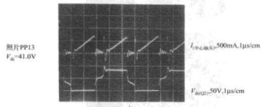

<table><tr><td><eq>{V}_{\mathrm{{dc}}},\mathrm{V}</eq></td><td><eq>{I}_{\mathrm{{dc}}},\mathrm{A}</eq></td><td><eq>{P}_{\text{in }},\mathrm{W}</eq></td><td><eq>{V}_{5},\mathrm{\;V}</eq></td><td><eq>{R}_{01},\Omega</eq></td><td><eq>{I}_{5},\Lambda</eq></td><td><eq>{P}_{5},\mathrm{W}</eq></td><td><eq>{V}_{25},\mathrm{\;V}</eq></td><td><eq>{R}_{02},\Omega</eq></td><td><eq>{I}_{25},\Lambda</eq></td><td><eq>{P}_{25},\mathrm{\;W}</eq></td><td><eq>{P}_{\text{total }}</eq>,W</td><td>Efficiency, %</td></tr><tr><td>41.0</td><td>0.52</td><td>21.3</td><td>5.00</td><td>3.05</td><td>1.64</td><td>8.20</td><td>21.46</td><td>50.0</td><td>0.429</td><td>9.21</td><td>17.4</td><td>81.7</td></tr></table>

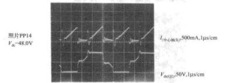

<table><tr><td><eq>{V}_{dc}</eq>, V</td><td><eq>{I}_{dc}</eq>, A</td><td><eq>{P}_{ia}</eq>, W</td><td><eq>{V}_{5}</eq>, V</td><td><eq>{R}_{01}</eq>, Ω</td><td><eq>{I}_{5}</eq>, A</td><td><eq>{P}_{5}</eq>, W</td><td><eq>{V}_{25}</eq>, V</td><td><eq>{R}_{02}</eq>, Ω</td><td><eq>{I}_{25}</eq>, A</td><td><eq>{P}_{25}</eq>, W</td><td><eq>{P}_{\text{(total) }}</eq>, W</td><td>Efficiency, %</td></tr><tr><td>48.0</td><td>0.44</td><td>21.1</td><td>5.00</td><td>3.05</td><td>1.64</td><td>8.20</td><td>21.52</td><td>50.0</td><td>0.430</td><td>9.25</td><td>17.5</td><td>82.7</td></tr></table>

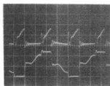

<table><tr><td><eq>{V}_{\mathrm{{dc}}},\mathrm{V}</eq></td><td><eq>{I}_{\mathrm{{dc}}},\mathrm{A}</eq></td><td><eq>{P}_{\text{in }},\mathrm{W}</eq></td><td><eq>{V}_{5},\mathrm{\;V}</eq></td><td><eq>{R}_{01},\Omega</eq></td><td><eq>{I}_{5},\mathrm{\;A}</eq></td><td><eq>{P}_{5},\mathrm{\;W}</eq></td><td><eq>{V}_{25},\mathrm{\;V}</eq></td><td><eq>{R}_{02},\Omega</eq></td><td><eq>{I}_{25},\mathrm{\;A}</eq></td><td><eq>{P}_{25},\mathrm{\;W}</eq></td><td><eq>{P}_{\text{(total) }},\mathrm{W}</eq></td><td>Efficiency,%</td></tr><tr><td>59.8</td><td>0.37</td><td>22.1</td><td>5.00</td><td>3.05</td><td>1.64</td><td>8.20</td><td>21.88</td><td>50.0</td><td>0.438</td><td>9.58</td><td>17.8</td><td>78.0</td></tr></table>

图 14.13 20% 最大输出电流条件下, 输入电压不同时测得的变压器中心抽头处电流和开关管 Q2 漏源极电压波形。照片 PP13 为输入电压最低时的波形, 照片 PP14 为额定输入电压时的波形, 照片 PP15 为输入电压最大时的波形

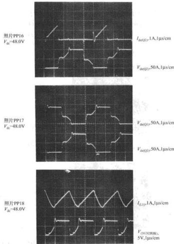

图 14.14 图 14.8 中的变换器的主要波形, 其工作条件为, 20% 最大输出电流, 额定输入电压为 48V

最后讨论为什么在励磁电流过大或直流输出电流过低时出现死区期间的凸起波形。这可根据14.3.2节中所讨论的内容来解释。 

某一个开关管关断时，总励磁电流的一部分会根据匝数比折算到次级，并在某一个半次级中继续流动。此时所有次级的整流二极管都在续流，并承担约一半的对应输出电感的电流。现在每个次级中的整流二极管会承担一部分折算到次级的初级励磁电流。 

考虑图 14.8 中的整流器。假设 Q1 导通，这使 D2 的阳极为正，D2 通过 L1 传送电流至负载。当 Q1 关断时，死区开始，L1 的电流在 D1、D2 中近似均分，D1、D2 的作用相当于续流二极管。只要流过 D1 和 D2 的电流之和等于流过 L1 的电流，它们的阴极就会被钳位于比地低一个二极管压降。 

然而，当Q1关断时，由于反激作用，一部分励磁电流转换到 $\mathbf{N}_{\mathrm{ala}}$ 经D1流进L1。只要这个电流小于L1中的电流，D1、D2的阴极就被钳位于比地电位低一个二极管压降，通过D1、D2保持了L1电流的平衡。 

如果反激折算到 $N_{s1a}$ 的电流超过了 L1 中的电流，则 L1 输入端阻抗变大，D1、D2 的阴极电压在死区结束前增至高于地电位，如图 14.14 中的照片 PP18 所示。 

由于接入了闭环反馈,死区期间整流器阴极电压凸起引起的伏秒面积的增加将被 PWM 芯片调整,开关管导通时间缩短,使经 LC 滤波器平均的输出电压精确地等于 5.00V。这种导通时间的缩短会使辅输出的直流电压低于预计值。 

## 14.3.9 $20\%$ 最大输出功率下的漏极电流和漏极电压的波形

波形可见图14.14中的照片PP16。注意，此时电流探头串联于开关管漏极，测量漏极电流的真实值(峰值为 $15\mathrm{A}$ )。电流探头串联于变压器中心抽头测得的漏极电流如图14.13中的照片PP14所示，峰值误差为 $700\mathrm{mA}$ 。这一点已在14.3.1节和14.3.4节中讨论过了。 

## 14.3.10 20% 最大输出功率下两开关管漏源极间电压的波形

波形可见图 14.14 中的照片 PP17。该照片说明了两管电压的相位关系。 

## 14.3.11 输出电感电流和整流器阴极电压的波形

由图 14.14 中的照片 PP18 中的电感电流波形可见，开关管导通时电感电流上升斜率为 $\left[\mathrm{d}i/\mathrm{d}t=\left(V_{\mathrm{cathode}}-V_{\mathrm{o}}\right)/L1\right]$ ，死区期间电感电流下降斜率为 $\left(\mathrm{d}i/\mathrm{d}t=V_{\mathrm{o}}/L1\right)$ 。 

可以通过计算 L1 来证实绕制电感的电感值与设计期望值是否一致。从导通期间阴极电压波形中可以近似读出， $V_{cathode} = 7.5V$ 。从电感电流的波形可以看出，沿斜坡上升 $1.45\mu s$ 内，di 达到 1.8A。因此可得 $L1 = (7.5 - 5) \times 1.45 \times 10^{-6} \div 1.8 = 20\mu H$ 。 

该电感磁心使用MPP55120型芯片（见MagneticsInc.公司的MPP磁心目录），匝数为5匝，其电感值 $A_{1}$ 为 $72\mathrm{mH} / 1000$ 匝。因此5匝绕组的电感值为 $(0.005)^{2}\times 72000 = 1.8\mu \mathrm{H}$ 。这与在图14.14中的照片PP18中根据di/dt读取的数值很相近。 

## 14.3.12 输出电流大于最小输出电流时输出整流器阴极电压的波形

波形可见图 14.15 中的照片 PP19。在照片中，由于输出电流增加了，不存在像照片 PP18 中那样的死区期间的凸起电压。在整个死区期间，整流器阴极电压都被钳位于地，且在开关管导通时急剧上升至其峰值。如前面 14.3.8 节所述，“23V”辅输出的输出电压从照片 PP18 中的 21.50V 上升到了照片 PP19 中的 22.97V。 

## 14.3.13 栅源极间电压和漏极电流波形的相位关系

图 14.15 中的照片 PP20 所示为两组栅源极间电压和两组漏极电流波形的相位关系。可见，栅源极间电压与相应漏极电流的上升、下降时间之间的延迟很小，可以忽略。 

## 14.3.14 整流二极管(变压器次级)的电流波形

这个波形已经在14.3.2节中讨论过(可见图14.15中的照片PP21)。照片PP21所示为开关管死区期间的台阶电流。可见导通时间过后，流经二极管的台阶电流要比导通时间之前流经二极管的台阶电流高。这是因为，先前导通的二极管在刚刚关断的死区时间内不仅流过折合的初级励磁电流还流过输出电感电流一半的电流。 

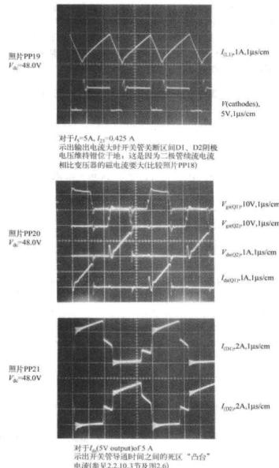

图 14.15 图 14.8 中的变换器的主要波形

## 14.3.15 由于励磁电流过大或直流输出电流较小造成的每半周期两次“导通”的现象

图 14.16 中的照片 PP22 所示的是图 14.13 中的照片 PP13 所示波形的一个极端情况。从图 14.16 中的照片 PP22 可明显看到，每半周期有两个导通阶段——Q1 的 A1 和 A2 及 Q2 的 B1 和 B2。 

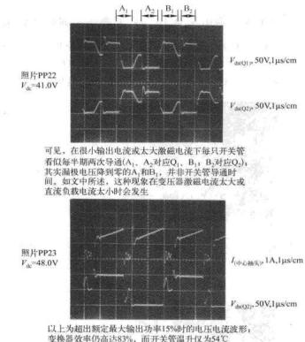

<table><tr><td><eq>{V}_{\mathrm{{dc}}},\mathrm{V}</eq></td><td><eq>{I}_{\mathrm{{dc}}},\mathrm{A}</eq></td><td><eq>{P}_{\text{mp }},\mathrm{W}</eq></td><td><eq>{V}_{5},\mathrm{\;V}</eq></td><td><eq>{R}_{01},\Omega</eq></td><td><eq>{I}_{5},\mathrm{\;A}</eq></td><td><eq>{P}_{5},\mathrm{\;W}</eq></td><td><eq>{V}_{23},\mathrm{\;V}</eq></td><td><eq>{R}_{02},\Omega</eq></td><td><eq>{I}_{23},\mathrm{\;A}</eq></td><td><eq>{P}_{23},\mathrm{\;W}</eq></td><td><eq>{P}_{\text{(total) }},\mathrm{W}</eq></td><td>Efficiency, %</td></tr><tr><td>48.0</td><td>2.51</td><td>120.5</td><td>5.00</td><td>0.339</td><td>14.7</td><td>73.7</td><td>26.12</td><td>25.0</td><td>1.04</td><td>27.3</td><td>101.0</td><td>83.8</td></tr></table>

图 14.16 图 14.8 中的变换器的主要波形

开关管只在 A2 和 B2 时段导通，此时漏极电压接地。A1 和 B1 时段并非真实导通时间。在 A1 和 B1 时段，某一开关管漏极被另一个开关管关断形成的漏极正向凸起电压强制接地。这种现象是由于图 14.13 中的照片 PPI3 所示的，直流输出电流过小或由于增加变压器气隙使初级励磁电流过大造成的。 

如 14.3.8 节中讨论的, 这个现象出现在折算到次级的励磁电流很大的时候。若该电流超过输出电感的直流负载电流, 整流二极管不能钳位到地电位, 就会在漏极产生比 $V_{dc}$ 大很多的正向凸起电压。 

由于变压器的耦合作用，该正向凸起电压会在另一个开关管漏极产生凹陷电压。当另一个漏极的凹陷电压达到地电位时，MOSFET管的内部寄生二极管导通，使漏极钳位于地电位。这种情况看起来好像是开关管已经导通了。 

在这种工作模式下,电路可能由于闭环反馈作用发生振荡。由于负载电流时而大于时而小于折合到次级的初级励磁电流,实际导通时间(脉宽)将在 B2 与 B1+B2 之间无规律跳变。 

· 为避免上述问题,应保证变压器气隙及励磁电流不要太大;保证最小直流负载电流总是大于折算到次级的励磁电流。 

## 14.3.16 功率高于额定最大输出功率 15% 时的漏极电流和漏极电压的波形

如图 14.16 中的照片 PP23 所示, 输出 115% 最大功率时效率仍高达 83%, 变压器温升仅为 54℃, 其主要波形在此高功率下仍十分清晰。输出达到 112W 时, 图 14.8 中的电路 (图 14.17 中的照片 PP24) 效率高达 86%, 且波形清晰, 变压器温升仅为 65℃。 

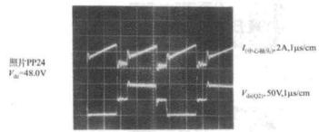

<table><tr><td><eq>{V}_{\mathrm{{dc}}},\mathrm{V}</eq></td><td><eq>{I}_{\mathrm{{dc}}},\mathrm{A}</eq></td><td><eq>{P}_{\text{in }},\mathrm{W}</eq></td><td><eq>{V}_{5},\mathrm{V}</eq></td><td><eq>{R}_{5},\Omega</eq></td><td><eq>{I}_{5},\mathrm{A}</eq></td><td><eq>{P}_{5},\mathrm{W}</eq></td><td><eq>{V}_{23},\mathrm{V}</eq></td><td><eq>{R}_{12},\Omega</eq></td><td><eq>{I}_{23},\mathrm{A}</eq></td><td><eq>{P}_{23},\mathrm{W}</eq></td><td><eq>{P}_{\text{total }},\mathrm{W}</eq></td><td>Efficiency, %</td></tr><tr><td>48.0</td><td>2.71</td><td>130</td><td>5.00</td><td>1.03</td><td>4.85</td><td>24.3</td><td>21.7</td><td>5.36</td><td>4.05</td><td>87.9</td><td>112.1</td><td>86.2</td></tr></table>

超过规定最大输出功率30%时的漏极电流和漏源电压波形

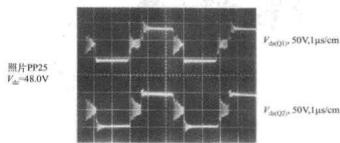

示出当初级不接RC缓冲器 $(\mathbb{R}_4, \mathbb{C}_4$ 和 $\mathbb{R}_5, \mathbb{C}_5)$ 时死区的振荡现象

图 14.17 开关管死区期间漏极的振荡现象

## 14.3.17 开关管死区期间的漏极电压振荡

为了避免振荡，每个初级都要使用 RC(R1、C4 和 R5、C5)缓冲器。如果没有这些缓冲器，开关管死区期间会出现高频振荡(图 14.17 中的照片 PP25)。高频振荡不仅加重了 RFI 问题，而且会像图 14.14 中的照片 PP18 所示的死区时间波形凸起一样影响辅输出电压。 

## 14.4 反激拓扑波形

## 14.4.1 引言

下面将给出低功率、电流不连续模式下的单端反激变换器的典型波形。 

输出功率小于 60W 时通常选用结构简单的不连续模式下的单端反激拓扑。反激变换器广泛应用于这种场合。 

变压器漏感存储的能量必须由 RCD 缓冲器吸收并消耗掉(第 11 章)，这几乎是单端反激变换器严重的缺点。如果漏感能量不被吸收，则漏感尖峰可能损坏开关管。功率大于 60W 时，缓冲器的损耗更为严重。 

双端反激变换器(4.6节)不是把漏感能量存储在缓冲器电容中然后消耗在电阻上，而是把漏感能量无损耗地回馈到输入电源。 

因此，双端单端反激变换器广泛应用于输出功率高于60～75W的场合。但是单端反激变换器与较高级的双端反激变换器的关键波形非常相似，因此以下只给出单端反激变换器波形。 

这里的全部波形均取自图 14.18 所示的电路。该电路工作频率为 50kHz，输出为 50W，有主、辅两个输出。不使用反馈闭环，开关管使用 50kHz 宽度可调的脉冲信号（PWM 芯片 3525A）来驱动。 

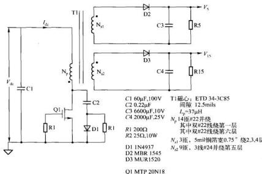

图 14.18 一种反激电源(50kHz、50W)

在不同输入电压和输出负载下,手动调整脉宽,使主输出准确地等于5.00V。同时检测并记录下辅输出的数值。 

辅输出匝数选择的原则是，当主输出为5.00V时，辅输出为15V。需要指出，辅输出电压并不是完全由主/辅匝数比决定的。由于次级漏感和主、辅绕组间的互感作用，使辅输出电压与主直流输出电流密切相关。 

## 14.4.2 90%满载情况下，输入电压为其最小值、最大值及额定值时漏极电流和漏源极间电压的波形

这些波形如图 14.19 所示。开关管导通时，初级电流波形是线性增加的斜坡形状（di/dt = V $_{primary}$ /L $_{primary}$ ）。关断瞬间，上升的漏极电压上有漏感尖峰。尖峰的数值由 RCD 缓冲器的电容 C2 控制。这个电容应选得足够大，既能限制漏感尖峰以保证开关管的安全，又不会使缓冲器电阻 R1 上的损耗（0.5C2(V $_{peak}$ ) $^{2}$ /T）过大。 

<table><tr><td><eq>{V}_{\mathrm{{dc}}},\mathrm{V}</eq></td><td><eq>{I}_{\mathrm{{dc}}},\mathrm{A}</eq></td><td><eq>{P}_{\text{int }},\mathrm{W}</eq></td><td><eq>{V}_{5},\mathrm{\;V}</eq></td><td><eq>{I}_{5},\mathrm{\;A}</eq></td><td><eq>{P}_{5},\mathrm{\;W}</eq></td><td><eq>{V}_{15},\mathrm{\;V}</eq></td><td><eq>{I}_{15},\mathrm{\;A}</eq></td><td><eq>{P}_{15},\mathrm{\;W}</eq></td><td><eq>{P}_{\text{out of }}</eq> , <eq>\mathrm{W}</eq></td><td>Efficiency, %</td></tr><tr><td>59.2</td><td>1.07</td><td>63.1</td><td>5.003</td><td>6.58</td><td>32.9</td><td>25.36</td><td>0.504</td><td>12.8</td><td>45.7</td><td>72.4</td></tr></table>

从图 14.19 中的波形可见， $V_{dc}$ 增加时，为保持主输出电压恒定脉宽变窄了。从波形还可可以看出，输出功率恒定时斜坡电流峰值在所有输入电压下都相等。 

<table><tr><td><eq>{V}_{\mathrm{{dc}}},\mathrm{V}</eq></td><td><eq>{I}_{\mathrm{{dc}}},\mathrm{A}</eq></td><td><eq>{P}_{\text{in }},\mathrm{W}</eq></td><td><eq>{V}_{5},\mathrm{\;V}</eq></td><td><eq>{I}_{5},\mathrm{\;A}</eq></td><td><eq>{P}_{5},\mathrm{\;W}</eq></td><td><eq>{V}_{15},\mathrm{\;V}</eq></td><td><eq>{I}_{15},\mathrm{\;A}</eq></td><td><eq>{P}_{15},\mathrm{\;W}</eq></td><td><eq>{P}_{\alpha \left( \text{total}\right) }\mathrm{p},\mathrm{W}</eq></td><td>Efficiency, %</td></tr><tr><td>38.0</td><td>1.67</td><td>63</td><td>5.002</td><td>6.58</td><td>32.9</td><td>25.3</td><td>0.504</td><td>12.8</td><td>45.7</td><td>72.1</td></tr></table>

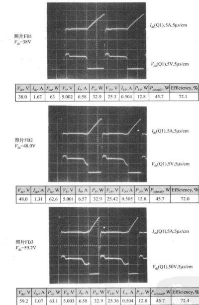

图 14.19 图 14.18 中的反激电源的主要波形

如图 14.19 所示，漏感尖峰过后，漏源极间电压下降（除了尖峰后有一小段的平台）到 $\left[V_{\mathrm{dc}} + \left(N_{\mathrm{p}} / N_{\mathrm{a1}}\right) \left(V_{5} + V_{\mathrm{D2}}\right)\right]$ 。而且保持该值直到复位伏秒数等于置位伏秒数 $V_{\mathrm{dc}} t_{\mathrm{on}} = \left(N_{\mathrm{p}} / N_{\mathrm{s}}\right) \left(V_{5} + V_{\mathrm{D2}}\right) t_{\mathrm{off}}$ ，然后再下降至 $V_{dc}$ 。 

图 14.20 所示为更低的总输出功率(17W)下, 不同输入电压时测得的波形。可以看 到，所有导通脉宽都很窄，所有初级电流峰值 $(\mathrm{di} = V_{\mathrm{primary}}t_{\mathrm{on}} / L_{\mathrm{p}})$ 都很低。这是因为从输入母线吸收的功率 $[0.5L_{\mathrm{p}}(I_{\mathrm{p}})^2 /T]$ 变小了。导通结束时，初级电流峰值变低使漏感尖峰也降低了。 

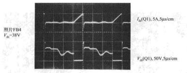

<table><tr><td><eq>V_{dc}</eq>, V</td><td><eq>I_{dc}</eq>, A</td><td><eq>P_{int}</eq>, W</td><td><eq>V_{s}</eq>, V</td><td><eq>I_{s}</eq>, A</td><td><eq>P_{s}</eq>, W</td><td><eq>V_{15}</eq>, V</td><td><eq>I_{15}</eq>, A</td><td><eq>P_{15}</eq>, W</td><td><eq>P_{o(total)}</eq>, W</td><td>Efficiency, %</td></tr><tr><td>38.0</td><td>0.595</td><td>22.6</td><td>5.003</td><td>2.08</td><td>10.4</td><td>19.1</td><td>0.380</td><td>7.27</td><td>17.7</td><td>78.3</td></tr></table>

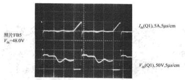

<table><tr><td><eq>{V}_{\mathrm{{dc}}},\mathrm{V}</eq></td><td><eq>{I}_{\mathrm{{dc}}},\mathrm{A}</eq></td><td><eq>{P}_{15},\mathrm{\;W}</eq></td><td><eq>{V}_{5},\mathrm{\;V}</eq></td><td><eq>{I}_{5},\mathrm{\;A}</eq></td><td><eq>{P}_{5},\mathrm{\;W}</eq></td><td><eq>{V}_{15},\mathrm{\;V}</eq></td><td><eq>{I}_{15},\mathrm{\;A}</eq></td><td><eq>{P}_{15},\mathrm{\;W}</eq></td><td><eq>{P}_{\text{total }}/\mathrm{W}</eq></td><td>Efficiency, %</td></tr><tr><td>48.0</td><td>0.481</td><td>23.1</td><td>5.004</td><td>2.09</td><td>10.4</td><td>19.2</td><td>0.381</td><td>7.29</td><td>17.7</td><td>76.6</td></tr></table>

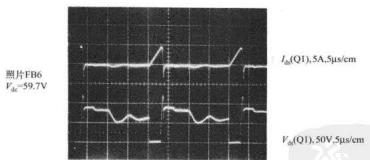

<table><tr><td><eq>{V}_{\mathrm{{dc}}},\mathrm{V}</eq></td><td><eq>{I}_{\mathrm{{dc}}},\mathrm{\;A}</eq></td><td><eq>{P}_{\text{inp }},\mathrm{W}</eq></td><td><eq>{V}_{53}\mathrm{\;V}</eq></td><td><eq>{I}_{53}\mathrm{\;A}</eq></td><td><eq>{P}_{53}\mathrm{\;W}</eq></td><td><eq>{V}_{153}\mathrm{\;V}</eq></td><td><eq>{I}_{153}\mathrm{\;A}</eq></td><td><eq>{P}_{153}\mathrm{\;W}</eq></td><td><eq>{P}_{\text{o(total)}},\mathrm{\;W}</eq></td><td>Efficiency, %</td></tr><tr><td>59.7</td><td>9.397</td><td>23.7</td><td>5.004</td><td>2.08</td><td>10.4</td><td>19.15</td><td>0.381</td><td>7.29</td><td>17.7</td><td>74.7</td></tr></table>

图14.20 图14.18中的反激电源的主要波形

## 14.4.3 输出整流器输入端的电压和电流波形

下面解释辅输出电压不完全由主/辅匝数比决定，而是与主输出电流有关的原因。 

15V整流管（图14.18中 $D_{3}$ ）的电压和电流波形 $V_{15}$ 电流为0.50A，电压为25.8V $V_{3}$ 电流为6.58A，电压为5.00V

开关管关断时，所有存储于初级的能量 $(0.5L_{\mathrm{p}}(I_{\mathrm{p}})^2)$ 都传到次级（除了一些存储于漏感中的能量转移到缓冲器电容C2中）。这些能量以电流的形式（图14.21）传到主输出和辅输出。通过各自整流器传到主输出和辅输出的电流持续时间并不相等，当然波形也不相同。 

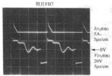

15V整流管（图14.18中D3）的电压和电流波形 $V_{15}$ 电流为0.39A，电压为19.39V $V_{5}$ 电流为2.08A，电压为5.00V
照片FB8

5V整流管（图14.18中D₂）
的电压和电流波形 $V_{15}$ 电流为0.39A，电压为19.39V $V_{5}$ 电流为2.08A，电压为5.00V
照片FB10

5V整流管（图14.18中D₂）的电压和电流波形 $V_{15}$ 电流为0.50A，电压为25.8V $V_{3}$ 电流为6.58A，电压为5.00V

图 14.21 图中示出辅输出电压不与主输出电压或匝比关系的原因。在关断瞬间，主/次级漏感立即转换一些次级峰值电流进入辅二极管的阴极。只要有这种电流存在，就会在辅二极管阴极耦合出凸起电压。辅输出电容充电至该电压。这个凸起电压比次级感应电压高，并且与主输出负载电流有关。补救的方法是尽量降低次级漏感。这可以通过在辅次级串接小电感实现。

值得注意的是，当主输出的直流输出电流从2.08A（图14.21中的照片FB8）增加到6.58A（图14.21中的照片FB10）时，辅输出二极管阴极出现的小凸起电压从约20V上升至28V（图14.21中的照片FB7和FB9）。这是由次级漏感和主、辅次级耦合造成的。随着辅输出二极管阴极小平台电压的增大（比较图14.21中的照片FB7和照片FB9），辅直流输出电压会升高。 

## 14.4.4 开关管关断瞬间缓冲器电容的电流波形

如图 14.22 所示, 开关管关断瞬间, 所有变压器初级电流(在图 14.20 中的照片 FB5 中是 5A) 马上转移到缓冲器电容 C2, 并通过缓冲器二极管 D1 到地。这个电流可视为存储于初级 漏感的能量 $(0.5L_{\text{leakage}}(I_{\mathrm{p}})^{2})$ 。直到这个能量完全转变成C2的静电能量 $0.5G2(V_{\mathrm{p}})^{2}$ ，存储于变压器励磁电感中的能量才能全部传递到次级。 

Q1关断瞬间，缓冲器电容C2上的电流5A，5μs/cm

照片FB11

Q1漏源极电压50V，50μs/cm

图 14.22 关断瞬间,本来串联流经变压器励磁电感和漏感的所有电流立即转移到图 14.18(c) 所示的缓冲器电容上去。

如果 C2 选得太小, 则关断瞬间由初级折算过来的电流给 C2 充电可能会造成过高的电压。所以 C2 必须选得足够大, 使之既能将漏感尖峰限制在安全范围内, 但又不至于产生过高的损耗。 

## 参考文献

1. Keith Billings, Switchmode Power Supply Handbook, Chapter 4, McGraw-Hill, New York, 1989. 

第4部分 

# 开关电源技术的应用

## 第 15 章 功率因数及功率因数校正

## 15.1 功率因数

当电压和电流为直流时,我们很熟悉功率的概念,这里 VI 的乘积即为功率。但是,在交流的情况下功率的计算没有那么直接。 

交流情况下我们熟悉 RMS(平方和的平均值的均方根, 即有效值)的概念, RMS 是根据任意的电压或电流波形通过电阻产生的热量与直流电压或电流通过该电阻产生的热量相等来定义的。 

但是，对于交流输入，输入电压有效值 $V_{i}$ 与输入电流有效值的乘积 $V_{i}I_{i}$ 为视在功率，当为纯电阻负载时这也是有功功率。 

在正弦电压电流情况下，与负载两端电压垂直的输入电流分量 $(I,\sin x)$ 不向负载提供功率。在交流输入开始的一段时间内，这表现为从输入电源抽取功率并暂时存储在负载的感性器件里，而随后这部分存储的电流或能量回馈到输入电源。这些不向负载提供功率的电流也会在输入电源的内部和输入线路的电阻上消耗功率。 

功率因数一词源自基本的交流电路原理。当正弦交流电源给感性或容性负载供电时，负载电流也是正弦的，但是比输入电压滞后或超前一定的角度 $x$ 。实际传递到负载的功率只有 $V_{i}I_{i}\cos x$ 。与负载两端的电压同相位的输入电流分量 $(I_{i}\cos x)$ 向负载提供功率。功率因数定义为 $\cos x$ 。有功功率由视在功率与功率因数乘积所得。输入电网电流的无功分量和有功分量如图15.1所示。 

图 15.1 在交流电路术语里，功率因数是由输入电压和输入电流之间的相角的余弦值决定的。对于纯电阻性负载电路，输入电压和电流之间没有相位差，功率因数是 1。如果电流滞后或超前于输入电压，则只有和负载电压同相位的输入电流分量提供功率给负载。

在交流电路理论中, $\cos x$ 的大小就是功率因数值。一般希望保持功率因数尽可能接近于1,也就是说,保持输入电网电流为正弦波并且和正弦电网电压同相位。获得这种效果的方法称为功率因数校正技术。 

本章介绍的功率因数校正电路，能使输入端的电网电流正弦化并和输入电网电压同相位，而且能消除谐波。这些技术对电网供电的开关电源是非常有用且必须实行的。 

强制使用功率因数校正技术是因为输入电流严重畸变。例如，桥式整流器后加电容滤波引起供配电系统和发电机设备过多损耗（图15.2(c)）。 

图 15.2 (a) 和 (b) 输入桥式整流器后面接电容滤波器和不接电容滤波器的电压波形。
(c) 连接电容 $C_{u}$ 时的输入电网电流波形。

## 15.2 开关电源的功率因数校正

在开关调整器领域,任何电路结构使输入电网电流非正弦化,或使输入电网电流是正弦波。但和正弦输入电压相位不同,或使输入电流具有谐波的都会降低功率因数从而产生功率损耗。与负载两端的电压垂直的输入电流分量 $(I,\sin x)$ 不向负载提供功率,在输入电源的内部和输入线路的电阻上消耗功率。 

对于桥式整流器接电容滤波器的开关电源，输入电网电流是上升和下降很陡的窄脉冲。这些电流脉冲的有效值很高，消耗功率并且产生更多的RFI/EMI问题。借用交流电路原理的术语，称这种电源的功率因数较低。功率因数校正电路的作用就是要消除这样的电网电流尖峰，使输入电流成为正弦形状并且和输入电压同相位，而且要得到一个比交流输入电压幅值略高的稳定直流电压。 

由图 15.2(a) 和图 15.2(b) 可知，如果没有滤波电容 $C_{0}$ 并且负载是纯电阻，那么电压 $V_{0}$ 将是正弦半波 ABXCDYEF。从整流器整流出来的电流也有相同的正弦半波，且从输入端吸收的电网电流也是正弦波并且和正弦输入电压同相位，功率因数为 1。如果输入电压和电流的有效值为 $V_{i}$ 和 $I_{i}$ ，则输入和输出负载功率可表示为 $V_{i}I_{i}$ 。 

像 ABXCDYEF(图 15.2(b)) 这样的正弦半波输出电压在许多场合是不可用的。整流器的唯一目的是将输入交流电压变换成纹波尽可能小的直流电压，正因为如此，才接入电容 $C_{o}$ 来产生波形 ABCDEF。这样可以产生较高的直流电压分量（在 B 和 C 或 D 和 E 的中间）和较低的 B—C 或 C—D 的峰—峰值纹波。在 B 和 C 或 D 和 E 之间，所有整流器二极管都被反偏，没有电网电流流过，负载电流由电容 $C_{o}$ 提供。在 A、C 和 E 时刻，上升的输入电 压使整流器二极管正向导通，电网电流流过负载并给电容充电，补偿其单独给负载供电时损失的电荷。 

选用合适的滤波电容时电网电流波形如图 15.2(c) 所示, 它是输入电压的每个正弦半波前端的一系列电流窄脉冲。滤波电容越大, 输入电流的脉冲宽度越窄, 上升和下降得更快, 峰值越高, 有效值越大。 

使用功率因数校正技术的目的就是要消除这些窄而陡的电网电流脉冲。这些陡的电流会引起频射干扰(RFI)问题,更严重的是,它的有效值比所需的负载输出功率值要大,这造成滤波电容的温升提高并降低了其可靠性。 

## 15.3 校正功率因数的基本电路

功率因数校正可以去掉桥式整流器后接的大滤波电容 $C_{0}$ ，这样整流器输出电压按正弦半波曲线上升和下降，接着功率因数校正电路将正弦半波输入电压转换成恒定的直流输出电压。 

这项技术的本质是监控整流后的正弦半波电压,强制电流波形跟踪电压,如果是纯电阻负载,瞬态输入网压电流与电压成比例。 

采用脉宽调制的 Boost 变换器(1.4 节)来实现功率因数校正。在整个正弦半波时间里，Boost 变换器的导通时间由 PWM 控制芯片来控制，使输入电流变为正弦波，同时得到比输入正弦电压幅值高的稳定直流电压。 

图 15.3 所示为实现功率因数校正的基本电路。与图 15.2(a) 相比, 这个电路用一个小容量电容取代大容量的输入滤波电容, 从而使桥式整流器的输出电压在输入正弦波过零点时可以降到零。 

通过去掉输入电容 $C_{0}$ ，电网电流可以连续流通并且是正弦的，而不是如图 15.2(c) 所示的窄脉冲电流。 

功率因数校正电路的首要任务是利用Boost变换器将沿正弦半波曲线上升和下降的不同输入电压转换成稳定的，比输入正弦电压幅值稍高的直流输出电压。这可以通过下面将提到的连续导电工作模式下的Boost变换器(1.4节)来实现。 

Boost 变换器可以将低电压提升为较高的电压。其工作原理是，在周期 T 内开关管 Q1 导通一段时间 $T_{on}$ ，电感 L1 储能。当 Q1 关断时，L1 的极性颠倒，L1 同名端的电压 $V_{o}$ 上升到高于输入电压 $V_{in}$ 。Q1 关断时，在 $T_{on}$ 期间存储在 L1 的能量通过 D1 传送给负载和电容 C1。这种 Boost 变换器的输入－输出电压关系式为 

$$
V _ {\mathrm{o}} = \frac {V _ {\mathrm{in}}}{1 - T _ {\mathrm{on}} / T}\tag{15.1}
$$

在 $V_{in}$ 的整个正弦半波时段里，Q1 的导通时间 $T_{on}$ 可根据式(15.1)调整，从而产生一个比输入正弦电压幅值稍高的稳定直流电压 $V_{o}$ 。在整个正弦电压的半个周期里，导通时间由 PFC (Power Factor Correction) 控制芯片控制，它检测 $V_{o}$ 并利用误差放大器将检测值与内部基准电压比较，通过负反馈来设置 $T_{on}$ ，从而使 $V_{o}$ 保持设定值不变。 

由式(15.1)可见，在图15.3(a)所示的正弦半波曲线的较低位置，Q1的导通时间较长，从而可以将低输入电压提升为比正弦波的幅值高的电压。随着 $V_{in}$ 上升达到幅值，PFC芯片不断减少Q1的导通时间，使正弦半波上升段的每一时刻的电压都被转换为比正弦波幅值稍高的相同直流电压。在整个正弦半波曲线里对应的一系列导通时间如图15.4所示。 

(a)

(b)

(c)

图 15.3 在输入桥式整流器后面接 Boost 变换器来迫使正弦电网电流和交流电网电压同相位，并且输出一个比输入正弦电压的幅值稍高的稳定的直流电压

图15.4 图15.3所示的Boost变换器在正弦半波输入电压各点对应的电流波形图

功率因数校正电路的第二个任务是检测输入电网的电流，并使它变为与输入电网电压同相位的正弦波。这也通过调整Boost变换器的导通时间来实现。PFC(Power Factor Correction)控制芯片将电网电流采样与基准正弦波电流比较，这两个正弦波的差值产生误差电压，由误差 电压来调节导通时间，使电网电流采样与基准正弦波电流具有相同的幅值和相位。 

这要求控制 Boost 调整器导通时间的总误差电压是电压环误差电压和电流环误差电压两者的合成电压。这种合成由实时乘法器实现，乘法器输出与电压环误差电压和电流环误差电压的乘积成正比。 

## 15.3.1 用于功率因数校正的连续和不连续工作模式 Boost 电路对比

Boost 变换器可以工作在连续或不连续工作模式(1.4节)。在功率因数校正应用中，工作于连续工作模式的 Boost 拓扑更适合于用来产生相对平滑的、没有纹波的正弦波输入电流。这一点可以从图 15.5 看出。图 15.5 是恒定直流输入下连续工作模式下的 Boost 变换器的波形。连续工作模式下的 Boost 电路与不连续工作模式下的 Boost 电路（图 1.10）有很大的差别。 

对不连续工作模式, 电感 L1 的取值较小, 以便产生一个斜率 (di/dt = V $_{in}$ /L1) 很大的输入电流 (图 1.10(c)) 给 Q1。当 Q1 关断时, 所有存储在电感 L1 的电流或能量通过 D1 传递给负载 (图 1.10(d))。因为 L1 的电感值较小, 所以通过 D1 的电流的下降斜率也很大 [di/dt = (V $_{o}$ - V $_{in}$ )/L1], 而且在 Q1 下一次导通之前流过 D1 的电流就已下降到 0。输入电流在一个周期里是不连续的, 其值等于 Q1 导通时流过 Q1 的电流与 Q1 关断时流过 D1 的电流之和, 它由很陡的上升和下降斜率的电流, 以及在关断的结尾到下一个导通期间的零值电流组成。 

对图15.5给出的连续工作模式，电感L1取值应较大。Q1的电流形状为直流阶梯叠加缓升斜坡，而D1的电流下降斜率也较小。更重要的是，关断后到下一次导通之间的电流不为零。输入电流(图15.5(e))是电流 $I_{Q1}$ 和 $I_{d}$ 的和。如果L1的值很大，则斜率很小，输入电流在一个开关周期内是一个恒值 $I_{av}$ ，而且它的峰—峰值纹波 $\Delta I$ 很小。此时输入功率为 $V_{in}I_{av}$ 。 

若为交流输入，则 Boost 变换器按在输入桥式整流器之后，如图 15.3 所示。在正弦半波输入电压的任何点上，通过 PWM 控制芯片来调节 Q1 的导通时间，从而将瞬间电压提高到所希望的直流输出电压值。对应不同的正弦半波输入电压，由直流电压误差放大器、直流基准电压和控制芯片的脉宽调制器通过负反馈环调节 Q1 的导通时间，从而获得一个恒定的直流输出电压。 

在整个正弦半波区间里，每一瞬时输入电网的电流都由 $R_{s}$ 检测，使它和瞬时输入正弦电压成正比。在任一导通期间，电流流过L1、Q1和 $R_{s}$ 并返回整流桥的负端。在随后的关断期间，电流流过L1、D1、 $R_{o}$ 及与其并联的 $C_{o}$ ，再经 $R_{s}$ 返回整流桥的负端。 

通过选取较大的 $L1$ 值，使整个开关周期里的电流纹波很小。Q1的开关速度越快， $\mathbf{R}_{\mathrm{s}}$ 上越可能出现许多窄的电流尖峰叠加的情况，如图15.3(b)所示。虽然可能产生RFI问题，严重程度与开关速度有关，但只要在 $\mathbf{R}_{\mathrm{s}}$ 两端并联一个很小的电容就可以解决这个问题。 

## 15.3.2 连续工作模式下 Boost 变换器对输入网压变化的调整

在考虑 Boost 整流器的更多细节前,这里有必要先了解连续工作模式下 Boost 变换器是怎样适应网压变化的。 

首先，考虑式(15.1)中输出和输入电压的关系是如何得来的。如图15.5所示，在整个周期 $T$ 里，开关晶体管Q1的导通时间为 $T_{\mathrm{on}}$ ，关断时间为 $T_{\mathrm{off}}$ ，忽略Q1和D1上的导通压降，则电感L1的电阻可忽略，所以在一个开关周期里，L1的平均电压必为零。并且因为电感L1上端 的电压为 $V_{in}$ ，所以其下端的电压在一个周期内的平均值也必为 $V_{in}$ 。也就是说，在图 15.6(a) 里，A1 的面积和 A2 的面积必须相等。因为在关断期间，L1 的下端电压为 $V_{o}$ ，所以有 

(a)

$$
V _ {\mathrm{in}} T _ {\mathrm{on}} = \left(V _ {\mathrm{o}} - V _ {\mathrm{in}}\right) T _ {\mathrm{off}} = \left(V _ {\mathrm{o}} - V _ {\mathrm{in}}\right) \left(T - T _ {\mathrm{on}}\right)
$$

图 15.5 恒定直流电压输入的连续工作模式下的 Boost 变换器。该电路通过改变 Q1 的导通时间来适应直流输入电压的变化。负载电流改变时，一旦在几个周期里建立起通过 Q1 的平均电流，导通时间就回到原值，维持不变（图 15.5(f)）。

即 

$$
V _ {\mathrm{o}} = \frac {V _ {\mathrm{in}}}{1 - T _ {\mathrm{on}} / T}
$$

这就是前面提到的式(15.1)。 

由图 15.5(a) 可见，当 $V_{in}$ 改变时，可对应式 (15.1) 改变 $T_{on}$ 来调整输出电压。这可以通过脉宽调制来实现。如果 $V_{in}$ 在某一时刻改变，则 $V_{o}$ 也会改变。 $V_{o}$ 的部分电压（即 $V_{ea,in}$ ）由误差放大器 EA 检测并与基准电压 $V_{ref}$ 进行比较，产生误差电压 $V_{ca,o}$ 。这个直流误差电压与内部的 三角波电压 $V_{t}$ 经电压比较器 $V_{e}$ 比较， $V_{e}$ 的输出为方波。三角波比误差电压 $V_{ea}$ 。高时，它为高电平。 $V_{e}$ 输出的高电平经图腾柱驱动器(TPD)后触发 Q1。 

(c)

如果 $V_{in}$ 在某一时刻降低，则 $V_{o}$ 及 $V_{ro}$ 的输入端电压也降低， $V_{en}$ 的输出电平上升，三角波 $V_{t}$ 和误差运放的输出的交点延迟，导通时间增加， $V_{o}$ 按照式(15.1)上升回到原来的值。显然，如果 $V_{in}$ 上升，则 $V_{o}$ 上升，但 $V_{ro}$ 。下降， $T_{ro}$ 减小， $V_{o}$ 将降回原来的值。 

## 15.3.3 连续工作模式下 Boost 变换器对负载电流变化的调整

连续工作模式下的 Boost 变换器以特殊的工作方式对负载电流变化进行调整。从式(15.1)可见， $V_{o}$ 和 $T_{on}$ 与负载电流无关。但显然，当直流负载电流改变时，即使导通时间恒定，晶体管和输出二极管的电流也必须改变。 

电路对负载电流的变化响应如下。假设负载电流增加之前，Q1的电流必须为如图15.6(b)所示的ABCD波形。若负载电流有少量增加并到达稳态，则波形上移的过程是这样完成的：Q1电流波形上移为AB1C1D；当负载电流增加很大时，Q1的电流波形上移为AB2C2D。当负载电流改变时， $T_{m}$ 在几个开关周期里增加，到达稳态时 $T_{m}$ 又恢复到原值。图15.6(c)给出了这三种不同负载电流对应的稳态二极管D1的电流波形。输出负载电流是 $I_{Q1}$ 和 $I_{L}$ 的和，其峰—峰值纹波可以通过增加电感L1来减小。 

(b)

图 15.6 工作在连续模式下的 Boost 变换器负载变化时的调整过程

图 15.6(b) 和图 15.6(c) 所示的由于直流负载增加使阶梯斜坡波形改变的过程是在接下来的几个开关周期内完成的。参考图 15.5(a)，若某一时刻直流负载电流增加，则电源阻抗压降增加会使 $V_{0}$ 立即下降， $V_{ea,in}$ 下降， $V_{ea,o}$ 上升，三角波 $V_{t}$ 与 $V_{ea,o}$ 延迟相交， $T_{on}$ 增加。 $T_{on}$ 增加使 $I_{Q1}$ 上升到较高的数值；从而 $I_{d}$ 从一个较高数值开始，并且在关断结束时达到一个较高的值。由于 $T_{off}$ 缩短， $I_{d}$ 电流值仍较高，因此，当管子再次导通时，电流初始值 $I_{t}$ 变大。 

这个过程经历几个周期，使平均电流(图15.5(b)和图15.5(c)中的 $I_{Q1}$ 及 $I_{d}$ 斜坡的中间值)上升达到与增大的直流负载电流相等，此后 $T_{on}$ 和 $T_{off}$ 慢慢恢复到由式(15.1)确定的初始值。由此可见，对于任何直流负载电流的改变， $T_{on}$ 和 $T_{off}$ 都会相应改变，但最终会慢慢恢复到原来的值。 

可知，输出电压误差放大器的带宽不能太大，以便能有足够的时间使电流在上述几个开关周期里建立起来。如果带宽太大，它的响应太快，将不允许输出电压过久地偏离其正常值。不同的厂家设计的各种能用的PFC芯片一般均提供电压和电流的采样和误差信号的放大、误差信号的合成，以及产生控制Boost开关管的脉宽调制信号。 

给一台开关电源增加功率因数校正环节首先必须去掉图15.2(a)所示的滤波电容 $C_{0}$ ，增加一个PFC芯片、一个电感、Boost晶体管、电流检测电阻和图15.3(c)所示的输出电容 $C_{0}$ ，再大约加上6个电阻和电容就可以了。 

补充：这里经常有个误解，认为有功率因数校正电源的有功效率比没校正的电源的高。设计者和客户应该知道，由于附加的元器件，功率因数校正电源的有功损耗一般比没校正的电源大。节约的能量更多是体现在外部RFI滤波器，网线和分布式系统，而不是电源本身。如果一个正确的功率表用来测量输入功率（比如功率计），有功率因数校正电源的输入有功功率会大些。 

—K. B. 

## 15.4 用于功率因数校正的集成电路芯片

有几个主要厂商生产可以实现功率因数校正功能的集成电路芯片。它们都使用连续工作模式 Boost 变换器拓扑，并通过脉宽调制来检测和控制直流输出电压和输入电网电流。 

Unitrode UC3854 是开发最早、应用最广泛的芯片，它是该类芯片中的典型产品，在这里将详细讨论。其他芯片如 Motorola MC34261 和 MC34262 将简单提及。芯片 Microlinear ML4821（现在属于 TI）、Linear Technology LT1248 和 Toke 公司的 83854。Linear Technology LT1248 与 Unitrode UC3854 的结构基本相同，但在一些重要的细节上不同。因此在所有新设计中，应该仔细研究厂商的数据表和应用说明。 

## 15.4.1 功率因数校正芯片 Unitrode UC3854

图 15.7 给出了这种芯片构成的简单 PFC 电路框图。以 Claudio de Silva 所做的 Unlrode 公司应用论文资料为基础。下面我们将讨论不同单元的功能。 

Boost 变换器由晶体管 Q1、电感 L1、二极管 D1 和输出电容 $C_{0}$ 组成。可由锯齿波电压发生器的频率 $F_{s}=1.25/(R14C_{t})$ 确定开关频率，由图腾柱输出 Q2 和 Q3 来控制功率开关管 Q1 的导通和关断。 

导通时间从对应时钟脉冲将FF1（触发器1）置位开始。当接于脉宽调制器(PWM)同相输入端的锯齿波比线性电流放大器EA2输出端(3脚)的电压高时将FF1复位，这时导通截止。3脚的电压是 $R_{s}$ 的电压和R2的电压瞬间差值的正向放大电压。 

图 15.7 Unlrode UC3854 构成的功率因数校正器电路框图

主要电路可通过开关管脉宽调制控制导通时间,将桥式整流器输出的正弦半波电压升压为恒定的直流输出电压,同时也使输入电网电流波形成为正弦波,并与输入电网电压同相位。 

## 15.4.2 用 UC3854 实现输入电网电流的正弦化

UC3854的5脚的输出电流是连续的正向正弦半波，其幅值在任何瞬时都与A点直流电压和输入UC3854的6脚的电流值成比例。UC3854的6脚的输入是与整流桥输出的正弦半波电压同相位的正弦半波电流基准。因此，UC3854的5脚的电压是与整流桥输出的正弦半波电压同相位的连续正弦半波曲线，其幅值与误差运放EA1的输出电压成比例。 

在每个正弦半波的所有时刻上，通过使 $\mathbb{R}_s$ 的压降（从右到左，图15.8(c))与R2的升压（从左到右，图15.8(b))近似相等来使电网电流波形成为正弦波。 

$R_{n}$ 的电流是经过整流后的电网输入电流。这个整流电网电流等于 Q1 导通时流过 Q1 的电流和 Q1 关断时流过 D1 的电流的和。 

因此，当使 $\mathbb{R}_{\mathrm{s}}$ 的压降等于R2的升压时，电网电流波形也是正弦半波且与整流桥输出的电压波形同相位。由图15.5(c)、图15.5(d)和图15.5(e)可见，因为有大电感的Boost变换器工作在连续模式，所以一个开关周期内的纹波电流很小。在半个周期里，当 $\mathbb{R}_{\mathrm{s}}$ 的压降等于R2的升压时，因为R2的电压波形是平滑的正弦半波，所以流过 $\mathbb{R}_{\mathrm{s}}$ 的电流也是平滑的正弦半 

波，只有很小的开关频率纹波。 

在网压频率为60Hz的半周期里， $R_{i}$ 的压降跟踪R2的基准电压，但R2的升压比 $R_{i}$ 的压降稍微高一些。这个差值(瞬间误差电压)，如图15.8(d)所示，在半波周期里，相对的是正的，并且是上凹波形。这个误差电压由同相电流运放EA2放大并保持上凹的波形，如图15.8(e)所示。 

图15.8 功率因数控制芯片UnitrodeUC3854的主要波形

UC3854的3脚电压与UC3854的14脚的峰值约为5V的三角波电压通过PWM比较器进行比较。在X点和Y点处，如图15.8(e)所示，较高的UC3854的3脚电压与三角波相交得较迟，则导通时间较长。在正弦波的峰值点(P点)，电压较低，较低的电压与三角波相交的较早，则导通时间较短。半个周期内呈上凹的UC3854的3脚波形使在输入电压接近正向过零点时导通时间最大；而后，随输入电压增加至其峰值，导通时间逐渐减小；当输入电压从峰值逐渐下降到负向过零点时，导通时间增加。这种变化的导通时间将正弦半波输入电压转换为 $C_{0}$ 两端恒定的直流输出电压，由式(15.1)可知。 

UC3854 的 3 脚的误差电压信号控制的导通时间是几个开关周期导通时间的平均值。 

当R2的正弦电压决定的电流变化时， $\mathbb{R}_{\mathrm{s}}$ 的阶梯斜坡电流必须跟着变化。当5脚乃至3脚的误差电压突然发生变化时，就会发生15.3.3节中讨论的那种情况。PWM比较器会立即改变导通时间，使流过 $\mathbb{R}_{\mathrm{s}}$ 的阶梯斜坡电流产生的电压等于R2的电压。经过几个周期后，当这些电压相等时，导通时间恢复到由式(15.1)决定的值，因此可以得到所要求的恒定直流输出电压。 

## 15.4.3 使用UC3854保持输出电压恒定

本章不详细解释乘法器和除法器的工作原理。易知5脚的输出电压是输入点A的电压和输入点B的电压(代表输入电流)的乘积。 

可通过如下方法调整 $V_{0}$ ，如图 15.7 所示。 

A点的电压是误差放大器将正比于 $V_{\mathrm{e}}$ 的电压与固定的基准电压进行比较后得到的输出电压。UC3854的5脚电压是一个连续的非畸变的正弦半波电压，其幅值与UC3854的7脚的直流电压（误差运放EA1的输出）成比例。因此当 $V_{\mathrm{e}}$ 增大时，UC3854的7脚电压下降，UC3854的5脚的正弦半波电压幅值变小，UC3854的5脚和地之间的电压差值（如图15.8(d)）更接近零，UC3854的3脚的电压也是如此。因此，在PWM比较器里，三角波与较低电压相交的越早，每个开关周期的导通时间越短，对应于式(15.1)， $V_{\mathrm{e}}$ 将减小。 

UC3854 的 5 脚的输出信号确保了输出电压的恒定和输出电流为正弦波。 

输入UC3854的6脚的电流是正弦的且与输入电压同相位。因为这一点的阻抗很低，因此将有较大阻值的电阻R8连接到整流桥输出，整流桥的输出是正弦电压。 

## 15.4.4 采用UC3854芯片控制电源的输出功率

图 15.9 给出了采用 UC3854 芯片的 250W 功率因数校正器的电路图。可通过设定流过 $R_{s}$ 的正弦电流的峰值来获得最大输出功率，这决定了可得到的最大电网输入电流的有效值，并决定了在任何输入电压有效值时可得到的最大输出功率。对图 15.9 所示的电路， $V_{mn}$ 和 $I_{mn}$ 分别表示电压有效值的最小值和电流有效值的最大值。 

$$
P _ {\mathrm{o}} = E P _ {\mathrm{in}} = E V _ {\mathrm{rms}} \overline {{I _ {\mathrm{rms}}}} = E V _ {\mathrm{rms}} (0. 7 0 7 I _ {\mathrm{pl}})\tag{15.2}
$$

式中，E 是效率， $I_{pi}$ 是有效值为 $V_{res}$ 时流过电流检测电阻 $R_{a}$ 的电流。 

首先由式(15.2)选择 $I_{pl}$ ，然后恰当地选择 $R_{s}$ ，以使其在低网压和大负载时的损耗减小，并且在低电网电压时其压降不要低于1V，也就是说 $R_{s}$ 的压降为1V。 

$$
R _ {\mathrm{s}} = \frac {1}{I _ {\mathrm{pl}}}\tag{15.3}
$$

由于芯片内部设计的要求,MD 输出(UC3854 的 5 脚)的最大电流 $I_{pssd}$ 可由下式给定 

$$
I _ {\mathrm{pmd}} = \frac {3 . 7 5}{R 1 4}\tag{15.4}
$$

式中， $I_{pmd}$ 可以达到 0.5mA，但通常设定为 0.25mA。 

在所有时刻，反馈环都保持 $R_{s}$ 的压降（为 $R_{s}I_{1}$ ）等于 R2 的升压（为 $R_{2}I_{md}$ ）。最大电网电流 $I_{pt}$ 和 MD 电流 $I_{pmd}$ 的关系为 

$$
R 2 = \frac {I _ {\mathrm{pl}} R _ {\mathrm{s}}}{I _ {\mathrm{pmd}}}\tag{15.5}
$$

图 15.9 采用 UC3854 控制芯片的 250W 功率因数校正器的详细电路图

当 $P_{\mathrm{o}} = 250\mathrm{W}, V_{\mathrm{rms}} = 90\mathrm{V}, E = 0.85$ 时，由式(15.2)可得， $I_{\mathrm{rms}} = 250 / (0.85 \times 90) = 3.27\mathrm{A}$ ， $I_{\mathrm{pl}} = 1.41 \times 3.27 = 4.61\mathrm{A}$ 。当 $\mathbf{R}_{\mathrm{s}}$ 上的压降是 $1\mathrm{V}$ 时，由式(15.3)可得 

$$
R _ {\mathrm{s}} = \frac {1 . 0}{I _ {p 1}} = \frac {1}{4 . 6 1} = 0. 2 2 \Omega
$$

我们一般选择最接近的标准值 $0.25\Omega$ 。当 $I_{\mathrm{pmd}} = 0.25\mathrm{mA}$ 时，由式(15.4)可得 

$$
R 1 4 = \frac {3 . 7 5}{0 . 0 0 0 2 5} = 1 5 \mathrm{k} \Omega
$$

当 $I_{pred}=0.25mA, I_{pl}=4.61A, R_{s}=0.25\Omega$ 时，由式(15.5)可得 

$$
R _ {2} = \frac {4 . 6 1 \times 0 . 2 5}{0 . 0 0 0 2 5} = 4. 6 1 \mathrm{k} \Omega
$$

为了减小EA2的偏差，应选择 $R3$ 等于 $R2$ 

## 15.4.5 采用UC3854芯片的Boost电路开关频率的选择

其他内部电路元件的要求,进一步决定了 UC3854 的 5 脚 MD 的输出电流,R14 同时也设定 Boost 开关频率。当 R14 固定时,Boost 开关频率可由下式决定 

$$
F _ {s} = \frac {1 . 2 5}{R 1 4 C 1 1}\tag{15.6}
$$

式中，C11是UC3854的14脚的接地电容值。R14的单位为 $\Omega, C11$ 的单位为 $F, F_{\mathrm{s}}$ 的单位为 $\mathrm{Hz}$ 。UC3854可达到的最高频率为 $200\mathrm{kHz}$ 左右，但一般选择为 $100\mathrm{kHz}$ 左右。 

## 15.4.6 Boost 输出电感 L1 的选择

图 15.5 和图 15.7 中的 Boost 电感的选择必须满足当正弦输入电压达到峰值时，有一个合乎要求的最小电网纹波电流。电感在输入功率最大和输入电压最小时选择，这时正弦波电流峰值 $\overline{I_{pt}}$ 最大。纹波电流为 $\Delta I$ ，斜坡幅值为图 15.5 所示的 $I_{QI}$ 或 $I_{D1}$ 。它是当 Q1 导通时间 $\overline{T_{cs}}$ 最大时，对应于 L1 上最小电压 $V_{\text{ss}}$ 的 L1 的电流改变量。 $V_{\text{rms}}$ 和 $\overline{I_{rms}}$ 分别表示电压有效值的最小值和电流有效值的最大值。 

$$
L 1 = \frac {V _ {\mathrm{p}} \overline {{T _ {\mathrm{on}}}}}{\Delta I} = \frac {1 . 4 1 V _ {\mathrm{rms}} \overline {{T _ {\mathrm{on}}}}}{\Delta I}\tag{15.7}
$$

且 

$$
I _ {\mathrm{pl}} = \frac {1 . 4 1 P _ {\mathrm{o}}}{E V _ {\mathrm{rms}}}\tag{15.8}
$$

选择 $\Delta I = 0.2I_{\mathrm{pl}}$ ，则有 

$$
\Delta I = \frac {0 . 2 \times 1 . 4 1 P _ {\mathrm{o}}}{E V _ {\mathrm{ms}}} = \frac {0 . 2 8 2 P _ {\mathrm{o}}}{E V _ {\mathrm{ms}}}\tag{15.9}
$$

则由式(15.7)和式(15.9)可得 

$$
L 1 = \frac {5 . 0 (V _ {\text { max }}) ^ {2} E \overline {{T _ {\text { on }}}}}{P _ {\mathrm{o}}}\tag{15.10}
$$

现在由式(15.1)可得 

$$
\overline {{{T _ {\mathrm{on}}}}} = T \left(\frac {1 - V _ {\mathrm{p}}}{V _ {\mathrm{o}}}\right)\tag{15.11}
$$

设置 $V_{0}$ 大于 $\overline{V}_{p}10\%$ —— $\overline{V}_{p}$ 为输入为最大值时的正弦输入幅值，可得 

$$
\overline {{{T _ {\infty}}}} = T \left(1 - \frac {V _ {\mathrm{p}}}{1 . 1 \bar {V} _ {\mathrm{p}}}\right)\tag{15.12}
$$

由于 $V_{p}/\overline{V}_{p}=V_{rms}/V_{rms}$ ，取 $V_{rms}=90V,\overline{V_{rms}}=250V$ ，则由式(15.12)可得 

$$
\overline {{{T _ {\mathrm{on}}}}} = T \left(1 - \frac {9 0}{1 . 1 \times 2 5 0}\right) = 0. 6 7 3 T\tag{15.13}
$$

又由式(15.10)和式(15.13)可得 

$$
L 1 = \frac {3 . 3 7 (V _ {\mathrm{rms}}) ^ {2} T E}{P _ {\mathrm{o}}}\tag{15.14}
$$

因此，当 $V_{rms}=90V, f=100kHz(T=10\mu s), E=85\%, P_{o}=250W$ 时，由式(15.14)可得 

$$
L 1 = \frac {3 . 3 7 (9 0 ^ {2}) (1 0 \times 1 0 ^ {- 6}) (0 . 8 5)}{2 5 0} = 9 2 8 \mu \mathrm{H}
$$

## 15.4.7 Boost 输出电容的选择

参照图 15.10, Boost 电容 $C_{o}$ 一般用于给 DC/DC 变换器供电（一般是 600W 以下的半桥电路或功率更高的全桥电路）。前面已提到，正常的输出电压 $V_{on}$ 一般应设为比输入有效值 $V_{rms}$ 最大时的幅值大10%。那么当 $V_{rms}=250V$ 时， $V_{on}=1.1\times1.41\times250=380V$ 。这个电压值不好调节，电压误差运放的带宽增益保持较低，以便改善它对负载电流变化时的响应。因此，在这种交流输入电压情况下，设定最小输出电压 $V_{st}$ 为370V。 

图 15.10 电容 $C_{n}$ 的选择必须满足规定的保持时间

如果交流输入突然断开， $V_{0}$ 最小时，希望 $C_{0}$ 足够大，以保持输出电压为一个定值 ( $V_{mhu}$ )。 $V_{mhu}$ 是能够保证 DC/DC 变换器所有输出维持为规定值一段时间（一般规定为 30ms）的电压。 

当 $V_{\mathrm{m}}$ 从 $V_{\mathrm{a}}$ 向 $V_{\mathrm{obs}}$ 下降时，DC/DC变换器的导通时间增大，以维持其所有输出在规定值范围内。对于大多数变换器拓扑， $V_{\mathrm{o}}$ 下降越少时需要较大的电容，而允许 $V_{\mathrm{o}}$ 有较大压降则会导致DC/DC变换器导通时间增大，甚至达到最大导通时间，如半个开关周期（许多拓扑的最大导通时间就是半个开关周期）。 $V_{\mathrm{obs}}$ 一般折中选择为比 $V_{\mathrm{o}}$ 低60V到80V，并且将变换器的变压器次级电压设计得足够高，以使 $V_{\mathrm{obs}}$ 作为输入时的导通时间仍然是半个周期的 $80\%$ (3.2.2.1节)。 

因此， $C_{0}$ 可由下式来选择 

$$
C _ {\circ} = \frac {I _ {\mathrm{av}} T _ {\mathrm{bu}}}{\Delta V} = \frac {I _ {\mathrm{av}} T _ {\mathrm{bu}}}{V _ {\mathrm{o}} - V _ {\mathrm{mhu}}}\tag{15.15}
$$

式中， $I_{av}$ 是 $V_{o}$ 从 $V_{o}$ 下降到 $V_{mhu}$ 时输出电流的平均值。变换器输出功率为 $P_{c}$ ，效率为 $E_{c}$ 时 

$$
I _ {\mathrm{av}} = \frac {2 P _ {\mathrm{c}}}{E _ {\mathrm{c}} (V _ {\mathrm{e}} + V _ {\mathrm{mhu}})}\tag{15.16}
$$

因此，当 $V_{mho} = V_{o} - 70 = 370 - 70 = 300V$ 且 $T_{hu} = 30ms$ 时，由式(15.15)可得 

$$
C _ {\mathrm{o}} = \frac {I _ {\mathrm{av}} \times 0 . 0 3}{3 7 0 - 3 0 0} = 4 2 9 \times 1 0 ^ {- 6} I _ {\mathrm{av}}
$$

并且当 $P_{\mathrm{e}} = 250\mathrm{W},E_{\mathrm{e}} = 0.85$ 时，由式(15.16)可得 

$$
\begin{array}{r l} & I _ {a v} = \frac {2 \times 2 5 0}{0 . 8 5 (3 7 0 + 3 0 0)} = 0. 8 8 \mathrm{A} \\ & C _ {o} = 0. 8 8 (4 2 9 \times 1 0 ^ {- 6}) = 3 7 8 \mu \mathrm{F}, \text {   一般取为   } 4 0 0 \mu \mathrm{F} \end{array}
$$

选择容量最接近的标准电容 $390 \mu F$ 。 

必须恰当设计 DC/DC 变换器的变压器，在规定的 $V_{mbu}$ 值时能得到需要的输出。正如 3.2.2.1 节中讨论的那样，如果次级匝数足够多能产生足够高的次级电压，就可以确保在导通时间为半个周期的 80% 时，即可得到输出电压。 

电容 $C_{o}$ 的选择，除了必须满足得到希望的输出电压保持时间，还要使电容有足够的额定纹波电流值。Boost 二极管 D2（图 15.7）的电流由直流分量（从 $V_{o}$ 流出的直流负载电流）和振幅等于直流负载电流的 120Hz 谐波分量组成。显然，电流的直流分量流入负载，而 120Hz 谐波分量流入电容 $C_{o}$ 。因此， $C_{o}$ 的纹波电流额定值的有效值 $I_{rms} = 0.707I_{dc}$ 。 

对于输出功率为 250W 的 DC/DC 变换器，当 $V_{a}=388V$ ，效率为 85% 且 $I_{dc}=250/(388\times0.85)=0.76A$ 时， $C_{a}$ 纹波电流额定值的有效值是 $0.707\times0.76=0.54A$ 。 

## 15.4.8 UC3854 的峰值电流限制

UC3854 的 2 脚的峰值限制比较器、电阻 R4 和 R5（图 15.9）组成峰值电流限制电路。当触发器 FF1 复位时，开关管 Q1 关断，流过 Q1 的电流截止。当电流限制比较器的反相输入端（2 脚）的直流电压低于正相输入端的电压（地）时，电流限制比较器的输出为高电平，这时触发器复位。电阻 R4 和 R5 由 PFC 9 脚的 7.5V 基准电压供电，提供上拉电位，以使 UC3854 的 2 脚电位降到地电位，这时就限制峰值电流为 $I_{pl}$ ，也就是 

$$
I _ {\mathrm{pi}} R _ {\mathrm{s}} = I _ {\mathrm{R4}} R 4
$$

当UC3854的2脚电位为地电位时 

$$
I _ {\mathrm{R4}} = I _ {\mathrm{R5}} = \frac {7 . 5}{R 5}
$$

那么，当 $R5 = 10\mathrm{k}\Omega$ 且 $I_{\mathrm{H4}} = 0.75\mathrm{mA}$ 时 

$$
R 4 = \frac {R _ {\mathrm{s}} I _ {\mathrm{lp}}}{I _ {\mathrm{R4}}}\tag{15.17}
$$

设 $P_{\mathrm{o}} = 250\mathrm{W}$ ，则由前面的计算可知峰值电流 $I_{\mathrm{p}} = 4.61\mathrm{A}$ 。那么当峰值电流限制为5.5A时，由式(15.17)可得 $R4 = 0.25\times 5.5 / 0.00075 = 1.8\mathrm{k}\Omega$ 。 

## 15.4.9 设计稳定的 UC3854 反馈环

反馈环的稳定性不在这一章讨论的范围内。UC3854有两个反馈环，一个是强迫输入电网电流为正弦波的高带宽内部环(EA2)，另一个是保持输出电压恒定的低带宽外环(EA1)。 

EA2（图15.7和图15.9）是一个2型接法线性运放（12.6节），它的零点为 $F_{z}=1/(2\pi R6C15)$ ，一个极点为 $F_{p}=1/(2\pi R6C13)$ ，另外还有一个初始极点为 $1/[2\pi R3(C13+C15)]$ 。 

电压误差放大器 EA1 除了可以保持直流输出电压恒定外, 还可以通过在电网的高于三次谐波频率处设置较低的带宽和增益来减少 60Hz 电网电流的谐波畸变。 

这些反馈环的详细设计在文献1至文献4中有所讨论。 

## 15.5 Motorola MC34261 功率因数校正芯片

为了展示另外一个不同的设计方案,我们将讨论已经很少使用的芯片 Motorola MC34261,这个芯片被广泛应用于早期的设计中,(见参考文献5),图 15.11 给出了这种芯片的电路结构。 

和 Unitrode 芯片一样, 它配合 Boost 变换器将桥式整流器输出的正弦半波电压转换成比输入幅值稍高的直流电压; 并且也检测电网输入电流, 使输入电流在整个正弦半波周期内都等于内部基准正弦半波的值。 

图 15.11 Motorola MC34261 功率因数校正器, 它可用于交流输入为 85 ~ 265V 的电路

与采用Unitrode芯片的Boost变换器工作在固定的频率和连续工作模式下不同（图15.4），采用Motorola MC34261芯片的Boost变换器工作在连续工作模式临界点。图15.12(c)给出了一个开关周期里，T1初级的电网电流波形。当开关管导通时，它按一定的斜率上升到峰值，开关管关断时降回到零，电流下降到零后立即开始上升，没有死区时间，因此频率是变化的。 

在这种情况下,因为有很大的上升和下降电流斜率,所以这种电路可能产生很大的开关噪声。相对来说,Unitrode芯片的电流斜率很小,在任何一个开关周期里,电网电流的改变量很小。采用Motorola和Unitrode芯片的功率因数校正器在相同的理想交流输入和相同的输出功率下,二者产生非常相似的三次谐波,二者的功率因数都高于0.99。 

## 15.5.1 Motorola MC34261 的详细说明(图 15.11)

在输入整流桥后面用一个非常小的电容(C6)取代以往连接的大滤波电容。这个电容能保证整流桥的输出电压跟随电网电压的正弦半波形式，它最低时比地电位高1V左右。输出电压必须是完全正弦的，并且应与电网电压同相位。EA1输出电压接乘法器，同正弦半波进行乘积后，输出的电压波形通过比较器与流过R7的电网电流正弦半波进行比较，以使输入电网电流为无畸变的正弦波，并且与输入电网电压同相位。 

图 15.12 120Hz 正弦半波输入,一个开关周期里,Motorola MC34261 功率因数校正器的主要波形,所有点对应于图 15.11 中的位置

为了防止内部电路使正弦半波畸变，PFC 3 脚的电压必须保持低于 3V。R9 的电流是不连续的三角波（图 15.12(b)），它的幅值等于图 15.12(c) 中的三角波的波峰与波谷的差值。一个开关周期里，图 15.12(c) 中的三角波电流的平均值等于同一周期里电网输入电流的平均值。因此，通过使三角波电流（由 R9 转换成电压）的平均值等于乘法器输出的基准正弦半波的幅值，就可以使电网电流成为正弦波并且与电网电压同相位。 

## 15.5.2 MC34261 的内部逻辑及结构(图 15.11 和图 15.12)

假设 RS 已闭锁, 4 点和 5 点已经为高电平, MC34261 的 7 脚变为高电平, 导通主开关管 Q1。Q1 集电极降到地电位 (图 15.12(a)), T1 的初级电流以斜率 $dI/dz = V_{m}/L$ 上升 (图 15.12(b) 和图 15.12(c))。当流过 R9 两端的压降达到与乘法器输出端 (2 点) 的瞬时电压相等的峰值 (1 点) 时, 电流比较器输出端 (3 点) 为高电平并使 RS 复位, 这时 4 点变为低电平, 并使 5 点和芯片的 7 脚输出低电平, 从而关断 Q1。 

Q1 集电极电压(图 15.12(a))上升到 $V_{o}$ ，T1 初级电流以斜率 $dI/dt = (V_{o} - V_{in})/L$ 下降(图 15.12(c))，T1 初级同名端变为正电位，次级的同名端(7 点)变为正电位。RS 的两个输入端(9 点和 11 点)都为高电平，所以 RS 的两输出端(4 点和 10 点)都变为低电平。只要 7 点保持高电平(8 点也为高电平)，4 点就保持低电平。4 点为低电平使 12 点为高电平且 5 点为 低电平,因此 PFC 7 脚为低电平,这使 Q1 关断。只要 MC34261 的 7 脚为低电平,或者 T1 初级电流还未减小到零,Q1 就保持关断。 

当T1初级电流降到零(图15.12(c))，次级的同名端(7点)降到地电位，则零电流检测器的输出(8点)也为低电平。或非门Y的三个输入端均为低电平，输出4点变为高电平，这使5点变为高电平，从而再次导通Q1重复前一周期。但是在7点降到低电平后，要保证闭锁状态为4点高电平和10点低电平。这个过程解释如下。 

在 8 点和 9 点之间有一个延时, 8 点降到低电平的瞬间 9 点仍然保持为高电平, 使 10 点保持为低电平。延时过后, 当 9 点降到为低电平时, 已为高电平的 4 点使或非门 X 输出保持为低电平, 从而实现 4 点的高电平和 10 点的低电平闭锁状态, 直到流过 Q1 的电流使 1 点的电压超过 2 点乘法器瞬时输出电压。 

## 15.5.3 开关频率和L1电感量的计算

在图15.12(c)中，当Q1导通时，L1的电压为 $V_{in}$ ，电感L1的电流按斜率 $\mathrm{d}I_{\mathrm{r}}/\mathrm{d}t=V_{in}/L1$ 上升。当Q1关断时，L1的电压是 $(V_{\alpha}-V_{in})$ ，它的电流（即交流电网输入电流）按斜率 $\mathrm{d}I_{\mathrm{p}}/\mathrm{d}t=(V_{\alpha}-V_{in})/L1$ 下降。如果在 $T_{on}$ 导通期间，电流达到峰值 $I_{p}$ ，那么在Q1再次导通之前，电流必须在 $T_{off}$ 关断期间降低到相同的 $I_{p}$ 值，或表示为 

$$
\frac {V _ {\mathrm{in}} T _ {\mathrm{on}}}{L 1} = \frac {(V _ {\mathrm{o}} - V _ {\mathrm{in}}) T _ {\mathrm{off}}}{L 1}
$$

即 

$$
T _ {\text { off }} = \frac {T _ {\text { on }} V _ {\text { in }}}{V _ {\mathrm{o}} - V _ {\mathrm{in}}}\tag{15.18}
$$

式中， $V_{in}$ 是瞬时正弦半波输入电压。当导通时间固定时，关断时间与 $V_{in}$ 有关并按式(15.18)改变。因此，频率 $\left[-1/(T_{\mathrm{on}}+T_{\mathrm{off}})\right]$ 随着正弦半波电压 $V_{in}$ 改变。 

电感 L 的值要设计得相当小,但要能够承受要求的输出功率下的尖峰电流。对于大电感（超过 1mH 的）,当电流超过 2A 时还不会饱和。这种电感不但体积大,成本也很高。因此有 

$$
P _ {\mathrm{in}} = \frac {P _ {\mathrm{o}}}{E} = \frac {V _ {\mathrm{rms}} I _ {\mathrm{rms}}}{E}
$$

电压最小时电流最大。 

根据 

$$
I _ {\mathrm{rms}} = \frac {P _ {\mathrm{o}}}{E V _ {\mathrm{rms}}} = 0. 7 0 7 I _ {\mathrm{pk}} \quad \text {或} \quad I _ {\mathrm{pk}} = \frac {1 . 4 1 P _ {\mathrm{o}}}{E V _ {\mathrm{rms}}}
$$

式中， $I_{pk}$ 是电压为 $V_{max}$ 时 60Hz 电网输入电流的峰值。但是由图 15.12(c) 可知，因为一个开关周期的电流平均值仅仅是 $(1/2)I_{pkt}$ ，因此 $I_{pkt}=2I_{pk}$ ，或可表示为 

$$
I _ {\mathrm{pkt}} = \frac {2 . 8 2 P _ {\circ}}{E V _ {\mathrm{rms}}}\tag{15.19}
$$

这是电压为 $V_{rms}$ 时，在输入正弦半波峰值处的开关管电流峰值。在正弦半波的峰值时刻导通开关管，则流过晶体管的电流按一定的斜率上升到 

$$
I _ {\mathrm{pkt}} = \frac {V _ {\mathrm{p}} T _ {\mathrm{on}}}{L}
$$

式中， $V_{p}=1.41\ V_{mm}$ ，因此L为 

$$
L = \frac {1 . 4 1 V _ {\mathrm{rms}} T _ {\mathrm{on}}}{I _ {\mathrm{pkt}}}
$$

由式(15.19)可得 

$$
L = \frac {\left(V _ {\mathrm{rms}}\right) ^ {2} T _ {\mathrm{on}} E}{2 P _ {\mathrm{o}}}\tag{15.20}
$$

现在假设正常情况下，最小和最大的输入电压有效值分别为120V、92V和138V。当 $V_{rms}=92V,P_{o}=80W,E=0.95$ 时，有 

$$
L 1 = \frac {(9 2) ^ {2} \times 0 . 9 5 T _ {\mathrm{on}}}{2 \times 8 0} = 5 0 T _ {\mathrm{on}}\tag{15.21}
$$

如果选择 $T_{\mathrm{on}}$ 为 $10\mu \mathrm{s}$ ，则由式(15.21)可得 $L = 500\mu \mathrm{H}$ ，而 $I_{\mathrm{pkt}} = 1.41\times 92\times 10\times 10^{-6} / (500\times 10^{-6}) = 2.59\mathrm{A}$ ，这个峰值电流相对来说比较合适。 

Boost 输出电压必须大于最大线输入电压的峰值。当 $V_{rms} = 1.38V$ 时，正弦波峰值为 $1.41 \times 138 = 195V$ ，如果 Boost 电压不能高于这个电压，则由式 (15.18) 可知关断时间将很大，导通时间和频率就会很小。对于较高的 Boost 电压，这么大的频率改变将使开关管在关断时承受较高的电压应力，且二极管 D5 的反向恢复时间问题会变得很严重。 

因此，在低网压（92V）时，正弦波峰值是 $1.41 \times 92 = 129\mathrm{V}$ 。如果输出升到245V，由式(15.18)可得，关断时间 $T_{off} = T_{\mathrm{m}}V_{\mathrm{in}} / (V_{\mathrm{n}} - V_{\mathrm{in}}) = 10 \times 129 / (245 - 129) = 11.1\mu \mathrm{s}$ ，使得开关周期变为 $21.1\mu \mathrm{s}$ ，即频率为 $48\mathrm{kHz}$ 。高网压 $V_{AC} = 138\mathrm{V}$ 时， $V_{\mathrm{in}} = 1.41 \times 138 = 195\mathrm{V}$ ，由式(15.18)可得 $T_{off} = T_{\mathrm{an}}V_{\mathrm{in}} / (V_{\mathrm{n}} - V_{\mathrm{in}}) = 10 \times 195 / (245 - 195) = 39\mu \mathrm{s}$ 。开关频率将为 $1 / (T_{\mathrm{an}} + T_{\mathrm{off}}) = 20\mathrm{kHz}$ 。频率从92V网压峰值时的 $48\mathrm{kHz}$ 到138V网压峰值时的 $20\mathrm{kHz}$ 的改变是不允许的。 

整个正弦半波周期内的开关频率改变量更大。假设 $V_{AC}=92V$ ，并且被升压到 245V，由前面的分析可知，正弦半波达到峰值时的开关频率为 48kHz。现在计算正弦半波接近谷点（一般在相位为 $10^{\circ}$ 的地方）时的开关频率。在 92V 交流电网的相位 $10^{\circ}$ 处， $V_{in}=1.41\times92\sin10=23V$ ，由式(15.18)得 $T_{eff}=T_{on}\times23/(245-23)=0.1T_{on}$ ，这时的开关频率为 $1/10.1=99kHz$ 。 

这种随着交流输入电压变化开关频率也随之变化,特别是120Hz正弦半波从瞬时高到低变化时开关频率也变化的现象,会引起RFI/EMI问题,因为它包含很宽的频谱。虽然如此,MC34261芯片在整个工业领域里仍已被广泛接受。 

## 15.5.4 MC34261 电流检测电阻(R9)和乘法器输入电阻网络(R3 和 R7)的选择

Motorola 数据手册里建议 $R9 = V_{CS}/I_{pkt}$ 。其中， $I_{pkt}$ 是开关管电流的峰值（式（15.19））， $V_{AC} = 92 \sim 138V_{rms}$ 时， $V_{CS}$ 的极限值为 0.5V。当 $P_{o} = 80W, V_{rms} = 92V$ ，效率为 95% 时，由式（15.19）可得 

$$
I _ {\mathrm{pkt}} = \frac {2 . 8 2 \times 8 0}{0 . 9 5 \times 9 2} = 2. 5 8 \mathrm{A}
$$

因此 

$$
R 9 = \frac {0 . 5}{2 . 5 8} = 0. 1 9 \Omega
$$

数据手册里的建议,当高网压的正弦波达到峰值时,乘法器的电压(芯片3脚)为 $3.0\mathrm{V}(V_{\mathrm{M}})$ ,因此有 

$$
V _ {\mathrm{M}} = \frac {1 . 4 1 V _ {\mathrm{AC}} R 3}{R 3 + R 7}
$$

## 参考文献

# 第 16 章 电子镇流器——应用于荧光灯的高频电源

## 16.1 引言:电磁镇流器

在绿色能源的时代,更高效的电子镇流器(荧光灯采用的高频开关电源)意味着开关电源将有巨大的市场。从20世纪80年代中期以来,不同类型荧光灯的销售总量达到了每年300万。在美国估计有超过30%的能源用于照明。 

从 1938 年至 20 世纪 70 年代末期, 荧光灯都是直接由 60Hz 的工频电源, 通过一个串连电感或一个 60Hz 的升压变压器/电感的组合来驱动的。这个电感或者变压器/电感的组合就是常说的电磁镇流器, 如图 16.1 所示。 

(a) 预热启动型

(b) 带高压灯用自耦变压器的预热启动型

(c) 快速启动型

(d) 瞬时启动型

图 16.1 采用电磁镇流器的荧光灯的例子 

荧光灯使用的电源是 $60\mathrm{Hz}$ 的交流电，需要用镇流器或限流元件来与灯串联。必须采用限流元件是因为荧光灯在其工作区具有负输入阻抗特性。电磁镇流器相当于一个电感（如图16.1(a）所示）或者是变压器次级被增大的漏感（如图16.1(b)所示）。 

在预热型灯管中，开关迅速闭合预热灯丝，点亮后则马上断开。电感上的电流产生一个尖锋电压点燃灯管。 

快速启动型灯管在启动时和点亮后始终采用自加热的灯丝。瞬时启动的灯管在启动时并没有加热灯丝，而是依赖场致发射提供电子云来启动灯。这就节省了预热的能量，但需要更高的启动电压，这将导致阴极材料的脱落和灯管寿命的缩短。 

串联的电感作为一个无损限流元件是必需的，因为荧光灯表现出负输入阻抗特性。其特 性是表示当灯的输入电流增加时，灯管两端电压却是下降的。因此，如果用一个低输出阻抗的电源为荧光灯供电，任何灯管输入电流的瞬间增加都会导致灯上的电压下降，从而使电流变得更大。这个过程将一直持续到灯管因电流过大而损坏，或是灯两端电压下降到低于最低维持电压而熄灭为止。 

从 1938 年到 20 世纪 80 年代中期，荧光灯的销售需要同等数量的便宜的电磁镇流器，采用价格低廉电磁镇流器主要的缺点是由于电感线圈和铁心磁片的损耗导致低效率。同时由于在 60Hz 电源波形的过零点，灯会反复熄灭而产生显著的闪烁，这将会降低灯的平均亮度，这对于基于闸门效应的旋转机器是危险的。其次，由于铁心磁片的振动发出噪声，这就需要把它们用柏油或清漆密封在罐子里面，这会引起火灾和装配上的问题。最后其典型重量就达到了 3～4 磅。虽然这在工业上是允许的，但仍然是一个很大的缺点。 

这些缺点使我们把目光转向采用高频电源来驱动荧光灯,其好处是提高了灯的效率(每瓦特输入功率下灯的输出功率),体积更小,重量更轻。 

早期的经验表明，容性荧光灯的效率会随着频率的提高而提高，在20kHz左右将会稳定在14%（图16.2）。并且电容镇流器更小更轻，不发出可以听到的噪声，价格也比较低廉。同 时在高频下，灯不会闪烁，并且传导和辐射电磁干扰也更容易抑制。 

图 16.2 对应于不同频率下的 T12(直径为 1.5 英尺)和 T17(直径为 1.88 英尺)的输出,单位为流明/瓦(Campbell, Schultz, Kershaw, “High-Frequency Fluorescent Lamps,” Illumination Engineering, February 1953)

灯管在高频下工作的这些显著优点必须依赖于实用而廉价的高频电源电路的运用。可以考虑为每盏灯配备一个小型的SCR逆变器，在大工厂或大的办公大楼里的灯群则可以考虑采用更大的SCR，甚至采用高频旋转交流发电机。随着功率晶体管和铁氧体磁心价格的迅速下降，局部DC/AC逆变器代替了大型的集中高频电源发生器。对一盏灯或每组两到四盏灯直接以交流整流变换后的电源来供电，已经成为了可能。 

当采用电子镇流器后，大多数的性能指标都可以得到实现，但是它的价格依然高于电磁镇流器。但是当考虑到它会节约电费，延长了灯的寿命，这就促使高频电子镇流器在新的建筑安装过程中不断地替代电磁镇流器。在重新安装电子镇流器来替换电磁镇流器时不必连灯管也更换，因此这种替换在大型办公大楼和大的工厂里具有很大的市场潜力。 

根据估算，更换电子镇流器所花的费用，只要大约一年时间就可以由替换后所节约的电费弥补。若所有工厂都使用新型的电子镇流器，则在电能方面总共可以节省20%～25%的费用。低能耗的实现归功于高频工作消除了灯管的闪烁，提高了工作电流，使灯管工作在更为高效的区间，以及电容镇流器的采用获得了比电磁镇流器更低的损耗。 

结果,2008年很多政府开始立法在家用和工业照明领域用高效的电子镇流器和节能灯(紧凑型荧光灯)更换白炽灯。在空调使用的地方还有个附加的优点,由于高效率的照明减少了空调系统的需求。下一步很可能朝固态照明发展。 

一家主要的镇流器生产厂商估算了一栋拥有960盏8英尺荧光灯的大楼在更换了电子镇流器后，灯管在产生同样的光通量时，每盏灯及镇流器需要的能量仅为87瓦，而不是原来的227瓦。以每年工作6000小时，并以每千瓦时0.106美元的电费计算，每年960盏灯在节电上所节约的费用为86088美元。即使考虑到电子镇流器更高的价格以及人工更换费用，也只需一年时间就可以把所有投入弥补回来。生产商同时还估算出由于空调系统负荷的降低，将还会节省额外的8814美元 $^{[2]}$ 。 

## 16.2 荧光灯的物理特性和类型

大多数的荧光灯都是有着标准直径、长度和额定功率的灯管。灯管直径是以1/8英寸递增的，标准的长度是2、3、4、8英尺。各厂商大多采用同样的四个字母编码FPTD标注型号，F表示荧光灯，P表示输入功率(用瓦特表示)，T表示管形，D则是以1/8英寸的倍数来表示的直径。因此，F32T8表示的是功率为32瓦，直径为1英寸的灯管；F40T12则表示功率为40瓦，直径为1.5英寸的灯管。荧光灯也有环形和U形的。采用旧式电磁镇流器的各种类型的荧光灯都可以找到匹配的以相同线电压工作的电子镇流器。 

不同的荧光灯都由具有以上标准直径、长度和形状的玻璃管构成，管中充满了低压氩气或氮气，以及少量的液态汞(图 16.3)。这些汞当灯启动时就被低能的电弧加热蒸发而形成汞蒸气。 

灯管上可以涂各种磷光质,这些磷光质会被大电流的汞弧产生的紫外线激发,从而产生需要的可见光。当高压施加于灯管两端的电极时,就会在灯管里流过较大的电流。 

这些电极在瞬时启动的灯管里是非热致发射的无源灯丝线圈，而在快速启动的灯管里则是表面氧化的灯丝线圈。 

在电极施加电压之前，灯管里几乎没有载流子存在，因为没有任何气体原子被电离。 

当在电极两端施加电压后，少量的自由电子从电极中被激发出来，并被电场加速到一定速度时，就会产生大量的载流子。因为加速的电子碰撞一个中性的气体原子后，会将它电离，从而产生一个新的自由电子和一个质量较大的正离子。电子被加速朝着阳极运动，正离子则被加速朝着阴极运动，这样会产生更多的碰撞电离。每次碰撞就会产生更多的载流子，而更多的载流子会进一步导致更多的碰撞电离。这就产生了电流的雪崩效应，形成了电弧。 

图 16.3 典型的快速启动型荧光灯。两端被加热的灯丝产生了大量的自由电子，使灯在较低电压下点燃。相反的，瞬时启动型荧光灯不需加热灯丝，它们采用更高的极电压使电子场致发射，这就节省了预热的能量，但降低了灯的寿命（Courtesy GTE/Sylvania, “Fluorescent Lamps.”）。

瞬时启动的灯管(图 16.1(d))本身并不具有大量初始的自由电子来启动以上的过程,它们依赖于由宇宙射线产生的少量的自由电子和电极上巨大的电压梯度来产生足够多的自由电子去启动碰撞电离的过程。因此,它们需要一个高压去启动或点燃电弧,而启动的瞬时性则由应用场合的电压大小决定。 

快速启动型灯管(图 16.1(c))具有载流氧化灯丝,它将提供大量的储备电子去点燃电弧。它仅需要一个较低的加速电压来点亮灯管,虽然其点亮的速度没有瞬时启动的灯快,但已经可以接受了。快速启动的灯在点亮后仍然保持灯丝上的加热电流。旧式的预热灯管使用启辉器,只在启动时加热灯丝,灯点亮后就自动切断灯丝上的电源来节省能量。 

瞬时启动和快速启动的灯都具有各自的优缺点。快速启动的灯虽然在启动时相对慢一点，但速度仍然可以接受，并且它需要的启动电压相对较低。但是它的灯丝对于厂商来说成本较高，并且它需要一个灯丝电源，这就需要一个独立的灯丝变压器，或者在功率变压器上增加一个独立的绕组。瞬时启动的灯会在每次启动时因较高的冲击电压而使阴极上的物质剥离。经过数次启动后，灯管的末端就会变黑并且寿命缩短。如果考虑到灯在正常使用时并不会频繁的启动，则它低廉的价格仍然使它具有竞争力。这两种类型的灯管市场上都可以找到，不过 

它们都需要相应的镇流器才能正常工作。 

灯管里充有低压的氩气或氦气是为了让灯管更快地启动。起初的碰撞电离或电弧就在这些气体中产生。而正是因为氩气或氮气中的电弧，使得灯管内温度上升，汞蒸发成为气体，从而使得汞原子参与碰撞电离而产生更多的电子和正离子。更重要的是，由汞原子产生的紫外线激发了灯管壁上的荧光物质才发出了可见光。 

现在电子向阳极运动，带正电荷的汞离子朝阴极运动，同时它们和其他汞原子相碰撞将其在原子轨道上运行的电子激发到一些更高能级的轨道。当这些电子跃迁回基态能级时，就会发出一定频率的光，该频率对应于电子所处的两个能级之差。那些跨越低能级差的跃迁将会产生波长较长的可见光，而那些跨越高能级差的跃迁将会产生能量较高波长较短的紫外线。 

如一次特定的跃迁将会产生高能量的紫外线，它的波长是2537埃(1埃= $10^{-8}$ 厘米)。这低于约4000到7000埃的可见光光谱。但如此短波长高能量的紫外线对激发灯管上的磷光质产生可见光却非常有效。 

图16.4显示了40瓦白光荧光灯的光谱能量分布，单位为毫瓦/纳米(1纳米=10埃)。光滑的曲线代表磷光粉被紫外线激发辐射产生了连续的光谱。10nm宽的离散区域，代表汞原子在低能级之间跃迁产生的光谱。虽然这些跃迁也产生了可见光，但其激发荧光质产生可见光的效果远不如波长为2573埃的紫外线能级的跃迁。而大多数的可见光正是由紫外线激发磷光质产生的。 

图 16.4 40W 的白光荧光灯的光谱能量分布, 单位为毫瓦/纳米。光滑的曲线是白光荧光灯的磷光质受激辐射产生的连续光谱图, 分散的 10nm 宽的光谱代表汞原子从高能级向低能级跃迁产生的光谱 (Courtesy, "General Electric Bulletin Fluorescent Lamps.")。

图 16.5 著名的帕邢(Paschen)实验,测试了在密封气室中,一对球形电极在不同间距条件下,击穿电压和气压的函数关系

## 16.3 电弧特性

本节将对气体中的电弧特性做更深一步的讨论。虽然这并不一定有必要，但对一个设计电子镇流器的工程师在某些时候做出的某些决定还是很有参考价值的。对气体导电特性的集中研究始于19世纪。这也导致了人们对电子的属性和本质的深入了解，以及对原子结构的初步认识和X射线在医用诊断上的运用。 

帕邢在1889年研究了在空气中的一对电极之间，直流击穿电压和气体压力的函数关系。他采用的球形电极的直径远大于两个电极之间的距离，这就避免了在尖端或边缘附近产生很高的电压梯度。他得出的结论，也就是著名的帕邢曲线，如图16.6所示。当两个电极之间相隔 $0.3\sim 0.5\mathrm{cm}$ 时，在一个大气压下击穿电压接近于 $1000\mathrm{V}$ 。随着气压的下降，击穿电压将会持续下降到 $300\mathrm{V}$ 左右的最低点，之后又迅速上升。其他气体也表现出相同的特性，只是最低击穿电压点的临界气压有所不同。 

图 16.6 经典的帕邢曲线,表明了不同气压下的燃弧电压值,在空气中 $3 \sim 5 ~mm$ 的极间距最小燃弧电压约为 300V

帕邢定律为上文提到的现象提供了一个实验解释，即碰撞电离。在高气压下，原子之间的平均距离（即平均自由程）很小。这样，当一个电子或正离子被电场加速到足够大的速度去电离一个中性原子之前，就会和其他原子相碰撞。随着气体压力的下降，平均自由程将加大，电子或正离子就会在碰撞前通过一段更长的距离进行加速，从而积累了足够的速度。在最终碰撞时，它们就拥有足够的能量去电离原子，这样便产生了载流子的雪崩效应，从而引发了电弧。 

## 16.3.1 在直流电压下的电弧特性

早在 19 世纪末,物理学家们就研究了在直流电压下电极电弧放电的可见光特性。他们早期的实验,将冷发射的固体电极放在玻璃灯管的两端,然后将一个几百伏的高压通过一个限流电阻加到电极的两端。 

当管内的气压下降到足够低时，他们观测到亮暗相间的区域从阴极延伸到阳极，如图16.7所示。从阴极附近开始，首先可以看到一小段发光的区域CG，紧接着是一段很长的黑暗隔离区CDS，再接着是一段更长的发光区NG，随后是一段等长的黑暗区FDS，在其之后靠近阳极的则是一段亮暗交替的光带PC。这些区域就顺序命名为阴极光区（CG）、克鲁克斯(Crookes)黑暗区(CDS)、负极光区(NG)、法拉第黑暗区(FDS)，以及正弧柱区(PC)。 

图 16.7 电弧放电暗区和亮区的模型

对以上现象可做如下解释。 

随着压力降低到接近帕邢曲线上压力的最低点时，杂散的自由电子（它们是由宇宙射线或阴极的高电压梯度产生的）被加速到获得足够的能量使中性气体原子电离。由此电离出的正离子，因质量较大，移动得不是很快，不会远离阴极，因此就会在此处建立一个正的电荷区，并在阴极附近形成一个高的电压梯度。这个电压梯度，即现在所称的阴极压降会加速正离子往阴极上撞击，从而使阴极发射出一些电子。 

当靠近阴极的中性或电离的汞原子被足够大能量的电子轰击时，它们原子内的一些电子就会吸收这些能量而跃迁到更高能级的轨道上。当这些电子再次跃迁回它们的初始轨道时，就会在 CG 区域发出可见光。 

在 CG 区的外部边缘，所有的电子在向阳极运动的途中耗尽了它们的能量，从而速度降下来，这样它们就没有足够的能量去激发那些中性原子达到更高的能态。在通过 CDS 区后，这些电子又重新被加速，在 NG 区的边缘，它们又重新获得能激发中性原子达到更高能态的能量，在通过 NG 区时因被激发的中性原子中的电子又重新返回初始轨道，而又会在 NG 区发出可见光。而游离的电子通过 FDS 区时，由于它们又耗尽了能量而无法再去激发那些中性原子达到更高的能态，因此又形成暗区。 

在 PC 区的始端，又有了一段亮区。随后在整个 PC 区，暗与亮交替出现。黑暗区是电子加速段，而光亮区则是电子有足够的能量去激发原子使之发出可见光的区域。大多数施加在电极上的电压主要降落在这一段，其长度占灯管总长度的 80%～90%。 

## 16.3.2 交流驱动的荧光灯

交流荧光灯的电极是由60Hz(使用电磁镇流器)或20～40kHz(使用电子镇流器)的交流电来驱动的。这样在每一个周期内，灯管两端的电极轮流作为阴阳极，上述的明亮和黑暗区域将会不断左移或右移，从而在荧光灯里的磷光粉层将看不到明显的暗亮条纹。 

采用反激变压器的次级对荧光灯供电，因为反激变压器的次级经过整流二极管后的输出电压的幅值是不受限制的，可以很容易达到很高的数值使荧光灯产生电弧，在产生电弧后电压将会回落到工作电压，其范围通常为100～300V。 

这样会缩短灯的寿命。因为若总是使用一个电极作为阴极，灯管该端将会在数个小时内变黑。前面已经证明了，在阴极附近会出现一个较大的电压梯度，因为这里聚集着大量的正离子，这个电压梯度将会驱动大量的阳离子撞击阴极，从而使阴极上的物质溅 射出来, 这就会使得靠近阴极的灯管变黑。因此必须使灯管两端的电极交替作为阴阳极。 

各种类型的荧光灯在高频镇流器的驱动下，相对于60Hz的驱动电源而言更容易发光和点亮。在60Hz交流电源的驱动下，正弦波在过零点时，灯上并没有电压，这样灯在过零点就会闪烁或熄灭，在一个周期里电弧必须重新点燃两次。这就会降低灯的平均亮度，并使灯相对难以启动，尤其是在低温时。当灯被高于20kHz的交流电源驱动时，被电离的原子并没有足够的时间在过零点复合，灯也不会熄灭，这样就维持了灯的亮度。 

从图 16.8(a) 和图 16.8(b) 中可以看出，和 25kHz 电子镇流器相比，用标准 60Hz 的电磁镇流器来驱动灯管是一个极大的浪费。图 16.8(a) 所示的是由标准 60Hz 的电磁镇流器驱动灯管的波形图。在正弦电流波形过零点的短暂时间里，灯管电压将会急速爬升去点亮灯管。 

灯管电流过零后产生的一个高电压变化率无疑损耗了能量。比较而言，图16.8(b)展示的是电子镇流器的驱动情况，可以看出此时在电流的过零点后并没有出现高电压变化率。并且采用电子镇流器后，灯管的电压和电流波形是正弦波，且相位一致。如果采用 $60\mathrm{Hz}$ 的电磁镇流器，波峰因数或者电流峰值和有效值的比值都会远远高于电子镇流器。很多文献都已证实，高的波峰因数将会产生较低的灯管效率，一个标准的正弦波的波峰因数为1.41。 

(a) 使用 60Hz 电磁镇流器供电的灯管电压和电流波形

(b) 同样的灯管采用电子镇流器（频率为25Hz）供电时的电压和电流波形

图 16.8 灯的波形。使用 60Hz 的镇流器时在每个电流波形的过零点电压会迅速上升。因为在过零点处灯熄灭，它的阻抗上升，电压必须上升来重新点亮灯管。而采用高频电源后，灯在过零点是不会熄灭的。灯的电压与灯的电流同相位。反之，采用 60Hz 的电源，灯会在过零点熄灭，导致输出功率下降。

图 16.9 显示的是 40W 的荧光灯在使用 60Hz 的电磁镇流器驱动时对耗电分布的估计，其中输入能量的 23%（大约 9.3W）通过紫外线被灯管上的磷光粉吸收后转化为可见光，41%（大约 16.3W）的能量转化为对流和传导热，剩下的 36%（大约 14.4W）能量转化为红外线。比较而言，300W 的白炽灯中 11% 的能量转化为可见光，剩下 89% 全部转化为热量。就光效率而言，荧光灯的为 75 流明/瓦（最新型的灯管采用电子镇流器可高达 90～100 流明/瓦），白炽灯的则仅为 18 流明/瓦。 

图 16.9 40W 荧光灯的能量分布图

## 16.3.3 带电子镇流器荧光灯的伏安特性

在荧光灯点亮或电弧燃烧前，它具有很高的输入阻抗，因为此时基本上没有导电粒子。这样高压 $V_{\mathrm{m}}$ 就会加在灯管上，这是点亮灯管的额定启动电压。在正常工作之后，加在带有电子整流器灯管上的电压就会下降为工作电压 $V_{\mathrm{op}}$ ，那么灯的工作电流就由 $X_{\mathrm{B}}$ （在工作频率下镇流器的阻抗）及以下公式得出 

$$
I _ {\mathrm{op}} = \frac {V _ {\mathrm{ns}} - V _ {\mathrm{op}}}{X _ {\mathrm{b}}}\tag{16.1}
$$

这里的电压、电流指的是有效值，因而可以得出灯所消耗的功率为 

$$
P _ {\mathrm{in}} = V _ {\mathrm{op}} I _ {\mathrm{op}}\tag{16.2}
$$

因为电压和电流大小成比例，且同相位。 

灯管在 $50^{\circ}$ F 下的额定启动电压由制造商给出，但为了确保灯管在最坏的情况下也能点亮，实际的启动电压至少要大于厂商给定值的 10%。美国国家标准机构(ANSI)，在荧光灯的 ANSI 规范中指定了不同类型灯管的 $V_{op}$ 和 $I_{op}$ 值，这样厂商在制作时必须满足灯管的最大功率定额。 

从 ANSI 规范可以得出所选类型灯管的 $V_{op}$ 和 $I_{op}$ 值，再从厂商那里得到所要的 $V_{m}$ 值，就可由式(16.1)确定镇流器的阻抗 $X_{b}$ 。而在电子镇流器里，这个阻抗的值是由电容确定的，它可以由以下公式求得 

$$
X _ {\mathrm{b}} = \frac {1}{2 \pi f C _ {\mathrm{bT}}}\tag{16.3}
$$

这里的 $C_{bT}$ 是指与灯管串联的等效电容，因为灯管可能是由连接起来的两个电容驱动的。 

通过选择任意阻抗的电容，可以使灯管在高于或低于该型号的额定功率下工作，也就是灯管可以在任意给定的功率下运行，包括极限值，这通过 $V_{op}$ 和 $I_{op}$ 的任意组合来实现。这样在任 意的功率水平下，可以任意规定 $I_{\mathrm{op}}$ ，并通过式(16.2)计算 $V_{\mathrm{op}}$ ，则电子镇流器的阻抗可以通过式(16.1)得出，电容值可以通过式(16.3)得出。 

虽然任何荧光灯都可以在比 ANSI 规范规定的该类型荧光灯额定功率更高的功率下工作，但是它的寿命会明显下降。灯管即使在规定的功率下工作，它的寿命也会小于预计的时间，这是因为预计的时间是厂商在一定的电流电压和温度环境下测试出来的。 

图 16.10(a) 和图 16.10(b) 给出了 T8 和 T12 热阴极灯(快速启动型)的工作电流和工作电压曲线。 

电弧长度(in)

(b)

图 16.10 荧光灯的工作电压和电流。电源和镇流器的阻抗决定了荧光灯在厂商规定的工作电流下的工作电压。如果工作电流小于规定的电流，就会导致输入功率的减少和输出功率的下降。反之，若工作电流过大，则输入功率和输出功率都会变大，这将会使灯的寿命缩短（“Fluorescent Lamp Light Sources,” Illumination Engineering Magazine）。

可以看出这是负阻抗特性。对于恒定的电弧长度(大约占灯管长度的90%)，当灯管的电流上升时，灯管的电压是下降的，图16.11(a)和图16.11(b)所示的是瞬时启动和快速启动灯管的ANSI规范中重要的参数(包括 $V_{op}$ 、 $I_{op}$ 和 $V_{ns}$ )。从灯管的电流上升而灯管的电压下降可以看出，图16.11(a)中瞬时启动的灯管也是负阻抗特性。 

<table><tr><td>额定功率 (W)</td><td>T尺寸</td><td>长度 (in)</td><td><eq>{V}_{\text{sp }}</eq> (V)</td><td><eq>{V}_{\text{sp }}</eq> (A)</td><td><eq>{V}_{\text{sp }} \times {Z}_{\text{sp }}</eq> (W)</td><td><eq>{V}_{\text{st }}</eq> (V)</td></tr><tr><td colspan="7">快速启动型</td></tr><tr><td>25</td><td>T8</td><td>36</td><td>100</td><td>0.265</td><td>26.5</td><td>230</td></tr><tr><td>30</td><td>T12</td><td>36</td><td>77</td><td>0.43</td><td>33.1</td><td>205</td></tr><tr><td>32</td><td>T8</td><td>48</td><td>137</td><td>0.265</td><td>36.3</td><td>204</td></tr><tr><td>34</td><td>T12</td><td>48</td><td>79</td><td>0.46</td><td>36.3</td><td>260</td></tr><tr><td>37</td><td>T12</td><td>24</td><td>41</td><td>0.80</td><td>32.8</td><td>325</td></tr><tr><td>95</td><td>T12</td><td>96</td><td>126</td><td>0.83</td><td>106</td><td></td></tr><tr><td>100</td><td>T12</td><td>84</td><td>135</td><td>0.80</td><td>108</td><td>280</td></tr><tr><td>113</td><td>T12</td><td>96</td><td>153</td><td>0.79</td><td>121</td><td>295</td></tr><tr><td>113</td><td>T12</td><td>96</td><td>139</td><td>1.00</td><td>139</td><td>295</td></tr><tr><td>116</td><td>T12</td><td>48</td><td>84</td><td>1.50</td><td>126</td><td>160</td></tr><tr><td>168</td><td>T12</td><td>72</td><td>125</td><td>1.50</td><td>188</td><td>225</td></tr><tr><td>215</td><td>T12</td><td>96</td><td>163</td><td>1.50</td><td>245</td><td>300</td></tr><tr><td colspan="7">瞬时启动型</td></tr><tr><td>40</td><td>T12</td><td>48</td><td>104</td><td>0.425</td><td>44</td><td>385</td></tr><tr><td>40</td><td>T12</td><td>60</td><td>107</td><td>0.425</td><td>39</td><td>385</td></tr><tr><td>60</td><td>T12</td><td>96</td><td>157</td><td>0.44</td><td>69</td><td>565</td></tr><tr><td>38</td><td>T8</td><td>72</td><td>195</td><td>0.300</td><td>59</td><td>540</td></tr><tr><td>38</td><td>T8</td><td>72</td><td>220</td><td>0.200</td><td>44</td><td>540</td></tr><tr><td>38</td><td>T8</td><td>72</td><td>245</td><td>0.120</td><td>29</td><td>540</td></tr><tr><td>51</td><td>T8</td><td>96</td><td>263</td><td>0.300</td><td>79</td><td>675</td></tr><tr><td>51</td><td>T8</td><td>96</td><td>295</td><td>0.200</td><td>59</td><td>675</td></tr><tr><td>51</td><td>T8</td><td>96</td><td>325</td><td>0.120</td><td>39</td><td>675</td></tr></table>

(a)

<table><tr><td>灯管型号</td><td>电流有效值(mA)</td><td>电压有效值(V)</td><td>功率(W)</td></tr><tr><td>48&quot;热阴极-T12</td><td>500</td><td>75</td><td>37.5</td></tr><tr><td>&quot;</td><td>350</td><td>95</td><td>33.3</td></tr><tr><td>&quot;</td><td>250</td><td>110</td><td>22.0</td></tr><tr><td>&quot;</td><td>50</td><td>120</td><td>6.0</td></tr><tr><td>72&quot;热阴极-T12</td><td>500</td><td>120</td><td>60</td></tr><tr><td>&quot;</td><td>350</td><td>140</td><td>49</td></tr><tr><td>&quot;</td><td>200</td><td>160</td><td>32</td></tr><tr><td>&quot;</td><td>50</td><td>185</td><td>9.3</td></tr><tr><td>96&quot;热阴极-T12</td><td>500</td><td>160</td><td>80</td></tr><tr><td>&quot;</td><td>350</td><td>196</td><td>67</td></tr><tr><td>&quot;</td><td>200</td><td>210</td><td>42</td></tr><tr><td>&quot;</td><td>50</td><td>246</td><td>12</td></tr><tr><td>72&quot;热阴极-T8</td><td>500</td><td>150</td><td>75</td></tr><tr><td>&quot;</td><td>350</td><td>175</td><td>61</td></tr><tr><td>&quot;</td><td>200</td><td>210</td><td>42</td></tr><tr><td>&quot;</td><td>50</td><td>265</td><td>13</td></tr><tr><td>96&quot;热阴极-T8</td><td>500</td><td>200</td><td>100</td></tr><tr><td>&quot;</td><td>350</td><td>240</td><td>84</td></tr><tr><td>&quot;</td><td>200</td><td>280</td><td>56</td></tr><tr><td>&quot;</td><td>50</td><td>350</td><td>18</td></tr><tr><td>48&quot;冷阴极-T8</td><td>100</td><td>260</td><td>26</td></tr><tr><td>72&quot;冷阴极-T8</td><td>100</td><td>380</td><td>38</td></tr><tr><td>96&quot;冷阴极-T8</td><td>100</td><td>460</td><td>46</td></tr></table>

(b)

图 16.11 （a）各种荧光灯的美国国家标准（ANSI）；（b）各种灯管在不同的工作电压下的伏安特性。

## 16.4 电子镇流器电路

现代电子镇流器的基本电路模块如图 16.12 所示。用来驱动荧光灯的 DC/AC 逆变器并没有直接接在交流电源上，而是接在功率因数校正模块上。 

图 16.12 现代荧光灯电源的模块图。DC/AC 逆变器的输出频率是由一个串联或并联自谐振电路来决定的，其谐振频率范围是 $20 \sim 50kHz$ 。镇流器通常是一个电容或是串联谐振电路的受控源阻抗。

回忆一下第15章的内容。假如没有功率因数校正，而输入整流后又需要直接接一个大电容，则这个大电容就会使线电流产生很高幅值的尖峰，其脉宽很窄并含有大量谐波，同时陡峭的上升沿会对附近的电子设备产生EMI和RMI干扰。非正弦电流的有效值比直流负载真正需要的电流有效值要高，这样输入电源线和发电机绕组就会产生过热。对于很多在办公大楼里或小型舰艇上的发电机来说，这种现象持续较长时间无疑是一个较大的问题。 

功率因数校正模块通过去掉大的输入滤波电容，使电流波形正弦化，并且使电流相位和输入电压相位一致，从而解决了上述问题。灯管镇流器的制造商目前所制作的功率因数校正模块要满足IEC555-2的规定，即把输入电网线上的谐波限制在一定范围内，电子镇流器也必须要满足FCC规定的EMI/RFI限制标准(CFR47, Part18)。 

## 16.5 DC/AC 逆变器的一般特性

电子镇流器中DC/AC逆变器所用到的拓扑大多数为：在 $120\mathrm{V}$ 交流电下采用推换式，在 $220\mathrm{V}$ 交流电下采用半桥式。但这些拓扑并不像开关电源那样具有固定的频率，并使用驱动芯片和方波电路去驱动DC/AC逆变器。电子镇流器是由串联或并联的LC自谐振荡器构成的。这样做有许多原因。 

其中，最重要的一点是因为灯管在正弦电流驱动下有很高的效率。正弦电流驱动相对于方波驱动而言，可以节省很多成本并缩小装置体积，产生方波电流加上高次谐波的滤波元件。虽然采用芯片会很简单，并很容易在整流后产生交流电流，但是它的价格不低。虽然采用 LC 振荡器并没有产生一个恒定的频率，但这不重要，因为只要保持 20kHz 以上的频率，电源的效率变化就会很小。 

并且采用正弦的电压和电流有一个很明显的优点,那就是可以大大降低晶体管导通和关断时的损耗,在采用正弦基极驱动电压时会降低关断后的电压应力。在负半周期,基极电压直接提供一个反向偏置,这将允许正常的高压晶体管保持在较高的 $V_{corr}$ 额定电压等级而不是较低的 $V_{corr}$ 额定电压等级。 

从图 16.14(a) 中可以看出，以上任何一个拓扑在正弦基极驱动时都可以允许承受更高的集电极关断电压。同时可以看出，在集电极关断时间里，在输入电容的反偏协助下，基极驱动绕组的正弦负半波自动使基极处于反偏状态。这样使得高压晶体管可以安全地承受 $V_{corr}$ （而不是较低的 $V_{corr}$ ）额定电压。现在你应该回忆起来了， $V_{corr}$ 是双极型晶体管在关断情况下当基极处于高阻抗或开路时，集电极和发射极之间所能够承受的最大关断电压。另一方面， $V_{corr}$ 额定电压一般情况下比 $V_{corr}$ 要高 100～300V，但其前提是晶体管在关断情况下，基极要保持 -2～-5V 的反偏电压。这个负的偏置电压是自动从启动电压的负半周期由振荡变压器的反馈绕组获取的，如图 16.14(a) 所示。这个反向偏置电压也可以从图 16.14(a) 中的备用基极驱动电路自动获取。 

从波形图可以看到(图 16.14(a)或图 16.22(a))，这两个常用的拓扑可以使晶体管在集电极电压过零时关断，这样会大大减少关断损耗。 

## 16.6 DC/AC 逆变器拓扑

图 16.13 所示的是电子镇流器最为常用的 4 种拓扑结构, 它们分别是用于 120V 交流输入下的推挽结构和 220V 交流输入下的半桥结构的电流馈电式拓扑和电压馈电式拓扑。 

带绝缘输出的电流馈电式并联谐振推挽镇流器

带绝缘输出的电流馈电式并联谐振半桥镇流器

带绝缘输出的电压馈电式推挽镇流器

电压馈电式半桥镇流器

图 16.13 交流供电的荧光灯常用的 DC/AC 逆变器拓扑结构。220V 交流输入时采用半桥式，120V 交流输入时采用推挽式 (Courtesy Ferroxcube/Philips, Inc.)。

无论对于推挽拓扑还是半桥拓扑，电流馈电式结构都会增加一到两个额外的电感，这样就会使晶体管在关断时产生的电压应力高于电压馈电式拓扑。但是电压馈电式拓扑设计的可靠性很难保证，因为它会产生很高的启动电压和瞬态电流，它们的幅值是由电路的品质因数 $Q$ 来决定的。启动的瞬态电流可能有工作电流的 $5\sim 10$ 倍那么大。此外，电压馈电式电路在灯管负载开路或短路的情况下很难正常工作，而电流馈电式电路却能很容易地应对这种情况[6,17]。 

进一步说,电流馈电式结构产生更干净的正弦波,因此提供更高的效率。重要的是,电压馈电式结构只能驱动单个灯管,而电流馈电式结构可以驱动一些并联的灯管。 

随着双极型晶体管的耐压值不断提高和价格的不断下降,电流馈电式拓扑具有较高的电压关断应力已经不再是什么大问题。它的主要缺点就是元器件较多,这将会使造价有所上升。 

## 16.6.1 电流馈电式推挽拓扑

如图 16.14(a) 和图 16.14(b) 所示, 这种拓扑在 R. J. Haver 的经典文章里第一次得到描述 $^{[8]}$ 。在 Haver 的方案里并没有采用隔离变压器来驱动灯管, 而是采用了具有抽头的扼流圈直接把集电极和集电极相连接, 而灯管就直接接在扼流圈之间。 

电容 C1 和初级的激磁电感 $L_{m}$ 并联组成了一个并联谐振电路，它的谐振频率为 $f_{r} = 1 / (2\pi \sqrt{L_{m} C1})$ ，在灯点亮之前电路会按照这个谐振频率振荡一小段时间，直到灯被点亮后镇流电容 C4 才会影响到初级。当灯点亮后，镇流电容上就会产生电流，而当一个不确定的电容值折算到初级和 C4 并联后就降低了谐振频率。 

可以采用如图 16.14 所示的两种方案来驱动基极。图 16.14(a) 所示的方案采用了 RC 组合，每个基极和驱动绕组相串联。电容在基极处的反偏作用是加快晶体管的导通时间和缩短晶体管的存储时间。同时，反偏有助于将晶体管关断电压的耐受值提高至 $V_{cex}$ ，而不是原来的 $V_{cex}$ 。 

次级绕组驱动的是两个并联的快速启动型灯管，灯丝电源是由第二个变压器的次级来提供的，而第二个变压器的初级是T1上的附加绕组。虽然T2会增加费用支出，但比在变压器T1的次级增加一个灯丝绕组更好。后者会使绕组变得体积庞大、效率低下且更为昂贵。 

R1 从直流电源上引出电流，提供引发谐振的启动电流。两个晶体管之间不同的 Q 值导致了增益大的管子首先导通，之后基极通过 D1 的正反馈绕组 $N_{b}$ 获得持续的驱动。 

集电极的电压和电流波形如图 16.14(b) 中的(2)至(5)所示。晶体管在集电极电压的过零点导通和关断，极大限度地降低了开关损耗。 

$N_{s}$ 上的次级电压峰值根据不同的灯管设定为50 ℉时相应的灯管额定启动电压 $V_{rms}$ 。电容C4是镇流电容，它的主要功能是使灯管工作在额定电压有效值 $V_{Irms}$ 下，限定它的工作电流为 $I_{Irms}$ ，并使功率满足 $P=V_{Irms}\times I_{Irms}$ ，这样C4可以从以下公式推出 

$$
\begin{array}{r l} I _ {\mathrm{lms}} & = I _ {\mathrm{C4rms}} = \frac {0 . 7 0 7 V _ {\mathrm{ns}} - V _ {\mathrm{lms}}}{X _ {\mathrm{C4}}} \\ & = (0. 7 0 7 V _ {\mathrm{ns}} - V _ {\mathrm{lms}}) (2 \pi f _ {\mathrm{r}} C 4) \end{array}\tag{16.4}
$$

(a)

(1)

(2)

(b)

(3)

(4)

(5)

图 16.14 (a) 电流馈电式并联谐振 DC/AC 逆变器。C1 加上反馈回来的 C4A 和 C4B 与 T1 的励磁电感构成并联谐振电路。 $L_{ct}$ 是恒流电感。(b) 图 16.14(a) 的波形图。

## 16.6.2 电流馈电式推挽拓扑的电压和电流

在图 16.14(b) 中的 (1) 所示的是图 16.14(a) 中功率变压器 T1 中心抽头的波形。有这种波形是因为电流反馈电感 $L_{cd}$ 的存在，以及一个经过全波整流后的正弦波在过零点时会降为零。因为 $L_{cd}$ 的直流电阻可以忽略，所以加在上面的直流电压几乎为零，在 $L_{cd}$ 输出端的电压几乎等于输入端的电压，即 $V_{dc}$ 。同时因为一个全波整流后的正弦波的平均幅值等于 $V_{wc} = V_{dc} = (2/\pi) V_{p}$ ，则中心抽头的电压峰值为 $V_{p} = (\pi/2) V_{dc}$ 。由于中心抽头的电压峰值出现于开关管导通时间的中点，其大小为 $(\pi/2) V_{dc}$ ，因此另一个晶体管处于关断状态时承受的电压为 $\pi V_{dc}$ 。 

正常的交流输入电压有效值为 120V，并假设有 ±15% 的偏差，所以峰值电压为 $1.41 \times 1.15 \times 120 = 195V$ 。考虑到 PFC 电路能产生大约比输入交流电压高 20V 左右的直流电压，就有 $V_{de} = 195 + 20 = 215V$ 。这样晶体管要保证安全工作就必须能够承受值为 $\pi V_{de}$ 的关断电压，也就是 675V 的电压。目前有很多晶体管的额定值都可以满足电流、电压和 $f_{t}$ 的要求。 

从图 16.14(b) 中的(2)至(5)可以看出,晶体管电流在电压的过零点处才会上升或下降,这样可以减少开关损耗。因为通过初级的两个绕组的正弦半波幅值相等,所以其伏秒数也是相等的,而且由于存储时间可以忽略(图 16.14(b) 中的(1)),也就不会产生磁通不平衡或瞬态同时导通的问题了。 

每个半周期内的集电极电流如图16.14(b)中的(4)或(5)所示。在电流方波脉冲顶部的正弦形状特点将在下面讨论。正弦形状中点处为电流的平均值 $(I_{\mathrm{cw}})$ ，它可以根据灯的功率计算出来。假设两盏灯的功率均为 $P_{1}$ ，变换器的效率为 $E$ ，输入电压为 $V_{dc}$ ，则集电极电流为 

$$
I _ {\mathrm{cav}} = \frac {2 P _ {1}}{E V _ {\mathrm{dc}}}\tag{16.5}
$$

设两灯管均为 40W，变换器效率为 90%，从 PFC 电路得到输入电压 $V_{dc}$ 为 205V，则 $I_{cav}=2\times40/0.9\times205=434mA$ 。 

## 16.6.3 电流馈电拓扑中的“电流馈电”电感的幅值

图 16.14(a) 中的反馈电感 $L_{cf}$ 可以根据图 16.14(b) 中的(1)计算出来，从图中可以看出， $L_{cf}$ 输出端电压以正弦半波形式围绕 $V_{dc}$ 上下摆动， $L_{cf}$ 上的瞬时电压为 $V_{1} = L_{cf} dI / dt$ 。因此在任何两个时刻 $t_{1}$ 和 $t_{2}$ 之间， $L_{cf}$ 上电流的变化 dI 可以从下式计算出来 

$$
\mathrm{d} I = \frac {1}{L _ {\mathrm{cf}}} \int_ {t _ {1}} ^ {t _ {2}} V _ {1} \mathrm{d} t\tag{16.6}
$$

图 16.41(b) 中， $L_{ef}$ 输出端的电压从时刻 A 到时刻 C 都大于 $V_{de}$ 。因此，式(16.6)中电感两端的伏秒数大于零。这意味着这段时间内电感中的电流是上升的。反之，从时刻 C 到时刻 E，电感两端的伏秒数小于零，在这段时间里电感中的电流是下降的。 

因此，一般可以通过选择电感 $L_{cf}$ 来使式(16.6)中的电流变化量 dI 只是式(16.5)中的电流 $I_{exn}$ 的很小一部分。这个用于供电 DC/AC 逆变器的电感可以看作是一个恒流源。假设式(16.6)中的 dI 为式(16.5)中 $I_{exn}$ 的 ±20%，这样如果 $I_{exn}$ 为 434mA，那么就有 dI = 0.4 × 434 = 174mA，则由式(16.6)可得 $L_{cf} = \int_{A}^{c} V_{1} dt / 0.174H$ 。在图 16.14(b) 中的(1)中， $\int_{A}^{c} V_{1} dt$ 就是 $V_{ct}$ 

和 $V_{dc}$ 之间曲线所围区域的面积(伏秒数)。 

通过粗略估算，这个区域的面积大约为 $806 \times 10^{-6} \mathrm{Vs}$ ，则从式(16.6)可得 $L_{\mathrm{df}} = 806 \times 10^{-6} / 0.174 = 4.6$ ，取为 $4 \mathrm{mH}$ 。该电感可以用铁粉体或带气隙的铁氧体磁心来绕制，这样即使在最大直流电流下工作也不会饱和。此外虽然在正常情况下计算出来的电流为 $434 \mathrm{~mA}$ ，但考虑到导通瞬态电流，一般应留有两倍的裕量。 

图 16.14(b) 中的测量波形(1)，(2) 和(3)，为图 16.14(b) 中(4) 和(5) 电流波形顶部的特征正弦摆动提供了解释，其依据是电感 $I_{\alpha}$ 车端的电压为 $V_{1} = L_{\alpha} dI/dt$ 。在图 16.14(b) 中的(1) 中，时刻 A 和时刻 $C_{1}I_{\alpha}$ 两端电压为零，于是 dl/dt 为零。与其相对应的图 16.14(b) 中的(4) 中的时刻 A 和时刻 K，这两点处的 dl/dt 也为零。在图 16.14(b) 中的(1) 中的时刻 B， $I_{\alpha}$ 两端的电压最大，因此 dl/dt 也最大，从而与该点对应的图 16.14(b) 中的(4) 中的时刻 J 的 dl/dt 也最大。 

## 16.6.4 电流馈电电感中具体磁心的选择

4.0mH 的电感 $L_{ef}$ 可以采用 MPP 磁心(4.3.2.2 节)，或采用更便宜的 MPP 改进版本，即 KoolMμ 磁心 $^{[9]}$ （图 16.15），也可采用带气隙的铁氧体(4.3.3.1 节)，或者是价格不贵但损耗较大的铁粉体（图 16.17）。一般情况下，要综合考虑损耗、体积和价格三方面的因素。表 16.1 提供了这方面的参考。 

表 16.1 各种磁心材料的价格/损耗的比较

<table><tr><td>磁心类型</td><td>售价(500 quantity), $</td><td>磁心损耗 <eq>\mathrm{{mW}}/{\mathrm{{cm}}}^{3}</eq> ,at 1000G,50kHz</td></tr><tr><td>MPP</td><td>14.00</td><td>180</td></tr><tr><td>KoolMμ</td><td>4.20</td><td>300</td></tr><tr><td>Gapped ferrite (3C85)</td><td>2.20 (two halves,3019 pot)</td><td>30</td></tr><tr><td>Micrometal</td><td>0.34 (26 material)</td><td>2000</td></tr></table>

MPP 磁心高昂的价格使我们对其不予考虑。表 16.1 中在 1000G 条件下磁心损耗的比较并非完全准确，因为 4mH 的电感绕组匝数很多，磁通密度的峰值很低，这样即使是廉价的 Micrometal 磁心的损耗也不是很大。下面用计算来说明最终的磁心选择过程。 

绕组匝数 $N_{r}$ 可由每1000匝的毫亨数 $A_{1}$ 计算而得 

$$
N _ {r} = 1 0 0 0 \sqrt {\frac {L}{A _ {1}}} = 1 0 0 0 \sqrt {\frac {4}{A _ {1}}}\tag{16.7}
$$

磁通密度的峰值 $B_{\mathrm{m}}$ 可以通过法拉第定律来求出 

$$
V _ {1} = 1 0 ^ {- 8} N A _ {e} \frac {\mathrm{d} B}{\mathrm{d} t}
$$

或 

$$
B _ {\mathrm{m}} = 1 0 ^ {8} \int_ {A} ^ {C} \frac {V _ {1}}{N A _ {e}} \mathrm{d} t
$$

在图 16.14(b) 中的(1)中, $\int_{A}^{c}V_{1}dt$ 是 $V_{ct}$ 和 $V_{dc}$ 之间从 A 点到 C 点区域的面积,估算值为 $806\times10^{-6}Vs$ ,于是有 

$$
B _ {\mathrm{m}} = \frac {8 0 6 \times 1 0 ^ {2}}{N A _ {e}}\tag{16.8}
$$

磁心的损耗可以通过厂家提供的在不同频率和磁通密度 $B_{m}$ 下的损耗曲线来计算，由 

图 16.14(b) 中的(1)可以看出, 在 25kHz 的振荡频率下, 电感工作频率应为 50kHz。

(a)

(b)

图 16.15 KoolMμ 的特性曲线, 磁粉体的损耗小于铁粉体 (Courtesy Magnetics, Inc)

通常选用以下3种类型的磁心，即KoolMμ、Micrometal和带气隙的磁心。初选时，可通过分析厂家提供的在不同磁场强度下电感的衰减曲线(图16.16(a))以及式(16.8)来选定 $A_{i}$ ，使得电感匝数最少，并且保证磁心不会饱和。当 $A_{i}$ 较大(磁导率较高)，匝数较小时，磁心在较低的直流磁场强度下就会饱和。磁场强度的最大值可以由以下公式计算得出 

$$
H _ {\mathrm{m}} = \frac {0 . 4 \pi N I}{l _ {\mathrm{m}}}.\tag{16.9}
$$

(a)

(b)

图 16.16 Micrometal 铁粉体磁心的特性, 相对于 KoolM $\mu$ 和 MPP 材料, 其损耗大, 但是价格便宜

式中， $l_{m}$ 是磁路长度，单位为 cm。由 16.6.2 节可知，因为开关管的瞬态电流峰值是正常工作情况下的两倍，所以 I 是最大电流值 434mA 的两倍。 

一般通过参考厂家提供的在不同的 $B_{\mathrm{m}}$ 和频率下的磁心损耗曲线（图16.16(b)）以及式(16.8)中的 $N$ 和 $B_{\mathrm{m}}$ 来对磁心进行初选，使磁心损耗最小。下面将以KoolMμ磁心为例进行分析，参见表16.2。 

表 16.2 电流馈电电感可采用的各种 KoolMμ 磁心

<table><tr><td>KoolMμ type</td><td><eq>{A}_{1}</eq> , mH/1KT</td><td><eq>N</eq> turns</td><td><eq>{A}_{\mathrm{m}},{\mathrm{{cm}}}^{2}</eq></td><td><eq>{B}_{\mathrm{m}},\mathrm{C}</eq></td><td><eq>{l}_{\mathrm{m}},\mathrm{{cm}}</eq></td><td><eq>{H}_{\mathrm{m}},\mathrm{{Oe}}</eq></td><td>% Fall</td><td>Loss, <eq>\mathrm{{mW}}/{\mathrm{{cm}}}^{3}</eq></td><td>Volume, <eq>{\mathrm{{cm}}}^{3}</eq></td><td>Loss, total, mW</td></tr><tr><td>77110</td><td>75</td><td>231</td><td>1.44</td><td>121</td><td>14.3</td><td>17.6</td><td>8</td><td>4</td><td>20.6</td><td>84</td></tr><tr><td>77214</td><td>94</td><td>206</td><td>1.44</td><td>136</td><td>14.3</td><td>15.7</td><td>11</td><td>5</td><td>20.6</td><td>103</td></tr><tr><td>77094</td><td>107</td><td>193</td><td>1.34</td><td>159</td><td>11.6</td><td>18.5</td><td>13</td><td>8</td><td>15.6</td><td>125</td></tr><tr><td>77439</td><td>135</td><td>172</td><td>1.99</td><td>117</td><td>10.74</td><td>17.4</td><td>9</td><td>4</td><td>21.3</td><td>85</td></tr></table>

电感可以使用前面提到的4种磁心材料中的任何一种来制作。总的磁心损耗显然并不大，电感的衰减百分比也是可以忽略的，因为它可以通过改变衰减百分比的平方根，也就是增加电感匝数来抵消。77439磁心可能是最好的选择，因为它需要的匝数最少。 

对 Micrometal 的磁心进行同样的计算, 参考厂家给出的在不同的 $B_{m}$ 和频率下的磁心损耗曲线(图 16.16(b)), 并参考图 16.6(a) 中的电感衰减百分比, 可得到表 16.3 中的结果。 

表 16.3 电流馈电电感可采用的各种 Micrometal 磁心

<table><tr><td>Micronetal type</td><td><eq>{A}_{1}</eq> , mH/1kT</td><td><eq>N</eq> turns</td><td><eq>{A}_{\mathrm{a}},{\mathrm{{cm}}}^{2}</eq></td><td><eq>{B}_{\mathrm{m}},\mathrm{G}</eq></td><td><eq>{l}_{\mathrm{m}},\mathrm{{cm}}</eq></td><td><eq>{H}_{\mathrm{m}},\mathrm{{Oe}}</eq></td><td>% Fall</td><td>Loss, <eq>\mathrm{{mW}}/{\mathrm{{cm}}}^{3}</eq></td><td>Volume, <eq>{\mathrm{{cm}}}^{3}</eq></td><td>Loss, total mW</td></tr><tr><td>225-26B</td><td>160</td><td>158</td><td>2.59</td><td>98</td><td>14</td><td>12.3</td><td>10</td><td>17</td><td>38</td><td>646</td></tr><tr><td>250-26</td><td>242</td><td>129</td><td>3.84</td><td>81</td><td>15</td><td>9.38</td><td>6</td><td>15</td><td>57</td><td>855</td></tr><tr><td>157-26</td><td>100</td><td>200</td><td>1.06</td><td>190</td><td>10</td><td>21.8</td><td>20</td><td>60</td><td>11</td><td>660</td></tr><tr><td>175-26</td><td>105</td><td>195</td><td>1.34</td><td>154</td><td>11</td><td>19.3</td><td>18.0</td><td>40</td><td>15</td><td>600</td></tr></table>

从表 16.3 可以看出，廉价的 Micrometal 磁心损耗大约是 KoolMμ 的 5～7 倍，但还不是高得不可接受，两者所需要的匝数相差并不是很大。与最早的两款 Micrometal 磁心相比，Micrometal157-26 和 175-26 具有较小的磁路和较多的匝数，并有较高的磁场强度尖峰，这导致了电感中波动或衰减的幅度都很大。 

在 Micrometal 系列磁心中, 尽管 250-26 的损耗很大, 但是其电感衰减却很小, 因此它仍是最佳选择。 

磁心最终的选择将取决于其性价比。KoolMμ77439（图16.17(a)）尺寸较小，损耗也小，但价格昂贵。它的外径是1.84in，损耗为85mW，一次买500个，则单个价格为4.2美元。Micrometal250-26（图16.17(b)）的外径是2.5in，损耗为855mW，一次买500个，则单个价格仅为34美分。 

带气隙的铁氧体可能是最好的折中选择。对磁心的选取可先进行初略的估算，再通过两到三次的反复计算来最终确定。选择过程的参考资料仅需要在不同气隙时产生直流磁偏的临界安匝数所对应的 $A_{1}$ 特性曲线，可以参见4.3.3.1节中的图4.2。 

具体的选择过程如下。首先试选一个磁心，这样就可以得到其 $A_{1}$ 的值，同时通过式(16.7)来计算所期望电感 $(4\mathrm{mH})$ 的匝数。然后计算在预计的最大直流电流(1A)下的最大的安匝数。如果这个安匝数超过了临界饱和的安匝数，就说明磁心太小或气隙不够大。此时应重新选择一个气隙更大的磁心（此时 $A_{1}$ 更小）。再不断地重复这个过程，直到找到一个磁心的气隙或 $A_{1}$ 使 $(NI)_{\max}$ 不超过其临界饱和点为止。 

根据这样选定的磁心及 $A_{e}$ 由式(16.8)就可以计算得出磁密峰值 $B_{m}$ 。这样就可以根据厂家给出的“ $B_{m}$ ——磁心损耗”图，得出在不同 $B_{m}$ 下的磁心损耗及电流纹波频率（在开关频率为25kHz时为50kHz）。 

图 16.17 图 16.14(a) 采用的电感 $L_{cf}$ 的候选磁心尺寸

这样，重复上述步骤对2616型罐型铁心及3019型罐型铁心进行估算，就可得出表16.4。 

表 16.4 电流馈电电感可能采用的气隙磁心

<table><tr><td>Core Philips</td><td><eq>{A}_{1},\mathrm{{mH}}/1\mathrm{{kT}}</eq></td><td>Gap, mils</td><td><eq>N</eq> turns</td><td><eq>{N}_{\max },\mathrm{A} \cdot</eq> turns</td><td>Cliff point, <eq>\mathrm{A} \cdot</eq> turns</td></tr><tr><td>2616</td><td>170</td><td>32</td><td>153</td><td>153</td><td>129</td></tr><tr><td>2616</td><td>100</td><td>64</td><td>200</td><td>200</td><td>200</td></tr><tr><td>3019</td><td>500</td><td>11</td><td>89</td><td>89</td><td>60</td></tr><tr><td>3019</td><td>210</td><td>35</td><td>138</td><td>138</td><td>170</td></tr></table>

从该表可以看出，不能采用2616型罐型铁心。这是因为即使是使用32mil的气隙也需要200匝线圈，而1A电流下的最大安匝数几乎正好在其临界点上。增加气隙有可能会使 $(NI)_{\max}$ 值小于临界值，但是会使匝数远远大于153匝，也就是说磁心绕线在适当的铜线尺寸下无法满足对匝数的要求。 

体积较大的3019型壶型铁心可以在合理的气隙宽度下工作。如果选11mil的气隙，在电流为1A时，安匝数为89，而其饱和点仅为60安匝，所以不能使用。如果采用35mil的气隙，则需要138匝线圈，在电流为1A时， $(NI)_{\max}$ 为138安匝，完全可以在饱和点170安匝下正常工作。 

3019型磁心的截面积为 $1.38\mathrm{cm}^2$ ，从式(16.8)可知，它的最大磁通密度为423G。图16.8给出了在该磁通密度下的损耗，大约是 $5\mathrm{mW / cm^3}$ ，因此在体积为 $6.19\mathrm{cm}^3$ 时，它的总损耗为 $31\mathrm{mW}$ 。 

表 16.5 是 3 种磁心最终的性价比结果。显然, 如果以成本最小化为主要选择依据, 则 Micrometal250-26 是最好的选择, 尽管它的损耗达到了 850mW。如果觉得这个损耗过大, 则可以选择较高价格的铁氧体磁心 3019。 

表 16.5 电流馈电磁心的比较

<table><tr><td>磁心类型</td><td>售价(500 qty.),s</td><td>磁心总损耗,mW</td><td>OD,in</td><td>Height,in</td></tr><tr><td>KoolMμ 77439</td><td>4.20</td><td>85</td><td>1.84</td><td>0.71</td></tr><tr><td>Mic-Met 250-26</td><td>0.34</td><td>850</td><td>2.5</td><td>1.00</td></tr><tr><td>Ferrite pot 3019</td><td>2.20</td><td>31</td><td>1.18</td><td>0.74</td></tr></table>

## 16.6.5 电流馈电电感线圈的设计

线圈的电流有效值为直流电流，大于计算所得的434mA。以有效值为500mA的电流为 例，需要的铜线截面积为 $500 \times 0.432 = 217$ 圆密耳。因此具有253圆密耳截面积的26号线是足够的。选择3019型铁氧体磁心，其绕线轴的宽度为0.459英寸，高度为0.198英寸，而26号线的直径为0.0182英寸。所以每层可以绕制 $0.495 / 0.0182 = 25$ 匝，每个绕线轴可以绕制 $0.198 / 0.0182 = 10$ 层，这样138匝就可以用6层来绕完。 

如果采用以上任何一种环形磁心,可以很容易将138匝控制在3层以内。 

因为交流幅值很小,所以集肤效应不会造成很大影响。表7.6表明,在50kHz下交流一直流阻抗比等于1。 

## 16.6.6 电流馈电拓扑中的铁氧体磁心变压器

对于图 16.14(a) 所示的两盏 40W 的灯, 考虑到其效率为 85%, 那么变压器初级输入功率应该是 94W。 

该变压器最好选用铁氧体磁心，其尺寸可从表7.2a获得。当然也可以尝试选用环形KoolMμ磁心，但是它的设计缺少灵活性且损耗很大。表7.2a给出了正激变换器的磁心在给定最大磁通为1600G时，不同频率下所能达到的最大功率，而一个推挽变换器所能达到的最大功率为正激变换器的两倍。 

表 7.2a 给出了 24kHz 下在许多厂家都可以买到的尺寸符合国际标准的最小磁心——E21，它在推挽拓扑中能传递 94W 的功率。E21 在最大磁通密度为 1600G 时，在推挽拓扑中的最大输出功率为 $2 \times 69.4 = 138W$ 。如果最大磁通密度增大到 2000G，那么它就可以传递 $(2000 \div 1600) \times 138 = 172W$ ，其铁心面积为 $1.49cm^{2}$ 。 

由于谐振变换器独特的特性,使 E21 刚好处于可用的边缘。可以参考图 16.14(a) 和图 16.14(b) 中的(1)来理解它为何具有这样的原理。 

初级的匝数 $N_{\mathrm{p}}$ 可以由法拉第定律计算而得，即 $E = N_{\mathrm{p}}A_{\mathrm{e}}\mathrm{dB / dt}\times 10^{-8}$ 

或 

$$
N _ {p} = \int_ {0} ^ {\pi} \frac {V \mathrm{d} t (1 0 ^ {8})}{A _ {e} \mathrm{d} B} = \int_ {0} ^ {\pi} \frac {V \mathrm{d} t (1 0 ^ {8})}{2 A _ {e} B _ {m}}\tag{16.10}
$$

式中， $\int_{0}^{\pi}Vdt$ 是半个周期的伏秒数，dB是这段时间内总的磁通变化量（在磁通量为2000G时，最大磁通量为4000G），当正弦半波的峰值为 $V_{p}$ 时，其伏秒数面积为 $(2/\pi)V_{\mathrm{p}}(T/2)\mathrm{Vs}$ 。这样由式(16.11)可知，当 $V_{p}=322V$ 时，如图16.14(b)中的(1)和(2)所示，在20μs的半个周期内有 

$$
N _ {\mathrm{p}} = \frac {(2 / \pi) (3 2 2) (2 0 \times 1 0 ^ {2})}{1 . 4 9 \times 4 0 0 0} = 6 8 \mathrm{匝}
$$

铜线的尺寸可以按500圆密耳每有效值安培计算，从图16.14(b)中的(1)中可以看出，在导通时间的中点，中心抽头的电压峰值为322V，变压器传递功率的电压有效值是 $0.707 \times 322 = 228V$ ，以前面提到的94W输入功率为例，输入电流有效值为 $94/228 = 0.412A$ 。但是初级中心抽头的两个绕组分别只流过半个周期的电流，因此每个绕组实际流过的电流为 $0.5 \times 0.412 = 0.291A$ 。所以在500圆密耳每有效值安培下，需要选择146圆密耳的铜线。 

对于146圆密耳的铜线，可以选择27号线，它的截面积为202圆密耳。直径为0.0164英寸的E21骨架宽度为0.734英寸，高度为0.256英寸。其宽度可以容纳 $0.734 / 0.0164 = 44$ 匝，高度可以容纳 $0.256 / 0.0164 = 15$ 层27号线，于是每半个初级的68匝线就要绕两层，每层34匝，也就是说整个初级仅仅需要绕4层。假设 $N_{\mathrm{r}} / (2N_{\mathrm{p}}) = 1$ 且使用27号铜线作为次级，那么初级和次级总共才只占磁心高度的一半。这会留下足够的空间来容纳灯丝或者灯丝的一个 

分离变压器的初级,如图 16.14(a) 所示。 

变压器磁心可以选择 Magnetics 公司的 P 型或 Ferroxcube/Philips 的 3F3 型，这两者在 2000G 和 25kHz 下的损耗都为 $75 \, mW/cm^{3}$ ，如图 16.18 所示。于是体积为 $11.5 \, cm^{3}$ 的 E21 型磁心，如图 16.19 所示，将会损耗 $75 \times 11.5 = 863 \, mW$ 的能量。 

图 16.18 在不同的磁通密度和频率下的磁心损耗(图中为 Ferroxcube/Philips 3C85 磁心材料)

表面看来,这个设计及 E21 的选择都是合理的。然而,其错误在于认为初级电流只提供输出功率。通过以上的计算可知,负载功率为 94W 时,在每半个初级线圈中的半波正弦电流的峰值为 0.412A。 

从下面可以看出,实际上初级流过的电流比估算值要大很多,因为两个串联的初级线圈和C1以及映射回来的镇流器电容C4A和C4B并联,如图16.14(a)所示,形成一个谐振回路,于是初级电流就由谐振回路的电流幅值来确定,由前面的计算可知,这个电流会大于0.412A的有效值。 

实际的初级电流就是谐振电流，并可以由以下计算得到。 

加在谐振电路的电压是峰值为644V的正弦电压，其有效值为 $0.707\times644=455V$ ，因此初级电流不只是在半个周期内流过初级，而是一整个周期内都流过初级。这样电流的有效值为 $I_{rms}=V_{rms}/X_{1}$ ，其中 $X_{1}=2fL_{t},L_{t}$ 是初级两个半绕组的串联电感。 

初级的电流主要由 $L_{t}$ 决定，但 $L_{t}$ 也不能任意增大来使电流变小，并且减小导线尺寸。因为 $L_{t}$ 和并联的总电容 $C_{t}$ 决定了谐振频率为 $1/\left(2\pi/\sqrt{L_{t}C_{t}}\right)=25\mathrm{kHz}$ 。 

由于 $C_{i}$ 是 CI 与映射回来的镇流器电容 C4A 与 C4B 之和，因此不能通过减小 $C_{i}$ 的值来增大 $L_{i}$ ，并最终使流过 $I_{v}$ 的电流减小。开始导通时，灯管阻抗很高，C4A 和 C4B 不包含在电路里，CI 和 $L_{i}$ 使谐振频率达到峰值；而当灯点亮时，总的谐振电容便增加到 CI + C4A + C4B（假设 $N_{i}/(2N_{p})=1$ ），谐振频率也随之下降到预期值 25kHz。但是，如果有一盏灯损坏了，则只有一个电容反馈回来，这样谐振频率就会介于最高频率和 25kHz 之间。这样为了保证谐振频率在以上 3 种工作模式下不会变化太大，CI 的取值应该比较大，至少不应小于 (C4A + C4B) 的值。 

图16.19 E21磁心的骨架和尺寸。图16.14(a)中的电流馈电式并联推挽拓扑主要采用该磁心。其中励磁电感是谐振电路的电感。由于限定了最小的谐振电容，这也就限定了在 $25\mathrm{kHz}$ 下励磁电感的最小值。励磁电感最小时会使谐振电流比较大，这就需要更大的线径，并可能会导致需要采用更大的磁心。

C4A 和 C4B 的大小受到式(16.1)和式(16.3)的限制。在式(16.1)中， $V_{\mathrm{m}}$ 可以是比所给灯管的最高点亮电压高的任意值。从式(16.1)可知， $V_{\mathrm{m}}$ 的值越大，镇流器电容 C4 的阻抗 $X_{\mathrm{b}}$ 也要越大，以限制灯管电流的大小。如果 $V_{\mathrm{m}}$ 的值设计得很大， $X_{\mathrm{b}}$ 的值就会比较大，那么 $C_{\mathrm{b}}$ 的值就会较小，这样就会使 C1 设计相对容易达到设定值，即大于镇流器映射电容。但是当 $V_{\mathrm{m}}$ （次级电压的有效值）较大，且 $N_{\mathrm{r}}/(2N_{\mathrm{p}})$ 也较大时，就会使反馈到初级的电容较大，因此没有必要使匝比 $N_{\mathrm{r}}/(2N_{\mathrm{p}})$ 大于 1，最好是等于 1。 

因此，在上述限定工作电压为101V，工作电流为430mA， $V_{s}=455V$ 时，由式(16.1)有 

$$
X _ {\mathrm{b}} = \frac {4 5 5 - 1 0 1}{0 . 4 3 0} = 8 2 3 \Omega
$$

由式(16.3)可得 

$$
C _ {\mathrm{b}} = \frac {1}{2 \pi F _ {\mathrm{r}} X _ {\mathrm{b}}} = \frac {1}{(2 \pi) (2 5 \times 1 0 ^ {3}) (8 2 3)} = 0. 0 0 7 7 \mu \mathrm{F}
$$

因此，两个反馈到初级的镇流器电容为 $2 \times 0.0077 = 0.015\mu \mathrm{F}$ 。C1设定为等于两个反馈电容之和，这样不至于使上述工作模式下频率的变化过大。于是当 $C_{\mathrm{t}} = C1 + C4\mathrm{A} + C4\mathrm{B} = 0.03\mu \mathrm{F}$ ，谐振频率为 $25\mathrm{kHz}$ 时，有 

$$
L _ {1} = \frac {1}{4 \pi^ {2} F _ {\mathrm{r}} ^ {2} C _ {1}} = \frac {1}{4 \pi^ {2} 2 . 5 ^ {2} \times 1 0 ^ {8} \times (0 . 0 3 \times 1 0 ^ {- 6})} = 0. 0 0 1 5 \mathrm{H}\tag{16.11}
$$

磁心必须加气隙才能使得上面计算得到的半个初级为68匝，整个初级136匝具有0.0015H的电感量。这样就得出了相应的 $A_{1}$ （每1000匝电感量，单位为mH）为 $(1000/136)^{2}\times1.5=81\mathrm{mH}/1\mathrm{kT}$ 。图16.20表明采用80mil的气隙就可以得到所需的 $A_{10}$ 。 

(a) Magnetics公司E21磁心

(b) Magnetics公司E625磁心

(c) Magnetics公司ETD磁心

图 16.20 $A_{1}$ (每 1000 匝的电感量)

那么现在 $L_{t}$ 上的电压有效值为 455V，则流过它的电流为 

$$
\begin{array}{r l} I _ {\mathrm{rms}} & = \frac {4 5 5}{2 \pi (2 . 5 \times 1 0 ^ {4}) (0 . 0 0 1 5)} \\ & = 1. 9 3 \mathrm{rmsA} \end{array}
$$

如果以 500cmils/rmsA 来计算,则需要截面积为 966 圆密耳的铜线。表 16.6 列出了可供选择的铜线。 

表 16.6 设计 E21 变压器磁心可能采用的铜线

<table><tr><td>Wire no.</td><td>Area,cmils</td><td>Diameter,in</td><td>Bobbin width,in</td><td>Bobbin height,in</td><td>Turns/width</td><td>Layers/height</td></tr><tr><td>20</td><td>1020</td><td>0.0351</td><td>0.734</td><td>0.256</td><td>20</td><td>7</td></tr><tr><td>21</td><td>812</td><td>0.0314</td><td>0.734</td><td>0.256</td><td>23</td><td>8</td></tr></table>

从该表可以看出，T1的初级只适合使用E21的磁心骨架，并采用圆密耳面积比实际需要大一点的20号铜线。该骨架仅能容纳 $20\times7=140$ 匝，而采用20号铜线则需要绕136匝，所以剩下的空间太小。若采用21号线，那么初级半个绕组绕3层就可以了（每层分别为23匝、23匝和22匝）。这就为次级和灯丝绕组留下了 $0.256-6\times0.0314=0.068in$ 的空隙。尽管次级只需流过驱动两盏灯的工作电流 $(2\times0.43=0.86A)$ ，且可以使用比21号线还小的线圈，但这对于次级、灯丝及初/次级之间的隔离所需要的空间来说仍然是远远不够的。因此一定要选择更大的磁心。

磁心的选择步骤如下。

① 暂定一个磁心，为了使半个初级的匝数 $(N_{p})$ 尽量少， $A_{e}$ 要足够大，在最高磁通密度为2000G时， $N_{p}$ 可根据式(16.10)计算得到（式中dB=4000G）。

② 在磁心 E21 中，经计算谐振电感 $L_{t}$ 和电容 $C_{t}$ 的值分别为 1.5mH 和 0.03mF。通过 $L_{t}$ 和 $N_{p}$ 计算出每 1000 匝的电感量 $A_{1}$ ，从 $A_{1}$ 和厂商给出的 $A_{1}$ 与气隙的关系曲线（图 16.22）就可以得出气隙的大小。

③ 因为加在 $L_{1}$ 上的电压也为 455V，按照上述 E21 的磁心来计算 $L_{1}$ 上流过的电流应为 1.93A，这样就可以根据电流密度 500cmils/rmsA 来选择 20 号或者 21 号线。

④ 从厂商提供的数据表读出骨架宽度和高度，并且通过计算来确定磁心骨架在为次级和灯丝留有足够空间的前提下，能否容纳总匝数 $(2N_{p})$ 。

⑤ 如果骨架适合绕组,那么可以根据磁心损耗(图 16.18)和价格来选择磁心。

如表 16.7 所示, 这个选择过程可以通过 3 个试选的磁心来说明。可以看出, 虽然 3 种磁心都可以采用, 但 E625 存在问题, 因为设置好整个初级后骨架要有足够的剩余垂直高度来容纳次级和灯丝绕组。以 500cmils/rmsA 来计算, 次级两个灯丝每个流过的电流有效值都为 0.43A, 总共为 0.86A, 所以次级线圈共需要 430 圆密耳。因此可以采用 24 号线, 它具有 404 圆密耳的截面积, 且直径为 0.027in。总结如下表所示。

<table><tr><td></td><td>E625</td><td>783E608</td><td>ETD44</td></tr><tr><td>Secondary turns <eq>\left( { = 2{N}_{p}}\right)</eq></td><td>86</td><td>112</td><td>116</td></tr><tr><td>Max. turns/layer (#24 wire)</td><td>37</td><td>45</td><td>51</td></tr><tr><td>Secondary layers</td><td>3</td><td>3</td><td>3</td></tr><tr><td>Total height primary + secondary, in (4 lay- ers #20 + 3 layers (#24)</td><td>0.208</td><td>0.208</td><td>0.208</td></tr><tr><td>Remaining height in hobbin, in</td><td>0.043</td><td>0.062</td><td>0.075</td></tr></table>

表 16.7 T1 变压器磁心的特性

<table><tr><td></td><td>E625</td><td>783E608</td><td>ETD44</td></tr><tr><td><eq>{A}_{\mathrm{s}},{\mathrm{{cm}}}^{2}</eq></td><td>2.34</td><td>1.81</td><td>1.74</td></tr><tr><td><eq>{B}_{\mathrm{m}},\mathrm{G}</eq></td><td>2000</td><td>2000</td><td>2000</td></tr><tr><td><eq>{N}_{p}</eq> ,turns/half primary</td><td>43</td><td>56</td><td>58</td></tr><tr><td><eq>{I}_{c},\mathrm{{mH}}</eq></td><td>1.5</td><td>1.5</td><td>1.5</td></tr><tr><td><eq>{C}_{i},\mathrm{{mF}}</eq></td><td>0.03</td><td>0.03</td><td>0.03</td></tr><tr><td><eq>{A}_{1},\mathrm{{mH}}/1\mathrm{{KT}}</eq></td><td>203</td><td>120</td><td>111</td></tr><tr><td>Gap, mils</td><td>72</td><td>110</td><td>120</td></tr><tr><td>Bobbin width,in</td><td>0.85</td><td>1.024</td><td>1. 165</td></tr><tr><td>Bobbin height,in</td><td>0.251</td><td>0.270</td><td>0.283</td></tr><tr><td>Turns/W,#20 wire</td><td>24</td><td>29</td><td>33</td></tr><tr><td>Full primary layers</td><td>4</td><td>4</td><td>4</td></tr><tr><td>Layers/height for no. 20 wire</td><td>7</td><td>7</td><td>8</td></tr><tr><td>Core loss, <eq>\mathrm{{mW}}/{\mathrm{{cm}}}^{3}</eq> at</td><td>80</td><td>80</td><td>80</td></tr><tr><td>2000G, 25kHz</td><td></td><td></td><td></td></tr><tr><td>Core volume, <eq>{\mathrm{{cm}}}^{3}</eq></td><td>20.8</td><td>17.8</td><td>18.0</td></tr><tr><td>Total core loss, W</td><td>1.66</td><td>1.42</td><td>1.44</td></tr></table>

骨架剩余的高度必须能容纳初/次级的绝缘体与灯丝才行(大约为22号线的一匝,直径为0.0281in)。显然E625勉强可用,而对于其他两个来说,ETD44更合适。 

## 16.6.7 电流馈电拓扑的环形磁心变压器

环形磁心内部直径(ID)的周长为 $(\pi \times ID)$ ，在 $A_{e}$ 大致相同的情况下，它比EE磁心的宽度要大得多。因此，环形磁心在每一层允许放置的匝数比EE磁心也要多，即可以实现更少的层数（一般情况下，仅需要两层）。 

这几乎完全消除了临近效应损耗(7.5.6节)。由于匝间电压较大，则匝间间隔得越远，产生电弧效应的可能性就越小，从这一点来看，使用环形磁心进行设计更为可靠。另外，如果必须使用VDE规则(欧洲安全规则)，那么EE磁心的整个骨架宽度就不适用了。这就意味着要采用更多的层数和更大的磁心。在某些情况下，如果采用三层绝缘线圈，那么VDE规则将允许使用整个骨架宽度，但同样需要更大的磁心。 

对于环形磁心(Kool Mμ 和 MPP)来说,其价格高、损耗大,且设计缺乏灵活性。这种灵活性的缺乏可以从以下几方面看出。 

从式(16.10)可以计算出,每半个初级绕组的匝数为 $N_{p}$ 。一旦选择了磁心,就已经确定了 $A_{c}$ ,与此对应的 $B_{m}$ 也被确定下来,由此而产生的磁心损耗将保持在可以接受的范围内,如图16.15(a)所示,但两个初级的总匝数 $2N_{p}$ 必须产生预期电感 $L_{r}$ ,其值可从式(16.7)计算得出。在确定了 $2N_{p}$ 和 $L_{f}$ 后,就可以确定 $A_{r}$ ,即每1000匝的电感量了。但对于MPP或Kool Mμ,甚至Micrometal的环形磁心来说, $A_{t}$ 的值是离散的,它与磁心的磁导率成正比,且仅可以得到 

(a) 

5～6个离散点的磁导率值。 

这就不像 EE 磁心, 可以通过设定半个初级的匝数 $N_{p}$ 来产生预期的磁通密度峰值(从式(16.10)可以得出 $B_{m}$ )。在确定的 $2N_{p}$ 下, 可通过设定气隙来得到预期的 $A_{t}$ , 如图 16.22 所示。 

对于任意给定的 $A_{\mathrm{e}}$ ，上述环形磁心的 $A_{\mathrm{i}}$ 仅有 $5\sim 6$ 个点的离散值可以应用，这个问题可以通过带气隙的环形磁心来解决。KoolMμ和Micrometal磁心都可以使用个性化的气隙来得到期望的 $A_{\mathrm{i}}$ 。但是如果环形磁心加上气隙，那么相对于价格便宜也带气隙的EE磁心来说就没有什么大的优势了。唯一可以考虑的理由是，带气隙的环形磁心绕组的长度大于EE磁心，这使得只需更少的磁心层数，并且更容易满足VDE规则。 

## 16.7 电压馈电推挽拓扑 $^{[6\sim8],[11]}$

拓扑具体情况如图 16.21 所示。T1 中心抽头的电压来自输入电压整流后的电源或者功率因数校正模块的输出，没有像电流馈电拓扑那样接入电感。 

图 16.21 电压馈电推挽拓扑。在直流输入和中心抽头之间无电感的情况下，加在关断晶体管上的电压为 $2V_{dc}$ ，而不是电流馈电推挽拓扑的 $\pi V_{dc}$ 。

这个电路也是一个谐振振荡器而不是一个驱动逆变器。变压器 T1 的绕组 $N_{fa}$ 和 $N_{fb}$ 提供正反馈来保持电路谐振。电阻 R1 从 $V_{dc}$ 引入小电流来启振，谐振开始后，反馈绕组通过晶体管的基极提供电流，D1 管续流。 

T1 次级为与灯串联的串联谐振电路 L1 和 C1 供电，灯的阻抗与 C1 并联。集电极的方波电压在 $V_{cesat}$ （大约为 1V）和 $2V_{dc}$ 之间变动。初级电压是方波，次级电压也是方波。由于次级采用谐振电路，谐振电流是正弦的，因此初级电流也是正弦的。当次级正弦电流发生翻转时，反 馈绕组上的电流也会发生翻转，晶体管就会关断。这个电路可以在集电极电流的过零点实现开关，因此电路的开关损耗可以忽略。 

由于中心抽头没有电感，当任何一个晶体管关断时，加在半个初级上的电压就和加在另半个初级上的电压一致，同为 $V_{dc}$ 。这样对于关断的晶体管来说，就要承受 $2V_{dc}$ 的电压，而不是如图16.14(a)所示的电流馈电拓扑中的 $\pi V_{dc}$ 。如果 $V_{dc}$ 是205V，那么晶体管能承受的额定电压就不是205V或对于电流馈电电路来说的644V，而是大于410V。如果考虑到降低低压晶体管或者输入电感的成本，这个电路是一个不错的选择。但对于电压馈电拓扑来说，在导通时，较高的瞬态电流是一个很大的缺点。相对而言，对晶体管较大额定电流的要求已明显超出了降低额定电压所带来的好处。这可以从以下方面看出： 

在图 16.21(a) 中 A、B 两点右侧的等效电路如图 16.21(b1) 所示，这里假设灯管 L1 灯丝的阻抗可以忽略不计。图中 R1 为灯的有效电阻，当灯还没有点亮时，灯的阻抗会很高；灯点亮后，灯的阻抗会下降到很小。把电路等效为图 16.21(b2)，可以更好地理解其工作原理。这样 AB 点亮后电路的等效阻抗为 

$$
Z _ {\mathrm{AB}} = \frac {R _ {\mathrm{L}} X _ {\mathrm{C1}}}{R _ {\mathrm{L}} + X _ {\mathrm{C1}}} = \frac {R _ {\mathrm{L}} [ 1 / (\mathrm{j} \omega C 1) ]}{R _ {\mathrm{L}} + 1 / (\mathrm{j} \omega C 1)} = \frac {R _ {\mathrm{L}}}{1 + \mathrm{j} \omega R _ {\mathrm{L}} C 1}
$$

分子分母同时乘以 $(1 - \mathrm{j}\omega R_{\mathrm{L}}C1)$ 可以得到 

$$
Z _ {\mathrm{AB}} = \frac {R _ {\mathrm{L}}}{\left(1 + \omega^ {2} R _ {\mathrm{L}} ^ {2} C _ {1} ^ {2}\right)} - \frac {\mathrm{j} \omega R _ {\mathrm{L}} ^ {2} C 1}{1 + \omega^ {2} R _ {\mathrm{L}} ^ {2} C _ {1} ^ {2}}
$$

设 $\omega R_{\mathrm{L}}C1 = Q$ ，则 

$$
Z _ {\mathrm{AB}} = \frac {R _ {\mathrm{L}}}{1 + Q ^ {2}} = \frac {\mathrm{j} \omega R _ {\mathrm{L}} ^ {2} C 1}{1 + Q ^ {2}}
$$

如果 $Q \gg 1$ ，那么 

$$
Z _ {\mathrm{AB}} = \frac {R _ {\mathrm{L}}}{Q ^ {2}} + \frac {1}{\mathrm{j} \omega C 1}\tag{16.12}
$$

从式(16.12)和图16.21(b2)可以看出，由变压器次级 $\mathbf{N}_{\mathrm{s}}$ 来驱动LC串联谐振电路，其谐振频率为 $1 / (2\pi \sqrt{LICl})$ ，等效的串联阻抗为 $R_{\mathrm{L}} / Q^{2}$ 。当 $Q\gg 1$ 时，串联阻抗是很小的。所以在这个串联谐振电路谐振时，若输入电压为 $V_{\mathrm{in}}$ ，则电流为 $V_{\mathrm{in}} / (RI / Q^2)$ 。 

电路导通时，在灯点亮前，电阻 $R_{L}$ 的值是比较高的， $Q = \omega R_{L} C_{1}$ 的值也很高，等效串联阻抗 $(R_{L}/Q^{2})$ 很低。这就导致了很高的启动电流，其值可能是工作电流的 5～10 倍。如此高的启动电流会导致正常的基极驱动电流不足以使晶体管饱和导通。更为严重的是，在灯亮前会产生过电压，灯的寿命会随着导通次数的增加而变短。 

尽管存在这些缺点,一些生产镇流器的厂商仍会使用电压馈电型电路。这是因为它对晶体管额定电压值的要求较低。但若考虑使用价格低廉且可以承受一定电流的高压晶体管,那么图 16.14(a) 所示的电流型拓扑则更好些。 

## 16.8 电流馈电并联谐振半桥拓扑 $^{[7]}$

这个拓扑如图 16.22 所示。它使用在交流输入电压为 230V，且功率因数校正模块的升压 

图 16.22 电流馈电半桥式拓扑

输出大于 230V 整流峰值的场合。 

考虑到有 $\pm 15\%$ 的允许输入范围，整流电压的峰值为 $1.15 \times 1.41 \times 230 = 373\mathrm{V}$ 。通常的PFC电路会把这个电压提升到略高于 $400\mathrm{V}$ 。而谐振半桥电路比电流推挽电路更能适应这样的高压。 

对于交流输入电压为 $120\mathrm{V}$ 的情况，考虑 $\pm 15\%$ 的允许误差，整流后的峰值为 $1.15\times 1.41$ $\times 120 = 195\mathrm{V}$ ，通常PFC会把这个电压提升到 $205\mathrm{V}(16.6.2$ 节）。在该节中可以得出在电流馈电推挽谐振拓扑里关断晶体管承受的电压为 $\pi V_{\mathrm{dc}} = \pi (205) = 644\mathrm{V}$ 。对于 $230\mathrm{V}$ 的交流电，电流馈电推挽拓扑的关断晶体管承受的电压为 $\pi \times 400 = 1257\mathrm{V}$ ，这就需要使用价格昂贵的晶体管。 

从下面的论述可以看出,电流馈电并联谐振半桥拓扑关断晶体管承受的电压仅为 $(\pi/2)$ $V_{\mathrm{dc}}=(\pi/2)\times400=628\mathrm{V}$ ,很多廉价的晶体管都可以满足这个要求。 

T2 的两个绕组 T2A 和 T2B 为自谐振提供正反馈。T1 是主功率变压器，它的励磁电感和 $C_{r}$ 及折算回来的镇流器电容 $C_{b}$ 形成串联谐振电路。电感 L1 和 L2 是谐振电路的恒流驱动元件。图 16.22 所示为由隔离次级驱动的快速启动型灯管。 

灯丝的电流(或者并联的灯,就像这个拓扑允许驱动并联的灯一样)来自于与之串联的变压器次级,并受到 $C_{r}$ 和 $C_{b}$ 的限制。当 $C_{s}$ 上的电压超过双向二极管 $D_{s}$ 的极限电压时,电路开始谐振。当 $D_{y}$ 导通时, $R_{s}$ 中的电流注入Q2的基极,使Q2导通。Q2导通后,释放 $C_{s}$ 上的电荷,并使它与T2A上正常的正弦半波开启电压互不干扰。 

电路重要点上的波形可以从图16.14(b)得出。当Q1开启时，它使 $V_{A}$ 的电压为正的正弦半波，而当它关断时，它会使 $V_{A}$ 的值为负的正弦半波。加到谐振电路上的电压的峰—峰值( $V_{A}$ 到 $V_{B}$ )为 $\pi V_{dc}$ ，对于 $V_{dc}=400V$ ，就是 $\pi(400)=1256V$ 。谐振电路的有效值是 $V_{rms}=0.707\times1256/2=444V$ 。初级电流为 $I_{rms}=V_{rms}/X_{L1},I_{L1}$ 是变压器初级的电感。 

变压器原边电感 $L_{\mathrm{t}}$ 和 $C_{\mathrm{t}}(C_{\mathrm{t}}$ 与折算回来的镇流器电容 $C_{\mathrm{b}}$ 之和)的计算方法如6.6.6节中所述。在暂定磁心且在适当的磁心损耗前提下，选择尽可能高的磁通密度 $B_{\mathrm{m}}$ ，则初级的匝数 $N_{\mathrm{p}}$ 可由式(16.10)计算而得。 

一旦选定 $N_{\mathrm{p}}$ ，就可以从图16.22中读出气隙，即可以选定 $L_{\mathrm{t}}$ 。镇流器的电容可以由式(16.1)、式(16.2)和式(16.3)计算而得。 

图 16.22(c)、图 16.22(d) 和图 16.22(e) 表明，对于 $V_{dc} = 400V$ 的晶体管，其关断电压为 $(\pi/2)V_{dc} = 628V$ 。有许多价格便宜的耐压为 700V 的晶体管都可以满足以上的要求。 

## 16.9 电压馈电串联谐振半桥拓扑 $^{[5\sim8]}$

这种拓扑如图16.23所示。使用于交流输入为 $230\mathrm{V}$ 的场合，它的优点是去掉了交流整流后串联的滤波电感并降低了PFC模块关断晶体管的直流电压，其电压降为 $V_{\mathrm{dc}}$ 而不是电流馈电半桥电路中的 $(\pi /2)V_{\mathrm{dc}}$ 。对于输出电压为 $400\mathrm{V}$ 的PFC，它所承受的最大电压为 $400\mathrm{V}$ ，而不是 $628\mathrm{V}$ ，这将会极大地降低晶体管的损耗。 

图 16.23 显示了一个驱动灯管的变压器，它提供直流隔离。虽然在各种文献中非隔离式电路被广泛讨论研究，但目前不隔离且没有变压器的电路并没有被广泛认同。 

从图 16.23 可以明显看出,无论开关导通还是关断,其最大的电压应力都是 $V_{dc}$ 。而获得该优点的代价是,在导通时,与在电压馈电串联推挽拓扑中讨论的类似,串联谐振电路同样会产生高幅值的尖峰电流冲击。 

从图 16.23 可以看出，串联谐振电路位于变压器的次级，由 $L_{1}, C_{r}$ 和电流变压器的初级及与灯的阻抗并联的 C1 共同组成。大电流出现在导通冲击时，这是由于在导通瞬间，灯管的阻抗很大，等效阻抗 $R_{\mathrm{s}} = [R_{\mathrm{L}} / (1 + Q^{2})]$ （图 16.21(b) 中的 (2)）会很小。这是因为 $Q = R_{L} C_{1}$ 很大，所以 $R_{s}$ 很小。这样在导通瞬间，串联谐振回路中的等效阻抗仅包含很小的 $R_{s}$ （忽略电流变压器的初级阻抗）。在导通瞬间就是因为较低的 $R_{s}$ 而导致了电流冲击。在灯点亮以后，灯管的阻抗会下降，Q增加， $R_{s}$ 也增加，从而电流就会调整为预定功率时的输出值。 

图 16.23 电压馈电串联谐振半桥拓扑。开始启动时，串联谐振电路包含 $L_{r}$ 、 $C_{r}$ 和 Cl。当灯点亮后，就只有 $C_{r}$ ，谐振频率下降。电流变压器初级（CTP）起限流作用，它也充当基极比例驱动变压器，因为它的匝比 $N_{A}/N_{B}$ 刚好等于晶体管最小的 $\beta$ 值。

电流变压器的初级和谐振电感 $L_s$ 、谐振电容 $C_v$ 相串联，这样增加了导通阻抗，有利于在开始的时候降低电流的冲击。电流变压器是基极比例驱动变压器(8.3.5节)。其匝比 $N_A / N_V$ 设计为最小的晶体管 $\beta$ 值。这确保了在所有的电流水平下都有足够的基极驱动。因为极电极和基极的电流比刚好就是变压器的匝比，这会保证在高电流输出下有足够的基极驱动，在低电流输出时则可以降低基极驱动以减少存储时间。 

导通时，电路的振荡频率是 $1 / (2\pi \sqrt{L_rC_e})$ ， $C_e$ 是 $C_t$ 和 $C_1$ 的串联值，其值为 $C_1C_r / (C_1 + C_t)$ 。当灯管点亮时，由于C1与较低的阻抗并联，所以电路的谐振频率降为 $1 / (2\pi \sqrt{L_rC_e})$ 。启动电路包括 $\mathbf{R}_{\mathrm{s}},\mathbf{C}_{\mathrm{s}}$ 和 $\mathbf{D}_y$ 。 $\mathrm{D}_3$ 的工作类似于16.8节中的并联半桥谐振电路，C4是一个隔直电容。 

总而言之，该电路和电流馈电电路一样并不容易分析设计。设计时并没有足够的把握保证已经考虑到了最坏的情况，也不能保证同一生产线上的产品都是一样的。因为启动时的瞬态过程和各个工作模态下的等效电路很难确定，并且灯管电流精确值也不容易计算出来。 

## 16.10 电子镇流器的封装

一个完整的电子镇流器包括输入整流、功率因数校正模块和 DC/AC 逆变器，因此必须封装成合适的尺寸，以便能放入传统的电磁镇流器使用的标准盒子。图 16.24 所示为一个主要电子镇流器厂商的产品封装。 

补充：现代电子镇流器一般含有Boost功率因数校正。许多控制芯片集成了功率因数校 

正的控制电路，芯片产品说明书里提供了典型的例子，并且需要的外围元件非常少。 

瞬时启动高性能电子镇流器最大限度地节省了并联线圈，设计和制造时达到了6σ质量标准

T5荧光灯  
高性能电子镇流器  
主要为各种T5荧光灯设计，相对电磁镇流器，散热系统更好，最高可节约 $28\%$ 的能量

快速启动型
高性能电子镇流器
Motorola高性能电子镇流器，T8灯管达到了使能量效率、输入电网侧波形和照明系统的最优化设计

快速启动T12、T10
高性能电子镇流器
标准T12照明系统的最佳选择，
同样也适用于4脚的T10灯管

图 16.24 Motorola 电子镇流器的封装 (Coutesy Motorola Lighting Inc.) 

## 参考文献

1 "Fluorescent Lamps," General Electric Bulletin, General Electric Lighting, Cleveland, OH. 

2 Motorola Lighting Inc., Technical Publication, Buffalo Grove, IL. 

3 G. Meyers and J. C. Heffernan, "The Role of Crest Factor in Fluorescent Lamp Starting," Sylvania Lighting Products, Danvers, MA. 

4 GTE/Sylvania Publication, Sylvania Lighting Center, Danvers, MA. 

5 ANSI Fluorescent Lamp Specifications, American National Standards Institute, New York. 

6 "Efficient Fluorescent Lighting Using Electronic Ballasts," Philips Semiconductor Inc., Saugerties, NY. 

7 R. J. Haver, "Electronic Ballasts—Power Conversion and Intelligent Motion," April 1987. 

8 R. J. Haver, "Solid State Ballasts Are Here," Electronic Design News, November 1976. 

9 "KoolMμ Powder Cores," Magnetics Inc., Butler, PA. 

10 "Iron Powder Cores," Micrometals Inc., Anaheim, CA. 

11 M. Bairanzade, J. Nappe, and J. Spangler, "Electronic Control of Fluorescent Lamps," Motorola Inc., Application Note AN 1049. 

12 "Electronic Ballast Fundamentals," Motorola Lighting Inc., Buffalo Grove, IL. 

# 第 17 章 用于笔记本电脑和便携式电子设备的低输入电压变换器

## 17.1 引言

近几年来,笔记本电脑和便携式电子设备的发展促使电源变换领域一个新分支的形成。这个分支由低压输入、电池供电的Boost,Buck或极性转换变换器组成(1.3节～1.5节)。它的电路基本上集成在一个芯片中,所需的外部元件仅是一个电感、一个电容和一个二极管,再加上3～5个小电阻。 

因为这些芯片的工作频率为 $60 \sim 500kHz$ ，所以外接电容和电感都很小。这些芯片与常用 PWM 控制电路的不同之处在于其内部具有主功率开关晶体管。因为这些芯片是由电池供电的，所以输出端和输入端不需要隔离。从而节省了与输出端电压检测和输入端脉宽控制相关的元件（如光电耦合器、脉冲变压器和接地的辅助输出电源）。 

它的输出功率范围是0.5～100W，这由生产厂家产品的电路拓扑及输入和输出电压的要求决定。其效率可达80%～95%，从而减小了散热系统的体积，且对于输出功率范围很大的设备，可完全不用散热系统。对于生产厂家的不同产品，Boost变换器的输入电压范围是3～60V，Buck变换器的是4～60V。 

除了可用作由独立电池供电的 DC/DC 变换器外，这些装置还可应用于其他电源系统设计中，例如分布式电源系统多路输出隔离电源，且这种电路设计简单、研制周期短、成本相对较低。因此，可将传统的隔离电源设计成次级具有 +5V 电压和大电流的输出。其他辅助电压可通过两种方法产生，具体使用哪种方法由输出功率确定。当需要较低功率的辅助输出时，可将 +5V 电压接到所需要的点，利用前面提到的 Boost 变换器将 +5V 升到所需的输出值。Boost 变换器还可以将 +5V 输入电压转换成负的辅助输出电压。当需要较高功率的辅助输出时，加入另一个约为 +24V 的辅助输出并将它接到所需要的点，尽管这样会使价格稍贵但效率显著提高。再利用前面提到的 Buck 变换器芯片，将这一点的电压降到所需的辅助输出电压。 

与通过在主功率变压器上增加辅助次级绕组来产生辅助输出的传统方法相比,这种方法可能不太经济,并且从功率损耗的角度看,其效率也较低,但可做成隔离的多路输出电源这一优点弥补了其缺点,这将在下面详细讨论。 

## 17.2 低输入电压芯片变换器供应商

上面讨论的芯片模块主要由几家美国制造商提供，典型代表是加利福尼亚 Milpitas 市的凌特公司（Linear Technology）和加利福尼亚 Sunnyvale 市的美信公司（Maxim Integrated Products）。下面将详细介绍它们的产品。德州仪器（Texas Instrument）和摩托罗拉（Motorola）也生产了一些这方面的芯片，但在这里不做讨论。 

这里只讨论芯片的应用，需要时将介绍它们的内部设计及其原理，所引用的基本资料来源于供应商的目录，该目录中有很多产品，包括Boost和Buck变换器及极性转换变换器。这些设备具有可变输入和可调输出，或固定输入和固定输出（+5V输入，+3.3V输出），或可变输入和固定输出（从 $+8\sim +40\mathrm{V}$ 输入降到常用的 $+5\mathrm{V}$ 、 $+12\mathrm{V}$ 或 $+15\mathrm{V}$ 输出）。通过合理的设计可以把这些设备组合起来，将 $1\sim 4$ 个1.5V电池串联单元的低电压进行升压。这些设备大多数是脉宽调制型芯片，具有的固定工作频率从 $40\mathrm{kHz}$ 到 $500\mathrm{kHz}$ 。也有些设备的脉冲宽度固定，通过改变工作频率来调节输出。 

## 17.3 凌特(Linear Technology)公司的Boost和Buck变换器 $^{[1]}$

凌特公司(LTC)典型的Boost和Buck变换器如图17.1(a)和图17.1(b)所示。首先介绍Boost变换器。 

凌特公司生产两种 Boost 变换器系列，一种是开关输出电流为 1.25～10.0A 的大电流系列，另一种是输出电流为 95～350mA 的微功耗系列。 

1.4.1节～1.4.4节和15.3.2节～15.3.3节描述了工作于非连续和连续导通模式下的Boost变换器。在LTC芯片的大部分电流范围内，电路工作于连续导通模式， $V_{o}/V_{in}$ 的关系由式(15.1) $V_{o}=V_{in}/(1-T_{on}/T)$ 恒定，其中 $T_{on}$ 是内部电源整个开关周期T内的导通时间。在连续导通模式下，导通时间保持恒定，如图15.5所示。当输出负载电流减小到一定数值时，电路从连续模式转到非连续模式。但这没关系，因为如果连续模式下反馈环是稳定的（通过选择图17.1(a)中的R3和C1实现），则进入非连续模式时反馈环仍然保持稳定。 

用LTC芯片设计Boost变换器，需要的外部元件如图17.1(a)所示，包括电感L1、电容C2、二极管D1、采样电阻R1、R2和反馈环的稳定元件R3、C1。整个电路的设计仅是对这些元件进行选择。 

由 Boost 变换器的工作原理(1.4.2 节和 1.4.3 节)可知，LI 底端需要一个放电回路将电流引入地(图 15.5(a))。LTC 芯片内部的 NPN 功率开关管提供这种放电回路，这种 Boost 芯片的 NPN 集电极接到输出端，记为 $V_{sw}$ ，其发射极接到地，如图 17.1(a) 所示。 

由 Buck 变换器的工作原理(1.3.1节)可知,在图 1.4 中 L1 的输入端需要一个晶体管开关来阻断从将被降压的电压源流入 L1 的电流。如图 17.1(b) 所示,此开关由 LTC Buck 芯片内部的 NPN 功率开关晶体管提供,即功率开关晶体管的发射极在内部与 $V_{sw}$ 连接,集电极在内部与 $V_{in}$ 连接。 

虽然 Boost 芯片也可以像 Buck 变换器那样连接使用,但是需要附加元件,所以最好用 Buck 芯片降压。Buck 芯片也能够将负电压转换为更低的负电压,下面将会分析这种变换结构。 

每个系列中的芯片都具有相似的内部结构，只有工作频率、最大开关电压和输入电压，以及最大开关电流额定值不同。每个系列中最新设计的芯片，其工作频率较高(100～500kHz)，从而减小了输出电感值，电感通常是变换器中体积最大的元件。由于这些芯片通常由可充电蓄电池供电，所以设计的主要目标是最大化其效率以及最大限度地提高其再次充电的间隔时间。这些装置的大部分损耗来自于内部NPN功率晶体管和外部二极管（图17.1(a)）的电压/电流降产生的损耗。因此，新设计的芯片通常使用低 $R_{ab}$ 的MOSFET开关管。 

下面将详细讨论最常用的 Buck 系列和 Boost 系列的芯片。其他系列的芯片仅用表格的形式将其主要参数列出来，以便查找和选择。 

(a)

基本正极性Buck变换器

图 17.1 LTC 基本 Boost 变换器和 Buck 变换器。这些变换器具有通用的 PWM 控制电路，并含有功率输出开关晶体管。对于大多数应用，大的外部元件只需要 L、D1、C1 和 C3。

## 17.3.1 凌特 LT1170 Boost 变换器 $^{[3]}$

LT1170芯片用于基本的Boost变换器，如图17.1(a)所示。图17.2给出了芯片内部电路的结构框图。这种芯片使用电流模式拓扑，其优点在5.3节中已讨论过。其工作原理为：当谐振器的脉冲将逻辑模块的触发器置位时，功率开关管导通；当比较器输出将触发器复位时，功率开关管截止。复位的快慢由功率开关管的峰值电流决定，因此这种拓扑称为电流模式拓扑。 

注：对小型8脚和16脚表面封装器件，将E1接到地脚。对 $T_{03}$ 和 $T_{0220}$ 封装器件，E1和E2内部已接地。

图 17.2 (a) LT1170 Boost 变换器(100kHz、5A); (b) LT1170 Boost 变换器的波形。这是一个典型的电流型 Boost 变换器。输出晶体管的导通时刻由时钟脉冲触发导通。当检测电阻 Rs 的阶梯斜坡电压波形高于由电压误差放大器的输出电压 $V_{c}$ 设定的门限值时，输出晶体管截止。

电压误差放大器的直流输出电压与电流放大器的阶梯斜坡输出电压通过比较器进行比较。当电流放大器的阶梯斜坡电压（由 $R_{s}$ 将电流转换成的电压）大于电压误差放大器的直流电压时，比较器输出高电平将逻辑模块的触发器复位，从而功率开关管关断。 

电路中有两个反馈环。一个反馈环通过设置恰当的门限电平，使电压误差放大器能 够检测直流输出，从而保持输出稳定，电流放大器的阶梯斜坡电压波形必须大于门限电平时才能将触发器复位。另一个反馈环检测电源开关电流每一个周期的峰值并保持其稳定。 

因为当功率开关管导通时，电感 $L1$ 两端有一个固定的电压（图17.1(a)），并且 $L1$ 的电流以斜率 $\mathrm{d}I / \mathrm{d}T = (V_{\mathrm{in}} - V_{\mathrm{ceat}}) / L1$ 上升，所以功率开关管的电流波形是一个斜坡波形。电流放大器是一个具有恒定增益(为6)的放大器，这样不需要增加 $R_{\mathrm{s}}$ 就可以增加斜坡的斜率，因为增加 $R_{\mathrm{s}}$ 会增加损耗。比较器的输入端需要更高的信号以提高信号与噪声的比率，因为平坦斜坡顶端的小幅度噪声尖峰会过早地使触发器复位并缩短功率晶体管的导通时间，从而导致输出电压不稳定。 

$V_{e}$ 是误差放大器输出端的电压，它控制触发器复位并使功率晶体管关断。 $V_{e}$ 的变化范围是 $0.9 \sim 2.0V$ ，在芯片内被钳位于 2V，以限制流过开关管的峰值电流。利用肖特基二极管可将 $V_{e}$ 锉位到小于 2V 的变换电压，以此从外部降低峰值电流限制点。这个峰值电流的选择必须对应于最大占空比（发生在输入电压最小时），此时晶体管平均电流值和由此产生的晶体管损耗最大，此最大晶体管电流由下面将讨论的热效应决定。 

误差放大器输入端的参考电压是 $1.24\mathrm{V}$ 。在所有LT1170的应用中，输出电压采样电阻，即FB脚对地的阻值为 $1.24\mathrm{k}\Omega$ (图17.1(a)中的R2)。这有利于方便计算连接FB脚到输出端的电阻的值(图17.1(a)中的R1)。因为FB脚的直流电压必须等于 $1.24\mathrm{V}$ 的参考电压，流过R2的电流是 $1.24 \div 1240 = 1\mathrm{mA}$ 。又因为同样的 $1\mathrm{mA}$ 电流流过R1，所以R1的电压是 $0.001R1$ ，输出电压是 $V_{\mathrm{a}} = 1.24 + 0.001R1$ 。 

LT1170 的开关频率是 100kHz，并且功率开关最大电流额定值为 5A, $V_{in}$ 的最小和最大电压额定值分别为 3V 和 40V，最大开关输出电压是 65V。 

## 17.3.2 LT1170 Boost 变换器的主要波形

检测 LT1170 测试电路的一些主要电压和电流波形是有必要的。由这些波形可知，LT1170 工作于 100kHz 关开频率时，其波形很平滑并且没有脉冲波形干扰。图 17.3 给出了一个具有 +12V 输出的基本 Boost 变换电路，上述波形就由此电路测出。测试出的波形显示了负载为最大值和最小值的情况下，输入从 4V 变到 8V 时的网压调整，如图 17.4 所示。同时给出了 +5V 恒定输入，负载变化为 10:1（即从 0.082A～0.82A）时的负载调整，如图 17.5 所示。 

图 17.4(a) 和图 17.4(b) 给出了当输入电压从 +4V 变到 +8V，输出电压为 +12V，且最小电流为 82mA 时，电源的开关电压和电流波形。这些波形说明了电流波形是具有不连续工作模式特性的斜坡。当输入电压从 +4V 变到 +8V 时，输出电压只有 0.02V 的增量，效率为 84%，这对于 1.2W 输出功率等级的电源来说是相当出色的。 

图 17.4(c) 和图 17.4(d) 给出了当输入电压从 +4V 变到 +8V，输出电压为 +12V 且最大输出电流达到 823mA 时晶体管的开关电压和电流波形。在上述不同输入电压和输出电流的情况下，输出电压仅仅改变了 0.06V，波形依然没有脉冲干扰，且最恶劣情况下的效率是 81%。开关电流波形是如连续工作模式特性的阶梯斜坡，晶体管的导通时间可由 $V_{\mathrm{m}} = V_{\mathrm{in}} / (1 - T_{\mathrm{on}} / T)$ 精确地算出。 

图 17.3 LT1170 的实际测试电路, 波形如图 17.4 和图 17.5 所示

$$
\begin{array}{l l} L 1 - 5 0 \mu \mathrm{H}, 1 8 \text {距} \# 2 0 \mathrm{MPP} 5 5 9 3 0 \text {磁心} & C 1 - 1 0 0 0 \mu \mathrm{F} 2 5 \mathrm{V} \\ R 1 - 1 3. 3 5 \mathrm{k} \Omega & C 2 - 1 0 0 0 \mu \mathrm{F} 1 6 \mathrm{V} \\ R 2 - 1. 5 \mathrm{k} \Omega & C 3 - 1 0 0 0 \mathrm{pF} \\ R 3 - 2. 2 \mathrm{k} \Omega & C 4 - 1. 0 \mu \mathrm{F} \\ R 4 - 4 4 0 \Omega & D 1 - M B R 3 4 0 P \end{array}
$$

图17.4(e)给出了导通时的晶体管开关电流和关断时的输出二极管电流的波形。这些波形是典型的连续工作模式下的波形。关断期开始时刻的输出二极管电流等于导通期结束时刻的晶体管开关电流。同样，关断期结束时刻的输出二极管电流等于导通期开始时刻的晶体管电流。斜坡波形的斜率由电感值的大小决定，这将在后面加以讨论。 

图 17.5(a) 至图 17.5(e) 给出了 +5V 恒定输入电压和 +12V 输出电压，负载有 10:1 的变化即从 823mA 变到 82mA 时晶体管的电流和电压波形。这里，负载调整率非常好，在负载变化为 10:1 的情况下，输出电压仅改变了 0.03V。从图 17.5(a) 至图 17.5(d) 可知，当直流负载减小引起阶梯斜坡台阶高度减小时，导通时间仍保持恒定。在图 17.5(e) 中，阶梯斜坡台阶高度为 0，晶体管的导通时间减少，因为变换器此时已进入非连续导通模式。 

## 17.3.3 IC 变换器的热效应 $^{[3]}$

这里考虑的集成变换器与广泛应用的 PWM 控制芯片（如较为常用的类似电压和电流模式控制器的 UC3525）的唯一不同点在于这里考虑的芯片内部含有功率开关晶体管。当芯片工作电流超过 1A 时，晶体管是主要的功率损耗源。变换器工作于晶体管额定最大开关电流时需要很大的散热器，此散热器相对于所分配空间来说太大了。但通常情况下，LTC 变换器的输出晶体管电流额定值低于 1A 时，可以不用或使用体积很小的散热器。 

通过热效应计算变换器整体功耗非常简单,应该在设计初期就进行。这种损耗计算包括以下两部分。 

<table><tr><td><eq>{V}_{\text{out }}\mathrm{\;V}</eq></td><td><eq>{I}_{\text{out }}\mathrm{A}</eq></td><td><eq>{V}_{\text{out }}\mathrm{V}</eq></td><td><eq>{R}_{\text{out }}\Omega</eq></td><td><eq>{I}_{\text{out }}\mathrm{A}</eq></td><td><eq>{P}_{\text{out }}\mathrm{W}</eq></td><td><eq>{P}_{\text{out }}\mathrm{W}</eq></td><td>Eff.%</td></tr><tr><td>4.00</td><td>0.30</td><td>12.30</td><td>150</td><td>0.082</td><td>1.01</td><td>1.21</td><td>84.2</td></tr><tr><td>8.00</td><td>0.15</td><td>12.32</td><td>150</td><td>0.082</td><td>1.01</td><td>1.20</td><td>84.2</td></tr><tr><td>4.00</td><td>3.14</td><td>12.36</td><td>15.0</td><td>0.824</td><td>10.18</td><td>12.56</td><td>81.0</td></tr><tr><td>8.0</td><td>1.35</td><td>12.32</td><td>15.0</td><td>0.823</td><td>10.64</td><td>10.88</td><td>93.9</td></tr><tr><td>5.00</td><td>2.30</td><td>12.35</td><td>15.0</td><td>0.824</td><td>10.2</td><td>11.5</td><td>88.7</td></tr></table>

图 17.4 如图 17.3 所示的 LT1170 Boost 电路。(a)(b) 最小负载时的网压调整；(c)(d) 最大负载时的网压调整；(e) 晶体管的开关电流；(f) 输出二极管 D1 的电流。所有波形中 $V_{s}=10V,2\mu s/cm$ ; $I_{s}=1A,2\mu s/cm$ 。

<table><tr><td><eq>{V}_{\text{in }}\mathrm{V}</eq></td><td><eq>{I}_{\text{in }}\mathrm{A}</eq></td><td><eq>{V}_{\text{in }}\mathrm{V}</eq></td><td><eq>{R}_{\text{in }}\Omega</eq></td><td><eq>{I}_{\text{in }}\mathrm{A}</eq></td><td><eq>{P}_{\text{in }}\mathrm{W}</eq></td><td><eq>{P}_{\text{in }}\mathrm{W}</eq></td><td>Eff.%</td></tr><tr><td>5.00</td><td>2.30</td><td>12.35</td><td>15.0</td><td>0.823</td><td>10.16</td><td>11.50</td><td>88.4</td></tr><tr><td>5.00</td><td>1.36</td><td>12.34</td><td>24.9</td><td>0.496</td><td>6.12</td><td>6.80</td><td>90.0</td></tr><tr><td>5.00</td><td>0.68</td><td>12.33</td><td>49.4</td><td>0.249</td><td>3.07</td><td>3.40</td><td>90.3</td></tr><tr><td>5.00</td><td>0.34</td><td>12.33</td><td>100</td><td>0.123</td><td>1.52</td><td>1.70</td><td>89.2</td></tr><tr><td>5.00</td><td>0.23</td><td>12.32</td><td>150</td><td>0.082</td><td>1.01</td><td>1.15</td><td>87.8</td></tr></table>

图 17.5 $V_{in}=5.0V$ 时，图 17.3 所示的 Boost 测试电路的负载调整和效率。所有波形中 $V_{s}=10V,2\mu s/cm$ ; $I_{s}=1A,2\mu s/cm$ 。

注：在整个连续模式中导通时间保持恒定（波形(a)至波形(d)）。 

① 开关晶体管损耗 = $V_{const}I_{sw} \times$ 占空比 

② 内部控制电路损耗 $= V_{in} \times$ 由 $V_{in}$ 脚流入的平均电流，其中平均电流为 

$$
I _ {\mathrm{av}} = 0. 0 0 6 + I _ {\mathrm{sw}} (0. 0 0 1 5) + \frac {I _ {\mathrm{sw}}}{4 0} \times (\mathrm{占空比})
$$

其中，6mA 是内部控制电路的稳态电流；0.0015 $I_{sw}$ 是与 $I_{sw}$ 成比例的稳态电流增量； $\frac{I_{sw}}{40}\times$ （占空比）是功率开关管的平均驱动电流，这里假设开关晶体管的平均 $\beta$ 值为 40。 

芯片的总损耗 $\left(\mathrm{PD}_{\mathrm{tot}}\right)$ 是上述第①项与第②项之和。大多数LTC变换器都指定一个100℃的绝对最大工作温度，但为了有较大的裕量，应将其降额为90℃。 

现在假设最大工作环境温度为 $50^{\circ}C$ ，计算用 TO220 封装，要求晶体管最大开关电流为 5A 的 LT1170 所需的散热器热阻。 

假设 Boost 变换器输出电压从 +5V 变化到 +15V，由式(15.1)可知，对应于升压比为 3 的占空比 $T_{ee}/T = 0.67$ 。由前面的第①项可得功率晶体管的损耗为 

$$
P D _ {\mathrm{sw}} = V _ {\mathrm{cesal}} I _ {\mathrm{sw}} \times \mathrm{占空比}
$$

LTC 参数表给出了所有 LTC 变换器的 $V_{cesat}$ 。LT1170 的参数如图 17.6 所示，一般当温度为 $100^{\circ}C$ ，峰值电流为 5A 时， $V_{cesat} = 0.8V$ 。当占空比为 0.67 时功率晶体管的损耗为 

$$
P D _ {\mathrm{sw}} = 5 \times 0. 8 \times 0. 6 7 = 2. 7 \mathrm{W}
$$

图 17.6 LT1170 Boost 变换器的电源开关导通电压。决定吸收多少峰值电流的是导通损耗 $(V_{\infty}I_{\infty}T_{\infty}/T)$ 而不是峰值电流额定值。如果工作于芯片的峰值电流额定值，则需要一个比芯片封装本身大得多的散热器。

LT1170 是 TO220 塑料封装，从结点到封装外壳的热阻 $O_{jc}$ 是 $2^{\circ}C/W$ 。 

对于 2.7W 的晶体管损耗, 晶体管结点高于封装外壳的温度 $2 \times 2.7 = 5.4^{\circ}C$ , 当最大结点温度是 $90^{\circ}C$ 时, 晶体管封装外壳的温度为 $90 - 5.4 \approx 85^{\circ}C$ 。 

由上面的第②项可得，从 $V_{in}$ 流入的平均电流为 

$$
0. 0 0 6 + 5 \times 0. 0 0 1 5 + 5 / 4 0 \times 0. 6 7 = 0. 0 9 7 \mathrm{A}
$$

并且当 $V_{in}=5V$ 时，对应于此平均电流的损耗是 $5\times0.097=0.485W$ 。芯片的总损耗是第①项与第②项损耗的和，即 $2.7+0.485=3.185W$ 。 

最后，对于 TO220 封装，在相同温度下，当装上散热器且环境温度为 $50^{\circ}C$ 时，散热器和环境之间的热阻 $O_{hsamb}$ 为 

$$
O _ {\mathrm{hsamb}} = \frac {8 5 - 5 0}{3 . 1 8 5} = 1 0. 9 9 ^ {\circ} \mathrm{C/W}
$$

参照 Aham 散热器目录, 可以采用像 342-1PP 这样的散热器。342-1PP 的底座面积是 $1.69in \times 0.75in$ , 并且带有四块宽为 0.75in、高为 0.60in 的垂直散热片。这种散热器比芯片封装要大得多。 

这表明芯片允许的峰值工作电流等级不是由晶体管峰值电流额定值决定的，而是由散热器的大小决定的。 

## 17.3.4 LT1170 Boost 变换器的其他应用 $^{[5]}$

## 17.3.4.1 LT1170 Buck 变换器

LT1170 虽然主要用作 Boost 变换器,但也可以实现许多其他类型的电压变换。其中几种类型如图 17.7 所示(由凌特公司提供)。 

图 17.7(a) 所示为一个正极性 Buck 变换器。这种电路虽然可行，但是相对于专门为 Buck 变换器设计的芯片 (图 17.1(b)) 而言，这种芯片需要更多的外部元件。在正极性 Buck 变换器中，功率开关管需要为电感提供电流，因此在图 17.7(a) 中，LI 的输入端是芯片内部功率晶体管的发射极。但是这个发射极在内部是连接到 Gnd 脚的，而这个脚是内部 +1.24V 基准电压的负端。因此，内部误差放大器输入端的 +1.24V 参考电压在变换器的地和 $V_{in}$ 之间上下波动。为了利用芯片内的误差放大器，要求输出电压的采样电压跟随 Gnd 脚的电位上下波动。 

采样电压可由图 17.7(a) 中 R1、R2、R4、C2 和 D2 构成的电路获得。当芯片内的 Q1 关断时，Gnd 脚的电位下降至比地电位低一个二极管 (D1) 导通压降，R4 和 D2 的串连电路对 C2 的正极充电，使其电位上升至 $V_{\mathrm{a}}$ 低一个二极管导通压降。所以，当 D1 和 D2 的管压降相等时，C2 的电压被充电至 $V_{\mathrm{c}}$ 。由此可见，C2 的电压跟随芯片内部基准电压负端 (Gnd 脚) 上下波动，这是要调整的电压。这也意味着输出电压与 C2 上调整得到的电压间的差值由 D1 与 D2 的上的压降差决定，与输出负载有关。 

图 17.1(b) 中的变换器设计为 Buck 变换器时，内部功率晶体管的发射极与 $V_{\mathrm{sw}}$ 脚连接，使其电位可以上下波动来驱动外部电感。内部基准电压与 Gnd 脚连接。因此，以地为参考点输出电压的采样电压可以直接连接到 FB 脚。这种装置不需要图 17.7(a) 所示的方法也可以实现 Buck 变换。这种类似 LT1075 的装置将在下文加以讨论。 

## 17.3.4.2 LT1170 驱动高压 MOSFET 管或 NPN 晶体管

在图 17.7(b) 中, MOSFET 管的栅极连接 $V_{in}, V_{in}$ 相对于地是稳定的, 且可以得到 +10V 到 MOSFET 管的最大安全栅源极间电压(大约 15V)之内的任何一个值。 

当变换器内部的晶体管导通时，将MOSFET管的源极电位拉低至地电位。此时栅极电位被钳位于 $+V_{\mathrm{in}}$ ，栅源极间电压为 $V_{\mathrm{in}}$ ，故MOSFET管导通。 $V_{\mathrm{in}}$ 对MOSFET管的栅源极间电容充电产生大电流，使其导通速度很快。而关断比较慢，因为当内部晶体管关断时，MOSFET管栅 

(c)

源极间电容保持 MOSFET 管导通。 

图 17.7(c) 中显示了芯片驱动 NPN 晶体管的电路。 $V_{in}$ 通过 R1 驱动晶体管的基极，同时 R1 限制晶体管基极电流。当内部晶体管已经导通时，C1 通过 R2 充电至 $V_{in}$ ，且其右端为负极。当内部晶体管关断时，C1 的反向充电将减小外部晶体管的关断时间。 

(a)

(d)

图 17.7 LT1170 Boost 变换器的各种应用

该电路通常用于将-48V变换到5V，给电路保护和限流电路供电(AN19)。图39应接CI(200pF) 

*Required if input leads ≥2'

**Pulse engineering 92114 coiltronics 50-2-52

$^{\dagger}$ 为解决输入电压低于10V时的启动问题，将 $D_{3}$ 阳极接 $V_{in}$ ，移除R5。输出电流小时可减少C1值。 $C1=500\mu F$ 。若输出为5V，则减少R3到1.5kΩ，增加C2为0.3μF并减少R6为100Ω。

图 17.7 LT1170 Boost 变换器的各种应用(续)

## 17.3.4.3 LT1170 负极性 Buck 变换器

如图 17.7(d) 所示，当内部功率晶体管导通时， $V_{in}$ 接地，电位为 $-V_{in}$ ，它的集电极负载是 L1, L1 连接 $-V_{in}$ 和 $-V_{in}$ ，L1 的左端相对其右端为负电位。当内部功率晶体管关断时，L1 的极性反相，其左端电位将被 D1 钾位于地电位。因此 L1 的输入端电压在 $-V_{in}$ 和地之间波动。一个周期 T 内的导通时间为 $T_{m}$ ，L1 输入端的平均电压是 $-V_{\mathrm{in}}(T_{\mathrm{eq}}/T)$ ，在正极性 Back 变换器中，L1 和 C2 对这个电压进行滤波，其参数选择见 1.3.6 节和 1.3.7 节。恒定电流源 Q1 和 R1 在 R2 中产生一个与 $V_{in}$ 成比例的电流，R2 上的电压即以芯片地为参考的被调整电压。由于反馈环无法消除由于工作点或温度变化而引起的 Q1 上的电压 $V_{in}$ 的改变，从而会在输出电压上产生微小误差。 

## 17.3.4.4 LT1170 负极性—正极性变换器

17.7(e)所示的变换器与正极性Boost变换器类似，但是误差放大器输入端的1.24V基准电压是以Gnd端为参考点的，而Gnd端电位相对于地电位是 $-V_{\mathrm{in}}$ 。输出电压采样信号相对于地电平为正，必须经过电平移动后才能加在FB脚和Gnd脚之间。 

这可通过电流源PNP晶体管Q1、R1来实现，假设Q1的 $\beta$ 值很高，可得 $I_{\mathrm{R1}} = I_{\mathrm{R2}}$ 。忽略Q1基极一发射极的压降，那么 $V_{\mathrm{R2}} = R2I_{\mathrm{R1}} = R2V_{\mathrm{o}} / R1$ ，且这个电压以Gnd脚为参考点。但要注意输出电压会存在误差，因为Q1的 $\beta$ 值以及基极一发射极间的电压都是随温度变化而变化的。 

如 15.3.2 节所述，当变换器将一个正电压升到更高正电压时，可导出其输出/输入电压的关系。因为晶体管导通时电感 L1 的伏秒数 $(V_{\mathrm{in}} T_{\mathrm{on}})$ 必须等于晶体管关断时的伏秒数 $(V_{\mathrm{o}} T_{\mathrm{eff}})$ ，可得 

$$
V _ {\mathrm{o}} = \frac {V _ {\mathrm{in}} T _ {\mathrm{on}}}{T _ {\mathrm{off}}} = \frac {V _ {\mathrm{in}} T _ {\mathrm{on}}}{T - T _ {\mathrm{on}}} = \frac {- V _ {\mathrm{in}}}{T / T _ {\mathrm{on}} - 1}\tag{17.1}
$$

## 17.3.4.5 正极性一负极性变换器

如图 17.7(f) 所示, 当内部功率晶体管导通时, Gnd 脚电位通过饱和晶体管被升至 $V_{in}$ , 并且电流通过 $V_{in}$ 端和 L1 流入地。当晶体管关断时, L1 两端电压极性反相, 并通过 D1 使 C1 的底端变为负电位。同样, 输出/输入电压关系通过晶体管导通和关断时 L1 的伏秒数相等的原则得到, 可得与 (17.1) 相同的表达式。 

类似于图17.7(a)，因为芯片Gnd脚的电位在地和 $V_{\mathrm{s}}$ 之间波动，且芯片内部基准电压是以Gnd脚为参考点的，所以输出电压的采样信号需要经过电平移动后，再加在FB脚和Gnd脚之间。这个采样信号由R4、D2和C3构成的电路获得。当晶体管关断时，L1的上端变为负极性，使得C3的底端变为负极性，且由于D1的导通使其电位比 $-V_{\mathrm{s}}$ 低一个二极管的压降，C3上端的电位由D2钳位于比地低一个二极管压降。假设这些二极管的压降相等，那么C3的电压等于 $-V_{\mathrm{s}}$ ，并且跟随Gnd脚的电位上下波动。 

如图 17.7(a) 所示, FB 脚到 Gnd 脚之间的电阻 $R2 = 1.2k\Omega$ , 流过采样电路 R1 和 R2 的电流是 1mA, 可得 $V_{0} = 1.2 + 0.001R1$ 。 

## 17.3.4.6 LT1170 负极性 Boost 变换器

在图 17.7(g) 中，当内部功率晶体管导通时，其接 Gnd 端的发射极将 L1 的右端与地连接，并储存电流于 L1。当晶体管关断时，L1 的极性反相并通过 D1 将 C1 的下端拉为负电位。这 样，Gnd 脚的电位在地电位与 $V_{cesst}$ 之差与 $-V_{0}$ 减一个二极管压降的电位之间波动。同样，令 L1 的正负伏秒数相等，则输出/输入电压关系为 

$$
V _ {\mathrm{o}} = \frac {- V _ {\mathrm{in}}}{1 - T _ {\mathrm{on}} / T}\tag{17.2}
$$

由于 Gnd 脚的电位在地电位和 $-V_{0}$ 之间切换，可用图 17.7(a) 和图 17.7(f) 所示的电路将 $V_{0}$ 的采样信号传给 FB 脚和 Gnd 脚。 

## 17.3.5 LTC 其他类型高功率 Boost 变换器 $^{[5]}$

在 17.3 节中已讲过, 凌特公司生产了多种类型的 Boost 变换器, 其差别仅仅在于频率、电压和电流的额定值。表 17.1 以表格形式列出一些常用的器件类型, 可供快速查找和选择。 

选择器件时要明确其基本的电压和电流额定值。有较低额定电流的器件通常具有较高的导通阻抗，这些器件的价格低，但需要较大且可能更贵的散热器。有较高额定电流的器件，虽然较贵，但可能完全不用散热器也能在所要求的电流下工作。另一个选择的标准是工作频率，高频器件需要较小的电感(图17.1(a)中的L1)。而除了变换器之外，电感是电路中体积最大且最贵的元件。 

表17.1

<table><tr><td rowspan="2">LTC Boost regulator</td><td colspan="2">Input voltage, V</td><td rowspan="2">Switch voltage, <eq>\mathrm{V},\max</eq></td><td rowspan="2">Frequency, kHz</td><td colspan="2">Switch</td></tr><tr><td>Min.</td><td>Max.</td><td>Current, A, max.</td><td>Resistance, Ω</td></tr><tr><td>LT1170</td><td>3.0</td><td>60</td><td>75</td><td>100</td><td>5</td><td>0.15</td></tr><tr><td>LT1172</td><td>3.0</td><td>60</td><td>65</td><td>100</td><td>1.25</td><td>0.60</td></tr><tr><td>LT1171HV</td><td>3.0</td><td>60</td><td>75</td><td>100</td><td>2.5</td><td>0.30</td></tr><tr><td>LT1270</td><td>3.5</td><td>30</td><td>60</td><td>60</td><td>8.0</td><td>0.12</td></tr><tr><td>LT1270A</td><td>3.5</td><td>30</td><td>60</td><td>60</td><td>10.0</td><td>0.12</td></tr><tr><td>LT1268</td><td>3.5</td><td>30</td><td>60</td><td>150</td><td>7.5</td><td>0.12</td></tr><tr><td>LT1373</td><td>2.4</td><td>30</td><td>35</td><td>250</td><td>1.5</td><td>0.50</td></tr><tr><td>LT1372</td><td>2.4</td><td>30</td><td>35</td><td>500</td><td>1.5</td><td>0.50</td></tr><tr><td>LT1371</td><td>2.4</td><td>30</td><td>35</td><td>500</td><td>3.0</td><td>0.25</td></tr><tr><td>LT1377</td><td>2.4</td><td>30</td><td>35</td><td>1000</td><td>1.5</td><td>0.50</td></tr></table>

## 17.3.6 Boost 变换器的元件选择 $^{[3]}$

变换器芯片选择好后，接下来就要选择主要元件 L1、D1 和 C2（图 17.1(a)）。 

## 17.3.6.1 输出电感 L1 的选择

变换器工作于不连续模式下时负载调整率相对较差，且输入电流纹波大，因此，即使负载降到最小值时，依然需要保持电路仍能够工作在连续模式。由图17.5(a)至图17.5(d)可知，当负载电流减小时，晶体管的导通时间不变而阶梯斜坡的台阶降低。当电流减小到某一值时，电流台阶消失(图17.5(e))，变换器开始进入非连续模式，晶体管导通时间开始缩短。为了缩短导通时间，内部误差放大器输入端的采样电压必须改变，由此导致输出电压改变。在许多情况下，输出电压的变化是可以接受的——当误差放大器的直流增益很大时，变化量仅为 $10\sim 30\mathrm{mV}$ 。 

电感 L1 的选择要符合变换器在负载减小到最低时仍能保持在连续工作模式。如图 17.4(e) 所示，直流输入电流是晶体管导通时流过的电流和晶体管关断时流过 D1 的电流之和。总的直流输入电流是斜坡的中点电流，如图 17.4(e) 所示。因此从图 17.5(a) 或图 17.5(d) 可以看出，在电流降低到维持连续模式的临界点时，流过晶体管的电流是从 0 开始 的三角波，并且直流输入电流是三角波中点的平均电流。这个电流是输入电压为最小值 $(V_{\mathrm{in min}})$ 时的直流输入电流 $(I_{\mathrm{dc min}})$ 。 

因此晶体管输入电流的变化量(图17.5(d)中的dI)是 $2I_{de\ min}$ ，并且 

$$
L = V _ {\text { in   min }} \frac {\mathrm{d} t}{\mathrm{d} I} = \frac {V _ {\text { in   min }} T _ {\text { on }}}{2 I _ {\text { de   min }}}
$$

由式(5.1)， $T_{\mathrm{on}} = T(V_{\mathrm{o}} - V_{\mathrm{in min}}) / V_{\mathrm{o}}$ ，可得 

$$
L = \frac {V _ {\mathrm{in} \min} (V _ {\mathrm{o}} - V _ {\mathrm{in} \min}) T}{2 V _ {\mathrm{o}} I _ {\mathrm{dc} \min}}\tag{17.3}
$$

式中， $I_{dc\ min}$ 表示连续模式结束时对应的直流电流，通常取最大输入功率下电流的 10%。 

因此，在图17.3中，电路将5V升到12V时， $T_{\mathrm{on}} = T(12.3 - 5) / 12.3 = 0.59T$ ，从式(17.3)可得 

$$
L = \frac {5 \times 0 . 5 9 T}{2 \times 0 . 1 \times 2 . 3} = 6 4 \mu \mathrm{H}
$$

选用最接近的电感值为 $50 \mu H$ 的电感,没必要选择精确的电感值 $64 \mu H$ , 因为此电感值只是设定变换器工作于连续模式时的最小负载电流。 

## 17.3.6.2 输出电容C1的选择[3]

Boost 变换器的输出滤波电容 C1 应有较小的等效串联电阻 (ESR)，以减小一定开关频率下的输出纹波峰—峰值。Boost 电路的纹波问题严重，下面将分析其原因。 

当内部晶体管导通时，二极管 D1 反偏，所有直流电流 $(I_{\mathrm{deo}})$ 从 C1 流出。这会在输出电压中产生一个压降，其值为 $ESR \times I_{deo}$ ，持续时间为 $T_{on}$ 。当晶体管关断时，产生一个幅值为 $ESR \times (I_{\mathrm{deo}} V_{\mathrm{o}} / V_{\mathrm{in}})$ 的正尖峰电压。当 $V_{0} / V_{in} = 3$ 时，纹波峰—峰值为 $4I_{deo} ESR$ 。 

将这个纹波电压减到最小值的最简单的方法是选择一个 ESR 值最小的 C1, 但通常电容生产商不会给出这种参数。 

在特定情况下计算纹波电压峰—峰值是有必要的，LTC应用说明书AN19-60提供了计算ESR的经验近似公式。 

Mallory 型 VPR 铝电解电容： 

$$
\mathrm{ESR} = \frac {2 0 0 \times 1 0 ^ {- 6}}{C V ^ {0 . 6}} \Omega
$$

Sprague 型 673D 及 674D 铝电解电容： 

$$
\mathrm{ESR} = \frac {4 0 0 \times 1 0 ^ {- 6}}{C V ^ {0 . 6}} \Omega
$$

如果变换器将输入电压由 +5V 升到 +15V 且输出为 25W(1.66A)，并假设使用 Mallory 型 VPR 电容（容量为 $200\mu F$ ，额定电压是 25V），则由上面的公式可得 

$$
\mathrm{ESR} = \frac {2 0 0 \times 1 0 ^ {- 6}}{2 0 0 \times 1 0 ^ {- 6} \times 2 5 ^ {0 . 6}} = 0. 1 4 5 \Omega
$$

由上述可知，纹波峰—峰值为 $V_{\mathrm{orp}} = 4I_{\mathrm{dcn}}(\mathrm{ESR}) = 4 \times 1.66 \times 0.145 \approx 0.963 \mathrm{~V}$ 。 

钽电容具有较低的ESR值，因此其产生纹波较低。增加电容值，采用较高电压额定值的电容或将电容并联起来都可以减少纹波，但所有这些方法均增加了变换器的体积。与上面的任一种方法相比，采用LC滤波的方法可有效减小变换器体积，即使采用具有较大ESR值的小电容，滤波器也可以将较大的纹波峰—峰值消除掉。因为纹波频率是开关频率的两倍，这样滤 

波器可以做得很小。 

在Buck变换器中，开关频率的纹波并不如在Boost变换器中严重。如图17.1(b)所示，无论晶体管导通还是关断，输出电容自身都不能提供全部的输出负载电流。负载电流的大部分都是由电感L1提供的。电感的纹波电流通过C1和二极管D1流回L1的输入端，通过选择一个足够大的电感可以将这个纹波电流减到最小，如1.3.6节中所述。 

在 Boost 变换器中,因为在功率晶体管导通的任何时刻,输出电容都提供所有的负载电流,所以确定电容不超过其纹波电流额定值是很必要的。制造商通常不会提供其产品的最大纹波电流限制值。 

## 17.3.6.3 输出二极管 D1 的损耗

输出二极管(图 17.3 中的 D1)通常是肖特基二极管,它在芯片内的功率损耗仅次于功率晶体管,假设其导通压降是 0.5V,则它的功率损耗为 

$$
\mathrm{PD} _ {\mathrm{DI}} = \frac {0 . 5 I _ {\mathrm{in} \max} T _ {\mathrm{off}}}{T} = \frac {0 . 5 P _ {\mathrm{in}}}{V _ {\mathrm{in} \min}} \frac {T _ {\mathrm{off}}}{T}
$$

## 17.3.7 凌特Buck变换器系列

图 1.4 所示的 Buck 变换器是一种最早的开关变换器，在 1.3 节曾有过详细的讨论，描述了其工作原理、主要波形和元件的选择。同时介绍了连续导通模式和非连续导通工作模式的概念，示波器波形显示了当输出负载电流减小时，这两种工作模式的过渡过程（图 1.6 和图 1.7）。 

从基本工作原理来看，LTC集成变换器电路与图1.4所示的电路非常类似。通过在电源和输出滤波器之间引入一个低阻抗的饱和晶体管开关，将一个较高的输入电压 $V_{in}$ 降为一个较低的输出电压 $V_{o}$ 。通过调节它的 $\frac{T_{m}}{T}$ 值，并通过LC滤波电路滤波后，可以产生一个直流输出电压 $V_{o}=V_{in}(T_{m}/T)$ 。LTC集成电路Buck变换器具有图1.4所示的所有电路，包括封装在电路中的功率开关晶体管。最简单的情况下，外部元件只需要 $L_{m}, C_{n}, D1, R1$ 和 $R2_{o}$ 。通常它们以固定的频率100～1MHz工作，通过调节导通时间 $T_{m}$ 调整输出，如图1.4所示。同时，也有些变换器保持关断时间恒定，通过改变工作频率来调节输出电压。通常使用电流型拓扑方案（5.2节）而不用图1.4所示的电压型方案。 

LTC 提供了大量的新设计,他们不断提高变换器效率的原因在于这些产品主要用于使用充电电池供电的设备——笔记本电脑和便携式消费型电子产品。对于这样的设备,效率一点点的提高都可以大大延长电池再次充电的间隔时间。由于功率损耗的主要部分来源于饱和导通开关管的导通压降,所以新设计中往往选用低 $R_{dc}$ 的功率 MOSFET。 

## 17.3.7.1 LT1074 Buck 变换器

大功率LTC正极性Buck变换器的一个典型例子是LT1074，如图17.1(b)所示，它的内部结构如图17.8(a)所示。由图17.7(a)可见，Boost变换器芯片也可用作正极性Buck变换器，但需要增加元件(D2、C2、R1和R2)。但像LT1074芯片这样主要设计应用于Buck电路的芯片，其内部功率晶体管的发射极不接地，而是由 $V_{\mathrm{in}}$ 引脚引出。此引脚可输出高低开关电平，并通过内部与 $V_{\mathrm{in}}$ 连接的集电极给LI提供电流。这样可不必使用像图17.7(a)所示的额外电路就能实现Buck变换器功能。下面介绍LT1074构成的Buck变换器(图17.8)。 

(b)

图 17.8 LT1074(100kHz、5A) Buck 变换器

(c)

图 17.8 LT1074(100kHz、5A) Buck 变换器(续)

图中所用的功率晶体管是达林顿管，能提供高达5A的输出电流。达林顿管的基极需要一个输入电流源，这由NPN晶体管Q3提供。Q3基极驱动则由与非门G1提供。当G1的两个输入均为高电平时，其输出为低电平。在R/S锁存器被置位时，其Q端输出高电平，功率晶体管开通；同时，给R/S锁存器置位的振荡器的正脉冲使G2输出低电平，G1输出被禁止。这很好地限制了功率晶体管在一个周期内的最大导通时间，避免了功率晶体管直通所造成的危害。当然，这对保证 $V_{0}$ 正常输出的 $V_{in}$ 最小值提出了限制。 

当比较器C1的输出为正且使锁存器复位时，导通时间结束。乘法器产生的直流电平与芯片内部产生的3V三角波在比较器中进行比较，三角波高过乘法器输出电平的瞬间，比较器输出高电平使锁存器复位，并关断功率晶体管。因此这个电路是一个电压型电路——电源开关的导通时间仅仅与输出电压有关，而与开关电流峰值无关(5.2节)。 

乘法器输出电压与电压误差放大器输出成正比，与其输入电压成反比。因此，当 $V_{\mathrm{in}}$ 增加或 $V_{\mathrm{o}}$ 增加（FB脚的电压增加）时，导通时间将缩短以使输出电压恒定。前馈补偿方法使乘法器直接反映 $V_{\mathrm{in}}$ 的变化（而不是间接通过 $V_{\mathrm{o}}$ ），这样可以快速修正 $V_{\mathrm{in}}$ 波动对输出电压的影响。 

C2 用于限制功率晶体管的电流。电流限制阀值由 R1 上小的反偏电压设置，而这个反偏电压由电流源 Q4 控制。因为 Q4 基极的电压是相对恒定的，所以这个电流是相对稳定的。当 $R_{s}$ 两端的电压降大于 R1 的偏压时，比较器 C2 输出高电平，使锁存器复位并关断晶体管。 

LT1074 的主要波形(理想情况下的波形,但也相当精确),如图 17.9 所示。[6] 

图 17.9 图 17.8 所示的 LT1074Buck 变换器的主要波形

## 17.3.8 LT1074 Buck 变换器的其他应用

## 17.3.8.1 LT1074 正极性—负极性变换器

如图 17.10(a) 所示变换器的输出/输入关系可由功率晶体管导通和关断期间 L1 的伏秒数相等原理来确定。当功率晶体管导通时， $V_{in}$ 脚的电位上升为 $V_{in}$ 脚的电位，L1 的伏秒数为 $V_{in}T_{on}$ ；当功率晶体管关断时，L1 的极性反相且其电压被二极管 D1 钳位于 C2 下端的输出电压 $V_{o}$ ，持续时间为 $T_{off}$ ，因此有 

$$
V _ {\mathrm{in}} T _ {\mathrm{on}} = V _ {\mathrm{o}} T _ {\mathrm{off}} = V _ {\mathrm{o}} (T - T _ {\mathrm{on}})
$$

或 

$$
V _ {\mathrm{o}} = \frac {V _ {\mathrm{in}} T _ {\mathrm{on}}}{T - T _ {\mathrm{on}}} = \frac {- V _ {\mathrm{in}}}{T / T _ {\mathrm{on}} - 1}
$$

## 17.3.8.2 LT1074 负极性 Boost 变换器

图 17.10(b) 所示为一负极性 Boost 变换器, 应用开关管导通和关断期间在 L1 上产生的伏秒数相等原理进行分析。当功率晶体管导通时, $V_{sv}$ 接地, L1 上的伏秒数为 $V_{in} T_{on}$ ; 当功率晶体管关断时, L1 两端电压极性反相且被二极管 D1 钳位于 C1 下端电压, 因此有 

$$
\begin{array}{r l} V _ {\mathrm{in}} T _ {\mathrm{on}} & = (V _ {\mathrm{o}} - V _ {\mathrm{in}}) T _ {\mathrm{off}} = (V _ {\mathrm{o}} - V _ {\mathrm{in}}) (T - T _ {\mathrm{on}}) \\ & = V _ {\mathrm{o}} (T - T _ {\mathrm{on}}) - V _ {\mathrm{in}} T + V _ {\mathrm{in}} T _ {\mathrm{on}} \end{array}
$$

或 

$$
V _ {\mathrm{o}} = \frac {V _ {\mathrm{in}} T}{T - T _ {\mathrm{on}}} = \frac {V _ {\mathrm{in}}}{1 - T _ {\mathrm{on}} / T}\tag{17.4}
$$

## 17.3.8.3 LT1074 芯片的散热问题 $^{[5]}$

假设需要设计一款Buck变换器，其输入电压为 $+24\mathrm{V}$ ，输出电压为 $+15\mathrm{V}, 5\mathrm{A}$ 。如图17.1(a)所示，采用T0220封装的LT1074芯片制作这款75W的Buck变换器初看起来是很吸引人的，仅仅需要添加L、C和D等少数外部元件。但发热量计算将会表明，其内部功率损耗(而不是功率晶体管的额定峰值电流)将使得这种设计方案缺乏实际可行性。 

虽然芯片内部损耗随输入和输出电压的不同而不同，但若要使得晶体管工作在峰值电流，芯片所需散热器将比 T0220 封装常规散热器大许多倍，下面对此加以分析。 

因为 $I_{o}=5A$ ，由图 17.10(c) 可知晶体管的导通电压是 2.2V，那么当 $V_{inno\ min\ al} = +24V$ ， $V_{in\ min} = +22V$ ， $V_{o} = +15V$ 时，占空比 (DC) = $T_{on}/T = V_{o}/V_{in\ min} = 15/22 = 0.68$ 。因此晶体管的开关损耗是 

$$
\mathrm{PD} _ {\mathrm{sw}} = V _ {\mathrm{ce}} I _ {\mathrm{o}} \times D C = 2. 2 \times 5 \times 0. 6 8 = 7. 5 \mathrm{W}
$$

除了这个损耗外,控制电路的平均损耗是 

$$
\mathrm{PD} _ {\mathrm{cc}} = V _ {\text { in   min }} I _ {\text { in   cc }}
$$

其中， 

$$
I _ {\mathrm{incc}} = 0. 0 0 7 + 0. 0 0 5 \times D C + 2 I _ {o} T _ {s} F
$$

这里的第一项是从 $V_{in}$ 流出的稳态电流；第二项是与输出电流成正比的增量；最后一项是电流峰值的平均值，其持续时间是 $T_{s}$ ，电流在导通和关断的瞬间由 $V_{in}$ 流出。那么当 $F = 100 \, kHz$ ， $T_{s} = 0.06 \, \mu s$ 时， 

↑低压输入时可使用较低额定电压的管子
较低电流输出时可考虑使用较小额定电流的管子，见AN44。 

$\dagger\ddagger$ 低电流输出时可使用较小额定电流电感，见AN44。 $^{*}$ =1% film resistors
D1=Motorola-MBR745
C1=Nichicon-UPLIC221MRH6
C2=Nichicon-UPL1A102MRH6
L1=Coiltronics-CTX25-5-52 

***1A的最大输出电流由4.5V的最小输入电压决定,较高的最小输入电压将允许更大的输出电流,见AN44。 

**R1、R2和C4可用于低输入电压频率环补偿，但R1和R2的计算项考虑输出分压值，输出电压高时，应成比例增加R1、R2和R3的数值。输入电压大于10V时，R1、R2和R4可以省去，补偿完全由 $V_{c}$ 脚提供。 $R3=V_{out}-2.37(k\Omega)$ $R1=(R_{2})(1.86)$ $R2=(R_{2})(3.65)$ 

(a)

(b)

图 17.10 不同类型的 LT1074 Buck 变换器(注意: 图 17.8 中的三级达林顿结构峰值电流为 5A 时, 导通压降可达 2.2V, 需要相当大的散热器)。

(c)

图 17.10 不同类型的 LT1074 Buck 变换器(注意: 图 17.8 中的三级达林顿结构峰值电流为 5A 时, 导通压降可达 2.2V, 需要相当大的散热器)。(续)

$$
\mathrm{PD} _ {\mathrm{ee}} = 2 2 (0. 0 0 7 + 0. 0 0 5 \times 0. 6 8 + 2 \times 5 \times 0. 0 0 6 \times 1 0 ^ {- 6} \times 1 \times 1 0 ^ {+ 5}) = 1. 7 \mathrm{W}
$$

内部总损耗为 $7.5 + 1.7 = 9.2W$ 。 

假设环境温度是 $50^{\circ}\mathrm{C}$ ，计算散热器的尺寸时考虑功率晶体管的最大结温是 $90^{\circ}\mathrm{C}$ 。假设TO220封装的热阻是 $2.5^{\circ}\mathrm{C} / \mathrm{W}$ ，则晶体管的封装外壳温度是 $90 - (7.5 \times 2.5) = 71^{\circ}\mathrm{C}$ 。假设晶体管封装外壳和散热器的温度相同，则散热器温度允许比环境温度高 $71 - 50 = 21^{\circ}\mathrm{C}$ 。 

参考 AHAM 散热器的目录,若要求它相对于环境温度的温升是 $21^{\circ}C$ , 则可以选用的散热器是 AHAM 型 S1100 5.5。这种散热器带有 8 个散热片, 每片高为 0.461in, 底座面积是 $5.5in \times 4.5in$ 。从以上分析可见, 这种应用下将功率晶体管封装在芯片内没什么有利之处。 

LTC 提供了其他变换器类型 (LT1142, LT1143, LT1148, LT1149, LT1430) 来解决这个问题, 这些变换器使用外部 MOSFET 晶体管代替内部晶体管开关和续流二极管, 降低了内部损耗。MOSFET 开关管具有较小的 $R_{\mathrm{a}}$ 值, 从而其导通电压和损耗较低。应用贴片封装的 MOSFET 可使变换器整体尺寸也较小。下面将介绍这类及其他类型的高效率变换器。 

## 17.3.9 LTC 高效率、大功率 Buck 变换器

## 17.3.9.1 LT1376 高频、低开关压降 Buck 变换器

图 17.11(a) 所示为这种芯片的典型应用电路, 图 17.11(d) 所示为芯片的内部结构图。该电路为电流型电路(5.1 节至 5.5 节), 通过控制其直流输出电压和晶体管峰值电流以决定晶体管的导通时间。 

输出电流从1A到1.5A范围内，它的效率比LT1074高，从而所需要的散热器较小。当输出电流低于1A时，则可以完全不用散热器。因为其工作频率为 $500\mathrm{kHz}$ （而LT1074工作于 $100\mathrm{kHz})$ ，所以它的输出电感和电容(图17.11(a)中的L1和C1)要小得多。 

此变换器能达到较高效率的主要原因在于输出晶体管的压降较低，电流为1.5A时它的压降仅为0.5V，如图17.11(c)所示。而在LT1074中，晶体管电流为1.5A时其压降达到1.7V，在LT1076中压降则是1.25V（见图17.10(c)）。 

若负载电流超过0.6A,到10μH；超过1A时，增到20μH。
电感LI输入电压低于7.5V时，使用将有限制，详见说明书。

(b)

(a)

(c)

图 17.11 LT1375(500kHz) 高效率 Buck 变换器。单级达林顿输出晶体管和由 D2、C2 构成的升压电路使得输出晶体管导通压降降低，变换器在宽电流范围内效率接近 90%。

造成压降较低有两个原因。第一，输出晶体管为单级晶体管而非三级达林顿管（图17.8）。第二，比输入电压 $V_{in}$ 还高的驱动电压使输出晶体管达到深度饱和导通状态。这个较高的驱动电压可通过几个廉价元件D2和C2(图17.11(a))获得。当内部功率晶体管关断时， $V_{in}$ 端电压下降，比地电位低一个二极管(D2)的压降。此时C2上端被正向充电，电压上升到比 $+V_{s}$ 低一个二极管压降。当内部功率晶体管再次导通时，C2上端提供一个正向升高的电压驱动内部输出晶体管。 

## 17.3.9.2 外接 MOSFET 开关的 LTC1148 高效率 Buck 变换器

图 17.12(a) 和 17.12(c) 所示为它的典型应用电路和结构图。它具有较高的效率是因为 P 沟道 MOSFET 管(Q1) 具有较低的 $R_{ak}$ 和较低的导通压降，Q1 在导通期间将 L 的输入端和 $V_{in}$ 端连接起来；在关断期间，当 Q1 关断时，具有较低的 $R_{ak}$ 和较低的导通压降的 N 沟道 MOSFET 管 Q2 导通并像续流二极管一样续流，旁路二极管 D1 将 L 的输入端拉低到接近地电平。 

如图 17.12(b) 所示, 由于导通压降低, 此变换器效率接近于 95%。 

(b)

图 17.12 具有外部 MOSFET 管的 LTC1148 高效率 Buck 变换器。这种变换器工作在固定关断时间的情况下（由 C, 确定），变频调节输出。这种芯片外接具有较低导通压降的 P 沟道和 N 沟道 MOSFET 管，在电流宽范围内效率均超过 90%。

(c)

图 17.12 具有外部 MOSFET 管的 LTC1148 高效率 Buck 变换器。这种变换器工作在固定关断时间的情况下（由 C $_{i}$ 确定），变频调节输出。这种芯片外接具有较低导通压降的 P 沟道和 N 沟道 MOSFET 管，在电流宽范围内效率均超过 90%。（续）

这个电路与LTC生产的其他大部分产品的不同之处在于，它工作时功率开关管每个开关周期的关断时间固定，通过改变变换器工作频率来控制占空比。 

一直以来，开关电源多采用恒定频率，调节开关管导通时间的方法来调节输出。通常在一个大的系统中，系统会给开关电源输入一个同步脉冲，并要求电源的开关频率等于该脉冲频率的分频数，该脉冲与中央计算机时钟或CRT显示器水平扫描信号同步且同相。 

需要注意的是，电源产生的传导型或辐射型RFI会影响到附近的电子设备，如CRT显示器或计算机等。如果产生的噪声被CTR显示器接收到，而该噪声与显示器水平扫描信号同步，则噪声将稳定显示在屏幕上，而不会像它在屏幕上往复移动那样妨碍操作人员工作。同理，如果噪声被计算机接收到，且该噪声与中央计算机时钟相位不同步，则它很可能使计算机错误地将信号1转换成信号0，其原因在于变频噪声的傅里叶频谱比固定频率噪声的要宽许多。 

但对于手提电脑和便携式电子产品使用的低功率电源来说,通常附近没有其他电子设备,也就没有理由否定变频调节方案。 

## 17.3.9.3 LTC1148 芯片原理框图

虽然变频调压与恒频调宽调压控制方式不同,但其输入/输出电压关系求解与脉冲宽度调节(PWM)调压方法是一样的。 

如图 17.12(a) 所示, 应用 L 的输入端电压为高和为低期间的伏秒数相等的原理。Q1 导通时, Q2 关断, L 的输入端为 $V_{in}$ ; Q2 导通时, Q1 关断, L 的输入端接地。因此有 

$$
\left(V _ {\mathrm{in}} - V _ {\mathrm{o}}\right) t _ {\mathrm{on}} = V _ {\mathrm{o}} t _ {\mathrm{off}} = V _ {\mathrm{in}} t _ {\mathrm{on}} - V _ {\mathrm{o}} t _ {\mathrm{on}}
$$

或 

$$
V _ {\mathrm{o}} = \frac {V _ {\mathrm{in}} t _ {\mathrm{on}}}{t _ {\mathrm{on}} + t _ {\mathrm{off}}} = v _ {\mathrm{in}} \frac {t _ {\mathrm{on}}}{T}\tag{17.5}
$$

由上式可得频率与输出/输入电压的关系是 

$$
\begin{array}{r l} V _ {\mathrm{o}} & = \frac {V _ {\mathrm{in}} t _ {\mathrm{on}}}{T} = \frac {V _ {\mathrm{in}} (T - t _ {\mathrm{off}})}{T} = V _ {\mathrm{in}} \left(1 - \frac {t _ {\mathrm{off}}}{T}\right) \\ & = V _ {\mathrm{in}} (1 - f t _ {\mathrm{off}}) \end{array}\tag{17.6}
$$

即 

$$
f = \frac {1 - V _ {\mathrm{o}}}{V _ {\mathrm{in}} / t _ {\mathrm{off}}}\tag{17.7}
$$

由式(17.6)和式(17.7)可知,对于恒定的 $t_{off}$ ,当 $V_{in}$ 上升时,为了保持 $V_{o}$ 恒定,频率f必须上升。下面通过图17.12分析其调节过程。 

当 Q1 导通时，P drive 即①脚输出低电平，保持 P 沟道 MOSFET 管导通；并且 N drive 即④脚也输出低电平，保持 N 沟道 MOSFET 管关断。 $N_{a}$ 、 $I_{1}$ 、 $N_{a}$ 、 $I_{2}$ 四个元件构成置位一复位触发器（FF1），从而使 P drive 脚和 N drive 脚的输出保持为低电平，以保持 Q1 导通和 Q2 关断直到触发器被复位。 

L 的电流通常以 LC 输出滤波器特性的一阶斜坡的形式倾斜上升，通过 $R_{max}$ 两端的电压降检测此电感电流的大小。这个电压降被加于比较器 C 的同相输入端的反偏置电压，此反偏置电压是电压误差放大器 G 的输出电压，电压误差放大器将输出电压 $V_{out}$ 的分压与内部 1.25V 基准电压进行比较。 

当 $B_{\text{norm}}$ 的电压超过⑥脚的偏置电压时，比较器 C 输出高电平，此高电平加于与非门 $N_{\mathrm{s}}$ 的一个输入端，由于此时与非门的另一个输入端也为高电平，所以 $N_{\mathrm{s}}$ 输出低电平。此低电平使触发器 FF2 复位，使其 Q 脚输出为低电平，与门 A1 输出低电平，此时芯片开始关断，即要求 P drive 脚和 N drive 脚的输出都是高电平。这就使 P 沟道 MOSFET 管关断，N 沟道 MOSFET 管导通，使 L 的输入端接地。 

当芯片开始关断时，与门 A1 输出低电平，这有两个重要作用。第一个作用是使反相器③脚输出高电平，此时 $N_{a}$ 是正逻辑或非门，任何一个输入为高电平都使其输出低电平；并且 $N_{a}$ 是正逻辑与非门（只有当所有输入为高电平时，输出为低电平）。因此当 I3 输出高电平时， $N_{a}$ 输出低电平，I1 输出高电平，P drive 脚为高电平并关断 P 沟道 MOSFET 管；由于 $N_{a}$ 的其余输入都为高电平，所以 $N_{a}$ 输出低电平，I2 输出高电平，N drive 脚为高电平，导通 N 沟道 MOSFET 管。由于交叉耦合效果，触发器保持使 Q1 关断和 Q2 导通的置位状态，直到触发器 FF2 被复位。 

设计中需要一个恒定的关断时间,可由下述方法得到。与门 A1 输出低电平使 FF1 复位 的第二个重要作用在于使二极管 D1 的阳极变为低电平，使其与 4 脚的时钟电容 $C_{t}$ 断开。在 D1 的阳极降为低电平之前，此二极管已将 C4 的电压钳位于 3V 基准电压，并且使关断时间比较器 $T_{effc}$ 的同相输入端具有相同的电压；此时， $T_{effc}$ 的反相输入已被钳位于阀值电压 $V_{thl}$ （大约为 0.5V），因此 $T_{effc}$ 的输出已经为高电平。 

当二极管 D1 阳极为低电平时，Q1 关断，Q2 导通；D1 承受反偏电压，关断时间开始。此时电容 $C_{t}$ 以大约 0.25mA 的电流开始放电，当它放电到电压低于 $V_{thl}$ 时， $T_{offc}$ 输出低电平并使 FF2 置位。这促使 A1 再次变为高电平，并通过 FF1 使 P drive 和 N drive 脚又变为低电平，使 P 沟道 MOSFET 管导通，使 N 沟道 MOSFET 管关断，关断时间结束。 

因此关断时间应是 $C_{t}$ 以 0.25mA 的内部电流将大约 3V 电压放电所需要的时间。0.25mA 电流由内部调制确定，以保证频率在低输入电压时也不会太低（式(17.7)）。 $C_{t}$ 值的选择方法如下：首先选择额定输入电压 $V_{in}$ 下拟使用的开关频率 f，然后根据额定输入/输出电压 $V_{in}$ 、 $V_{o}$ 通过式(17.7)选择关断时间 $t_{off}$ ，最后由下式选择 $C_{t}$ 。 

$$
C _ {1} = i \frac {\mathrm{d} t}{\mathrm{d} V} = \frac {0 . 0 0 2 5 t _ {\text { off }}}{3}
$$

## 17.3.9.4 LTC1148 对输入电压变化和负载变化的调整

由前面的介绍可知,此变换器对输入电压变化和负载变化的调整可通过在固定关断时间下改变开关频率,从而改变导通时间来实现,下面重点分析如何改变开关管导通时间。 

现假设 $V_{in}$ 变大，则 $V_{o}$ 将随之变大，电压误差放大器 G 的反相输入端电压升高，它与 $R_{sense}$ 上的斜坡电压之间的反压偏差将减少。这样，C 的同相端的正斜坡电压达到反相端的阀值电压时间减小，比较器 C 输出高电平时间减短，从而使导通时间减少；因 $t_{off}$ 恒定，所以开关频率增加，输出电压降低并回到额定值。 

负载变化时,除了负载瞬间变化后又恢复,导通时间恢复为式(17.6)所示的情况外,变换器同样通过调整导通时间调节输出。导通时间的瞬时改变使阶梯斜坡电流(图1.6(a))的阶梯值在几个开关周期内上升或下降达到稳定,且图1.6(a)所示的阶梯斜坡中点电流等于直流输出电流。 

## 17.3.9.5 LTC1148 峰值电流和输出电感的选择

误差放大器 G 输出端(图 17.12(c) 的 6 脚)的阀值电压变化范围是 $-0.025 \sim -0.15V$ 。注意，当 $R_{sense}$ 两端的电压等于阀值电压时，输出电感电流达到峰值。考虑一定裕量，假设最大阀值是 0.100V，对于规定的最大输出电流 $I_{max}, R_{sense}$ 值可由下式决定。 

$$
R _ {\text { sense }} = \frac {0 . 1 0 0}{I _ {\max}}\tag{17.8}
$$

输出电感的选择应使变换器在误差放大器阀值电压为最小值0.025V时工作于临界连续导通模式（1.3.6节）。在临界连续模式下，电感电流在 $t_{on}$ 期间是从零上升到峰值0.025/R $_{sense}$ A的三角波，且该峰值电流在 $t_{off}$ （式(17.8)）时间恰好下降到零，因此有 

$$
L = V \frac {\mathrm{d} t}{\mathrm{d} I} = \frac {V _ {\mathrm{o}} t _ {\mathrm{off}}}{0 . 0 2 5 / R _ {\mathrm{sense}}}.\tag{17.9}
$$

## 17.3.9.6 用于低输出电流的LTC1148间断工作模式

在输出小电流时，间断工作模式不是使电感进入不连续工作模式，而是通过电路设计使开关完全关断。此时负载电流完全由输出电容提供，当输出电容放电一段时间后，其电压降到设计的输出电压，变换器才再次开始正常工作。 

这种工作模式由比较器 BC 实现。在正常工作情况下，由于 BC 的反相输入低于它的同相输入，其输出是高电平。这使 A1 起作用，并且它的输出状态由 FF2 的输出端 Q 控制。但是当负载电流下降且 $V_{e}$ 上升到大于其设定值时，BC 的反相端电压升高到大于同相端的参考电压，BC 输出低电平，A1 输出低电平，③脚为高电平并通过 $N_{a}$ 和 I1 使 P drive 脚变为高电平以关断 Q1；通过 $N_{a}$ 和 I2 可使 N drive 脚保持高电平以保持 Q2 导通。但在此非开关模式下，为了减小电流损耗，当 $C_{t}$ 电压低于 $V_{n2}$ 时，N drive 同时也处于关断状态并且使电路处于休眠模式。 

此时没有开关切换,因为 BC 输出低电平使 A1 输出一直保持为低电平,所以尽管 $C_{t}$ 电压已放电至低于 $V_{th}$ ,关断时间仍持续。 

当输出电容已经放电至低于它的设定值时，BC反相输入为低电平，输出为高电平，使A1输出变高，电路恢复开关切换工作方式。在休眠模式中，P drive脚为高电平、N drive脚为低电平，以减少内部损耗，从而使得变换器即使在负载电流降到接近于空载的情况下也能保证高效率。 

## 17.3.10 凌特大功率 Buck 变换器小结

前面讨论过的3种Buck变换器是LTC Buck系列中最典型、也可能是最常用到的变换器类型。LTC还有其他许多类型的变换器，但都是这3种变换器之一的特例。其他变换器有的电压较高，有的输出电压是固定的，还有一些较低的峰值电流的变换器。它们都使用相同的结构，元件的选择和前面章节讨论过的一样(1.3.6节和1.3.7节中的Buck变换器,15.4.6节和15.4.7节中的Boost变换器)。 

图 17.13 将常用到的 LTC 变换器以表格形式集中列出。 

## 17.3.11 凌特低功率变换器

用于笔记本电脑电池管理的功率变换器将所有的半导体元件集中于一个模块中，其在低输入电压变换器市场中占据很重要的地位。凌特公司生产了许多用于这种用途的产品，它们的拓扑结构和电路图与前面讨论的类型没有差别，主要拓扑有Boost、Buck及极性转换变换器。它们与其他产品所不同的主要区别在于，这种产品的输出电流都低于1A，并且常常使用表面贴片封装。 

因为没有包含新的电路,在此就用图表的形式列出这些装置,如图 17.14(a) 和图 17.14(b) 所示。 

## 17.3.12 反馈环的稳定性 $^{[3]}$

在第12章中已用数学方法分析了反馈环稳定性问题，讨论了极点和零点及其在频率轴的位置对反馈环稳定性的重要影响。 

高频5V到3.3V降压选择指导

<table><tr><td>负载电流</td><td>器件</td><td>同步</td><td>关断电流</td><td>效率</td></tr><tr><td>200mA to 400mA</td><td>LTC1174-3.3</td><td>NO</td><td><eq>{1\mu }\mathrm{A}</eq></td><td>90%</td></tr><tr><td>200mA to 425mA</td><td>LTC1574-3.3</td><td>NO</td><td><eq>{2\mu }\mathrm{A}</eq></td><td>90%</td></tr><tr><td>450mA</td><td>LTC1433</td><td>NO</td><td><eq>{15\mu }\mathrm{A}</eq></td><td>93%</td></tr><tr><td>0.5mA to 2A</td><td>LTC147-3.3</td><td>NO</td><td><eq>{10\mu }\mathrm{A}</eq></td><td>92%</td></tr><tr><td>1A</td><td>LTC1265-3.3</td><td>NO</td><td><eq>{5\mu }\mathrm{A}</eq></td><td>90%</td></tr><tr><td>1A to 5A</td><td>LTC1148-3.3</td><td>YES</td><td><eq>{10\mu }\mathrm{A}</eq></td><td>94%</td></tr><tr><td>5A to 10A</td><td>LTC1266</td><td>YES</td><td><eq>{30\mu }\mathrm{A}</eq></td><td>94%</td></tr><tr><td>5A to 20A</td><td>LTC1158</td><td>YES</td><td><eq>{2.2\mu }\mathrm{A}</eq></td><td>91%</td></tr></table>

降压—开关变换器选择指导

<table><tr><td rowspan="2">器件</td><td colspan="2">输入电压(V)</td><td rowspan="2">最大开关电压(V)</td><td rowspan="2">最大额定开关电流(A)</td><td rowspan="2">可用封装</td><td rowspan="2">注释</td></tr><tr><td>最小</td><td>最大</td></tr><tr><td>LT074</td><td>8</td><td>40</td><td>65</td><td>5.5</td><td>K,T,Y</td><td>集成5A开关</td></tr><tr><td>LT074HV</td><td>8</td><td>60</td><td>75</td><td>5.5</td><td>K,T,Y</td><td>最大输入电压64V</td></tr><tr><td>LT076</td><td>8</td><td>40</td><td>65</td><td>2.0</td><td>K,Q,R,T,Y</td><td>集成2A开关</td></tr><tr><td>LT076HV</td><td>8</td><td>60</td><td>75</td><td>2.0</td><td>K,R,T,Y</td><td>最大输入电压64V</td></tr><tr><td>LTC1142</td><td>5</td><td>16</td><td>*</td><td>*</td><td>28~SSOP</td><td>双输出同步开关控制器</td></tr><tr><td>LTC1142HV</td><td>5</td><td>20</td><td>*</td><td>*</td><td>28~SSOP</td><td>双输出同步开关控制器</td></tr><tr><td>LTC1143</td><td>5</td><td>16</td><td>*</td><td>*</td><td>N16,S16</td><td>双电压3.3V/5V LTC1147</td></tr><tr><td>LTC1147</td><td>4</td><td>16</td><td>*</td><td>*</td><td>N8,S8</td><td>外部P沟道MOSFET,90%效率</td></tr><tr><td>LTC1148</td><td>4</td><td>16</td><td>*</td><td>*</td><td>N14,S14</td><td>同步开关,93%效率</td></tr><tr><td>LTC1148HV</td><td>4</td><td>20</td><td>*</td><td>*</td><td>N14,S14</td><td>同步开关,93%效率</td></tr><tr><td>LTC1149</td><td>5</td><td>60</td><td>*</td><td>*</td><td>N16,S16</td><td>同步开关,48V输入</td></tr><tr><td>LTC1158**</td><td>5</td><td>30</td><td>*</td><td>*</td><td>N16,S16</td><td>效率90%时,升到15A</td></tr><tr><td>LTC1159</td><td>4</td><td>40</td><td>*</td><td>*</td><td>N16,S16,G20</td><td>同步开关,94%效率</td></tr><tr><td>LTC1160**</td><td>8.8</td><td>20</td><td>*</td><td>*</td><td>N14,S14</td><td>效率90%时,升到10A</td></tr><tr><td>LTC1174</td><td>4</td><td>13.5</td><td>13.5</td><td>1</td><td>N8,S8</td><td>集成开关,效率90%</td></tr><tr><td>LTC1174HV</td><td>4</td><td>18.5</td><td>18.5</td><td>1</td><td>N8,S8</td><td>集成开关</td></tr></table>

降压—开关变换器选择指导

<table><tr><td rowspan="2">器件</td><td colspan="2">输入电压(V)</td><td rowspan="2">最大开关电压(V)</td><td rowspan="2">最大额定开关电流(A)</td><td rowspan="2">可用封装</td><td rowspan="2">注释</td></tr><tr><td>最小值</td><td>最大值</td></tr><tr><td>LT1176</td><td>8</td><td>38</td><td>50</td><td>1.2</td><td>N8,S20</td><td>集成 1.25A 开关,封装</td></tr><tr><td>LTC1265</td><td>3.5</td><td>13</td><td><eq>{\mathrm{V}}_{\mathrm{{IN}}} - {13}</eq></td><td>1.6</td><td>S14</td><td>集成开关,效率90%</td></tr><tr><td>LTC1266</td><td>4</td><td>20</td><td>*</td><td>*</td><td>N16,S16</td><td>N 沟道 MOSFET 同步开关</td></tr><tr><td>LTC1267</td><td>4</td><td>40</td><td>*</td><td>*</td><td>28 ~ SSOP</td><td>双输出同步开关控制器</td></tr><tr><td>LT1375/LT1376</td><td>6</td><td>25</td><td>30</td><td>1.5</td><td>N8,S8</td><td>500kHz, Buck 开关器</td></tr><tr><td>LTC1430</td><td>4</td><td>9</td><td>*</td><td>*</td><td>S8,S16,N16</td><td>同步开关升到 50A 时高效</td></tr><tr><td>LTC1435</td><td>3.5</td><td>36</td><td>*</td><td>*</td><td>S16</td><td>恒频宽输入电压范围</td></tr><tr><td>LTC1436</td><td>3.5</td><td>36</td><td>*</td><td>*</td><td>24 ~ SSOP</td><td>恒频自动 Linear 变换控制器</td></tr><tr><td>LTC1436 – PLL</td><td>3.5</td><td>36</td><td>*</td><td>*</td><td>24 ~ SSOP</td><td>同步恒频</td></tr><tr><td>LTC1437</td><td>3.5</td><td>36</td><td>*</td><td>*</td><td>28 ~ SSOP</td><td>同步恒频,自动 Linear 变换控制器</td></tr><tr><td>LTC1438</td><td>3.5</td><td>36</td><td>*</td><td>*</td><td>28 ~ SSOP</td><td>恒频,双输出同步开关变换器</td></tr><tr><td>LTC1439</td><td>3.5</td><td>36</td><td>*</td><td>*</td><td>36 ~ SSOP</td><td>恒频,双输出开关变换器</td></tr><tr><td>LT1507</td><td>4</td><td>16</td><td>25</td><td>1.5</td><td>N8,S8</td><td>500kHz Buck 开关,3.3~5V</td></tr><tr><td>LTC1538</td><td>3.5</td><td>36</td><td>*</td><td>*</td><td>28 ~ SSOP</td><td></td></tr><tr><td>LTC1539</td><td>3.5</td><td>36</td><td>*</td><td>*</td><td>36 ~ SSOP</td><td></td></tr><tr><td>LTC1574</td><td>4.5</td><td>18.5</td><td>18.5</td><td>*</td><td>S16</td><td>封装中有 1A 肖特基二极管</td></tr></table>

* 使用外部 FET 开关 

**半桥驱动需有外部控制电路 

图 17.13 凌特 Buck 变换器 

电池供电的 DC/DC 变换方案选择指导 

下表是常用电池供电 DC/DC 变换器应用选择简表。由于电感、电容和电阻值均已选定，无需再做设计。 

从下表中选择合适的LTC DC/DC变换器
LT1073、LT1107、LT1108、LT1110、LT1111、LT1173、LTC1174和LT1303、LT1307均有“电池电压过低”检测能力 

单电池(1V)输入升压方案

<table><tr><td><eq>{V}_{\text{out }}</eq>(V)</td><td><eq>{I}_{\text{out }}</eq>(mA)</td><td>器件</td><td><eq>{I}_{0}</eq>(μA)</td><td><eq>L</eq>(μH)</td><td><eq>C</eq>(μF)</td><td><eq>R</eq>(Ω)</td><td><eq>{\mathrm{{Fi}}}_{\text{reg }}</eq></td><td>注释</td></tr><tr><td>3. 3V</td><td>75</td><td>LT1307</td><td>50</td><td>10</td><td>10</td><td>-</td><td>4</td><td></td></tr><tr><td rowspan="2">5</td><td>40</td><td>LT1073 ~ 5</td><td>95</td><td>82</td><td>100</td><td>0</td><td>1</td><td>最小 <eq>{I}_{0}</eq></td></tr><tr><td>40</td><td>LT1110 ~ 5</td><td>350</td><td>27</td><td>33</td><td>0</td><td>1</td><td>适合表面安装元件</td></tr><tr><td rowspan="3">12</td><td>40</td><td>LT1307</td><td>50</td><td>10</td><td>10</td><td>-</td><td>4</td><td></td></tr><tr><td>15</td><td>LT1073 ~ 12</td><td>95</td><td>82</td><td>100</td><td>0</td><td>1</td><td>最小 <eq>{I}_{0}</eq></td></tr><tr><td>15</td><td>LT1110 ~ 12</td><td>350</td><td>27</td><td>33</td><td>0</td><td>1</td><td>适合表面安装元件</td></tr></table>

还可提供 $V_{\mathrm{out}}$ 直到50V的其他配套器件 

基本升压变换器

Figure 1

两电池输入升压

<table><tr><td><eq>{V}_{\text{out }}</eq>(V)</td><td><eq>{I}_{\text{out }}</eq>(mA)</td><td>器件</td><td><eq>{I}_{0}</eq>(μA)</td><td>L(μH)</td><td>C(μF)</td><td>R(Ω)</td><td>Fig</td><td>注释</td></tr><tr><td rowspan="2">3.3</td><td>400</td><td>LTI300**</td><td>120</td><td>10</td><td>100</td><td>-</td><td>2</td><td>选择3.3V/5V输出</td></tr><tr><td>250</td><td>LTI500</td><td>200</td><td>22</td><td>220</td><td>-</td><td>2</td><td>低检测噪声</td></tr><tr><td rowspan="10">5</td><td>90</td><td>LTI173~5</td><td>110</td><td>47</td><td>100</td><td>47</td><td>1</td><td>最小<eq>{I}_{0}</eq></td></tr><tr><td></td><td>LTI111~5</td><td>300</td><td>18</td><td>33</td><td>47</td><td>1</td><td>表面安装元件</td></tr><tr><td>150</td><td>LTI107~5</td><td>300</td><td>33</td><td>33</td><td>47</td><td>1</td><td>表面安装元件</td></tr><tr><td></td><td>LTI108~5</td><td>110</td><td>100</td><td>100</td><td>47</td><td>1</td><td>最小<eq>{I}_{0}</eq></td></tr><tr><td>200</td><td>LTI304</td><td>120</td><td>22</td><td>100</td><td>-</td><td>2</td><td>小电池检测</td></tr><tr><td></td><td>LTI501</td><td>200</td><td>22</td><td>220</td><td>-</td><td>2</td><td>低检测噪声</td></tr><tr><td>220</td><td>LTI300**</td><td>120</td><td>10</td><td>100</td><td>-</td><td>2</td><td>选择3.3V/5V输出</td></tr><tr><td></td><td>LTI301**</td><td>120</td><td>10</td><td>100</td><td>-</td><td>2</td><td>选择5V/12V输出</td></tr><tr><td>400</td><td>LTI305</td><td>120</td><td>10</td><td>220</td><td>-</td><td>2</td><td>高输出功率</td></tr><tr><td>600</td><td>LTI302</td><td>200</td><td>10</td><td>100</td><td>-</td><td>*</td><td>最大功率输出</td></tr><tr><td rowspan="6">12</td><td>20</td><td>LTI173~12</td><td>110</td><td>47</td><td>47</td><td>47</td><td>1</td><td>最小<eq>{I}_{0}</eq></td></tr><tr><td></td><td>LTI111~12</td><td>300</td><td>18</td><td>22</td><td>47</td><td>1</td><td>表面安装元件</td></tr><tr><td>40</td><td>LTI107~12</td><td>300</td><td>27</td><td>33</td><td>47</td><td>1</td><td>表面安装元件</td></tr><tr><td></td><td>LTI108~12</td><td>110</td><td>82</td><td>100</td><td>47</td><td>1</td><td>最小<eq>{I}_{0}</eq></td></tr><tr><td>50</td><td>LTI301**</td><td>120</td><td>10</td><td>100</td><td>-</td><td>2</td><td>选择5V/12V输出</td></tr><tr><td>120</td><td>LTI302</td><td>200</td><td>3.3</td><td>66</td><td>-</td><td>*</td><td>最大输出功率</td></tr></table>

* 见 LT1302 数据表 

**要求“电池电压低”检测时使用 LT1303 或 LT1304 

图 17.14 (a) 凌特低功率( $I_{0}$ 小于 1A) Boost 变换器；(b) 凌特低功率 Buck 变换器。 

电池供电的 DC/DC 变换方案选择指导

从5V升压到12V

<table><tr><td><eq>{V}_{\mathrm{{in}}}</eq>(V)</td><td><eq>{I}_{\text{out }}</eq>(mA)</td><td>器件</td><td><eq>{I}_{0}</eq>(μA)</td><td>L(μH)</td><td>C(μF)</td><td>R(Ω)</td><td>Fig</td><td>注释</td></tr><tr><td rowspan="7">12</td><td rowspan="2">90</td><td>LT1173 - 12</td><td>110</td><td>120</td><td>100</td><td>0</td><td>1</td><td>最小<eq>{I}_{0}</eq></td></tr><tr><td>LT1111 - 12</td><td>300</td><td>47</td><td>33</td><td>0</td><td>1</td><td>表面安装元件</td></tr><tr><td rowspan="2">175</td><td>LT1107 - 12</td><td>300</td><td>60</td><td>32</td><td>0</td><td>1</td><td>表面安装元件</td></tr><tr><td>LT1108 - 12</td><td>110</td><td>180</td><td>100</td><td>0</td><td>1</td><td>最小<eq>{I}_{0}</eq></td></tr><tr><td rowspan="2">200</td><td>LT1301 **</td><td>120</td><td>33</td><td>47</td><td>-</td><td>2</td><td>实际关断</td></tr><tr><td>LT1500</td><td>200</td><td>22</td><td>220</td><td>-</td><td>2</td><td>低检测噪声</td></tr><tr><td>350</td><td>LT1373</td><td>1000</td><td>22</td><td>100</td><td>-</td><td>4</td><td>250kHz</td></tr></table>

**要求“电池电压低”检测时使用 LT1303 

从5V升压到12V

<table><tr><td rowspan="2"><eq>{V}_{\mathrm{m}}</eq>(V)</td><td rowspan="2"><eq>{I}_{\text{out }}</eq>(mA)</td><td rowspan="2"><eq>{I}_{\text{out }}\left( \mathrm{{mA}}\right)</eq></td><td rowspan="2">器件</td><td rowspan="2"><eq>{I}_{0}</eq>(μA)</td><td rowspan="2"><eq>L</eq>(μH)</td><td rowspan="2"><eq>C</eq>(μF)</td><td colspan="2">Fig</td><td rowspan="2">注释</td></tr><tr><td>1</td><td>* * *</td></tr><tr><td rowspan="2">3 or 5</td><td rowspan="2">12</td><td rowspan="2">60</td><td>LT1106</td><td>750</td><td>10</td><td>1</td><td>1</td><td>* * *</td><td rowspan="2">TSSOP小关断</td></tr><tr><td>LT1309</td><td>500</td><td>10</td><td>1</td><td>3</td><td></td></tr><tr><td rowspan="4">5</td><td rowspan="4">12</td><td>60</td><td>LT1109 -12</td><td>320</td><td>33</td><td>22</td><td>3</td><td>小型 SMT</td><td rowspan="5">小型 SMT实际关联</td></tr><tr><td>120</td><td>LT1109A -12</td><td>320</td><td>27</td><td>47</td><td>3</td><td>小型 SMT</td></tr><tr><td>200</td><td>LT1301 **</td><td>120</td><td>27</td><td>47</td><td>2</td><td></td></tr><tr><td>60</td><td>LT1109A -12</td><td>320</td><td>10</td><td>22</td><td>1</td><td>都是表面安装元件实际关联</td></tr><tr><td>2Cells</td><td>12</td><td>80</td><td>LT1301 **</td><td>120</td><td>10</td><td>47</td><td>2</td><td></td></tr></table>

**要求“电池电压低”检测时使用 LT1303 ***见 LT1106 数据表 

图 17.14 (a) 凌特低功率( $I_{0}$ 小于 1A) Boost 变换器；(b) 凌特低功率 Buck 变换器。

<table><tr><td><eq>{V}_{\text{in }}</eq> (V)</td><td><eq>{I}_{\text{out }}</eq> (mA)</td><td>器件</td><td><eq>{I}_{Q}</eq> (μA)</td><td><eq>L</eq> (μH)</td><td><eq>C</eq> (μF)</td><td>IPGM</td><td><eq>{F}_{\text{reg }}</eq></td><td>注 释</td></tr><tr><td>4.5to</td><td>200</td><td>LTC1174 -3.3</td><td>450</td><td>50</td><td><eq>2 \times  {33}</eq></td><td>To God</td><td>6</td><td>低压降</td></tr><tr><td>12.5</td><td>425</td><td>LTC1174 -3.3</td><td>450</td><td>50</td><td><eq>2 \times  {33}</eq></td><td>To <eq>{\mathrm{V}}_{\text{in }}</eq></td><td>6</td><td>表面安装元件</td></tr><tr><td>4.5to</td><td>200</td><td>LTC1574 -3.3</td><td>600</td><td>50</td><td><eq>2 \times  {33}</eq></td><td>To <eq>{\mathrm{V}}_{\text{in }}</eq></td><td>6</td><td>元件少</td></tr><tr><td>16</td><td>425</td><td>LTC1574 -3.3</td><td>600</td><td>50</td><td><eq>2 \times  {33}</eq></td><td>To <eq>{\mathrm{V}}_{\text{in }}</eq></td><td>6</td><td>元件少</td></tr><tr><td>5to</td><td>2A</td><td>LTC1148 -3.3</td><td>160</td><td>-</td><td>-</td><td></td><td>-</td><td>见降压</td></tr><tr><td>16</td><td></td><td></td><td></td><td></td><td></td><td>-</td><td></td><td>开关</td></tr><tr><td>5 to</td><td>450</td><td>LTC1433</td><td>470</td><td>100</td><td>100</td><td></td><td>6</td><td>恒频</td></tr><tr><td>12</td><td></td><td></td><td></td><td></td><td></td><td>-</td><td></td><td></td></tr><tr><td>12to</td><td>2A</td><td>LTC1149 -3.3</td><td>600</td><td>-</td><td>-</td><td></td><td>-</td><td>见降压</td></tr><tr><td>60</td><td></td><td></td><td></td><td></td><td></td><td>-</td><td></td><td>开关</td></tr><tr><td colspan="9">降压变换到 5V</td></tr><tr><td>5.5to</td><td>200</td><td>LTC1174 -5</td><td>450</td><td>100</td><td><eq>2 \times  {33}</eq></td><td>To Gnd</td><td>6</td><td>低压降</td></tr><tr><td>12</td><td>400</td><td>LTC1174 -5</td><td>450</td><td>100</td><td><eq>2 \times  {33}</eq></td><td>To <eq>{\mathrm{V}}_{\text{in }}</eq></td><td>6</td><td>表面安装元件</td></tr><tr><td>5.5to</td><td>200</td><td>LTC1574 -5</td><td>600</td><td>100</td><td><eq>2 \times  {33}</eq></td><td>To <eq>{\mathrm{V}}_{\text{in }}</eq></td><td>6</td><td>元件少</td></tr><tr><td>16</td><td>425</td><td>LTC1574 -5</td><td>600</td><td>100</td><td><eq>2 \times  {33}</eq></td><td>To <eq>{\mathrm{V}}_{\text{in }}</eq></td><td>6</td><td>元件少</td></tr><tr><td>5.8to</td><td>450</td><td>LTC1433</td><td>470</td><td>100</td><td>100</td><td>-</td><td>6</td><td>恒频</td></tr><tr><td>12</td><td></td><td></td><td></td><td></td><td></td><td></td><td></td><td></td></tr><tr><td>12to</td><td>300</td><td>LT1107 -5</td><td>300</td><td>60</td><td>100</td><td>100</td><td>5</td><td>表面安装元件</td></tr><tr><td>20</td><td>300</td><td>LT1108 -5</td><td>110</td><td>180</td><td>330</td><td>100</td><td>5</td><td>最小 <eq>{I}_{Q}</eq></td></tr><tr><td>20to</td><td>300</td><td>LT1173 -5</td><td>110</td><td>470</td><td>470</td><td>100</td><td>5</td><td>最小 <eq>{I}_{Q}</eq></td></tr><tr><td>30</td><td>300</td><td>LT1111 -5</td><td>300</td><td>180</td><td>220</td><td>100</td><td>5</td><td>表面安装元件</td></tr><tr><td>6to</td><td><eq>2{\mathrm{\;A}}_{ * }</eq></td><td>LTC1147/8 -5</td><td>160</td><td>-</td><td>-</td><td>-</td><td>-</td><td>见降压</td></tr><tr><td>16</td><td></td><td></td><td></td><td></td><td></td><td></td><td></td><td>开关</td></tr><tr><td>12to</td><td><eq>2{\mathrm{\;A}}_{ * }</eq></td><td>LTC1149 -5</td><td>600</td><td></td><td>-</td><td></td><td>-</td><td>见降压</td></tr><tr><td>60</td><td></td><td></td><td></td><td></td><td></td><td></td><td></td><td>开关</td></tr></table>

LT1173, LT1111, LT1107, LT1108 或 LT1110, 还有可调制输出电压直到 6.2V 的配套器件 

图 17.14 (a) 凌特低功率( $I_{0}$ 小于 1A) Boost 变换器; (b) 凌特低功率 Buck 变换器。(续)

负极性变换器 

负极性电压变换

<table><tr><td><eq>{V}_{in}</eq>(V)</td><td><eq>{I}_{out}</eq>(mA)</td><td><eq>{I}_{out}</eq>(mA)</td><td>器件</td><td><eq>{l}_{0}</eq>(μA)</td><td><eq>L</eq>(μH)</td><td><eq>C</eq>(μF)</td><td><eq>R</eq>(Ω)</td><td><eq>F_{\text{坯}}</eq></td><td>注释</td></tr><tr><td rowspan="4">5</td><td rowspan="4">-5</td><td rowspan="2">75</td><td>LTI108 - 5</td><td>110</td><td>100</td><td>100</td><td>100</td><td>7</td><td>最小<eq>{l}_{0}</eq></td></tr><tr><td>LTI107 - 5</td><td>300</td><td>33</td><td>33</td><td>100</td><td>7</td><td>表面安装元件</td></tr><tr><td>150</td><td>LTC1174 - 5</td><td>450</td><td>50</td><td><eq>2 \times {33}</eq></td><td>-</td><td>8</td><td>表面安装元件</td></tr><tr><td>290</td><td>LTC1433</td><td>470</td><td>68</td><td>100</td><td>-</td><td>8</td><td>恒频</td></tr><tr><td rowspan="2">12</td><td rowspan="2">-5</td><td>250</td><td>LTI1173 - 5</td><td>110</td><td>470</td><td>220</td><td>100</td><td>7</td><td>最小<eq>{l}_{0}</eq></td></tr><tr><td>250</td><td>LTI1111 - 5</td><td>300</td><td>180</td><td>82</td><td>100</td><td>7</td><td>表面安装元件</td></tr><tr><td>1</td><td>-5</td><td>110</td><td>LTC1574 - 5</td><td>450</td><td>50</td><td>100</td><td>-</td><td>8</td><td rowspan="3">SMT,无外部肖特基二极管</td></tr><tr><td>8</td><td></td><td>170</td><td></td><td></td><td></td><td></td><td></td><td></td></tr><tr><td>12.5</td><td></td><td>235</td><td></td><td></td><td></td><td></td><td></td><td></td></tr></table>

图 17.14 (a) 凌特低功率( $I_{0}$ 小于 1A) Boost 变换器；(b) 凌特低功率 Buck 变换器。(续)

但是 LTC 喜欢根据经验进行设计,因为数学分析依赖于元件各种参量的假定值,而元件制造商往往并未对这些参量进行精确标定。例如,这些参数的其中之一就是滤波电容的 FSR,其值可能因应用环境的不同而改变。与其武断地对一些不确定参量做假设,LTC 宁愿用示波器来观察电源输出电压对负载电流阶跃的响应,通过在误差放大器输出端接不同的 RC 组合(零点),以优化输出电压对负载阶跃响应的波形,从而达到稳定反馈环的目的。 

所有在LTC的芯片资料中列出的Boost、Buck和极性转换变换器都是通过这种方法确保反馈环路稳定的，这里讨论的这种方法来自于LTC应用说明书19中C.Nelson和J.Williams的描述。 

反馈环稳定性测量电路如图17.15(a)所示。当输出带有直流负载时，通过一个大电容C1将额外的一个大约为 $10\% R_{i}$ 的阶跃负载(图17.15)交流耦合，并加到正常的直流负载中。阶跃信号频率不精确规定，一般使用方波发生器产生的频率为50Hz的方波。通过示波器观察变换器对负载阶跃的瞬态响应，图中所示滤波器用于滤除波形中与开关频率相关的噪声尖峰。 

可以利用串联 RC 网络来提高电源稳定性,该网络连接于内部电压误差放大器的输出端 ( $V_{o}$ 脚) 和地之间。首先,选用一个 $2\mu F$ 的电容 C2 和一个电阻值为 $1k\Omega$ 的电阻 R3。这时,几乎总能得到稳定的直流环,但是 C2 太大,电源对阶跃负载的响应具有大的瞬态过冲且衰减回直流输出的速度慢,如图 17.15(c) 所示。逐步减小 C2 后产生如图 17.15(d) 所示的波形,过冲电压的幅度减小了,并且回归稳定值的速度更快了,还可看见电压过冲过后会有一个反向过冲尖峰。若增加 R3,得到如图 17.15(e) 所示的波形,反向过冲尖峰被消除。继续减小 C2 将使过冲幅度更小。前面提到的 LTC 应用说明书 19 中对此有更详细的介绍。 

根据第12章的反馈分析，C2和R3的组合在放大器传输特性中仅仅产生单个零点，而没有极点(12.3节和12.19节)。由12.3节可知，增加极点(串联RC组合与电容并联)可以减小高频时的增益，从而使得误差放大器输入端检测到的任何高频噪声尖峰都不会传递到输出端。 

图 17.15 通过 $R_{s}C_{b}$ 加入阶跃负载电流时，通过调整 R3C2 来稳定反馈环，以此最优化晶体管的动态响应波形。

但是 LTC 的分析和数据资料中没有提到这种极点或与串联 RC 组合的并联电容，这可能是因为在芯片内部已经有电容并联于 $V_{e}$ 脚和地之间，或者是因为在这些相对低功率的设备中没有大的 di/dt 或 di/dt 源，所以没有这种噪声尖峰。如果观察到输出有尖峰，可以在 $V_{e}$ 脚和地之间选择合适的小电容将它们消除。 

## 17.4 Maxim 公司的变换器芯片

Maxim 公司是以上讨论的变换器芯片的另一个主要生产商, 它的产品同样涵盖了 Boost、Buck 及极性转换变换器, 并且大部分产品与 LTC 产品有相同的最大电压和电流额定值。但是通常来说, Maxim 公司致力于开发比 LTC 变换器额定电流更低的产品。 

由于不涉及新的电路技术,这里只用图表的形式列出 Maxim 公司的芯片产品及其主要电压电流参数,如图 17.16 所示。 

<table><tr><td>部分型号</td><td>输入电压范围(V)</td><td>输出电压(V)</td><td>电压电流(mA)</td><td>输出(mA typ)</td><td>控制方式</td><td>封装选择*</td><td>EV Kit</td><td>温度范围**</td><td>特性</td><td>1000-up(s)</td></tr><tr><td colspan="11">升/降压开关变换器</td></tr><tr><td colspan="2">MAX877/878/879 1to6.2</td><td>5/(3.3to3)/Adj.</td><td>0.310(0.220)</td><td>240</td><td>PFM</td><td>DIP. SO</td><td>Yes</td><td>C.E.M.</td><td>调试输出当输入高/低于输出时;无变压器</td><td>2.95</td></tr><tr><td colspan="11">升压开关变换器</td></tr><tr><td>MAX4193</td><td>2.4to16.5</td><td>Adj.</td><td>0.200(0.090)</td><td>300mW</td><td>PFM</td><td>DIP. SO</td><td></td><td>C.E.M.</td><td>改进的RG4193辅助电源</td><td>1.74</td></tr><tr><td>MAX630</td><td>2to16.5</td><td>Adj.</td><td>0.125(0.070)</td><td>300mW</td><td>PFM</td><td>DIP. SO</td><td></td><td>C.E.M.</td><td>改进的RG4193辅助电源</td><td>2.88</td></tr><tr><td>MAX631</td><td>1.5no5.6</td><td>5,Adj.</td><td>0.4(0.135)</td><td>40</td><td>PFM</td><td>DIP. SO</td><td></td><td>C.E.M.</td><td>仅有两个外部元件</td><td>2.56</td></tr><tr><td>MAX632</td><td>1.5no12.6</td><td>12,Adj.</td><td>2.0(0.5)</td><td>25</td><td>PFM</td><td>DIP. SO</td><td></td><td>C.E.M.</td><td>仅两个外部元件</td><td>2.56</td></tr><tr><td>MAX633</td><td>1.5to15.6</td><td>15,Adj.</td><td>2.5(0.75)</td><td>20</td><td>PFM</td><td>DIP. SO</td><td></td><td>C.E.M</td><td>仅两个外部元件</td><td>2.56</td></tr><tr><td>MAX641</td><td>1.5no5.6</td><td>5,Adj.</td><td>0.4(0.135)</td><td>300</td><td>PFM</td><td>DIP. SO</td><td></td><td>C.E.M</td><td>PFM控制</td><td>2.87</td></tr><tr><td>MAX642</td><td>1.5no12.6</td><td>12,Adj.</td><td>2.0(0.5)</td><td>550</td><td>PFM</td><td>DIP. SO</td><td></td><td>C.E.M.</td><td>PFM控制</td><td>2.87</td></tr><tr><td>MAX643</td><td>1.5to15.6</td><td>15,Adj.</td><td>2.5(0.75)</td><td>325</td><td>PFM</td><td>DIP. SO</td><td></td><td>C.E.M.</td><td>PFM控制</td><td>2.87</td></tr><tr><td>MAX731</td><td>1.8to5.25</td><td>5</td><td>4(2)</td><td>200</td><td>PWM</td><td>DIP. SO</td><td>Yes</td><td>C.E.M.</td><td></td><td>2.60</td></tr><tr><td>MAX732</td><td>4to9.3</td><td>12</td><td>3(1.7)</td><td>200</td><td>PWM</td><td>DIP. SO</td><td>Yes</td><td>C.E.M.</td><td>瞬时记忆程序,±4%输出电压范围</td><td>2.76</td></tr><tr><td>MAX733</td><td>4to11</td><td>15</td><td>3(1.7)</td><td>125</td><td>PWM</td><td>DIP. SO</td><td>Yes</td><td>C.E.M.</td><td></td><td>2.60</td></tr><tr><td>MAX734</td><td>1.9to12</td><td>12</td><td>2.5(1.2)</td><td>120</td><td>PWM</td><td>DIP. SO</td><td>Yes</td><td>C.E.M.</td><td>瞬时记忆程序</td><td>2.23</td></tr><tr><td>MAX741U</td><td>1.8to15.5</td><td>5,12,15,Adj.</td><td>3.5(1.6)</td><td>5W</td><td>PWM</td><td>DIP. SSOP</td><td>Yes</td><td>C.E.M.</td><td>PMW升压控制器,1A,3A</td><td>3.64</td></tr><tr><td>MAX751</td><td>1.2no5.25</td><td>5</td><td>3.5(2)</td><td>175</td><td>PWM</td><td>DIP. SO</td><td>Yes</td><td>C.E.M.</td><td>输入,5V输出,85%效率</td><td>2.35</td></tr><tr><td>MAX752</td><td>1.8to16</td><td>Adj.</td><td>3(1.7)</td><td>2.4W</td><td>PWM</td><td>DIP. SO</td><td>Yes</td><td>C.E.M.</td><td></td><td>2.94</td></tr><tr><td>MAX756/757</td><td>1.1no5.5</td><td>(3.3to5)/Adj.</td><td>0.060(0.045)</td><td>250</td><td>PFM</td><td>DIP. SO</td><td>Yes</td><td>C.E</td><td>低I0的最好组合85%高效率</td><td>1.95</td></tr><tr><td>MAX761/762</td><td>2to16.5</td><td>12/15or Adj. to16.5</td><td>0.1(0.080)</td><td>120</td><td>PFM</td><td>DIP. SO</td><td>Yes</td><td>C.E.M.</td><td>12V瞬时程序,高效,宽输出电流范围</td><td>2.23</td></tr><tr><td>MAX770/771/772</td><td>2to16.5</td><td>5/12/15or Adj.</td><td>0.1(0.085)</td><td>1A</td><td>PFM</td><td>DIP. SO</td><td>Yes</td><td>C.E.M.</td><td>控制器,高效,宽输出电流范围</td><td>1.80</td></tr><tr><td>MAX1771</td><td>2to16.5</td><td>12or Adj.</td><td>0.1(0.085)</td><td>1A</td><td>PFM</td><td>DIP. SO</td><td>Yes</td><td>C.E.M.</td><td>类似MAX771,但仅有100mV传感电流限制</td><td>1.80</td></tr><tr><td>MAX773</td><td>2to16.5</td><td>Adj. to48</td><td>0.1(0.085)</td><td>1A</td><td>PFM</td><td>DIP. SO</td><td>Yes</td><td>C.E.M.</td><td>控制器,高电压输出,高效宽输出电流范围</td><td>1.80</td></tr><tr><td colspan="2">MAX777/778/779 1to6</td><td>5/(3to3.3)/Adj.</td><td>0.31(0.220)</td><td>300</td><td>PFM</td><td>DIP. SO</td><td>Yes</td><td>C.E.M.</td><td>芯片上的二极管电路关断时也关断</td><td>2.65</td></tr><tr><td>MAX856/857</td><td>0.8to6</td><td>5/(3.3to5)/Adj.</td><td>0.60(0.025)</td><td>100</td><td>PFM</td><td>DIP. SOμMAX</td><td>Yes</td><td>C.E</td><td>低I0的最好组合,85%高效率</td><td>1.72</td></tr><tr><td>MAX858/859</td><td>0.8to6</td><td>5/(3.3to5)/Adj.</td><td>0.60(0.025)</td><td>25</td><td>PFM</td><td>DIP. SOμMAX</td><td>Yes</td><td>C.E</td><td>小的,低I0的最好组合,高效率</td><td>1.72</td></tr></table>

部分型号 输入电压 范围(V) 输出电压 (V) 电压电流(mA) 输出 (mA typ) 控制方式 封装选择* EV Kit 温度范围** 

<table><tr><td colspan="11">降压开关变换器</td></tr><tr><td>MAX6387</td><td>2.6to16.5</td><td>5,Adj.</td><td>0.6(0.136)</td><td>75</td><td>PFM</td><td>DIP,SO</td><td></td><td>C.E.M.</td><td>仅 3 个外部元件</td><td>2.56</td></tr><tr><td>MAX639/640/653</td><td>4to11.5</td><td>5/3.3/3or Adj.</td><td>0.02(0.01)</td><td>225</td><td>PFM</td><td>DIP,SO</td><td>Yes</td><td>C.E.M.</td><td>效率 &gt;90%,宽输出电流范围(1mA 到 225mA)</td><td>2.96</td></tr><tr><td>MAX649/651/652</td><td>4to16.5</td><td>5/3.313or Adj.</td><td>0.1(0.080)</td><td>2A</td><td>PFM</td><td>DIP,SO</td><td>Yes</td><td>C.E.M.</td><td>效率&gt;90%,宽输出电流范围外部 P 内道 FET 驱动</td><td>1.60</td></tr><tr><td>MAX649/1651</td><td>4to16.5</td><td>5/3.3or Adj.</td><td>0.1(0.080)</td><td>2A</td><td>PFM</td><td>DIP,SO</td><td>Yes</td><td>C.E.M.</td><td>类似 MAX649/651,但 96.5% 周期和仅 100mV 传感电流限制</td><td>1.60</td></tr><tr><td>MAX724/724H</td><td>3.5to40/60</td><td>Adj.(2.5to40)</td><td>12(8.5)</td><td>5A</td><td>PWM</td><td>TO/220,TO-3</td><td></td><td>C.E.M.</td><td>大功率, 少外部元件</td><td>4.52/ 6.83</td></tr><tr><td>MAX726</td><td>3.5to40/60</td><td>Adj.(2.5to40)</td><td>12(8.5)</td><td>2A</td><td>PWM</td><td>TO/220,TO-3</td><td></td><td>C.E.M.</td><td>大功率, 少外部元件</td><td>3.00</td></tr><tr><td>MAX727</td><td>3.5to40/60</td><td>5</td><td>12(8.5)</td><td>2A</td><td>PWM</td><td>TO/220,TO-3</td><td></td><td>C.E.M.</td><td>大功率, 少外部元件</td><td>3.00</td></tr><tr><td>MAX728</td><td>3.5to40/60</td><td>3.3</td><td>12(8.5)</td><td>2A</td><td>PWM</td><td>TO/220,TO-3</td><td></td><td>C.E.M.</td><td>大功率, 少外部元件</td><td>3.00</td></tr><tr><td>MAX729</td><td>3.5to40/60</td><td>3</td><td>12(8.5)</td><td>2A</td><td>PWM</td><td>TO/220,TO-3</td><td></td><td>C.E.M.</td><td>大功率, 少外部元件</td><td>3.00</td></tr><tr><td>MAX730A</td><td>5.2to11</td><td>5</td><td>3(1.7)</td><td>300</td><td>PWM</td><td>DIP,SO</td><td>Yes</td><td>C.E.M.</td><td>效率90%,无谐波开关噪声</td><td>2.15</td></tr><tr><td>MAX738A</td><td>6to16</td><td>5</td><td>3(1.7)</td><td>750</td><td>PWM</td><td>DIP,SO</td><td>Yes</td><td>C.E.M.</td><td>效率&gt;85%,无谐波开关噪声</td><td>2.60</td></tr><tr><td>MAX741D</td><td>2.7to15.5</td><td>5,Adj.</td><td>4.25(2.8)</td><td>3A</td><td>PWM</td><td>DIP,SSOP</td><td>Yes</td><td>C.E.M.</td><td>PWM 降压控制器,3A,6.5V 输入,5V 输出, 90% 效率</td><td>3.74</td></tr><tr><td>MAX744A</td><td>4.75to16</td><td>5</td><td>2.5(1.2)</td><td>750</td><td>PWM</td><td>DIP,SO</td><td>Yes</td><td>C.E.M.</td><td>优化过的通信单元,无谐波开关噪声</td><td>2.90</td></tr><tr><td>MAX746</td><td>4to15</td><td>5/Adj.</td><td>1</td><td>2.5A</td><td>PWM</td><td>DIP,SO</td><td>Yes</td><td>C.E.M.</td><td>5V 到 3.3V 绿色 PC 设备,外部 N 沟道 FET 驱动</td><td>2.25</td></tr><tr><td>MAX747</td><td>4to15</td><td>5/Adj.</td><td>1.3(0.8)</td><td>2.5A</td><td>PWM</td><td>DIP,SO</td><td>Yes</td><td>C.E.M.</td><td>5V 到 3.3V 绿色 PC 设备,外部 N 沟道 FET 驱动</td><td>2.25</td></tr><tr><td>MAX748A</td><td>3.3to16</td><td>3.3</td><td>3(1.7)</td><td>750</td><td>PWM</td><td>DIP,SO</td><td>Yes</td><td>C.E.M.</td><td>效率&gt;85%,无谐波开关噪声</td><td>2.60</td></tr><tr><td>MAX750A</td><td>4to11</td><td>Adj.</td><td>3(1.7)</td><td>1.5W</td><td>PWM</td><td>DIP,SO</td><td>Yes</td><td>C.E.M.</td><td>效率90%,无谐波开关噪声</td><td>2.15</td></tr><tr><td>MAX758A</td><td>4to16</td><td>Adj.</td><td>3(1.7)</td><td>3.75W</td><td>PWM</td><td>DIP,SO</td><td>Yes</td><td>C.E.M.</td><td>效率&gt;85%,无谐波开关噪声</td><td>2.60</td></tr><tr><td>MAX763A</td><td>3.3to11</td><td>3.3</td><td>2.5(1.4)</td><td>500</td><td>PWM</td><td>DIP,SO</td><td>Yes</td><td>C.E.M.</td><td>效率&gt;85%,无谐波开关噪声</td><td>2.15</td></tr><tr><td>MAX767</td><td>4.5to5.5</td><td>3.3,3.45 (R,or3.6(s)</td><td>0.75</td><td>7A</td><td>PWM</td><td>SSOP</td><td>Yes</td><td>C.E.</td><td>绿色 PC 设备,高效,小规格控制器</td><td>3.40</td></tr><tr><td>MAX787/787H</td><td>3.5to40/60</td><td>5</td><td>12(8.5)</td><td>5A</td><td>PWM</td><td>TO-220,TO-3</td><td></td><td>C.E.M.</td><td>大功率, 少外部元件</td><td>↑↑</td></tr><tr><td>MAX788/788H</td><td>3.5to40/60</td><td>3.3</td><td>12(8.5)</td><td>5A</td><td>PWM</td><td>TO-220,TO-3</td><td></td><td>C.E.M.</td><td>大功率, 少外部元件</td><td>↑↑</td></tr><tr><td>MAX789/789H</td><td>3.5to40/60</td><td>3</td><td>12(8.5)</td><td>5A</td><td>PWM</td><td>TO-220,TO-3</td><td></td><td>C.E.M.</td><td>大功率, 少外部元件</td><td>↑↑</td></tr><tr><td>MAX796~799</td><td>4.5to30</td><td>5.05/3.3/ 2.9Adj.</td><td>1(0.7)</td><td>50W</td><td>PWM</td><td>DIP,SO</td><td>Yes</td><td>C.E.M.</td><td>同步建设,二次输出调试理想模式 PWM 控 制,高效</td><td>↑↑</td></tr><tr><td>MAX830~833</td><td>3.5to40</td><td>Adj.5/3/3.3</td><td>11(8)</td><td>1A</td><td>PWM</td><td>SO</td><td>Yes</td><td>C</td><td>大功率, SOIC</td><td>↑↑</td></tr><tr><td>部分型号</td><td>输入电压范围(V)</td><td>输出电压(V)</td><td>电压电流(mA)</td><td>输出(mA typ)</td><td>控制方式</td><td>封装选择*</td><td>EV Kit</td><td>温度范围**</td><td>特性</td><td>Price *1000-up(s)</td></tr><tr><td colspan="11">INVERTING SWITCHING REGULATORS</td></tr><tr><td>MAX4391</td><td>4to16.5</td><td>up to -20</td><td>0.25(0.09)</td><td>400mW</td><td>PFM</td><td>DIP, SO</td><td></td><td>C.E.M.</td><td>改进的RG4391辅助电源</td><td>2.09</td></tr><tr><td>MAX634</td><td>2.3to16.5</td><td>up to -20</td><td>0.15(0.07)</td><td>400mW</td><td>PFM</td><td>DIP, SO</td><td></td><td>C.E.M.</td><td>改进的RG4391辅助电源</td><td>2.61</td></tr><tr><td>MAX635</td><td>2.3to16.5</td><td>-5,Adj.</td><td>0.15(0.08)</td><td>50</td><td>PFM</td><td>DIP, SO</td><td></td><td>C.E.M.</td><td>仅3个外部元件</td><td>2.56</td></tr><tr><td>MAX636</td><td>2.3to16.5</td><td>-12Adj.</td><td>0.15(0.08)</td><td>40</td><td>PFM</td><td>DIP, SO</td><td></td><td>C.E.M.</td><td>仅3个外部元件</td><td>2.56</td></tr><tr><td>MAX637</td><td>2.3to16.5</td><td>-15Adj.</td><td>0.15(0.07)</td><td>25</td><td>PFM</td><td>DIP, SO</td><td></td><td>C.E.M.</td><td>仅3个外部元件</td><td>2.56</td></tr><tr><td>MAX650</td><td>-54to -42</td><td>5</td><td>10(0.5)</td><td>250</td><td>PFM</td><td>DIP, SO</td><td></td><td>C.E.M.</td><td>通讯应用</td><td>3.50</td></tr><tr><td>MAX735</td><td>4to6.2</td><td>-5</td><td>3(1.6)</td><td>275</td><td>PWM</td><td>DIP, SO</td><td></td><td>C.E.M.</td><td>效率&gt;80%</td><td>2.15</td></tr><tr><td>MAX736</td><td>4to8.6</td><td>-12</td><td>3(1.6)</td><td>125</td><td>PWM</td><td>DIP, SO</td><td>Yes</td><td>C.E.M.</td><td>效率&gt;80%</td><td>2.75</td></tr><tr><td>MAX737</td><td>4to5.5</td><td>-15</td><td>4.5(2.5)</td><td>100</td><td>PWM</td><td>DIP, SO</td><td>Yes</td><td>C.E.M.</td><td>效率&gt;80%</td><td>2.75</td></tr><tr><td>MAX739</td><td>4to15</td><td>-5</td><td>3(1.6)</td><td>500</td><td>PWM</td><td>DIP, SO</td><td>Yes</td><td>C.E.M.</td><td>效率&gt;80%</td><td>2.75</td></tr><tr><td>MAX714N</td><td>2.7to15.5</td><td>-5,-12,-15,Adj.</td><td>4.0(2.2)</td><td>5W</td><td>PWM</td><td>DIP, SSOP</td><td></td><td>C.E.M.</td><td>PWM变换控制,高效</td><td>3.64</td></tr><tr><td>MAX749</td><td>2to6</td><td>Adj.</td><td>0.06</td><td>5W</td><td>PFM</td><td>DIP, SO</td><td>Yes</td><td>C.E.M.</td><td>数字调试负LCD</td><td>2.49</td></tr><tr><td>MAX755</td><td>2.7to9</td><td>Adj.</td><td>3.5(1.8)</td><td>1.4W</td><td>PWM</td><td>DIP, SO</td><td></td><td>C.E.M.</td><td>80%效率</td><td>2.15</td></tr><tr><td>MAX759</td><td>4to15</td><td>Adj.</td><td>4(2.1)</td><td>1.5W</td><td>PWM</td><td>DIP, SO</td><td>Yes</td><td>C.E.M.</td><td>LCD驱动,效率&gt;80%</td><td>2.75</td></tr><tr><td>MAX764/765/766</td><td>3to16.5</td><td>-5/-12/-15orAdj. to21ΔV</td><td>0.1</td><td>200</td><td>PFM</td><td>DIP, SO</td><td>Yes</td><td>C.E.M.</td><td>高效,宽电流输出范围</td><td>2.38</td></tr><tr><td>MAX774/775/776</td><td>3to16.5</td><td>-5/-12/-15of Adj.</td><td>0.1</td><td>1A</td><td>PFM</td><td>DIP, SO</td><td>Yes</td><td>C.E.M.</td><td>控制器,高效,宽电流输出范围</td><td>2.20</td></tr></table>

* 封装选择：DIP = Dual - In - Line Package, SO = Small Outline, SSOP = Shrink Small - Outline Package, TO_ = Can. 

$^{*}$ 温度范围： $C=0^{\circ}C$ to +70℃， $E=40^{\circ}C$ to +85℃， $M=-55^{\circ}C$ to +125℃ 

提供的价格为设计参改价格符合 POB USA. 其他国家随着当地政策、税收和交换率会不同. 

↑↑将来产品——请接洽厂家询价和资源，事先声明技术要求。 

图17.16 Maxim IC变换器。其他供应商也提供了许多类似于凌特变换器的产品，它们所需要连接的外部元件都很少 

虽然这里只以图表形式列出了 Maxim 芯片的各种类型而大篇幅讨论了 LTC 的产品,但这并不表示作者对这两家芯片产品优劣性能有所评价,原因仅仅在于作者对 LTC 产品较早熟悉和了解而已。 

## 17.5 由芯片产品构成的分布式电源系统 $^{[7]}$

图 17.17(a) 所示为一个传统的离线式多路输出电源。交流电被整流电路整流(有的电路使用功率因素校正,有的电路不使用),然后利用某种拓扑电路(半桥、全桥、正激或反激变换器)产生一个精确控制的以输出地为参考的主输出电压。该主输出一般为最大电流的输出,输出电压通常为 +5V,因为它接有反馈环电路,能及时调整输入开关管的导通时间,所以它能很好地对网压和负载电流的变化进行调节。 

通过增加变压器次级绕组的数量得到辅助输出（也称辅输出），选择合适的次级绕组匝数以得到所要求的辅助输出直流电压。由于辅助次级输出与主次级输出变换器开关时间相同，所以经各自LC滤波器输出的辅助直流电压也能很好地适应网压变化。 

但辅助输出并不能很好地适应主输出或其自身负载电流的变化(2.2.1节至2.2.3节)，其对负载变化的调整率一般只能达到±5%~8%。若允许主输出或辅助输出的电感进入不连续工作模式，则对负载变化的调整率只能达到50%(2.2.4节)。另外，因为辅助输出最小的改变也要增加或减少一匝次级绕组，所以辅助输出的直流电压不能精确设计。由法拉第定律 $\left[E/N=A_{\mathrm{c}}(\mathrm{d}T/t_{\mathrm{on}})\left(10^{-8}\right)=A_{\mathrm{c}}(\mathrm{dB}\times0.4f)\left(10^{-8}\right)\right]$ 可知，每匝伏数与开关频率成比例，高频下根据磁密和铁心面积不同，每匝伏数E/N的值可能达到2~3V。 

这些辅助输出电压在位置上离主功率变压器很近，并用导线连接到其使用位置。 

一般来说,因为辅助输出绕组往往用来给运放或计算机外围设备的电动机供电,它们均能耐受较大的输出电压波动,所以辅助输出电压对网压和负载变化调整率较差以及不能精确设定直流输出电压的值也并非大问题。 

但如果要求辅助输出有精确电压输出和良好调整率时，就必须对辅助输出使用独立反馈环控制。常用的做法是：需要较小电流输出时，在较差调整的辅助输出后级接线性调整器；需要较大电流时接Buck调整器或磁性放大器(10.3节)。 

因为分布式电源解决了辅助输出电压难以精确控制的问题，并且还有其他一些明显的优点，所以分布式电源可以替代传统多路输出电源。图 17.17(b) 所示为分布式电源的一种拓扑结构。 

分布式电源的优势在于产生了一个集中的直流母线电压(并不需要精确调节)，它可向有需要的位置供电，然后接调节性能良好的DC/DC变换器芯片——Buck、Boost或极性转换变换器（将它转换为所需的电压）。前述的LTC公司和Maxim公司的芯片是这种分布式电源设计的很好选择。 

如图17.17(b)所示的一种分布式电源电路就具有以下许多优点。在图17.17中，提供最大电流的输出端电压一般是 $+5V$ ，直接由主功率变压器产生，并且这个主功率变压器只有一个次级。它由反馈环控制，在输出端采样，控制输入端的功率晶体管的导通时间。所有其他的输出由Boost变换器或极性转换变换器得到，每个辅助输出都有自己的反馈环。在图17.17中，所有的辅助输出都由LTC1174Boost变换器产生，它的优点如下。 

(a)

(b)

图 17.17 (a) 传统的多路输出电源电路。主输出(输出电流最高的)接有反馈环电路,对网压和负载波动进行调整。功率变压器次级其他绕组构成辅输出,它们可以很好地对网压波动进行调整,但对负载波动调整率只有 $28\%$ 。(b)分布式电源电路。变压器只有一个次级,它可以很好地对网压和负载的波动进行调节。利用标准的DC/DC变换器如Boost、Back或极性转换变换器,将变压器次级输出电压转换为所需的多组辅输出电压。主输出甚至可能不需初级功率开关管的PWM控制。开关管仅工作于固定的导通时间,在很小的输出电流下主输出的调整通过自带的DC/DC变换器实现。

① 主功率变压器比较简单且成本较低。功率变压器通常都是开关电源中体积最大、价格最高的元件。变压器次级绕组个数越少，就越容易满足 VDE 安全指标。 

② 改变变压器的电气参数比较简单。在图 17.17(a) 所示的传统方案中，变压器的最初设计常常需要经过反复修改，有些绕组需要增加匝数、又有些绕组需要减少匝数。在初始的设计中，漏感和励磁电感也可能不适合，可能要改变绕组的绕线顺序，以改善绕组间的耦合或减小集肤效应的损耗。在图 17.17(b) 所示的电路，每个辅助输出模块都有自己的反馈环，由于输出电压恒定（输出电压与输入电压比为 3:1 左右），输入电压稍有波动也不会有问题。 

③要改变输出电压和电流很容易，且不需要改变主功率变压器的设计。 

④ 在一个大的系统设计中，常常需要在设计后期增加几个新的辅助输出电压。而在这种分布式电源系统中，要增加新的输出电压很容易。 

⑤ 可能完全消除主输出的反馈环，这可避免由检测输出电压以及控制输入端脉冲宽度所引起的所有问题，并且这样可以不使用增益随温度变化的光电耦合器及其所需的小功率辅助电源，也可不使用将输出端信号耦合到输入端控制功率晶体管的耦合变压器。 

所有以上优点的获得都可通过在次级输出一个大约为 $+20\sim +24\mathrm{V}$ 的非精确调节的电压，然后将其连接到所需要的位置，再通过标准的Buck变换器，如高效率的LT1070A或LTC1159等芯片产生一个 $+5\mathrm{V}$ 的大电流输出端口；同时可通过小功率的LT1074型Buck芯片降压产生低电流的辅助输出端口。 

这种电路只需调整次级而不需要对功率晶体管进行脉宽调制，一般设定脉宽不变，约为半周期的85%，并且在次级只需要使用整流器和单电容滤波即可。由网压和负载变化造成的未精确调节的直流电压的波动和滤波电容的纹波可由次级调整器进行调节。 

一般来说，在分布式电源系统中，最好选用相对较高的母线电压，如 $+20\sim +25\mathrm{V}$ ，然后将其降到所需电压值，而不是采用 $+5\mathrm{V}$ 低母线电压再升到较高电压值。 $+5\mathrm{V}$ 母线电压只在同时要求 $+5\mathrm{V}$ 大电流输出(如 $10\sim 100\mathrm{A})$ 时才采用，因为这样的大电流输出一般不采用DC/DC变换器。 

虽然分布式电源电路可能较贵，且在一定程度上由于能量的两级调节而功率损耗较大，但以上谈到的优点和能方便获得电源多组输出的特点将弥补这一不足。 

## 参考文献

1 Linear Technology LT1070 and LT1074 data sheets. 

2 LT1170 data sheet. 

3 Carl Nelson and Jim Wilson, LTC Application Note 19, Linear Technology.
4 LT1170 data sheet. 

5 Linear Technology Power Solutions, 1997. 

6 Carl Nelson, LTC Application Note 44, Linear Technology. 

7 R. Mammano, "Distributed Power Systems," Unitrode Corp. publication. 

