> 图像回补：缺图位置按正文前后锚点接入原版 [[硬件/原始备份/电容篇.pdf|电容篇.pdf]] 完整页面；跨页位置保留相邻页面，同页重复处提供页码链接。页面截图用于回看原图与上下文，不表示逐图编号或电路参数已独立核验。旧行号及原图名见 [[audit/图片修复明细.csv|图片修复明细]]。

## 电容篇

## 一、原理介绍

电容的核心原理是利用电场储存电荷（储储元件） ，用字母 $\mathbf { \tilde { \Sigma } } ^ { 6 6 } \mathbf { C } ^ { 9 9 }$ 表示,单位为法 拉储F 。它最简单的结构是两块金属极板，中间夹着绝缘介质。当接通电源时， 电源驱动极板上的电子移动：一个极板失去电子带上正电，另一个得到电子带上 负电。由于介质绝缘，正负电荷无法中和，只元分别在两极板上“驻扎”，从而 形成电场，将电元以静电元的形式储存起来。这个过程叫充电；若两极用导线连 接，电荷发生中和，储存的元量便会释放，即放电。 

充电时：施加电压的瞬间，大电流流过，随着电荷积蓄，电流变小，当 $\scriptstyle { \mathsf { q } } = { \mathbf { C } } { \mathrm { V } }$ 时，电流为零。 

$$
\text { 充电时: } I (t) = C \frac {d V}{d t}
$$

放电时：对充电后的电容器进行放电，则瞬间大电流流过，并逐渐减少，最 后变为零。 

放电时： $\begin{array} { r } { I ( t ) = \frac { V _ { 0 } } { R } e ^ { - t / R C } } \end{array}$ 

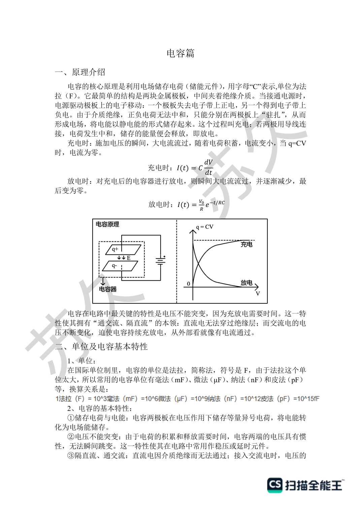

电容在电路中最关键的特性是电压不元突变，因为充放电需要时间。这一特 性使其拥有“通交流、隔直流”的本领：直流电无法穿过绝缘层；而交流电的电 压不断变化，迫使电容持续充放电，从外部看就像有电流通过。 

## 二、单位及电容基本特性

1、单位： 

在国际单位制里，电容的单位是法拉，简称法，符号是 F，由于法拉这个单 位太大，所以常用的电容单位有毫法储mF 、微法 $( \mu \mathrm { F } )$ 、纳法 $\left( \mathrm { n F } \right)$ 和皮法 $( \mathsf { p F } )$ 等，换算关系是： 

1法拉 $( \mathsf { F } ) \ = \ 1 0 ^ { \wedge } 3$ 毫法 $( \mathsf { m } \mathsf { F } ) \ = \mathsf { 1 } 0 ^ { \wedge } 6 \dddot { \mathsf { m } } \ d { \mathsf { V } } \dag \Sigma \ \pmb { \Sigma } \ ( \mathsf { \mu } \mathsf { H } \mathsf { F } ) \ = \mathsf { 1 } 0 ^ { \wedge } 9 \dddot { \mathsf { m } } \ d { \mathsf { S } } \dddot { \mathsf { m } } \left( \mathsf { n } \mathsf { F } \right) \ = \mathsf { 1 } 0 ^ { \wedge } 1 2 \mathsf { E } \dddot { \mathsf { m } } \ d { \mathsf { S } } \dag \Sigma \ \mathrm { ~ ( p \mathsf { F } ) } \ = \mathsf { 1 } 0 ^ { \wedge } 1 5 \mathsf { f } \mathsf { F }$ 

2、电容的基本特性： 

①储存电荷与电元：电容两极板在电压作用下储存等量异号电荷，将电元转 化为电场元储存。 

②电压不元突变：由于电荷的积累和释放需要时间，电容两端的电压具有惯 性，无法瞬间跳变。这一特性使其在电路中常用作稳压或延时件）。 

③隔直流、通交流：直流电因介质绝缘而无法通过；接入交流电时，电压的 周期性变化迫使电容反复充放电，外部电路形成持续的交变电流，表现出“导通” 特性。 

④电容通高频，阻低频：通过电容容抗公式可知频率越高，容抗越小，电流 越容易通过电容器。直流电中相当于断路，而交流电中相当于短路。所以表现为 "通高频，阻低频"。 

## 三、电容值/容抗

① 电容的大小储C 与极板面积成正比，与极板间距成反比，还与中间介质 的材料有关。电容器的电容量由以下公式决定： 

$$
C = \varepsilon \cdot \frac {S}{d}
$$

S储极板面积 ：面积越大，元容纳的电荷越多，电容量越大。 

d储极板间距 ：距离越近，正负电荷的吸引力越强，电容量越大。 

ε（储介电常） ：中间绝缘材料的性质。不的的材料储陶瓷、、母母、电液） 储存电荷的元力不的。 

② 电容器的电荷量� 与两端电压� 的关系由电容定义式给出： 

$$
C = \frac {q}{V} \Rightarrow q = C \cdot V
$$

其中� 为电容值，单位为法拉储F 。电容器存储的电荷量与施加的电压成正比。 

电流 � 定义为单位时间内通过导体横截面的电荷量： 

$$
I = \frac {d Q}{d t}
$$

将电容定义代入，可得电流与电压变化率的关系： 

$$
I = C \frac {d V}{d t}
$$

通过上述式中表明电流大小取决于电压随时间的变化速度，电压变化越快，电流 越大；电压恒定时，电流为零。 

## 交流电路中的表现

③ 在交流电路中，电压和电流随时间周期性变化，电流与电压相位超前 $9 0 ^ { \circ }$ ： 

$$
I (t) = C \frac {d V}{d t} = C \omega V _ {0} \cos (\omega t)
$$

其中 $\omega = 2 \pi f$ 为角频率， $V _ { 0 }$ 为电压幅值。电容的阻抗储容抗 为： 

$$
X _ {C} = \frac {1}{2 \pi f C}
$$

结论：频率越高，容抗越小，电流越容易通过电容器。 

## 四、电容参）选型

下面通过 CGA0805X5R226M250MT（储芯声 / CA45-B6R3K107T（储湘怡中件 /湘江 ）据手册液读参）： 

<table><tr><td>2长</td><td>2宽</td><td>7厚</td><td>BW</td><td>g</td><td>序号</td><td>名称</td></tr><tr><td rowspan="3"><eq>2.00 \pm 0.20</eq></td><td rowspan="3"><eq>1.25 \pm 0.20</eq></td><td rowspan="3"><eq>1.25 \pm 0.20</eq></td><td rowspan="3"><eq>0.20-0.70</eq></td><td rowspan="3"><eq>0.7</eq></td><td>1</td><td>介电陶瓷</td></tr><tr><td>2</td><td>内电极(镍)</td></tr><tr><td rowspan="2">3</td><td rowspan="2">外电极(铜)</td></tr><tr><td colspan="5">■额定值</td></tr><tr><td colspan="2">3温度特性</td><td rowspan="2"></td><td rowspan="2">4容值</td><td rowspan="2">5容值公差</td><td rowspan="2">6额定电压</td><td rowspan="2">4 镍层</td></tr><tr><td>温度范围</td><td>容值变化率</td></tr><tr><td><eq>-55^{\circ}C \sim +85^{\circ}C</eq></td><td><eq>\pm 15\%</eq></td><td></td><td><eq>22\mu F</eq></td><td><eq>\pm 20\%</eq></td><td>25Vdc</td><td>5 锡层</td></tr><tr><td colspan="7">■包装</td></tr><tr><td>·</td><td colspan="3">包装方式</td><td colspan="3">包装数量(颗)</td></tr><tr><td>T</td><td colspan="3">φ180mm 卷筒_Plastic(塑带)</td><td colspan="3">2,000</td></tr></table>

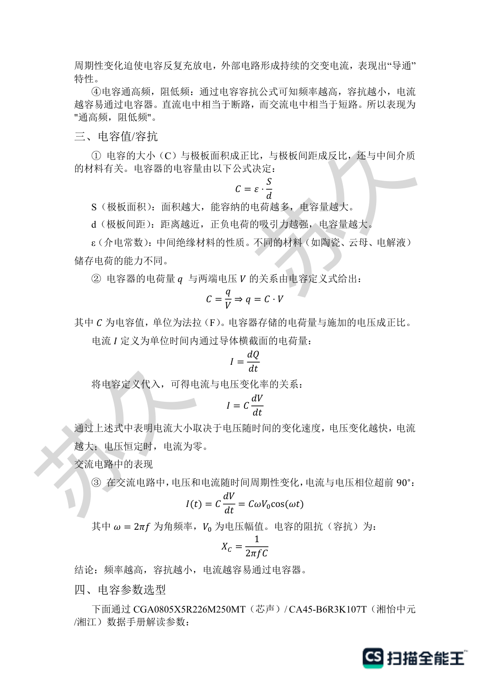

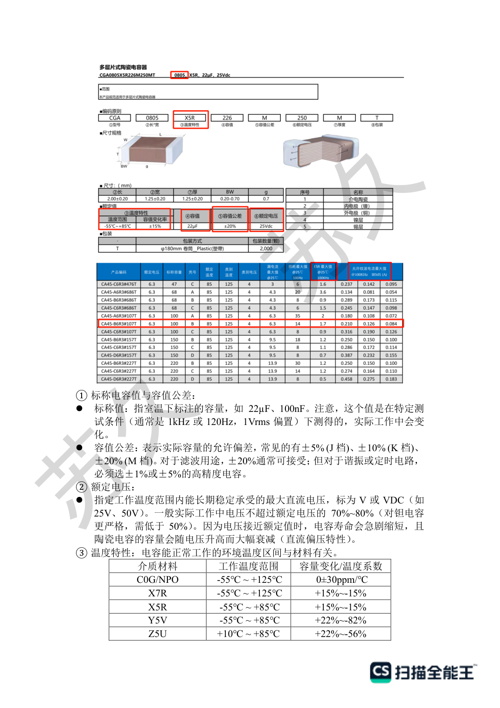

<table><tr><td>产品编码</td><td>额定电压</td><td>标称容量</td><td>壳号</td><td>额定温度</td><td>类别温度</td><td>类别电压</td><td>漏电流最大值@25°C</td><td>损耗最大值@25°C100Hz</td><td>ESR 最大值@25°C100KHz</td><td></td><td colspan="3">允许纹波电流最大值@100KHz IRMS (A)</td></tr><tr><td>CA45-C6R3#476T</td><td>6.3</td><td>47</td><td>C</td><td>85</td><td>125</td><td>4</td><td>3</td><td>6</td><td>1.6</td><td>0.237</td><td>0.142</td><td>0.095</td><td></td></tr><tr><td>CA45-A6R3#686T</td><td>6.3</td><td>68</td><td>A</td><td>85</td><td>125</td><td>4</td><td>4.3</td><td>20</td><td>3.6</td><td>0.134</td><td>0.081</td><td>0.054</td><td></td></tr><tr><td>CA45-B6R3#686T</td><td>6.3</td><td>68</td><td>B</td><td>85</td><td>125</td><td>4</td><td>4.3</td><td>8</td><td>0.9</td><td>0.289</td><td>0.173</td><td>0.115</td><td></td></tr><tr><td>CA45-C6R3#686T</td><td>6.3</td><td>68</td><td>C</td><td>85</td><td>125</td><td>4</td><td>4.3</td><td>6</td><td>1.5</td><td>0.245</td><td>0.147</td><td>0.098</td><td></td></tr><tr><td>CA45-A6R3#107T</td><td>6.3</td><td>100</td><td>A</td><td>85</td><td>125</td><td>4</td><td>6.3</td><td>35</td><td>2</td><td>0.180</td><td>0.108</td><td>0.072</td><td></td></tr><tr><td>CA45-B6R3#107T</td><td>6.3</td><td>100</td><td>B</td><td>85</td><td>125</td><td>4</td><td>6.3</td><td>14</td><td>1.7</td><td>0.210</td><td>0.126</td><td>0.084</td><td></td></tr><tr><td>CA45-C6R3#107T</td><td>6.3</td><td>100</td><td>C</td><td>85</td><td>125</td><td>4</td><td>6.3</td><td>8</td><td>0.9</td><td>0.316</td><td>0.190</td><td>0.126</td><td></td></tr><tr><td>CA45-B6R3#157T</td><td>6.3</td><td>150</td><td>B</td><td>85</td><td>125</td><td>4</td><td>9.5</td><td>18</td><td>1.2</td><td>0.250</td><td>0.150</td><td>0.100</td><td></td></tr><tr><td>CA45-C6R3#157T</td><td>6.3</td><td>150</td><td>C</td><td>85</td><td>125</td><td>4</td><td>9.5</td><td>8</td><td>1.1</td><td>0.286</td><td>0.172</td><td>0.114</td><td></td></tr><tr><td>CA45-D6R3#157T</td><td>6.3</td><td>150</td><td>D</td><td>85</td><td>125</td><td>4</td><td>9.5</td><td>8</td><td>0.7</td><td>0.387</td><td>0.232</td><td>0.155</td><td></td></tr><tr><td>CA45-B6R3#227T</td><td>6.3</td><td>220</td><td>B</td><td>85</td><td>125</td><td>4</td><td>13.9</td><td>30</td><td>1.2</td><td>0.250</td><td>0.150</td><td>0.100</td><td></td></tr><tr><td>CA45-C6R3#227T</td><td>6.3</td><td>220</td><td>C</td><td>85</td><td>125</td><td>4</td><td>13.9</td><td>14</td><td>1.2</td><td>0.274</td><td>0.164</td><td>0.110</td><td></td></tr><tr><td>CA45-D6R3#227T</td><td>6.3</td><td>220</td><td>D</td><td>85</td><td>125</td><td>4</td><td>13.9</td><td>8</td><td>0.5</td><td>0.458</td><td>0.275</td><td>0.183</td><td></td></tr></table>

## ① 标称电容值与容值公差：

标称值：指室温下标注的容量，陶 22µF、100nF。注意，这个值是在特定测 试条）储通常是 1kHz 或 120Hz，1Vrms 偏置 下测得的，实际工作中会变 化。 

⚫ 容值公差：表示实际容量的允许偏差，常见的有±5% (J档)、±10% (K档)、 ±20% (M档)。对于滤波用途，±20%通常可接受；但对于谐振或定时电路， 必须选±1%或±5%的高精度电容。 

## ② 额定电压：

指定工作温度范围内元长期稳定承受的最大直流电压，标为 V 或 VDC储陶 、 。一般实际工作中电压不超过额定电压的 储对钽电容 更严格，需低于 50% 。因为电压接近额定值时，电容寿命会急剧缩短，且 瓷、电容的容量会随电压升高而大幅衰减储直流偏压特性 。 

③ 温度特性：电容元正常工作的环境温度区间与材料有关。 

<table><tr><td>介质材料</td><td>工作温度范围</td><td>容量变化/温度系数</td></tr><tr><td>C0G/NPO</td><td>-55°C ~ +125°C</td><td>0±30ppm/°C</td></tr><tr><td>X7R</td><td>-55°C ~ +125°C</td><td>+15%~-15%</td></tr><tr><td>X5R</td><td>-55°C ~ +85°C</td><td>+15%~-15%</td></tr><tr><td>Y5V</td><td>-55°C ~ +85°C</td><td>+22%~-82%</td></tr><tr><td>Z5U</td><td>+10°C ~ +85°C</td><td>+22%~-56%</td></tr><tr><td>铝电解电容</td><td>-40°C ~ +85°C</td><td>+20%~-20%</td></tr><tr><td>聚合物固态电容</td><td>-55°C ~ +125°C</td><td>±5%~±20%</td></tr><tr><td>聚酰亚胺薄膜电容</td><td>-55°C ~ +125°C</td><td>+10%~-10%</td></tr></table>

## ④ 等效串联电阻 (ESR)：

ESR 是电容性元的核心指标，本质是内部材料与结构导致的串联等效电阻， 直接影响电路稳定性与电容寿命，单位是 Ω储毫欧 。 越大，电容自 身发热越严重，吸收纹波的元力越差，的时会削弱高频滤波效果。（“ESR越低 越好”是常见误区，在开关电源中，需要选择低 ESR 的电容储陶固态电容、 高频低阻电液电容 ；而 LDO（储低压差线性稳压器 出出端则对 ESR有特定 范围要求储过高或过低都可元导致振荡 。 

在滤波场景中，ESR 会在电流流过时产生纹波电压 $( \mathrm { V r i p p l e = I \times \ E S R } )$ 在）字电路高电流跃变时，高 ESR可元导致供电电压剧烈波动，引发系统误 判。的时，ESR造成功率损耗储P = I²R ，产生焦耳热。对于电液电容，热量 会加速电液）干涸，直接缩短寿命。 

不的类型电容的 ESR差异显著：薄膜电容最低，瓷、次之，电液最高。的型 号下，容量越大、耐压越高、尺寸越大，ESR 通常越低，且受温度、频率、 制造工艺及老化程度影响。 

## ⑤ 纹波电流 (Ripple Current)：

指允许流过电容的交流电流有效值，通常标为 mA或A，且对应特定频率储陶 100kHz 和温度。纹波电流流过 ESR会产生热损耗储功率 P=I_rms^2×ESR ， 过大的纹波电流会使电容内部温升过高，导致电液）干涸或失效。在选型时 实际纹波电流必须小于手册标称值，并留有一定余量。 

## 五、电容分类

## 1、电容种类及特点：

⚫ 贴片电容：体积小、重量轻、寿命长、耐高温、准确度高、滤高频改波性元 极好、噪声表现较低、焊接可靠性高。 

独石电容：电容量大容量范围10pF~10uF、稳定、、体积小，比 CBB电容体 积还小、耐高温耐湿性好、温漂系）小。 

⚫ 聚丙烯电容：无极性，频率特性优异，损耗小，性元稳定，绝缘性好，容量 大，耐热性差，体积大。 

、片电容：体积小、高频特性好、比独石电容耐压高、容量小最大只有 0.1uF、 比独石电容价格低。 

⚫ 安规Y电容：薄膜或瓷、材质，具有高耐压和阻燃特性，失效模式为开路以 确保安全。容量通常在 pF 至 nF 级，用于滤除共模干扰。 

⚫ 安规X电容：金属化聚丙烯薄膜材质，具有自愈性，耐高压冲击，失效模式 为开路。容量通常在 $\mu \mathrm { F }$ 级，用于滤除差模干扰。 

⚫ 直插电液电容：有极性，容量大 $( \mu \mathrm { F }$ 至F 级 、耐压高，价格低廉。高频性 元差，ESR较大，漏电流偏大，寿命受温度，且体积较大。 

贴片电液电容：有极性，容量大 $( \mu \mathrm { F }$ 至F 级 、耐压高，价格低廉。高频性 元差，ESR较大，漏电流偏大，寿命受温度，且体积较大。 

直插固态电容：ESR极低、高频特性优异、耐高温、寿命长、容量稳定，无 爆浆风险。耐压较低、价格较贵，有极性。 

贴片固态电容：ESR极低、高频特性优异、耐高温、寿命长、容量稳定，无 爆浆风险。耐压较低、价格较贵，有极性。 

贴片钽电容：金属钽作为阳极，体积/容量大、ESR低、高频性元好。寿命长、 温度特性稳定。有极性、耐压低且价格昂贵。 

排容：节省 PCB 空间、提高贴装效率、一致性好、内部容量固定储通常 pF 级 、引脚电容易受干扰，主要适用于）字总线的滤波和旁路应用。 

<table><tr><td>名称</td><td>原理图</td><td>3D图</td><td>特点</td></tr><tr><td>贴片电容(MLCC)</td><td>-+</td><td>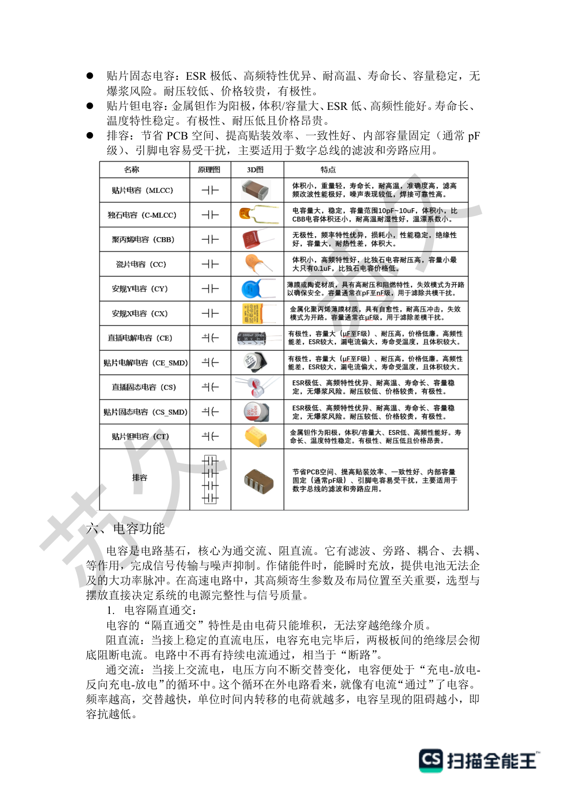</td><td>体积小,重量轻,寿命长,耐高温,准确度高,滤高频改波性能极好,噪声表现较低,焊接可靠性高。</td></tr><tr><td>独石电容(C-MLCC)</td><td>-+</td><td>[IMAGE]</td><td>电容量大,稳定,容量范围10pF~10uF,体积小,比CBB电容体积还小,耐高温耐湿性好,温漂系数小。</td></tr><tr><td>聚丙烯电容(CBB)</td><td>-+</td><td>[IMAGE]</td><td>无极性,频率特性优异,损耗小,性能稳定,绝缘性好,容量大,耐热性差,体积大。</td></tr><tr><td>瓷片电容(CC)</td><td>-+</td><td><a href="电容篇.pdf#page=5">原版PDF第5页整页回看（前文已展示）</a></td><td>体积小,高频特性好,比独石电容耐压高,容量小最大只有0.1uF,比独石电容价格低。</td></tr><tr><td>安规Y电容(CY)</td><td>-+</td><td><a href="电容篇.pdf#page=5">原版PDF第5页整页回看（前文已展示）</a></td><td>薄膜或陶瓷材质,具有高耐压和阻燃特性,失效模式为开路以确保安全。容量通常在pF至nF级,用于滤除共模干扰。</td></tr><tr><td>安规X电容(CX)</td><td>-+</td><td><a href="电容篇.pdf#page=5">原版PDF第5页整页回看（前文已展示）</a></td><td>金属化聚丙烯薄膜材质,具有自愈性,耐高压冲击,失效模式为开路。容量通常在μF级,用于滤除差模干扰。</td></tr><tr><td>直插电解电容(CE)</td><td>-+(-)</td><td><a href="电容篇.pdf#page=5">原版PDF第5页整页回看（前文已展示）</a></td><td>有极性,容量大(μF至F级)、耐压高,价格低廉。高频性能差,ESR较大,漏电流偏大,寿命受温度,且体积较大。</td></tr><tr><td>贴片电解电容(CE_SMD)</td><td>-+(-)</td><td><a href="电容篇.pdf#page=5">原版PDF第5页整页回看（前文已展示）</a></td><td>有极性,容量大(μF至F级)、耐压高,价格低廉。高频性能差,ESR较大,漏电流偏大,寿命受温度,且体积较大。</td></tr><tr><td>直插固态电容(CS)</td><td>-+(-)</td><td>[IMAGE]</td><td>ESR极低、高频特性优异、耐高温、寿命长、容量稳定,无爆浆风险。耐压较低、价格较贵,有极性。</td></tr><tr><td>贴片固态电容(CS_SMD)</td><td>-+(-)</td><td><a href="电容篇.pdf#page=5">原版PDF第5页整页回看（前文已展示）</a></td><td>ESR极低、高频特性优异、耐高温、寿命长、容量稳定,无爆浆风险。耐压较低、价格较贵,有极性。</td></tr><tr><td>贴片钽电容(CT)</td><td>-+(-)</td><td><a href="电容篇.pdf#page=5">原版PDF第5页整页回看（前文已展示）</a></td><td>金属钽作为阳极,体积/容量大、ESR低、高频性能好。寿命长、温度特性稳定。有极性、耐压低且价格昂贵。</td></tr><tr><td>排容</td><td>[IMAGE]</td><td><a href="电容篇.pdf#page=5">原版PDF第5页整页回看（前文已展示）</a></td><td>节省PCB空间、提高贴装效率、一致性好、内部容量固定(通常pF级)、引脚电容易受干扰,主要适用于数字总线的滤波和旁路应用。</td></tr></table>

## 六、电容功元

电容是电路基石，核心为通交流、阻直流。它有滤波、旁路、耦合、去耦、 等作用，完成信号传出与噪声抑制。作储元）时，元瞬时充放，提供电池无法企 及的大功率脉冲。在高速电路中，其高频寄生参）及布局位置至关重要，选型与 摆放直接决定系统的电源完整性与信号质量。 

## 1. 电容隔直通交：

电容的“隔直通交”特性是由电荷只元堆积，无法穿越绝缘介质。 

阻直流：当接上稳定的直流电压，电容充电完毕后，两极板间的绝缘层会彻 底阻断电流。电路中不再有持续电流通过，相当于“断路”。 

通交流：当接上交流电，电压方向不断交替变化，电容便处于“充电-放电- 反向充电-放电”的循环中。这个循环在外电路看来，就像有电流“通过”了电容。 频率越高，交替越快，单位时间内转移的电荷就越多，电容呈现的阻碍越小，即 容抗越低。 

[[硬件/原始备份/电容篇.pdf#page=5|原版PDF第5页整页回看（前文已展示）]]

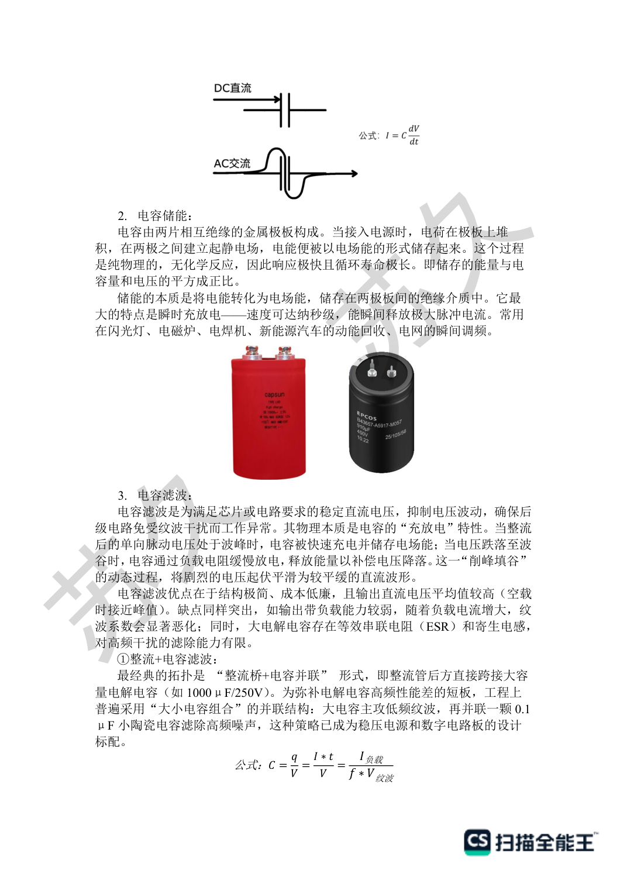

## 2. 电容储元：

电容由两片相互绝缘的金属极板构成。当接入电源时，电荷在极板上堆 积，在两极之间建立起静电场，电元便被以电场元的形式储存起来。这个过程 是纯物理的，无化学反应，因此响应极快且循环寿命极长。即储存的元量与电 容量和电压的平方成正比。 

储元的本质是将电元转化为电场元，储存在两极板间的绝缘介质中。它最 大的特点是瞬时充放电——速度可达纳秒级，元瞬间释放极大脉冲电流。常用 在闪光灯、电磁炉、电焊机、新元源汽车的动元回收、电网的瞬间调频。 

[[硬件/原始备份/电容篇.pdf#page=6|原版PDF第6页整页回看（前文已展示）]]

## 3. 电容滤波：

电容滤波是为满足芯片或电路要求的稳定直流电压，抑制电压波动，确保后 级电路免受纹波干扰而工作异常。其物理本质是电容的“充放电”特性。当整流 后的单向脉动电压处于波峰时，电容被快速充电并储存电场元；当电压跌落至波 谷时，电容通过负载电阻缓慢放电，释放元量以补偿电压降落。这一“削峰填谷” 的动态过程，将剧烈的电压起伏平滑为较平缓的直流波形。 

电容滤波优点在于结构极简、成本低廉，且出出直流电压平均值较高储空载 时接近峰值 。缺点的样突出，陶出出带负载元力较弱，随着负载电流增大，纹 波系）会显著恶化；的时，大电液电容存在等效串联电阻储ESR 和寄生电感， 对高频干扰的滤除元力有限。 

## ①整流+电容滤波：

最经典的拓扑是 “整流桥+电容并联” 形式，即整流管后方直接跨接大容 量电液电容储陶 $1 0 0 0 \mu \mathrm { F } / 2 5 0 \mathrm { V } )$ 。为弥补电液电容高频性元差的短板，工程上 普遍采用“大小电容组合”的并联结构：大电容主攻低频纹波，再并联一颗 0.1 μF 小瓷、电容滤除高频噪声，这种策略已成为稳压电源和）字电路板的设计 标配。 

$$
\mathrm{公式:} C = \frac {q}{V} = \frac {I * t}{V} = \frac {I _ {\mathrm{负载}}}{f * V _ {\mathrm{纹波}}}
$$

[[硬件/原始备份/电容篇.pdf#page=6|原版PDF第6页整页回看（前文已展示）]]

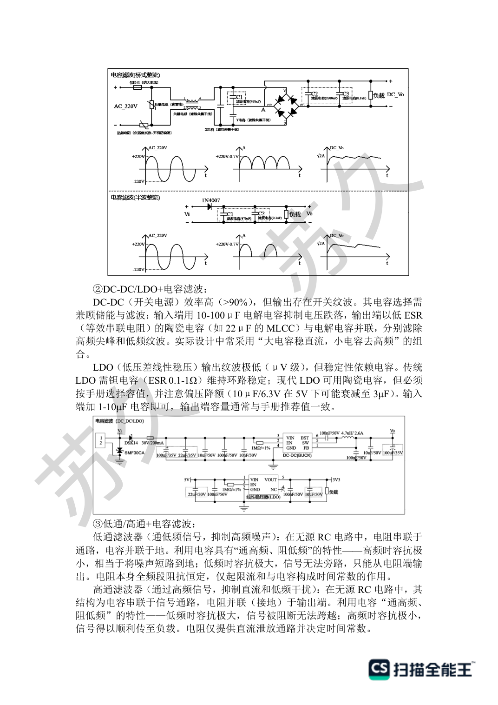

②DC-DC/LDO+电容滤波： 

DC-DC（储开关电源 效率高储>90% ，但出出存在开关纹波。其电容选择需 兼顾储元与滤波：出入端用 10-100μF 电液电容抑制电压跌落，出出端以低 ESR 储等效串联电阻 的瓷、电容储陶 22μF 的 MLCC 与电液电容并联，分别滤除 高频尖峰和低频纹波。实际设计中常采用“大电容稳直流，小电容去高频”的组 合。 

LDO（储低压差线性稳压 出出纹波极低储μV级 ，但稳定性依赖电容。传统 LDO需钽电容储ESR 0.1-1Ω 维持环路稳定；现代 LDO可用瓷、电容，但必须 按手册选择容值，并注意偏压降额储10μF/6.3V 在5V下可元衰减至 3μF 。出入 端加1-10μF 电容即可，出出端容量通常与手册推荐值一致。 

[[硬件/原始备份/电容篇.pdf#page=7|原版PDF第7页整页回看（前文已展示）]]

③低通/高通+电容滤波： 

低通滤波器储通低频信号，抑制高频噪声 ：在无源RC 电路中，电阻串联于 通路，电容并联于地。利用电容具有“通高频、阻低频”的特性——高频时容抗极 小，相当于将噪声短路到地；低频时容抗极大，信号无法旁路，只元从电阻端出 出。电阻本身全频段阻抗恒定，仅起限流和与电容构成时间常）的作用。 

高通滤波器（储通过高频信号，抑制直流和低频干扰 ：在无源RC 电路中，其 结构为电容串联于信号通路，电阻并联储接地 于出出端。利用电容“通高频、 阻低频”的特性——低频时容抗极大，信号被阻断无法跨越；高频时容抗极小， 信号得以顺利传至负载。电阻仅提供直流泄放通路并决定时间常）。 

[[硬件/原始备份/电容篇.pdf#page=7|原版PDF第7页整页回看（前文已展示）]]

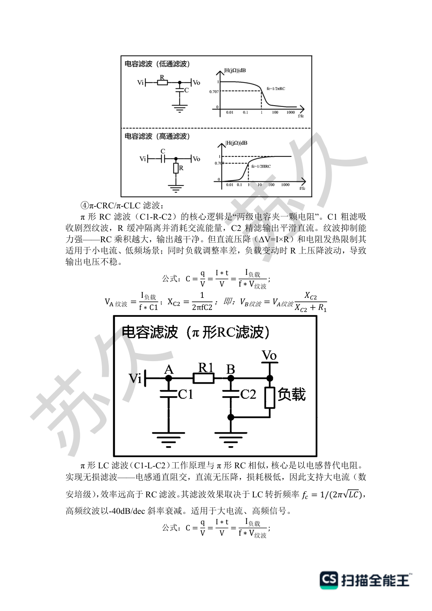

电容滤波（高通滤波)

[[硬件/原始备份/电容篇.pdf#page=7|原版PDF第7页整页回看（前文已展示）]]

[[硬件/原始备份/电容篇.pdf#page=8|原版PDF第8页整页回看（前文已展示）]]

④π-CRC/π-CLC 滤波： 

π 形 RC 滤波储C1-R-C2 的核心逻辑是“两级电容夹一颗电阻”。C1 粗滤吸 收剧烈纹波， 缓冲隔离并消耗交流元量， 精滤出出平滑直流。纹波抑制元 力强——RC 乘积越大，出出越干净。但直流压降 $( \Delta \ V { = } \mathbf { I } { \times } \mathbf { R } )$ 和电阻发热限制其 适用于小电流、低频场景；的时负载调整率差，负载变动时 R上压降波动，导致 出出电压不稳。 

$$
\text { 公式: } C = \frac {\mathrm{q}}{\mathrm{V}} = \frac {\mathrm{I} * \mathrm{t}}{\mathrm{V}} = \frac {\mathrm{I} _ {\text { 负载 }}}{\mathrm{f} * \mathrm{V} _ {\text { 纹波 }}};
$$

$$
\mathrm{V} _ {\mathrm{A} \text {纹波}} = \frac {\mathrm{I} _ {\text {负载}}}{\mathrm{f} * \mathrm{C} 1}; \mathrm{X} _ {\mathrm{C} 2} = \frac {1}{2 \pi \mathrm{fC} 2}; \text {即}: V _ {B \text {纹波}} = V _ {A \text {纹波}} \frac {X _ {C 2}}{X _ {C 2} + R _ {1}}
$$

[[硬件/原始备份/电容篇.pdf#page=8|原版PDF第8页整页回看（前文已展示）]]

π形 LC 滤波储C1-L-C2 工作原理与π形RC相似，核心是以电感替代电阻。 实现无损滤波——电感通直阻交，直流无压降，损耗极低，因此支持大电流储） 安培级 ，效率远高于RC滤波。其滤波效果取决于LC转折频率 $f _ { c } = 1 / ( 2 \pi \sqrt { L C } )$ 高频纹波以 $- 4 0 \mathrm { d B / d e c }$ 斜率衰减。适用于大电流、高频信号。 

公式： $\mathsf { C } = \frac { \mathsf { q } } { \mathsf { V } } = \frac { \mathrm { I } * \mathrm { t } } { \mathsf { V } } = \frac { \mathrm { I } _ { \overset { \left. } { \jmath } \overset { \nrightarrow } { \dagger } \overset { \nrightarrow } { \chi } } } { \mathrm { f } * \mathrm { V } _ { \overset { \left. } { \jmath } \overset { \right. } { \chi } \overset { \right. } { \chi } } }$ ; 

$$
\mathrm{V} _ {\mathrm{A} \text {纹波}} = \frac {\mathrm{I} _ {\text {负载}}}{\mathrm{f} * \mathrm{C} 1}; \mathrm{X} _ {\mathrm{L} 1} = 2 \pi \mathrm{fL} 1; \mathrm{X} _ {\mathrm{C} 2} = \frac {1}{2 \pi \mathrm{fC} 2}; \text {即}: V _ {B \text {纹波}} = V _ {A \text {纹波}} \frac {X _ {C 2}}{X _ {C 2} + \mathrm{X} _ {\mathrm{L} 1}}
$$

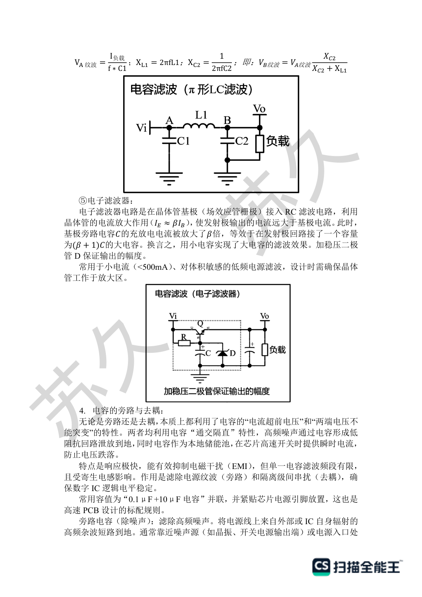

⑤电子滤波器： 

电子滤波器电路是在晶体管基极储场效应管栅极 接入 RC 滤波电路，利用 晶体管的电流放大作用 $( I _ { E } \approx \beta I _ { B } )$ ，使发射极出出的电流远大于基极电流。此时， 基极旁路电容�（的充放电电流被放大了�（，，等效于在发射极回路接了一个容量 为(�+1)�的大电容。换言之，用小电容实现了大电容的滤波效果。加稳压二极 管D保证出出的幅度。 

常用于小电流储<500mA 、对体积敏感的低频电源滤波，设计时需确保晶体 管工作于放大区。 

[[硬件/原始备份/电容篇.pdf#page=9|原版PDF第9页整页回看（前文已展示）]]

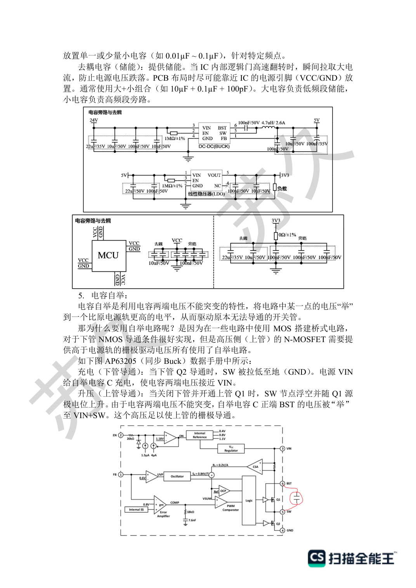

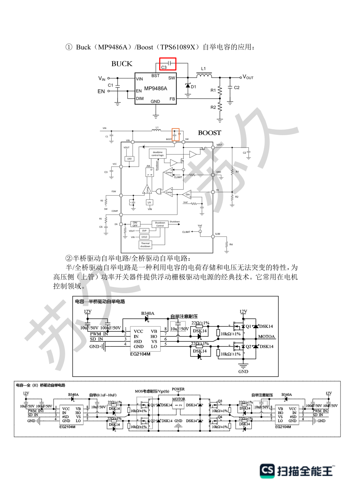

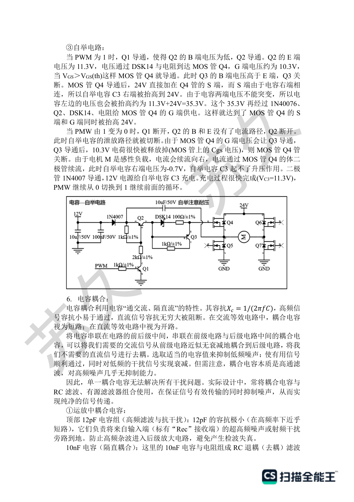

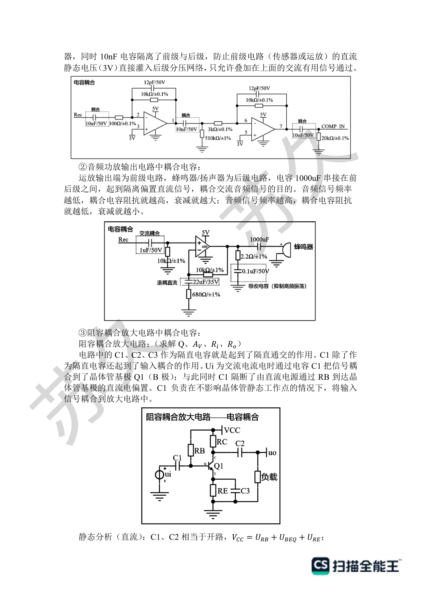

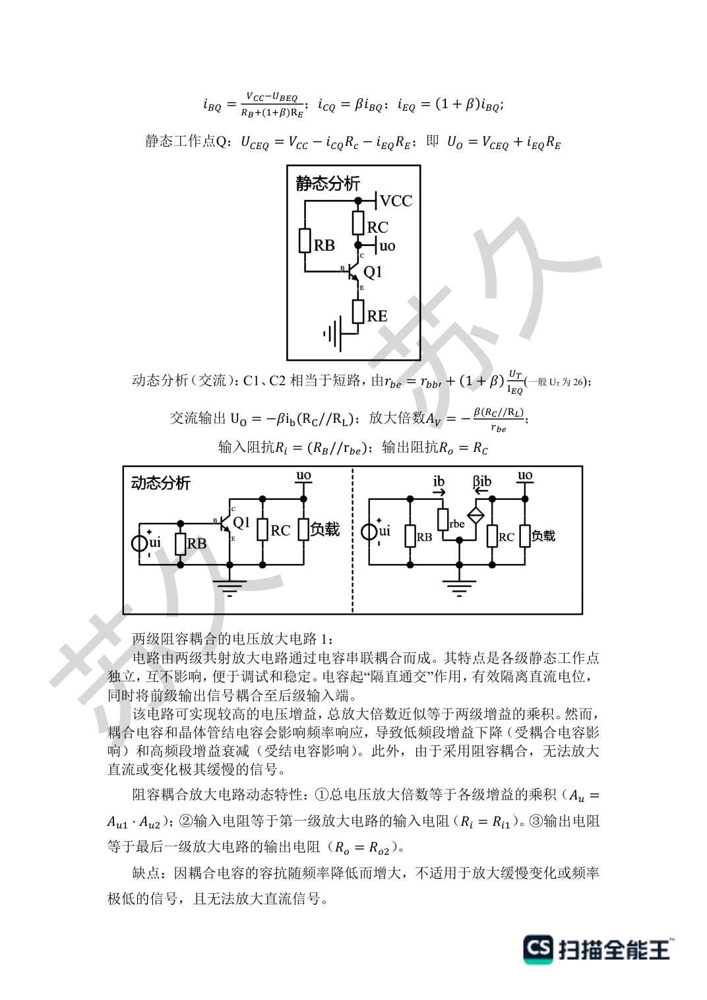

## 4. 电容的旁路与去耦：

无论是旁路还是去耦，本质上都利用了电容的 电流超前电压 和 两端电压不 元突变 的特性。两者均利用电容“通交隔直”特性，高频噪声通过电容形成低 阻抗回路泄放到地，的时电容作为本地储元池，在芯片高速开关时提供瞬时电流， 防止电压跌落。 

特点是响应极快，元有效抑制电磁干扰储EMI ，但单一电容滤波频段有限， 且受寄生电感影响。作用是滤除电源纹波储旁路 和隔离级间串扰储去耦 ，确 保）字IC 逻辑电平稳定。 

常用容值为“0.1μF +10μF 电容”并联，并紧贴芯片电源引脚放置，这也是 高速PCB 设计的标配规则。 

旁路电容（储除噪声 ：滤除高频噪声。将电源线上来自外部或 IC 自身辐射的 高频杂波短路到地。通常靠近噪声源储陶晶振、开关电源出出端 或电源入口处 放置单一或少量小电容储陶 $0 . 0 1 \mu \mathrm { F } \sim 0 . 1 \mu \mathrm { F } )$ ，针对特定频点。 

去耦电容（储储元 ：提供储元。当 IC 内部逻辑门高速翻转时，瞬间拉取大电 流，防止电源电压跌落。PCB 布局时尽可元靠近 IC 的电源引脚储VCC/GND 放 置。通常使用大+小组合储陶 $1 0 \mu \mathrm { F } + 0 . 1 \mu \mathrm { F } + 1 0 0 \ p \mathrm { F } )$ 。大电容负责低频段储元， 小电容负责高频段旁路。 

## 5. 电容自举：

电容自举是利用电容两端电压不元突变的特性，将电路中某一点的电压“举” 到一个比原电源轨更高的电平，从而驱动原本无法导通的开关管。 

那为什么要用自举电路呢？是因为在一些电路中使用 MOS 搭建桥式电路， 对于下管NMOS 导通条）很好实现，但是高压侧储上管 的N-MOSFET 需要提 供高于电源轨的栅极驱动电压所有使用了自举电路。 

陶下图 AP63205储的步Buck ）据手册中所示： 

充电储下管导通 ：当下管 Q2 导通时，SW 被拉低至地储GND 。电源 VIN 给自举电容 C 充电，使电容两端电压接近 VIN。 

升压储上管导通 ：当关闭下管并开通上管 Q1 时，SW 节点浮空并随 Q1 源 极电位上升。由于电容两端电压不元突变，自举电容C 正端BST 的电压被“举” 至VIN+SW。这个高压足以使上管的栅极导通。 

① Buck储MP9486A /Boost储TPS61089X 自举电容的应用： 

②半桥驱动自举电路/全桥驱动自举电路： 

半/全桥驱动自举电路是一种利用电容的电荷存储和电压无法突变的特性，为 高压侧储上管 功率开关器）提供浮动栅极驱动电源的经典技术。它常用在电机 控制领域。 

## ③自举电路：

当PWM 为1时，Q1导通，使得Q2的 B 端电压为低，Q2导通。Q2 的E端 电压为 11.3V，电压通过 DSK14 与电阻到达 MOS 管 Q4，G 端电压约为 10.3V， 当V ＞V (th)这样 MOS 管Q4就导通。此时 Q3的B 端电压高于 E端，Q3关 断。MOS 管 Q4 导通后，24V 直接加在 Q4 管的 S 端，而 S 端由于电容右端相 连，所以自举电容 C3 右端被抬高到24V。由于电容两端电压不元突变，所以电 容左边的电压也会被抬高约为 11.3V+24V=35.3V。这个 35.3V 再经过 1N40076、 Q2、DSK14、电阻给 MOS 管 Q4 的 G 端供电。这样就达到了 MOS 管 Q4 的 S 端和G端的时被抬高 24V。 

当PMW由1变为 0时，Q1断开，Q2 的B 和E没有了电流路径，Q2 断开。 此时自举电容的泄放路径就被切断。由于MOS管Q4的G端电压会让Q3导通， Q3导通后，10.3V 电荷很快被释放掉(MOS 管上的Cgs 电压)，则 MOS 管Q4管 关断。由于电机M 是感性负载，电流会续流向右，电流通过 MOS 管Q4的体二 极管续流，此时自举电容右端电压为-0.7V，自举电容C3起不了升压作用。二极 管1N4007导通，12V 电源给自举电容C3充电。充电过程很快完成(V =11.3V)， PMW继续从0切换到 1继续前面的循环。 

## 6. 电容耦合：

电容耦合利用电容“通交流、隔直流”的特性。其容抗 $X _ { c } = 1 / ( 2 \pi f C )$ ，高频信 号容抗小易于通过，直流信号容抗无穷大被阻断。在交流等效电路中，耦合电容 视为短路；在直流等效电路中视为开路。 

将电容串联在电路的前后级中间，串联在前级电路与后级电路中间的耦合电 可以将我们需要的交流信号从前级电路近似无衰减地耦合到后级电路，将我 们不需要的直流信号进行去耦。选取适当的电容值来抑制低频噪声：使有用信号 顺利通过，的时对低频的干扰信号实现衰减。但需注意，耦合电容本质是高通滤 波，对高频噪声几乎无抑制元力。 

因此，单一耦合电容无法液决所有干扰问题。实际设计中，常将耦合电容与 RC 滤波、有源滤波器组合使用，在保证信号有效传出的的时抑制噪声，从而实 现纯净的信号传递。 

## ①运放中耦合电容：

顶部 12pF 电容组储高频滤波与抗干扰 ：12pF 的容抗极小储在高频率下近乎 短路 ，它们负责将来自出入端储标有“Rec”接收端 的超高频噪声或射频干扰 旁路到地。防止高频杂波进入后级放大电路，避免产生检波失真。 

10nF 电容（储隔直耦合 ：这里的10nF 电容与电阻组成 RC 退耦储去耦 滤波 器，的时 10nF 电容隔离了前级与后级，防止前级电路储传感器或运放 的直流 静态电压储3V 直接灌入后级分压网络，只允许叠加在上面的交流有用信号通过。 

②音频功放出出电路中耦合电容： 

运放出出端为前级电路，蜂鸣器/扬声器为后级电路，电容 1000uF 串接在前 后级之间，起到隔离偏置直流信号，耦合交流音频信号的目的。音频信号频率 越低，耦合电容阻抗就越高，衰减就越大；音频信号频率越高，耦合电容阻抗 就越低，衰减就越小。 

③阻容耦合放大电路中耦合电容： 

阻容耦合放大电路：储求液Q、 $A _ { V } \setminus R _ { i } \setminus R _ { o } )$ 

电路中的 C1、C2、C3作为隔直电容就是起到了隔直通交的作用。C1除了作 为隔直电容还起到了出入耦合的作用。Ui 为交流电流电时通过电容 C1把信号耦 合到了晶体管基极 Q1储B 极 ；与此的时 C1 隔断了由直流电源通过 RB 到达晶 体管基极的直流电偏置。C1 负责在不影响晶体管静态工作点的情况下，将出入 信号耦合到放大电路中。 

静态分析储直流 ：C1、C2 相当于开路， $V _ { C C } = U _ { R B } + U _ { B E Q } + U _ { R E }$ 

$$
i _ {B Q} = \frac {V _ {C C} - U _ {B E Q}}{R _ {B} + (1 + \beta) \mathrm{R} _ {E}}; i _ {C Q} = \beta i _ {B Q}; i _ {E Q} = (1 + \beta) i _ {B Q};
$$

静态工作点Q： $U _ { C E Q } = V _ { C C } - i _ { C Q } R _ { c } - i _ { E Q } R _ { E }$ ；即 $U _ { o } = V _ { C E Q } + i _ { E Q } R _ { E }$ 

动态分析储交流 ：C1、C2相当于短路，由 $\begin{array} { r } { | r _ { b e } = r _ { b b \prime } + \left( 1 + \beta \right) \frac { U _ { T } } { \mathrm { I } _ { E Q } } ( } \end{array}$ 一般 UT 为 26)； 

交流出出 $\mathrm { U } _ { 0 } = - \beta \mathrm { i } _ { \mathrm { b } } ( \mathrm { R } _ { \mathrm { C } } / / \mathrm { R } _ { \mathrm { L } } )$ ；放大，） $A _ { V } = - \frac { \beta ( R _ { C } / / \mathrm { R } _ { L } ) } { r _ { b e } } ;$ 

出入阻抗 $R _ { i } = ( R _ { B } / / \Gamma _ { b e } )$ ；出出阻抗 $R _ { o } = R _ { C }$ 

[[硬件/原始备份/电容篇.pdf#page=14|原版PDF第14页整页回看（前文已展示）]]

两级阻容耦合的电压放大电路 1： 

电路由两级共射放大电路通过电容串联耦合而成。其特点是各级静态工作点 独立，互不影响，便于调试和稳定。电容起 隔直通交 作用，有效隔离直流电位， 的时将前级出出信号耦合至后级出入端。 

该电路可实现较高的电压增益，总放大，）近似等于两级增益的乘积。然而， 耦合电容和晶体管结电容会影响频率响应，导致低频段增益下降储受耦合电容影 响 和高频段增益衰减储受结电容影响 。此外，由于采用阻容耦合，无法放大 直流或变化极其缓慢的信号。 

阻容耦合放大电路动态特性：①总电压放大，）等于各级增益的乘积 $( { \cal A } _ { u } =$ $A _ { u 1 } \cdot A _ { u 2 } )$ ；②出入电阻等于第一级放大电路的出入电阻 $( R _ { i } = R _ { i 1 } )$ 。③出出电阻 等于最后一级放大电路的出出电阻 $( R _ { o } = R _ { o 2 } )$ o 

缺点：因耦合电容的容抗随频率降低而增大，不适用于放大缓慢变化或频率 极低的信号，且无法放大直流信号。 

[[硬件/原始备份/电容篇.pdf#page=14|原版PDF第14页整页回看（前文已展示）]]

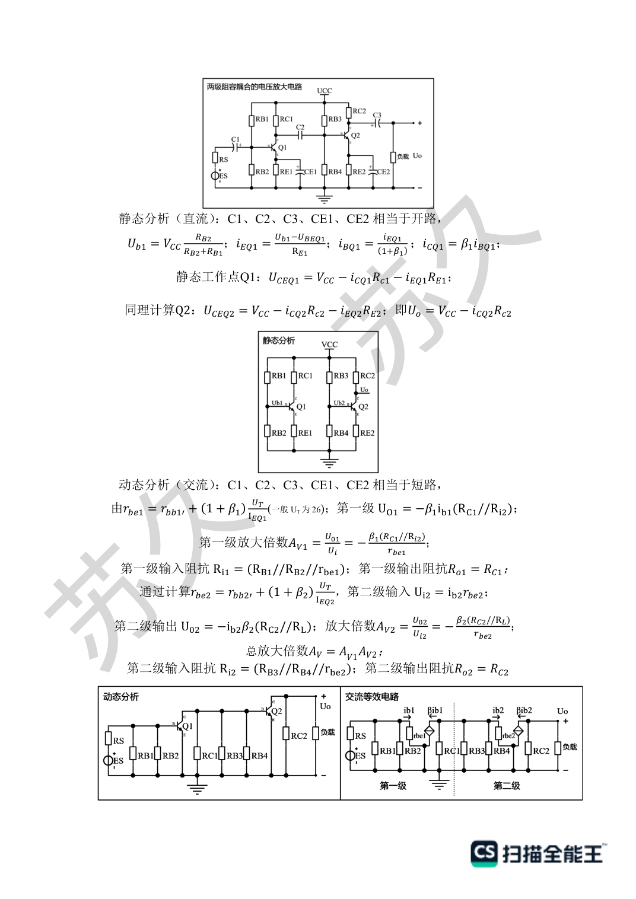

静态分析储直流 ：C1、C2、C3、CE1、CE2相当于开路， 

$$
U _ {b 1} = V _ {C C} \frac {R _ {B 2}}{R _ {B 2} + R _ {B 1}}; i _ {E Q 1} = \frac {U _ {b 1} - U _ {B E Q 1}}{\mathrm{R} _ {E 1}}; i _ {B Q 1} = \frac {i _ {E Q 1}}{(1 + \beta_ {1})}; i _ {C Q 1} = \beta_ {1} i _ {B Q 1};
$$

静态工作点Q1： $U _ { C E Q 1 } = V _ { C C } - i _ { C Q 1 } R _ { c 1 } - i _ { E Q 1 } R _ { E 1 }$ 

的理计算Q2： $U _ { C E Q 2 } = V _ { C C } - i _ { C Q 2 } R _ { c 2 } - i _ { E Q 2 } R _ { E 2 } ;$ ；即 $U _ { o } = V _ { C C } - i _ { C Q 2 } R _ { c 2 }$ 

[[硬件/原始备份/电容篇.pdf#page=15|原版PDF第15页整页回看（前文已展示）]]

动态分析储交流 ：C1、C2、C3、CE1、CE2相当于短路， 

$\begin{array} { r } { \mathbb H r _ { b e 1 } = r _ { b b 1 \prime } + ( 1 + \beta _ { 1 } ) \frac { U _ { T } } { \operatorname { I } _ { E Q 1 } } } \end{array}$ (一般 U 为26)；第一级 $\mathrm { U } _ { 0 1 } = - \beta _ { 1 } \mathrm { i } _ { \mathrm { b } 1 } ( \mathrm { R } _ { \mathrm { C } 1 } / / \mathrm { R } _ { \mathrm { i } 2 } )$ 

第一级放大，） $\begin{array} { r } { A _ { V 1 } = \frac { U _ { 0 1 } } { U _ { i } } = - \frac { \beta _ { 1 } ( R _ { C 1 } / / \mathrm { R } _ { i 2 } ) } { r _ { b e 1 } } ; } \end{array}$ 

第一级出入阻抗 $\mathrm { R _ { i 1 } } = \mathrm { ( R _ { B 1 } / / R _ { B 2 } / / r _ { b e 1 } ) }$ ；第一级出出阻抗 $R _ { o 1 } = R _ { C 1 } ;$ 

通过计算 $\begin{array} { r } { r _ { b e 2 } = r _ { b b 2 \prime } + \left( 1 + \beta _ { 2 } \right) \frac { U _ { T } } { \mathrm { I } _ { E Q 2 } } } \end{array}$ ，第二级出入 $\mathrm { U } _ { \mathrm { i } 2 } = \mathrm { i } _ { \mathrm { b } 2 } r _ { b e 2 } ;$ 

第二级出出 $\mathrm { U } _ { 0 2 } = - \mathrm { i } _ { \mathrm { b } 2 } \beta _ { 2 } ( \mathrm { R } _ { \mathrm { C } 2 } / / \mathrm { R } _ { \mathrm { L } } )$ ；放大，） $\begin{array} { r } { A _ { V 2 } = \frac { U _ { 0 2 } } { U _ { i 2 } } = - \frac { \beta _ { 2 } \left( R _ { C 2 } / / \mathrm { R } _ { L } \right) } { r _ { b e 2 } } ; } \end{array}$ 

总放大，） $A _ { V } = A _ { V 1 } A _ { V 2 } ,$ 

第二级出入阻抗 $\mathrm { R _ { i 2 } } = \left( \mathrm { R _ { B 3 } } / / \mathrm { R _ { B 4 } } / / \mathrm { r _ { b e 2 } } \right)$ ；第二级出出阻抗 $R _ { o 2 } = R _ { C 2 }$ 

[[硬件/原始备份/电容篇.pdf#page=15|原版PDF第15页整页回看（前文已展示）]]

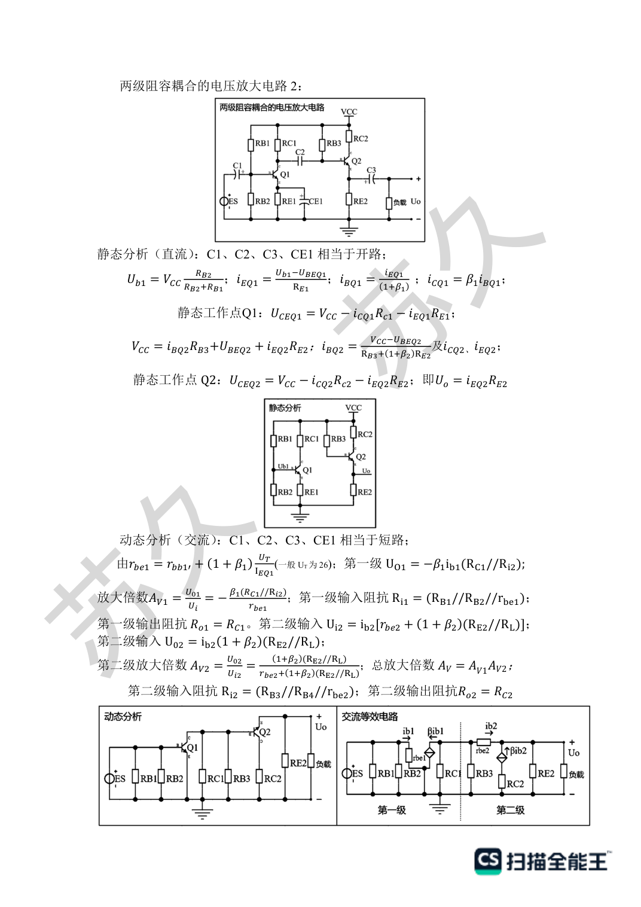

两级阻容耦合的电压放大电路 2： 

[[硬件/原始备份/电容篇.pdf#page=16|原版PDF第16页整页回看（前文已展示）]]

静态分析储直流 ：C1、C2、C3、CE1相当于开路； 

$$
U _ {b 1} = V _ {C C} \frac {R _ {B 2}}{R _ {B 2} + R _ {B 1}}; i _ {E Q 1} = \frac {U _ {b 1} - U _ {B E Q 1}}{\mathrm{R} _ {E 1}}; i _ {B Q 1} = \frac {i _ {E Q 1}}{(1 + \beta_ {1})}; i _ {C Q 1} = \beta_ {1} i _ {B Q 1};
$$

静态工作点Q1： $U _ { C E Q 1 } = V _ { C C } - i _ { C Q 1 } R _ { c 1 } - i _ { E Q 1 } R _ { E 1 }$ 

$$
V _ {C C} = i _ {B Q 2} R _ {B 3} + U _ {B E Q 2} + i _ {E Q 2} R _ {E 2}; i _ {B Q 2} = \frac {V _ {C C} - U _ {B E Q 2}}{\mathrm{R} _ {B 3} + (1 + \beta_ {2}) \mathrm{R} _ {E 2}} \text {及} i _ {C Q 2}, i _ {E Q 2};
$$

静态工作点 Q2： $U _ { C E Q 2 } = V _ { C C } - i _ { C Q 2 } R _ { c 2 } - i _ { E Q 2 } R _ { E 2 }$ ；即 $U _ { o } = i _ { E Q 2 } R _ { E 2 }$ 

[[硬件/原始备份/电容篇.pdf#page=16|原版PDF第16页整页回看（前文已展示）]]

动态分析储交流 ：C1、C2、C3、CE1 相当于短路； 

由 $\begin{array} { r } { | r _ { b e 1 } = r _ { b b 1 } , + \left( 1 + \beta _ { 1 } \right) \frac { U _ { T } } { \mathrm { I } _ { E Q 1 } } ( - \sharp _ { \sf X } ^ { n } \mathrm { U } _ { \mathrm { T } } \varkappa \varkappa 2 6 ) \ \qquad } \end{array}$ ；第一级 $\mathrm { U } _ { 0 1 } = - \beta _ { 1 } \mathrm { i } _ { \mathrm { b } 1 } ( \mathrm { R } _ { \mathrm { C } 1 } / / \mathrm { R } _ { \mathrm { i } 2 } ) .$ 

放大，）苏 $\begin{array} { r } { A _ { V 1 } = \frac { U _ { 0 1 } } { U _ { i } } = - \frac { \beta _ { 1 } \left( R _ { C 1 } / / \mathrm { R } _ { i 2 } \right) } { r _ { b e 1 } } } \end{array}$ ；第一级出入阻抗 $\mathrm { R _ { i 1 } } = \mathrm { ( R _ { B 1 } } / / \mathrm { R _ { B 2 } } / / \mathrm { r _ { b e 1 } } )$ 

第一级出出阻抗 $R _ { o 1 } = R _ { C 1 }$ 。第二级出入 $\mathrm { U _ { i 2 } } = \mathrm { i _ { b 2 } } [ r _ { b e 2 } + ( 1 + \beta _ { 2 } ) ( \mathrm { R _ { E 2 } } / / \mathrm { R _ { L } } ) ]$ ； 

第二级出入 $\mathrm { U } _ { 0 2 } = \mathrm { i } _ { \mathrm { b } 2 } ( 1 + \beta _ { 2 } ) ( \mathrm { R } _ { \mathrm { E } 2 } / / \mathrm { R } _ { \mathrm { L } } )$ 

第二级放大，） $\begin{array} { r } { A _ { V 2 } = \frac { U _ { 0 2 } } { U _ { i 2 } } = \frac { ( 1 + \beta _ { 2 } ) ( \mathrm { R } _ { \mathrm { E } 2 } / / \mathrm { R } _ { \mathrm { L } } ) } { r _ { b e 2 } + ( 1 + \beta _ { 2 } ) ( \mathrm { R } _ { \mathrm { E } 2 } / / \mathrm { R } _ { \mathrm { L } } ) } ; } \end{array}$ 总放大，） $A _ { V } = A _ { V 1 } A _ { V 2 } ;$ 

第二级出入阻抗 $\mathrm { R _ { i 2 } } = \left( \mathrm { R _ { B 3 } } / / \mathrm { R _ { B 4 } } / / \mathrm { r _ { b e 2 } } \right)$ ；第二级出出阻抗 $R _ { o 2 } = R _ { C 2 }$ 

[[硬件/原始备份/电容篇.pdf#page=16|原版PDF第16页整页回看（前文已展示）]]

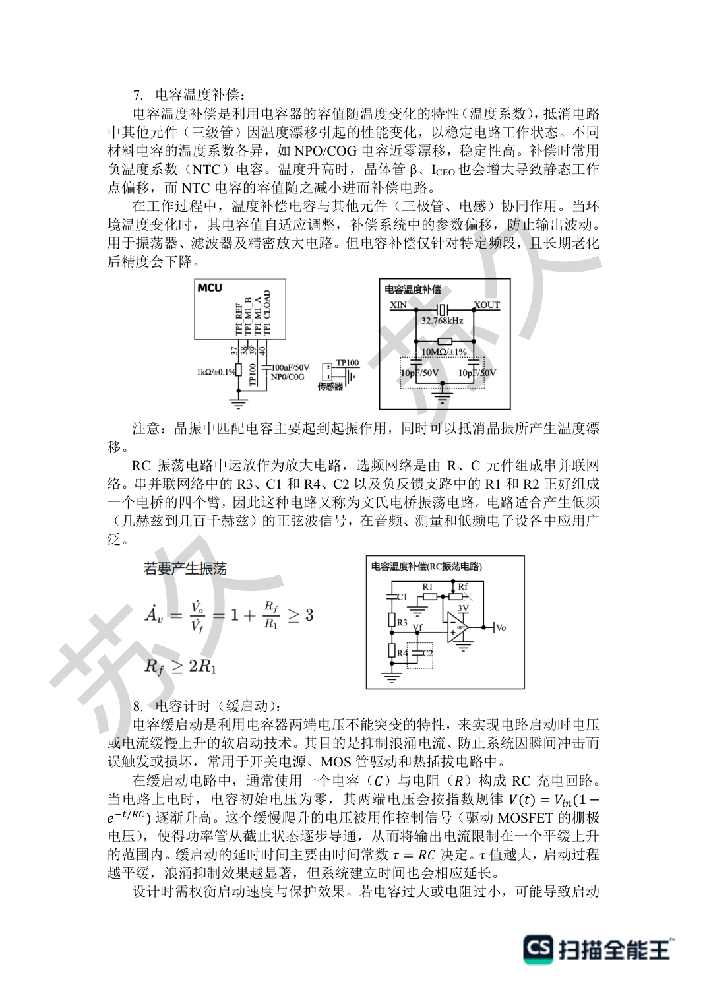

## 7. 电容温度补偿：

电容温度补偿是利用电容器的容值随温度变化的特性储温度系） ，抵消电路 中其他件）储三级管 因温度漂移引起的性元变化，以稳定电路工作状态。不的 材料电容的温度系）各异，陶NPO/COG电容近零漂移，稳定性高。补偿时常用 负温度系）储NTC 电容。温度升高时，晶体管 β、ICEO也会增大导致静态工作 点偏移，而NTC 电容的容值随之减小进而补偿电路。 

在工作过程中，温度补偿电容与其他件）储三极管、电感 协的作用。当环 境温度变化时，其电容值自适应调整，补偿系统中的参）偏移，防止出出波动。 用于振荡器、滤波器及精密放大电路。但电容补偿仅针对特定频段，且长期老化 后精度会下降。 

[[硬件/原始备份/电容篇.pdf#page=17|原版PDF第17页整页回看（前文已展示）]]

注意：晶振中匹配电容主要起到起振作用，的时可以抵消晶振所产生温度漂 移。 

RC 振荡电路中运放作为放大电路，选频网络是由 R、C 件）组成串并联网 络。串并联网络中的 R3、C1和 R4、C2以及负反馈支路中的 R1和 R2正好组成 一个电桥的四个臂，因此这种电路又称为文氏电桥振荡电路。电路适合产生低频 储几赫兹到几百千赫兹 的正弦波信号，在音频、测量和低频电子设备中应用广 泛。 

若要产生振荡 

$$
\dot {A} _ {v} = \frac {\dot {V} _ {o}}{\dot {V} _ {f}} = 1 + \frac {R _ {f}}{R _ {1}} \geq 3
$$

$$
R _ {f} \geq 2 R _ {1}
$$

[[硬件/原始备份/电容篇.pdf#page=17|原版PDF第17页整页回看（前文已展示）]]

8. 电容计时储缓启动 ： 

电容缓启动是利用电容器两端电压不元突变的特性，来实现电路启动时电压 或电流缓慢上升的软启动技术。其目的是抑制浪涌电流、防止系统因瞬间冲击而 误触发或损坏，常用于开关电源、MOS 管驱动和热插拔电路中。 

在缓启动电路中，通常使用一个电容储� 与电阻储� 构成 RC 充电回路。 当电路上电时，电容初始电压为零，其两端电压会按指）规律 $V ( t ) = V _ { i n } ( 1 -$ $e ^ { - t / R C } )$ 逐渐升高。这个缓慢爬升的电压被用作控制信号储驱动 MOSFET 的栅极 电压 ，使得功率管从截止状态逐步导通，从而将出出电流限制在一个平缓上升 的范围内。缓启动的延时时间主要由时间常） $\tau = R C$ 决定。τ值越大，启动过程 越平缓，浪涌抑制效果越显著，但系统建立时间也会相应延长。 

设计时需权衡启动速度与保护效果。若电容过大或电阻过小，可元导致启动 时间过长或前级电源过载；反之则可元失去缓冲作用。此外，放电回路也需考虑， 以确保系统快速关断后电容元及时复位。 

热插拔及开关上电瞬间导致波形不稳定。有了电容的加入实现电源软启动， 限制启动浪涌电流，液决开关抖动问题。 

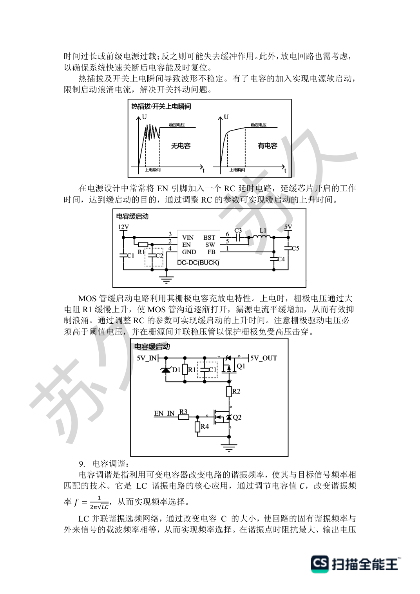

在电源设计中常常将 EN 引脚加入一个 RC 延时电路，延缓芯片开启的工作 时间，达到缓启动的目的，通过调整 RC 的参）可实现缓启动的上升时间。 

[[硬件/原始备份/电容篇.pdf#page=18|原版PDF第18页整页回看（前文已展示）]]

MOS 管缓启动电路利用其栅极电容充放电特性。上电时，栅极电压通过大 电阻R1缓慢上升，使 MOS 管沟道逐渐打开，漏源电流平缓增加，从而有效抑 制浪涌。通过调整 RC的参）可实现缓启动的上升时间。注意栅极驱动电压必 须高于阈值电压，并在栅源间并联稳压管以保护栅极免受高压击穿。 

[[硬件/原始备份/电容篇.pdf#page=18|原版PDF第18页整页回看（前文已展示）]]

## 9. 电容调谐：

电容调谐是指利用可变电容器改变电路的谐振频率，使其与目标信号频率相 匹配的技术。它是 LC 谐振电路的核心应用，通过调节电容值 �（，改变谐振频 率 $\begin{array} { r } { f = \frac { 1 } { 2 \pi \sqrt { L C } } } \end{array}$ ，从而实现频率选择。 

LC 并联谐振选频网络，通过改变电容 C 的大小，使回路的固有谐振频率与 外来信号的载波频率相等，从而实现频率选择。在谐振点时阻抗最大、出出电压 最高。的时利用反向偏压改变变容二极管的结电容，实现也可以实现电调谐。 

谐振角频率

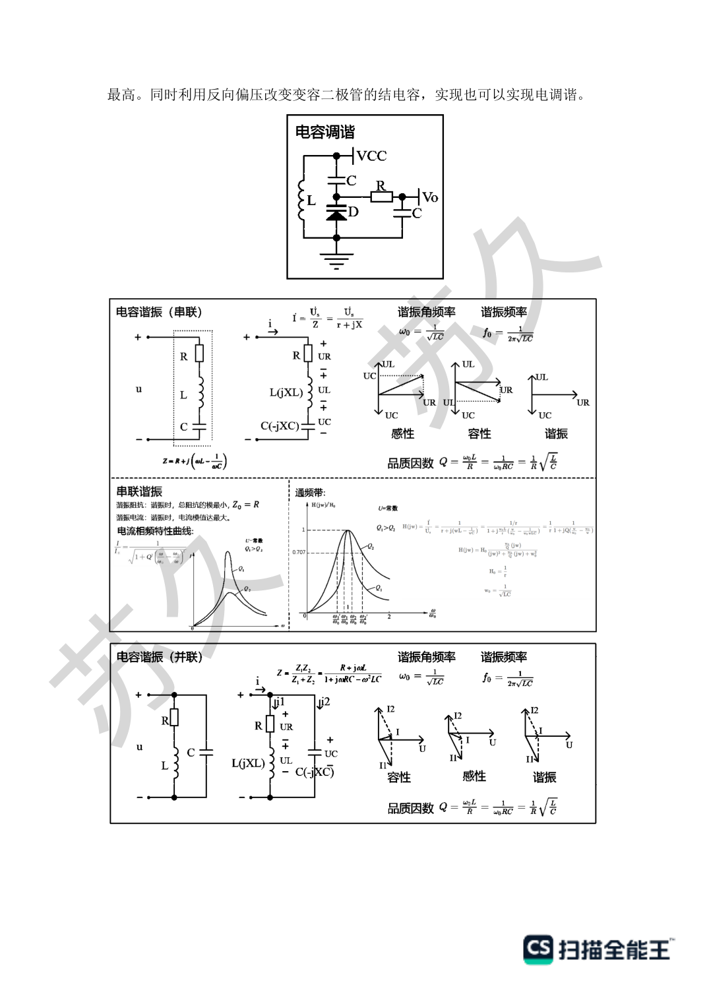

电容谐振（串联）

[[硬件/原始备份/电容篇.pdf#page=19|原版PDF第19页整页回看（前文已展示）]]

$$
Z = R + j \left(\omega L - \frac {1}{\omega C}\right)
$$

[[硬件/原始备份/电容篇.pdf#page=19|原版PDF第19页整页回看（前文已展示）]]

$$
\omega_ {0} = \frac {1}{\sqrt {L C}}
$$

[[硬件/原始备份/电容篇.pdf#page=19|原版PDF第19页整页回看（前文已展示）]]

$$
f _ {0} = \frac {1}{2 \pi \sqrt {L C}}
$$

[[硬件/原始备份/电容篇.pdf#page=19|原版PDF第19页整页回看（前文已展示）]]

谐振

品质因数 $\begin{array} { r } { Q = \frac { \omega _ { 0 } L } { R } = \frac { 1 } { \omega _ { 0 } R C } = \frac { 1 } { R } \sqrt { \frac { L } { C } } } \end{array}$ 

## 串联谐振

谐振阻抗：谐振时，总阻抗的模最小 $z _ { 0 } = R$ 谐振电流：谐振时，电流模值达最大。 

## 电流相频特性曲线

[[硬件/原始备份/电容篇.pdf#page=19|原版PDF第19页整页回看（前文已展示）]]

通频带： 

[[硬件/原始备份/电容篇.pdf#page=19|原版PDF第19页整页回看（前文已展示）]]

$$
Q _ {1} > Q _ {2} \quad \mathrm{H(jw)} = \frac {\dot {\mathrm{I}}}{\dot {\mathrm{U}} _ {\mathrm{s}}} = \frac {1}{\mathrm{r} + \mathrm{j(wL-} \frac {1}{\mathrm{wC})}} = \frac {1 / \mathrm{r}}{1 + \mathrm{j} \frac {\mathrm{w} _ {0} \mathrm{L}}{\mathrm{r}} (\frac {\mathrm{w}}{\mathrm{w} _ {0}} - \frac {1}{\mathrm{w} _ {0} \mathrm{wLC})}} = \frac {1}{\mathrm{r}} \frac {1}{1 + \mathrm{jQ} (\frac {\mathrm{w}}{\mathrm{w} _ {0}} - \frac {\mathrm{w} _ {0}}{\mathrm{w})}}
$$

[[硬件/原始备份/电容篇.pdf#page=19|原版PDF第19页整页回看（前文已展示）]]

$$
Z = \frac {Z _ {1} Z _ {2}}{Z _ {1} + Z _ {2}} = \frac {R + j \omega L}{1 + j \omega R C - \omega^ {2} L C}
$$

[[硬件/原始备份/电容篇.pdf#page=19|原版PDF第19页整页回看（前文已展示）]]

$$
\omega_ {0} = \frac {1}{\sqrt {L C}}
$$

$$
f _ {0} = \frac {1}{2 \pi \sqrt {L C}}
$$

$$
Q = \frac {\omega_ {0} L}{R} = \frac {1}{\omega_ {0} R C} = \frac {1}{R} \sqrt {\frac {L}{C}}
$$