> 图像回补：缺图位置按正文前后锚点接入原版 [[硬件/原始备份/电源设计经验.pdf|电源设计经验.pdf]] 完整页面；跨页位置保留相邻页面，同页重复处提供页码链接。页面截图用于回看原图与上下文，不表示逐图编号或电路参数已独立核验。旧行号及原图名见 [[audit/图片修复明细.csv|图片修复明细]]。

# 电源设计经验谈

## 1-50合集

请加入 TI 微博：http://e.weibo.com/tisemi 

## 作者介绍：

Robert Kollman 现任 TI 高级应用经理兼科技委员会的资深委员。他 拥有在电源电子领域超过 30 年的工作经验，并为电源电子设计了从低功 耗 (sub-watt)到超低功耗 (sub-megawatt) 的磁性元件，工作频率在兆 赫兹范围内。Robert 毕业于得克萨斯 A&M 大学 (Texas A&M University)，获电子工程理学士学位，后又毕业于南卫理公会大学 (Southern Methodist University)，获电子工程硕士学位。 

## 目 录

电源设计经验谈1：为您的电源选择正确的工作频率....5  
电源设计经验谈2：驾驭噪声电源....6  
电源设计经验谈3：阻尼输入滤波器——第一部分....8  
电源设计经验谈4：阻尼输入滤波器系列之第二部分....10  
电源设计经验谈5：降压—升压电源设计中降压控制器的使用....11  
电源设计经验谈6：精确测量电源纹波....13  
电源设计经验谈7：高效驱动LED离线式照明....14  
电源设计经验谈8：通过改变电源频率来降低EMI性能....16  
电源设计经验谈9：估算表面贴装半导体的温升....18  
电源设计经验谈10：轻松估计负载瞬态响应....20  
电源设计经验谈11：解决电源电路损耗问题....21  
电源设计经验谈12：电源效率最大化....22  
电源设计经验谈13：小心别被电感磁芯损耗烫伤....24  
电源设计经验谈14：SEPIC转换器提供高效偏置电源....25  
电源设计经验谈15：低成本、高性能LED驱动器....27  
电源设计经验谈16：缓冲正向转换器....29  
电源设计经验谈17：缓冲反向转换器....33  
电源设计经验谈18：您稳压器的输出电压精度或许并非如您所想的那样糟糕....35  
电源设计经验谈19：轻松创建多个负输出电压....38  
电源设计经验谈20：注意那些意外谐振响应....40  
电源设计经验谈21：请注意电容RMS纹波额定电流！....42  
电源设计经验谈22：避免一些常见的误差放大器使用错误....44  
电源设计经验谈23：改善负载瞬态响应....46  
电源设计经验谈24：并-串联阻抗转换....47  
电源设计经验谈25：改善负载瞬态响应—第2部分....50  
电源设计经验谈26：高频导体的电流分布....52  
POWER TIP 27: PARALLELING POWER SUPPLIES USING THE DROOP METHOD....54 

电源设计经验谈 28: 估算热插拔 MOSFET 的瞬态温升——第 1 部分 ..... 56
电源设计经验谈 29: 估算热插拔 MOSFET 的瞬态温升——第 2 部分 ..... 57
电源设计经验谈 30: 低压降压 IC 让简捷、经济的偏置电源成为现实 ..... 59
电源设计经验谈 31: 同步降压 MOSFET 电阻比的正确选择 ..... 61
电源设计经验谈 32: 注意 SEPIC 耦合电感回路电流—第 1 部分 ..... 62
电源设计经验谈 33: 注意 SEPIC 耦合电感回路电流——第 2 部分 ..... 64
电源设计经验谈 34: 设计简易的隔离式偏压电源 ..... 66
POWER TIP 35: MINIMIZE TRANSFORMER INTERWINDING CAPACITANCE ..... 68
电源设计经验谈 36: 使用高压 LED 提高灯泡效率 ..... 71
电源设计经验谈 37: 折中选择输入电容纹波电流的线压范围 ..... 73
电源设计经验谈 38: 使用简易锁存电路保护电源 ..... 75
电源设计经验谈 39: 同步整流带来的不仅仅是高效率 ..... 77
电源设计经验谈 40: 非隔离式电源的共模电流 ..... 78
电源设计经验谈 41: DDR 内存电源 ..... 80
电源设计经验谈 42: 可替代集成 MOSFET 的分立器件 ..... 82
电源设计经验谈 43: 分立器件——一款可替代集成 MOSFET 驱动器的卓越解决方案 ..... 84
电源设计经验谈 44: 如何处理高 DI/DT 负载瞬态 ..... 85
电源设计经验谈 45: 如何处理高 DI/DT 负载瞬态(下) ..... 87
电源设计经验谈 46: 正确的同步降压 FET 时序 ..... 90
电源设计经验谈 47: 解决隔离式开关的传导性共模辐射问题 ..... 92
电源设计经验谈 48: 解决隔离式开关的传导性共模辐射问题之第 2 部分 ..... 93
电源设计经验谈 49: 多层陶瓷电容器常见小缺陷的规避方法 ..... 95
电源设计小贴士 50: 铝电解电容器常见缺陷的规避方法 ..... 97 

## 电源设计经验谈1：为您的电源选择正确的工作频率

欢迎来到电源设计经验谈！随着现在 对更高效、更低成本电源解决方案需求的 强调，我们创建了该专栏，就各种电源管 理课题提出一些对您有帮助的小技巧。该 专栏面向各级设计工程师。无论您是从事 电源业务多年还是刚刚步入电源领域，您 都可以在这里找到一些极其有用的信息， 以帮助您迎接下一个设计挑战 

为您的电源选择最佳的工作频率是 一个复杂的权衡过程，其中包括尺寸、效 率以及成本。通常来说，低频率设计往往 是最为高效的，但是其尺寸最大且成本也 最高。虽然调高频率可以缩小尺寸并降低 成本，但会增加电路损耗。接下来，我们 使用一款简单的降压电源来描述这些权 衡过程。 

我们以滤波器组件作为开始。这些组 件占据了电源体积的大部分，同时滤波器 的尺寸同工作频率成反比关系。另一方面， 每一次开关转换都会伴有能量损耗；工作 频率越高，开关损耗就越高，同时效率也 就越低。其次，较高的频率运行通常意味 着可以使用较小的组件值。因此，更高频 率运行能够带来极大的成本节约。 

图 1 显示的是降压电源频率与体积 的关系。频率为 100 kHz 时，电感占据 了电源体积的大部分(深蓝色区域)。如果 我们假设电感体积与其能量相关，那么其 体积缩小将与频率成正比例关系。由于某 种频率下电感的磁芯损耗会极大增高并 限制尺寸的进一步缩小，因此在此情况下 上述假设就不容乐观了。如果该设计使用 陶瓷电容，那么输出电容体积(褐色区域) 便会随频率缩小，即所需电容降低。另一 方面，之所以通常会选用输入电容，是因 为其具有纹波电流额定值。该额定值不会 随频率而明显变化，因此其体积(黄色区域) 往往可以保持恒定。另外，电源的半导体 部分不会随频率而变化。这样，由于低频 开关，无源器件会占据电源体积的大部分。 当我们转到高工作频率时，半导体(即半导 体体积，淡蓝色区域)开始占据较大的空间 比例。 

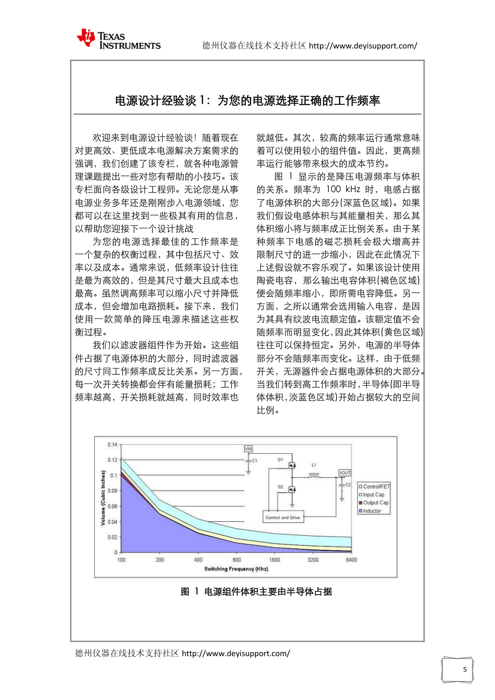

图 1 电源组件体积主要由半导体占据

该曲线图显示半导体体积本质上并 未随频率而变化，而这一关系可能过于简 单化。与半导体相关的损耗主要有两类： 传导损耗和开关损耗。同步降压转换器中 的传导损耗与 MOSFET 的裸片面积成反 比关系。MOSFET 面积越大，其电阻和传 导损耗就越低。 

开关损耗与 MOSFET 开关的速度以 及 MOSFET 具有多少输入和输出电容有 关。这些都与器件尺寸的大小相关。大体 积器件具有较慢的开关速度以及更多的 电容。图 2 显示了两种不同工作频率 (F) 的关系。传导损耗 (Pcon)与工作频率无 关，而开关损耗 (Psw F1 和 Psw F2) 与 工作频率成正比例关系。因此更高的工作 频率 (Psw F2) 会产生更高的开关损耗。 

当开关损耗和传导损耗相等时，每种 工作频率的总损耗最低。另外，随着工作 频率提高，总损耗将更高。 

但是，在更高的工作频率下，最佳裸 片面积较小，从而带来成本节约。实际上， 在低频率下，通过调整裸片面积来最小化 损耗会带来极高成本的设计。但是，转到 更高工作频率后，我们就可以优化裸片面 积来降低损耗，从而缩小电源的半导体体 积。这样做的缺点是，如果我们不改进半 导体技术，那么电源效率将会降低。如前 所述，更高的工作频率可缩小电感体积； 所需的内层芯板会减少。更高频率还可降 低对于输出电容的要求。有了陶瓷电容， 我们就可以使用更低的电容值或更少的 电容。这有助于缩小半导体裸片面积，进 而降低成本。 

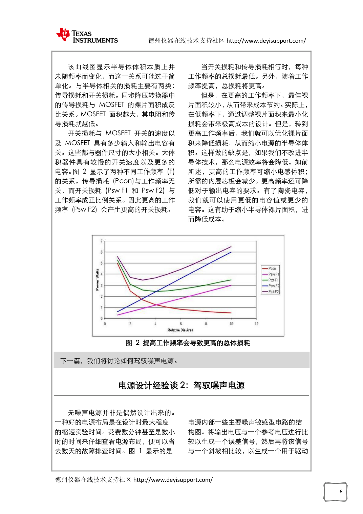

图 2 提高工作频率会导致更高的总体损耗

下一篇，我们将讨论如何驾驭噪声电源。 

## 电源设计经验谈2：驾驭噪声电源

无噪声电源并非是偶然设计出来的。 一种好的电源布局是在设计时最大程度 的缩短实验时间。花费数分钟甚至是数小 时的时间来仔细查看电源布局，便可以省 去数天的故障排查时间。图 1 显示的是 电源内部一些主要噪声敏感型电路的结 构图。将输出电压与一个参考电压进行比 较以生成一个误差信号，然后再将该信号 与一个斜坡相比较，以生成一个用于驱动 

功率级的 PWM(脉宽调制)信号。电源噪 声主要来自三个地方：误差放大器输入与 输出、参考电压以及斜坡。对这些节点进 行精心的电气设计和物理设计有助于最 大程度地缩短故障诊断时间。一般而言， 噪声会与这些低电平电路电容耦合。一种 卓越的设计可以确保这些低电平电路的 紧密布局，并远离所有开关波形。接地层 也具有屏蔽作用。误差放大器输入端可能 是电源中最为敏感的节点，因为其通常具 有最多的连接组件。如果将其与该级的极 高增益和高阻抗相结合，后患无穷。在布 局过程中，您必须最小化节点长度，并尽 可能近地将反馈和输入组件靠近误差放 大器放臵。如果反馈网络中存在高频积分 电容，那么您必须将其靠近放大器放臵， 其他反馈组件紧跟其后。并且，串联电阻 -电容也可能形成补偿网络。最理想的结果 是，将电阻靠近误差放大器输入端放臵， 这样，如果高频信号注入该电阻-电容节点 时，那么该高频信号就不得不承受较高的 电阻阻抗—而电容对高频信号的阻抗则 很小。斜坡是另一个潜在的会带来噪声问 题的地方。斜坡通常由电容器充电(电压模 式)生成，或由来自于电源开关电流的采样 (电流模式)生成。通常，电压模式斜坡并 不是一个问题，因为电容对高频注入信号 的阻抗很小。而电流斜坡却较为棘手，因 为存在了上升边沿峰值、相对较小的斜坡 振幅以及功率级寄生效应。 

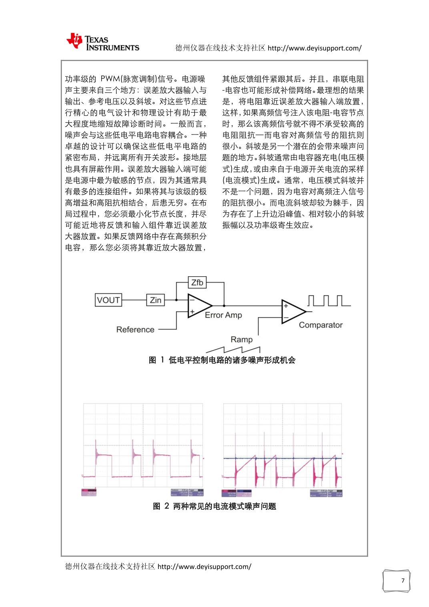

图 1 低电平控制电路的诸多噪声形成机会

[[硬件/原始备份/电源设计经验.pdf#page=7|原版PDF第7页整页回看（前文已展示）]]

图 2 两种常见的电流模式噪声问题

图 2 显示了电流斜坡存在的一些问 题。第一幅图显示了上升边沿峰值和随后 产生的电流斜坡。比较器(根据其不同速度) 具 有 两 个 电 压 结 点 (potential trip points)，结果是无序控制运行，听起来更 像是煎熏肉的声音。 

利用控制 IC 中的上升边沿消隐可 以很好地解决这一问题，其忽略了电流波 形的最初部分。波形的高频滤波也有助于 解决该问题。同样也要将电容器尽可能近 地靠近控制 IC 放臵。正如这两种波形表 现出来的那样，另一种常见的问题是次谐 波振荡。这种宽－窄驱动波形表现为非充 分斜率补偿。向当前斜坡增加更多的电压 斜坡便可以解决该问题。尽管您已经相当 仔细地设计了电源布局，但是您的原型电 源还是存在噪声。这该怎么办呢？首先， 您要确定消除不稳定因素的环路响应不 存在问题。有趣的是，噪声问题可能会看 起来像是电源交叉频率上的不稳定。但真 正的情况是该环路正以其最快响应速度 纠出注入误差。同样，最佳方法是识别出 噪声正被注入下列三个地方之一：误差放 大器、参考电压或斜坡。您只需分步解决 便可！第一步是检查节点，看斜坡中是否 存在明显的非线性，或者误差放大器输出 中是否存在高频率变化。如果检查后没有 发现任何问题，那么就将误差放大器从电 路中取出，并用一个清洁的电压源加以代 替。这样您应该就能够改变该电压源的输 出，以平稳地改变电源输出。如果这样做 奏效的话，那么您就已经将问题范围缩小 至参考电压和误差放大器了。 

有时，控制 IC 中的参考电压易受开 关波形的影响。利用添加更多(或适当)的 旁路可能会使这种状况得到改善。另外， 使用栅极驱动电阻来减缓开关波形也可 能会有助于解决这一问题。如果问题出在 误差放大器上，那么降低补偿组件阻抗会 有所帮助，因为这样降低了注入信号的振 幅。如果所有这些方法都不奏效，那么就 从印刷电路板将误差放大器节点去除。对 补偿组件进行架空布线 (air wiring) 可 以帮助我们识别出哪里有问题。 

下一篇，我们将讨论阻尼输入滤波器的第一部分(共 2 部分)。 

## 电源设计经验谈3：阻尼输入滤波器——第一部分

开关调节器通常优于线性调节器，因 为它们更高效，而开关拓扑结构则十分依 赖输入滤波器。这种电路元件与电源的典 型负动态阻抗相结合，可以诱发振荡问题。 本文将阐述如何避免此类问题的出现。 

一般而言，所有的电源都在一个给定 输入范围保持其效率。因此，输入功率或 多或少地与输入电压水平保持恒定。图 1 显示的是一个开关电源的特征。随着电压 的下降，电流不断上升。 

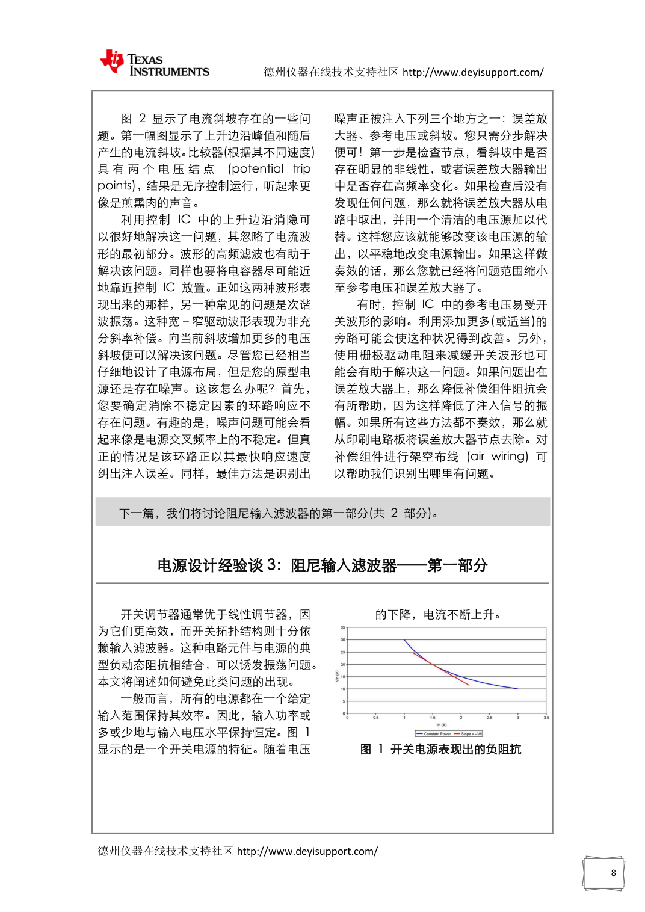

图 1 开关电源表现出的负阻抗

## 负输入阻抗

电压-电流线呈现出一定的斜率，其从 本质上定义了电源的动态阻抗。这根线的 斜率等于负输入电压除以输入电流。也就 是说，由 Pin = V . I，可以得出 V = Pin/I； 并由此可得 dV/dI = –Pin/I2 或 dV/dI ≈ –V/I。该近似值有些过于简单，因为 控制环路影响了输入阻抗的频率响应。但 是很多时候，当涉及电流模式控制时这种 简单近似值就已足够了。 

## 为什么需要输入滤波器

开关调节器输入电流为非连续电流， 并且在输入电流得不到滤波的情况下其 会中断系统的运行。大多数电源系统都集 成了一个如图 2 所示类型的滤波器。电 容为功率级的开关电流提供了一个低阻 抗，而电感则为电容上的纹波电压提供了 一个高阻抗。该滤波器的高阻抗使流入源 极的开关电流最小化。在低频率时，该滤 波器的源极阻抗等于电感阻抗。在您升高 频率的同时，电感阻抗也随之增加。在极 高频率时，输出电容分流阻抗。在中间频 率时，电感和电容实质上就形成了一种并 联谐振电路，从而使电源阻抗变高，呈现 出较高的电阻。 

大多数情况下，峰值电源阻抗可以通 过首先确定滤波器 (Zo) 的特性阻抗来估 算得出，而滤波器特性阻抗等于电感除以 电容所得值的平方根。这就是谐振下电感 或者电容的阻抗。接下来，对电容的等效 串联电阻 (ESR) 和电感的电阻求和。这样 便得到电路的 Q 值。峰值电源阻抗大约 等于 Zo 乘以电路的 Q 值。振荡 

但是，开关的谐振滤波器与电源负阻 抗耦合后会出现问题。图 3 显示的是在 一个电压驱动串联电路中值相等、极性相 反的两个电阻。这种情况下，输出电压趋 向于无穷大。当您获得由谐振输入滤波器 等效电阻所提供电源的负电阻时，您也就 会面临一个类似的电源系统情况；这时， 电路往往就会出现振荡。 

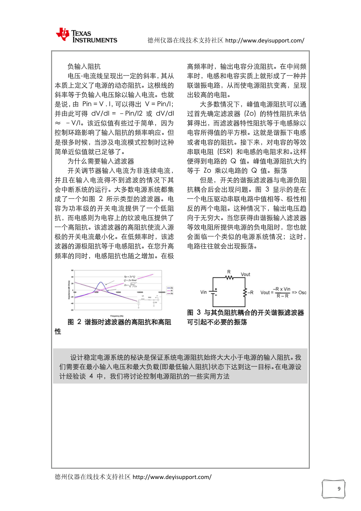

图 2 谐振时滤波器的高阻抗和高阻 性

[[硬件/原始备份/电源设计经验.pdf#page=9|原版PDF第9页整页回看（前文已展示）]]

图 3 与其负阻抗耦合的开关谐振滤波器 可引起不必要的振荡

设计稳定电源系统的秘诀是保证系统电源阻抗始终大大小于电源的输入阻抗。我 们需要在最小输入电压和最大负载(即最低输入阻抗)状态下达到这一目标。在电源设 计经验谈 4 中，我们将讨论控制电源阻抗的一些实用方法 

## 电源设计经验谈4：阻尼输入滤波器系列之第二部分

## 控制源极阻抗

在“电源设计经验谈 3”中，我们讨 论了输入滤波器的源极阻抗如何变得具 有电阻性，以及其如何同开关调节器的负 输入阻抗相互作用。在极端情况下，这些 阻抗振幅可以相等，但是其符号相反从而 构成了一个振荡器。业界通用的标准是输 入滤波器的源极阻抗应至少比开关调节 器的输入阻抗低 6dB，作为最小化振荡概 率的安全裕度。输入滤波器设计通常以根 据纹波电流额定值或保持要求选择输入 电容(图 1 所示 CO) 

开始的。第二步通常包括根据系统的 EMI 要求选择电感 (LO)。正如我们上个 月讨论的那样，在谐振附近，这两个组件 的源极阻抗会非常高，从而导致系统不稳 定。图 1 描述了一种控制这种阻抗的方 法，其将串联电阻 (RD) 和电容 (CD) 与 

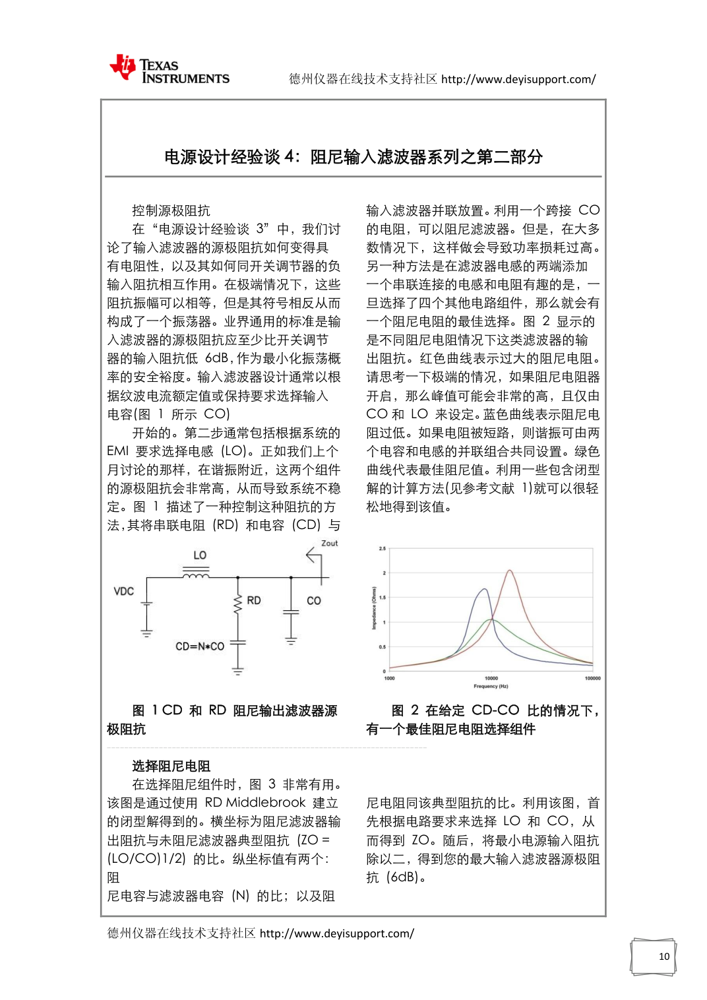

图 1 CD 和 RD 阻尼输出滤波器源 极阻抗

## 选择阻尼电阻

在选择阻尼组件时，图 3 非常有用。 该图是通过使用 RD Middlebrook 建立 的闭型解得到的。横坐标为阻尼滤波器输 出阻抗与未阻尼滤波器典型阻抗 (ZO = (LO/CO)1/2) 的比。纵坐标值有两个： 阻 

尼电容与滤波器电容 (N) 的比；以及阻 输入滤波器并联放臵。利用一个跨接 CO 的电阻，可以阻尼滤波器。但是，在大多 数情况下，这样做会导致功率损耗过高。 另一种方法是在滤波器电感的两端添加 一个串联连接的电感和电阻有趣的是，一 旦选择了四个其他电路组件，那么就会有 一个阻尼电阻的最佳选择。图 2 显示的 是不同阻尼电阻情况下这类滤波器的输 出阻抗。红色曲线表示过大的阻尼电阻。 请思考一下极端的情况，如果阻尼电阻器 开启，那么峰值可能会非常的高，且仅由 CO 和 LO 来设定。蓝色曲线表示阻尼电 阻过低。如果电阻被短路，则谐振可由两 个电容和电感的并联组合共同设臵。绿色 曲线代表最佳阻尼值。利用一些包含闭型 解的计算方法(见参考文献 1)就可以很轻 松地得到该值。 

[[硬件/原始备份/电源设计经验.pdf#page=10|原版PDF第10页整页回看（前文已展示）]]

图 2 在给定 CD-CO 比的情况下， 有一个最佳阻尼电阻选择组件

尼电阻同该典型阻抗的比。利用该图，首 先根据电路要求来选择 LO 和 CO，从 而得到 ZO。随后，将最小电源输入阻抗 除以二，得到您的最大输入滤波器源极阻 抗 (6dB)。 

最小电源输入阻抗等于 Vinmin2/Pmax。 只需读取阻尼电容与滤波器电容的比以 及阻尼电阻与典型阻抗的比, 您便可以计 算得到一个横坐标值。例如，一个具有 ${ \mathsf { l o } } { \mathsf { \mu } } { \mathsf { H } }$ 电感和 10µH 电容的滤波器具有 $\mathsf { Z } \mathsf { O } = \left( 1 0 \mu \mathsf { H } / 1 0 \mu \mathsf { F } \right) \mathsf { I } / 2 = 1 \mathsf { O } \mathsf { h } \mathsf { m }$ 的典型 阻抗。如果它正对一个 12V 最小输入的 12W 电源进行滤波，那么该电源输入阻 抗将为 $\mathrm { \Delta } Z = \mathsf { V } 2 / \mathsf { P } = 1 2 2 / 1 2 = 1 2 \mathsf { O h m s } _ { \circ }$ 这样，最大源极阻抗应等于该值的二分之 一， 

也即 6 Ohms。现在，在 $6 / 1 = 6$ 的 X 轴上输入该图，那么， ${ \mathsf { C D } } / { \mathsf { C O } } = 0 . 1$ ，即 1 µF，同时 $\mathsf { R D } / \mathsf { Z O } = 3$ ，也即 3 Ohms。 

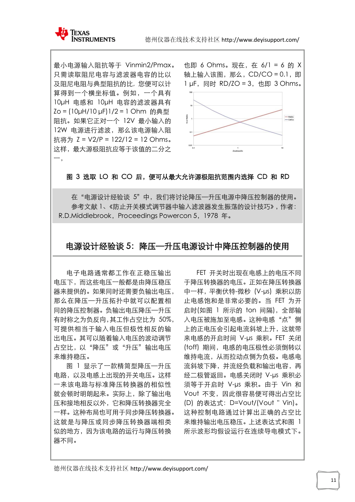

## 图 3 选取 LO 和 CO 后，便可从最大允许源极阻抗范围内选择 CD 和 RD

在“电源设计经验谈 $5 ^ { \mathfrak { N } }$ 中，我们将讨论降压—升压电源中降压控制器的使用。 参考文献1、《防止开关模式调节器中输入滤波器发生振荡的设计技巧》，作者： R.D.Middlebrook，Proceedings Powercon 5，1978 年。 

## 电源设计经验谈5：降压—升压电源设计中降压控制器的使用

电子电路通常都工作在正稳压输出 电压下，而这些电压一般都是由降压稳压 器来提供的。如果同时还需要负输出电压， 那么在降压—升压拓扑中就可以配臵相 同的降压控制器。负输出电压降压—升压 有时称之为负反向，其工作占空比为 50%， 可提供相当于输入电压但极性相反的输 出电压。其可以随着输入电压的波动调节 占空比，以“降压”或“升压”输出电压 来维持稳压。 

图 1 显示了一款精简型降压—升压 电路，以及电感上出现的开关电压。这样 一来该电路与标准降压转换器的相似性 就会顿时明朗起来。实际上，除了输出电 压和接地相反以外，它和降压转换器完全 一样。这种布局也可用于同步降压转换器。 这就是与降压或同步降压转换器端相类 似的地方，因为该电路的运行与降压转换 器不同。 

FET 开关时出现在电感上的电压不同 于降压转换器的电压。正如在降压转换器 中一样，平衡伏特-微秒 (V-μs) 乘积以防 止电感饱和是非常必要的。当 FET 为开 启时(如图 1 所示的 ton 间隔)，全部输 入电压被施加至电感。这种电感“点”侧 上的正电压会引起电流斜坡上升，这就带 来电感的开启时间 V-μs 乘积。FET 关闭 (toff) 期间，电感的电压极性必须倒转以 维持电流，从而拉动点侧为负极。电感电 流斜坡下降，并流经负载和输出电容，再 经二极管返回。电感关闭时 V-μs 乘积必 须等于开启时 V-μs 乘积。由于 Vin 和 Vout 不变，因此很容易便可得出占空比 (D) 的表达式：D=Vout/(Vout " Vin)。 这种控制电路通过计算出正确的占空比 来维持输出电压稳压。上述表达式和图 1 所示波形均假设运行在连续导电模式下。 

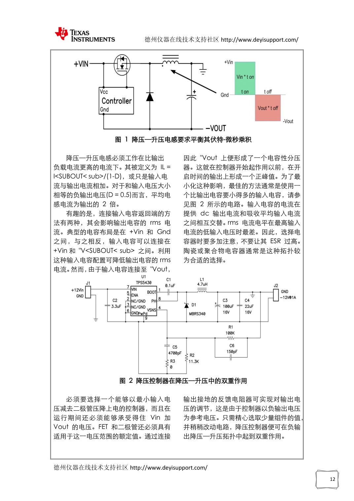

图 1 降压—升压电感要求平衡其伏特-微秒乘积

降压—升压电感必须工作在比输出 负载电流更高的电流下。其被定义为 IL = I<SUBOUT< sub>/(1-D)，或只是输入电 流与输出电流相加。对于和输入电压大小 相等的负输出电压(D = 0.5)而言，平均电 感电流为输出的 2 倍。 

有趣的是，连接输入电容返回端的方 法有两种，其会影响输出电容的 rms 电 流。典型的电容布局是在 +Vin 和 Gnd 之间，与之相反，输入电容可以连接在 +Vin 和 "V<SUBOUT< sub> 之间。利用 这种输入电容配臵可降低输出电容的 rms 电流。然而，由于输入电容连接至 "Vout， 因此 "Vout 上便形成了一个电容性分压 器。这就在控制器开始起作用以前，在开 启时间的输出上形成一个正峰值。为了最 小化这种影响，最佳的方法通常是使用一 个比输出电容要小得多的输入电容，请参 见图 2 所示的电路。输入电容的电流在 提供 dc 输出电流和吸收平均输入电流 之间相互交替。rms 电流电平在最高输入 电流的低输入电压时最差。因此，选择电 容器时要多加注意，不要让其 ESR 过高。 陶瓷或聚合物电容器通常是这种拓扑较 为合适的选择。 

[[硬件/原始备份/电源设计经验.pdf#page=12|原版PDF第12页整页回看（前文已展示）]]

图 2 降压控制器在降压—升压中的双重作用

必须要选择一个能够以最小输入电 压减去二极管压降上电的控制器，而且在 运行期间还必须能够承受得住 Vin 加 Vout 的电压。FET 和二极管还必须具有 适用于这一电压范围的额定值。通过连接 输出接地的反馈电阻器可实现对输出电 压的调节，这是由于控制器以负输出电压 为参考电压。只需精心选取少量组件的值， 并稍稍改动电路，降压控制器便可在负输 出降压—升压拓扑中起到双重作用。 

特别感谢 TI John Betten 对本文所做的贡献。下一篇的“电源设计经验谈 $6 ^ { \mathfrak { N } }$ 中， 我们将讨论如何正确测量电源纹波。 

## 电源设计经验谈6：精确测量电源纹波

精确地测量电源纹波本身就是一门 艺术。在图 1 所示的示例中，一名初级 工程师完全错误地使用了一台示波器。他 的第一个错误是使用了一支带长接地引 线的示波器探针；他的第二个错误是将探 针形成的环路和接地引线均臵于电源变 压器和开关元件附近；他的最后一个错误 是允许示波器探针和输出电容之间存在 多余电感。该问题在纹波波形中表现为高 频拾取。在电源中，存在大量可以很轻松 地与探针耦合的高速、大信号电压和电流 波形，其中包括耦合自电源变压器的磁场， 耦合自开关节点的电场，以及由变压器互 绕电容产生的共模电流。 

利用正确的测量方法可以大大地改 善测得纹波结果。首先，通常使用带宽限 制来规定纹波，以防止拾取并非真正存在 的高频噪声。我们应该为用于测量的示波 器设定正确的带宽限制。其次，通过取掉 探针“帽”，并构成一个拾波器(如图 2 所示)，我们可以消除由长接地引线形成的 天线。将一小段线缠绕在探针接地连接点 周围，并将该接地连接至电源。这样做可 以缩短暴露于电源附近高电磁辐射的端 头长度，从而进一步减少拾波。 

最后，在隔离电源中，会产生大量流 经探针接地连接点的共模电流。这就在电 源接地连接点和示波器接地连接点之间 形成了压降，从而表现为纹波。要防止这 一问题的出现，我们就需要特别注意电源 设计的共模滤波。另外，将示波器引线缠 绕在铁氧体磁心周围也有助于 

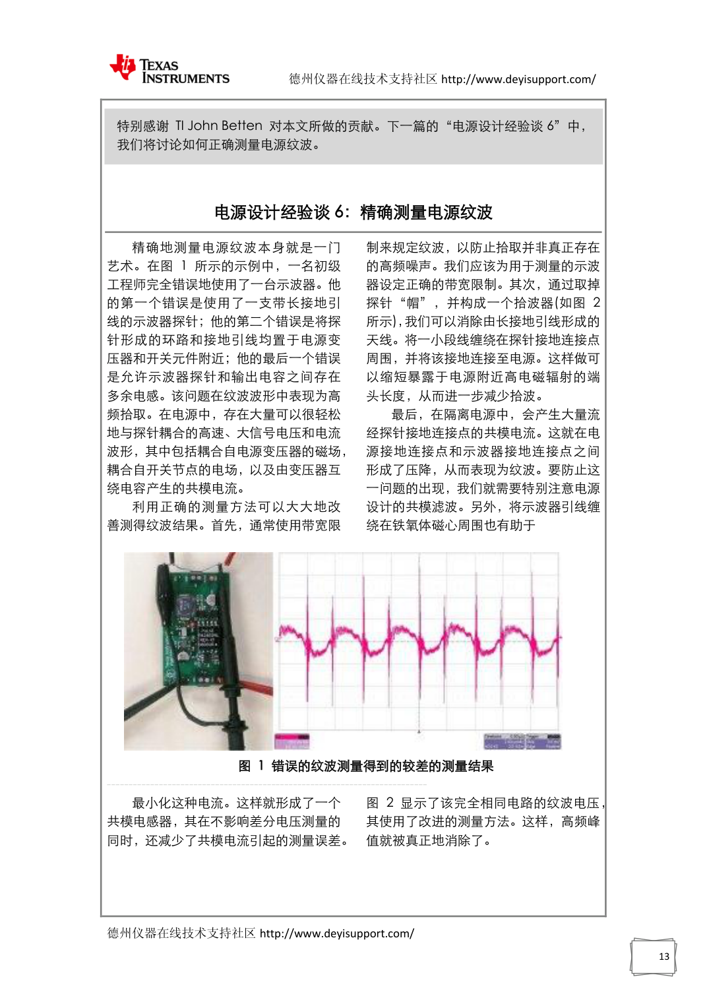

图 1 错误的纹波测量得到的较差的测量结果

最小化这种电流。这样就形成了一个 共模电感器，其在不影响差分电压测量的 同时，还减少了共模电流引起的测量误差。 

图 2 显示了该完全相同电路的纹波电压 其使用了改进的测量方法。这样，高频峰 值就被真正地消除了。 

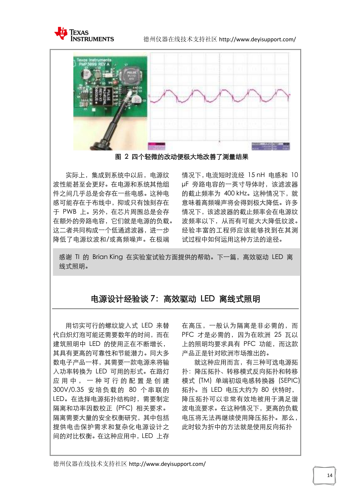

图 2 四个轻微的改动便极大地改善了测量结果

实际上，集成到系统中以后，电源纹 波性能甚至会更好。在电源和系统其他组 件之间几乎总是会存在一些电感。这种电 感可能存在于布线中，抑或只有蚀刻存在 于 PWB 上。另外，在芯片周围总是会存 在额外的旁路电容，它们就是电源的负载。 这二者共同构成一个低通滤波器，进一步 降低了电源纹波和/或高频噪声。在极端 情况下，电流短时流经 15 nH 电感和 10 μF 旁路电容的一英寸导体时，该滤波器 的截止频率为 400 kHz。这种情况下，就 意味着高频噪声将会得到极大降低。许多 情况下，该滤波器的截止频率会在电源纹 波频率以下，从而有可能大大降低纹波。 经验丰富的工程师应该能够找到在其测 试过程中如何运用这种方法的途径。 

感谢 TI 的 Brian King 在实验室试验方面提供的帮助。下一篇，高效驱动 LED 离 线式照明。 

## 电源设计经验谈7：高效驱动 LED 离线式照明

用切实可行的螺纹旋入式 LED 来替 代白炽灯泡可能还需要数年的时间，而在 建筑照明中 LED 的使用正在不断增长， 其具有更高的可靠性和节能潜力。同大多 数电子产品一样，其需要一款电源来将输 入功率转换为 LED 可用的形式。在路灯 应 用 中 ， 一 种 可 行 的 配 臵 是 创 建 300V/0.35 安 培 负 载的 80 个 串 联 的 LED。在选择电源拓扑结构时，需要制定 隔离和功率因数校正 (PFC) 相关要求。 隔离需要大量的安全权衡研究，其中包括 提供电击保护需求和复杂化电源设计之 间的对比权衡。在这种应用中，LED 上存 在高压，一般认为隔离是非必需的，而 PFC 才是必需的，因为在欧洲 25 瓦以 上的照明均要求具有 PFC 功能，而这款 产品正是针对欧洲市场推出的。 

就这种应用而言，有三种可选电源拓 扑：降压拓扑、转移模式反向拓扑和转移 模式 (TM) 单端初级电感转换器 (SEPIC) 拓扑。当 LED 电压大约为 80 伏特时， 降压拓扑可以非常有效地被用于满足谐 波电流要求。在这种情况下，更高的负载 电压将无法再继续使用降压拓扑。那么， 此时较为折中的方法就是使用反向拓扑 

和 SEPIC 拓扑。SEPIC 具有的优点是， 其可钳制功率半导体器件的开关波形，允 许使用较低的电压，从而使器件更为高效。 

在该应用中，可以获得大约 2% 的效率提 高。另外，SEPIC 中的振铃更少，从而使 EMI 滤波更容易。图 1 显示了这种电源 的原理图。 

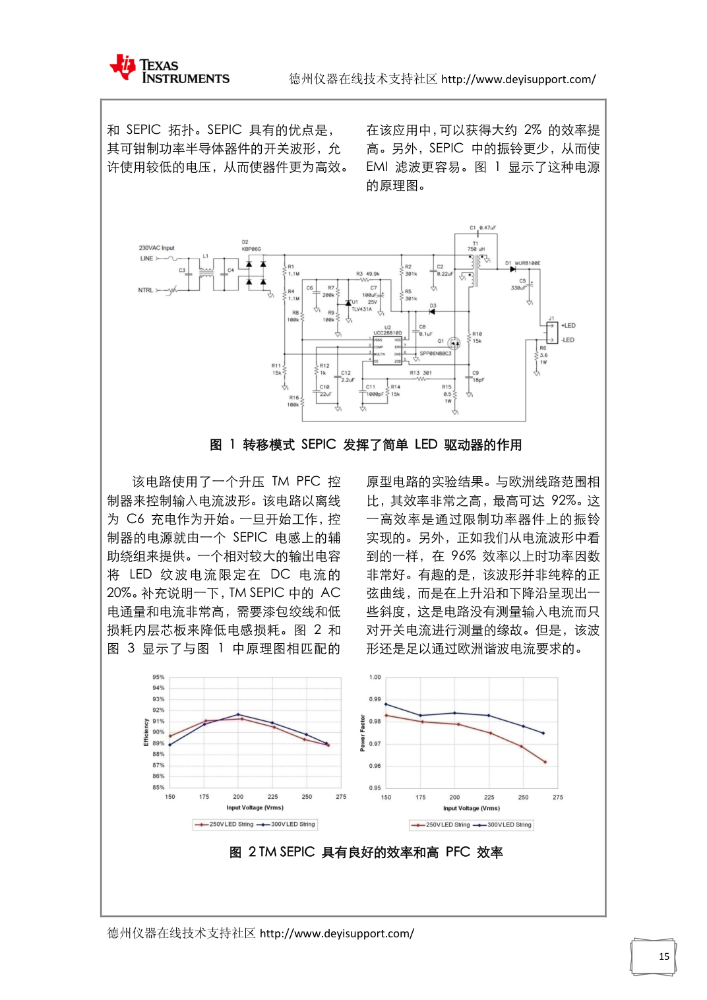

图 1 转移模式 SEPIC 发挥了简单 LED 驱动器的作用

该电路使用了一个升压 TM PFC 控 制器来控制输入电流波形。该电路以离线 为 C6 充电作为开始。一旦开始工作，控 制器的电源就由一个 SEPIC 电感上的辅 助绕组来提供。一个相对较大的输出电容 将 LED 纹波电流限定在 DC 电流的 20%。补充说明一下，TM SEPIC 中的 AC 电通量和电流非常高，需要漆包绞线和低 损耗内层芯板来降低电感损耗。图 2 和 图 3 显示了与图 1 中原理图相匹配的 原型电路的实验结果。与欧洲线路范围相 比，其效率非常之高，最高可达 92%。这 一高效率是通过限制功率器件上的振铃 实现的。另外，正如我们从电流波形中看 到的一样，在 96% 效率以上时功率因数 非常好。有趣的是，该波形并非纯粹的正 弦曲线，而是在上升沿和下降沿呈现出一 些斜度，这是电路没有测量输入电流而只 对开关电流进行测量的缘故。但是，该波 形还是足以通过欧洲谐波电流要求的。 

[[硬件/原始备份/电源设计经验.pdf#page=15|原版PDF第15页整页回看（前文已展示）]]

图 2 TM SEPIC 具有良好的效率和高 PFC 效率

[[硬件/原始备份/电源设计经验.pdf#page=15|原版PDF第15页整页回看（前文已展示）]]

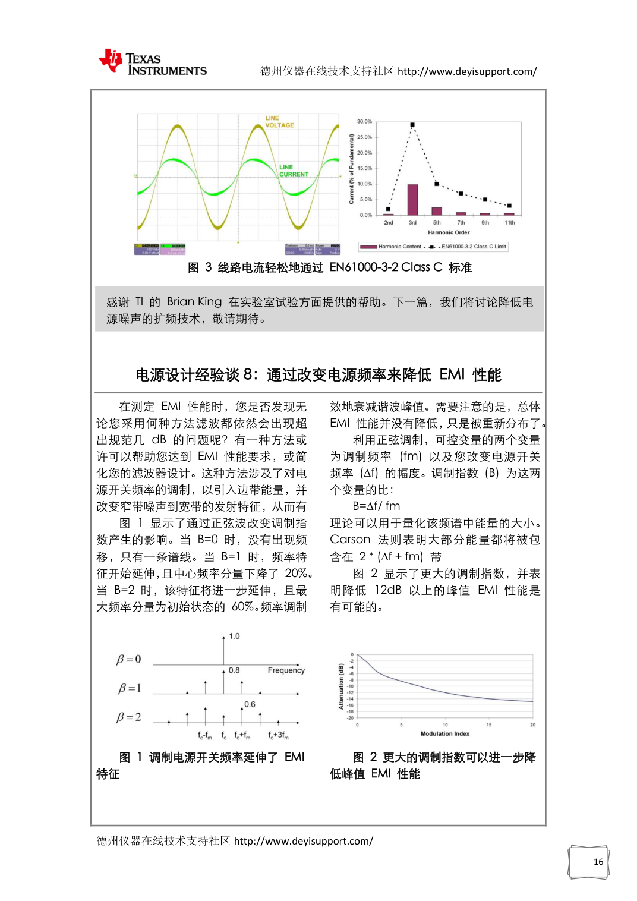

Harmonic Content - - - EN61000-3-2 Class C Limit

图 3 线路电流轻松地通过 EN61000-3-2 Class C 标准

感谢 TI 的 Brian King 在实验室试验方面提供的帮助。下一篇，我们将讨论降低电 源噪声的扩频技术，敬请期待。 

## 电源设计经验谈8：通过改变电源频率来降低 EMI 性能

在测定 EMI 性能时，您是否发现无 论您采用何种方法滤波都依然会出现超 出规范几 dB 的问题呢？有一种方法或 许可以帮助您达到 EMI 性能要求，或简 化您的滤波器设计。这种方法涉及了对电 源开关频率的调制，以引入边带能量，并 改变窄带噪声到宽带的发射特征，从而有 

图 1 显示了通过正弦波改变调制指 数产生的影响。当 Β=0 时，没有出现频 移，只有一条谱线。当 Β=1 时，频率特 征开始延伸，且中心频率分量下降了 20%。 当 Β=2 时，该特征将进一步延伸，且最 大频率分量为初始状态的 60%。频率调制 效地衰减谐波峰值。需要注意的是，总体 EMI 性能并没有降低，只是被重新分布了。 

[[硬件/原始备份/电源设计经验.pdf#page=16|原版PDF第16页整页回看（前文已展示）]]

图 1 调制电源开关频率延伸了 EM 特征

利用正弦调制，可控变量的两个变量 为调制频率 (fm) 以及您改变电源开关 频率 (Δf) 的幅度。调制指数 (Β) 为这两 个变量的比： 

$$
\mathrm{B} = \Delta \mathrm{f} / \mathrm{fm}
$$

理论可以用于量化该频谱中能量的大小。 Carson 法则表明大部分能量都将被包 含在 2 * (Δf + fm) 带 

图 2 显示了更大的调制指数，并表 明降低 12dB 以上的峰值 EMI 性能是 有可能的。 

[[硬件/原始备份/电源设计经验.pdf#page=16|原版PDF第16页整页回看（前文已展示）]]

图 2 更大的调制指数可以进一步降 低峰值 EMI 性能

选取调制频率和频移是两个很重要 的方面。首先，调制频率应该高于 EMI 接 收机带宽，这样接收机才不会同时对两个 边带进行测量。但是，如果您选取的频率 太高，那么电源控制环路可能无法完全控 制这种变化，从而带来相同速率下的输出 电压变化。另外，这种调制还会引起电源 中出现可闻噪声。因此，我们选取的调制 频率一般不能高出接收机带宽太多，但要 大于可闻噪声范围。很显然，从图 2 我 们可以看出，较大地改变工作频率更为可 取。然而，这样会影响到电源设计，意识 到这一点非常重要。也就是说，为最低工 作频率选择磁性元件。此外，输出电容还 需要处理更低频率运行带来的更大的纹 波电流。 

图 3 对有频率调制和无频率调制的 EMI 性能测量值进行了对比。此时的调制 指数为 4，正如我们预料的那样，基频下 EMI 性能大约降低了 8dB。其他方面也 很重要。谐波被抹入 (smear into) 同其 编号相对应的频带中，即第三谐波延展至 基频的三倍。这种情况会在一些较高频率 下重复，从而使噪声底限大大高于固定频 率的情况。因此，这种方法可能并不适用 于低噪声系统。但是，通过增加设计裕度 和最小化 EMI 滤波器成本，许多系统都 已受益于这种方法。 

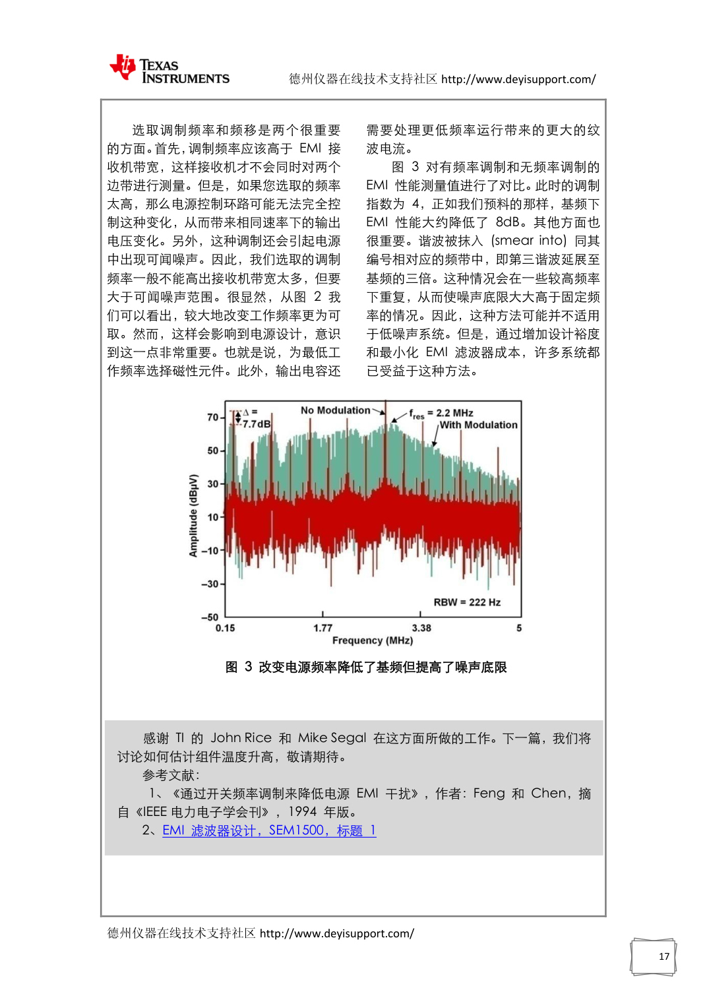

图 3 改变电源频率降低了基频但提高了噪声底限

感谢 TI 的 John Rice 和 Mike Segal 在这方面所做的工作。下一篇，我们将 讨论如何估计组件温度升高，敬请期待。 

## 参考文献：

1、《通过开关频率调制来降低电源 EMI 干扰》，作者：Feng 和 Chen，摘 自《IEEE电力电子学会刊》，1994 年版。 

2、EMI 滤波器设计，SEM1500，标题 1 

## 电源设计经验谈9：估算表面贴装半导体的温升

过去估算半导体温升十分简单。您只 需计算出组件的功耗，然后采用冷却电路 电模拟即可确定所需散热片的类型。现在 出于对尺寸和成本因素的考虑，人们渴望 能够去除散热片，这就使得这一问题复杂 化了。贴装在散热增强型封装中的半导体 要求电路板能够起到散热片的作用，并提 供所有必需的冷却功能。如图 1 所示， 热量经过一块金属贴装片和封装流入印 刷线路板 (PWB)。然后，热量由侧面流经 PWB 线迹，并通过自然对流经电路板表 面扩散到周围的环境中。影响裸片温升的 重要因素是 PWB 中的铜含量以及用于 对流导热的表面面积。 

半导体产品说明书通常会列出某种 PWB 结构下结点至周围环境的热阻。这 就是说，设计人员只需将这种热阻乘以功 耗，便可计算出温升情况。但是，如果设 计并没有具体的结构，或者如果需要进一 步降低热阻，那么就会出现许多问题。 

图 2 所示为热流问题的简化电模拟， 我们可据此深入分析。IC 电源由电流源 表示，而热阻则由电阻表示。在各电压下 对该电路求解，其提供了对温度的模拟。 从结点至贴装面存在热阻，同时遍布于电 路板的横向电阻和电路板表面至周围环 境的电阻共同形成一个梯形网络。这种模 型假设 1)电路板为垂直安装，2)无强制对 流或辐射制冷，所有热流均出现在电路板 的铜中，3)在电路板两侧几乎没有温差。 

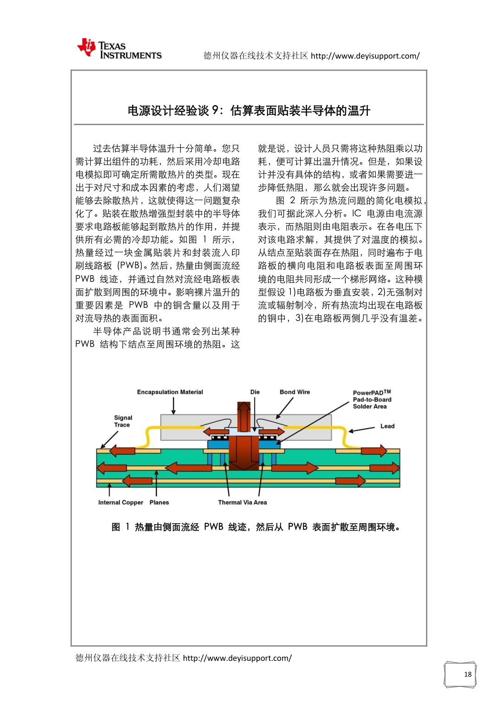

图 1 热量由侧面流经 PWB 线迹，然后从 PWB 表面扩散至周围环境。

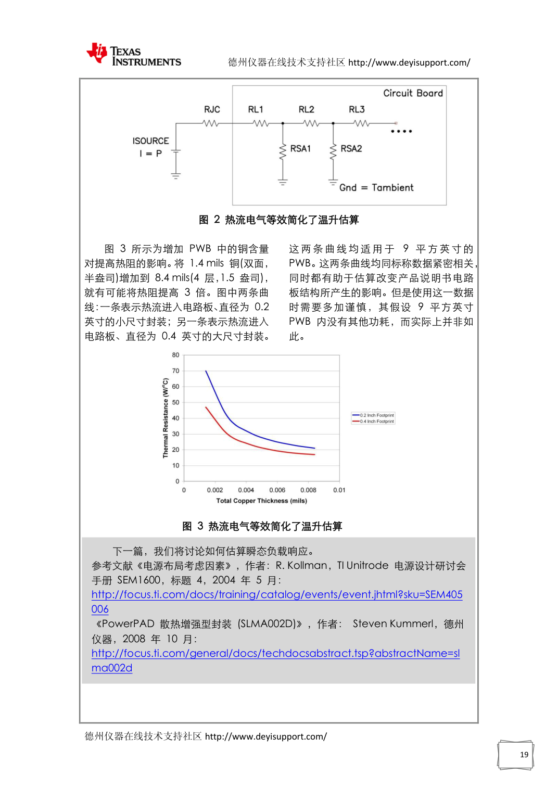

图 2 热流电气等效简化了温升估算

图 3 所示为增加 PWB 中的铜含量 对提高热阻的影响。将 1.4 mils 铜(双面， 半盎司)增加到 8.4 mils(4 层，1.5 盎司)， 就有可能将热阻提高 3 倍。图中两条曲 线：一条表示热流进入电路板、直径为 0.2 英寸的小尺寸封装；另一条表示热流进入 电路板、直径为 0.4 英寸的大尺寸封装。 

这两条曲线均适用于 9 平方英寸的 PWB。这两条曲线均同标称数据紧密相关， 同时都有助于估算改变产品说明书电路 板结构所产生的影响。但是使用这一数据 时需要多加谨慎，其假设 9 平方英寸 PWB 内没有其他功耗，而实际上并非如 此。 

[[硬件/原始备份/电源设计经验.pdf#page=19|原版PDF第19页整页回看（前文已展示）]]

图 3 热流电气等效简化了温升估算

参考文献《电源布局考虑因素》，作者：R. Kollman，TI Unitrode 电源设计研讨会 手册 SEM1600，标题 4，2004 年 5 月： 

http://focus.ti.com/docs/training/catalog/events/event.jhtml?sku=SEM405 006 

《PowerPAD 散热增强型封装 (SLMA002D)》，作者： Steven Kummerl，德州 仪器，2008 年 10 月： 

http://focus.ti.com/general/docs/techdocsabstract.tsp?abstractName=sl ma002d 

## 电源设计经验谈10：轻松估计负载瞬态响应

本篇电源设计经验谈介绍了一种通 过了解控制带宽和输出滤波器电容特性 估算电源瞬态响应的简单方法。该方法充 分利用了这样一个事实，即所有电路的闭 环输出阻抗均为开环输出阻抗除以 1 加 环路增益，或简单表述为： 

因此实际的峰值可能会更高些。然而，就 快速估计而言，这种影响可以忽略不计 [1] 。第二个需要注意的事项与负载变化 幅度上升有关。如果负载变化幅度变化缓 

$$
Z o u t _ {C l o s e d \_ L o o p} = Z o u t _ {O p e n \_ L o o p} / (1 + L o o p \_ G a i n)
$$

图 1 以图形方式说明了上述关系， 两种阻抗均以 dB-Ω 或 $2 0 ^ { * } | _ { \mathsf { O } } { \mathsf { g } }$ [Z] 为单 位。在开环曲线上的低频率区域内，输出 阻抗取决于输出电感阻抗和电感。当输出 电容和电感发生谐振时，形成峰值。高频 阻抗取决于电容输出滤波器特性、等效串 联电阻 (ESR) 以及等效串联电感 (ESL)。 将开环阻抗除以 1 加环路增益即可计算 得出闭环输出阻抗。由于该图形以对数表 示，即简单的减法，因此在增益较高的低 频率区域阻抗会大大降低；在增益较少的 高频率区域闭环和开环阻抗基本上是一 样的。在此需要说明如下要点：1)峰值环 路阻抗出现在电源交叉频率附近，或出现 在环路增益等于 1(或 0dB)的地方；以及 2)在大部分时间里，电源控制带宽都将会 高于滤波器谐振，因此峰值闭环阻抗将取 决于交叉频率时的输出电容阻抗。 

一旦知道了峰值输出阻抗，就可通过 负载变动幅度与峰值闭环阻抗的乘积来 轻松估算瞬态响应。有几点注意事项需要 说明一下，由于低相位裕度会引起峰化， 慢(dI/dt较低)，则响应取决于与上升时间 有关的低频率区域闭环输出阻抗；如果负 载变化幅度变化极为快速，则输出阻抗将 取决于输出滤波器 ESL。如果确实如此， 则可能需要更多的高频旁通。最后，就极 高性能的系统而言，电源的功率级可能会 限制响应时间，即电感器中的电流可能不 能像控制环路期望的那样快速响应，这是 因为电感和施加的电压会限制电流转换 速率。 

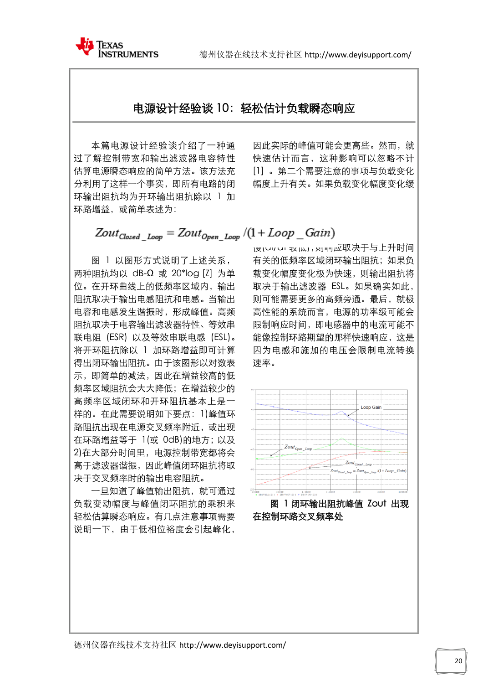

图 1 闭环输出阻抗峰值 Zout 出现 在控制环路交叉频率处

下面是一个如何使用上述关系的示 例。问题是根据 200kHz 开关电源 10 amp 变化幅度允许范围内的 50mV 输 出变化挑选一个输出电容。所允许的峰值 输出阻抗为：Zout=50 mV / 10 amps 或 5 毫欧。这就是最大允许输出电容 ESR。 接下来就是建立所需的电容。幸运的是， ESR 和电容均为正交型，可单独处理。一 个高 (Aggressive) 电源控制环路带宽 可以是开关频率的 1/6 或 30 kHz。于是 在 30 kHz 时输出滤波电容就需要一个 不到 5 毫欧的电抗，或高于 1000uF 的 电容。图 2 显示了在 5 毫欧 ESR、 1000uF 电容以及 30 kHz 电压模式控制 条件时这一问题的负载瞬态仿真。就校验 这一方法是否有效的 10amp 负载变动 幅度而言，输出电压变化大约为 52mV。 

下一篇，我们将讨论如何解决电源损耗问题，敬请期待。 

## 参考文献

1)《轻松计算得出负载瞬态响应》，作者：J. Betten 和 R. Kollman，摘自《电 力电子技术 (Power Electronics Technology) 》杂志，2005 年 2 月，网址： http://powerelectronics.com/mag/power_easy_calculation_yields/。 

2)《高级电子电路设计》，作者：Comer，David J.，出版商： Addison-Wesley Pub. Co., c1976, Chap. 6。 

## 电源设计经验谈11：解决电源电路损耗问题

您是否曾详细计算过设计中的预计 组件损耗，结果却发现与实验室测量结果 有较大出入呢？本电源设计经验谈介绍 了一种简便方法，以帮助您消除计算结果 与实际测量结果之间的差异。该方法基于 泰勒级数展开式，其中规定(在赋予一定自 由条件下)任何函数都可分解成一个多项 式，如下所示： 

$$
f (x) = a _ {0} + a _ {1} x + a _ {2} x ^ {2} + a _ {3} x ^ {3} + \dots
$$

如果意识到电源损耗与输出电流相 关(可用输出电流替换 X)，那么系数项就 能很好地与不同来源的电源功率损耗联 系起来。例如，ao 代表诸如栅极驱动、 偏压电源和磁芯的固定开销损耗以及功 率晶体管 Coss 充电与放电之类的损耗。 这些损耗与输出电流无关。第二项相关联 的损耗 a1 直接与输出电流相关，其典型 表现为输出二极管损耗和开关损耗。在输 出二极管中，大多数损耗是由于结电压引 起的，因此损耗会随着输出电流成比例地 增加。 

类似地，开关损耗可通过输出电流关 联项与某些固定电压的乘积近似得出。第 三项很容易被识别为传导损耗。其典型表 现为 FET 电阻、磁性布线电阻和互联电 阻中的损耗。高阶项可能在计算非线性损 耗(如磁芯损耗)时有用。只有在考虑前三 项情况下才能得出有用结果。计算三项系 数的一种方法是测量三个工作点的损耗 并成矩阵求解结果。如果损耗测量结果其 中一项是在无负载的工况下得到(即所有 损耗均等于第一项系数 a0)，那么就能简 化该解决方法。随后问题简化至容易求解 的两个方程式和两个未知数。一旦计算出 系数，即可构建出类似于图 1、显示三种 损耗类型的损耗曲线。该曲线在消除测量 结果和计算结果之间的偏差时大有用处， 并且有助于确定能够提高效率的潜在区 域。例如，在满负载工况下，图 1 中的 损耗主要为传导损耗。为了提高效率，就 需要降低 FET 电阻、电感电阻和互联电 阻。实际损耗与三项式之间的相关性非常 好。图 2 对同步降压稳压器的测量数据 与曲线拟合数据进行了对比。我们知道， 在基于求解三个联立方程组的曲线上将 存在三个重合点。对于曲线的剩余部分， 两个曲线之间的差异小于 2%。由于工作 模式(如连续或非连续)不同、脉冲跳频或 变频运行等原因，其他类型的电源可能很 难以如此匹配。这种方法并非绝对可靠， 但是有助于电源设计人员理解实际电路 损耗情况。 

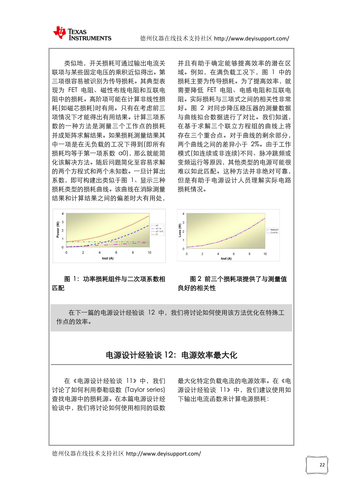

图 1：功率损耗组件与二次项系数相 匹配

[[硬件/原始备份/电源设计经验.pdf#page=22|原版PDF第22页整页回看（前文已展示）]]

图 2 前三个损耗项提供了与测量值 良好的相关性

在下一篇的电源设计经验谈 12 中，我们将讨论如何使用该方法优化在特殊工 作点的效率。 

## 电源设计经验谈12：电源效率最大化

在《电源设计经验谈 11》中，我们 讨论了如何利用泰勒级数 (Taylor series) 查找电源中的损耗源。在本篇电源设计经 验谈中，我们将讨论如何使用相同的级数 最大化特定负载电流的电源效率。在《电 源设计经验谈 11》中，我们建议使用如 下输出电流函数来计算电源损耗： 

<table><tr><td colspan="2"><eq>P_{loss}(i_o) = a_0 + a_1 i_o + a_2 i_o^2</eq>下一步是利用上述简单表达式,并将其放入效率方程式中:<eq>\eta(i_o) = v_o i_o / (v_o i_o + a_o + a_1 i_o + a_2 i_o^2)</eq>这样,输出电流的效率就得到了优化(具体论证工作留给学生去完成)。这种优化可产生一个有趣的结果。当输出电流等于如下表达式时,效率将会最大化。<eq>i_{opt} = \sqrt{\frac{a_0}{a_2}}</eq>需要注意的第一件事是,a1项对效率达到最大时的电流不产生影响。这是由于它与损耗相关,而上述损耗又与诸如二极管结点的输出电流成比例关系。因此,表1损耗系数及相应的电源损耗</td><td>当输出电流增加时,上述损耗和输出功率也会随之增加,并且对效率没有影响。需要注意的第二件事是,最佳效率出现在固定损耗和传导损耗相等的某个点上。这就是说,只要控制设置a0和a2值的组件,便能够获得最佳效率。还是要努力减小a1的值,并提高效率。控制该项所得结果对所有负载电流而言均相同,因此如其他项一样没有出现最佳效率。a1项的目标是在控制成本的同时达到最小化。表1概括总结了各种电源损耗项及其相关损耗系数,该表提供了一些最佳化电源效率方面的折中方法。例如,功率MOSFET导通电阻的选择会影响其栅极驱动要求及Coss损耗和潜在的缓冲器损耗。低导通电阻意味着,栅极驱动、Coss和缓冲器损耗逆向增加。因此,您可通过选择MOSFET来控制a0和a2。</td></tr><tr><td>损耗系数</td><td colspan="2">举例</td></tr><tr><td>a0</td><td colspan="2">偏压损耗 Coss损耗内核损耗 缓冲器损耗栅极驱动损耗</td></tr><tr><td>a1</td><td colspan="2">二级管结点损耗 开关损耗逆向恢复损耗 SR停滞时间损耗</td></tr><tr><td>a2</td><td colspan="2">FFT电阻损耗 绕组损耗漏电感损耗 蚀刻损耗电容器纹波I损耗 电流感应损耗</td></tr><tr><td colspan="2">代数式下一位将最佳电流代回到效率方程式中,解得最大效率为:<eq>\eta_{\text{max}} = v_o / (v_o + a_1 + 2\sqrt{a_o a_2})</eq>需要最小化该表达式中的最后两项,以最佳化效率。a1项很简单,只需对其最小化即可。末尾项能够实现部分优化。如果假设MOSFET的Coss和栅极驱</td><td>动功率与其面积相关,同时其导通电阻与面积成反比,则可以为它选择最佳面积(和电阻)。图1显示了裸片面积的优化结果。裸片面积较小时,MOSFET的导通电阻变为效率限制器。随着裸片面积增加,驱动和Coss损耗也随之增加,并且在某一点上变为主要损耗组件。这种最小值相对宽</td></tr></table>

泛，从而让设计人员可以灵活控制已实现 低损耗的 MOSFET 成本。当驱动损耗等 于传导损耗时达到最低损耗。 

图 2 是围绕图 1 最佳点的三种可 能设计效率图。图中分别显示了三种设计 的正常裸片面积。轻负载情况下，较大面 积裸片的效率会受不断增加的驱动损耗 影响，而在重负载条件下小尺寸器件因高 传导损耗而变得不堪重负。这些曲线代表 裸片面积和成本的三比一变化，注意这一 点非常重要。正常芯片面积设计的效率只 比满功率大面积设计的效率稍低一点，而 在轻载条件下(设计常常运行在这种负载 条件下)则更高。 

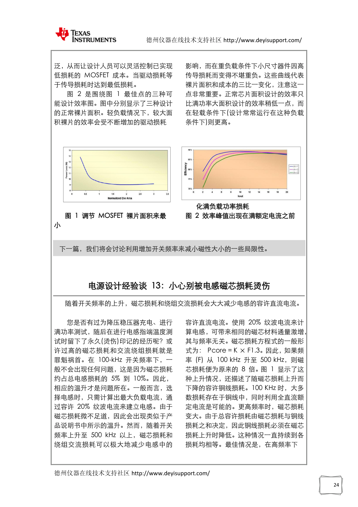

图 1 调节 MOSFET 裸片面积来最 小

[[硬件/原始备份/电源设计经验.pdf#page=24|原版PDF第24页整页回看（前文已展示）]]

化满负载功率损耗

图 2 效率峰值出现在满额定电流之前

下一篇，我们将会讨论利用增加开关频率来减小磁性大小的一些局限性。 

## 电源设计经验谈 13：小心别被电感磁芯损耗烫伤

随着开关频率的上升，磁芯损耗和绕组交流损耗会大大减少电感的容许直流电流。 

您是否有过为降压稳压器充电、进行 满功率测试，随后在进行电感指端温度测 试时留下了永久(烫伤)印记的经历呢？或 许过高的磁芯损耗和交流绕组损耗就是 罪魁祸首。在 100-kHz 开关频率下，一 般不会出现任何问题，这是因为磁芯损耗 约占总电感损耗的 5% 到 10%。因此， 相应的温升才是问题所在。一般而言，选 择电感时，只需计算出最大负载电流，通 过容许 20% 纹波电流来建立电感。由于 磁芯损耗微不足道，因此会出现类似于产 品说明书中所示的温升。然而，随着开关 频率上升至 500 kHz 以上，磁芯损耗和 绕组交流损耗可以极大地减少电感中的 容许直流电流。使用 20% 纹波电流来计 算电感，可带来相同的磁芯材料通量激增， 其与频率无关。磁芯损耗方程式的一般形 式为： $\mathsf { P C O r e } = \mathsf { K } \times \mathsf { F l } . 3 ,$ 。因此，如果频 率 (F) 从 100 kHz 升至 500 kHz，则磁 芯损耗便为原来的 8 倍。图 1 显示了这 种上升情况，还描述了随磁芯损耗上升而 下降的容许铜线损耗。100 KHz 时，大多 数损耗存在于铜线中，同时利用全直流额 定电流是可能的。更高频率时，磁芯损耗 变大。由于总容许损耗由磁芯损耗与铜线 损耗之和决定，因此铜线损耗必须在磁芯 损耗上升时降低。这种情况一直持续到各 损耗均相等。最佳情况是，在高频率下 

损耗稳定保持相等，并允许从磁结构获得 最大输出电流。 

图1和图2均基于固定磁芯体积和绕 组面积，仅匝数可变。图 2 显示了图 1 所示磁芯损耗的电感和容许直流电流。1.3 MHz以下时，电感与开关频率成反比关系。 电感在1.3 MHz 附近达到最小值。该频率 以上，则必须升高电感来限制磁芯通量， 从而将磁芯损耗控制在总损耗的 50%。该 电感的额定电流也同时被计算出来。低频 率时，磁芯损耗并不大，额定电流由绕组 的功率损耗决定。 

下列方程式中，匝数与频率平方根的 

倒数成正比，因此频率升高 2 倍(电 感降低一半)得到 0.707 匝数。 $\mathsf { L } = \mu \times \mathsf { A }$ × N2/lm 

这种情况会以两种方式影响绕组电 阻。匝数减少 30%，而每一匝的可用面积 却增加了 41%。由于绕组电阻与匝数/匝 面积相关，因此电阻随频率上升而线性下 降，例如：在本例中电阻下降 2 倍。较 高频率时，磁芯损耗开始限制容许铜线损 耗，直到达到它们相等的点为止。在这一 点上，通过增加更多匝数以及升高绕组电 阻，使电感上升来降低通量。这样，电感 额定电流减少。因此，从电感尺寸角度来 说获得了最佳频率。 

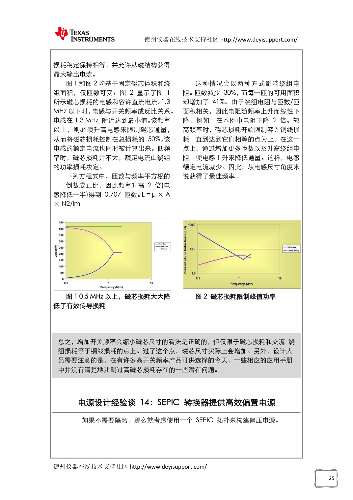

图 1 0.5 MHz 以上，磁芯损耗大大降 低了有效传导损耗

[[硬件/原始备份/电源设计经验.pdf#page=25|原版PDF第25页整页回看（前文已展示）]]

图 2 磁芯损耗限制峰值功率

总之，增加开关频率会缩小磁芯尺寸的看法是正确的，但仅限于磁芯损耗和交流 绕 组损耗等于铜线损耗的点上。过了这个点，磁芯尺寸实际上会增加。另外，设计人 员需要注意的是，在有许多高开关频率产品可供选择的今天，一些相应的应用手册 中并没有清楚地注明过高磁芯损耗存在的一些潜在问题。 

## 电源设计经验谈 14：SEPIC 转换器提供高效偏臵电源

如果不需要隔离，那么就考虑使用一个 SEPIC 拓扑来构建偏压电源。 

您想过使用一个单端初级电感转换 器 (SEPIC) 拓扑结构来构建偏压电源吗？ 如果您不需要隔离，那么这种想法还是行 的通的。SEPIC 拥有诸多特性，从而使其 比非隔离式反向结构更具吸引力。控制 MOSFET 和输出整流器振铃可减少电磁 干扰 (EMI) 和电压应力。在许多情况下， 这使您能够使用更低电压的部件，从而降 低成本并提高效率。另外，多输出 SEPIC 可改善输出之间的交叉稳压，从而消除对 于线性稳压器的需求。 

图 1 显示的是一个 SEPIC 转换器， 像反向转换器一样它具有最少的部件数 量。实际上，如果去除 C1，该电路就是 一个反向转换器。该电容可提供对其所连 接半导体的电压钳位控制。当 MOSFET 开启时，该电容通过 MOSFET 对 D1 的 反向电压进行钳位控制。当电源开关关闭 时，在 D1 导电以前漏电压一直上升。在 关闭期间，C1 通过 D1 和 C2 对 MOSFET 漏电压进行钳位控制。具有多个 输出端的 SEPIC 转换器对绕组比构成限 制。其中的一个次级绕组对初级绕组的匝 比需为 1:1，同时 C1 必须与之相连接。 在图 1 所示的示例电路中，12-V 绕组的 匝比为 1:1，但它可能已经使用了 5-V 绕组作为替代。 

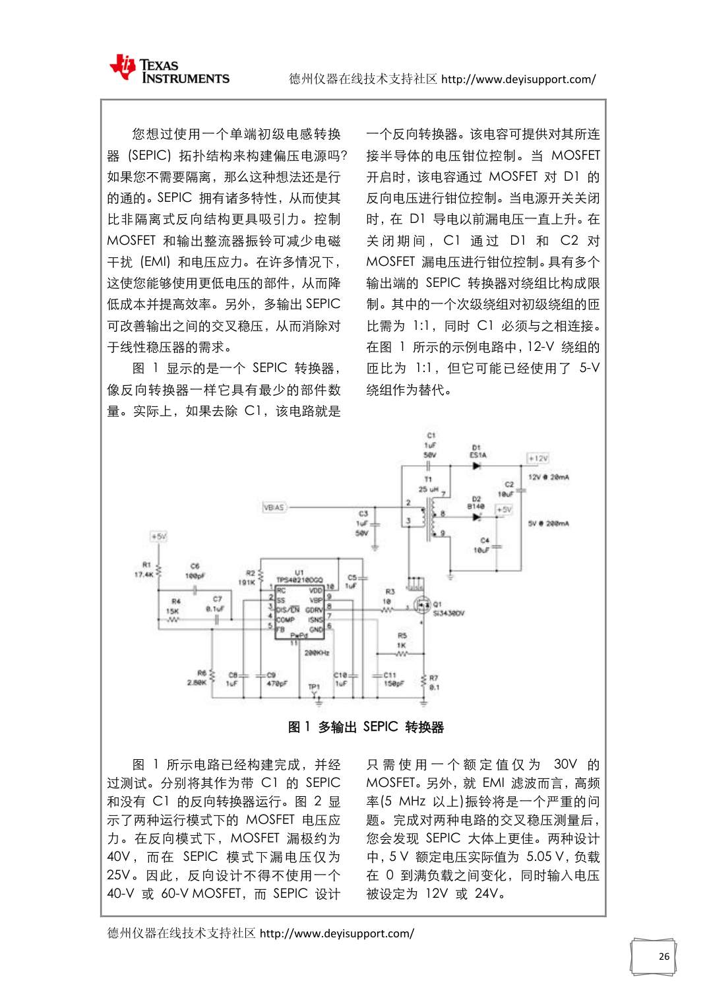

图 1 多输出 SEPIC 转换器

图 1 所示电路已经构建完成，并经 过测试。分别将其作为带 C1 的 SEPIC 和没有 C1 的反向转换器运行。图 2 显 示了两种运行模式下的 MOSFET 电压应 力。在反向模式下，MOSFET 漏极约为 40V，而在 SEPIC 模式下漏电压仅为 25V。因此，反向设计不得不使用一个 40-V 或 60-V MOSFET，而 SEPIC 设计 只需使用一个额定值仅为 30V 的 MOSFET。另外，就 EMI 滤波而言，高频 率(5 MHz 以上)振铃将是一个严重的问 题。完成对两种电路的交叉稳压测量后， 您会发现 SEPIC 大体上更佳。两种设计 中，5 V 额定电压实际值为 5.05 V，负载 在 0 到满负载之间变化，同时输入电压 被设定为 12V 或 24V。 

SEPIC 的 12V 电压维持在 10% 稳压频 带内，而反向转换器的 12V 电压则上升 至 30V(高线压输入，12V 无负载，5V 全 负载)。如果根据低电压应力选择功率部 件，那么即使这两种结构的效率相同人们 也会更倾向于使用 SEPIC。 

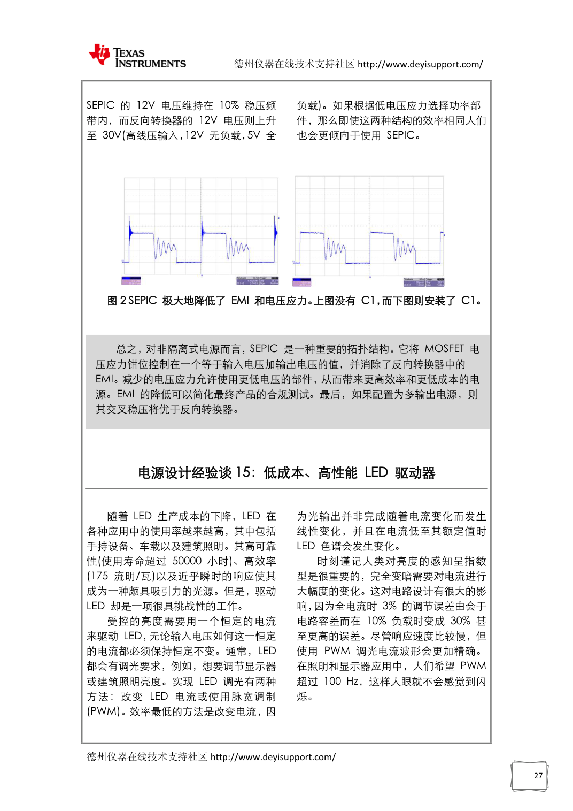

图 2 SEPIC 极大地降低了 EMI 和电压应力。上图没有 C1，而下图则安装了 C1。

总之，对非隔离式电源而言，SEPIC 是一种重要的拓扑结构。它将 MOSFET 电 压应力钳位控制在一个等于输入电压加输出电压的值，并消除了反向转换器中的 EMI。减少的电压应力允许使用更低电压的部件，从而带来更高效率和更低成本的电 源。EMI 的降低可以简化最终产品的合规测试。最后，如果配臵为多输出电源，则 其交叉稳压将优于反向转换器。 

## 电源设计经验谈 15：低成本、高性能 LED 驱动器

随着 LED 生产成本的下降，LED 在 各种应用中的使用率越来越高，其中包括 手持设备、车载以及建筑照明。其高可靠 性(使用寿命超过 50000 小时)、高效率 (175 流明/瓦)以及近乎瞬时的响应使其 成为一种颇具吸引力的光源。但是，驱动 LED 却是一项很具挑战性的工作。 

受控的亮度需要用一个恒定的电流 来驱动 LED，无论输入电压如何这一恒定 的电流都必须保持恒定不变。通常，LED 都会有调光要求，例如，想要调节显示器 或建筑照明亮度。实现 LED 调光有两种 方法：改变 LED 电流或使用脉宽调制 (PWM)。效率最低的方法是改变电流，因 为光输出并非完成随着电流变化而发生 线性变化，并且在电流低至其额定值时 LED 色谱会发生变化。 

时刻谨记人类对亮度的感知呈指数 型是很重要的，完全变暗需要对电流进行 大幅度的变化。这对电路设计有很大的影 响，因为全电流时 3% 的调节误差由会于 电路容差而在 10% 负载时变成 30% 甚 至更高的误差。尽管响应速度比较慢，但 使用 PWM 调光电流波形会更加精确。 在照明和显示器应用中，人们希望 PWM 超过 100 Hz，这样人眼就不会感觉到闪 烁。 

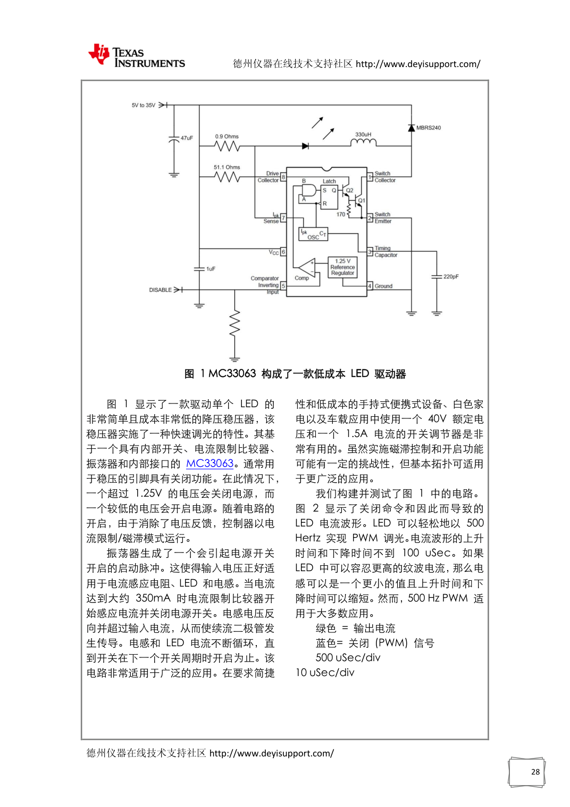

图 1 MC33063 构成了一款低成本 LED 驱动器

图 1 显示了一款驱动单个 LED 的 非常简单且成本非常低的降压稳压器，该 稳压器实施了一种快速调光的特性。其基 于一个具有内部开关、电流限制比较器、 振荡器和内部接口的 MC33063。通常用 于稳压的引脚具有关闭功能。在此情况下， 一个超过 1.25V 的电压会关闭电源，而 一个较低的电压会开启电源。随着电路的 开启，由于消除了电压反馈，控制器以电 流限制/磁滞模式运行。 

振荡器生成了一个会引起电源开关 开启的启动脉冲。这使得输入电压正好适 用于电流感应电阻、LED 和电感。当电流 达到大约 350mA 时电流限制比较器开 始感应电流并关闭电源开关。电感电压反 向并超过输入电流，从而使续流二极管发 生传导。电感和 LED 电流不断循环，直 到开关在下一个开关周期时开启为止。该 电路非常适用于广泛的应用。在要求简捷 性和低成本的手持式便携式设备、白色家 电以及车载应用中使用一个 40V 额定电 压和一个 1.5A 电流的开关调节器是非 常有用的。虽然实施磁滞控制和开启功能 可能有一定的挑战性，但基本拓扑可适用 于更广泛的应用。 

我们构建并测试了图 1 中的电路。 图 2 显示了关闭命令和因此而导致的 LED 电流波形。LED 可以轻松地以 500 Hertz 实现 PWM 调光。电流波形的上升 时间和下降时间不到 100 uSec。如果 LED 中可以容忍更高的纹波电流，那么电 感可以是一个更小的值且上升时间和下 降时间可以缩短。然而，500 Hz PWM 适 用于大多数应用。 

绿色 = 输出电流 

蓝色= 关闭 (PWM) 信号 

500 uSec/div 

10 uSec/div 

[[硬件/原始备份/电源设计经验.pdf#page=28|原版PDF第28页整页回看（前文已展示）]]

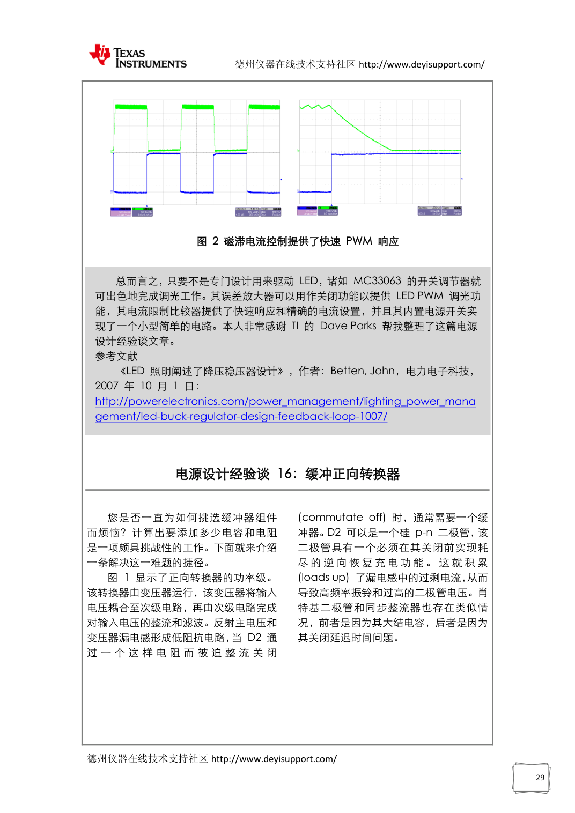

图 2 磁滞电流控制提供了快速 PWM 响应

总而言之，只要不是专门设计用来驱动 LED，诸如 MC33063 的开关调节器就 可出色地完成调光工作。其误差放大器可以用作关闭功能以提供 LED PWM 调光功 能，其电流限制比较器提供了快速响应和精确的电流设臵，并且其内臵电源开关实 现了一个小型简单的电路。本人非常感谢 TI 的 Dave Parks 帮我整理了这篇电源 设计经验谈文章。 

## 参考文献

《LED 照明阐述了降压稳压器设计》，作者：Betten, John，电力电子科技， 2007 年 10 月 1 日： 

http://powerelectronics.com/power_management/lighting_power_mana gement/led-buck-regulator-design-feedback-loop-1007/ 

## 电源设计经验谈 16：缓冲正向转换器

您是否一直为如何挑选缓冲器组件 而烦恼？计算出要添加多少电容和电阻 是一项颇具挑战性的工作。下面就来介绍 一条解决这一难题的捷径。 

图 1 显示了正向转换器的功率级。 该转换器由变压器运行，该变压器将输入 电压耦合至次级电路，再由次级电路完成 对输入电压的整流和滤波。反射主电压和 变压器漏电感形成低阻抗电路，当 D2 通 过 一 个 这 样 电 阻 而 被 迫 整 流 关 闭 (commutate off) 时，通常需要一个缓 冲器。D2 可以是一个硅 p-n 二极管，该 二极管具有一个必须在其关闭前实现耗 尽的逆向恢复充电功能。这就积累 (loads up) 了漏电感中的过剩电流，从而 导致高频率振铃和过高的二极管电压。肖 特基二极管和同步整流器也存在类似情 况，前者是因为其大结电容，后者是因为 其关闭延迟时间问题。 

[[硬件/原始备份/电源设计经验.pdf#page=29|原版PDF第29页整页回看（前文已展示）]]

图 1 漏电感延缓了 D2 关闭

图 2 显示了一些电路波形，顶部线 迹为 Q1 漏电压，中部线迹为 D1 和 D2 结点处的电压，底部线迹为流经 D1 的电流。在顶部线迹中，您可以看到当 Q1 打开时，其漏电压被降至输入电压以 下，这样就使得二极管 D1 电流增加。如 果 D2 没有逆向恢复充电功能，当 D1 电流等于输出电流时，结点电压就会上升。 由于 D2 具有逆向恢复充电功能，因此 

D1 电流会进一步增加，这便开始消耗电 荷。一旦电荷耗尽，二极管便关闭，从而 导致增加的结点电压进一步提高。请注意， 电流会不断增加直到结点电压等于反射 输入电压为止，因为在漏电感两端有一个 正电压。随着电流的增加，该电流将对寄 生电容进行充电并导致电路中振铃和损 耗更大。 

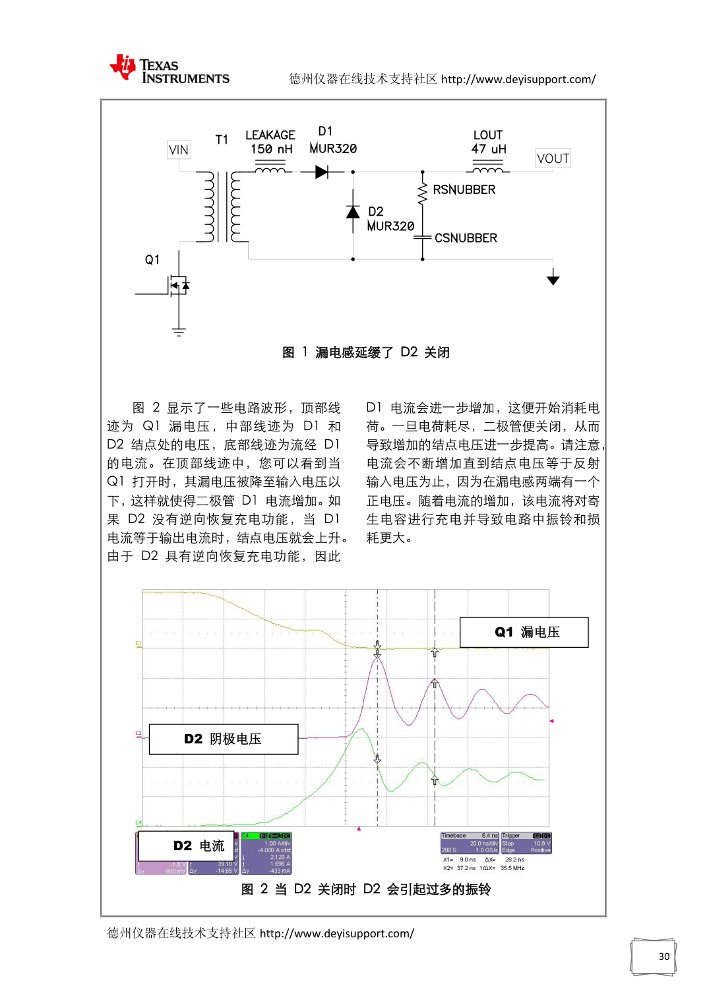

图 2 当 D2 关闭时 D2 会引起过多的振铃

这些振铃波形也许是人们所无法接 受的，因为它们会引起 EMI 问题或带来 二极管上让人无法接受的电压应力。跨接 D2 的 RC 缓冲器可以在几乎不影响效 率的同时大大减少振铃。您可以利用下面 的方程式计算得出振铃频率(请参见方程 

式 1)：方程式 1： 

$$
f = \frac {1}{2 ^ {*} \pi \sqrt {L ^ {*} C}}
$$

但是您如何知道电路中 L 和 C 的 值呢？窍门就是通过在 D2 两端添加一 个已知电容值的电容以降低振铃频率，这 样您就得到了两个方程式以及两个未知 项。如果您添加了正好可以减半振铃频率 的电容，那么就会使求出上述值变得更加 轻松。要想降低一半频率，您需要一个 4 倍于您一开始使用的寄生电容的总电容。 然后，只要将所添加的电容除以 3 就可 以得到寄生电容。图 3 显示了频率为最 初振铃频率一半时 D2 两端 470 pF 电 容的波形。因此，电路具有大约 150 pF 的寄生电容。请注意，只添加电容对振铃 的振幅作用很小，电路还需要一些电阻来 阻尼振铃。这就是电容因数 3 是开始的 好地方的另一个原因。如果选择的电阻适 当，那么该电阻就可以在对效率最小影响 的同时提供卓越的阻尼效果。阻尼电阻的 最佳值几乎就是寄生元件的典型电阻(请 参见方程式 2)。 

方程式 2： 

$$
R = Z _ {o} = \sqrt {\frac {L}{C}}
$$

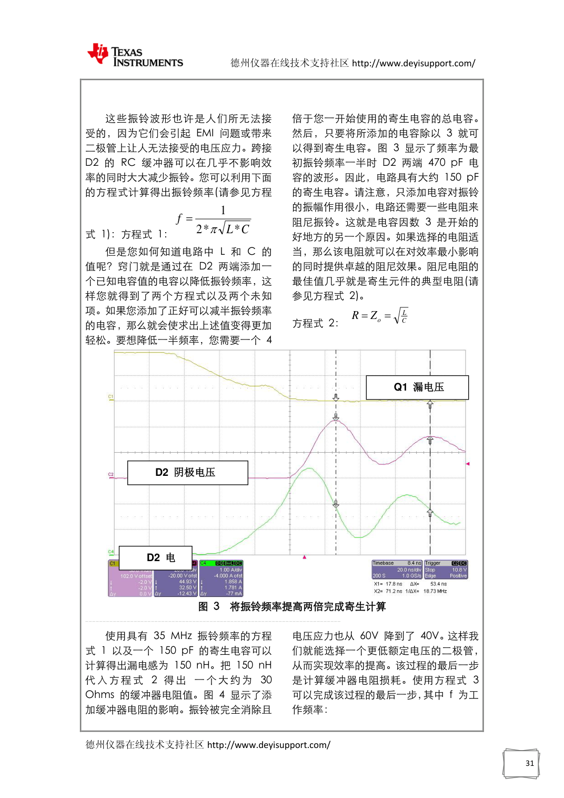

图 3 将振铃频率提高两倍完成寄生计算

使用具有 35 MHz 振铃频率的方程 式 1 以及一个 150 pF 的寄生电容可以 计算得出漏电感为 150 nH。把 150 nH 代入方程式 2 得出 一个大约为 30 Ohms 的缓冲器电阻值。图 4 显示了添 加缓冲器电阻的影响。振铃被完全消除且 电压应力也从 60V 降到了 40V。这样我 们就能选择一个更低额定电压的二极管， 从而实现效率的提高。该过程的最后一步 是计算缓冲器电阻损耗。使用方程式 3 可以完成该过程的最后一步，其中 f 为工 作频率： 

方程式 3： 

$$
P = f ^ {*} C s n u b b e r ^ {*} V p k ^ {2}
$$

一旦完成计算，您就需要确定电路是 否可以承受缓冲器中的损耗。如果不能的 话，您就需要在振铃和缓冲器损耗间进行 权衡。如欲了解如何选择最佳阻尼电阻的 详情，请参见第 3 页的图 3《电源设计 经验谈 4》。 

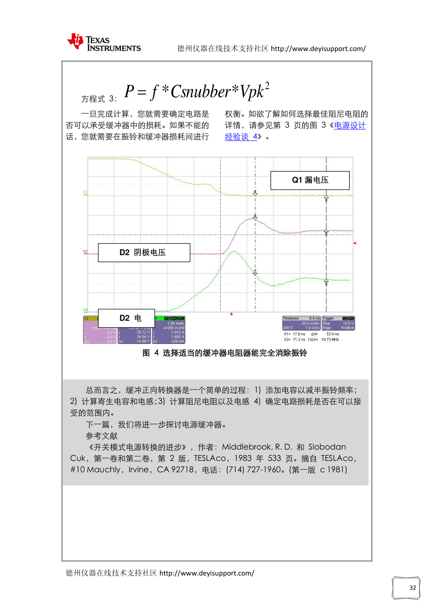

图 4 选择适当的缓冲器电阻器能完全消除振铃

总而言之，缓冲正向转换器是一个简单的过程：1) 添加电容以减半振铃频率； 2) 计算寄生电容和电感；3) 计算阻尼电阻以及电感 4) 确定电路损耗是否在可以接 受的范围内。 

下一篇，我们将进一步探讨电源缓冲器。 

## 参考文献

《开关模式电源转换的进步》，作者：Middlebrook, R. D. 和 Slobodan Cuk，第一卷和第二卷，第 2 版，TESLAco，1983 年 533 页。摘自 TESLAco， #10 Mauchly，Irvine，CA 92718，电话：(714) 727-1960。(第一版 c 1981) 

## 电源设计经验谈 17：缓冲反向转换器

之前，我们介绍了如何对正向转换器 输出整流器开启期间两端的电压进行缓 冲。现在，我们来研究如何对反向转换器 的 FET 关断电压进行缓冲。 

图 1 显示了反向转换器功率级和一 次侧 MOSFET 电压波形。该转换器将能 量存储于一个变压器主绕组电感中并在 MOSFET 关闭时将其释放到次级绕组。由 于变压器的漏极电感会使漏电压升至反 射 输 出 电 压 (Vreset) 以 上 ， 因 此 MOSFET 关闭时通常会需要一个缓冲器。 存储于漏极电感中的能量可使 MOSFET 产生雪崩现象，因此要添加一个由 D1、 R24 和 C6 组成的钳压电路。该电路的 钳位电压取决于漏电的能量大小以及电 阻器的功率消耗。更小值的电阻虽然可以 降低钳位电压，但会增加功率损耗。 

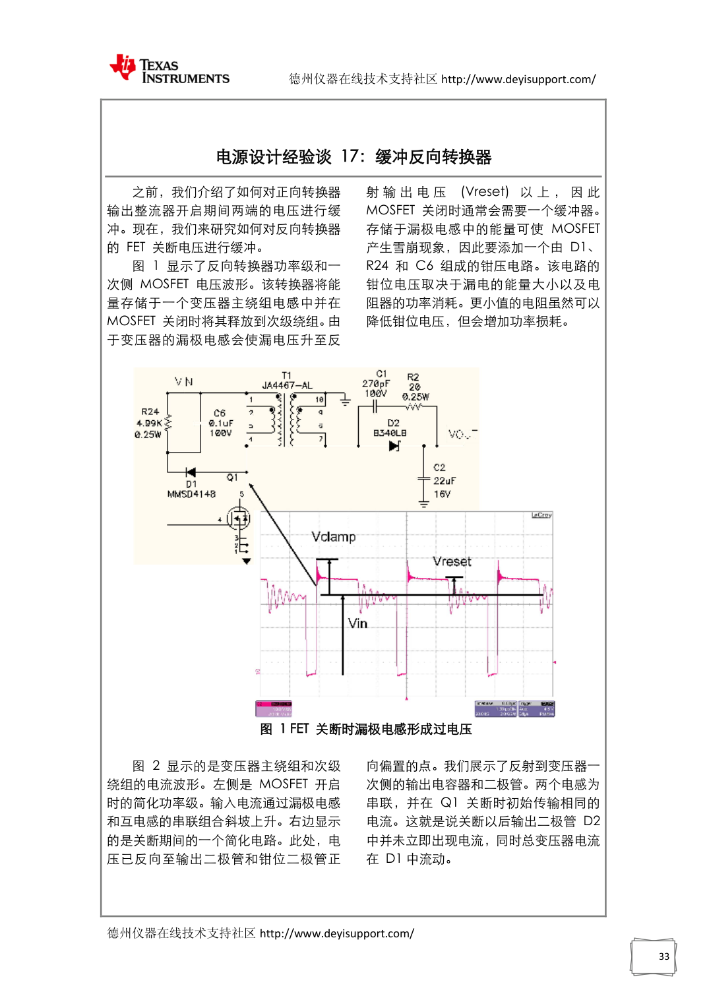

图 1 FET 关断时漏极电感形成过电压

图 2 显示的是变压器主绕组和次级 绕组的电流波形。左侧是 MOSFET 开启 时的简化功率级。输入电流通过漏极电感 和互电感的串联组合斜坡上升。右边显示 的是关断期间的一个简化电路。此处，电 压已反向至输出二极管和钳位二极管正 向偏臵的点。我们展示了反射到变压器一 次侧的输出电容器和二极管。两个电感为 串联，并在 Q1 关断时初始传输相同的 电流。这就是说关断以后输出二极管 D2 中并未立即出现电流，同时总变压器电流 在 D1 中流动。 

漏极电感的电压是钳位电压和重位 电压之间的差，且往往会快速释放漏电。 如图所示，经过简单计算便可得到分流至 缓冲器的能量大小。因此您可以通过缩短 释放漏极电感中能量的时间，来减少分流 能量。提高钳位电压可以实现这一目标。 

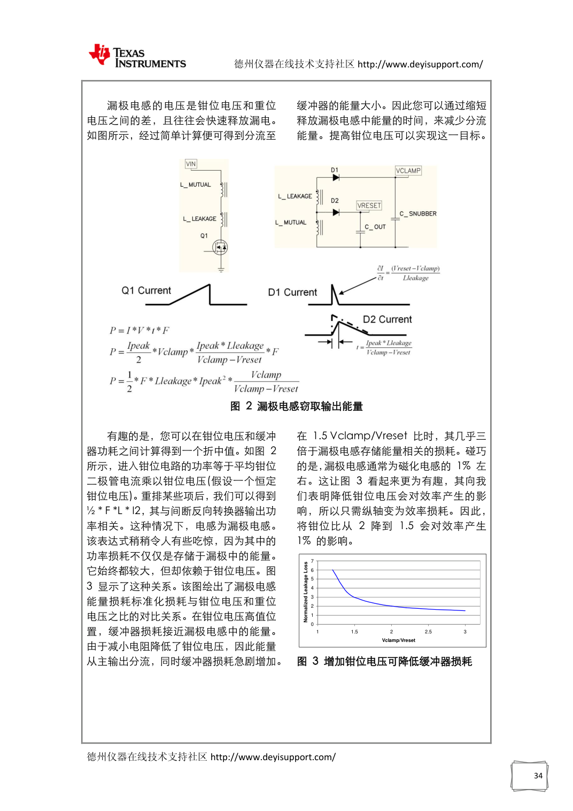

图 2 漏极电感窃取输出能量

有趣的是，您可以在钳位电压和缓冲 器功耗之间计算得到一个折中值。如图 2 所示，进入钳位电路的功率等于平均钳位 二极管电流乘以钳位电压(假设一个恒定 钳位电压)。重排某些项后，我们可以得到 ½ * F *L * I2，其与间断反向转换器输出功 率相关。这种情况下，电感为漏极电感。 该表达式稍稍令人有些吃惊，因为其中的 功率损耗不仅仅是存储于漏极中的能量。 它始终都较大，但却依赖于钳位电压。图 3 显示了这种关系。该图绘出了漏极电感 能量损耗标准化损耗与钳位电压和重位 电压之比的对比关系。在钳位电压高值位 臵，缓冲器损耗接近漏极电感中的能量。 由于减小电阻降低了钳位电压，因此能量 从主输出分流，同时缓冲器损耗急剧增加。 

在 1.5 Vclamp/Vreset 比时，其几乎三 倍于漏极电感存储能量相关的损耗。碰巧 的是，漏极电感通常为磁化电感的 1% 左 右。这让图 3 看起来更为有趣，其向我 们表明降低钳位电压会对效率产生的影 响，所以只需纵轴变为效率损耗。因此， 将钳位比从 2 降到 1.5 会对效率产生 1% 的影响。 

[[硬件/原始备份/电源设计经验.pdf#page=34|原版PDF第34页整页回看（前文已展示）]]

图 3 增加钳位电压可降低缓冲器损耗

总之，反向转换器的漏极电感可对电源开关产生不可接受的电压应力。RCD 缓冲器 可以控制这种应力。但是，可以在钳位电压和电路损耗之间有一种折中方法。 

下一篇，我们将研究分压器的精确度。 

## 电源设计经验谈 18：您稳压器的输出电压精度或许并非如您所想的

## 那样糟糕

虽然输出电压不断下降而稳压要求 正变得越来越高，但是您的任务可能并非 像其表面上看起来那么困难。即使必须要 使用 1% 或更大的容差电阻来进行设计， 但您仍然可以得到非常精确的输出电压。 图 1 显示了一款典型的电源调节电路。 输出被分流降压，并与参考电压进行比较。 差异被放大，并用于驱动调节环路。乍一 看，您可能会认为这一方案仅限于两倍电 阻容差精度。幸运的是，实际并非如此； 精度还是输出电压与参考电压之比的强 函数。三种不同的情况可以非常容易地说 明这一比率。第一种情况是假设一点分压 也没有，换句话就是说输出电压等于参考 电压。很明显，这种情况下没有电阻分压 误差。第二种情况是假设输出电压大大高 于参考电压。在这种情况下，R1 大于 R2。 分压器误差是电阻容差的两倍，从而得到 一个方向变化的 R1 值，以及往另一个方 向变化的 R2 值。第三种易于说明的情况 是假设输出电压是参考电压的两倍。在这 种情况下，额定电阻值相等。因此，如果 电阻容差以反方向变化，则分压器方程式 顶部随着该容差值变化，而分母变为零。 图 2 显示了输出精度，其为参考电压与 输出电压对比关系的函数。(详细推导过程 请参见附录。)简化之后，分压器精度为 (1 – Vref/Vout)*2*容差，其与我们通过检 查得到的三个数据点相关。我们对该方程 式进行了一些简化处理，但对大多数电阻 容差来说都应该足够精确。 

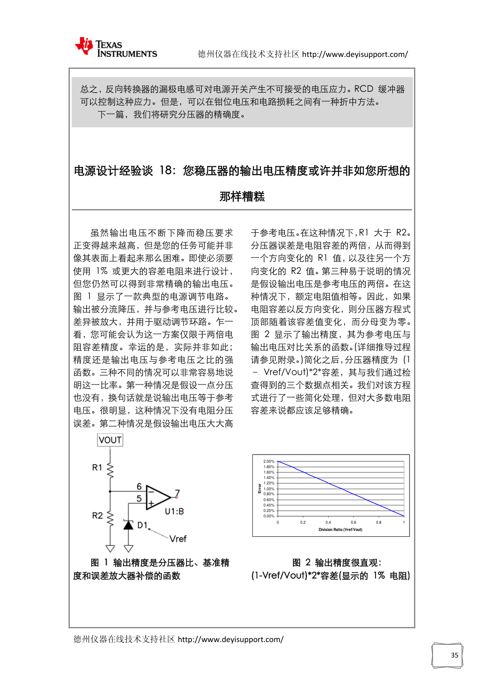

图 1 输出精度是分压器比、基准精 度和误差放大器补偿的函数

[[硬件/原始备份/电源设计经验.pdf#page=35|原版PDF第35页整页回看（前文已展示）]]

图 2 输出精度很直观：

(1-Vref/Vout)*2*容差(显示的 1% 电阻)

有趣的是，这样给低压输出带来了更 高的精度。许多 IC 参考电压范围为 0.6～1.25 V 之间，输出电压降至这一范 围时会带来 1% 或更高的精度。表 1 给 出了您可能需要了解的一些信息，这些信 息是典型电阻器产品说明书的电阻误差 术语汇编。在设计中，该列表会较难理解。 大多数工程师都止步于初始容差，然而列 表中还有一些或许不应被忽略的误差项。 

表格中的每一项都有其微妙的影响。 例如，没有指定具体的温度系数范围，而 实际上两个电阻都可能随温度变化以相 同方向变化，并且不会在相反的极端。在 对一些经验丰富的设计工程师进行简单 调查后，得出的结论是假设 1% 容差电阻 的 2.5% 精度可在极端情况和合理成本 之间得到一个合理的折中方案。 

## 表 1 电阻容差可相加

<table><tr><td>误差源</td><td>典型值</td><td>和</td><td>备注</td></tr><tr><td>初始容差</td><td>1%</td><td>1%</td><td>一般 0.1%、0.5%、1% 或 5%</td></tr><tr><td>温度系数</td><td>0.5%</td><td>1.5%</td><td>70 摄氏度时一般为 0.2%~4%</td></tr><tr><td>使用寿命</td><td>1%</td><td>2.5%</td><td>额定功率条件下 1000 小时</td></tr><tr><td>焊接</td><td>1%</td><td>3.5%</td><td>260 摄氏度时 10 秒</td></tr><tr><td>低温运行</td><td>0.75%</td><td>4.25%</td><td>-55 摄氏度条件下,1 小时</td></tr><tr><td>高温暴露</td><td>1%</td><td>5.25%</td><td>125 摄氏度条件下,100 小时</td></tr><tr><td>短时过载</td><td>2%</td><td>7.25%</td><td>2.5 x RCWV,5 秒</td></tr><tr><td>引出端强度</td><td>0.5%</td><td>7.75%</td><td>2mm 弯曲,10 秒</td></tr><tr><td>耐潮性</td><td>2%</td><td>9.75%</td><td>Mil Std 202 标准</td></tr><tr><td>温度循环</td><td>0.5%</td><td>10.25%</td><td></td></tr><tr><td>温度冲击</td><td>0.2%</td><td>10.45%</td><td>50G,11ms</td></tr><tr><td>高频振动</td><td>0.2%</td><td>10.65%</td><td>10-2000Hz</td></tr></table>

求解计算顶部分压器电阻值，其为分压器比 (R) 的函数： 

$$
R = \frac {R 2}{R 1 + R 2}
$$

$$
R 1 = \frac {R 2 * (1 - R)}{R}
$$

重写表达式为电阻容差 (T) 的函数： 

$$
R ^ {\prime} = \frac {R 2 * (1 + T)}{R 1 * (1 - T) + R 2 * (1 + T)}
$$

代入 R1： 

$$
R ^ {\prime} = \frac {R 2 * (1 + T)}{R 2 * (1 - T) * (1 - R) / R + R 2 * (1 + T)}
$$

顶部和底部乘以 R/R2： 

$$
R ^ {\prime} = \frac {(1 + T) * R}{(1 - T) (1 - R) + R * (1 + T)}
$$

$$
R ^ {\prime} = \frac {(1 + T) ^ {*} R}{(1 - T - R + R ^ {*} T) + R + R ^ {*} T}
$$

$$
R ^ {\prime} = \frac {(1 + T) * R}{(1 - T + 2 * R * T)}
$$

除以 R，然后减去 1，得到误差： 

$$
R ^ {\prime} / R - 1 = \text { Error } = \frac {(1 + T)}{(1 - T + 2 * R * T)} - 1
$$

$$
E r r o r = \frac {(1 + T) - 1 + T - 2 * R * T}{(1 - T + 2 * R * T)}
$$

$$
E r r o r = \frac {2 * T - 2 * R * T}{(1 - T + 2 * R * T)}
$$

$$
E r r o r = \frac {2 * T * (1 - R)}{(1 - T + 2 * R * T)}
$$

$\intercal < < \rceil$ 时: 

$$
E r r o r = 2 ^ {*} T ^ {*} (1 - R) = 2 ^ {*} T ^ {*} (1 - V o u t / V r e f)
$$

总之，提供较好的低压输出精度并非是一项令人畏惧的任务，因为低分压器比本身 就较为精确。 

下一篇，我们将讨论获得负电压的一种有趣的电源拓扑。 

## 电源设计经验谈 19：轻松创建多个负输出电压

因特网协议语音传输 (VoIP) 电话的 出现带来了对于生成多个高压负输出的 需求，这些电压轨用于驱动电话线路。当 线路处在通话模式时，一般会有一个 –24V 输出来提供环路电流，同时通常会 有另外一个或两个负输出来驱动电话振 铃。有趣的是，就每条电话线路而言，这 些负载相互排斥，也就是说您不能使电话 同时响铃和通话。然而，一个系统中可能 会有多条电话线路，从而产生许多负载情 况。这些系统通常由一个 12V 的电源供 电，其已经与输入功率隔离，因此一般不 再需要二级隔离。功率电平一般低于 25W，调节要求通常在 3% 到 10% 范围 内。 

反向拓扑结构看起来是这种应用的 不二选择。功率电平与反向拓扑结构一致。 利用反向拓扑结构可轻松地生成多个高 压输出，而反向拓扑结构已为人们所了解。 

但是，反向拓扑结构也存在诸多不足之处： 该拓扑包括会过度振铃的非钳位电源开 关电压，；其通常需要一个二级输出滤波 器；零到满负载的交叉调节不能为 3%。 

图 1 显示了一种替代方法。您认识 这种拓扑结构吗？让我们来研究这种拓 扑结构具有的一些优点，假设所有负载仅 为 -27V 输出。 

关闭开关，使 C16 钳位控制电源开 关 (Q1)。电源开关开启时，输出整流器 (D2) 由 C16 钳位控制。因此，通常不 会出现与反向拓扑结构相关的振铃。另外， 流经耦合电感的输入及输出电流可以为 持续，这极大地简化了输入和输出滤波器。 这种拓扑结构是一款 C’uk 转换器。普 通工程师对这种拓扑结构不是很了解，这 成为实施该拓扑结构的难点。这主要是因 为只是偶尔使用 C’uk，抑或是工程师 在大多数时候甚至都没有考虑它。 

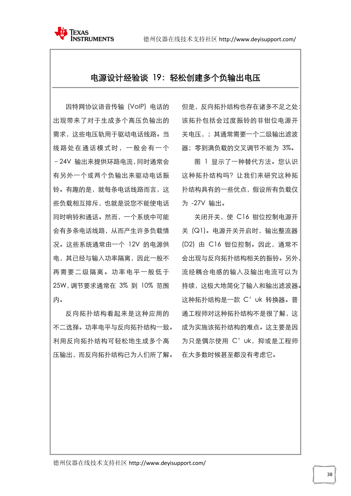

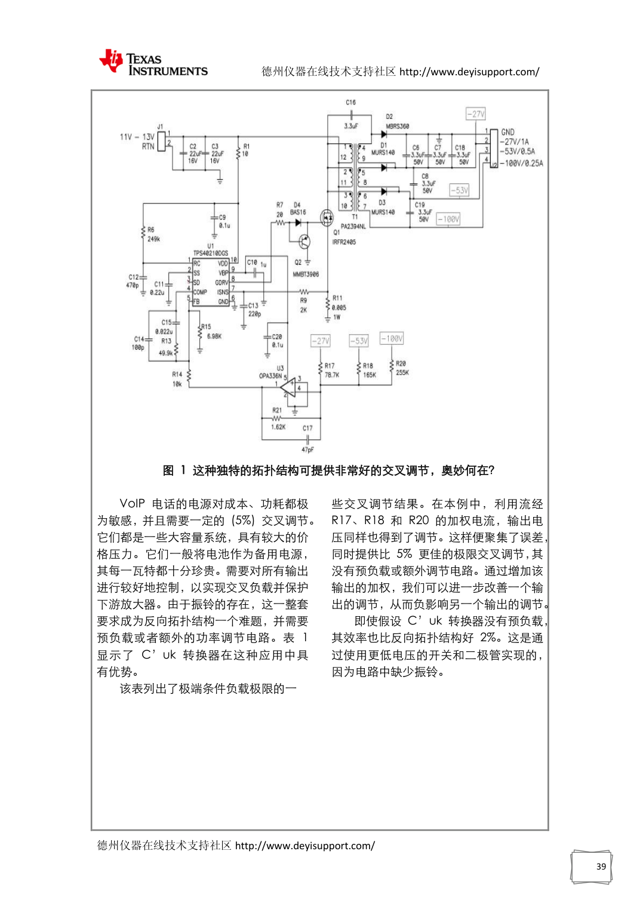

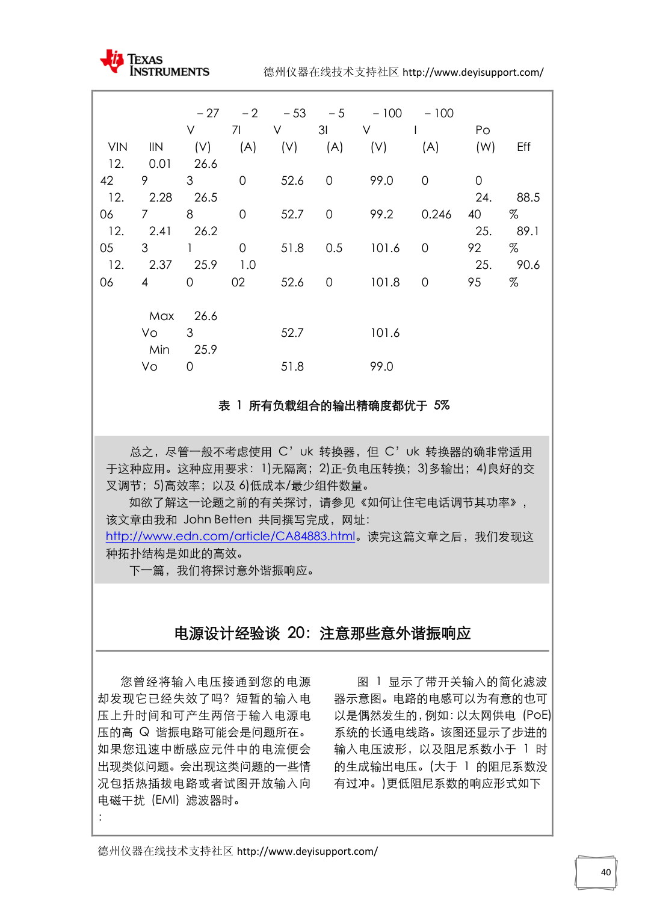

图 1 这种独特的拓扑结构可提供非常好的交叉调节，奥妙何在？

VoIP 电话的电源对成本、功耗都极 为敏感，并且需要一定的 (5%) 交叉调节。 它们都是一些大容量系统，具有较大的价 格压力。它们一般将电池作为备用电源， 其每一瓦特都十分珍贵。需要对所有输出 进行较好地控制，以实现交叉负载并保护 下游放大器。由于振铃的存在，这一整套 要求成为反向拓扑结构一个难题，并需要 预负载或者额外的功率调节电路。表 1 显示了 C’uk 转换器在这种应用中具 有优势。 

该表列出了极端条件负载极限的一 些交叉调节结果。在本例中，利用流经 R17、R18 和 R20 的加权电流，输出电 压同样也得到了调节。这样便聚集了误差， 同时提供比 5% 更佳的极限交叉调节，其 没有预负载或额外调节电路。通过增加该 输出的加权，我们可以进一步改善一个输 出的调节，从而负影响另一个输出的调节。 

即使假设 C’uk 转换器没有预负载， 其效率也比反向拓扑结构好 2%。这是通 过使用更低电压的开关和二极管实现的， 因为电路中缺少振铃。 

<table><tr><td></td><td></td><td>-27</td><td>-2</td><td>-53</td><td>-5</td><td>-100</td><td>-100</td><td></td><td></td></tr><tr><td></td><td></td><td>V</td><td>7I</td><td>V</td><td>3I</td><td>V</td><td>I</td><td>Po</td><td></td></tr><tr><td>VIN</td><td>IIN</td><td>(V)</td><td>(A)</td><td>(V)</td><td>(A)</td><td>(V)</td><td>(A)</td><td>(W)</td><td>Eff</td></tr><tr><td>12.</td><td>0.01</td><td>26.6</td><td></td><td></td><td></td><td></td><td></td><td></td><td></td></tr><tr><td>42</td><td>9</td><td>3</td><td>0</td><td>52.6</td><td>0</td><td>99.0</td><td>0</td><td>0</td><td></td></tr><tr><td>12.</td><td>2.28</td><td>26.5</td><td></td><td></td><td></td><td></td><td></td><td>24.</td><td>88.5</td></tr><tr><td>06</td><td>7</td><td>8</td><td>0</td><td>52.7</td><td>0</td><td>99.2</td><td>0.246</td><td>40</td><td>%</td></tr><tr><td>12.</td><td>2.41</td><td>26.2</td><td></td><td></td><td></td><td></td><td></td><td>25.</td><td>89.1</td></tr><tr><td>05</td><td>3</td><td>1</td><td>0</td><td>51.8</td><td>0.5</td><td>101.6</td><td>0</td><td>92</td><td>%</td></tr><tr><td>12.</td><td>2.37</td><td>25.9</td><td>1.0</td><td></td><td></td><td></td><td></td><td>25.</td><td>90.6</td></tr><tr><td>06</td><td>4</td><td>0</td><td>02</td><td>52.6</td><td>0</td><td>101.8</td><td>0</td><td>95</td><td>%</td></tr><tr><td></td><td>Max</td><td>26.6</td><td></td><td></td><td></td><td></td><td></td><td></td><td></td></tr><tr><td></td><td>Vo</td><td>3</td><td></td><td>52.7</td><td></td><td>101.6</td><td></td><td></td><td></td></tr><tr><td></td><td>Min</td><td>25.9</td><td></td><td></td><td></td><td></td><td></td><td></td><td></td></tr><tr><td></td><td>Vo</td><td>0</td><td></td><td>51.8</td><td></td><td>99.0</td><td></td><td></td><td></td></tr><tr><td colspan="10">表1所有负载组合的输出精确度都优于5%</td></tr><tr><td colspan="10">总之,尽管一般不考虑使用C’uk转换器,但C’uk转换器的确非常适用于这种应用。这种应用要求:1)无隔离;2)正-负电压转换;3)多输出;4)良好的交叉调节;5)高效率;以及6)低成本/最少组件数量。如欲了解这一论题之前的有关探讨,请参见《如何让住宅电话调节其功率》,该文章由我和John Betten共同撰写完成,网址:http://www.edn.com/article/CA84883.html。读完这篇文章之后,我们发现这种拓扑结构是如此的高效。下一篇,我们将探讨意外谐振响应。</td></tr><tr><td colspan="10">电源设计经验谈20:注意那些意外谐振响应</td></tr><tr><td colspan="6">您曾经将输入电压接通到您的电源却发现它已经失效了吗?短暂的输入电压上升时间和可产生两倍于输入电源电压的高Q谐振电路可能会是问题所在。如果您迅速中断感应元件中的电流便会出现类似问题。会出现这类问题的一些情况包括热插拔电路或者试图开放输入向电磁干扰(EMI)滤波器时。</td><td colspan="4">图1显示了带开关输入的简化滤波器示意图。电路的电感可以为有意的也可以是偶然发生的,例如:以太网供电(PoE)系统的长通电线路。该图还显示了步进的输入电压波形,以及阻尼系数小于1时的生成输出电压。(大于1的阻尼系数没有过冲。)更低阻尼系数的响应形式如下</td></tr></table>

其中: $\zeta$ 为斜率，其也等于 $1 / ( 2 ^ { * } \mathsf { Q } )$ 

$\omega _ { n }$ 为固有频率，由电感和电容设臵 

$\phi$ 为 $\zeta$ 的反余弦 

得到串联谐振电路以后，您会很容易地找到 Q，其就是特性阻抗除以串联电阻， 即： 

$$
Q = \frac {Z _ {o}}{R _ {s}} = \frac {\sqrt {\frac {L}{C}}}{R _ {s}} (\text {方程式} 2)
$$

高 Q(低阻尼)系统为无阻尼，而滤波 器输出电压可振铃至两倍输入源 (Vin)。 低 Q 系统会限制峰值振铃电压。 

图 2 显示了过冲百分比，其为阻尼 比率的函数。使用 0.4(1.25 Q)阻尼比率 可将振铃电压限定到源电压的 130%。由 于阻尼电阻的额外损耗或将一个电阻与 电容串联产生的滤波损耗可能是不可接 受的，因此这样做或许并不切实际。如果 您的设计不能容忍这些损耗，那么您需要 添加一些额外的组件。例如，利用串联电 阻以及同滤波器电容 (C1) 并联的电容 器可以进一步阻尼电路。您也可以使用热 插拔电路来限制滤波器的峰值电流；或者 您可以将一个二极管同电感器并联，以提 供低阻抗电容充电。事情并非如看起来那 样糟糕。电感器的电流会令其饱和，同时 电容充电可以通过比预计更低的串联电 感进行。如果电感饱和，则滤波器特性阻 抗会像 Q 一样下降，从而减少过冲。要 检验在高 Q 系统中其是否会出现这种情 况，请利用电压阶跃除以系统特性阻抗来 计算峰值电流。之后，请参阅电感产品说 明书确定其是否会饱和。 

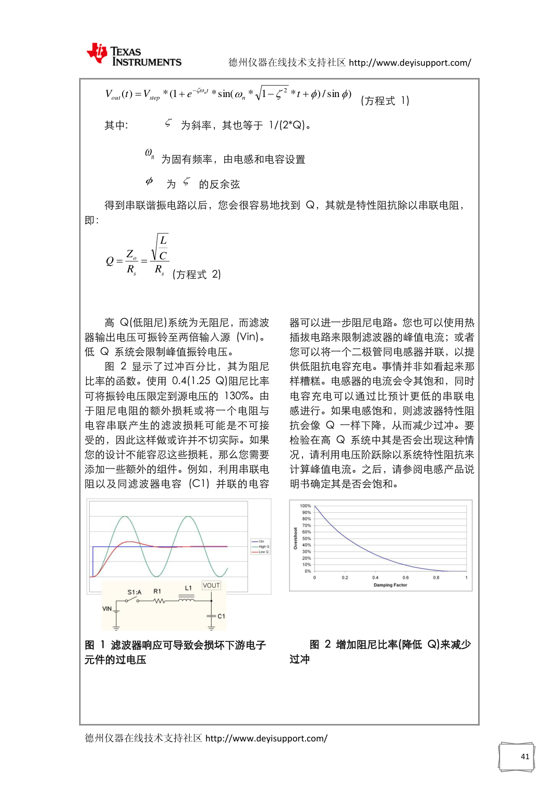

图 1 滤波器响应可导致会损坏下游电子 元件的过电压

[[硬件/原始备份/电源设计经验.pdf#page=41|原版PDF第41页整页回看（前文已展示）]]

图 2 增加阻尼比率(降低 Q)来减少 过冲

总之，阶跃输入电压带来的滤波器振铃可导致对下游电子元件有破坏性影响的电压。 特别是如 PoE 的系统，在使用低损耗陶瓷电容和一些不饱和的电感时它们往往为高 Q，则上述电压便成为问题。如果电压达到不可接受的水平，则这些系统会需要更 多的阻尼、电流限制或者一种替代充电方法。下面将介绍一种确定您是否存在问题 的简单过程： 

1)决定您的系统是否经受低阻抗的电压阶跃，然后确定其上升时间。该电压阶 跃可以是一个开关或者热插拔连接。 

2)估算充电电感和滤波器电容。线缆电感可估算为 15 nH/英寸。 

3)确定充电通路的总电阻，包括电感、线缆和连接器电阻，以及电容 ESR。 

$$
\omega_ {n} = \frac {1}{\sqrt {L ^ {*} C}}
$$

4)计算谐振频率 L C* ，确定输入上升时间是否大大短于固有滤波器响 应。 

$$
\zeta = \frac {R _ {s}}{2 * \sqrt {\frac {L}{C}}}
$$

5)计算阻尼系数 

并参考图 2 来确定过冲。 

下一篇，我们将讨论误差放大器结构。 

## 电源设计经验谈 21：请注意电容 RMS 纹波额定电流！

电源中常常被忽略的一种应力是输 入电容 RMS 电流。若不正确理解它，过 电流会使电容过热和过早失效。在降压转 换器中，使用下列近似式，根据输出电流 (Io) 和占空比 (D) 可以很轻松地计算出 RMS 电流： 

$$
I _ {r m s} = I _ {o} ^ {*} \sqrt {D ^ {*} (1 - D)}
$$

图 1 给出了该表达式的曲线图；它 是一个圆形，其中，50%占空比时达到最 大值 0.5，并在 0% 和 100% 占空比时有 2 个零交叉。该曲线在 50% 占空比附近 对称。在 20% 和 80% 之间，RMS 电流 和输出电流之间的比大于 80%。使用这一 范围的占空比，您可以将 RMS 电流粗略 估计为 1/2 最大输出电流。在这一范围 之外，您需要进行相应的计算。在过去几 年 

中，陶瓷电容器的容积效率和成本两方面 都取得了巨大的进步。陶瓷电容器现在成 为绕过电源功率级的首选。但是，它们的 低 ESR 在电源中会产生许多困扰，例如： EMI 滤波器振荡和意外电压浪涌(参见 《电源设计经验谈 20》)。并联电解电容 常常用于抑制这些高 Q 电路。这些情况 下，您应该注意电解质中的纹波电流，因 为大量的电源纹波电流会最终进入电解 电容。图 2 显示了一个带输入电容的 100 kHz 转换开关例子，其输入电容由一 个同电解电容器并联的 10 uF 陶瓷电容 组成，而该电解电容器包含 0.15 欧姆的 等效串联电阻 (ESR)。假设电解电容器的 

电容比陶瓷电容器的大，在这种情况下， 约 70% 的 RMS 电流出现在了电解质中。 要减少该 RMS 电流，您可以增加陶瓷电 容、工作频率或者 等效串联电阻(ESR)。 通过电容电流的傅里叶级数可以绘制出 这一曲线，从而计算每个谐波(多达 10) 的电解电容器电流，并重新组合谐波来计 算电解电容器的总 RMS 电流。请注意， 陶瓷电容的电流与 ESR 的电流在相位上 相差 1/4 周期，因此必须将它们看作是 矢量。如果您不想在这些计算方面花费时 间，那么您可以通过一个电流源和三个无 源组件轻松地对该电路进行仿真。 

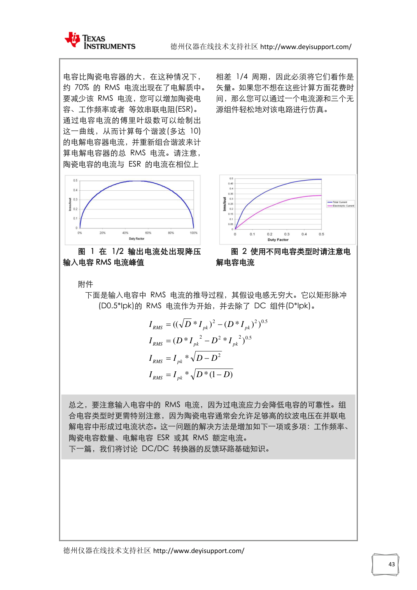

图 1 在 1/2 输出电流处出现降压 输入电容RMS 电流峰值

[[硬件/原始备份/电源设计经验.pdf#page=43|原版PDF第43页整页回看（前文已展示）]]

图 2 使用不同电容类型时请注意电 解电容电流

附件 

下面是输入电容中 RMS 电流的推导过程，其假设电感无穷大。它以矩形脉冲 (D0.5*Ipk)的 RMS 电流作为开始，并去除了 DC 组件(D*Ipk)。 

$$
I _ {R M S} = ((\sqrt {D} * I _ {p k}) ^ {2} - (D * I _ {p k}) ^ {2}) ^ {0. 5}
$$

$$
I _ {R M S} = (D * I _ {p k} ^ {2} - D ^ {2} * I _ {p k} ^ {2}) ^ {0. 5}
$$

$$
I _ {R M S} = I _ {p k} * \sqrt {D - D ^ {2}}
$$

$$
I _ {R M S} = I _ {p k} * \sqrt {D * (1 - D)}
$$

总之，要注意输入电容中的 RMS 电流，因为过电流应力会降低电容的可靠性。组 合电容类型时更需特别注意，因为陶瓷电容通常会允许足够高的纹波电压在并联电 解电容中形成过电流状态。这一问题的解决方法是增加如下一项或多项：工作频率、 陶瓷电容数量、电解电容 ESR 或其 RMS 额定电流。 

下一篇，我们将讨论 DC/DC 转换器的反馈环路基础知识。 

## 电源设计经验谈 22：避免一些常见的误差放大器使用错误

本文集中介绍一些您可以很轻松避 免的电源误差放大器使用错误，主要包括 错误计算误差放大器的增益，从而让放大 器完成某些超出其能力的工作以及错误 地对电路进行布局。图 1 显示了一款典 型的电源，其使用一个具有内臵误差放大 器的控制 IC。放大器正输入连接至一个 内部参考电压，负输入经 FB 引脚引出， 而输出经 COMP 引脚引出。电源输出电 压由分压器 R5 和 R7 设臵。 

第一种常见误差放大器错误是在 AC 小信号增益计算中使用 R5，尽管其 实际没有影响。如果误差放大器使用正确， 则其输入就为一个虚假接地。这就意味着， 没有 AC 电流会流经 R5，并且对 AC 小信号增益无影响。通过误差放大器输入 的“戴维宁”(Thevenin)等效电路，您可 以轻松地说服自己。(请参见附件) 

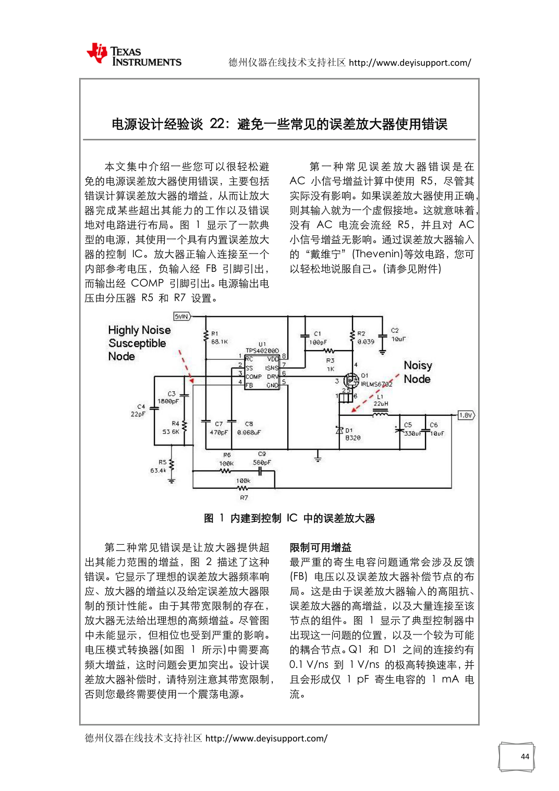

图 1 内建到控制 IC 中的误差放大器

第二种常见错误是让放大器提供超 出其能力范围的增益，图 2 描述了这种 错误。它显示了理想的误差放大器频率响 应、放大器的增益以及给定误差放大器限 制的预计性能。由于其带宽限制的存在， 放大器无法给出理想的高频增益。尽管图 中未能显示，但相位也受到严重的影响。 电压模式转换器(如图 1 所示)中需要高 频大增益，这时问题会更加突出。设计误 差放大器补偿时，请特别注意其带宽限制， 否则您最终需要使用一个震荡电源。 

## 限制可用增益

最严重的寄生电容问题通常会涉及反馈 (FB) 电压以及误差放大器补偿节点的布 局。这是由于误差放大器输入的高阻抗、 误差放大器的高增益，以及大量连接至该 节点的组件。图 1 显示了典型控制器中 出现这一问题的位臵，以及一个较为可能 的耦合节点。Q1 和 D1 之间的连接约有 0.1 V/ns 到 1 V/ns 的极高转换速率，并 且会形成仅 1 pF 寄生电容的 1 mA 电 流。 

一般而言，FB 和补偿节点的阻抗约 为 1K 到 10K Ohms，因此该电流可在误 差放大器输入端形成极大的电压扰动。其 通常以游走栅极驱动或感知振荡的形式 显现，而电源会努力对噪声源产生的误差 进行校正。最为成功的设计会认识到这个 问题，并绘出示意图以让诸多补偿组件出 现在误差放大器的附近，这样来给出一种 建议布局。确保各组件均紧凑地放臵在误 差放大器的附近，并确保连接它们的线迹 很短。另外，还要确保这些组件附近没有 高 dV/dt 线迹，主要包括开关节点和栅 极驱动信号。 

另一种常见问题是在反馈电路中没 有使用正确的阻抗。误差放大器的驱动能 力有限，必须使用合适的反馈组件电压。 在图 1 所示情况下，误差放大器的驱动 力仅为 100 uA，因此其电压只能为 1V 左右。连接误差放大器输出或者其反馈环 路中的阻抗不应低于 10K Ohms。请注意 不要在反馈环路中使用过大的阻抗值，因 为它会增加拾取开关波形噪声的敏感度。 图 1 还表明了在误差放大器附近配臵反 馈组件的最佳方法。电阻连接至高阻抗误 差放大器输入端 (FB)，而非电容。通过有 效地让它们降低阻抗，从而降低 R6/C9 和 R4/C3 节点的噪声敏感度。电容的另 一端连接至电路的低阻抗端点，从而降低 噪声耦合的可能性。 

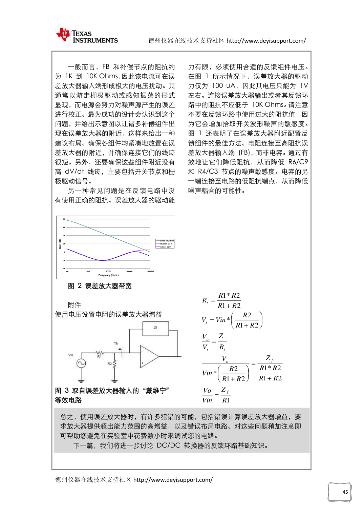

图 2 误差放大器带宽

附件 

使用电压设臵电阻的误差放大器增益 

$$
R _ {t} = \frac {R 1 * R 2}{R 1 + R 2}
$$

[[硬件/原始备份/电源设计经验.pdf#page=45|原版PDF第45页整页回看（前文已展示）]]

$$
V _ {t} = V i n * \left(\frac {R 2}{R 1 + R 2}\right)
$$

$$
\frac {V _ {o}}{V _ {t}} = \frac {Z}{R _ {t}}
$$

$$
\frac {V _ {o}}{V i n * \left(\frac {R 2}{R 1 + R 2}\right)} = \frac {Z _ {f}}{\frac {R 1 * R 2}{R 1 + R 2}}
$$

图 3 取自误差放大器输入的“戴维宁” 等效电路

$$
\frac {V o}{V i n} = \frac {Z _ {f}}{R 1}
$$

总之，使用误差放大器时，有许多犯错的可能，包括错误计算误差放大器增益，要 求放大器提供超出能力范围的高增益，以及错误布局电路。对这些问题稍加注意即 可帮助您避免在实验室中花费数小时来调试您的电路。 

下一篇，我们将进一步讨论 DC/DC 转换器的反馈环路基础知识。 

## 电源设计经验谈 23：改善负载瞬态响应

本文将重点介绍利用一个 TL431 并 联稳压器关闭隔离电源的反馈环路。文章 将讨论一种扩展电源控制环路带宽以改 善瞬态负载及线路响应的方法。图 1 显 示了一个离线隔离反向转换器的典型示 意图。输出电压被向下分流，并与 TL431 的 2.5 V 参考电压比较。如果输出电压过 高，TL431 就会通过其负极分流电流。该 分流电流的一部分会流经光耦合器二极 管 (U2)，并反射在光敏晶体管中。镜像 电流会增加 R16 的电压，其降低了功率 MOSFET 的峰值电流，从而使电源的输出 电压降低。有趣的是，有两条光耦合器相 关反馈通路；一条通过 TL431，另一条与 输出电压 R8 连接相关联。TL431 通路很 明显，因为输出电压的采样被拿来与参考 电压比较、放大，然后用于驱动光耦合器。 R8 连接很容易看见，通过 R8 的电流是 输出电压和 TL431 负极电压之间的差。 通过 R8 的电流随输出电压成比例变化， 而与TL431 负极电压无关。如果输出电压 要上升，则电阻和光耦合器二极管的电流 就会增加，从而降低输出电压。 

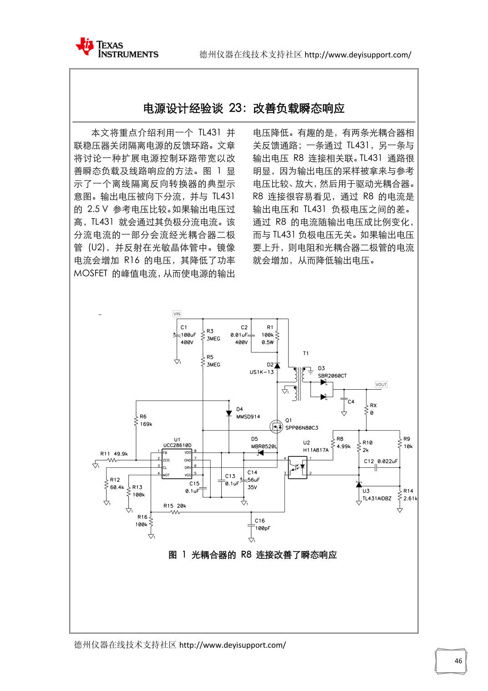

图 1 光耦合器的 R8 连接改善了瞬态响应

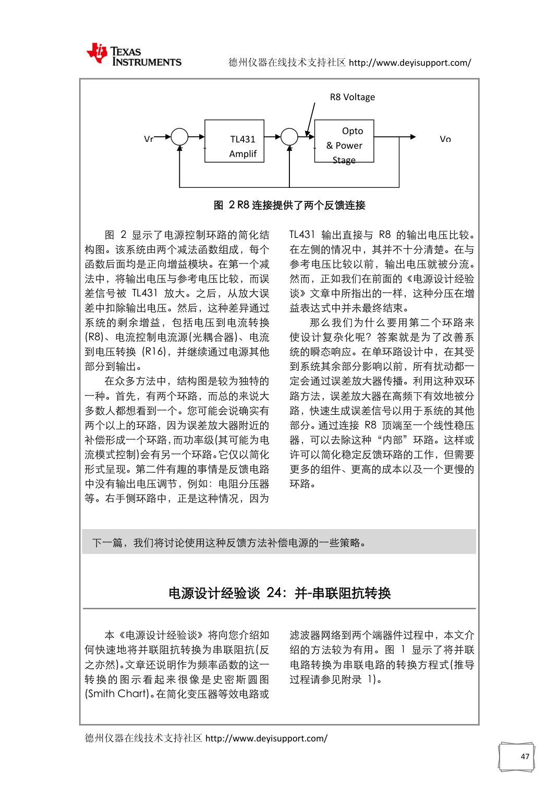

图 2 R8 连接提供了两个反馈连接

图 2 显示了电源控制环路的简化结 构图。该系统由两个减法函数组成，每个 函数后面均是正向增益模块。在第一个减 法中，将输出电压与参考电压比较，而误 差信号被 TL431 放大。之后，从放大误 差中扣除输出电压。然后，这种差异通过 系统的剩余增益，包括电压到电流转换 (R8)、电流控制电流源(光耦合器)、电流 到电压转换 (R16)，并继续通过电源其他 部分到输出。 

在众多方法中，结构图是较为独特的 一种。首先，有两个环路，而总的来说大 多数人都想看到一个。您可能会说确实有 两个以上的环路，因为误差放大器附近的 补偿形成一个环路，而功率级(其可能为电 流模式控制)会有另一个环路。它仅以简化 形式呈现。第二件有趣的事情是反馈电路 中没有输出电压调节，例如：电阻分压器 等。右手侧环路中，正是这种情况，因为 

TL431 输出直接与 R8 的输出电压比较。 在左侧的情况中，其并不十分清楚。在与 参考电压比较以前，输出电压就被分流。 然而，正如我们在前面的《电源设计经验 谈》文章中所指出的一样，这种分压在增 益表达式中并未最终结束。 

那么我们为什么要用第二个环路来 使设计复杂化呢？答案就是为了改善系 统的瞬态响应。在单环路设计中，在其受 到系统其余部分影响以前，所有扰动都一 定会通过误差放大器传播。利用这种双环 路方法，误差放大器在高频下有效地被分 路，快速生成误差信号以用于系统的其他 部分。通过连接 R8 顶端至一个线性稳压 器，可以去除这种“内部”环路。这样或 许可以简化稳定反馈环路的工作，但需要 更多的组件、更高的成本以及一个更慢的 环路。 

下一篇，我们将讨论使用这种反馈方法补偿电源的一些策略。 

## 电源设计经验谈 24：并-串联阻抗转换

本《电源设计经验谈》将向您介绍如 何快速地将并联阻抗转换为串联阻抗(反 之亦然)。文章还说明作为频率函数的这一 转换的图示看起来很像是史密斯圆图 (Smith Chart)。在简化变压器等效电路或 滤波器网络到两个端器件过程中，本文介 绍的方法较为有用。图 1 显示了将并联 电路转换为串联电路的转换方程式(推导 过程请参见附录 1)。 

[[硬件/原始备份/电源设计经验.pdf#page=47|原版PDF第47页整页回看（前文已展示）]]

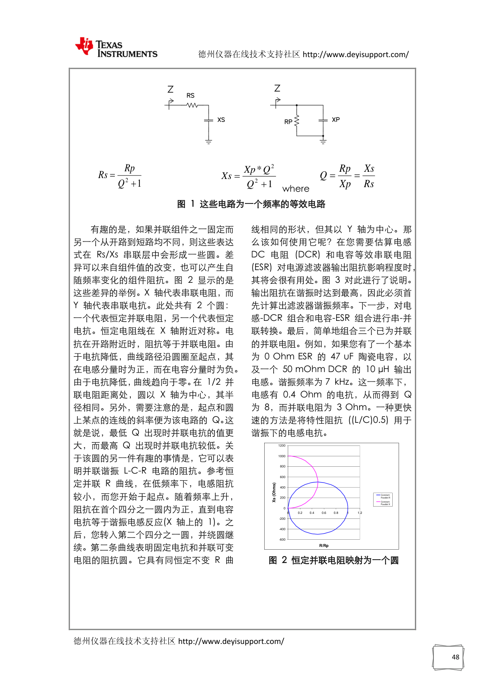

$$
R s = \frac {R p}{Q ^ {2} + 1}
$$

$$
X s = \frac {X p ^ {*} Q ^ {2}}{Q ^ {2} + 1} \quad \text { where } \quad Q = \frac {R p}{X p} = \frac {X s}{R s}
$$

图 1 这些电路为一个频率的等效电路 

有趣的是，如果并联组件之一固定而 另一个从开路到短路均不同，则这些表达 式在 Rs/Xs 串联层中会形成一些圆。差 异可以来自组件值的改变，也可以产生自 随频率变化的组件阻抗。图 2 显示的是 这些差异的举例。X 轴代表串联电阻，而 Y 轴代表串联电抗。此处共有 2 个圆： 一个代表恒定并联电阻，另一个代表恒定 电抗。恒定电阻线在 X 轴附近对称。电 抗在开路附近时，阻抗等于并联电阻。由 于电抗降低，曲线路径沿圆圈至起点，其 在电感分量时为正，而在电容分量时为负。 由于电抗降低，曲线趋向于零。在 1/2 并 联电阻距离处，圆以 X 轴为中心，其半 径相同。另外，需要注意的是，起点和圆 上某点的连线的斜率便为该电路的 Q。这 就是说，最低 Q 出现时并联电抗的值更 大，而最高 Q 出现时并联电抗较低。关 于该圆的另一件有趣的事情是，它可以表 明并联谐振 L-C-R 电路的阻抗。参考恒 定并联 R 曲线，在低频率下，电感阻抗 较小，而您开始于起点。随着频率上升， 阻抗在首个四分之一圆内为正，直到电容 电抗等于谐振电感反应(X 轴上的 1)。之 后，您转入第二个四分之一圆，并绕圆继 续。第二条曲线表明固定电抗和并联可变 电阻的阻抗圆。它具有同恒定不变 R 曲 线相同的形状，但其以 Y 轴为中心。那 么该如何使用它呢？在您需要估算电感 DC 电阻 (DCR) 和电容等效串联电阻 (ESR) 对电源滤波器输出阻抗影响程度时， 其将会很有用处。图 3 对此进行了说明。 输出阻抗在谐振时达到最高，因此必须首 先计算出滤波器谐振频率。下一步，对电 感-DCR 组合和电容-ESR 组合进行串-并 联转换。最后，简单地组合三个已为并联 的并联电阻。例如，如果您有了一个基本 为 0 Ohm ESR 的 47 uF 陶瓷电容，以 及一个 50 mOhm DCR 的 10 μH 输出 电感。谐振频率为 7 kHz。这一频率下， 电感有 0.4 Ohm 的电抗，从而得到 Q 为 8，而并联电阻为 3 Ohm。一种更快 速的方法是将特性阻抗 ((L/C)0.5) 用于 谐振下的电感电抗。 

[[硬件/原始备份/电源设计经验.pdf#page=48|原版PDF第48页整页回看（前文已展示）]]

图 2 恒定并联电阻映射为一个圆

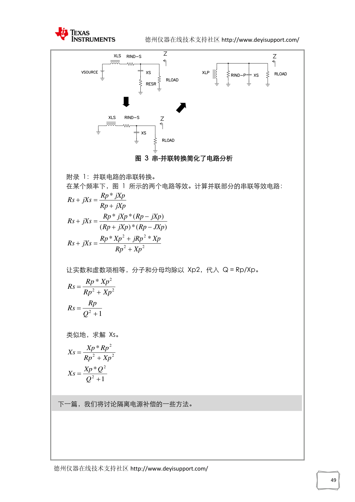

图 3 串-并联转换简化了电路分析

附录 1：并联电路的串联转换。 

在某个频率下，图 1 所示的两个电路等效。计算并联部分的串联等效电路： 

$$
R s + j X s = \frac {R p * j X p}{R p + j X p}
$$

$$
R s + j X s = \frac {R p * j X p * (R p - j X p)}{(R p + j X p) * (R p - J X p)}
$$

$$
R s + j X s = \frac {R p * X p ^ {2} + j R p ^ {2} * X p}{R p ^ {2} + X p ^ {2}}
$$

让实数和虚数项相等，分子和分母均除以 $\tt X p 2$ ，代入 $\mathsf Q = \mathsf Q \mathsf { p } / \mathsf { X } \mathsf { p }$ 。 

$$
R s = \frac {R p * X p ^ {2}}{R p ^ {2} + X p ^ {2}}
$$

$$
R s = \frac {R p}{Q ^ {2} + 1}
$$

类似地，求解 Xs。 

$$
X s = \frac {X p ^ {*} R p ^ {2}}{R p ^ {2} + X p ^ {2}}
$$

$$
X s = \frac {X p * Q ^ {2}}{Q ^ {2} + 1}
$$

下一篇，我们将讨论隔离电源补偿的一些方法。 

## 电源设计经验谈 25：改善负载瞬态响应—第 2 部分

这篇《电源设计经验谈》是《电源设 计经验谈 23》的后续文章。它着重介绍 如何使用TL431分路稳压器关闭隔离电源 的反馈环路。本文章讨论了一种扩展电源 控制环路带宽以改善瞬态负载及线路响 应的方法。您可能必须要参考原文来继续 这一讨论。功率级是一个带电容输出滤波 器和单极衰减的电流模式控制反馈电路。 图 1 显示了该控制环路的结构图，该图 已得到极大的简化。在左侧模块中，误差 放大器由一个带起点极的积分电路响应 代表。在右侧模块中，光耦合器增益和电 流模式控制电路已被组合为一个简单的 K2 增益，以及一个由负载电阻 (R) 和输 出电容 (C) 设臵的极。 

结构图中共有两条反馈通路：一条通 过积分器，其输出与参考电压比较；另一 条将积分电路输出与输出电压比较。模块 的频率响应显示在图 2 中。蓝色曲线代 表功率级响应，您可能没有足够多的修改 灵活性。负载电阻由输出电压和电流设臵， 而滤波器电容取决于噪声要求、开关频率 和瞬态负载要求。在电源的光耦合器和电 流模式控制部分，您的确可以通过增益实 现一定的控制。红色曲线是输出电压到功 率级输入的响应。利用补偿积分电路，在 对电源进行补偿的程度方面您会受到一 定的限制。在高频率下，Vout 到功率级 输入的增益等于 1。您唯一的选择是在哪 里放臵零。其由积分电路变为 1 的位臵 决定。图 2 中，补偿零与总单极衰减的 功率级极一致。请注意，由于补偿增益为 1，因此电源的交叉频率由功率级本身的 0 dB 交叉设臵。很多时候，积分电路并 不会为要求瞬态响应提供充足的带宽。一 种简单的改进方法是将 1 型误差放大器 布局转变为 2 型。2 型增加了一个与积 分电容串联的电阻，之后增加一个并联高 频电容，以用于二极、一零频率响应。图 3 显示了 2 型放大器的更新频率响应。 这种情况下，首个零时我们并没有被限于 0 dB 增益，并且我们还可以设臵 10 dB 增益。这样就允许将交叉频率(两条曲线的 和等于 0 dB)从 2 kHz 增加到 6 kHz。另 外，需要注意更高频率特性。我们在交叉 频率以上放臵了一个极，以降低电源的噪 声敏感度。正如简单积分电路中一样，通 过补偿部分的增益绝不会降低至 0 dB 以下。 

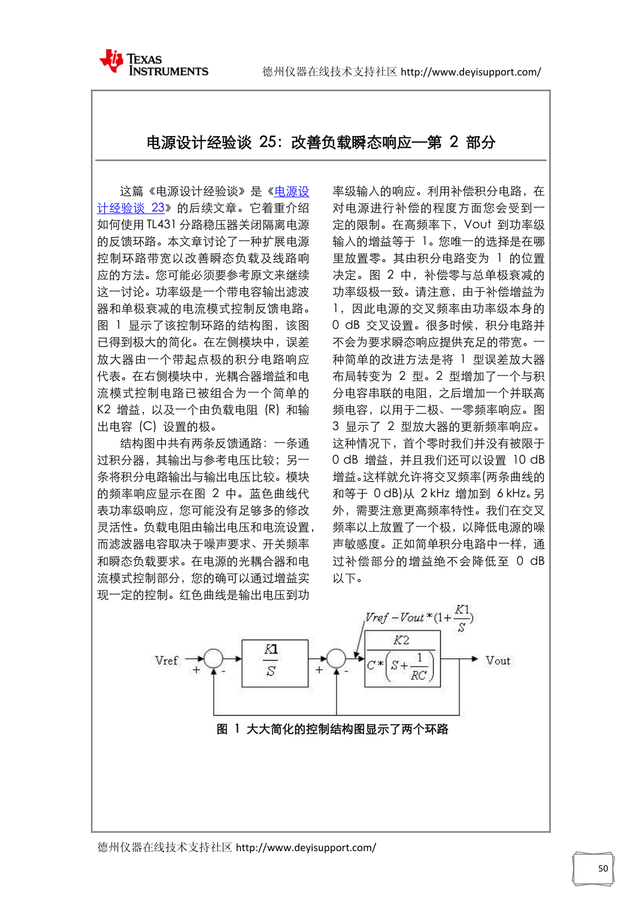

图 1 大大简化的控制结构图显示了两个环路

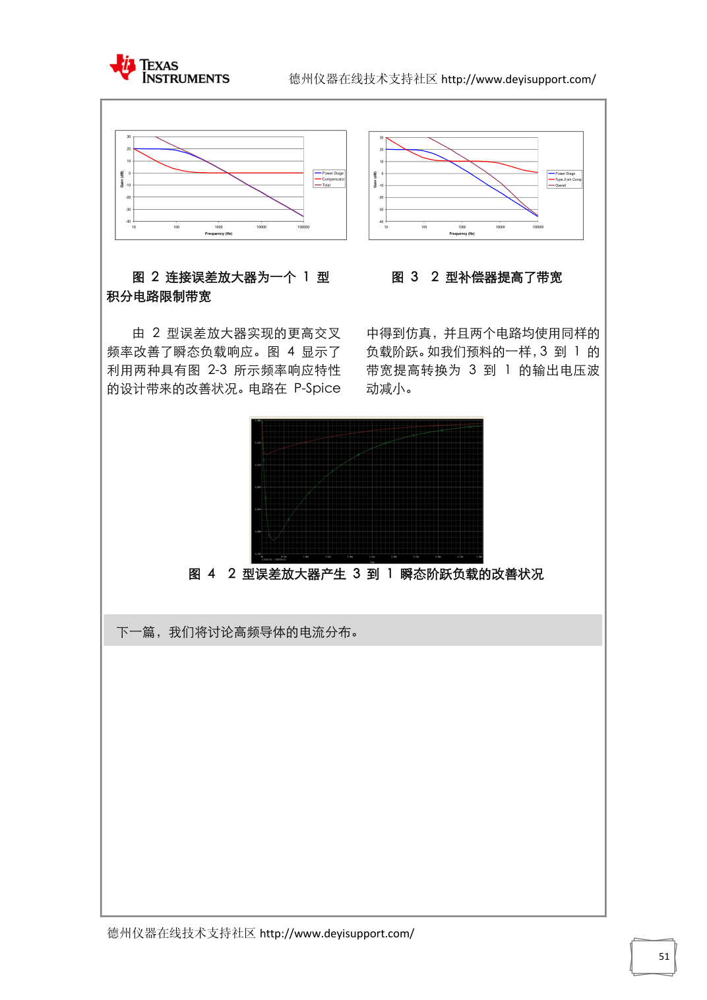

图 2 连接误差放大器为一个 1 型 积分电路限制带宽

图 3 2 型补偿器提高了带宽

由 2 型误差放大器实现的更高交叉 频率改善了瞬态负载响应。图 4 显示了 利用两种具有图 2-3 所示频率响应特性 的设计带来的改善状况。电路在 P-Spice 中得到仿真，并且两个电路均使用同样的 负载阶跃。如我们预料的一样，3 到 1 的 带宽提高转换为 3 到 1 的输出电压波 动减小。 

[[硬件/原始备份/电源设计经验.pdf#page=51|原版PDF第51页整页回看（前文已展示）]]

图 4 2 型误差放大器产生 3 到 1 瞬态阶跃负载的改善状况

## 下一篇，我们将讨论高频导体的电流分布。

## 电源设计经验谈 26：高频导体的电流分布

本《电源设计经验谈》中，我们将研 究自由空间及缠绕结构中导体的有效电 阻。图 1 显示了第一个例子。其为自由 空间中单条导线的横截面，其携带的是高 频电流。如果电流为 直流，则显示为不 同颜色的电流密度全部相同。但是，随着 频率的增加，电流朝导体外部移动，如红 色和橙色所示。这种拥挤情况被称为趋肤 效应。透入深度被定义为外表面到电流密 度降至外表面电流密度 1/e 的那个点的 距离。就铜而言，深度为： 

其中 f 单位为兆赫，而深度单位为 cm。 

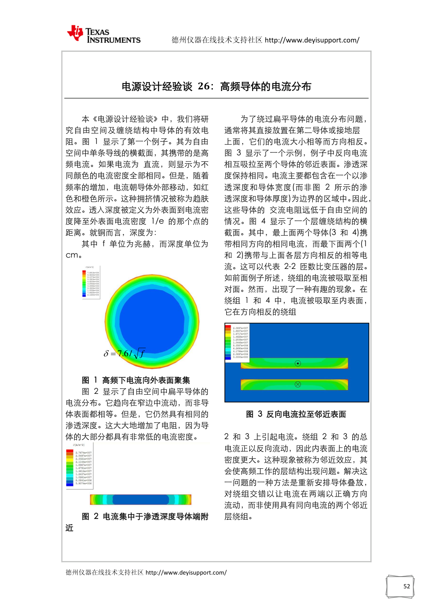

图 1 高频下电流向外表面聚集

图 2 显示了自由空间中扁平导体的 电流分布。它趋向在窄边中流动，而非导 体表面都相等。但是，它仍然具有相同的 渗透深度。这大大地增加了电阻，因为导 体的大部分都具有非常低的电流密度。

[[硬件/原始备份/电源设计经验.pdf#page=52|原版PDF第52页整页回看（前文已展示）]]

图 2 电流集中于渗透深度导体端附 近

为了绕过扁平导体的电流分布问题， 通常将其直接放臵在第二导体或接地层 上面，它们的电流大小相等而方向相反。 图 3 显示了一个示例，例子中反向电流 相互吸拉至两个导体的邻近表面。渗透深 度保持相同。电流主要都包含在一个以渗 透深度和导体宽度(而非图 2 所示的渗 透深度和导体厚度)为边界的区域中。因此， 这些导体的 交流电阻远低于自由空间的 情况。图 4 显示了一个层缠绕结构的横 截面。其中，最上面两个导体(3 和 4)携 带相同方向的相同电流，而最下面两个(1 和 2)携带与上面各层方向相反的相等电 流。这可以代表 2-2 匝数比变压器的层。 如前面例子所述，绕组的电流被吸取至相 对面。然而，出现了一种有趣的现象。在 绕组 1 和 4 中，电流被吸取至内表面， 它在方向相反的绕组 

[[硬件/原始备份/电源设计经验.pdf#page=52|原版PDF第52页整页回看（前文已展示）]]

图 3 反向电流拉至邻近表面

2 和 3 上引起电流。绕组 2 和 3 的总 电流正以反向流动，因此内表面上的电流 密度更大。这种现象被称为邻近效应，其 会使高频工作的层结构出现问题。解决这 一问题的一种方法是重新安排导体叠放， 对绕组交错以让电流在两端以正确方向 流动，而非使用具有同向电流的两个邻近 层绕组。 

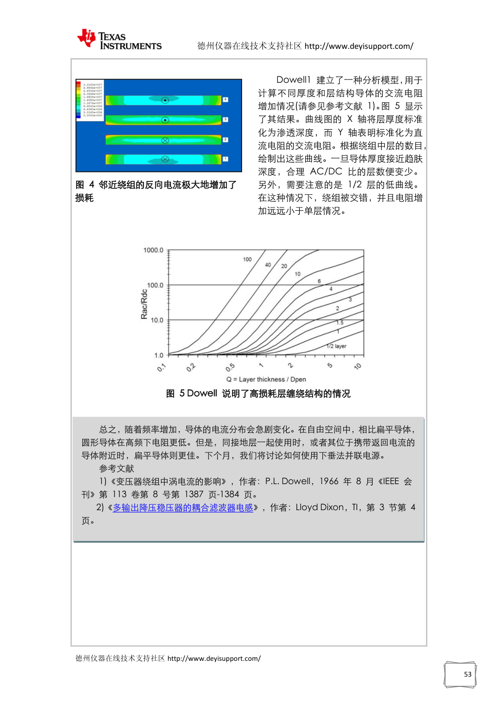

图 4 邻近绕组的反向电流极大地增加了 损耗

Dowell1 建立了一种分析模型，用于 计算不同厚度和层结构导体的交流电阻 增加情况(请参见参考文献 1)。图 5 显示 了其结果。曲线图的 X 轴将层厚度标准 化为渗透深度，而 Y 轴表明标准化为直 流电阻的交流电阻。根据绕组中层的数目， 绘制出这些曲线。一旦导体厚度接近趋肤 深度，合理 AC/DC 比的层数便变少。 另外，需要注意的是 1/2 层的低曲线。 在这种情况下，绕组被交错，并且电阻增 加远远小于单层情况。

[[硬件/原始备份/电源设计经验.pdf#page=53|原版PDF第53页整页回看（前文已展示）]]

图 5 Dowell 说明了高损耗层缠绕结构的情况

总之，随着频率增加，导体的电流分布会急剧变化。在自由空间中，相比扁平导体， 圆形导体在高频下电阻更低。但是，同接地层一起使用时，或者其位于携带返回电流的 导体附近时，扁平导体则更佳。下个月，我们将讨论如何使用下垂法并联电源。 

## 参考文献

1)《变压器绕组中涡电流的影响》，作者：P.L. Dowell，1966 年 8 月《IEEE 会 刊》第 113 卷第 8 号第 1387 页-1384 页。 

2)《多输出降压稳压器的耦合滤波器电感》，作者：Lloyd Dixon，TI，第 3 节第 4 页。 

<table><tr><td>In this Power Tip, we will look at a simple method to parallel supplies. Some of the key care concerns when paralleling supplies are:1) no single point failures added by the droop circuit;2) as a corollary to #1, no master-slave operation;3) minimum interconnect;4) no adverse impact on efficiency;5) good voltage regulation; and6) preserved load dynamics.The droop method provides a simple way to meet many of these requirements. It works by allowing the power output voltage to sag as a function of load current. As shown in Figure 1, paralleled power supplies tend to equalize output currents because of this load line.[IMAGE]Figure 1: Drooping power supply output voltage enables current share.</td><td>power supplies have slightly different V-I characteristics. For a given load condition, a horizontal line represents the output voltage when all three supplies are connected in parallel. The intersections of the horizontal line with the load lines represent the output currents of the individual supplies. This method obviously degrades the system voltage regulation.There is a trade-off between how well the currents balance and the voltage regulation. The first step of this trade is to determine the regulator tolerance; i.e., how far does the worst case design depart from the nominal. The important items to establish are reference accuracy over temperature and divider tolerance (seePower Tip 18).While how close to nominal you can set your output voltage by picking resistors that affect your accuracy, it will not impact the current share. You then are ready to pick either your slope or your allowable deviation, and calculate the other. If you assume that the slope is relatively constant, the variables are simply related as:<eq>\frac{2*SPA}{D} = LE</eq></td></tr></table>

# Power Tip 27: Paralleling power supplies using the droop

## method

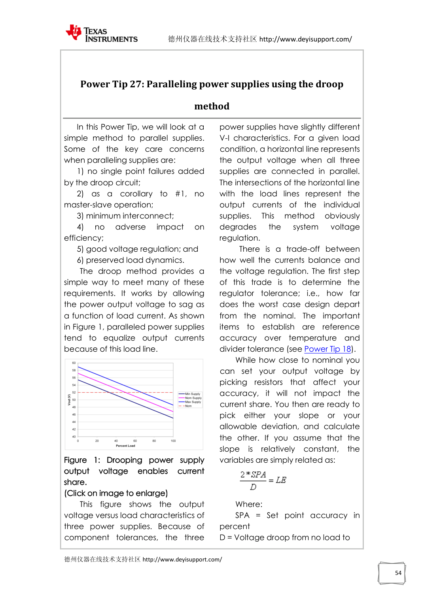

## (Click on image to enlarge)

This figure shows the output voltage versus load characteristics of three power supplies. Because of component tolerances, the three 

Where: 

SPA = Set point accuracy in percent 

D = Voltage droop from no load to 

full load in percent 

LE = Load extreme or how far the loads could be off, in percent 

In doing the calculations, you will find the short coming of this method. It takes extreme accuracy in setting the output voltage and significant voltage droop to get a reasonable current share. For instance, as shown in Figure 1, with 3.5% tolerances and 20% voltage droop, you can have 35% current mismatch. This amount of droop may be acceptable in high-voltage systems, but will not be in low-voltage supplies. The first thought about implementing voltage drop might be to put a big resistor in series with the output voltage, until you look at the tolerance issues and the resulting losses. In our previous example, we would loose over 20 percent of the output power in this resistor. 

The next thought is to measure the output current of the power supply, amplify and use this measurement to offset the output voltage setting circuit. This works for voltage mode control, but with current mode control, a much simpler method is available. By limiting the DC gain of the control loop, you have built a synthetic resistor. Appendix 1 below (after the About the Author box) goes through the simple math for calculating the output impedance based on Figure 2. 

The result is that the output impedance of this system is equal to the negative inverse of the compensator gain, times the power stage gain. Most power supplies contain an integrator in the compensation, which results in a very large DC compensator gain. By adjusting the DC gain to a specific value, a desired droop can be obtained. Usually this is quite easy to implement, just add a resistor across the error amplifier. 

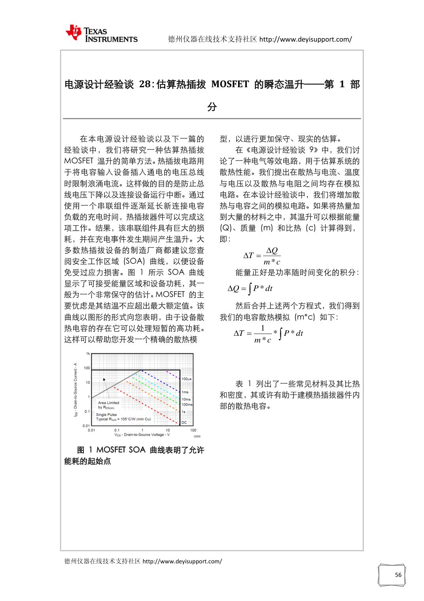

Figure 2: Voltage droop is easily implemented with current mode control.

(Click on image to enlarge) 

Please join us next month when we will discuss tips for hot swap controllers. 

For more information about this and other power solutions, visit: www.ti.com/power-ca. 

$$
V o = (V r e f - V o) ^ {*} K ^ {*} G ^ {*} R l
$$

$$
R l = \frac {V o}{I o}
$$

$$
V o = (V r e f - V o) ^ {*} K ^ {*} G ^ {*} V o / I o
$$

$$
\left| V r e f - V o \right. = \frac {I o}{K ^ {*} G}
$$

$$
V _ {o} = V r e f - \frac {I o}{K ^ {*} G}
$$

$$
\frac {\partial V o}{\partial I o} = \frac {- 1}{K ^ {*} G}
$$

## 电源设计经验谈 28：估算热插拔 MOSFET 的瞬态温升——第 1 部

## 分

在本电源设计经验谈以及下一篇的 经验谈中，我们将研究一种估算热插拔 MOSFET 温升的简单方法。热插拔电路用 于将电容输入设备插入通电的电压总线 时限制浪涌电流。这样做的目的是防止总 线电压下降以及连接设备运行中断。通过 使用一个串联组件逐渐延长新连接电容 负载的充电时间，热插拔器件可以完成这 项工作。结果，该串联组件具有巨大的损 耗，并在充电事件发生期间产生温升。大 多数热插拔设备的制造厂商都建议您查 阅安全工作区域 (SOA) 曲线，以便设备 免受过应力损害。图 1 所示 SOA 曲线 显示了可接受能量区域和设备功耗，其一 般为一个非常保守的估计。MOSFET 的主 要忧虑是其结温不应超出最大额定值。该 曲线以图形的形式向您表明，由于设备散 热电容的存在它可以处理短暂的高功耗。 这样可以帮助您开发一个精确的散热模 

[[硬件/原始备份/电源设计经验.pdf#page=56|原版PDF第56页整页回看（前文已展示）]]

图 1 MOSFET SOA 曲线表明了允许 能耗的起始点

型，以进行更加保守、现实的估算。 

在《电源设计经验谈 9》中，我们讨 论了一种电气等效电路，用于估算系统的 散热性能。我们提出在散热与电流、温度 与电压以及散热与电阻之间均存在模拟 电路。在本设计经验谈中，我们将增加散 热与电容之间的模拟电路。如果将热量加 到大量的材料之中，其温升可以根据能量 (Q)、质量 (m) 和比热 (c) 计算得到， 即： 

$$
\Delta T = \frac {\Delta Q}{m ^ {*} c}
$$

能量正好是功率随时间变化的积分： ∆Q = ∫ P *dt 

然后合并上述两个方程式，我们得到 我们的电容散热模拟 $( \mathsf { m } ^ { * } \mathsf { c } )$ 如下： 

$$
\Delta T = \frac {1}{m ^ {*} c} * \int P * d t
$$

表 1 列出了一些常见材料及其比热 和密度，其或许有助于建模热插拔器件内 部的散热电容。 

<table><tr><td>材料</td><td>比热(J/(g*oC)</td><td>密度 (g/cm3)</td></tr><tr><td>硅</td><td>0.7</td><td>2.3</td></tr><tr><td>熟铜</td><td>0.4</td><td>8</td></tr><tr><td>铝</td><td>0.9</td><td>2.7</td></tr><tr><td>环氧树脂</td><td>1</td><td>1.4</td></tr></table>

表 1 常见材料的物理属性

只需通过估算您建模的各种系统组 件的物理尺寸，便可得到散热电容。散热 能力等于组件体积、密度和比热的乘积。 这样便可以使用图 2 所示的模型结构。 

该模型以左上角一个电流源作为开 始，其为系统增加热量的模拟。电流流入 裸片的热容及其热阻。热量从裸片流入引 线框和封装灌封材料。流经引线框的热量 再流入封装和散热片之间的接触面。热量 从散热片流入热环境中。遍及整个网络的 电压代表高于环境的温升。 

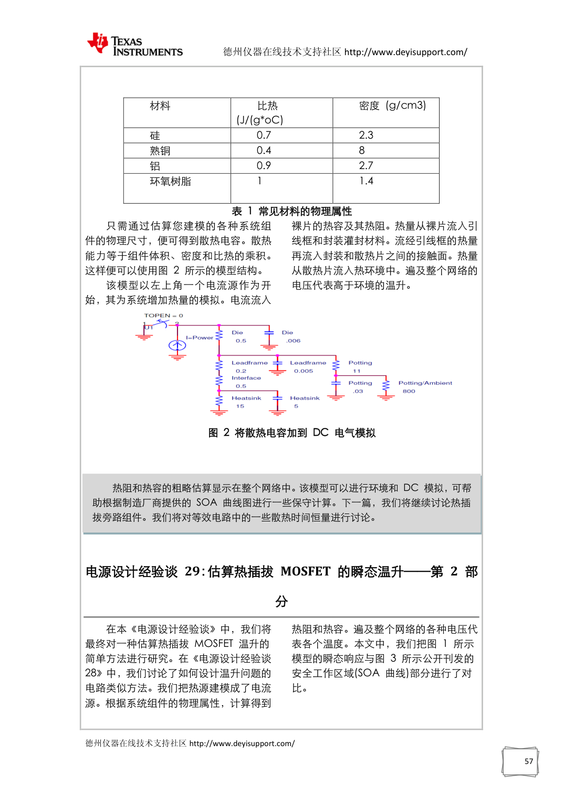

图 2 将散热电容加到 DC 电气模拟

热阻和热容的粗略估算显示在整个网络中。该模型可以进行环境和 DC 模拟，可帮 助根据制造厂商提供的 SOA 曲线图进行一些保守计算。下一篇，我们将继续讨论热插 拔旁路组件。我们将对等效电路中的一些散热时间恒量进行讨论。 

## 电源设计经验谈 29：估算热插拔 MOSFET 的瞬态温升——第 2 部

在本《电源设计经验谈》中，我们将 最终对一种估算热插拔 MOSFET 温升的 简单方法进行研究。在《电源设计经验谈 28》中，我们讨论了如何设计温升问题的 电路类似方法。我们把热源建模成了电流 源。根据系统组件的物理属性，计算得到 

## 分

热阻和热容。遍及整个网络的各种电压代 表各个温度。本文中，我们把图 1 所示 模型的瞬态响应与图 3 所示公开刊发的 安全工作区域(SOA 曲线)部分进行了对 比。 

[[硬件/原始备份/电源设计经验.pdf#page=57|原版PDF第57页整页回看（前文已展示）]]

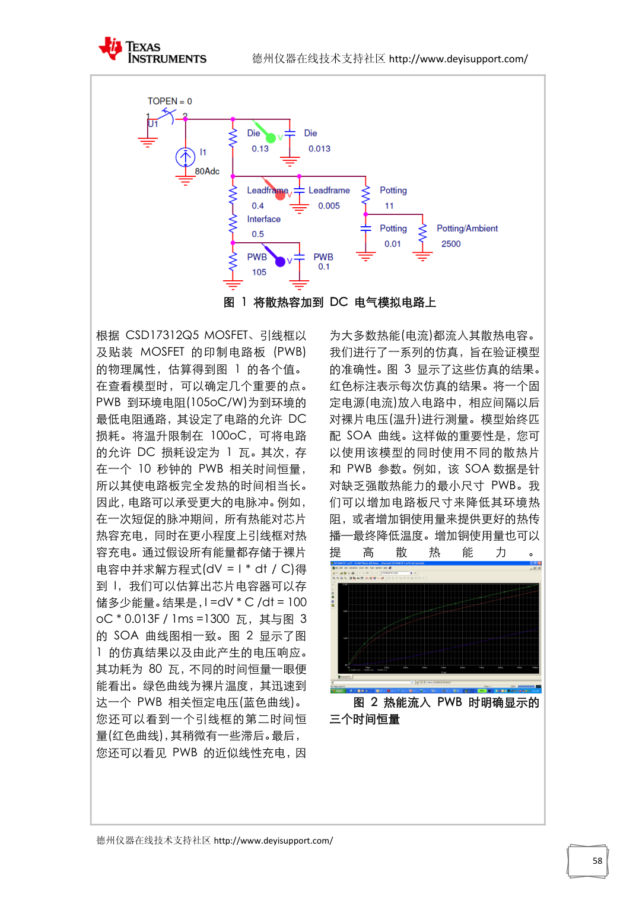

图 1 将散热容加到 DC 电气模拟电路上

根据 CSD17312Q5 MOSFET、引线框以 及贴装 MOSFET 的印制电路板 (PWB) 的物理属性，估算得到图 1 的各个值。 在查看模型时，可以确定几个重要的点。 PWB 到环境电阻(105oC/W)为到环境的 最低电阻通路，其设定了电路的允许 DC 损耗。将温升限制在 100oC，可将电路 的允许 DC 损耗设定为 1 瓦。其次，存 在一个 10 秒钟的 PWB 相关时间恒量， 所以其使电路板完全发热的时间相当长。 因此，电路可以承受更大的电脉冲。例如， 在一次短促的脉冲期间，所有热能对芯片 热容充电，同时在更小程度上引线框对热 容充电。通过假设所有能量都存储于裸片 电容中并求解方程式(dV = I * dt / C)得 到 I，我们可以估算出芯片电容器可以存 储多少能量。结果是， $\mathsf { I } = \mathsf { d } \mathsf { V } ^ { \ast } \mathsf { C } \mathrm { ~ / { d } \dagger = \mathrm { ~ 1 0 0 ~ } }$ $0 \mathsf { C } ^ { \mathrm { ~ * ~ } } 0 . 0 1 3 \mathsf { F } / \mathrm { ~ l ~ } \mathsf { m } \mathsf { s } = 1 3 0 0 \mathrm { ~ \textcircled { \mathrm { L } } }$ ，其与图 3 的 SOA 曲线图相一致。图 2 显示了图 1 的仿真结果以及由此产生的电压响应。 其功耗为 80 瓦，不同的时间恒量一眼便 能看出。绿色曲线为裸片温度，其迅速到 达一个 PWB 相关恒定电压(蓝色曲线)。 您还可以看到一个引线框的第二时间恒 量(红色曲线)，其稍微有一些滞后。最后， 您还可以看见 PWB 的近似线性充电，因 为大多数热能(电流)都流入其散热电容。 我们进行了一系列的仿真，旨在验证模型 的准确性。图 3 显示了这些仿真的结果。 红色标注表示每次仿真的结果。将一个固 定电源(电流)放入电路中，相应间隔以后 对裸片电压(温升)进行测量。模型始终匹 配 SOA 曲线。这样做的重要性是，您可 以使用该模型的同时使用不同的散热片 和 PWB 参数。例如，该 SOA 数据是针 对缺乏强散热能力的最小尺寸 PWB。我 们可以增加电路板尺寸来降低其环境热 阻，或者增加铜使用量来提供更好的热传 播—最终降低温度。增加铜使用量也可以 提 高 散 热 能 力 

[[硬件/原始备份/电源设计经验.pdf#page=58|原版PDF第58页整页回看（前文已展示）]]

图 2 热能流入 PWB 时明确显示的 三个时间恒量

[[硬件/原始备份/电源设计经验.pdf#page=58|原版PDF第58页整页回看（前文已展示）]]

图 3 散热模型与指示点的 MOSFET CSD17312 SOA 曲线一致

下一篇，我们将讨论获得隔离偏臵电源的一种简单电路。 

## 电源设计经验谈 30：低压降压 IC 让简捷、经济的偏臵电源成为现 实

在本《电源设计经验谈》中，我们将 研究一款可将高 AC 输入电压转换为可 用于电子能量计等应用的低 DC 电压简 单电路。在这种特殊的应用中，无需将输 出电压隔离于输入电压。此处，经过整流 的 AC 输入电压可高达 375 VDC，同时 数百毫安电流时的输出电压可在 5 伏以 内。这些大容量应用通常受到成本的推动， 因此要求低部件数量/低成本的电路。步 降稳压器提供了一种低成本的解决方案， 但在使用高电压输入实施时却充满挑战。 在连续模式下，该降压稳压器的占空比为 输出电压除以输入电压，即 400V 转换到 5V 时占空比为 1.25%。如果我们在 100 kHz 下运行电源，则需要 125 nS 的导通 时间，而由于开关速率限制的存在其通常 是不切实际的。 

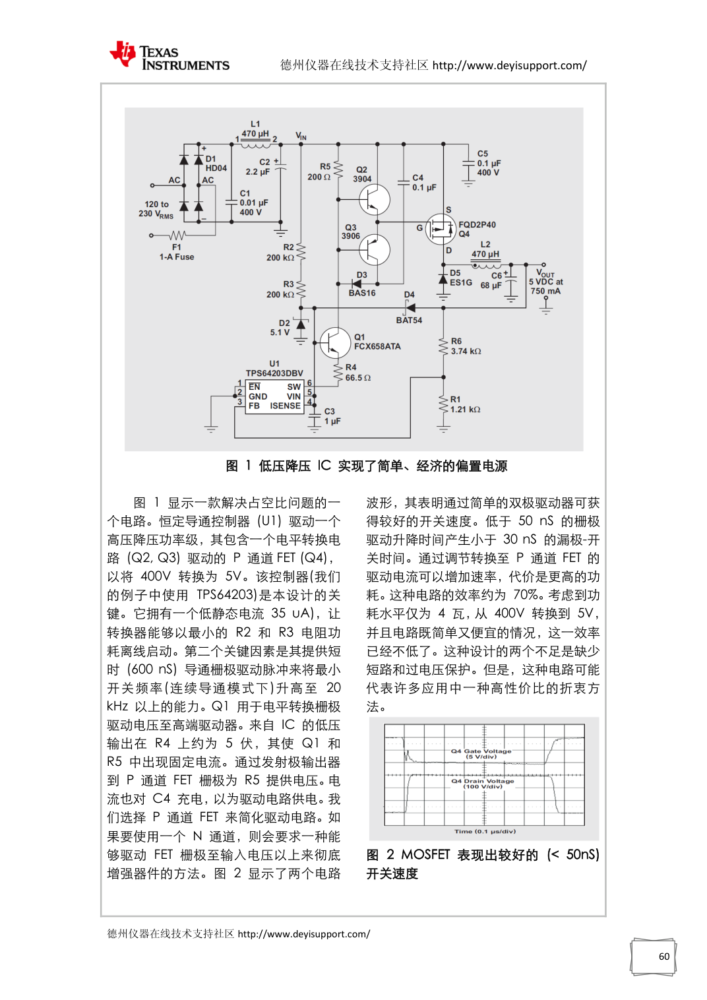

图 1 低压降压 IC 实现了简单、经济的偏臵电源

图 1 显示一款解决占空比问题的一 个电路。恒定导通控制器 (U1) 驱动一个 高压降压功率级，其包含一个电平转换电 路 (Q2, Q3) 驱动的 P 通道 FET (Q4)， 以将 400V 转换为 5V。该控制器(我们 的例子中使用 TPS64203)是本设计的关 键。它拥有一个低静态电流 35 uA)，让 转换器能够以最小的 R2 和 R3 电阻功 耗离线启动。第二个关键因素是其提供短 时 (600 nS) 导通栅极驱动脉冲来将最小 开关频率(连续导通模式下)升高至 20 kHz 以上的能力。Q1 用于电平转换栅极 驱动电压至高端驱动器。来自 IC 的低压 输出在 R4 上约为 5 伏，其使 Q1 和 R5 中出现固定电流。通过发射极输出器 到 P 通道 FET 栅极为 R5 提供电压。电 流也对 C4 充电，以为驱动电路供电。我 们选择 P 通道 FET 来简化驱动电路。如 果要使用一个 N 通道，则会要求一种能 够驱动 FET 栅极至输入电压以上来彻底 增强器件的方法。图 2 显示了两个电路 波形，其表明通过简单的双极驱动器可获 得较好的开关速度。低于 50 nS 的栅极 驱动升降时间产生小于 30 nS 的漏极-开 关时间。通过调节转换至 P 通道 FET 的 驱动电流可以增加速率，代价是更高的功 耗。这种电路的效率约为 70%。考虑到功 耗水平仅为 4 瓦，从 400V 转换到 5V， 并且电路既简单又便宜的情况，这一效率 已经不低了。这种设计的两个不足是缺少 短路和过电压保护。但是，这种电路可能 代表许多应用中一种高性价比的折衷方 法。 

[[硬件/原始备份/电源设计经验.pdf#page=60|原版PDF第60页整页回看（前文已展示）]]

图 2 MOSFET 表现出较好的 (< 50nS) 开关速度

下一篇，我们将讨论一种在无需研究其内部构件的情况下测量电源控制环路相位裕量 的方法。 

## 电源设计经验谈 31：同步降压 MOSFET 电阻比的正确选择

在这篇《电源设计经验谈》中，我们 将研究在同步降压功率级中如何对传导 功耗进行折中处理，而其与占空比和 FET 电阻比有关。进行这种折中处理可得到一 个用于 FET 选择的非常有用的起始点。 通常，作为设计过程的一个组成部分，您 会有一套包括了输入电压范围和期望输 出电压的规范，并且需要选择一些 FET。 另外，如果您是一名 IC 设计人员，则您 还会有一定的预算，其规定了 FET 成本 或者封装尺寸。这两种输入会帮助您选择 总 MOSFET 芯片面积。之后，这些输入 可用于对各个 FET 面积进行效率方面的 优化。 

首先，FET 电阻与其面积成反比例关 系。因此，如果为 FET 分配一定的总面 积，同时您让高侧面积更大(旨在降低其电 阻)，则低侧的面积必须减小，而其电阻增 加。其次，高侧和低侧 FET 导电时间的 百分比与 VOUT/VIN 的转换比相关，其 首先等于高侧占空比 (D)。高侧 FET 导 通 D 百分比时间，而剩余 (1-D) 百分比 时间由低侧 FET 导通。图 1 显示了标准 化的传导损耗，其与专用于高侧 FET 的 FET 面积百分比(X 轴)以及转换因数(曲 线)相关。很明显，某个设定转换比率条件 下，可在高侧和低侧之间实现最佳芯片面 积分配，这时总传导损耗最小。低转换比 率条件下，请使用较小的高侧 FET。反之， 高转换比率时，请在顶部使用更多的 FET。 面积分配至关重要，因为如果输出增加至 3.6V，则针对 12V：1.2V 转换比率(10% 占空比)进行优化的电路，其传导损耗会增 加 30%，而如果输出进一步增加至 6V， 则传导损耗会增加近 80%。最后，需要指 出的是，50% 高侧面积分配时所有曲线都Conve 经过同一个点。这是因为两个 FET 电阻rsion 在 这 一 点 相 等 

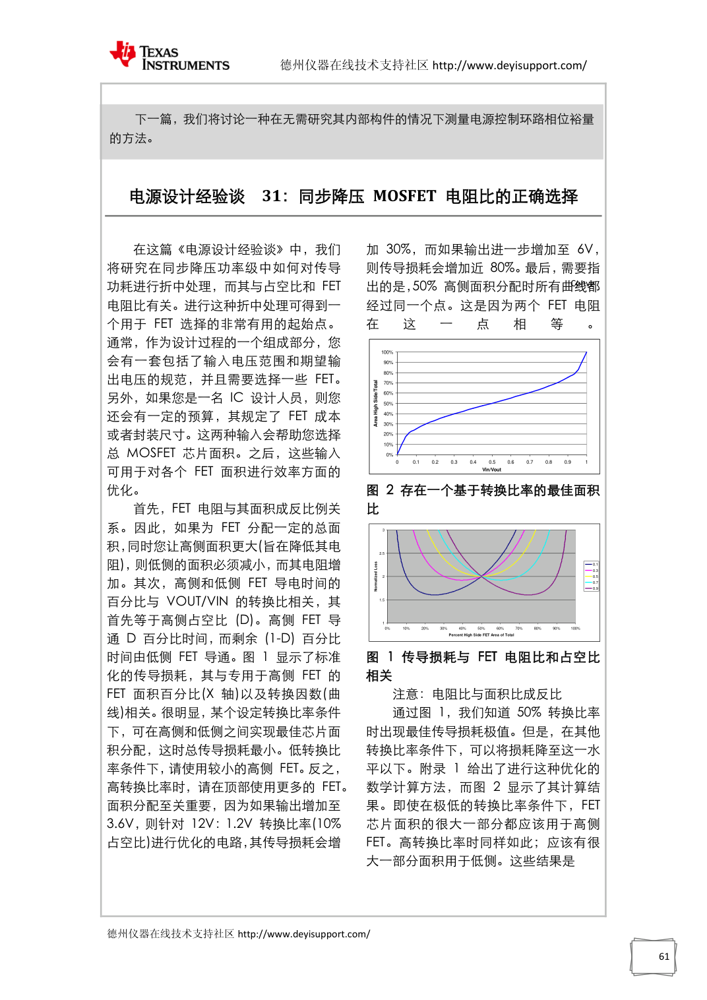

图 2 存在一个基于转换比率的最佳面积 比

[[硬件/原始备份/电源设计经验.pdf#page=61|原版PDF第61页整页回看（前文已展示）]]

图 1 传导损耗与 FET 电阻比和占空比 相关

注意：电阻比与面积比成反比 

通过图 1，我们知道 50% 转换比率 时出现最佳传导损耗极值。但是，在其他 转换比率条件下，可以将损耗降至这一水 平以下。附录 1 给出了进行这种优化的 数学计算方法，而图 2 显示了其计算结 果。即使在极低的转换比率条件下，FET 芯片面积的很大一部分都应该用于高侧 FET。高转换比率时同样如此；应该有很 大一部分面积用于低侧。这些结果是 

对这一问题的初步研究，其并未包括 如高侧和低侧FET之间的各种具体电阻值， 开关速度的影响，或者对这种芯片面积进 行封装相关的成本和电阻等诸多方面。但 是，它为确定 FET 之间的电阻比提供了 一个良好的开端，并且应会在 FET选择方 面实现更好的整体折中。 

附录：图 2 的推导过程 

定义： 

占空比： 

$$
D = \frac {V i n}{V o u t}
$$

MOSFET 指定电阻 (欧姆*面积): 

$$
\rho
$$

总面积：A 

高侧 FET 面积： 

高侧 FET 电阻： 

$$
R _ {H S} = \frac {\rho}{\alpha}
$$

低侧 FET 电阻： 

$$
R _ {L S} = \frac {\rho}{A - \alpha}
$$

有 效 FET 电 阻 

$$
R _ {T o t a l} = \frac {\rho}{A} = \frac {1}{\frac {1}{R _ {H S}} + \frac {1}{R _ {L S}}}
$$

总传导损耗求解过程 (用于图 1)： 

$$
P = I _ {O U T} ^ {2} * \rho * (D * \frac {1}{\alpha} + (1 - D) * \frac {1}{A - \alpha})
$$

利用 α 相关导数： 

$$
\frac {d P}{d \alpha} = I _ {O U T} ^ {2} * \rho^ {*} (\frac {- D}{\alpha^ {2}} + \frac {1 - D}{(A - \alpha) ^ {2}})
$$

将高侧面积比总 FET 面积定义为 $\alpha _ { r }$ . (注意：其为电阻比的倒数。) 让上 面的方程式等于零，然后代入。 

$$
\frac {- D}{\alpha_ {r} ^ {2}} + \frac {1 - D}{(1 - \alpha_ {r}) ^ {2}} = 0
$$

经过大量的代数计算后得到： 

$$
\alpha_ {r} = \frac {- D + / - \sqrt {D ^ {*} (1 - D)}}{1 - 2 ^ {*} D}
$$

结果如图 2 所示。 

下一篇，我们将讨论如何确定 SEPIC 所用耦合电感的漏电感要求。 

## 电源设计经验谈 32：注意 SEPIC 耦合电感回路电流—第 1 部分

在这篇《电源设计经验谈》中，我们 将确定 SEPIC 拓扑中耦合电感的一些漏 电感要求。在不要求主级电路和次级电路 之间电气隔离且输入电压高于或者低于 输出电压时，SEPIC 是一种非常有用的拓 扑。在要求短路电路保护时，我们可以使 用它来代替升压转换器。SEPIC 转换器的 特点是单开关工作和连续输入电流，从而 带来较低的电磁干扰 (EMI)。这种拓扑(如 图 1 所示)可使用两个单独的电感(或者 由于电感的电压波形类似)，因此还可以使 用一个耦合电感，如图所示。因其体积和 成本均小于两个单独的电感，耦合电感颇 具吸引力。其存在的缺点是标准电感并非 总是针对全部可能的应用进行优化。 

这种电路的电流和电压波形与连续 

电流模式 (CCM) 反向电路类似。开 启 Q1 时，其利用耦合电感主级的输入 电压，在电路中形成能量。关闭 Q1 时， 电感的电压逆转，然后被钳制到输出电压。 电容 C_AC 便为 SEPIC 与反向电路的 差别所在；Q1 开启时，次级电感电流 流过它然后接地。Q1 关闭时，主级电感 电流流过C_AC，从而增加流经 D1 的输 出电流。相比反向电路，这种拓扑的一个 较大好处是 FET 和二极管电压均受到 C_AC 的钳制，并且电路中很少有振铃。 这样，我们便可以选择使用更低的电压， 并由此而产生更高功效的器件。 

由于这种拓扑与反向拓扑类似，因此 许多人会认为要求有一套紧密耦合的绕 组。然而，情况却并非如此。图 2 显示 了连续 SEPIC 的两个工作状态，其变压 器已通过漏电感 (LL)、磁化电感 (LM) 和 一个理想变压器 (T) 建模。经检查，漏电 感的电压等于 C_AC 的电压。因此，较 小值 C_AC 或者较小漏电感的大 AC 电压会形成较大的回路电流。较大的回路 电流会降低转换器的效率和 EMI 性能， 而这种情况是我们所不希望出现的。减少 这种大回路电流的一种方法是增加耦合 电容 (C_AC)。但是，这样做是以成本、 尺寸和可靠性为代价的。一种更为精明的 方法是增加漏电感，其在指定某个定制磁 性组件的情况下可以很轻松地实现。 

图 1 SEPIC 转换器使用一个开关来升降 输出电压

[[硬件/原始备份/电源设计经验.pdf#page=63|原版PDF第63页整页回看（前文已展示）]]

2a)MOSFET 开启： $\mathsf { V L L } = \mathsf { V C \_ A C } - \mathsf { V I N } = \mathsf { \Delta E V C \_ A C } ( \mathsf { D C }$ 部分删除)

[[硬件/原始备份/电源设计经验.pdf#page=63|原版PDF第63页整页回看（前文已展示）]]

2b) MOSFET 关闭: VLL = VIN + VOUT - VC_AC - VOUT = ∆VC_AC (DC 部分删 除) 

图 2a 和 2b SEPIC 转换器的两种工作状态。 

漏电感的 AC 电压等于耦合电容电压。 

有趣的是，极少的厂商已经认识到了这一事实，并且许多厂商已经针对 SEPIC 应用 生产出了低漏电感的电感。另一方面，Coilcraft 拥有约 0.5 uH 漏电感的 47 uH MSD1260，同时还于最新开发出了这种设计的其他版本，其具有 10 uH 以上的漏电感， 我们将在下一篇的《电源设计经验谈》中对其进行介绍。 

## 参考文献

《SEPIC 转换器从漏电感中受益匪浅》，作者：Betten, John，PowerPulse.net, 

http://www.powerpulse.net/techPaper.php?paperID=153 

Coilcraft Catalog, 《MSD1260 产品说明书》。 

## 电源设计经验谈 33：注意 SEPIC 耦合电感回路电流——第 2 部分

在这篇《电源设计经验谈》中，我们 继续《电源设计经验谈 #32—第 1 部分》 的讨论，即如何确定 SEPIC 拓扑中耦合 电感的漏电感要求。前面，我们讨论了耦 合电容器 AC 电压被施加于耦合电感漏 电感的情况。漏电感电压会在电源中引起 较大的回路电流。在第 2 部分中，我们 将介绍利用松散耦合电感和紧密耦合电 感所构建电源的一些测量结果。 

我们构建起如图 1 所示电路，并对 其进行描述。该电路可在汽车市场获得应 用。这里，其拥有一个 8V 到 36V 的宽 范围输入，可以为稳定 12-V 输出以上或 者以下。汽车市场更喜欢使用陶瓷电容器， 原因是其宽温度范围、长寿命、高纹波电 流额定值和高可靠性。结果，耦合电容器 (C6) 便为陶瓷的。这就意味着，相比电 解电容器，它拥有较高的 AC 电压，同 时这种电路会对低漏电感值更加敏感。该 电路中的两个 47 uH Coilcraft 电感分 别为：一个非常低漏电感 (0.5 uH) 的 MSD1260，以及一个较高漏电感 (14 uH) 的MSC1278。图 2 显示了这两个电感的 一次电流波形。左边为 MSC1278 电感 的输入电流(流入 L1 的引脚 1)，而右边 为MSD1260 输入电流波形。左边的电流 为一般情况。 

电流主要为其三角 AC 分量的 DC。 右边的波形为利用耦合电感的高 AC 电 压以及一个低漏电感值所得到的结果。峰 值电流几乎为 DC 输入电流的两倍，而 RMS 电流比高漏电感情况多出 50%。 

图 1 SEPIC 转换器可利用一个单开关降压或者升压

[[硬件/原始备份/电源设计经验.pdf#page=65|原版PDF第65页整页回看（前文已展示）]]

(a)松散耦合

图 2 低漏电感(右边)带来严重的耦合电感回路电流

(b)紧密耦合

很明显，利用紧密耦合电感对这种电 源进行电磁干扰 (EMI) 滤波会存在更多 的问题。这两种设计之间的 AC 输入电 流比约为 5：1，也就是说还需要 14 dB 的衰减。这种高回路电流产生的第二个影 响是对转换器效率的影响。由于电源中多 出了 50% 的 RMS电流，传导损耗将会增 加一倍以上。图 3 将这两种电感的效率 进行了比较(电路其它部分保持不变)。 12V 到 12V 转换时，两种结果都很不错 

都在90%左右。但是，松散耦合电感 在负载范围得到的效率高出 1 到 2 个 百分点，而它的 DC 电阻与紧密耦合电 感是一样的。 

总之，SEPIC 转换器中的耦合电感可 以缩小电源的体积，降低电源的成本。电 

感并不需要紧密耦合。实际上，紧密 耦合会增加电源内的电流，从而使输入滤 波复杂化并降低效率。选择合适漏电感值 的最简单方法是利用模拟。但是，您也可 以先估算出耦合电容器的电压，然后设臵 允许纹波电流，最后计算得到最小漏电感。 

图 3 由于更少的电流，高漏电感 (MSC1278) 产生更高的效率

## 参考文献

Betten, John; 《SEPIC 转换器受益于漏电感》，PowerPulse.net。 

## 电源设计经验谈 34：设计简易的隔离式偏压电源

本文将探讨如何以最少零件、最低复 杂度及最节省成本的方法，针对闸极驱动、 隔离感测与通讯电路，设计隔离式电源供 应电路。当输入电压较低，而且电路通电 时允许少许(5%) 电压偏差，就能够使用 这种电路。 

图 1 的例子示范了专为简易隔离式 偏压电源所开发的 IC，任何允许下沉操 作(sink operaton)的同步降压电路均可 使用。这种电路称为非对称半桥返驰电路 (asymmetrical half-bridge flybuck) ， 其运作方式与同步降压稳压器相当类似。 连接输入电压的 FET 图腾柱 (totem pole) 输出会供应电感电容滤波器。接下 来透过分压器 (voltage divider) 及误 差放大器负输入调节滤波器输出。误差放 大器会控制 FET 图腾柱 (totem pole) 输出的负载周期，使 DC 电压维持在感 测点 (sense point)。 

C6 的电压相当于负载率 (duty factor) 乘以输入电压。和降压功率级一 样，电感的伏秒 (voltage-second) 必 须等于零。但此电路在电感加入一个耦 合绕组 (coupled winding) ，并且使 用二极管修正低位 FET 启动时所反射的 电感电压。由于这段期间的电感电压等 于输出电压，因此电路的输出将获得调节。 不过一次侧及二次侧的电压降幅差异将 降低调节的效果。在此电路中，负载的电 压调节将受到二极管 D1 正向电压降幅 的影响，若将二极管改换成 FET，即可提 升负载调节的效果。 

图 1：同步降压电路提供隔离式电源供应。

和耦合电感 SEPIC 一样，此拓朴的 寄生组件也会影响电路性能。在导通时间 内，电路状况相当良好，大部份的电流都 流入耦合电感 T1 的磁化电感，使 C6 充 电。输出电容 C3 则供应负载电流。不过， 在关闭期间，两个电容将透过电感的耦合 绕组平行放臵。这两个电容具有不同的电 压，只有回路中的寄生组件会限制两者之 间的电流。这些寄生组件包括这两个电容 的 ESR、耦合电感的绕组电阻、低位 MOSFET 与二极管的阻抗，以及耦合电感 的漏损电感。 

图 2 显示不同漏损电感值的模拟电 流。上半部为 T1 一次侧的电流，下半部 为输出二极管 D1 的电流。紧密耦合电感 10 nH 与松散耦合电感 1 uH 的漏损电 感各不相同。对于紧密耦合电感，峰值电 流较高，也受到回路阻抗的实质限制。 

对于松散耦合电感，峰值电流较低。 较高的漏损可减少 RMS 电流，有助于改 善电源供应的效率。图 2 显示两者的比 较。松散耦合电感的电流最多可减少 50%， 可减少少数组件的耗损达 75%。松散耦合 的缺点是输出电压的调节不佳。 

[[硬件/原始备份/电源设计经验.pdf#page=67|原版PDF第67页整页回看（前文已展示）]]

图 2：低漏损增加循环电流。

图 3 显示如图 1 的转换器所呈现 的负载调节结果。如果负载电流受限制， 在大部分的情况下，此转换器将提供足够 的调节。在轻负载时，可看出二极管接面 电压变化及振铃的影响。可能需要最小负 载或 Zener 箝位，才能降低这些轻负载 效应。在重负载时，电路的寄生组件会降 低调节的效果。因此减少组件数有助于提 升效果。例如，将二极管改换成同步切换， 将大幅提升负载调节。 

## Vin=5V Load Regulation

图 3：返驰负载调节在大多数情况下均良好。

总而言之，返驰式(Flyback)转换器是相当具吸引力的拓朴，能够提供低成本且简单 的隔离式电源供应，承受输出5% 至 10% 的电压变化。二极管整流器在 5V 下的输出效 率能够维持80% 的良好状态，而且同步整流器的状态也将更为改善。 

## Reference

Chen and Chen; “Small-Signal Modeling of Assymetrical Half-Bridge Flyback Converter,” IPEMC 2006. 

## Power Tip 35: Minimize transformer interwinding capacitance

Have you ever designed a low-power flyback converter with a high turns ratio? If so, you probably encountered problems with interwinding capacitance. In this Power Tip, we take a look at techniques to reduce the 

capacitance effects that allow higher frequency operation. 

Figure 1 illustrates a circuit that is indicative of the problem. In this transformer, we started with a high turns ratio (40:1) between the secondary and the primary windings. 

Figure 1: Interwinding capacitance is problematic with

high transformer-turn ratio.. (Click on image to enlarge) 

The transformer has distributed capacitance from the secondary winding-to-ground. The high-voltage switching on the secondary causes current to flow in this capacitance, which is reflected back to the primary. The effective capacitance seen on the primary is the secondary distributed capacitance multiplied by the turns ratio squared. 

For instance, 20 pF of distributed capacitance is multiplied by 1600. This appears as 32 nF of capacitance on the primary and generates significant loss. At 100 kHz and 12 volt input, for example, the loss attributed to this capacitance is equal to almost 1 watt in this 4 watt power supply. This capacitance slows the drain voltage as the power FET turns off, robbing you of duty factor. It can also cause false triggering of current limits when the MOSFET turns on. 

The secret to reducing current that flows through the capacitance is to minimize the transformer-turns ratio and minimize the voltage across it. There are a number of ways to minimize the voltage. Typically, in these high-voltage circuits, the windings are wound in layers. With two layers, when the end and start are on the same side of the bobbin, the first and last turns have the full winding voltage between them. 

One technique used to reduce the gradient between the turns is called bank winding. The wires are wound as shown in Figure 2. This method can significantly reduce the capacitance by limiting the voltages between the adjacent windings. Winding in sections with a split bobbin is an extension of this method. 

If the transformer capacitance is still an issue, there are some circuit tricks that you can play. Figure 3 shows an example. 

Figure 2: Bank winding reduces effective capacitance.

[[硬件/原始备份/电源设计经验.pdf#page=71|原版PDF第71页整页回看（前文已展示）]]

Figure 3: Splitting secondary can halve distributed capacitance.. (Click on image to enlarge)

In this design we have split the secondary windings so that they provide half the voltage of the secondaries shown in Figure 1, but we have connected two of them in series for each output. The average AC voltage on the lower-voltage winding remains the same, while the average AC voltage on the higher winding is reduced by 66 percent. This method reduces the effective transformer capacitance by about half, and can be extended to more sections for even higher voltages. 

To summarize, interwinding capacitance can be a problem where large transformer-turns ratios are involved, particularly with low-power converters where losses can be a significant percentage of the load power. The secret to a low-capacitance transformer design is to minimize the turns ratio and to 

minimize the voltage across adjacent windings. 

This can be accomplished by bank, or section windings. You can 

also split the windings and add rectifiers and filters to further reduce the capacitance. The effective capacitance will be reduced by the number of sections. For instance, four sections reduce capacitance by a factor of four. 

Please join us next month when we will discuss the efficiency implications of high-voltage LED’s on the lighting market. For more information about this and other power solutions, visit: http://www.deyisupport.com/. 

## 电源设计经验谈 36：使用高压 LED 提高灯泡效率

使用 LED 作为光源的灯泡来替代螺 纹旋入式白炽灯泡有很多好处。一般而言， 我们将小号(5-9)的 LED 串联起来，使用 一个电源将线电压转换为低电压(通常为 数十伏)，这时的电流约为 350 到 700mA。在确定如何最好地让用户同线电 压隔离的过程中，我们需要深思熟虑、权 衡利弊。我们可以在电源中实现隔离，也 可以在 LED 安装过程中进行这种隔离。 在一些低功耗设计中，LED 物理隔离是一 种常用方法，因为它允许使用成本更低的 非隔离式电源。图 1 显示了一种典型的 LED 灯替代方法。本举例中的电源为非隔 离式电源，其意味着实现用户高压保护的 隔离被嵌入到了封装而非电源中。很明显， 电源的空间极其小，从而对封装构成了挑 战。另外，电源被隐埋到封装内部，从而 阻碍了散热，影响了效率。 

图 2 显示了一个通过 120 伏 AC 电源 为 LED 供电的非隔离式电路。它包含一 个为降压功率级供电的整流桥。该降压调 节器是一个“倒臵版”，其电源开关 Q2 处在回路中，而环流二极管 D3 连接至电 源。在电源开关导通期间，通过一个源电 阻对电流进行调节。尽管这样做的效率相 当高(80%-90%)，但是这种电路存在几个 限制效率的缺点。导通时，电源开关必须 承载全部输出电流，而在电源开关关闭时， 输出电流流过环流二极管。另外，电流检 测电阻器 R8 和 R10 的电压约为 1 伏。 相比 15 到 30 伏的 LED 电压，所有这 三个压降都很大，并且会对电源效率构成 限制。更为重要的是，这些损耗会促进灯 泡温升。LED 的发光能力会慢慢减小，而 这种能力与 LED的工作温度密切相关。例 如，70oC 条件下，LED 光输出减少 30% 的时间超出了 50000 小时，而在 80oC 条件下，这一时间仅为 30000 小时。由 于灯泡都安装在一些“筒”中，而这些“筒” 往往会阻碍散热，不利于对流冷却，因此 发 热 问 题 被 进 一 步 复 杂 化 。 

[[硬件/原始备份/电源设计经验.pdf#page=71|原版PDF第71页整页回看（前文已展示）]]

图 1 灯泡替换使电源空间变得极小

图 2 降压调节器实现一个简单的离线 LED 驱动器

LED 制造厂商通过将数支 LED 串 联在一块公用基板上，制造出更高电压的 发光体。这些高压发光体带来亦或是更低 的成本亦或是更高的电源效率。使用这些 高压产品，我们只需使用一组整流器和一 个稳流电阻器，从而实现更低成本的电源 方法。尽管这种电源可以产生相当好的功 率因数，但效率很低，原因是输入电压的 很大一部分都被用在了稳流电阻器上，导 致 30%-50% 的 LED 功率损耗。但是， 它可以用于一些小体积的低功耗应用中。 然而，在一些高功耗应用中，低效率让其 无用武之地。图3显示了另一种替代方法： 其使用一个升压电源。该电路的大部分都 与上述方法相同。但是，开关、二极管和 电流检测损耗要小得多，带来高达 90% 到 95% 的效率。另外该电路还拥有 97% 的良好功率因数。 

[[硬件/原始备份/电源设计经验.pdf#page=72|原版PDF第72页整页回看（前文已展示）]]

图 3 利用升压电源提高 LED 驱动器效率

图 4 为图 1-2 示意图所描述电源 的照片。即使这种电源产生的输出功率大 致相同，但也存在一些影响电源尺寸的明 显差异。升压电源的电感器尺寸明显更小， 因为其蓄能要求更低。相比升压电源，降 压电源有一个更大的电阻器。该电阻器为 一个仿真负载电阻器(图 2 所示 R20)， 用于决定调光器何时开启硅控整流器 (SCR)。需要这样做的原因是，调光器在 三端双向可控硅开关组件旁边有一个电 磁干扰 (EMI) 抑制电容器，其在无负载情 况下的电压相对电源要高。这样便扰乱了 电源，导致出现不稳定调光。使用升压电 源时却不需要这样做，因为 LED 通过升 压电感器连接至输入，为其提供足够负载， 因此上述问题便不是问题。图中未显示电 路板的背面，但正如示意图所示，降压电 源有更多低电平电路。所以，升压电源拥 有更低的功耗，这一点在诸如 LED 灯泡 更换等空间限制型应用中极为重要。 

[[硬件/原始备份/电源设计经验.pdf#page=72|原版PDF第72页整页回看（前文已展示）]]

图 4 升压电源体积更小、效率更高

总之，高压 LED 因其具有功耗低、温升小的特点，可帮助增加旋入式 LED 灯泡的 使用寿命。它是通过使用升压电源替代降压电源，从而提高电源效率来实现的。升压电源 的损耗约为降压调节器的一半。另外，升压电源的组件更少，功率因数更好，体积更小， 并且利用三端双向可控硅开关组件实现调光更容易。下一篇，我们将讨论离线电源电容器 的纹波电压及电流。 

## 电源设计经验谈 37：折中选择输入电容纹波电流的线压范围

您在为一个低功耗、离线电源选择输 入滤波电容时，会出现一种有趣的权衡过 程。您要折中地选取电容的纹波电流额定 值，以适合电源工作所需的电压范围。通 过增加输入电容，您可以获得更多纹波电 流的同时还可以通过降低输入电容的压 降来缩小电源的工作输入电压范围。这样 做会影响电源的变压器匝数比以及各种 电压及电流应力。电容纹波电流额定值越 大，应力越小，电源效率也就越高。图 1 和 2 显示了离线电源中使用的两种整流 器配臵结构。图 1 为一个全波桥接，其 中，AC 输入电压经过简单整流以后便被 送至电容。这种电路常见于宽范围 AC 和 230 伏 AC 应用中。电容充电至正弦 波峰值，然后在大部分半周期放电。电容 纹波电流包括两个部分：首先是充电周期， 

其电流由电容值和所应用的 dV/dt 决定；其次是电容放电。电源起到恒定电 源负载 

的作用，因此电容以非线性速率实施放电， 其计算方法为：W = ½ * C *V^2 = P * dt。 图 2 描述了一种倍压器整流配臵结构， 许多 115/230 VAC 应用都使用了这种 结构。如果您有一个 230 VAC 应用，则 您的输入级需要处理最大输入电压(265 VAC)乘以峰值因数这么大的电压，其接 近 400 伏。在与一个 115 VAC 输入一 起使用时，倍压器将经过整流的电压，增 压至接近 230 VAC 输入电平。我们可以 专为 230 VAC 线压设计一个电源，以此 来减小电源工作的整流后电压范围。我们 通常使用一个跳线或者开关，来实现不同 整流器配臵之间的切换。这种方法的唯一 缺点是偶尔出现人为倍增 230 VAC 输 入的情况，从而对电源造成严重破坏。图 2 显示了倍压器电路的一些波形。电容之 间不带电。两个整流器交替对每个电容施 加输入电压。一个周期中，每个电容都被 充电至峰值线压，这样它们每个都有一个 线频率纹波部分。由于电容为异相位充电， 因此其和的纹波频率为线频率的两倍。 

图 3 显示了四种整流器/输入电压 方法的 uF/W 标准化压降。共有三种全 波桥接方法，适用于低线压美国(108 VAC/60 Hz)、低线压日本(85 VAC/50 Hz) 和低线压欧洲(216 VAC/50 Hz)。另外， 还有一个低线压日本的倍压器。就全波桥 而言，标准化过程只需将电容除以功率。 在倍压器中，标准化方法是将两个串联电 容之一的电容除以功率。要想使用该曲线 图，请首先确定您的整流器配臵结构，并 选择一个可以接受的压降。之后，您只需 读取输入电容的 uF/W 便可。最后， 通过乘以您的功率，便可去标准化。 

图 2 倍压器减小电源线压范围

[[硬件/原始备份/电源设计经验.pdf#page=74|原版PDF第74页整页回看（前文已展示）]]

图 3 大电容可减小输入线压范围并提高 效率

之后，您便可以利用图 4 来计算电容 的纹波电流额定值。图 4 显示了标准化 纹波电流与标准化输入电容的对比关系。 有趣的是，纹波电流并非与电容密切相关。 这是因为在放电期间，电流由一个来自负 载的接近于恒定的电流所决定。只有在充 电周期，电流才会极为不同。电容 (uF/W) 减小时，渐进纹波电流增加，这时便出现 上述情况。更大电容、更小传导角时，峰 值电流更高。请注意，该曲线图仅包括线 频率纹波电流，并未包括高频电源纹波电 流效应。 

图 1 用于许多离线设计中的全波桥接

[[硬件/原始备份/电源设计经验.pdf#page=74|原版PDF第74页整页回看（前文已展示）]]

图 4 增加 uF/W 不会明显增加输入电容纹波电流

总之，设计人员在选择输入电容和整流器配臵结构时进行一些折中处理非常重要。 如果选择宽范围应用的全波桥接，则电源可能需要在 4：1 输入范围工作运行。如果设 计人员选择在设计中使用一个倍压器来减小这一范围，则存在用户误操作导致出现过电 压的隐患。根据本文提供的曲线图来选择正确的输入电容，可以在一定程度上限制工作 电压范围。 

下一篇，我们将讨论一种价格低廉的电源保护锁闭电路。 

## 电源设计经验谈38：使用简易锁存电路保护电源

您曾经是否需要过一款简单、低成本 的锁存电路？图 1 显示的就是这样一款 电路，它只需几元钱的组件便可以提供电 源故障保护，基本上是一个可控硅整流器 (SCR)，结合了一些离散组件。两个晶体 管正常情况下为关闭状态。若想开启锁存， 您需要将 PNP 基极驱动为低电平，或者 将 NPN 基极驱动为高电平，直至其中一 个晶体管开启。这样会形成集电极电流， 让另一个晶体管也开启，从而进一步开启 初始晶体管。电路以一种再生方式执行锁 存操作。电流仅受限于电源阻抗和晶体管 特性，从而允许电路对电容器快速放电。 这种电路的一个有趣特性是，您可以通过 选择电阻器值建立 SCR 的保持电流。为 了让锁存电路在触发以后仍然保持开启， 两个基极发射极结点必须要有足够的电 压(~0.7 V)让其保持开启状态。这就意味 着，如果向它提供的电流为 Vbe / R1 + Vbe / R2 以上，则电路锁存。如果锁存 电路连接一个小电流的电容器，则锁存电 路对该电容器放电。一旦电路的电流减少 至保持电流以下，它便关闭。 

图 2 显示了这种电路一个很好使用 方法。图中所示为一个高压输入、48-V 输 出反向转换器，它在出现由控制电路故障 引起的输出过电压状态时，利用 SCR 来 关闭电源。输入电压首次施加于电路时， 流经 R3 和 R4 的电流便对大容量电容 器 C3 充电。当 C3 的电压达到足够高 时，控制 IC 便开始工作，对功率 FET Q3 进行开关操作，并将能量传送给输出端。 

通过控制 U1 的电流，实现对输出电压的 调节，从而控制通过变压器传输的能量。 这种电路还通过 U3 提供隔离式过电压 保护。我们选择使用了齐纳二极管 D5 和 D6，它们在正常工作期间不导电。在出现 过电压的情况下，它们便开始导电，压制 光耦合器 U3 的电流。U3 触发由 Q4 和 Q5 组成的锁存电路。锁存电路对偏臵电 容器 C3 放电，而当 VDD 电压达到 U2 的 欠 压 停 止 点 时 U2 停 止 工 作 。 

## 图 1 使用离散组件构建一个具有受 控保持电流的 SCR

在电压接近 1 伏以前，锁存电路持 续对偏臵电容器放电。这样，R3、R4、 R14 和 R16 的值变得很重要。R3 和 R4 限制输入线路的有效电流，而 R14 和 R16 决定了锁存电路中要求保持电流的 多少。如果 R14 和 R16 的价值较小， 则锁存电路关闭，偏臵电容器充电，同时 电源尝试再次提供输出功率。若出现故障， 

这种方法可提供连续重试的功能。如果电 阻器的价值足够大，则锁存保持开启，并 且需要重启电源来对其进行重臵。在这种 情况下，便没有连续重试。该电路中另一 个重要的组件是 R5，它在锁存电路开启 后限制偏臵电源。正常情况下，需要使用 这种组件来防止检测到峰值偏压。 

图 2 编程实现 SCR 的锁存控制

使用这种电路的方法有很多，特别是 在您使用升降沿来触发它时。例如，在 Q5 偏压和基极之间连接一个齐纳二极 管，便可以在一次侧实现过电压保护。您 可以使用一个负向变换的温度传感器来 驱动 Q4 的基极。或者，您也可以在二 次侧使用一个比较器，通过一个与图 2 所示极为类似的光耦合器，实现一种非常 精确的过电流关闭功能。 

总之，这种由 0.03 美元的晶体管组成的锁存电路，非常通用。它可以通过负向或者 正向转换触发，可以锁存，也可不锁存，具体可根据您的电阻器值而定。下一篇，我们将 比较非连续和连续电源的瞬态响应，说明效率并非是使用同步整流器的唯一原因。 

## 电源设计经验谈 39：同步整流带来的不仅仅是高效率

您是否曾经应要求设计过一种轻负 载状态下具有良好负载瞬态响应的电源 呢？如果是，并且您还允许电源非连续， 那么您可能会发现控制环路的增益在轻 负载状态下急剧下降。这会导致较差的瞬 态响应，并且需要大量的输出滤波电容器。 一种更简单的方法是让电源在所有负载 状态下都为连续。 

图 1 是一个简单的同步降压转换器， 用于演示输出电感中连续和非连续电流 的负载瞬 

态响应。在低至空载的负载状态下，输出 电感电流都一直保持连续，因为同步整流 器允许电感电流在轻负载状态下反向流 动。只需用一个二极管替换底部 FET (Q2)，电路便可转为非连续。尽管本文介 绍的是降压拓扑结构的区别，但您会注意 到所有电源拓扑都有类似的响应。 

图 1 用于演示瞬态响应的简单降压转换器

图 2 显示了输出电流 700 mA 阶 跃变化的两个瞬态负载响应。左边的线迹 为连续情况，而右边的线迹则为非连续情 况。在非连续情况下，瞬态响应比连续情 况差了三倍多。同步 FET 用于强制连续 运行。但是，也有一些获得较好瞬态响应 的其他方法，包括预加载输出或者使用摆 动电感等。摆动电感用于在低电流时增加 电感。这个目标的实现，主要是通过两种 磁心材料：低电流饱和高铁氧体，以及低 电流不饱和粉末铁氧体。 

[[硬件/原始备份/电源设计经验.pdf#page=77|原版PDF第77页整页回看（前文已展示）]]

图 2 同步运行(左)具有最佳瞬态响应

非连续运行期间，瞬态响应较差的原 因是环路特性急剧变化，如图 3 所示。 左边的曲线显示了连续运行期间的环路 增益。控制环路具有 50 kHz 的带宽，相 补角为 60 度。右边的曲线为功率级转为 非连续时的响应情况。功率级从连续运行 期间的一对复极，变为非连续运行期间的 一个单低频实极点。该极点的频率由输出 电容器和负载电阻器决定。相比连续情况， 您可以看到低频率下低频极点引起的相 移过程。低频率下，增益急剧下降，原因 是极点导致更低的交叉频率，从而降低了 瞬态响应。 

图 3 大量环路增益在非连续运行(右边)中损失

总之，同步整流可提高效率，同时也能够极大地帮助瞬态负载调节。它为电源预加 载提供了一种高效的方法。另外，相比摆动电感，它还拥有更加稳定的控制环路特性。 它提高了传统降压转换器，以及所有其他能够使用同步整流的拓扑结构的动态性。 

下一篇，我们将讨论非隔离式电源的共模噪声。 

## 电源设计经验谈 40：非隔离式电源的共模电流

非隔离式电源的共模电流可能成为 一个电磁干扰 (EMI) 源，您是否曾经消除 过它呢？在一些高压电源中，例如：LED 灯泡所使用的电源，您可能会发现您无法 消除它们。经仔细查看，发现非隔离式电 源与隔离式电源其实并没有什么两样。开 关节点接地寄生电容，产生共模电流。 

图 1 是一个 LED 电源的示意图，其 显示了该降压调节器中共模电流产生的 主要原因。原因就是开关节点接地电容。 令人惊讶的是，如此小的一点电容，仍会 产生问题。CISPR B 类(适用于住宅设备) 辐射规定允许 1 MHz 下 46 dBuV (200 uV) 信号的 50 电源阻抗。这也就是说， 仅允许 4 uA 的电流。如果转换器在 100 kHz 下对 Q2 漏极的 200 Vpk-pk 方波 进行开关操作，则基准电压约为 120 伏 峰值。由于谐波随频率降低而成比例下降， 因此 1MHz 下会有约 9 Vrms。我们可以 利用它来计算允许电容，得到约 0.1pF， 即 100 fF(相当于 1 MHz 下 2 兆欧阻 抗)，其为这个节点完全可能的电容量。另 外，还存在电路接地其余部分的电容，其 为共模电流提供了一条返回通路，如图 1 所示 C_Stray2。 

在 LED 灯应用中，没有基底连接， 

只有热和绝缘，因此共模 EMI 滤波 便成为问题。这是因为电路为高阻抗。它 可以由一个与 2 兆欧容抗串联的 9 Vrms 电压源表示(如图 2 所示)，无法增 加阻抗来减少电流。要想降低 1MHz 下 的辐射，您需要降低电压，或者减小寄生 电容。降低电压共有两种办法：颤动调谐 或者上升时间控制。颤动调谐通过改变电 源的工作频率来扩展频谱范围。 

图 1 仅 100 fF 的开关节点电容却产生了 EMI 问题

[[硬件/原始备份/电源设计经验.pdf#page=79|原版PDF第79页整页回看（前文已展示）]]

图 2 100 fF 可导致超出 EMI 限制

要讨论颤动调谐，首先请阅读《电源 设计经验谈 8》(2009 年 2 月)。上升时 间控制通过降低电源的开关速度来限制 

高频谱，最适合解决 10MHz 以上的 EMI 问题。减小开关节点的寄生电容很容易， 只需最小化蚀刻面积或者使用屏蔽材料。 

该节点到整流电源线路的电容，不会形成 共模电流，因此您可以将导线埋入多层型 印制线路板 (PWB)，从而减少大量不需要 的电容。但是，您无法彻底消除它，因为 FET 漏极和电感仍然余留有电容。图 2 给出了一幅曲线图，引导您逐步计算 EMI 频谱。第一步是计算电压波形(红色)的频 谱。通过计算漏电压波形的傅里叶级数， 或者只需计算基本分量然后对包线取近 似值(1 除以调和数和基本分量)，便可完 成上述计算。在高频完成进一步的调节(1/ (pi *上升时间))，如7MHz以上频率所示。 下一步，用该电压除以寄生电容的电抗。 

有趣的是，低频辐射为扁平稳定状态，直 到频率穿过由上升时间设定的极点为止。 最后，CISPR B 类规定也被绘制成图。仅 0.1 pF 的寄生电容和一个高压输入，辐射 就已接近于规定值。 

EMI 问题也存在于更高的频率，原因 是输入线路传输共振引起的电路共振和 辐射。共模滤波可以帮助解决这些问题， 因为在 C_Stray2存在大量的电容。例如， 如果电容大小为 20 pF，则其在 5MHz 下阻抗低于 2 K-Ohms。我们可以在电路 和 50 Ohm 测试电阻器之间增加阻抗足 够高的共模电感，以降低测得辐射。更高 频率时，也是如此。 

总之，使用高压、非隔离式电源时，共模电流会使 EMI 辐射超出标准规定。在一些 双线式设计中(无基底连接)，解决这个问题尤其困难，因为有许多高阻抗被包含在内。解 决这个问题的最佳方法是最小化寄生电容，并对开关频率实施高频脉动。频率更高时，电 路其余部分的分散电容的阻抗变小，因此共模电感可以同时降低辐射发射和传导发射。 

下一篇，我们将讨论 DDR 内存的电源。 

## 电源设计经验谈 41：DDR 内存电源

CMOS 逻辑系统的功耗主要与时钟 频率、系统内各栅极的输入电容以及电源 电压有关。器件形体尺寸减小后，电源电 压也随之降低，从而在栅极层大大降低功 耗。这种低电压器件拥有更低的功耗和更 高的运行速度，允许系统时钟频率升高至 千兆赫兹级别。在这些高时钟频率下，阻 抗控制、正确的总线终止和最小交叉耦合， 带来高保真度的时钟信号。传统上，逻辑 系统仅对一个时钟沿的数据计时，而双倍 数据速率 (DDR) 内存同时对时钟的前沿 和下降沿计时。它使数据通过速度翻了一 倍，且系统功耗增加极少。 

高数据速率要求时钟分配网络设计 要倍加小心，以此来最小化振铃和反射效 应，否则可能会导致对逻辑器件非有意计 时。图 1 显示了两种备选总线终止方案。 

第一种方案(A)中，总线终止电阻器 放臵于分配网络的末端，并连接至接地。 如果总线驱动器处于低态下，电阻器的功 耗便为零。在高态下时，电阻器功耗等于 电源电压(VDD)平方除以总线电阻(源阻 抗加端接电阻)。平均功耗为电源电压平方 除以两倍总线电阻。 

第二种方案(B)中，端接电阻器连接至 电源电压 (VTT)，电源电压为 VDD 电压 的一半。电阻器功耗恒定，且与电源电压 无关，其等于 VTT(或(Vdd/2))平方除以 端接电阻。相比第一种方法，这种方法产 生的功耗仅为其 1/2，但需要增加一个电 源。同时，它对电源的要求有些特别。首 先，其输出需要为驱动器电压 (VDD)的 一半；其次，它需要同时输出电流和汲取 电流。当驱动器输出电压为低时，电流来 

B 

自 VTT 电源。然而，当驱动器为高电平 时，电流流入电源。最后，电源还需要在 系统数据变化时在各模式之间转换，且必 须提供低源阻抗，直到接近系统的时钟速 率。 

根据端接电阻、时钟频率和系统电容， 确定峰值功耗相对容易。估算平均功耗要 更困难一点，它可以比 1/10 峰值功耗低 好几倍。由于系统为动态且没有真正固定 不变的时钟率，并非每个周期都对数据计 时，而且会有一些三态的器件，因此您需 要考虑所有这些因素。 

平均电流是验证系统测量的一个重要数 值，因为它对确定正确的电源拓扑很重要。 例如，您可能会在开关式电源低功耗和线 性稳压器的低成本和小体积之间进行权 衡。表 1 显示了开关式电源和线性稳压 器在组件数目、面积要求、功耗和成本等 方面的对比情况。该表适用于可输出 3 

安峰值电流的一些稳压器。有趣的是，如 果峰值电流一直存在的话，就很难处理高 功耗。建立 DC 电流将有助于做出正确 的选择。很明显，从各个方面来看，线性 稳 压 器 都 是 更 佳 的 选 择 。 

图 1 VTT 端接电压降低一半端接功 耗

表 1 线性方法体积更小、成本更低但不如开关式电源高效。

<table><tr><td>参数</td><td>线性</td><td>开关</td></tr><tr><td>组件数目</td><td>4</td><td>16</td></tr><tr><td>电路面积(平方英寸)</td><td><eq>1/4</eq></td><td>1</td></tr><tr><td>效率(0.25 A)</td><td>50 %</td><td>88 %</td></tr><tr><td>效率(3A)</td><td>50 %</td><td>90 %</td></tr><tr><td>功耗(0.25 A)</td><td>0.2 W</td><td>0.02 W</td></tr><tr><td>功耗(3A)</td><td>2.3 W</td><td>0.25</td></tr><tr><td>环路带宽</td><td>1 MHz</td><td>50 kHz</td></tr><tr><td>成本</td><td>X</td><td>2 X</td></tr></table>

DDR 电源面临的一个巨大挑战是在 高瞬态负载极端情况下如何控制输出电 压。如表 1所示，线性方法拥有比开关方 法更宽的控制带宽。因此，它使用更小的 电容器来控制输出阻抗。例如，3 安负载 下要将输出控制在 40mV 以内，交叉频 率的输出阻抗需要小于 0.013 Ohms，相 当于约 10 uF 电容。50 kHz 下线性控制 环路关闭的开关式电源使用 200 uF 的 电容，从而带来更多的成本和电路板面积 (参阅《电源设计经验谈 #10》) 

总之，DDR 内存通过同时对时钟两个沿的数据计时提高了系统速度，带来更高的数 据传输速度。由于是高频运行，要求使用端接电阻器来降低电压反射。通过将一端同一半 电源电压的电压连接，可以最小化端接的损耗。这种电源需要能够输出或者汲取电流，同 时还必须具有高交叉频率，来最小化电容器要求。如果升高的功耗在可接受范围以内，则 端接电源的线性稳压器方法可以节省成本和减小体积。 

下一篇，我们将讨论一些简单的 FET 栅极驱动电路。 

## 电源设计经验谈 42：可替代集成 MOSFET 的分立器件

在电源设计中，工程师通常会面临控 制 IC 驱动电流不足的问题，或者面临由 于栅极驱动损耗导致控制 IC 功耗过大 的问题。为缓解这一问题，工程师通常会 采用外部驱动器。半导体厂商(包括 TI 在 内)拥有现成的 MOSFET 集成电路驱动 器解决方案，但这通常不是成本最低的解 决方案，工程师通常会选择比较廉价的分 立器件。 

图 1 简单的缓冲器可驱动 2 Amps 以上的电流。

图 1 中 的 示 意 图 显 示 了 一 个 NPN/PNP 发射跟随器对，其可用于缓冲 控制 IC 的输出。这可能会增加控制器的 驱动能力并将驱动损耗转移至外部组件。 许多人都认为该特殊电路无法提供足够 的驱动电流。 

如图 2 hfe 曲线所示，通常厂商都不 会为这些低电流器件提供高于 0.5A 的 电流。但是，该电路可提供大大高于 0.5A 的电流驱动，如图 1 中的波形所示。就 该波形而言，缓冲器由一个 50Ω 源驱动， 负载为一个与1Ω 电阻串联的0.01 uF 电 容。该线迹显示了 1Ω 电阻两端的电压， 因此每段接线柱上的电流为 2A。该数字 还显示 MMBT2222A 可以提供大约 3A 的电流，MMBT3906 吸收 2A 的电流。 

事实上，晶体管将与其组件进行配对 (MMBT3904 用于 3906，MMBT2907 用 于2222)。这两个不同的配对仅用于比较。 这些器件还具有更高的电流和更高的 hfe, 如 FMMT618/718 对，其在 6 A 电流时 具有 100 的 hfe(请参见图 2)。与集成驱 动器不同，分立器件是更低成本的解决方 案，且有更高的散热和电流性能。 

## 图 2 诸如 FMMT618 的更高电流驱动器可增强驱动能力(最高：MMBT3904 / 最 低：FMMT618).

图 3 显示了一款可使您跨越隔离边 界的简单缓冲器变量情况。一个信号电平 变压器由一个对称双极驱动信号来驱动。 变压器次级绕组用于生成缓冲器电力并 为缓冲器提供输入信号。二极管 D1 和 D2 对来自变压器的电压进行调整，而晶 体管 Q1 和 Q2 则用于缓冲变压器输 出阻抗以提供大电流脉冲，从而对连接输 出端的 FET 进行充电和放电。该电路效 率极高且具有 50% 的占空比输入(请参 见图 3 中较低的驱动信号)，因为其将驱 动 FET 栅极为负并可提供快速开关，从 而最小化开关损耗。这非常适用于相移全 桥接转换器。 

如果您打算使用一个小于 50% 的上 方驱动波形(请参见图 3)，那么就要使用 缓冲变压器。这样做有助于避免由于转换 振铃引起的任意开启 EFT。一次低电平到 零的转换可能会引起漏电感和次级电容， 从而引发振铃并在变压器外部产生一个 正 电 压 o 

[[硬件/原始备份/电源设计经验.pdf#page=83|原版PDF第83页整页回看（前文已展示）]]

## 图 3 利用几个部件您就可以构建一款独立驱动器

总之，分立器件可以帮助您节约成本。价值大约 0.04 美元的分立器件可以将驱动 器 IC 成本降低 10 倍。分立驱动器可提供超过2A 的电流并且可以使您从控制 IC 中 获得电力。此外，该器件还可去除控制 IC 中的高开关电流，从而提高稳压和噪声性能。 下一篇，我们将继续讨论简单的 FET 栅极驱动电路及同步整流器电路。 

## 电源设计经验谈 43：分立器件——一款可替代集成 MOSFET 驱动 器的卓越解决方案

在电源设计经验谈 #42 中，我们讨 论了 MOSFET 栅极驱动电路中使用的发 射器跟踪器，并且了解到利用小型 SOT-23 晶体管便可以实现 2A 范围的 驱动电流。在本设计经验谈中，我们来了 解一下自驱动同整流器并探讨何时需要 分立驱动器来保护同步整流器栅极免受 过高电压带来的损坏。理想情况下，您可 以利用电源变压器直接驱动同步整流器， 但是由于宽泛的输入电压变量，变压器电 压会变得很高以至于可能会损坏同步整 流器。 

图 1 显示的是用于控制同步反 向拓扑中 Q2 传导的分立器件。该电路 可以让您控制开启栅极电流并保护整流 器栅极免受高反向电压的损坏。该电路可 以用变压器输出端的负电压进行驱动。 12V 输入与 5V 输出相比负电压值很大， 从而引起 Q1 传导并短路电源 FET Q2 上的栅-源电压，迅速将其关闭。由于基极 电流流经 R2，因此在加速电容 C1 上就 有了一个负电压。在此期间，一次侧 FET 将会发生传导并在变压器磁化电感中存 储能量。一次侧 FET 关闭时，变压器输 出电压在正电压范围摆动。Q2 栅-源通过 D1 和 R1 被迅速前向偏臵。C1 放电时， D2 对 Q1 基极-发射极连接进行保护。 在一次侧 FET 再次开启之前，该电路会 一直保持这种状态。正如同步降压转换器 那样，输出电流会真正地对输出电容进行 放电。开启一次侧 FET 会衰减变压器二 次侧上的电压并去除 Q2 的正驱动。这 种转换会导致明显的贯通叠加一次侧 FET 和 Q2 传导次数。为了最小化该次数， 当一次侧和二次侧 FET 均开启时，Q1 将 会尽快地短路同步整流器上的栅－源。 

图 1 Q1 快速关闭同步反向 FET Q2

图 2 显示的是用于控制同步正向转 换器中 Q1 和 Q4 传导的分立驱动器。 

在此特殊的设计中，输入电压很宽泛。 这就是说两个 FET 的栅极可能会有超过 

其额定电压的情况，因此就需要一个钳位 电路。当变压器输出电压为负数，该电路 就会开启 Q4。二极管 D2 和 D4 将正 驱动电压限制在 4.5V 左右。D1 和 D3 将 FET 关闭，该 FET 由变压器和电感中 的电流进行驱动。Q1 和 Q4 将反向栅极 电压钳位到接地。在此设计中，FET 具有 相当小栅极电感，因此转换非常迅速。较 大的 FET 可能需要实施一个 PNP 晶体 管对变压器绕组进行栅极电容去耦并提 升开关速度。为栅极驱动转换器 Q2 和 Q3 选择合适的封装至关重要，因为这些 封装会消耗转换器中大量的电能(这是因 为在 FET 栅极电容放电期间这些封装会 起到线性稳压器的作用)。此外，由于更高 的输出电压，R1 和 R2 中的功耗可能也 会很高。 

图 2 D2 和 D4 限制了该同步正向驱动器中正栅极电压

总之，许多具有同步整流器的电源都可以使用变压器的绕组电压来驱动同步整流器 的栅极。宽范围输入或高输出电压需要调节电路来保护栅极。在图 1 所示的同步反向结 构中，我们向您介绍了如何在保持快速的开关转换的同时控制同步整流器栅极上的反向 电压。与之相类似在图 2 的同步正向结构中，我们向您介绍了如何限制同步整流器栅极 上的正驱动电压。 

下一篇，我们将讨论高 di/dt 负载瞬态负载以及其在设计和测试电源时的意义。 

## 电源设计经验谈 44：如何处理高 di/dt 负载瞬态

就许多中央处理器 (CPU) 而言，规 范要求电源必须能够提供大而快速的充 电输出电流，特别是当处理器变换工作模 式的时候。例如，在 1V 的系统中，100 A/uS 负载瞬态可能会要求将电源电压稳 定在 3% 以内。解决这一问题的关键就是 要认识到 这不仅仅是电源的问题，电源 分配系统也是一个重要因素，而且在一款 解决方案中我们是很难将这二者严格地 划清界限。 

这些高 di/dt 要求的意义就在于电 压源必须具有非常低的电感。重新整理下 面的公式并求解得到允许的电源电感： 

$$
\begin{array}{l} {e = L ^ {*} \partial I / \partial t} \\ {L = \frac {e}{\partial I / \partial t}} \\ {L = \frac {3 0 m V}{1 0 0 A / u S} = 0. 3 n H} \end{array}
$$

在快速负载电流瞬态通道中电感仅 为 0.3 nH。为了便于比较，我们来看一 个四层电路板上的 0.1 英寸 (0.25 cm) 宽电路板线迹所具有的电感大约为 0.7 nH/英寸 (0.3 nH/cm)。IC 封装中接合 线的典型电感在1 nH 范围内，印刷电路 板的过孔电感在0.2 nH 范围内。 

此外，还有一个与旁路电容有关的串 联电感，如图 1 所示。顶部的曲线是贴 装在四层电路板上的一个 22 uF、X5R、 16V、1210 陶瓷电容的阻抗。正如我们 所期望的那样(100 kHz 以下)，阻抗随着 

表 1 陶瓷 SMT 电容尺寸会影响寄生电感 频率的增加而下降。然而，在 800 kHz时 有一个串联电感，此时电容会变得有电感 性。该电感(其可以从电容值和谐振频率计 算得出)为 1.7 nH，其大大高于我们 0.3 nH 的目标值。幸运的是，您可以使用并 联电容以降低有效的 ESL。图 1 底部的 曲线为两个并联电容的阻抗。有趣的是谐 振变得稍微低了一些，这表明有效电感并 不是绝对的一半。基于谐振频率，就两个 并联的电容而言，新电感则为 1.0 nH 或 ESL 下降 40%，而非下降 50%。这一结 果可以归结为两个原因：互连电感和两个 电容之间的互感。电流通道的环路尺寸在 一定程度上决定了连接组件中的寄生电 感，组件尺寸决定了环路的面积。尺寸与 电感相关系数如表 1 所示，其显示了各 种尺寸陶瓷表面贴装电容的电容电感。一 般来说，体积越大的电容具有更大的电感。 该表不包括电路板上贴装电容的电感，在 我们以前的测量中该电感由 1 nH 增加 到了 1.7 nH。另一个有趣的问题是端接 的位臵对电感有很大的影响。0805 电容 在电容的较短一侧有端接而0508 电容则 在较长的一侧有端接。这几乎将电流通道 分为了两半，从而大降低了电感。这种变 化了的结构将电感降低了四分之一. 

图 1 并联电容阻抗寄生现象衰减效果

总之，高 di/dt 负载需要仔细考虑旁路问题以保持电源动态稳压。表面贴装电容需 要非常靠近负载以最小化其互连电感。电容具有可能避免大量去耦的寄生电感。降低这 一寄生电感的并联电容是有效的，但互连和互感减弱了这一效果。使用具有更短电流通 道的电容也是有效的。这可以用体积较小的部件或具有交流端接(其使用了更短的尺寸用 于电流)的部件来实施。 

下一篇，我们将讨论高 di/dt 瞬态负载以及其在设计和测试电源时的意义。 届时我 们的讨论重点从本地旁路转变为电源设计意义。 

## 电源设计经验谈 45：如何处理高 di/dt 负载瞬态(下)

在《如何处理高di/dt负载瞬态(上)》 中，我们讨论了电流快速变化时一些负载 的电容旁路要求。我们发现必须让低等效 串联电感(ESL)电容器靠近负载，因为不到 0.5 nH 便可产生不可接受的电压剧增。实 际上，要达到这种低电感，要求在处理器 封装中放臵多个旁路电容器和多个互连 

针脚。本文中，我们将讨论达到电源输出 实际di/dt要求所需的旁路电容大小。 

为了讨论方便，图1 显示了电源系统 的 P-SPICE 模型。本图由补偿电路电源、 调制器(G1)和输出电容器组成。内部还包 括互连电感、旁路电容负载模型、DC 负 载和步进负载。 

图 1 简易 P-SPICE 模型辅助系统设计

首先，你需要决定是将电源和负载看 作一个个单独的“黑匣子”，还是把问题 当作一个完整的电源系统设计来处理。如 果使用系统级方法，你可以利用负载旁路 电容来降低电源输出电容，从而节约系统 成本。如果使用“黑匣子”方法，你要单 独测试电源和负载。不管使用哪种方法， 你都要知道负载需要多大的旁路电容。 

首先，估计电源和负载之间的互连电 感 和 电 阻 的 大 小 。 这 种 互 连 阻 抗 (LINTERCONNECT) 形成一个旁路电容 器 (CBYPASS) 低通滤波器。我们假设电 源输出阻抗较低。利用该低通滤波器的特 性阻抗 (ZO)、负载步进值 (ISTEP) 和允 许电压波动(dV)，建立旁路滤波器要求 (方程式 1-2)： 

$$
Z _ {0} = \sqrt {L _ {\text { interconnect }} / C _ {\text { bypass }}}
$$

方程式 1 

$$
d V = I _ {s t e p} \times Z _ {0}
$$

方程式 2 

求解方程式 2 得到 Z0，然后代入方 程式1，得到方程式 3： 

$$
C _ {b y p a s s} = \left(\frac {I _ {\text { step }}}{d V}\right) ^ {2} \times L _ {\text { interconnect }}
$$

方程式 3 

有趣的是，所需电容大小与负载电流 的平方除以允许扰动的平方有关，因此要 仔细计算这两个值。 

互连电感的范围从并列电源的几十 nH，到远距放臵电源的数百 nHs。一条较 为有效的经验法则是，每英寸增加15 nH 左右的互连电感。负载步进为 10 安培且 允许扰动为 30mV 时，旁路要求范围为 5 nH 的 500 uF 到 500 nH 的 50 mF。 

另外，这种滤波器还降低了电源的负 载电流上升速率。如果无损滤波器由一个 电流方波激励，则电感电流为正弦。通过 对方程式4-7中的电流波形求微分，可以 计算得到上升速率。 

$$
I _ {i n d} = I _ {s t e p} + I _ {s t e p} \times \cos (2 \times \pi \times f \times t + \pi)
$$

方程式 4 

$$
\frac {\partial I _ {i n d}}{\partial t} = I _ {s t e p} \times 2 \times \pi \times f \times \sin (2 \times \pi \times f \times t)
$$

方程式 5 

$$
\max \left(\frac {\partial I _ {i n d}}{\partial t}\right) = I _ {s t e p} \times 2 \times \pi \times f
$$

方程式 6 

$$
f = \frac {1}{\sqrt {2 \times \pi \times L _ {\text { int   erconnect }} \times C _ {\text { bypass }}}}
$$

## 方程式 7

互连电感为5 nH，旁路电容为500 uF 时，10 安培步进变化可形成 0.2 A/uS电 源电流上升速率。更大的电感可产生更低 的 di/dt。这些数值比系统设计人员所规 定的值要小得多。 

使用系统级方法时，要在最大化环路 带宽的同时，最小化总电容。现在，请您 思考如何使用“黑匣子”方法。你必须在 没有旁路电容和最大期望旁路电容的情 况下，让电源稳定。如前所述，互连电容 会推高负载的旁路电容要求。使用“黑匣 子”方法时，这反过来又会影响电源的电 容。连接电容范围确定了电源的交叉频率 范围。在电压和电流两种模式下，两者均 成比例关系。你可以最大化无负载电容的 交叉频率，但只要连接负载，交叉频率就 会急剧下降。 

表1对举例系统三个互连电感的要求 电容器进行了比较。通过改变互连电感、 计算负载旁路电容并设计电源的相应输 出级和控制环路，得到比较数据。案例 1 的负载和电源并列放臵；案例 2 电源和负 载之间的互连电感大小为中等。案例3中， 使用线缆连接的电源的电感极高。要求旁 路的多少直接与互连电感有关。 

本例中，案例 3 是互连电感的 100 倍，旁路电容也是如此。这在电源设计中 形成纹波，原因是电源在有和没有旁路电 容器的情况下都必须保持稳定。很明显， 第一种方法更好，因为它使用的电容器最 少，成本最低。案例 2中，互连电感受到 一定的控制，电容器数量有一定增加。案 例3 中，大量的互连电感带来了严重的成 本问题。案例2和案例3也都有一个好处： 独立的电源测试。 

<table><tr><td>Case 1: Interconnect Inductance (nH)</td><td>Case 2: Required PS Capacitance (mF)</td><td>Case 3 Required Load Capacitance (mF)</td></tr><tr><td>0</td><td>0</td><td>1</td></tr><tr><td>5</td><td>1</td><td>0.5</td></tr><tr><td>500</td><td>20</td><td>50</td></tr></table>

表 1 利用系统级方法降低电源系统成本

图 2 对小和大互连电感的负载瞬态 期间的输出电压变化模拟情况进行了比 较。小电感响应快速渐次减弱，而大电感 则并非如此，花费了较长的时间才稳定下 来。这是由于特性阻抗更高以及谐振频率 更低。另外，如果负载电流在该谐振频率 有规律地跳动，则会出现极宽且具破坏性 的电压变化。 

图 2 电压振铃成为大互连电感的一个问 题

总之，高di/dt 负载要求小心谨慎地进行旁路设计，以保持电源动态调节能力。在 负载和旁路电容器以及旁路电容器和负载之间，必须使用低电感互连。系统级方法可实 现一种成本最低的解决方案。为了系统测试方便，许多系统工程师都忽略了这种通过降 低电源电容实现成本节省的解决方案。 

下一篇，我们将对一些根据经验所得的结论进行讨论，以确定同步降压结构的最佳 栅极驱动计时方案。 

## 电源设计经验谈 46：正确的同步降压 FET 时序

由于工程师们都在竭尽所能地获得 其电源的最高效率，时序优化正变得越来 越重要。在开关期间，存在两个过渡阶段： 低压侧开关开启和高压侧开关开启。 

低压侧开启开关至关重要，因为该过 渡阶段几乎没有损耗，也即“无损开启”。 在高压侧开关关闭以后，电感电流无损驱 动开关节点电压接地。开启低压侧开关的 最佳时机便为过渡结束时。如果在低压侧 开启以前主体二极管短暂导电，则其无关 紧要，因为它不会导致反向恢复损耗。在 下一个开关过渡之前，该结点处的过剩载 流全部耗散。但是，如果电流仍然长时间 存在于主体二极管内，则会有过高的传导 损耗。高压侧 FET 开启时序是最为重要 的过渡。由于同低压侧 FET 存在交叉导 通，因此开启过早会导致直通损耗；开启 过晚又会导致传导损耗增高，并且会将过 剩载流注入低压侧 FET 主体二极管内(必 须对其进行恢复)。不管哪种情况，都会降 低效率。 

为了说明效率与驱动信号之间时序 的关系，我构建起了一些具有驱动器信号 可调节延迟的电源。之后，我比较了效率 与延迟时间，对其存在的关系进行了研究。 图 1A-1C 显示了结果。 

图 1A 显示了当高压侧 FET 在低压 侧 FET 完全关闭以前开启时的情况。在 低压侧栅极驱动中有一个明显的更大的 Miller 区域，其低压侧 FET 和高压侧 FET 同时导通，从而在功率级中产生直通电流。 当低压侧 FET 最终关闭时，在开关节点 处存在额外的电压过冲。在图 1B 中，在 低压侧 FET 关闭且主体二极管中形成电 流以后，高压侧 FET 才开启。当高压侧 FET 开启时，其恢复该主体二极管，并且 会有一个电流峰值让开关节点电压出现 振铃。但是，由于所用MOSFET体二极管 的反向恢复时间(12 nS)极短，因此这种现 象并不明显。主体二极管速度越慢，振铃 越明显。图 1C 拥有最高的电源效率。在 高压侧开关开启以前，低压侧栅极电压降 至接地电压附近。高压侧在更低的主体二 极管导电以前开启，开关节点振铃最小化。 

图 1A 先进的高压侧时序产生直通电流

[[硬件/原始备份/电源设计经验.pdf#page=91|原版PDF第91页整页回看（前文已展示）]]

图 1B 高压侧驱动延迟时主体二极管导电

[[硬件/原始备份/电源设计经验.pdf#page=91|原版PDF第91页整页回看（前文已展示）]]

图 1C 最佳时序带来更高的效率和更低的应力

图 2 显示了不同栅极驱动时序情况 下 12 伏到 1 伏/15 安培、300 kHz 功 率级的效率曲线。刻度左侧代表高压侧开 关提前开启，如图 1A 所示。右侧代表一 个经过延迟的高压侧栅极驱动(图 1B)。在 左边，效率急剧下降，原因是功率级的直 通电流损耗。在右边，效率逐渐下降。 

效率逐渐下降的原因有两个：来自低 压侧 FET 主体二极管的传导损耗和反向 恢复损耗。在主体二极管导电期间，主体 二极管电压下降约 0.7 伏。方程式 1 表 示了主体二极管导电期间的最大电源效 率，其大致如下： 

$$
\eta = \frac {V _ {\text {out}}}{V _ {\text {out}} + V _ {\text {diode}}} = \frac {1 V}{1 V + 0 . 7 V} = 59 \%
$$

方程式 1 

如果主体二极管在 3us 时间中有 50ns 时间导电，则可对总效率产生约 1.2% 的影响。就该功率级而言，反向恢 复损耗微不足道，原因是使用了 12 nS 短反向恢复时间的 MOSFET。 

图 2 驱动器时序可极大影响效率

总之，同步降压稳压器中正确的栅极驱动信号时序，对于最大化效率至关重要。这 种时序可最小化低压侧 FET 主体二极管导电时间。高压侧 FET 开启是最为关键的过渡 阶段，同时应避免在低压侧完全关闭以前开启高压侧 FET。这样做可以最小化开关损耗， 并减少过渡期间的电压振铃。 

更多详情，请参阅 2003 年 4 月 TI《应用手册》(SLUA281)文章《栅极驱动升压同 步 DC/DC 功率转换器效率预测》 

下一篇，我们将讨论降低离线电源 EMI 的方法。 

## 电源设计经验谈 47：解决隔离式开关的传导性共模辐射问题

在《电源设计经验谈 40》中，我们 讨论了开关级中大电压摆动如何形成共 模电流，并介绍了它驱动电流进入电容到 机架接地的过程。在这篇《电源设计经验 谈》中，我们将继续讨论共模电流的问题。 

在隔离式电源中，这种情况变得更加 糟糕，因为隔离变压器的次级绕组最终连 接至机架接地。因此，存在相当大的初级 到次级寄生电容。图 1 显示了一个这种 情况的简化示意图。 

[[硬件/原始备份/电源设计经验.pdf#page=92|原版PDF第92页整页回看（前文已展示）]]

图 1 Q1 高压开关驱动 C-STRAY 中共模电流

这是一种离线工作的隔离式反向结 构。110 伏到 220 伏 AC 输入电源经过 整流，从而向功率级提供 100 伏到 400 伏DC。电源开关迅速开启和关闭，在 Q1 漏极上产生 500 伏到 600 伏开关波形， 其同时也施加于电源变压器的初级绕组。 这种开关电压，在变压器初级绕组到次级 绕组之间的杂散电容中形成电流。该电流 流经负载的预设机架接地，或者只是以电 容方式接地耦合。该电流必须完成噪声返 回通路，从而产生开关式电源。在没有 C1 的情况下，它流回 AC 输入电源，然后 流入电源的输入线，其很可能会超出 EMI 辐射规格。 

由于其高电源阻抗，这种电流的滤波 特别困难。变压器的杂散电容大小级别为 100 pF，其典型电源开关频率的阻抗为 10 千欧。只在电流通路中添加一个电感 来减小这种电流的方法并不实际。例如， 如果我们希望将电流减小 10 倍，其要求 100 千欧的电抗(也即 0.1 亨)，且分布电 容小于 10 pF，这并不现实。 

电容器 C1 带来了另一种解决方案。 它为电流提供了一条本地返回通路。大多 数共模电流通过该电容器在电源内部回 流，而不是通过 AC 输入电源回流。另 外，C1 还减小了系统的电源阻抗，这样 共模串联电感 L1 就变得现实了。在共模 滤波器的设计过程中，一个关键因素是 C1 值的选择。从电磁干扰 (EMI) 的角度 来看，其值越大越好。更大的电容可获得 更小的 EMI 信号，且电源阻抗也更低。 你可以利用电容的平方原则，估计 EMI 信号的减小程度。但是，高电容也意味着 机架连线的线频率电流更大。另外，这种 电流还有一些安全限制，目的是减少触电 事故的发生机率。当电源机架连线断裂时， 人员进入电流通路便会发生触电事故，如 图 2 所示。IEC Std 601-1 将这种电流的 大小限制为 0.5 mA RMS，同时人们还在 讨论出台更为严格的安全规定。输入为 230 伏时，IEC 可有效地将 C1 值限制 为 4700 pF o 

图 2 C1 可以成为一种触电风险

总之，驱动寄生电容机架接地的高 dV/dt 电压波形，会形成共模电流。这种电流 特别难以滤波，原因是其存在高电源阻抗。滤波要求使用一个机架电容器，提供另一条 本地返回通路，并降低阻抗。尽管从 EMI 滤波器的角度来看，电容越大越好，但是总电 容受限于安全规定。 

如欲了解本文的更多详情，敬请参阅 2003 Unitrode 电源设计研讨会主题 3： www.ti.com/2003powerseminar-ca。 

下一篇，我们将讨论如何利用共模滤波电感器在离线电源中实现共模滤波，最终达 到减少 EMI 的目的。 

## 电源设计经验谈 48：解决隔离式开关的传导性共模辐射问题之第 2

## 部分

在本篇电源设计经验谈中，我们将继 续讨论共模电流问题。如前所述我们可以 使用一个机架电容将共模电流返回至电 源，该电容还可以降低噪声的源阻抗。然 而就我们可以使用的电容大小而言是有 一个安全极限的，其决定了共模滤波器的 剩余量。共模电流是由 Q1 漏极上的大 AC 开关电压产生的(请参见图 1)，其使 得电流流经杂散电容进入机架接地。机架 电容 C1 为其提供了一个在电源中返回 而不会流经 AC 输入源接地连接的路径。 共模电感 L1 通过在电源机架和 AC 输 入源之间的路径中添加阻抗来限制共模 辐射。1 MHz 时，4700 pF 机架电容的 最大容许感抗为 30 Ohms。为了让所有 开关产生的电流都进入到机架电容 C1， 这一电感需要在高频率范围内具有高阻 抗(数千欧姆)。更进一步观察 T2，电感位 于热线和中线组合路径，差动电感不再用 于降低共模电流。许多设计人员都使用 

L1 漏电感进行差动滤波。由于有了电感 连接(如图 1 所示)，在电感中就没有了净 DC 电流，这就是说可以使用一个高磁导 率无隙磁芯。图 2 显示了典型共模电感 磁芯材料与频率之间关系的相关磁导率。 就磁导率而言有真实部分 (real part) 也 有复极部分 (complex part)。当复极部 分与材料损耗相关时真实部分就与电感 相关。由于该图表述为串联组件，因此总 体阻抗为二者的矢量和。这是极具价值的， 因为即使电感的真实部分在 300 kHz 频 率时作用开始衰减并且在高于 1-2 MHz 时无法使用，阻抗取决于 1 MHz 以上时 材料的损耗情况并继续实现 10 MHz 的 高效率。 

图 1 高阻抗共模电感 (L1) 降低了辐射

[[硬件/原始备份/电源设计经验.pdf#page=94|原版PDF第94页整页回看（前文已展示）]]

图 2 寻找一种具有高磁导率裕量的磁芯材料

一旦您选定了磁芯材料，接下来的最 大挑战就是如何充分利用磁芯材料的高 磁导性(请参见图 3)，该图显示了 28 mH 阻抗共模与频率的关系。在低频率时，该 器就像是一个电感器，但是在高频率时其 更像是一个分布电容，该电容与电感共振。 由于该大电感，23 pF 分布式电容就会影 响电感在 200 kHz 以上时的性能。设计 一款高性能共模电感的关键就是选择扇 形绕组、单个绕组并精心选择磁芯最小化 绕组的数量来最小化电容。有时这些共振 是不可避免的并且在较高频率时需要额 外的滤波。在这些情况下，我们可以再添 加一个电感来对较高频率进行滤波。 

图 3 分布电容降低了共模电感阻抗

总之，出于对噪声的高源阻抗以及安全性考虑，AC 电源的共模滤波包含了若干高 阻抗组件以将电容限制在机架以内。由于中间绕组电容的存在，就高频率下的高阻抗而 言，要想实现上述功能，共模电感面临着很大的挑战。在选择磁芯材料时需十分谨慎， 材料磁导性裕量必须一直保持在高水平。此外，必须要对分布式绕组电容进行适当控制。 一个仅为 30 pF 的分布式电容就可损坏电感的阻抗。在大多数情况下，设计人员会使用 串联的两个电感(每个电感在特定的频带内均能提供滤波功能)来解决这一问题。 

如欲了解本文的更多详情，敬请参阅 2003 电源设计研讨会 www.ti.com/2003powerseminar-ca。 

下一篇，我们将讨论如何选择开关模式电源中的电容。 

## 电源设计经验谈 49：多层陶瓷电容器常见小缺陷的规避方法

因其小尺寸、低等效串联电阻(ESR)、 低成本、高可靠性和高纹波电流能力，多 层陶瓷 (MLC) 电容器在电源电子产品 中变得极为普遍。一般而言，它们用在电 解质电容器 leiu 中，以增强系统性能。 相比使用电解电容器铝氧化绝缘材料时 相对介电常数为 10 的电解质，MLC 电 容 器 拥 有 高 相 对 介 电 常 数 材 料 (2000-3000) 的优势。这一差异很重要， 因为电容直接与介电常数相关。在电解质 的正端，设臵板间隔的氧化铝厚度小于陶 瓷材料，从而带来更高的电容密度。温度 和 DC 偏压变化时，陶瓷电容器介电常 数不稳定，因此我们需要在设计过程中理 解它的这种特性。高介电常数陶瓷电容器 被划分为 2 类。图 1 显示了如何以 3 位数描述方法来对其分类，诸如：Z5U、 X5R 和 X7R 等。例如，Z5U 电容器额定 温度值范围为 +10 到 +85o C，其变化 范围为 +22/–56%。再稳定的电介质也 存在一定的温度电容变化范围。当我们研 究偏压电容依赖度时，情况变得更加糟糕。 图 2 显示了一个 22 uF、6.3 伏、X5S 电 容器的偏压依赖度。我们常常会把它用作 一个 3.3 伏负载点 (POL) 稳压器的输 出电容器。3.3 伏时电容降低 25%，导致 输出纹波增加，从而对控制环路带宽产生 巨大影响。如果您曾经在 5 伏输出时使 用这种电容器，则在温度和偏压之间，电 容降低达 60% 之多，并且由于 2：1 环 路带宽增加，可能产生一个不稳定的电源。 许多陶瓷电容器厂商都没有详细说明这 一问题。 

图 1 ：2 类电介质使用 3 位数进行 分类。注意观察其容差！

[[硬件/原始备份/电源设计经验.pdf#page=96|原版PDF第96页整页回看（前文已展示）]]

图 2：注意电容所施加偏压变化而降 低

陶瓷电容器的第二个潜在缺陷是，它 们具有相对较小的电容和低 ESR。在频域 和时域中，这会带来一些问题。如果它们 被用作某个电源的输入滤波电容器，则它 们很容易随输入互连电感谐振，形成一个 我 们 在 《 电 源 设 计 经 验 谈 3 》 (http://www.ti.com.cn/general/cn/d ocs/gencontent.tsp?contentId=5386 3 ) 和 《 电 源 设 计 经 验 谈 4 》 (http://www.ti.com.cn/general/cn/d ocs/gencontent.tsp?contentId=5386 4 )中讨论的振荡器。要想知道是否存在潜 在问题，可将寄生互连电感估算为每英寸 

15 nH，然后根据这两篇文章介绍的方法 把滤波输出阻抗与电源输入电阻进行对 比。第二个潜在问题存 

在于时域中，我们可在以太网电源 (POE) 等系统中看到它们的踪影。 

在这些系统中，电源通过大互连电感 连接至负载。负载通过一个开关实现开启， 并可能会使用陶瓷电容器构建旁路。这种 旁路电容器和互连电感可以形成一个高 Q谐振电路。由于负载电压振铃可以高达 电源电压的两倍，因此在负载下关闭开关 会形成一个过电压状态。这会引起意外电 路故障。例如，在 POE 中，负载组件的 额定电压变化可以高达电源额定电压的 两倍。 

第三个潜在缺陷的原因是陶瓷电容 器为压电式。也就是说，当电容器电压变 化时，其物理尺寸改变，从而产生可听见 的噪声。例如，我们将这种电容器用作输 出滤波电容器时(存在大负载瞬态电流)， 或者在“绿色”电源中，其在轻负载状态 下进入突发模式。这种问题的变通解决方 案如下： 

转而使用更低介电常数的陶瓷材料， 例如：COG 等。 

使用不同的电介质，例如：薄膜等。 使用加铅和表面贴装技术 (SMT) 组 件，可紧密贴合印制线路板 (PWB)。 

使用更小体积器件，降低电路板应力。 

使用更厚组件，降低施加电压应力和 物理变形。 

SMT 陶瓷电容器存在的另一个问题 是，在PWB弯曲时，由于电容器和 PWB 之间存在的热膨胀系数 (TCE) 错配，它 们的软焊接头往往会裂开。您可以采取一 些预防措施来减少这种问题的发生： 

封装尺寸限制为 1210。 

使电容器远离高曲率地区，例如：拐 角区等。 

## 使电容器朝向电路板短方向。

使电路板安装点远离边角。在所有装 配过程均注意可能出现的电路板弯曲。 

总之，如果您注意其存在的一些小缺点，则相比电解电容器，多层陶瓷电容器拥有 低成本、高可靠性、长寿命和小尺寸等优势。它们具有非常宽的电容容差范围，因此您 需要对其温度和偏压变化范围内的性能进行评估。它们均为压电式，其意味着它们会在 有脉冲电流的系统中产生可听见的噪声。最后，它们很容易出现破裂，因此我们必须采 取预防措施来减少这一问题的发生。所有这些问题都有相应的解决办法。因此，MLC 电 容器仍会变得越来越受欢迎。 

下一篇，我们将继续讨论开关式电源的电容器选择。 

## 电源设计小贴士 50：铝电解电容器常见缺陷的规避方法

因其低成本的特点，铝电解电容器一 直都是电源的常用选择。但是，它们寿命 有限，且易受高温和低温极端条件的影响。 铝电解电容器在浸透电解液的纸片两面 放臵金属薄片。这种电解液会在电容器寿 命期间蒸发，从而改变其电气属性。如果 电容器失效，其会出现剧烈的反应：电容 器中形成压力，迫使它释放出易燃、腐蚀 性气体。 

电解质蒸发的速度与电容器温度密切 相关。工作温度每下降 10 摄氏度，电容 器寿命延长一倍。电容器额定寿命通常为 在其最大额定温度下得出的结果。典型的 额定寿命为 105 摄氏度下 1000 小时。 选择这些电容器用于图 1 所示 LED 灯 泡等长寿命应用时（LED 的寿命为 25000 小时），电容器的寿命便成了问题。 要想达到 25000 小时寿命，这种电容器 要求工作温度不超过 65 摄氏度。这种工 作温度特别具有挑战性，因为在这种应用 中，环境温度会超出 125 摄氏度。市场 上有一些高额定温度的电容器，但是在大 多数情况下，铝电解电容器都将成为 LED 灯泡寿命的瓶颈组件。 

这种寿命温度依赖度实际影响了您降 低电容器额定电压的方法。您首先想到的 可能是增加电容器额定电压来最小化电 介质失效的机率。但是，这样做会使电容 器的等效串联电阻 (ESR) 更高。由于电容 器一般会具有高纹波电流应力，因此这种 高电阻会带来额外的内部功耗，并且增加 电容器温度。故障率随温度升高而增加。 实际上，铝电解电容器通常只使用其额定 电压的 80% 左右。 

电容器温度较低时，ESR 急剧增加， 如图 2 所示。在这种情况下，-40oC 下， 电阻呈数量级增加。这在许多方面都会影 响到电源性能。如果电容器用于开关式电 源的输出端，则输出纹波电压呈数量级增 加。另外，在 ESR 和输出电容形成的零 以上频率，它让环路增益增加一个数量级， 从而影响控制环路。这会产生一个有振荡 的不稳定电源。为了适应这种强震动，控 制环路通常会在空间方面做出巨大妥协， 并在更高温度下工作。 

图 1 这种 105℃ 电容器可能不会达 到其声称的 23 年寿命

图 2 低温下 ESR 性能急剧下降

总之，铝电解电容器通常是最低成本 的选择。但是，您需要确定其缺点是否会 对应用产生不利影响。您需要通过其工作 温度，考虑其寿命长短。另外，您还要适 当地降低其额定电压，这样您才能实现最 低温度运行，从而获得最长的使用寿命。 最后，您需要理解必须使用的 ESR 范围， 这样您才能正确地设计出控制环路，从而 满足设计的纹波规范要求。 

下一篇，我们将讨论一种低功耗离线式反向结构，敬请期待。 如欲了解本文以及其他电源解决方案的详情，敬请访问： http://www.ti.com.cn/lsds/ti_zh/analog/powermanagement/power_portal .page 。 

## 重要声明

德州仪器(TI) 及其下属子公司有权根据 JESD46 最新标准, 对所提供的产品和服务进行更正、修改、增强、改进或其它更改， 并有权根据 JESD48 最新标准中止提供任何产品和服务。客户在下订单前应获取最新的相关信息, 并验证这些信息是否完整且是最新的。所有产品的销售 都遵循在订单确认时所提供的TI 销售条款与条件。 

TI 保证其所销售的组件的性能符合产品销售时 TI 半导体产品销售条件与条款的适用规范。仅在 TI 保证的范围内，且 TI 认为 有必要时才会使 用测试或其它质量控制技术。除非适用法律做出了硬性规定，否则没有必要对每种组件的所有参数进行测试。 

TI 对应用帮助或客户产品设计不承担任何义务。客户应对其使用 TI 组件的产品和应用自行负责。为尽量减小与客户产品和应 用相关的风险， 客户应提供充分的设计与操作安全措施。 

TI 不对任何 TI 专利权、版权、屏蔽作品权或其它与使用了 TI 组件或服务的组合设备、机器或流程相关的 TI 知识产权中授予 的直接或隐含权 限作出任何保证或解释。TI 所发布的与第三方产品或服务有关的信息，不能构成从 TI 获得使用这些产品或服 务的许可、授权、或认可。使用 此类信息可能需要获得第三方的专利权或其它知识产权方面的许可，或是 TI 的专利权或其它 知识产权方面的许可。 

对于 TI 的产品手册或数据表中 TI 信息的重要部分，仅在没有对内容进行任何篡改且带有相关授权、条件、限制和声明的情况 下才允许进行 复制。TI 对此类篡改过的文件不承担任何责任或义务。复制第三方的信息可能需要服从额外的限制条件。 

在转售 TI 组件或服务时，如果对该组件或服务参数的陈述与 TI 标明的参数相比存在差异或虚假成分，则会失去相关 TI 组件 或服务的所有明 示或暗示授权，且这是不正当的、欺诈性商业行为。TI 对任何此类虚假陈述均不承担任何责任或义务。 

客户认可并同意，尽管任何应用相关信息或支持仍可能由 TI 提供，但他们将独力负责满足与其产品及在其应用中使用 TI 产品 相关的所有法 律、法规和安全相关要求。客户声明并同意，他们具备制定与实施安全措施所需的全部专业技术和知识，可预见 故障的危险后果、监测故障 及其后果、降低有可能造成人身伤害的故障的发生机率并采取适当的补救措施。客户将全额赔偿因 在此类安全关键应用中使用任何 TI 组件而 对 TI 及其代理造成的任何损失。 

在某些场合中，为了推进安全相关应用有可能对 TI 组件进行特别的促销。TI 的目标是利用此类组件帮助客户设计和创立其特 有的可满足适用 的功能安全性标准和要求的终端产品解决方案。尽管如此，此类组件仍然服从这些条款。 

TI 组件未获得用于 FDA Class III（或类似的生命攸关医疗设备）的授权许可，除非各方授权官员已经达成了专门管控此类使 用的特别协议。 

只有那些 TI 特别注明属于军用等级或“增强型塑料”的 TI 组件才是设计或专门用于军事/航空应用或环境的。购买者认可并同 意，对并非指定面 向军事或航空航天用途的 TI 组件进行军事或航空航天方面的应用，其风险由客户单独承担，并且由客户独 力负责满足与此类使用相关的所有 法律和法规要求。 

TI 已明确指定符合 ISO/TS16949 要求的产品，这些产品主要用于汽车。在任何情况下，因使用非指定产品而无法达到 ISO/TS16949 要 求，TI不承担任何责任。 

<table><tr><td></td><td>产品</td><td></td><td>应用</td></tr><tr><td>数字音频</td><td>www.ti.com.cn/audio</td><td>通信与电信</td><td>www.ti.com.cn/telecom</td></tr><tr><td>放大器和线性器件</td><td>www.ti.com.cn/amplifiers</td><td>计算机及周边</td><td>www.ti.com.cn/computer</td></tr><tr><td>数据转换器</td><td>www.ti.com.cn/dataconverters</td><td>消费电子</td><td>www.ti.com/consumer-apps</td></tr><tr><td>DLP® 产品</td><td>www.dlp.com</td><td>能源</td><td>www.ti.com/energy</td></tr><tr><td>DSP - 数字信号处理器</td><td>www.ti.com.cn/dsp</td><td>工业应用</td><td>www.ti.com.cn/industrial</td></tr><tr><td>时钟和计时器</td><td>www.ti.com.cn/clockandtimers</td><td>医疗电子</td><td>www.ti.com.cn/medical</td></tr><tr><td>接口</td><td>www.ti.com.cn/interface</td><td>安防应用</td><td>www.ti.com.cn/security</td></tr><tr><td>逻辑</td><td>www.ti.com.cn/logic</td><td>汽车电子</td><td>www.ti.com.cn/automotive</td></tr><tr><td>电源管理</td><td>www.ti.com.cn/power</td><td>视频和影像</td><td>www.ti.com.cn/video</td></tr><tr><td>微控制器 (MCU)</td><td>www.ti.com.cn/microcontrollers</td><td></td><td></td></tr><tr><td>RFID 系统</td><td>www.ti.com.cn/rfidsys</td><td></td><td></td></tr><tr><td>OMAP应用处理器</td><td>www.ti.com/omap</td><td></td><td></td></tr><tr><td>无线连通性</td><td>www.ti.com.cn/wirelessconnectivity</td><td>德州仪器在线技术支持社区</td><td>www.deyisupport.com</td></tr></table>

邮寄地址： 上海市浦东新区世纪大道 1568 号，中建大厦 32 楼 邮政编码： 200122 Copyright © 2013 德州仪器 半导体技术（上海）有限公司 