> 图像回补：缺图位置按正文前后锚点接入原版 [[硬件/原始备份/电阻篇.pdf|电阻篇.pdf]] 完整页面；跨页位置保留相邻页面，同页重复处提供页码链接。页面截图用于回看原图与上下文，不表示逐图编号或电路参数已独立核验。旧行号及原图名见 [[audit/图片修复明细.csv|图片修复明细]]。

## 电阻篇

## 一、介绍原理

电阻（Resistance，通常用“R”表示）是一个物理量，在物理学中表示导体对 电流阻碍作用的大小。导体的电阻越大，表示导体对电流的阻碍作用越大。不同 的导体，电阻一般不同，电阻是导体本身的一种性质。导体的电阻通常用字母 R 表示，电阻的单位是欧姆，简称欧，符号为 Ω。 

## 二、标称值

为便于大规模生产和选用，国际电工委员会（IEC）规定了电阻的优先数系， 即E系列。常用有 E-24（精度±5%）和E-96（精度±1%）两大系列。 

E-24 系列：基数为 10^(n/24)，每 decade（10 倍）包含 24 个数值，如 1.0、 1.1、1.2……8.2、9.1。阻值=基准数×10^k（k为整数），适用于普通电路。 

E-96 系列：基数为 10^(n/96)，每 decade（（10 倍）包含 96 个数值，阻值更精苏 细，适用于精密电路。 

## 三、常见电阻

①按材料与结构分类： 

贴片电阻（SMD）：表面贴装，体积小，是目前数字电路中最主流的类型。 

碳膜电阻（CF）：成本低、精度一般（±5%），适用于普通消费电子。 

金属膜电阻（MF）：精度高（±1%）、温漂小、噪声低，常用于精密电路。 

金属氧化膜电阻（MOF）：耐高温、功率大，常用于电源部分。 

线绕电阻（W）：功率极大，精度高，但高频性能差，用于大电流场合。 

②按封装形式（直观区分） 

直插式（轴向引线）：圆柱体带两根引脚，如 1/4W碳膜电阻，适合手工焊接或面 包板。 

贴片式（片状）：方形黑色小片，尺寸如 0603、0805、1206 等，数字越大体积 越大、功率越高。 

③特种电阻（功能型） 

热敏电阻（NTC/PTC）：阻值随温度变化，用于温度检测或过流保护。 

光敏电阻（LDR）：阻值随光照变化，用于光控开关。苏 

压敏电阻（MOV）：电压超过阈值时阻值骤降，用于浪涌保护。 

排阻：多个电阻集成在一个封装内，常用于数字信号的上拉或下拉。 

四、各类电阻原理图及 PCB封装区分 

<table><tr><td>名称</td><td>原理图</td><td>3D图</td></tr><tr><td>色环电阻</td><td>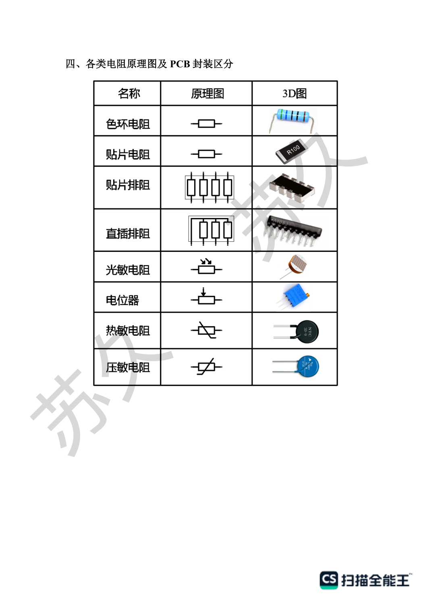 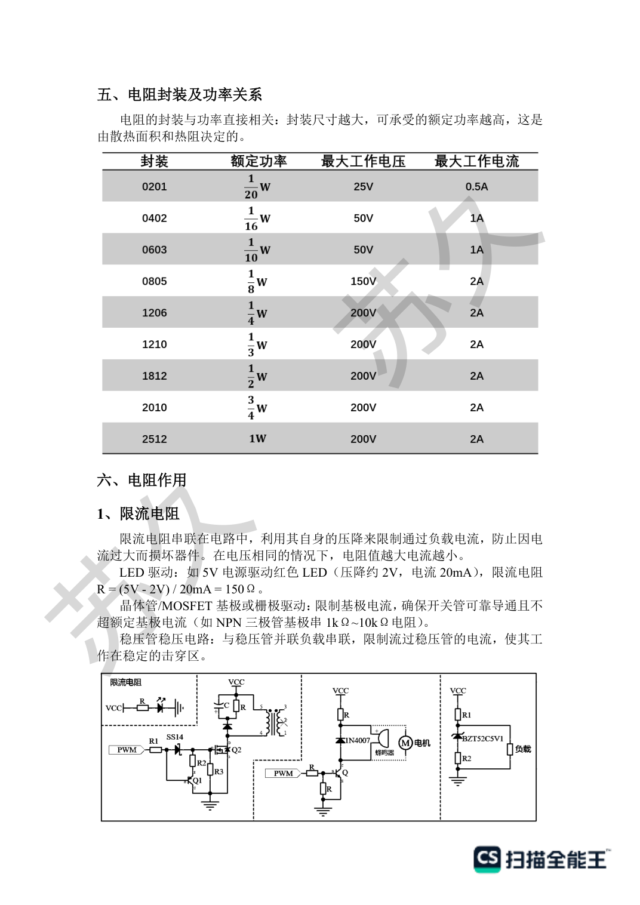</td><td></td></tr><tr><td>贴片电阻</td><td><a href="电阻篇.pdf#page=2">原版PDF第2页整页回看（前文已展示）</a> <a href="电阻篇.pdf#page=3">原版PDF第3页整页回看（前文已展示）</a></td><td></td></tr><tr><td>贴片排阻</td><td><a href="电阻篇.pdf#page=2">原版PDF第2页整页回看（前文已展示）</a> <a href="电阻篇.pdf#page=3">原版PDF第3页整页回看（前文已展示）</a></td><td></td></tr><tr><td>直插排阻</td><td><a href="电阻篇.pdf#page=2">原版PDF第2页整页回看（前文已展示）</a> <a href="电阻篇.pdf#page=3">原版PDF第3页整页回看（前文已展示）</a></td><td></td></tr><tr><td>光敏电阻</td><td><a href="电阻篇.pdf#page=2">原版PDF第2页整页回看（前文已展示）</a> <a href="电阻篇.pdf#page=3">原版PDF第3页整页回看（前文已展示）</a></td><td></td></tr><tr><td>电位器</td><td><a href="电阻篇.pdf#page=2">原版PDF第2页整页回看（前文已展示）</a> <a href="电阻篇.pdf#page=3">原版PDF第3页整页回看（前文已展示）</a></td><td></td></tr><tr><td>热敏电阻</td><td><a href="电阻篇.pdf#page=2">原版PDF第2页整页回看（前文已展示）</a> <a href="电阻篇.pdf#page=3">原版PDF第3页整页回看（前文已展示）</a></td><td></td></tr><tr><td>压敏电阻</td><td><a href="电阻篇.pdf#page=2">原版PDF第2页整页回看（前文已展示）</a> <a href="电阻篇.pdf#page=3">原版PDF第3页整页回看（前文已展示）</a></td><td></td></tr></table>

## 五、电阻封装及功率关系

电阻的封装与功率直接相关：封装尺寸越大，可承受的额定功率越高，这是 由散热面积和热阻决定的。 

<table><tr><td>封装</td><td>额定功率</td><td>最大工作电压</td><td>最大工作电流</td></tr><tr><td>0201</td><td><eq>\frac{1}{20}W</eq></td><td>25V</td><td>0.5A</td></tr><tr><td>0402</td><td><eq>\frac{1}{16}W</eq></td><td>50V</td><td>1A</td></tr><tr><td>0603</td><td><eq>\frac{1}{10}W</eq></td><td>50V</td><td>1A</td></tr><tr><td>0805</td><td><eq>\frac{1}{8}W</eq></td><td>150V</td><td>2A</td></tr><tr><td>1206</td><td><eq>\frac{1}{4}W</eq></td><td>200V</td><td>2A</td></tr><tr><td>1210</td><td><eq>\frac{1}{3}W</eq></td><td>200V</td><td>2A</td></tr><tr><td>1812</td><td><eq>\frac{1}{2}W</eq></td><td>200V</td><td>2A</td></tr><tr><td>2010</td><td><eq>\frac{3}{4}W</eq></td><td>200V</td><td>2A</td></tr><tr><td>2512</td><td>1W</td><td>200V</td><td>2A</td></tr></table>

## 六、电阻作用

## 1、限流电阻

限流电阻串联在电路中，利用其自身的压降来限制通过负载电流，防止因电 流过大而损坏器件。在电压相同的情况下，电阻值越大电流越小。 

LED驱动：如 5V电源驱动红色 LED（压降约 2V，电流20mA），限流电阻 $\mathrm { R } = ( 5 \mathrm { V } - 2 \mathrm { V } ) / 2 0 \mathrm { m A } = 1 5 0 \Omega$ 

晶体管/MOSFET 基极或栅极驱动：限制基极电流，确保开关管可靠导通且不 超额定基极电流（如NPN三极管基极串1kΩ~10kΩ电阻）。 

稳压管稳压电路：与稳压管并联负载串联，限制流过稳压管的电流，使其工 作在稳定的击穿区。 

[[硬件/原始备份/电阻篇.pdf#page=3|原版PDF第3页整页回看（前文已展示）]]

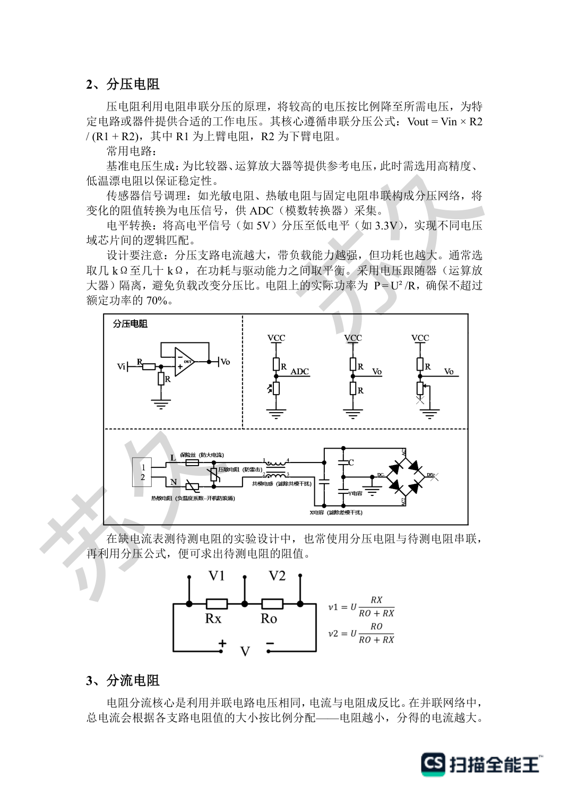

## 2、分压电阻

压电阻利用电阻串联分压的原理，将较高的电压按比例降至所需电压，为特 定电路或器件提供合适的工作电压。其核心遵循串联分压公式： $\mathrm { V o u t } = \mathrm { V i n } \times \mathrm { R } 2$ / (R1 + R2)，其中 R1 为上臂电阻，R2为下臂电阻。 

常用电路： 

基准电压生成：为比较器、运算放大器等提供参考电压，此时需选用高精度、 低温漂电阻以保证稳定性。 

传感器信号调理：如光敏电阻、热敏电阻与固定电阻串联构成分压网络，将 变化的阻值转换为电压信号，供 ADC（模数转换器）采集。 

电平转换：将高电平信号（如 5V）分压至低电平（如 3.3V），实现不同电压 域芯片间的逻辑匹配。 

设计要注意：分压支路电流越大，带负载能力越强，但功耗也越大。通常选 取几 kΩ至几十 kΩ，在功耗与驱动能力之间取平衡。采用电压跟随器（运算放 大器）隔离，避免负载改变分压比。电阻上的实际功率为 ${ \bf P } = { \bf U } ^ { 2 } / { \bf R }$ ，确保不超过 额定功率的70%。 

[[硬件/原始备份/电阻篇.pdf#page=4|原版PDF第4页整页回看（前文已展示）]]

在缺电流表测待测电阻的实验设计中，也常使用分压电阻与待测电阻串联， 再利用分压公式，便可求出待测电阻的阻值。 

[[硬件/原始备份/电阻篇.pdf#page=4|原版PDF第4页整页回看（前文已展示）]]

## 3、分流电阻

电阻分流核心是利用并联电路电压相同，电流与电阻成反比。在并联网络中， 总电流会根据各支路电阻值的大小按比例分配——电阻越小，分得的电流越大。 

常用的两类电路：电流表扩量程和功率均流。 

扩量程时，在微安表头两端并联一个极小的精密电阻，让大部分电流从分流 器流过，小部分驱动表头，从而测量大电流。 

功率均流是在并联的 LED 或大功率晶体管发射极串联小电阻，强制各支路 电流平均分配，防止某一路过热。 

选型时考虑电阻功耗要留足 2 倍余量；采样时必须选用低温漂的精密电阻， 否则温度变化会导致分流比例偏移，测量失真。 

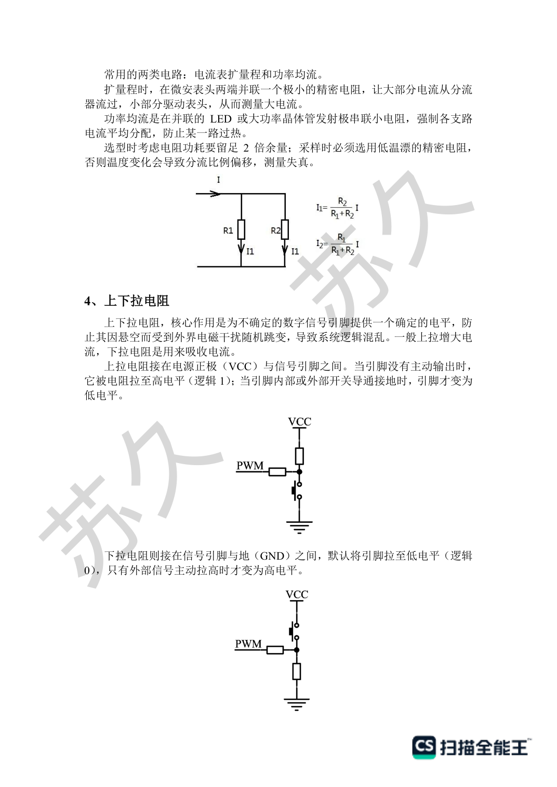

## 4、上下拉电阻

上下拉电阻，核心作用是为不确定的数字信号引脚提供一个确定的电平，防 止其因悬空而受到外界电磁干扰随机跳变，导致系统逻辑混乱。一般上拉增大电 流，下拉电阻是用来吸收电流。 

上拉电阻接在电源正极（VCC）与信号引脚之间。当引脚没有主动输出时， 它被电阻拉至高电平（逻辑 1）；当引脚内部或外部开关导通接地时，引脚才变为 低电平。 

[[硬件/原始备份/电阻篇.pdf#page=5|原版PDF第5页整页回看（前文已展示）]]

下拉电阻则接在信号引脚与地（GND）之间，默认将引脚拉至低电平（逻辑 0）， 只有外部信号主动拉高时才变为高电平。 

[[硬件/原始备份/电阻篇.pdf#page=5|原版PDF第5页整页回看（前文已展示）]]

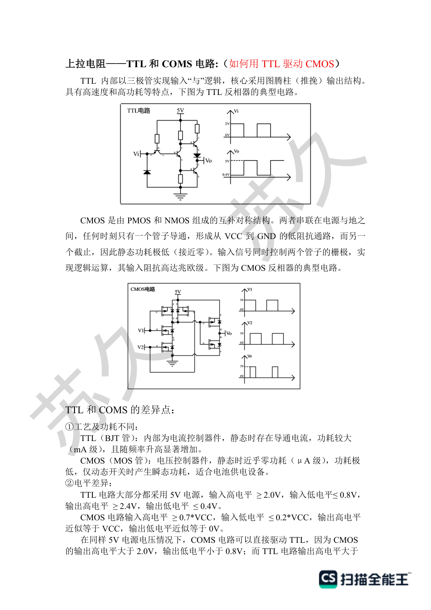

## 上拉电阻——TTL和 COMS电路:（如何用TTL驱动CMOS）

TTL 内部以三极管实现输入“与”逻辑，核心采用图腾柱（推挽）输出结构。 具有高速度和高功耗等特点，下图为 TTL 反相器的典型电路。 

[[硬件/原始备份/电阻篇.pdf#page=6|原版PDF第6页整页回看（前文已展示）]]

CMOS 是由 PMOS 和 NMOS 组成的互补对称结构。两者串联在电源与地之 间，任何时刻只有一个管子导通，形成从 VCC 到 GND 的低阻抗通路，而另一 个截止，因此静态功耗极低（接近零）。输入信号同时控制两个管子的栅极，实 现逻辑运算，其输入阻抗高达兆欧级。下图为 CMOS 反相器的典型电路。 

[[硬件/原始备份/电阻篇.pdf#page=6|原版PDF第6页整页回看（前文已展示）]]

## TTL 和 COMS 的差异点：

## ①工艺及功耗不同：

TTL（BJT 管）：内部为电流控制器件，静态时存在导通电流，功耗较大 （mA级），且随频率升高显著增加。 

CMOS（MOS 管）：电压控制器件，静态时近乎零功耗（μA 级），功耗极 低，仅动态开关时产生瞬态功耗，适合电池供电设备。 

②电平差异： 

TTL电路大部分都采用 5V电源，输入高电平 $\ge 2 . 0 \mathrm { V }$ ，输入低电平≤ 0.8V， 输出高电平 $\ge 2 . 4 \mathrm { V }$ ，输出低电平 $\leq 0 . 4 \mathrm { V }$ o 

CMOS 电路输入高电平 $\geq 0 . 7 ^ { * } \mathrm { V C C }$ ，输入低电平 $\leq 0 . 2 ^ { * } \mathrm { V C C }$ ，输出高电平 近似等于VCC，输出低电平近似等于 0V。 

在同样 5V电源电压情况下，COMS 电路可以直接驱动 TTL，因为 CMOS 的输出高电平大于 2.0V，输出低电平小于 0.8V；而TTL电路输出高电平大于 

[[硬件/原始备份/电阻篇.pdf#page=6|原版PDF第6页整页回看（前文已展示）]]

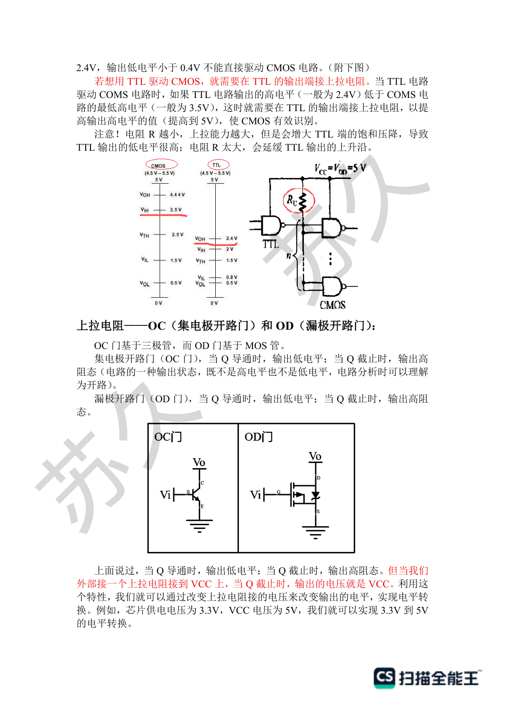

2.4V，输出低电平小于 0.4V不能直接驱动 CMOS 电路。（附下图） 

若想用 TTL驱动 CMOS，就需要在TTL 的输出端接上拉电阻。当TTL电路 驱动COMS 电路时，如果 TTL电路输出的高电平（一般为 2.4V）低于 COMS 电 路的最低高电平（一般为 3.5V），这时就需要在 TTL的输出端接上拉电阻，以提 高输出高电平的值（提高到 5V），使CMOS 有效识别。 

注意！电阻 R 越小，上拉能力越大，但是会增大 TTL 端的饱和压降，导致 TTL输出的低电平很高；电阻 R太大，会延缓 TTL输出的上升沿。 

[[硬件/原始备份/电阻篇.pdf#page=7|原版PDF第7页整页回看（前文已展示）]]

上拉电阻——OC（集电极开路门）和OD（漏极开路门）：

OC 门基于三极管，而 OD门基于MOS 管。 

集电极开路门（OC 门），当 Q 导通时，输出低电平；当 Q 截止时，输出高 阻态（电路的一种输出状态，既不是高电平也不是低电平，电路分析时可以理解 为开路）。 

漏极开路门（OD 门），当 Q 导通时，输出低电平；当 Q 截止时，输出高阻 态。 

[[硬件/原始备份/电阻篇.pdf#page=7|原版PDF第7页整页回看（前文已展示）]]

上面说过，当 Q导通时，输出低电平；当 Q截止时，输出高阻态。但当我们 外部接一个上拉电阻接到 VCC 上，当Q截止时，输出的电压就是 VCC。利用这 个特性，我们就可以通过改变上拉电阻接的电压来改变输出的电平，实现电平转 换。例如，芯片供电电压为 3.3V，VCC 电压为 5V，我们就可以实现 3.3V到5V 的电平转换。 

[[硬件/原始备份/电阻篇.pdf#page=7|原版PDF第7页整页回看（前文已展示）]]

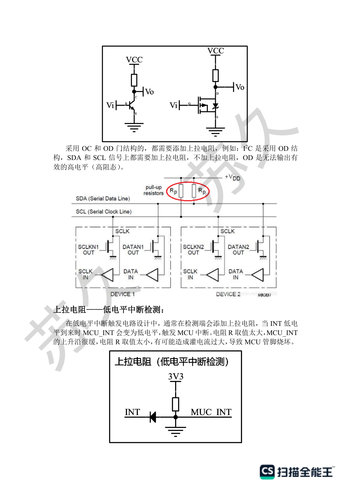

采用 OC 和 OD 门结构的，都需要添加上拉电阻，例如：I2C 是采用 OD 结 构，SDA 和 SCL 信号上都需要加上拉电阻，不加上拉电阻，OD 是无法输出有 效的高电平（高阻态）。 

[[硬件/原始备份/电阻篇.pdf#page=8|原版PDF第8页整页回看（前文已展示）]]

## 上拉电阻——低电平中断检测：

在低电平中断触发电路设计中，通常在检测端会添加上拉电阻，当 INT低电 平到来时MCU_INT会变为低电平，触发MCU中断。电阻R取值太大，MCU_INT苏 的上升沿很缓，电阻 R取值太小，有可能造成灌电流过大，导致 MCU 管脚烧坏。 

上拉电阻（低电平中断检测） 

[[硬件/原始备份/电阻篇.pdf#page=8|原版PDF第8页整页回看（前文已展示）]]

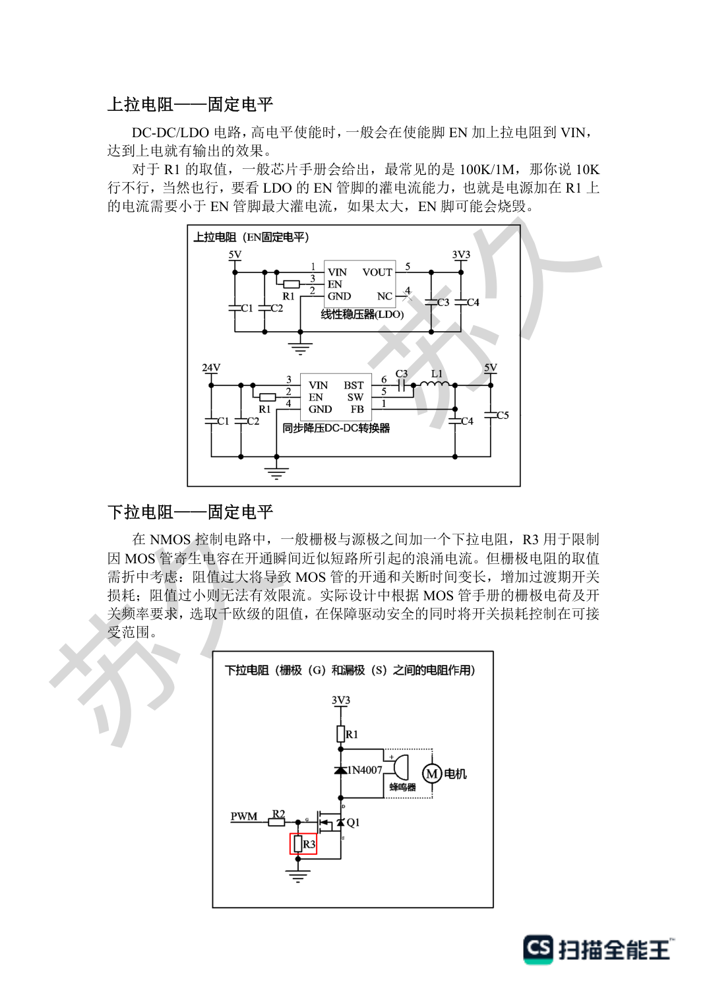

## 上拉电阻——固定电平

DC-DC/LDO电路，高电平使能时，一般会在使能脚 EN加上拉电阻到 VIN， 达到上电就有输出的效果。 

对于 R1 的取值，一般芯片手册会给出，最常见的是 100K/1M，那你说 10K 行不行，当然也行，要看 LDO的EN管脚的灌电流能力，也就是电源加在R1上 的电流需要小于EN 管脚最大灌电流，如果太大，EN脚可能会烧毁。 

[[硬件/原始备份/电阻篇.pdf#page=9|原版PDF第9页整页回看（前文已展示）]]

## 下拉电阻——固定电平

在 NMOS 控制电路中，一般栅极与源极之间加一个下拉电阻，R3 用于限制 因 管寄生电容在开通瞬间近似短路所引起的浪涌电流。但栅极电阻的取值 需折中考虑：阻值过大将导致 MOS 管的开通和关断时间变长，增加过渡期开关 损耗；阻值过小则无法有效限流。实际设计中根据 MOS 管手册的栅极电荷及开 关频率要求，选取千欧级的阻值，在保障驱动安全的同时将开关损耗控制在可接 受范围。 

[[硬件/原始备份/电阻篇.pdf#page=9|原版PDF第9页整页回看（前文已展示）]]

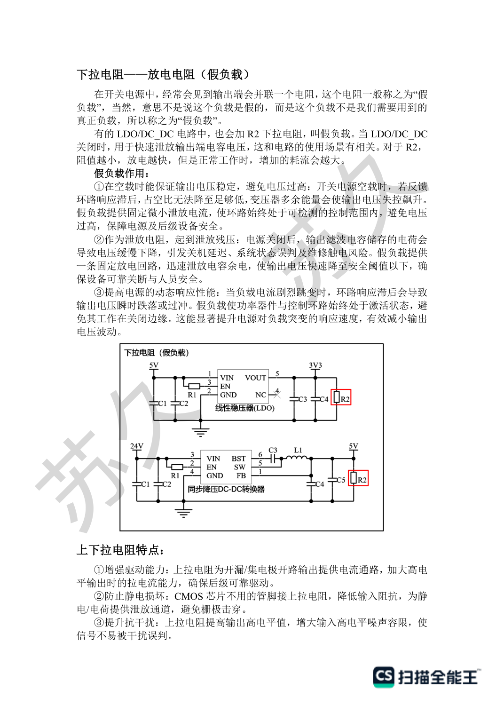

下拉电阻（栅极（G）和漏极（S）之间的电阻作用） 

[[硬件/原始备份/电阻篇.pdf#page=9|原版PDF第9页整页回看（前文已展示）]]

[[硬件/原始备份/电阻篇.pdf#page=10|原版PDF第10页整页回看（前文已展示）]]

## 下拉电阻——放电电阻（假负载）

在开关电源中，经常会见到输出端会并联一个电阻，这个电阻一般称之为“假 负载”，当然，意思不是说这个负载是假的，而是这个负载不是我们需要用到的 真正负载，所以称之为“假负载”。 

有的 LDO/DC_DC 电路中，也会加 R2 下拉电阻，叫假负载。当 LDO/DC_DC 关闭时，用于快速泄放输出端电容电压，这和电路的使用场景有相关。对于R2， 阻值越小，放电越快，但是正常工作时，增加的耗流会越大。 

## 假负载作用：

①在空载时能保证输出电压稳定，避免电压过高：开关电源空载时，若反馈 环路响应滞后，占空比无法降至足够低，变压器多余能量会使输出电压失控飙升。 假负载提供固定微小泄放电流，使环路始终处于可检测的控制范围内，避免电压 过高，保障电源及后级设备安全。 

②作为泄放电阻，起到泄放残压：电源关闭后，输出滤波电容储存的电荷会 导致电压缓慢下降，引发关机延迟、系统状态误判及维修触电风险。假负载提供 一条固定放电回路，迅速泄放电容余电，使输出电压快速降至安全阈值以下，确 保设备可靠关断与人员安全。 

③提高电源的动态响应性能：当负载电流剧烈跳变时，环路响应滞后会导致 输出电压瞬时跌落或过冲。假负载使功率器件与控制环路始终处于激活状态，避 免其工作在关闭边缘。这能显著提升电源对负载突变的响应速度，有效减小输出 电压波动。 

[[硬件/原始备份/电阻篇.pdf#page=10|原版PDF第10页整页回看（前文已展示）]]

## 上下拉电阻特点：

①增强驱动能力：上拉电阻为开漏/集电极开路输出提供电流通路，加大高电 平输出时的拉电流能力，确保后级可靠驱动。 

②防止静电损坏：CMOS 芯片不用的管脚接上拉电阻，降低输入阻抗，为静 电/电荷提供泄放通道，避免栅极击穿。 

③提升抗干扰：上拉电阻提高输出高电平值，增大输入高电平噪声容限，使 信号不易被干扰误判。 

④抑制电磁干扰：管脚悬空易耦合外界电磁噪声，接上下拉电阻固定电平后， 降低天线效应，提升总线抗 EMI能力。 

⑤匹配阻抗防反射：长线传输时，端接上下拉电阻使阻抗匹配，吸收信号反 射波，避免过冲或振铃，保证信号完整性。 

## 上下拉电阻阻值的选择原则

①功耗与灌电流方面：阻值应足够大，以减小静态电流，降低功耗，同时确 保不超过芯片最大灌电流能力。 

②驱动能力方面：阻值应足够小，确保提供充足的拉/灌电流，使输出高电平 满足后级输入阈值要求。 

③高速信号完整性：阻值过大会使 RC 时间常数增大，导致信号边沿变缓， 影响高速电路时序裕量。 

综合考虑，通用数字电路常选 1kΩ~10kΩ，具体依据负载电容、工作频率和 芯片手册推荐值确定。 

## 5、采样电阻

采样电阻利用欧姆定律，将流经电阻的电流信号线性转换为微弱的电压信号 （mV级）。该差分电压经运放放大后，送入 ADC 或比较器进行数字化处理，实 现电流的间接测量。 

①电流采样电阻：串联在回路中，将电流转换为微小电压降（mV级），配合 运放实现电流监测、过流保护及闭环恒流控制。 

在待测支路中串联采样电阻，并将电阻两端电压接入运算放大器中。电路中 运放以及电阻 R1、R2 构成的差分电路。差分电路的输出经低通过滤波器（R5、 C1）后接入ADC 采样模块。 

$V _ { o } = { \frac { R 4 } { R _ { 1 } } } ( V _ { 2 } - V _ { 1 } )$ ；接电源时： $V _ { o } = { \frac { R 4 } { R _ { 1 } } } \left( V _ { 2 } - V _ { 1 } \right) + V _ { 3 }$ 

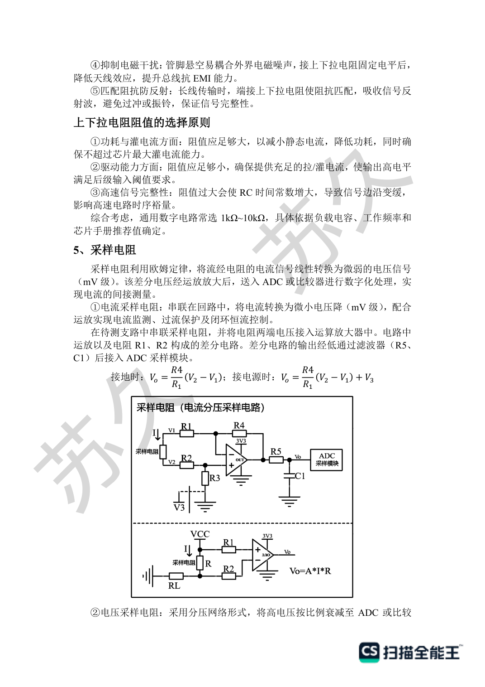

②电压采样电阻：采用分压网络形式，将高电压按比例衰减至 ADC 或比较

器可承受的低电压范围，用于电压监测与欠压/过压保护。 

当输入电压 Vi 经过 R1 与 R 分压后经过输入侧滤波（R2、C1）接入运算放 大器，再经过输出端滤波（R5、C2）接入 ADC 采样模块，运算放大器起同相放 大作用。 

$$
V _ {o} = (1 + \frac {R 4}{R _ {3}}) \left(\frac {R}{R + R _ {1}} V _ {1}\right)
$$

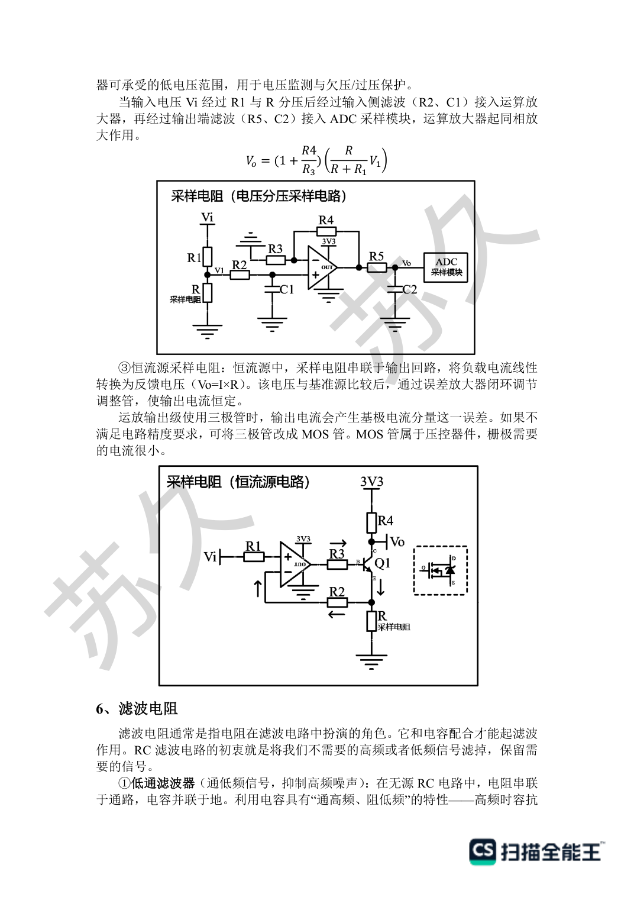

③恒流源采样电阻：恒流源中，采样电阻串联于输出回路，将负载电流线性 转换为反馈电压（Vo=I×R）。该电压与基准源比较后，通过误差放大器闭环调节 调整管，使输出电流恒定。 

运放输出级使用三极管时，输出电流会产生基极电流分量这一误差。如果不 满足电路精度要求，可将三极管改成 MOS 管。MOS 管属于压控器件，栅极需要 的电流很小。 

[[硬件/原始备份/电阻篇.pdf#page=12|原版PDF第12页整页回看（前文已展示）]]

## 6、滤波电阻

滤波电阻通常是指电阻在滤波电路中扮演的角色。它和电容配合才能起滤波 作用。RC 滤波电路的初衷就是将我们不需要的高频或者低频信号滤掉，保留需 要的信号。 

①低通滤波器（（通低频信号，抑制高频噪声）：在无源RC 电路中，电阻串联 于通路，电容并联于地。利用电容具有“通高频、阻低频”的特性——高频时容抗 极小，相当于将噪声短路到地；低频时容抗极大，信号无法旁路，只能从电阻端 输出。电阻本身全频段阻抗恒定，仅起限流和与电容构成时间常数的作用。 

计算公式： 

$$
f _ {c} = \frac {1}{2 \pi R C}
$$

滤波电阻（低通滤波） 

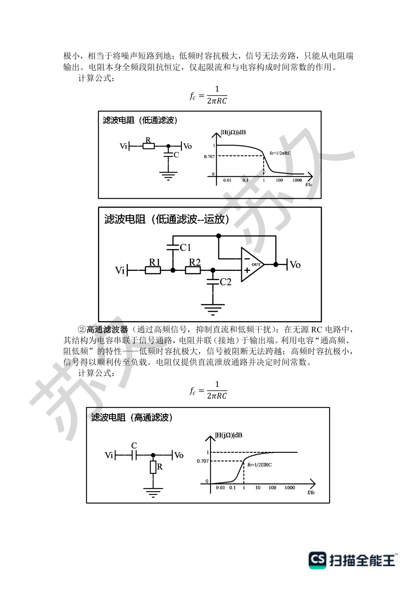

滤波电阻（低通滤波--运放） 

[[硬件/原始备份/电阻篇.pdf#page=13|原版PDF第13页整页回看（前文已展示）]]

②高通滤波器（通过高频信号，抑制直流和低频干扰）：在无源 RC 电路中， 其结构为电容串联于信号通路，电阻并联（接地）于输出端。利用电容“通高频、 阻低频”的特性——低频时容抗极大，信号被阻断无法跨越；高频时容抗极小， 信号得以顺利传至负载。电阻仅提供直流泄放通路并决定时间常数。 

计算公式： 

$$
f _ {c} = \frac {1}{2 \pi R C}
$$

滤波电阻（高通滤波） 

[[硬件/原始备份/电阻篇.pdf#page=13|原版PDF第13页整页回看（前文已展示）]]

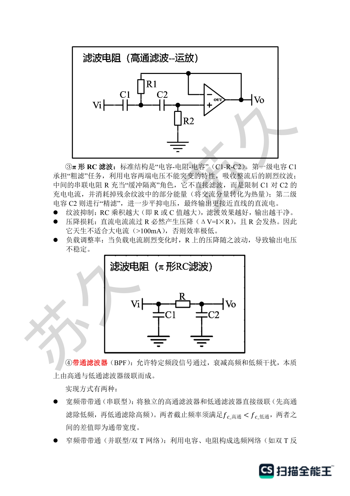

滤波电阻（高通滤波--运放） 

[[硬件/原始备份/电阻篇.pdf#page=13|原版PDF第13页整页回看（前文已展示）]]

[[硬件/原始备份/电阻篇.pdf#page=14|原版PDF第14页整页回看（前文已展示）]]

③π 形 RC滤波：标准结构是“电容-电阻-电容”（（C1-R-C2）。第一级电容 C1 承担“粗滤”任务，利用电容两端电压不能突变的特性，吸收整流后的剧烈纹波； 中间的串联电阻 R 充当“缓冲隔离”角色，它不直接滤波，而是限制 C1 对 C2 的 充电电流，并消耗掉残余纹波中的部分能量（将交流分量转化为热量）；第二级 电容C2则进行“精滤”，进一步平抑电压，最终输出更接近直线的直流电。 

⚫ 纹波抑制：RC 乘积越大（即R或C 值越大），滤波效果越好，输出越干净。 

压降损耗：直流电流流过 R必然产生压降（ $\Delta \ V { = } \mathbf { I } { \times } \mathbf { R } \ )$ ），且R会发热。因此 它天生不适合大电流 $\mathrm { \Gamma { ( > 1 0 0 m A ) } }$ ），否则效率极低。 

⚫ 负载调整率：当负载电流剧烈变化时，R上的压降随之波动，导致输出电压 不稳定。 

[[硬件/原始备份/电阻篇.pdf#page=14|原版PDF第14页整页回看（前文已展示）]]

④带通滤波器（（BPF）：允许特定频段信号通过，衰减高频和低频干扰，本质 上由高通与低通滤波器级联而成。 

实现方式有两种： 

⚫ 宽频带带通（（串联型）：将立的的高通滤波器和低通滤波器直接级联（先高通 滤除低频，再低通滤除高频）。两者截止频率须满足 $f _ { c _ { \mathrm { - } } ^ { } \mathrm { \vec { \boxplus } } \mathrm { \vec { \textmu } } } < f _ { c _ { \mathrm { - } } ^ { } | \mathrm { \vec { \textmd { E } } i } | \mathrm { \vec { \textmu } } }$ ，两者之 间的差值即为通带宽度。 

⚫ 窄频带带通（并联型/双T网络）：利用电容、电阻构成选频网络（如双 T反 馈或LC 谐振），仅在谐振频率 $f _ { 0 }$ 附近形成极窄的通带，常用于陷波或单一频 率提取。 

[[硬件/原始备份/电阻篇.pdf#page=14|原版PDF第14页整页回看（前文已展示）]]

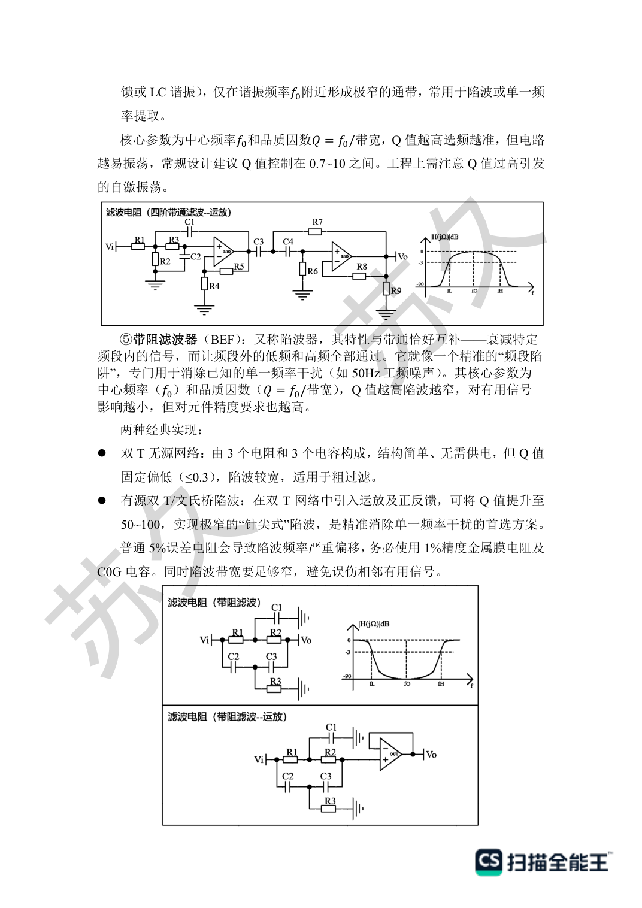

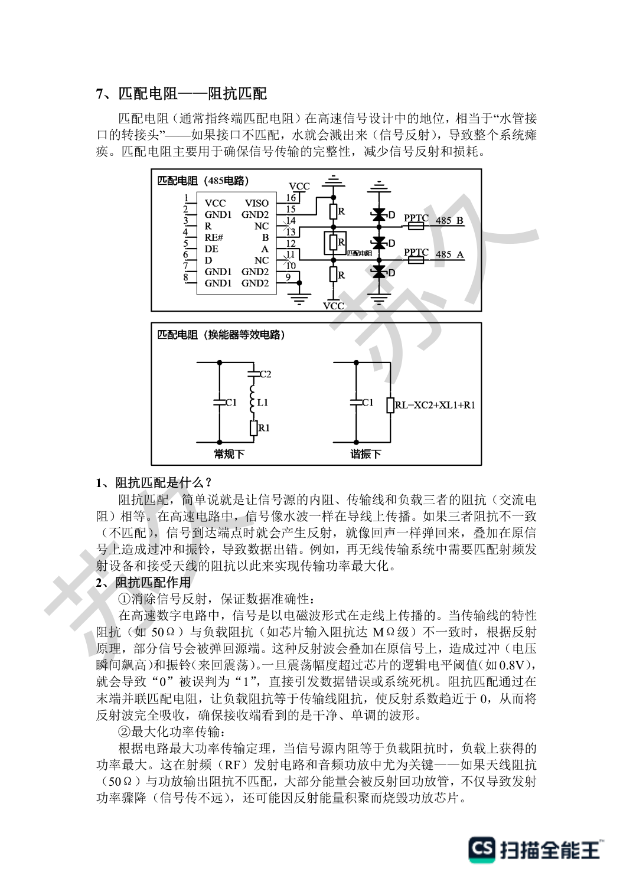

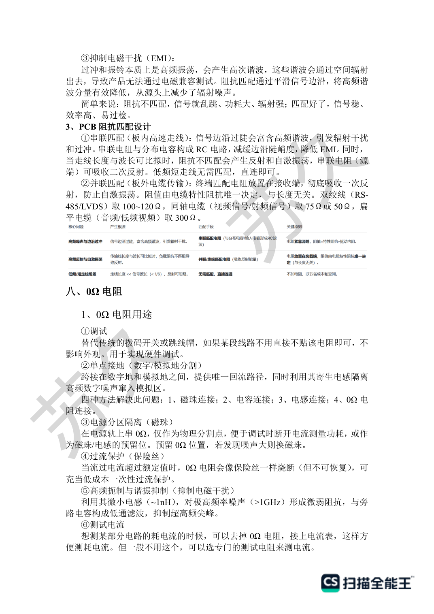

核心参数为中心频率 $f _ { 0 }$ 和品质因数 $Q = f _ { 0 } /$ 带宽，Q值越高选频越准，但电路 越易振荡，常规设计建议 Q值控制在0.7~10 之间。工程上需注意 Q值过高引发 的自激振荡。 

⑤带阻滤波器（BEF）：又称陷波器，其特性与带通恰好互补——衰减特定 频段内的信号，而让频段外的低频和高频全部通过。它就像一个精准的“频段陷 阱 ，专门用于消除已知的单一频率干扰（如 工频噪声）。其核心参数为 中心频率 $( f _ { 0 } )$ 和品质因数（ $( Q = f _ { 0 } /$ 带宽），Q值越高陷波越窄，对有用信号 影响越小，但对元件精度要求也越高。 

两种经典实现： 

⚫ 双T无源网络：由 3个电阻和3个电容构成，结构简单、无需供电，但 Q值 固定偏低（≤0.3），陷波较宽，适用于粗过滤。 

⚫ 有源双 T/文氏桥陷波：在双 T 网络中引入运放及正反馈，可将 Q 值提升至 50~100，实现极窄的“针尖式”陷波，是精准消除单一频率干扰的首选方案。 普通 5%误差电阻会导致陷波频率严重偏移，务必使用 1%精度金属膜电阻及 C0G电容。同时陷波带宽要足够窄，避免误伤相邻有用信号。 

## 7、匹配电阻——阻抗匹配

匹配电阻（通常指终端匹配电阻）在高速信号设计中的地位，相当于“水管接 口的转接头”——如果接口不匹配，水就会溅出来（信号反射），导致整个系统瘫 痪。匹配电阻主要用于确保信号传输的完整性，减少信号反射和损耗。 

## 1、阻抗匹配是什么？

阻抗匹配，简单说就是让信号源的内阻、传输线和负载三者的阻抗（交流电 阻）相等。在高速电路中，信号像水波一样在导线上传播。如果三者阻抗不一致 （不匹配），信号到达端点时就会产生反射，就像回声一样弹回来，叠加在原信 号上造成过冲和振铃，导致数据出错。例如，再无线传输系统中需要匹配射频发 射设备和接受天线的阻抗以此来实现传输功率最大化。 

## 2、阻抗匹配作用

①消除信号反射，保证数据准确性： 

在高速数字电路中，信号是以电磁波形式在走线上传播的。当传输线的特性 阻抗（如 Ω）与负载阻抗（如芯片输入阻抗达 Ω级）不一致时，根据反射 原理，部分信号会被弹回源端。这种反射波会叠加在原信号上，造成过冲（电压 瞬间飙高）和振铃（来回震荡）。一旦震荡幅度超过芯片的逻辑电平阈值（如 ）， 就会导致“0”被误判为“1”，直接引发数据错误或系统死机。阻抗匹配通过在 末端并联匹配电阻，让负载阻抗等于传输线阻抗，使反射系数趋近于 0，从而将 反射波完全吸收，确保接收端看到的是干净、单调的波形。 

## ②最大化功率传输：

根据电路最大功率传输定理，当信号源内阻等于负载阻抗时，负载上获得的 功率最大。这在射频（RF）发射电路和音频功放中尤为关键——如果天线阻抗 （50Ω）与功放输出阻抗不匹配，大部分能量会被反射回功放管，不仅导致发射 功率骤降（信号传不远），还可能因反射能量积聚而烧毁功放芯片。 

③抑制电磁干扰（EMI）： 

过冲和振铃本质上是高频振荡，会产生高次谐波，这些谐波会通过空间辐射 出去，导致产品无法通过电磁兼容测试。阻抗匹配通过平滑信号边沿，将高频谐 波分量有效降低，从源头上减少了辐射噪声。 

简单来说：阻抗不匹配，信号就乱跳、功耗大、辐射强；匹配好了，信号稳、 效率高、易过检。 

## 3、PCB 阻抗匹配设计

①串联匹配（板内高速走线）：信号边沿过陡会富含高频谐波，引发辐射干扰 和过冲。串联电阻与分布电容构成 RC 电路，减缓边沿陡峭度，降低 EMI。同时， 当走线长度与波长可比拟时，阻抗不匹配会产生反射和自激振荡，串联电阻（源 端）可吸收二次反射。低频短走线无需匹配，直连即可。 

②并联匹配（板外电缆传输）：终端匹配电阻放置在接收端，彻底吸收一次反 射，防止自激振荡。阻值由电缆特性阻抗唯一决定，与长度无关。双绞线（RS-485/LVDS）取 100~120Ω，同轴电缆（（频频信号/射频信号）取75Ω或50Ω，扁 平电缆（音频/低频频频）取300Ω。 

<table><tr><td>核心问题</td><td>产生根源</td><td>匹配手段</td><td>关键原则</td></tr><tr><td>高频噪声与边沿过冲</td><td>信号边沿过陡,富含高频谐波,引发辐射干扰。</td><td>串联匹配电阻(与分布电容/输入电容形成RC滤波)</td><td>电阻紧靠源端,阻值=特性阻抗-驱动内阻。</td></tr><tr><td>高频反射与自激振荡</td><td>传输线长度与波长可比拟时,负载阻抗不匹配导致反射。</td><td>并联/终端匹配电阻(吸收反射能量)</td><td>电阻放置在负载端,阻值由电缆特性阻抗唯一决定(与长度无关)。</td></tr><tr><td>低频/短走线场景</td><td>走线长度&lt;&lt;信号波长(&lt;1/6),反射可忽略。</td><td>无需匹配,直接连通</td><td>不加电阻,以节省成本和空间。</td></tr></table>

## 八、0Ω 电阻

## 1、0Ω电阻用途

## ①调试

替代传统的拨码开关或跳线帽，如果某段线路不用直接不贴该电阻即可，不 影响外观。用于实现硬件调试。 

## ②单点接地（数字/模拟地分割）

跨接在数字地和模拟地之间，提供唯一回流路径，同时利用其寄生电感隔离 高频数字噪声窜入模拟区。 

四种方法解决此问题：1、磁珠连接；2、电容连接；3、电感连接；4、0Ω电 阻连接。 

## ③电源分区隔离（磁珠）

在电源轨上串 0Ω，仅作为物理分割点，便于调试时断开电流测量功耗，或作 为磁珠/电感的预留位。预留0Ω位置，若发现噪声大则换磁珠。 

## ④过流保护（保险丝）

当流过电流超过额定值时，0Ω电阻会像保险丝一样烧断（但不可恢复），可 充当低成本一次性过流保护。 

⑤高频扼制与谐振抑制（抑制电磁干扰） 

利用其微小电感（~1nH），对极高频率噪声（>1GHz）形成微弱阻抗，与旁 路电容构成低通滤波，抑制超高频尖峰。 

## ⑥测试电流

想测某部分电路的耗电流的时候，可以去掉 0Ω 电阻，接上电流表，这样方 便测耗电流。但一般不用这个，可以选专门的测试电阻来测电流。 

[[硬件/原始备份/电阻篇.pdf#page=17|原版PDF第17页整页回看（前文已展示）]]

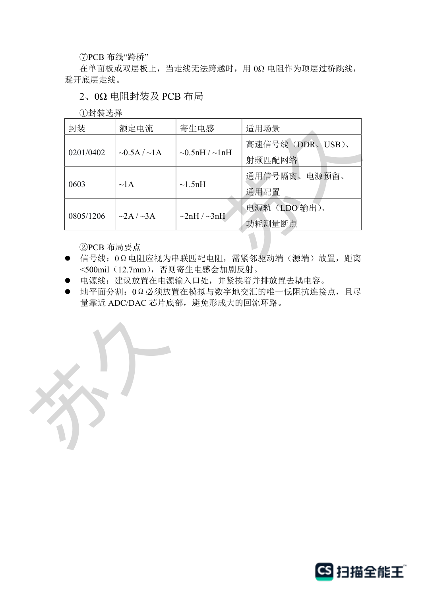

## ⑦PCB 布线“跨桥”

在单面板或双层板上，当走线无法跨越时，用 0Ω 电阻作为顶层过桥跳线， 避开底层走线。 

## 2、0Ω电阻封装及PCB布局

## ①封装选择

<table><tr><td>封装</td><td>额定电流</td><td>寄生电感</td><td>适用场景</td></tr><tr><td>0201/0402</td><td>~0.5A / ~1A</td><td>~0.5nH / ~1nH</td><td>高速信号线(DDR、USB)、射频匹配网络</td></tr><tr><td>0603</td><td>~1A</td><td>~1.5nH</td><td>通用信号隔离、电源预留、通用配置</td></tr><tr><td>0805/1206</td><td>~2A / ~3A</td><td>~2nH / ~3nH</td><td>电源轨(LDO输出)、功耗测量断点</td></tr></table>

## ②PCB 布局要点

⚫ 信号线：0Ω电阻应频为串联匹配电阻，需紧邻驱动端（源端）放置，距离 <500mil（12.7mm），否则寄生电感会加剧反射。 

⚫ 电源线：建议放置在电源输入口处，并紧挨着并排放置去耦电容。 

地平面分割：0Ω必须放置在模拟与数字地交汇的唯一低阻抗连接点，且尽 量靠近ADC/DAC 芯片底部，避免形成大的回流环路。 