> 图像回补：缺图位置按正文前后锚点接入原版 [[硬件/原始备份/线性稳压器基础知识.pdf|线性稳压器基础知识.pdf]] 完整页面；跨页位置保留相邻页面，同页重复处提供页码链接。页面截图用于回看原图与上下文，不表示逐图编号或电路参数已独立核验。旧行号及原图名见 [[audit/图片修复明细.csv|图片修复明细]]。

## TI-dianyuan.com 线性稳压器基础知识

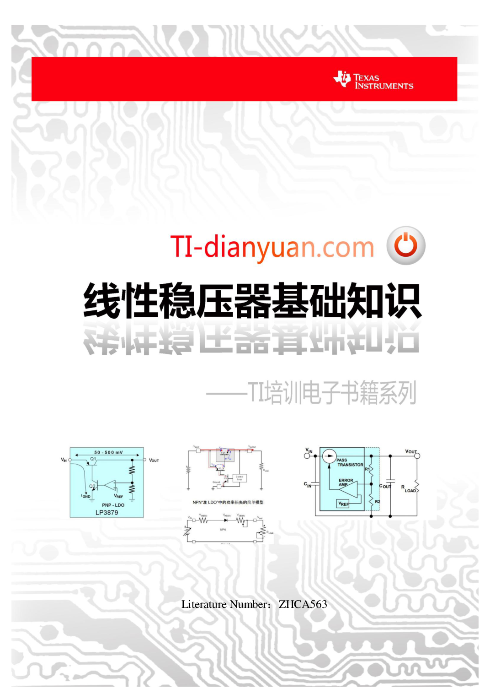

——TI培训电子书籍系列 

[[硬件/原始备份/线性稳压器基础知识.pdf#page=1|原版PDF第1页整页回看（前文已展示）]]

Literature Number: ZHCA563

[[硬件/原始备份/线性稳压器基础知识.pdf#page=1|原版PDF第1页整页回看（前文已展示）]]

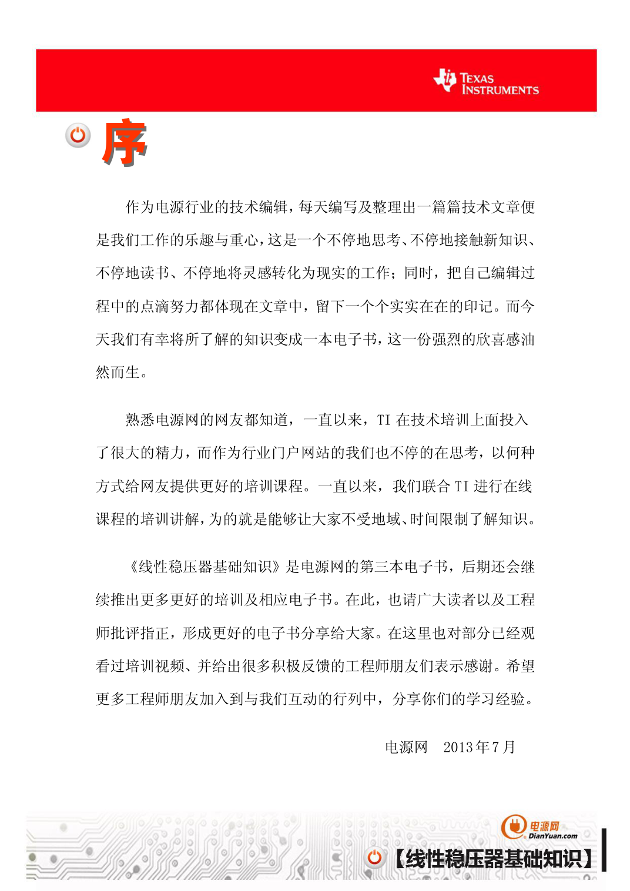

作为电源行业的技术编辑, 每天编写及整理出一篇篇技术文章便是我们工作的乐趣与重心, 这是一个不停地思考、不停地接触新知识、不停地读书、不停地将灵感转化为现实的工作; 同时, 把自己编辑过程中的点滴努力都体现在文章中, 留下一个个实实在在的印记。而今天我们有幸将所了解的知识变成一本电子书, 这一份强烈的欣喜感油然而生。 

熟悉电源网的网友都知道，一直以来，TI 在技术培训上面投入了很大的精力，而作为行业门户网站的我们也不停的在思考，以何种方式给网友提供更好的培训课程。一直以来，我们联合 TI 进行在线课程的培训讲解，为的就是能够让大家不受地域、时间限制了解知识。 

《线性稳压器基础知识》是电源网的第三本电子书，后期还会继续推出更多更好的培训及相应电子书。在此，也请广大读者以及工程师批评指正，形成更好的电子书分享给大家。在这里也对部分已经观看过培训视频、并给出很多积极反馈的工程师朋友们表示感谢。希望更多工程师朋友加入到与我们互动的行列中，分享你们的学习经验。 

电源网 2013年7月 

## 前言

线性稳压器的工作原理是采用一个压控电流源以强制在稳压器输出端上产生一个固定电压，控制电路连续监视(检测)输出电压，并调节电流源(根据负载的需求)以把输出电压保持在期望的数值。 

电流源的设计极限限定了稳压器在仍然保持电压调节作用的情况下所能供应的最大负载电流。输出电压采用一个反馈环路进行控制，其需要某种类型的补偿以确保环路稳定性。大多数线性稳压器都具有内置补偿功能电路，无需外部组件就能保持完全稳定。 

《线性稳压器基础知识》电子书共分为二章，第一章线性稳压器基础知识，讲述了最基础的线性稳压器知识理论，第二章线性稳压器的分类，讲述了NPN型的LDO、PNP型的LDO、NMOS型的LDO、PMOS型的LDO这四种不同线性稳压器的特性、架构图、功率损失的简单模型、传输元件，以及驱动电流与低/高负载电流的关系。 

## 目录

## 第一章 线性稳压器基础知识

1.1 什么是线性稳压器 ……1
1.2 线性稳压器操作 ……1
1.3 线性稳压器拓扑 ……2
1.4 简单的模型 ……2
1.5 带数值的简单模型 ……3
1.6 负载电流变化的简单模型 ……3
1.7 输入电压变化的简单模型 ……4
1.8 控制环路 ……4
1.9 具有控制环路模块的简单模型 ……4
1.10 给 LDO 环路增添一个零点 ……5
1.11 采用 COUTESR 实现 LDO 的稳定 ……5
1.12 由前馈电容器产生的相位超前 ……6
1.13 CF 正相位超前与 VOUT 的关系 ……7
1.14 致使 LDO 环路不稳定：如何设计一个振荡器？ ……7
1.15 ESR 的稳定范围 ……8
1.16 为什么高ESR会使LDO不稳定？ ……8
1.17 为什么低ESR会使LDO不稳定？ ……9 

## 第二章 线性稳压器的分类

2.1 NPN 型的 LDO
2.1.1 NPN “准 LDO” 特性 …… 10
2.1.2 NPN 型 LDO 的架构图 …… 10
2.1.3 NPN “准 LDO” 中的功率损失的简单模型 …… 11 

2.1.4 驱动 NPN“准 LDO”传输元件 ……12
2.1.5 NPN “准 LDO” 驱动电流与低/高负载电流的关系 ……12
2.1.6 总结 ……13

2.2 PNP 型的 LDO
2.2.1 PNP 型 LDO 的架构图 ……13
2.2.2 PNP LDO 稳压器中的功率损失的简单模型 ……14
2.2.3 驱动电流与低/高负载电流的关系 ……14
2.2.4 总结 ……15

2.3 NMOS 型的 LDO
2.3.1 NMOS 型的 LDO 的架构图 ……15
2.3.2 NMOS LDO 稳压器中的功率损失的简单模型 ……16
2.3.3 驱动标准 NMOS 传输元件 ……16
2.3.4 驱动电流与低/高负载电流的关系 ……17
2.3.5 总结 ……18

2.4 PMOS 型的 LDO
2.4.1 PMOS LDO 稳压器中功率损失的简单模型 ……19
2.4.2 驱动 PMOS LDO 传输元件 ……19
2.4.3 栅极驱动电压与低负载电流的关系 ……20
2.4.4 总结 ……20 

附录一：编委信息与后记 

附录二：版权说明 

## 第一章 线性稳压器基础知识一

## 1.1 什么是线性稳压器?

- 线性稳压器的工作原理是: 采用一个压控电流源以强制在稳压器输出端上产生一个固定电压。控制电路连续监视（检测）输出电压，并调节电流源（根据负载的需求）以把输出电压保持在期望的数值。 

- 电流源的设计极限限定了稳压器在仍然保持电压调节作用的情况下所能供应的最大负载电流。 

- 输出电压采用一个反馈环路进行控制，其需要某种类型的补偿以确保环路稳定性。大多数线性稳压器都具有内置补偿功能电路，无需外部组件就能保持完全稳定。 

- 某些稳压器（比如低压降型）则确实需要在输出引脚和地之间连接一些外部电容以确保稳压器的稳定性。 

## 1.2 线性稳压器操作

● 电压反馈负责对输出进行采样，R1 和 R2 可以内置或外置 

● 反馈用于控制传输晶体管至负载的电流 

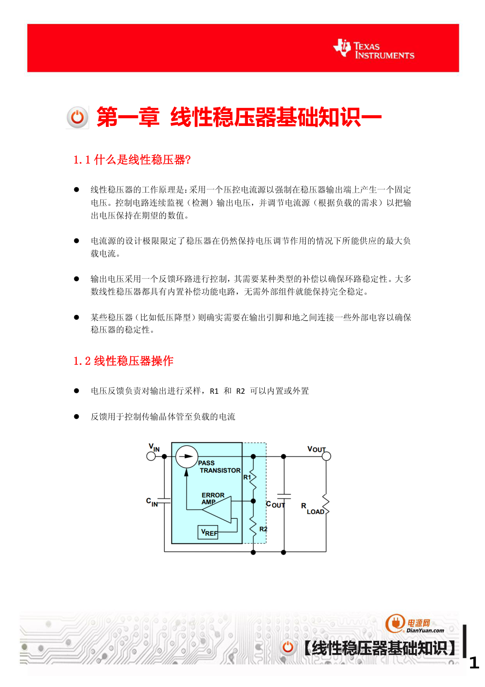

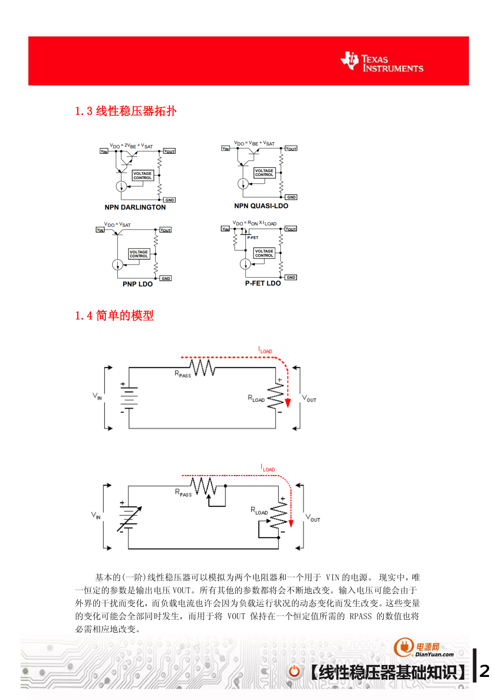

## 1.3 线性稳压器拓扑

[[硬件/原始备份/线性稳压器基础知识.pdf#page=7|原版PDF第7页整页回看（前文已展示）]]

## 1.4 简单的模型

[[硬件/原始备份/线性稳压器基础知识.pdf#page=7|原版PDF第7页整页回看（前文已展示）]]

基本的(一阶)线性稳压器可以模拟为两个电阻器和一个用于 VIN 的电源。现实中，唯一恒定的参数是输出电压 VOUT。所有其他的参数都将会不断地改变。输入电压可能会由于外界的干扰而变化，而负载电流也许会因为负载运行状况的动态变化而发生改变。这些变量的变化可能会全部同时发生，而用于将 VOUT 保持在一个恒定值所需的 RPASS 的数值也将必需相应地改变。 

## 1.5 带数值的简单模型

对于第一个例子，我们将分配典型的操作值并计算串联传输元件 RPASS 所需的数值。 

VIN = 12V VOUT= 5V ILOAD = 50 mA 

当 VIN=12V 和 VOUT=5V 时，RPASS 两端的电压 = (12V - 5V) = 7V，当流过 RPASS 的电流 = ILOAD = 50 mA 时，RPASS 所需的电阻 = (7V / 50mA) = 140 Ω。 

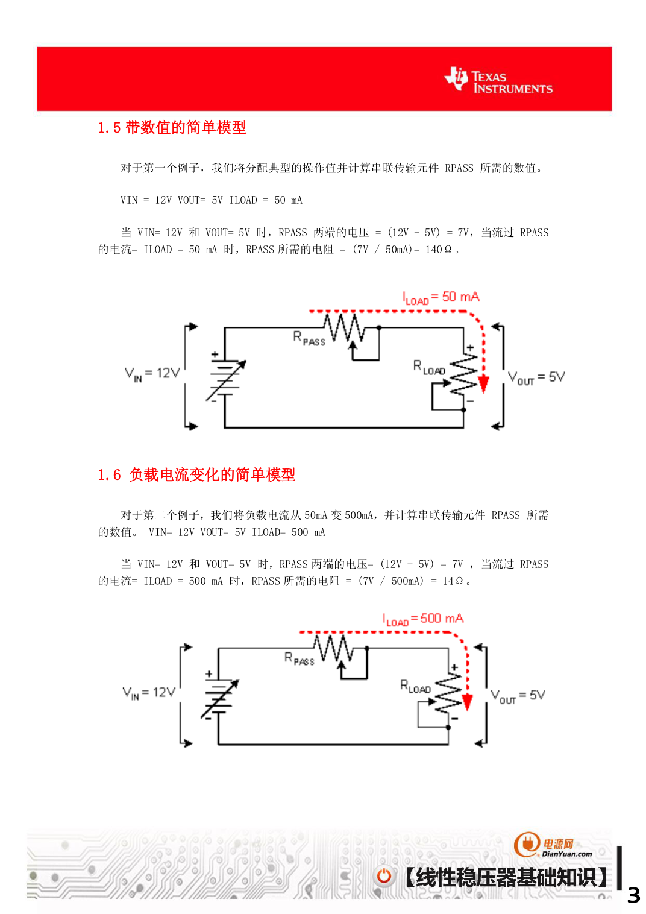

## 1.6 负载电流变化的简单模型

对于第二个例子，我们将负载电流从 50mA 变 500mA，并计算串联传输元件 RPASS 所需的数值。 VIN=12V VOUT=5V ILOAD=500 mA 

当 VIN=12V 和 VOUT=5V 时，RPASS 两端的电压= $(12V-5V)=7V$ ，当流过 RPASS 的电流=ILOAD=500 mA 时，RPASS 所需的电阻= $(7V/500mA)=14\Omega$ 。 

[[硬件/原始备份/线性稳压器基础知识.pdf#page=8|原版PDF第8页整页回看（前文已展示）]]

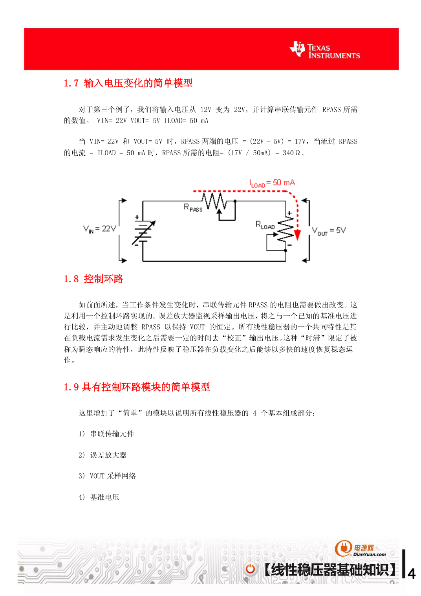

## 1.7 输入电压变化的简单模型

对于第三个例子，我们将输入电压从 12V 变为 22V，并计算串联传输元件 RPASS 所需的数值。VIN=22V VOUT=5V ILOAD=50 mA 

当 VIN=22V 和 VOUT=5V 时，RPASS 两端的电压 = (22V - 5V) = 17V，当流过 RPASS 的电流 = ILOAD = 50 mA 时，RPASS 所需的电阻 = (17V / 50mA) = 340Ω。 

[[硬件/原始备份/线性稳压器基础知识.pdf#page=9|原版PDF第9页整页回看（前文已展示）]]

## 1.8 控制环路

如前面所述，当工作条件发生变化时，串联传输元件 RPASS 的电阻也需要做出改变。这是利用一个控制环路实现的。误差放大器监视采样输出电压，将之与一个已知的基准电压进行比较，并主动地调整 RPASS 以保持 VOUT 的恒定。所有线性稳压器的一个共同特性是其在负载电流需求发生变化之后需要一定的时间去 “校正” 输出电压。这种 “时滞” 限定了被称为瞬态响应的特性，此特性反映了稳压器在负载变化之后能够以多快的速度恢复稳态运作。 

## 1.9 具有控制环路模块的简单模型

这里增加了“简单”的模块以说明所有线性稳压器的 4 个基本组成部分: 

1）串联传输元件 

2）误差放大器 

3）VOUT 采样网络 

4）基准电压 

[[硬件/原始备份/线性稳压器基础知识.pdf#page=9|原版PDF第9页整页回看（前文已展示）]]

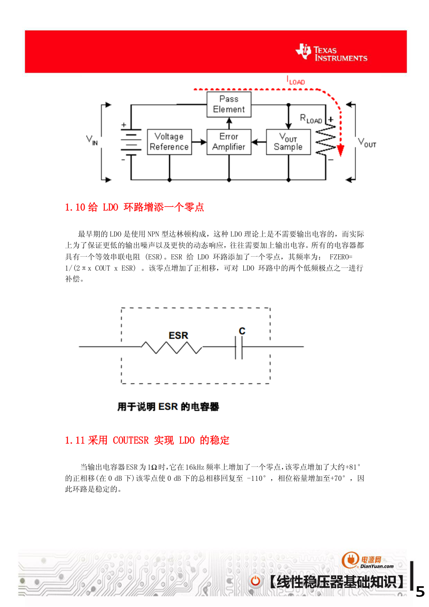

## 1.10 给 LDO 环路增添一个零点

最早期的 LDO 是使用 NPN 型达林顿构成，这种 LDO 理论上是不需要输出电容的，而实际上为了保证更低的输出噪声以及更快的动态响应，往往需要加上输出电容。所有的电容器都具有一个等效串联电阻（ESR）。ESR 给 LDO 环路添加了一个零点，其频率为： $FZERO=1/(2\pi x\text{COUT}x\text{ESR})$ 。该零点增加了正相移，可对 LDO 环路中的两个低频极点之一进行补偿。 

[[硬件/原始备份/线性稳压器基础知识.pdf#page=10|原版PDF第10页整页回看（前文已展示）]]

用于说明 ESR 的电容器

## 1.11 采用 COUTESR 实现 LDO 的稳定

当输出电容器ESR为 $1\Omega$ 时，它在 $16\mathrm{kHz}$ 频率上增加了一个零点，该零点增加了大约 $+81^{\circ}$ 的正相移(在0dB下)该零点使0dB下的总相移回复至 $-110^{\circ}$ ，相位裕量增加至 $+70^{\circ}$ ，因此环路是稳定的。 

[[硬件/原始备份/线性稳压器基础知识.pdf#page=10|原版PDF第10页整页回看（前文已展示）]]

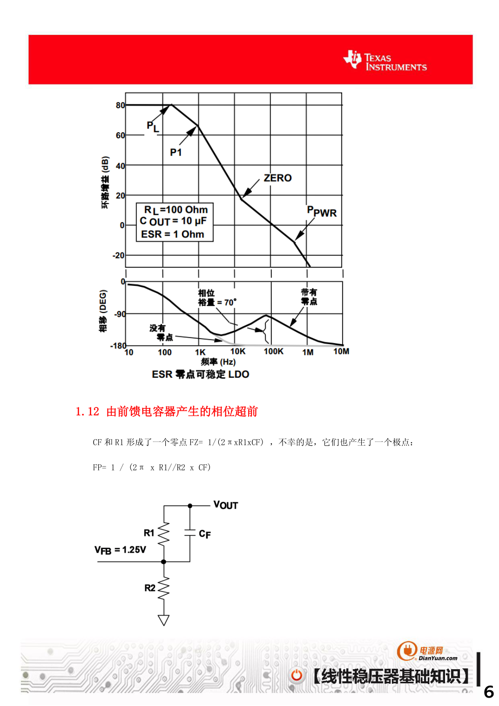

## 1.12 由前馈电容器产生的相位超前

CF 和 R1 形成了一个零点 $FZ = 1/(2\pi xR1xCF)$ ，不幸的是，它们也产生了一个极点： 

$$
\mathrm{FP} = 1 / (2 \pi \mathrm{xR1} / / \mathrm{R2xCF})
$$

[[硬件/原始备份/线性稳压器基础知识.pdf#page=11|原版PDF第11页整页回看（前文已展示）]]

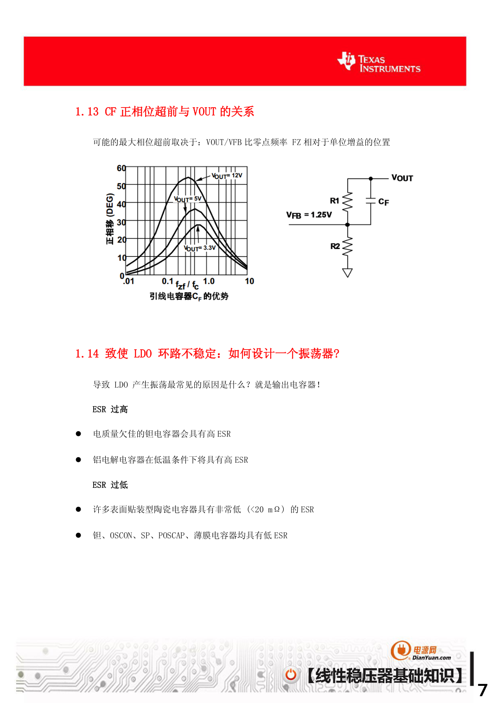

## 1.13 CF 正相位超前与 VOUT 的关系

可能的最大相位超前取决于：VOUT/VFB 比零点频率 FZ 相对于单位增益的位置 

[[硬件/原始备份/线性稳压器基础知识.pdf#page=12|原版PDF第12页整页回看（前文已展示）]]

引线电容器 $C_{F}$ 的优势

[[硬件/原始备份/线性稳压器基础知识.pdf#page=12|原版PDF第12页整页回看（前文已展示）]]

## 1.14 致使 LDO 环路不稳定：如何设计一个振荡器？

导致 LDO 产生振荡最常见的原因是什么？就是输出电容器！ 

ESR过高 

● 电质量欠佳的钽电容器会具有高 ESR 

● 铝电解电容器在低温条件下将具有高 ESR 

ESR 过低 

● 许多表面贴装型陶瓷电容器具有非常低（<20 mΩ）的 ESR 

- 钽、OSCON、SP、POSCAP、薄膜电容器均具有低ESR 

## 1.15 ESR 的稳定范围

ESR 必须处在制造商规定的最小/最大值范围之内以确保稳定性。 

[[硬件/原始备份/线性稳压器基础知识.pdf#page=12|原版PDF第12页整页回看（前文已展示）]]

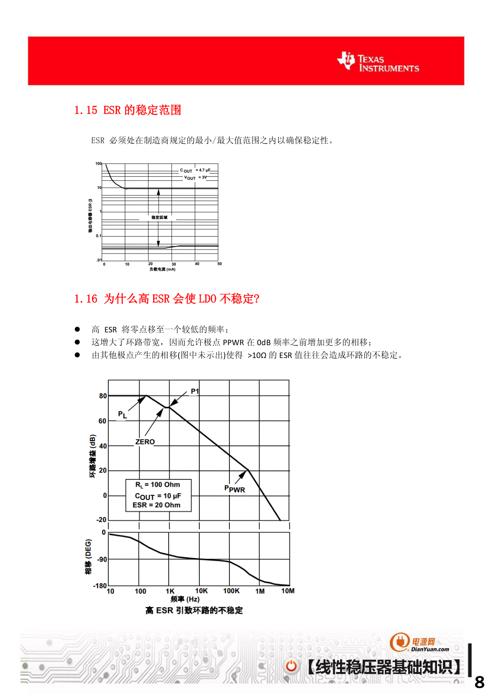

## 1.16 为什么高 ESR 会使 LDO 不稳定?

● 高 ESR 将零点移至一个较低的频率； 

- 这增大了环路带宽，因而允许极点 PPWR 在 0dB 频率之前增加更多的相移； 

- 由其他极点产生的相移(图中未示出)使得 $>10\Omega$ 的ESR值往往会造成环路的不稳定。 

[[硬件/原始备份/线性稳压器基础知识.pdf#page=13|原版PDF第13页整页回看（前文已展示）]]

高ESR引致环路的不稳定

## 1.17 为什么低 ESR 会使 LDO 不稳定?

● 低 ESR 将零点移至一个较高的频率； 

● 零点出现的频率比 0 dB 频率高 1 个十倍频程以上; 

- 由于零点在 $0 \mathrm{~dB}$ 下未添加任何正相移，因此两个低频极点将导致相移达到 $-180^{\circ}$ (不稳定)。 

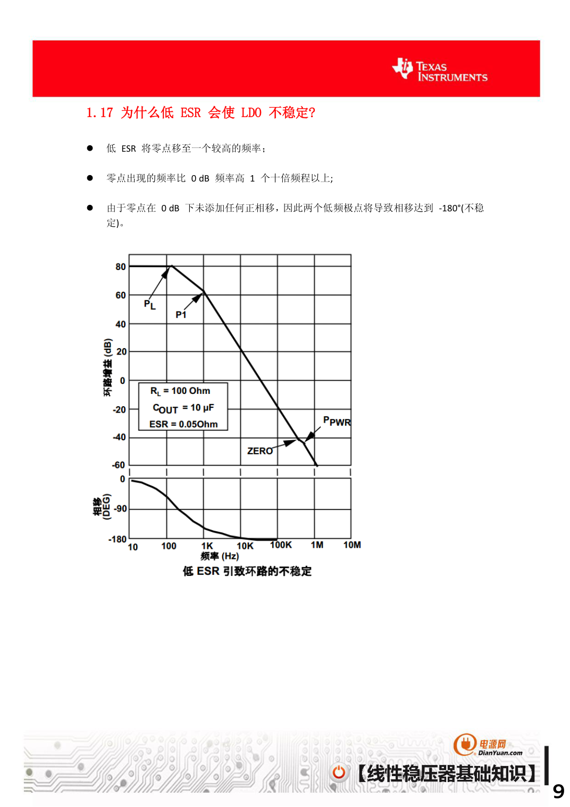

低 ESR 引致环路的不稳定

## 第二章 线性稳压器的分类

## 2.1 NPN 型的 LDO

NPN 型的 LDO 分两大类；一种是是用达林顿管做的 LDO，因为当时的单个晶体管的放大倍数不是很大，所以要用达林顿管来构成更大的放大倍数。在这里不讨论达林顿管构成的 LDO；另一种就是单个 NPN 型晶体管构成的 LDO。 

## 2.1.1 NPN “准 LDO” 具有下列特性:

● 要求输入电压至少比输出电压高 0.9V 至 1.5V; 

● 接地引脚电流大于 NPN-达林顿管，但小于 PNP-LDO 稳压器； 

● 需要一个输出电容器，但一般不像 PNP-LDO 那样具有特殊的 ESR 要求。 

## 2.1.2 NPN 型 LDO 的架构图

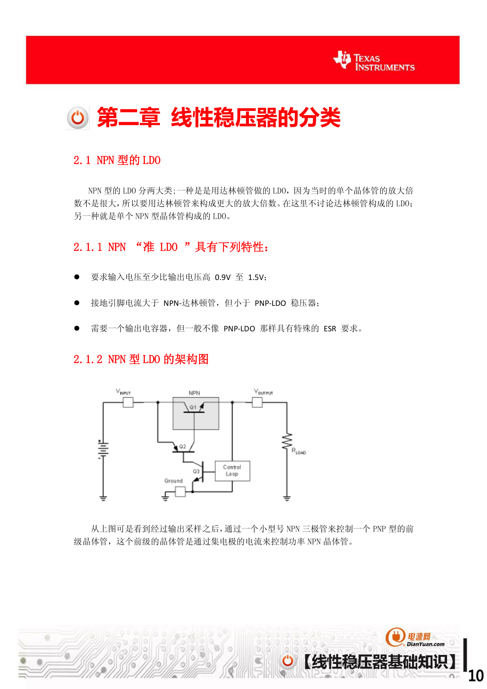

从上图可是看到经过输出采样之后，通过一个小型号 NPN 三极管来控制一个 PNP 型的前级晶体管，这个前级的晶体管是通过集电极的电流来控制功率 NPN 晶体管。 

## 2.1.3 NPN “准 LDO” 中的功率损失的简单模型

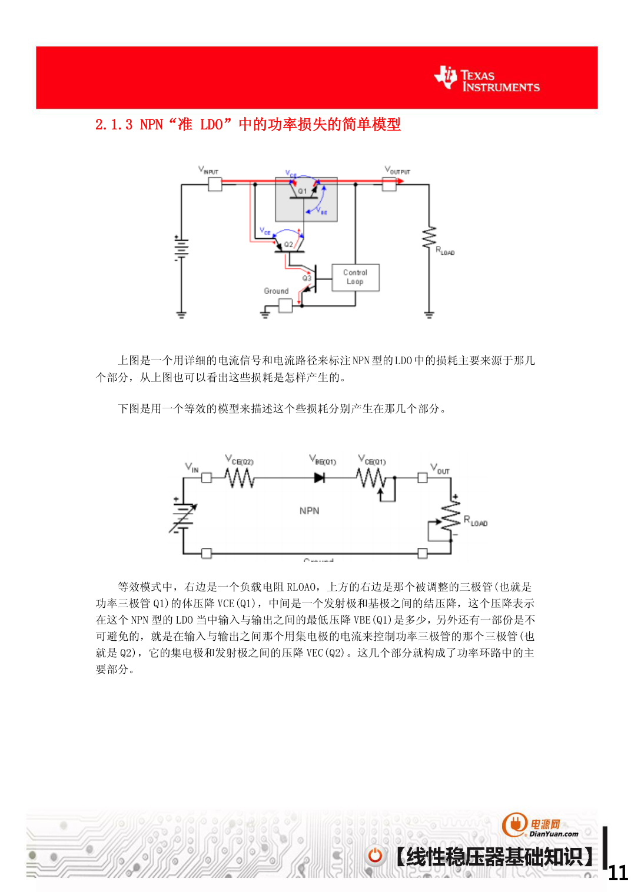

上图是一个用详细的电流信号和电流路径来标注NPN型的LDO中的损耗主要来源于那几个部分，从上图也可以看出这些损耗是怎样产生的。 

下图是用一个等效的模型来描述这个些损耗分别产生在那几个部分。 

[[硬件/原始备份/线性稳压器基础知识.pdf#page=16|原版PDF第16页整页回看（前文已展示）]]

等效模式中，右边是一个负载电阻 RLOA0，上方的右边是那个被调整的三极管(也就是功率三极管 Q1)的体压降 VCE(Q1)，中间是一个发射极和基极之间的结压降，这个压降表示在这个 NPN 型的 LDO 当中输入与输出之间的最低压降 VBE(Q1)是多少，另外还有一部份是不可避免的，就是在输入与输出之间那个用集电极的电流来控制功率三极管的那个三极管(也就是 Q2)，它的集电极和发射极之间的压降 VEC(Q2)。这几个部分就构成了功率环路中的主要部分。 

## 2.1.4 驱动 NPN “准 LDO” 传输元件

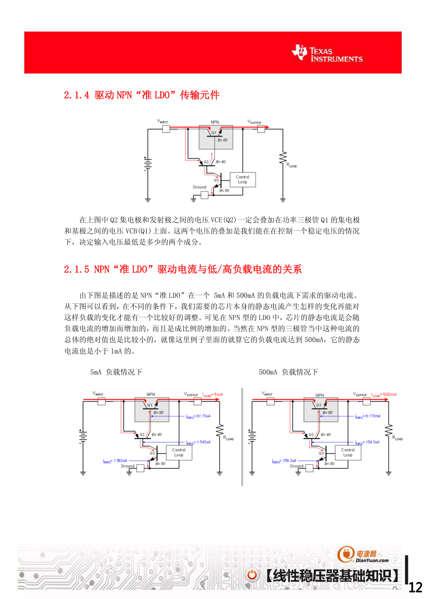

在上图中 Q2 集电极和发射极之间的电压 VCE(Q2)一定会叠加在功率三极管 Q1 的集电极和基极之间的电压 VCB(Q1)上面。这两个电压的叠加是我们能在在控制一个稳定电压的情况下，决定输入电压最低是多少的两个成分。 

## 2.1.5 NPN “准 LDO” 驱动电流与低/高负载电流的关系

由下图是描述的是 NPN “准 LDO” 在一个 5mA 和 500mA 的负载电流下需求的驱动电流。从下图可以看到，在不同的条件下，我们需要的芯片本身的静态电流产生怎样的变化再能对这样负载的变化才能有一个比较好的调整。可见在 NPN 型的 LDO 中，芯片的静态电流是会随负载电流的增加而增加的，而且是成比例的增加的。当然在 NPN 型的三极管当中这种电流的总体的绝对值也是比较小的，就像这里例子里面的就算它的负载电流达到 500mA，它的静态电流也是小于 1mA 的。 

5mA 负载情况下

500mA 负载情况下

[[硬件/原始备份/线性稳压器基础知识.pdf#page=17|原版PDF第17页整页回看（前文已展示）]]

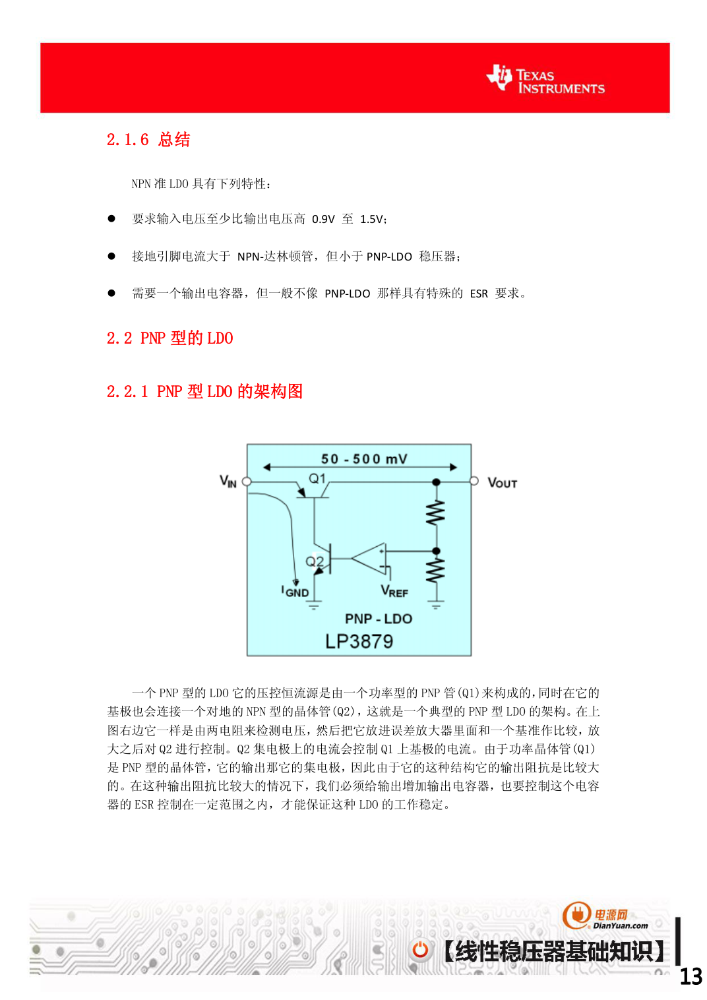

## 2.1.6 总结

NPN 准 LDO 具有下列特性: 

● 要求输入电压至少比输出电压高 0.9V 至 1.5V; 

● 接地引脚电流大于 NPN-达林顿管，但小于 PNP-LDO 稳压器； 

● 需要一个输出电容器，但一般不像 PNP-LDO 那样具有特殊的 ESR 要求。 

## 2.2 PNP 型的 LDO

## 2.2.1 PNP 型 LDO 的架构图

[[硬件/原始备份/线性稳压器基础知识.pdf#page=18|原版PDF第18页整页回看（前文已展示）]]

一个 PNP 型的 LDO 它的压控恒流源是由一个功率型的 PNP 管(Q1)来构成的，同时在它的基极也会连接一个对地的 NPN 型的晶体管(Q2)，这就是一个典型的 PNP 型 LDO 的架构。在上图右边它一样是由两电阻来检测电压，然后把它放进误差放大器里面和一个基准作比较，放大之后对 Q2 进行控制。Q2 集电极上的电流会控制 Q1 上基极的电流。由于功率晶体管(Q1)是 PNP 型的晶体管，它的输出那它的集电极，因此由于它的这种结构它的输出阻抗是比较大的。在这种输出阻抗比较大的情况下，我们必须给输出增加输出电容器，也要控制这个电容器的 ESR 控制在一定范围之内，才能保证这种 LDO 的工作稳定。 

## 2.2.2 PNP LDO 稳压器中的功率损失的简单模型

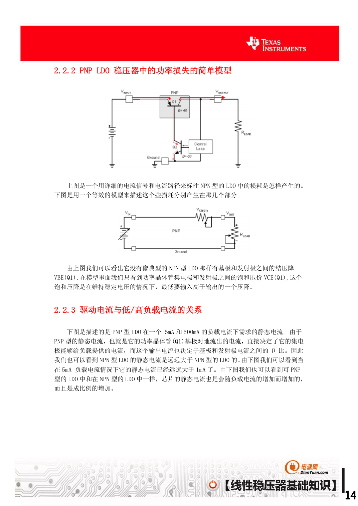

上图是一个用详细的电流信号和电流路径来标注NPN型的LDO中的损耗是怎样产生的。下图是用一个等效的模型来描述这个些损耗分别产生在那几个部分。 

[[硬件/原始备份/线性稳压器基础知识.pdf#page=19|原版PDF第19页整页回看（前文已展示）]]

由上图我们可以看出它没有像典型的 NPN 型 LDO 那样有基极和发射极之间的结压降 VBE(Q1)，在模型里面我们只看到功率晶体管集电极和发射极之间的饱和压价 VCE(Q1)，这个饱和压降是在维持稳定电压的情况下，最低要输入高于输出的一个压降。 

## 2.2.3 驱动电流与低/高负载电流的关系

下图是描述的是 PNP 型 LDO 在一个 5mA 和 500mA 的负载电流下需求的静态电流。由于 PNP 型的静态电流，也就是它的功率晶体管 (Q1) 基极对地流出的电流，直接决定了它的集电极能够给负载提供的电流，而这个输出电流也决定于基极和发射极电流之间的 $\beta$ 比。因此我们也可以看到 NPN 型 LDO 的静态电流是远远大于 NPN 型的 LDO 的。由下图我们可以看到当在 5mA 负载电流情况下它的静态电流已经远远大于 1mA 了。由下图我们也可以看到可 PNP 型的 LDO 中和在 NPN 型的 LDO 中一样，芯片的静态电流也是会随负载电流的增加而增加的，而且是成比例的增加。 

5mA 负载情况下 

500mA 负载情况下 

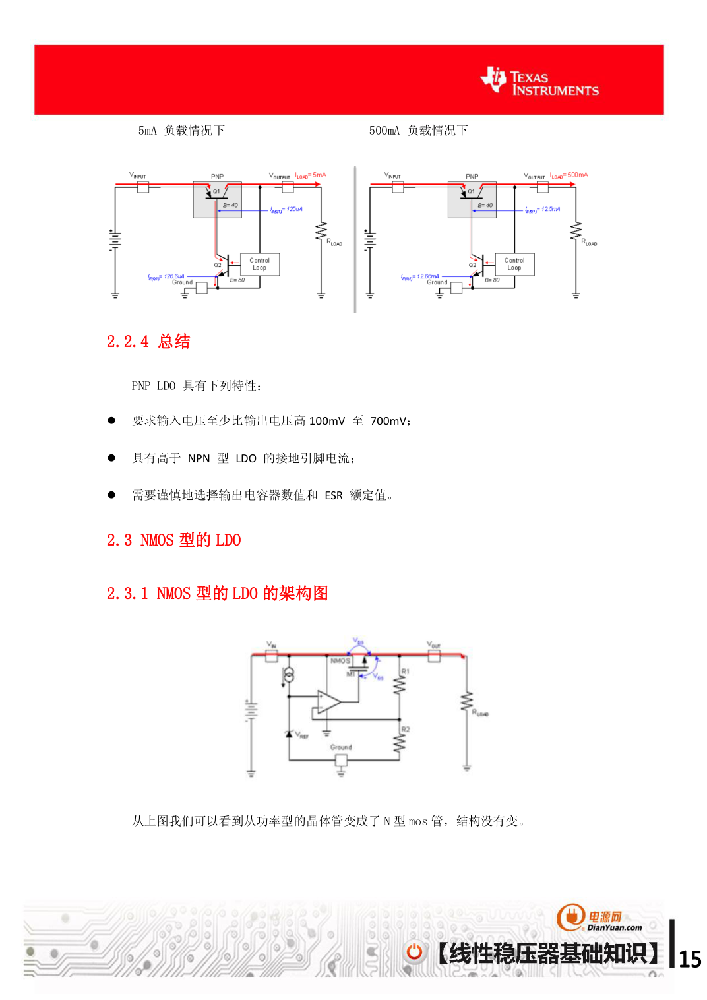

## 2.2.4 总结

PNP LDO 具有下列特性: 

● 要求输入电压至少比输出电压高 100mV 至 700mV; 

● 具有高于 NPN 型 LDO 的接地引脚电流； 

● 需要谨慎地选择输出电容器数值和 ESR 额定值。 

## 2.3 NMOS 型的 LDO

## 2.3.1 NMOS 型的 LDO 的架构图

[[硬件/原始备份/线性稳压器基础知识.pdf#page=20|原版PDF第20页整页回看（前文已展示）]]

从上图我们可以看到从功率型的晶体管变成了 N 型 mos 管，结构没有变。 

## 2.3.2 NMOS LDO 稳压器中的功率损失的简单模型

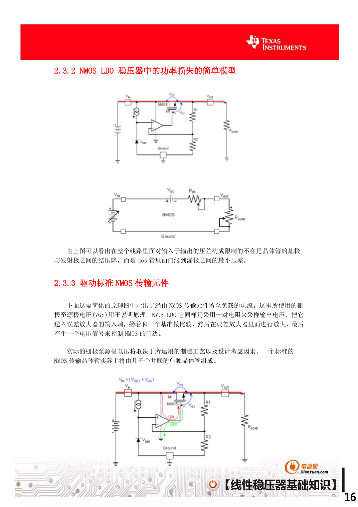

由上图可以看出在整个线路里面对输入于输出的压差构成限制的不在是晶体管的基极与发射极之间的结压降，而是 mos 管里面门级到漏极之间的最小压差。 

## 2.3.3 驱动标准 NMOS 传输元件

下面这幅简化的原理图中示出了经由NMOS传输元件留至负载的电流。这里所使用的栅极至源极电压(VGS)用于说明原理。NMOS LDO它同样是采用一对电阻来采样输出电压，把它送入误差放大器的输入端，接着和一个基准做比较，然后在误差放大器里面进行放大，最后产生一个电压信号来控制NMOS的门级。 

实际的栅极至源极电压将取决于所运用的制造工艺以及设计考虑因素。一个标准的NMOS传输晶体管实际上将由几千个并联的单独晶体管组成。 

[[硬件/原始备份/线性稳压器基础知识.pdf#page=21|原版PDF第21页整页回看（前文已展示）]]

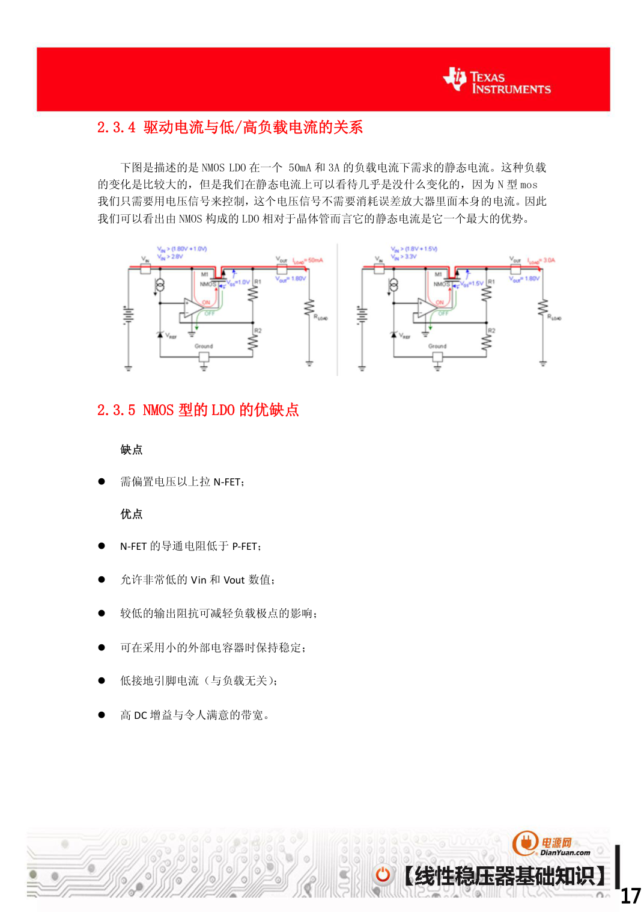

## 2.3.4 驱动电流与低/高负载电流的关系

下图是描述的是 NMOS LDO 在一个 50mA 和 3A 的负载电流下需求的静态电流。这种负载的变化是比较大的，但是我们在静态电流上可以看待几乎是没什么变化的，因为 N 型 mos 我们只需要用电压信号来控制，这个电压信号不需要消耗误差放大器里面本身的电流。因此我们可以看出由 NMOS 构成的 LDO 相对于晶体管而言它的静态电流是它一个最大的优势。 

[[硬件/原始备份/线性稳压器基础知识.pdf#page=22|原版PDF第22页整页回看（前文已展示）]]

## 2.3.5 NMOS 型的 LDO 的优缺点

缺点 

● 需偏置电压以上拉 N-FET; 

优点 

● N-FET 的导通电阻低于 P-FET; 

- 允许非常低的 Vin 和 Vout 数值; 

● 较低的输出阻抗可减轻负载极点的影响； 

● 可在采用小的外部电容器时保持稳定； 

● 低接地引脚电流（与负载无关）; 

● 高 DC 增益与令人满意的带宽。 

## 2.3.6 总结

NMOS 稳压器具有下列特点: 

● 要求输入电压高于输出电压（高出的幅度依据传输晶体管的 VGS 要求）； 

● 接地引脚电流不随输出负载电流而变化; 

- 不需要任何的输出电容器（但为了动态响应更好还是使用一个）。 

## 2.4 PMOS 型的 LDO

在前面讲 NMOS LDO 的时候，我们注意到 NMOS 由于它的源极和门级之间的导通门限，使简单构成的 NMOS LDO 它输入和输出之间的压差不可能很小，必须大于这个导通门限，如果我们引入一个单个的偏置电压对某些应用又是一个负担。因此我们可以引用另外一种方式，也就是 PMOS 构成的 LDO 老克服这些麻烦。 

由于PMOS它的输入端是接在它的源极上(如下图)，而门级是需要低于源极才能是它导通，所以这个就是PMOS的LDO在驱动上天生的要比NMOS的LDO简单。 

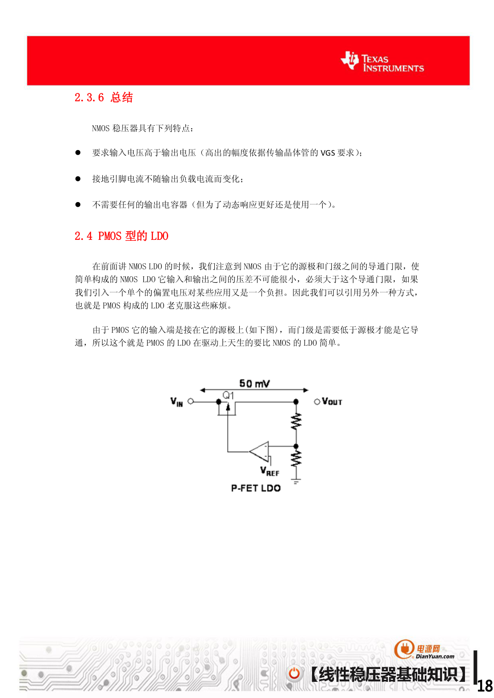

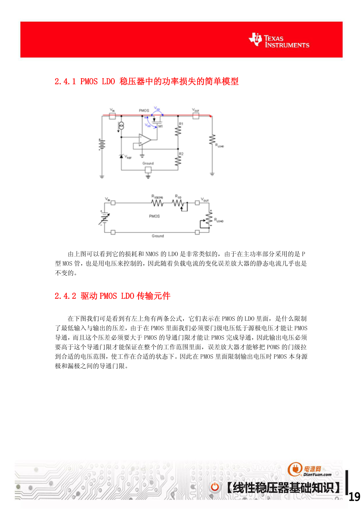

## 2.4.1 PMOS LDO 稳压器中的功率损失的简单模型

[[硬件/原始备份/线性稳压器基础知识.pdf#page=24|原版PDF第24页整页回看（前文已展示）]]

由上图可以看到它的损耗和 NMOS 的 LDO 是非常类似的，由于在主功率部分采用的是 P 型 MOS 管，也是用电压来控制的，因此随着负载电流的变化误差放大器的静态电流几乎也是不变的。 

## 2.4.2 驱动 PMOS LDO 传输元件

在下图我们可是看到有左上角有两条公式，它们表示在 PMOS 的 LDO 里面，是什么限制了最低输入与输出的压差，由于在 PMOS 里面我们必须要门级电压低于源极电压才能让 PMOS 导通，而且这个压差必须要大于 PMOS 的导通门限才能让 PMOS 完成导通，因此输出电压必须要高于这个导通门限才能保证在整个的工作范围里面，误差放大器才能够把 POMS 的门级拉到合适的电压范围，使工作在合适的状态下。因此在 PMOS 里面限制输出电压时 PMOS 本身源极和漏极之间的导通门限。 

[[硬件/原始备份/线性稳压器基础知识.pdf#page=24|原版PDF第24页整页回看（前文已展示）]]

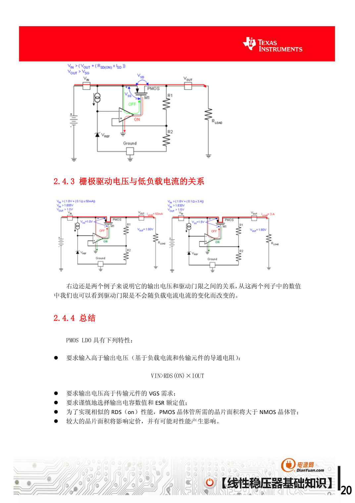

2.4.3 栅极驱动电压与低负载电流的关系

[[硬件/原始备份/线性稳压器基础知识.pdf#page=25|原版PDF第25页整页回看（前文已展示）]]

右边还是两个例子来说明它的输出电压和驱动门限之间的关系，从这两个列子中的数值中我们也可以看到驱动门限是不会随负载电流电流的变化而改变的。 

## 2.4.4 总结

PMOS LDO 具有下列特性: 

● 要求输入高于输出电压（基于负载电流和传输元件的导通电阻）： 

$$
\mathrm{VIN} > \mathrm{RDS(ON)} \times \mathrm{IOUT}
$$

● 要求输出电压高于传输元件的 VGS 需求； 

● 要求谨慎地选择输出电容数值和 ESR 额定值； 

● 为了实现相似的 RDS（on）性能，PMOS 晶体管所需的晶片面积将大于 NMOS 晶体管； 

● 较大的晶片面积将影响定价，并有可能对性能产生影响。 

## 附录一：编委信息与后记

1、《线性稳压器基础知识》通过对 TI 培训班视频课程的整理，以帮助更多工程师能够更好的学习 TI 的课程知识。 

2、在此特别感谢 TI 公司大力支持。 

3、希望《线性稳压器基础知识》文档，能够为工程师朋友们带来更加详细全面的讲解！ 

电源网 

2013年7月 

## 附录二：版权说明

1、《线性稳压器基础知识》著作权属 TI 和电源网共同所拥有； 

2、本着开源思想，我们授权任何对《线性稳压器基础知识》有兴趣的工程师免费下载、复制、传播该书； 

3、用于商业用途须经 TI 公司和电源网书面同意。 

## 重要声明

德州仪器(TI)及其下属子公司有权根据JESD46最新标准，对所提供的产品和服务进行更正、修改、增强、改进或其它更改，并有权根据JESD48最新标准中止提供任何产品和服务。客户在下订单前应获取最新的相关信息，并验证这些信息是否完整且是最新的。所有产品的销售都遵循在订单确认时所提供的TI销售条款与条件。 

TI保证其所销售的组件的性能符合产品销售时TI半导体产品销售条件与条款的适用规范。仅在TI保证的范围内，且TI认为有必要时才会使用测试或其它质量控制技术。除非适用法律做出了硬性规定，否则没有必要对每种组件的所有参数进行测试。 

TI 对应用帮助或客户产品设计不承担任何义务。客户应对其使用 TI 组件的产品和应用自行负责。为尽量减小与客户产品和应用相关的风险，客户应提供充分的设计与操作安全措施。 

TI 不对任何 TI 专利权、版权、屏蔽作品权或其它与使用了 TI 组件或服务的组合设备、机器或流程相关的 TI 知识产权中授予的直接或隐含权限作出任何保证或解释。TI 所发布的与第三方产品或服务有关的信息，不能构成从 TI 获得使用这些产品或服务的许可、授权、或认可。使用此类信息可能需要获得第三方的专利权或其它知识产权方面的许可，或是 TI 的专利权或其它知识产权方面的许可。 

对于 TI 的产品手册或数据表中 TI 信息的重要部分，仅在没有对内容进行任何篡改且带有相关授权、条件、限制和声明的情况下才允许进行复制。TI 对此类篡改过的文件不承担任何责任或义务。复制第三方的信息可能需要服从额外的限制条件。 

在转售 TI 组件或服务时，如果对该组件或服务参数的陈述与 TI 标明的参数相比存在差异或虚假成分，则会失去相关 TI 组件或服务的所有明示或暗示授权，且这是不正当的、欺诈性商业行为。TI 对任何此类虚假陈述均不承担任何责任或义务。 

客户认可并同意，尽管任何应用相关信息或支持仍可能由 TI 提供，但他们将独力负责满足与其产品及在其应用中使用 TI 产品相关的所有法律、法规和安全相关要求。客户声明并同意，他们具备制定与实施安全措施所需的全部专业技术和知识，可预见故障的危险后果、监测故障及其后果、降低有可能造成人身伤害的故障的发生机率并采取适当的补救措施。客户将全额赔偿因在此类安全关键应用中使用任何 TI 组件而对 TI 及其代理造成的任何损失。 

在某些场合中，为了推进安全相关应用有可能对 TI 组件进行特别的促销。TI 的目标是利用此类组件帮助客户设计和创立其特有的可满足适用的功能安全性标准和要求的终端产品解决方案。尽管如此，此类组件仍然服从这些条款。 

TI 组件未获得用于 FDA Class III（或类似的生命攸关医疗设备）的授权许可，除非各方授权官员已经达成了专门管控此类使用的特别协议。 

只有那些 TI 特别注明属于军用等级或“增强型塑料”的 TI 组件才是设计或专门用于军事/航空应用或环境的。购买者认可并同意，对并非指定面向军事或航空航天用途的 TI 组件进行军事或航空航天方面的应用，其风险由客户单独承担，并且由客户独力负责满足与此类使用相关的所有法律和法规要求。 

TI 已明确指定符合 ISO/TS16949 要求的产品，这些产品主要用于汽车。在任何情况下，因使用非指定产品而无法达到 ISO/TS16949 要求，TI 不承担任何责任。 

<table><tr><td></td><td>产品</td><td></td><td>应用</td></tr><tr><td>数字音频</td><td>www.ti.com.cn/audio</td><td>通信与电信</td><td>www.ti.com.cn/telecom</td></tr><tr><td>放大器和线性器件</td><td>www.ti.com.cn/amplifiers</td><td>计算机及周边</td><td>www.ti.com.cn/computer</td></tr><tr><td>数据转换器</td><td>www.ti.com.cn/dataconverters</td><td>消费电子</td><td>www.ti.com/consumer-apps</td></tr><tr><td>DLP® 产品</td><td>www.dlp.com</td><td>能源</td><td>www.ti.com/energy</td></tr><tr><td>DSP - 数字信号处理器</td><td>www.ti.com.cn/dsp</td><td>工业应用</td><td>www.ti.com.cn/industrial</td></tr><tr><td>时钟和计时器</td><td>www.ti.com.cn/clockandtimers</td><td>医疗电子</td><td>www.ti.com.cn/medical</td></tr><tr><td>接口</td><td>www.ti.com.cn/interface</td><td>安防应用</td><td>www.ti.com.cn/security</td></tr><tr><td>逻辑</td><td>www.ti.com.cn/logic</td><td>汽车电子</td><td>www.ti.com.cn/automotive</td></tr><tr><td>电源管理</td><td>www.ti.com.cn/power</td><td>视频和影像</td><td>www.ti.com.cn/video</td></tr><tr><td>微控制器 (MCU)</td><td>www.ti.com.cn/microcontrollers</td><td></td><td></td></tr><tr><td>RFID 系统</td><td>www.ti.com.cn/rfidsys</td><td></td><td></td></tr><tr><td>OMAP应用处理器</td><td>www.ti.com/omap</td><td></td><td></td></tr><tr><td>无线连通性</td><td>www.ti.com.cn/wirelessconnectivity</td><td>德州仪器在线技术支持社区</td><td>www.deyisupport.com</td></tr></table>

邮寄地址：上海市浦东新区世纪大道1568号，中建大厦32楼邮政编码：200122 Copyright © 2013 德州仪器半导体技术（上海）有限公司 