> 图像回补：缺图位置按正文前后锚点接入原版 [[硬件/原始备份/运放应用.pdf|运放应用.pdf]] 完整页面；跨页位置保留相邻页面，同页重复处提供页码链接。页面截图用于回看原图与上下文，不表示逐图编号或电路参数已独立核验。旧行号及原图名见 [[audit/图片修复明细.csv|图片修复明细]]。

## 运算放大器应用

## §8.1 比例运算电路

## 8.1.1 反相比例电路

1. 基本电路 

电压并联负反馈输入端虚短、虚断 

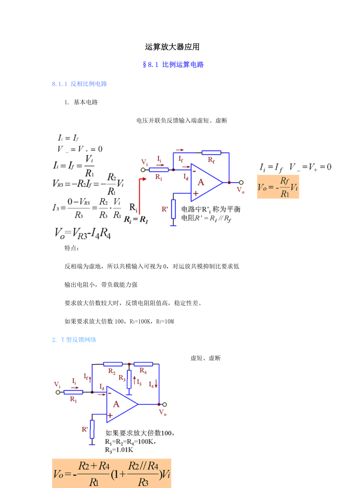

特点： 

反相端为虚地，所以共模输入可视为0，对运放共模抑制比要求低 

输出电阻小，带负载能力强 

要求放大倍数较大时，反馈电阻阻值高，稳定性差。 

如果要求放大倍数100， $\mathrm { R 1 } { = } 1 0 0 \mathrm { K }$ $\mathrm { R f } { = } 1 0 \mathrm { M }$ 

2. T型反馈网络 

[[硬件/原始备份/运放应用.pdf#page=1|原版PDF第1页整页回看（前文已展示）]]

虚短、虚断 

$$
V _ {o} = - \frac {R 2 + R 4}{R 1} (1 + \frac {R 2 / / R 4}{R 3}) V _ {i}
$$

## 8.1.2 同相比例电路

1. 基本电路：电压串联负反馈 

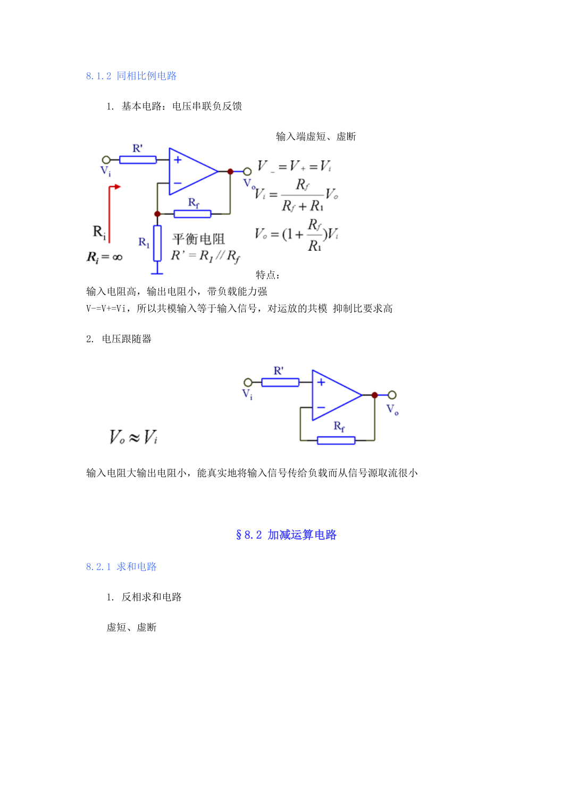

输入电阻高，输出电阻小，带负载能力强 

V-=V+=Vi，所以共模输入等于输入信号，对运放的共模 抑制比要求高 

2. 电压跟随器 

$$
V _ {o} \approx V _ {i}
$$

[[硬件/原始备份/运放应用.pdf#page=2|原版PDF第2页整页回看（前文已展示）]]

输入电阻大输出电阻小，能真实地将输入信号传给负载而从信号源取流很小 

## §8.2 加减运算电路

## 8.2.1 求和电路

1. 反相求和电路 

虚短、虚断 

$$
I _ {d} = 0
$$

$$
V _ {-} = V _ {+} = 0
$$

$$
I _ {1} + I _ {2} + I _ {3} = I _ {f}
$$

$$
- V _ {o} = R _ {f} \cdot \left(\frac {V _ {i 1}}{R _ {1}} + \frac {V _ {i 2}}{R _ {2}} + \frac {V _ {i 3}}{R _ {3}}\right)
$$

$$
R ^ {\prime} = R _ {1} / / R _ {2} / / R _ {3} / / R _ {f}
$$

[[硬件/原始备份/运放应用.pdf#page=2|原版PDF第2页整页回看（前文已展示）]]

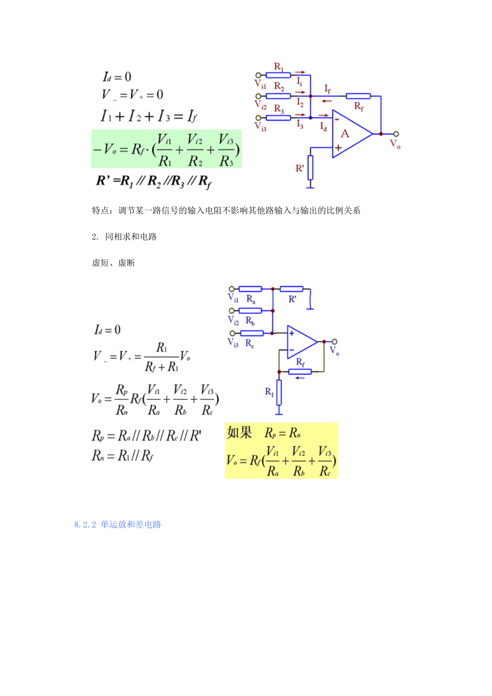

特点：调节某一路信号的输入电阻不影响其他路输入与输出的比例关系 

2. 同相求和电路 

虚短、虚断 

$$
I _ {d} = 0
$$

$$
V _ {-} = V _ {+} = \frac {R _ {1}}{R _ {f} + R _ {1}} V _ {o}
$$

$$
V _ {o} = \frac {R _ {p}}{R _ {n}} R _ {f} (\frac {V _ {i 1}}{R _ {a}} + \frac {V _ {i 2}}{R _ {b}} + \frac {V _ {i 3}}{R _ {c}})
$$

[[硬件/原始备份/运放应用.pdf#page=3|原版PDF第3页整页回看（前文已展示）]]

$$
R _ {p} = R _ {a} / / R _ {b} / / R _ {c} / / R ^ {\prime}
$$

$$
R _ {n} = R _ {1} / / R _ {f}
$$

如果 $R _ { p } = R _ { n }$ 

$$
V _ {o} = R _ {f} \left(\frac {V _ {i 1}}{R _ {a}} + \frac {V _ {i 2}}{R _ {b}} + \frac {V _ {i 3}}{R _ {c}}\right)
$$

8.2.2 单运放和差电路 

$$
\begin{array}{r l} & V _ {i 3} = V _ {i 4} = 0 \text {时:} \\ & V _ {o 1} = - R _ {f} (\frac {V _ {i 1}}{R _ {1}} + \frac {V _ {i 2}}{R _ {2}}) \\ & V _ {i 1} = V _ {i 2} = 0 \text {且} \\ & R _ {p} = R _ {3} / / R _ {4} / / R ^ {\prime} \\ & R _ {n} = R _ {1} / / R _ {2} / / R _ {f} \\ & R _ {n} = R _ {p} \\ & V _ {o 2} = R _ {f} (\frac {V _ {i 3}}{R _ {3}} + \frac {V _ {i 4}}{R _ {4}}) \quad V _ {o} = V _ {o 1} + V _ {o 2} = R _ {f} \left(\frac {V _ {i 3}}{R _ {3}} + \frac {V _ {i 4}}{R _ {4}} - \frac {V _ {i 1}}{R _ {1}} - \frac {V _ {i 2}}{R _ {2}}\right) \end{array}
$$

8.2.3 双运放和差电路 

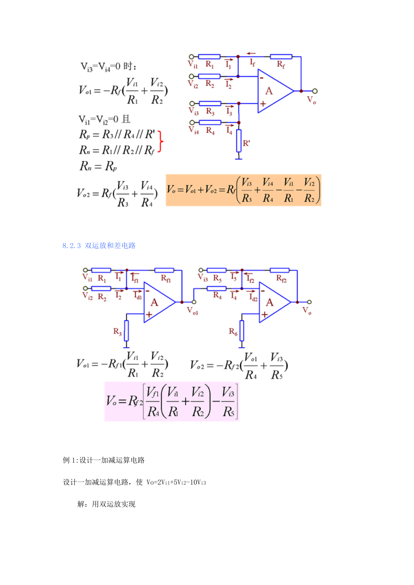

例1:设计一加减运算电路 

设计一加减运算电路，使 $\mathrm { V } _ { 0 } { = } 2 \mathrm { V } _ { } 1 1 { + } 5 \mathrm { V } _ { } \mathrm { i } 2 { - } 1 0 \mathrm { V } \mathrm { i } 3$ 

解：用双运放实现 

[[硬件/原始备份/运放应用.pdf#page=4|原版PDF第4页整页回看（前文已展示）]]

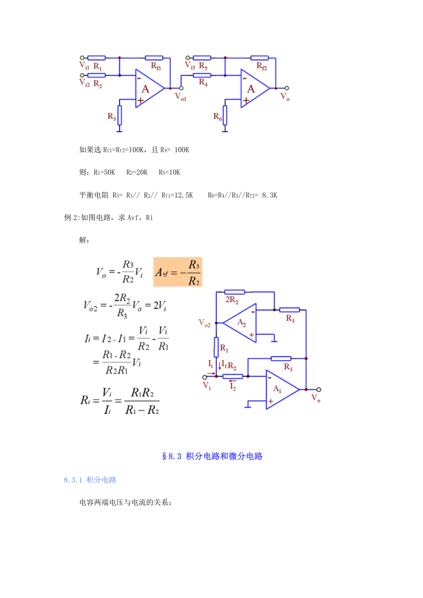

如果选 Rf1=Rf2=100K，且 R4= 100K 

则：R1=50K R2=20K R5=10K 

平衡电阻 R3= R1// R2// Rf1=12.5K $\mathrm { R 6 { = } R 4 / / R 5 / / R f 2 { = } ~ 8 . 3 K }$ 

例2:如图电路，求Avf，Ri 

解： 

$$
V _ {o} = - \frac {R _ {3}}{R _ {2}} V _ {i} \quad A _ {v f} = - \frac {R _ {3}}{R _ {2}}
$$

$$
V _ {o 2} = - \frac {2 R _ {2}}{R _ {3}} V _ {o} = 2 V _ {i}
$$

$$
\begin{array}{r l} I _ {i} & = I _ {2 -} I _ {1} = \frac {V _ {i}}{R _ {2}} - \frac {V _ {i}}{R _ {1}} \\ & = \frac {R _ {1 -} R _ {2}}{R _ {2} R _ {1}} V _ {i} \end{array}
$$

$$
R _ {i} = \frac {V _ {i}}{I _ {i}} = \frac {R _ {1} R _ {2}}{R _ {1} - R _ {2}}
$$

[[硬件/原始备份/运放应用.pdf#page=5|原版PDF第5页整页回看（前文已展示）]]

§8.3 积分电路和微分电路

## 8.3.1 积分电路

电容两端电压与电流的关系： 

$$
i _ {c} (t) = C \frac {d v _ {c} (t)}{d t}
$$

$$
v _ {c} (t) = \frac {1}{C} \int i _ {c} (t) d t
$$

[[硬件/原始备份/运放应用.pdf#page=5|原版PDF第5页整页回看（前文已展示）]]

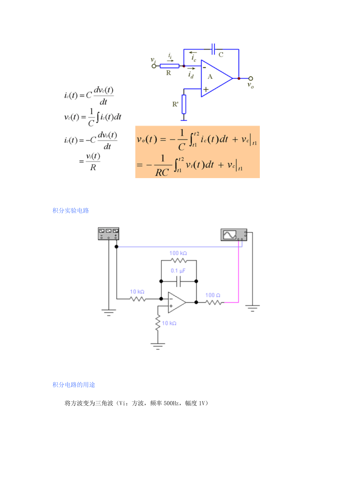

$$
\begin{array}{r l} i _ {c} (t) & = - C \frac {d v _ {o} (t)}{d t} \\ & = \frac {v _ {i} (t)}{R} \end{array}
$$

$$
\begin{array}{l} v _ {o} (t) = - \frac {1}{C} \int_ {t 1} ^ {t 2} i _ {c} (t) d t + v _ {c} \big | _ {t 1} \\ = - \frac {1}{R C} \int_ {t 1} ^ {t 2} v _ {i} (t) d t + v _ {c} \big | _ {t 1} \end{array}
$$

积分实验电路 

[[硬件/原始备份/运放应用.pdf#page=6|原版PDF第6页整页回看（前文已展示）]]

积分电路的用途 

将方波变为三角波（Vi：方波，频率500Hz，幅度 1V） 

[[硬件/原始备份/运放应用.pdf#page=6|原版PDF第6页整页回看（前文已展示）]]

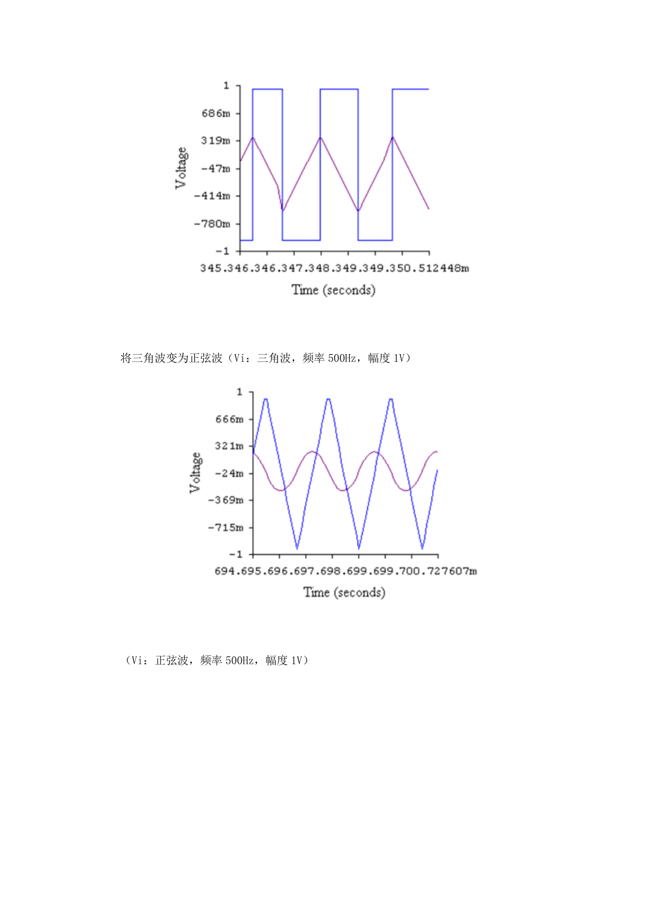

将三角波变为正弦波（Vi：三角波，频率500Hz，幅度 1V）

[[硬件/原始备份/运放应用.pdf#page=7|原版PDF第7页整页回看（前文已展示）]]

（Vi：正弦波，频率500Hz，幅度1V）

[[硬件/原始备份/运放应用.pdf#page=7|原版PDF第7页整页回看（前文已展示）]]

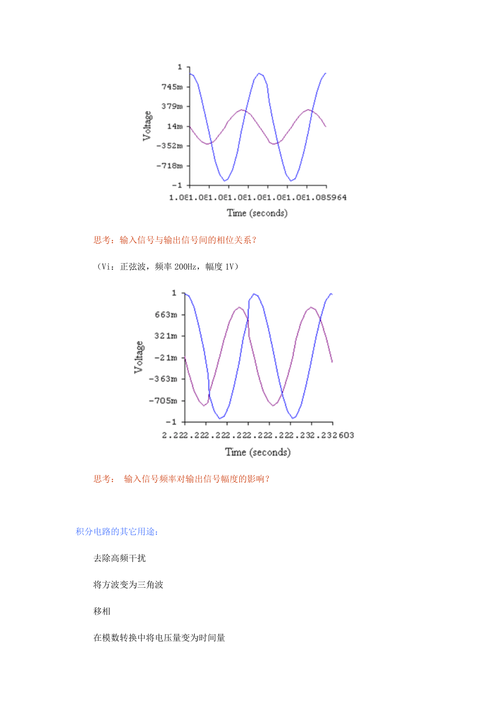

思考：输入信号与输出信号间的相位关系？

（Vi：正弦波，频率200Hz，幅度1V）

[[硬件/原始备份/运放应用.pdf#page=8|原版PDF第8页整页回看（前文已展示）]]

思考： 输入信号频率对输出信号幅度的影响？

积分电路的其它用途： 

去除高频干扰 

将方波变为三角波 

移相 

在模数转换中将电压量变为时间量 

8.3.2 微分电路 

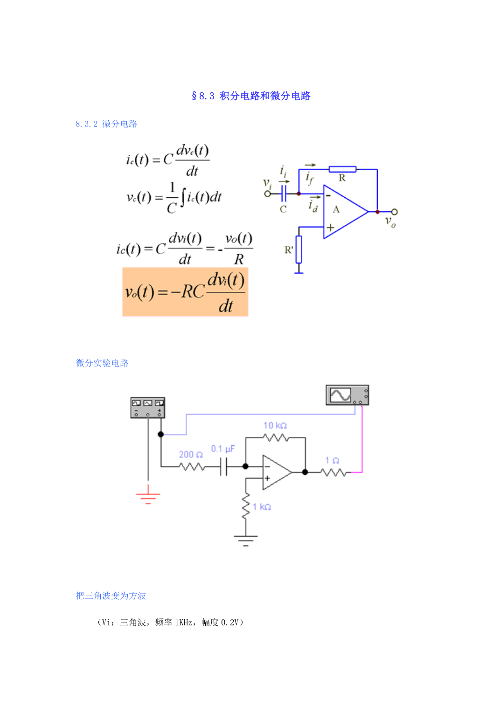

微分实验电路 

[[硬件/原始备份/运放应用.pdf#page=9|原版PDF第9页整页回看（前文已展示）]]

把三角波变为方波 

（Vi：三角波，频率1KHz，幅度0.2V） 

[[硬件/原始备份/运放应用.pdf#page=9|原版PDF第9页整页回看（前文已展示）]]

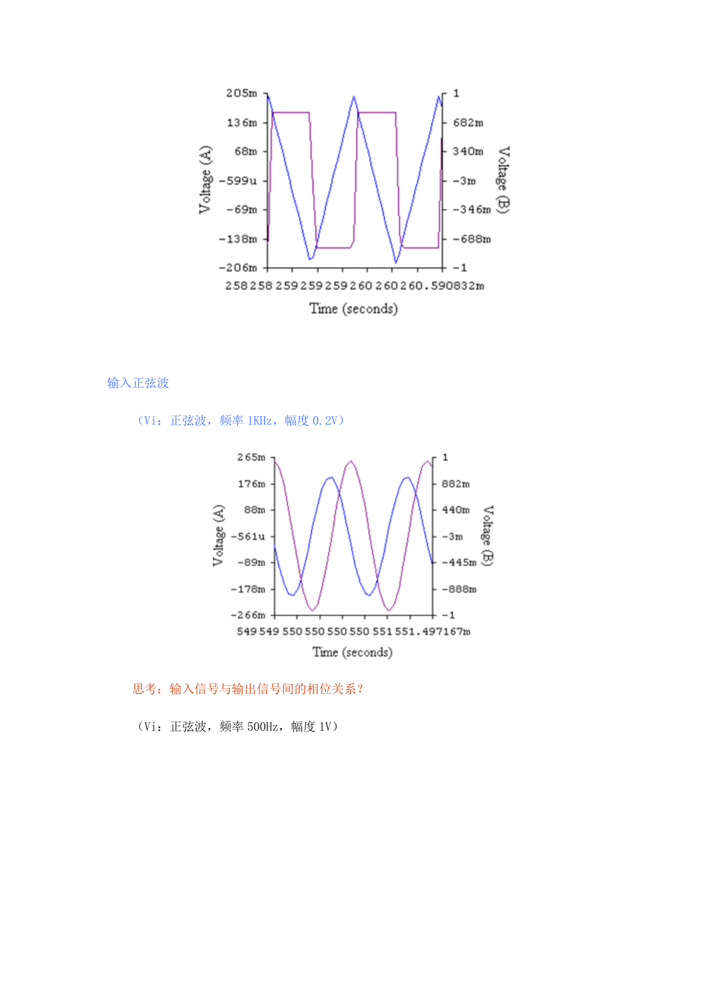

输入正弦波

（Vi：正弦波，频率1KHz，幅度0.2V）

[[硬件/原始备份/运放应用.pdf#page=10|原版PDF第10页整页回看（前文已展示）]]

思考：输入信号与输出信号间的相位关系？

（Vi：正弦波，频率500Hz，幅度1V）

[[硬件/原始备份/运放应用.pdf#page=10|原版PDF第10页整页回看（前文已展示）]]

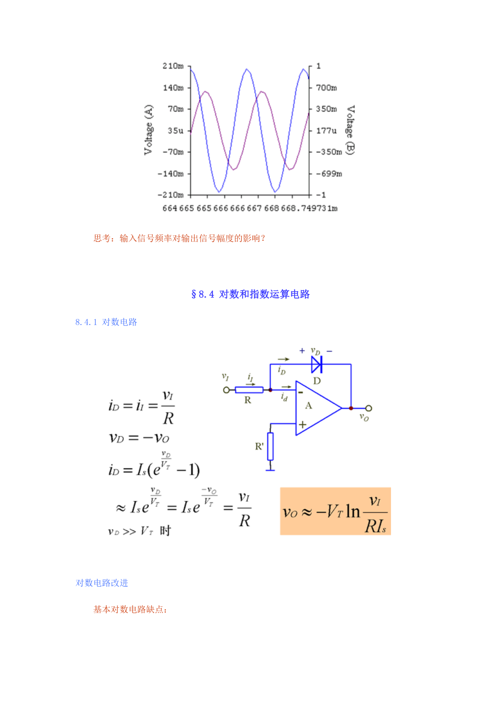

思考：输入信号频率对输出信号幅度的影响？

§8.4 对数和指数运算电路

## 8.4.1 对数电路

[[硬件/原始备份/运放应用.pdf#page=11|原版PDF第11页整页回看（前文已展示）]]

对数电路改进 

基本对数电路缺点： 

运算精度受温度影响大； 

小信号时 $\exp \left( \mathrm { V p / V _ { I } } \right)$ 与 1 差不多大，所以误差很大； 

二极管在电流较大时伏安特性与 PN结伏安特性差别较大，所以运算只在较小的电流范 围内误差较小。 

改进电路1：用三极管代替二极管 

$$
i _ {C} \approx i _ {E} \approx i _ {I} = \frac {v _ {I}}{R}
$$

$$
\begin{array}{r l} & {i _ {E} = I _ {s} (e ^ {\frac {v _ {B E}}{V _ {T}}} - 1)} \\ & {\qquad \approx I _ {s} e ^ {\frac {v _ {B E}}{V _ {T}} (v _ {B E} > > V _ {T} \text {时})}} \end{array}
$$

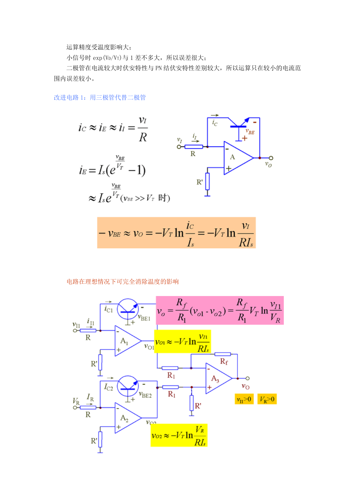

$$
- v _ {B E} \approx v _ {O} = - V _ {T} \ln \frac {i _ {C}}{I _ {s}} = - V _ {T} \ln \frac {v _ {I}}{R I _ {s}}
$$

电路在理想情况下可完全消除温度的影响 

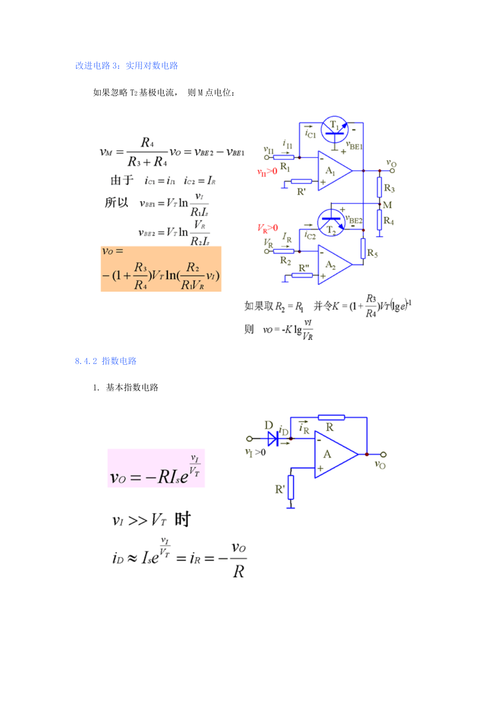

如果忽略T2基极电流， 则M点电位： 

$$
\nu_ {M} = \frac {R _ {4}}{R _ {3} + R _ {4}} \nu_ {O} = \nu_ {B E 2} - \nu_ {B E 1}
$$

由于 $\begin{array} { r } { i _ { \scriptscriptstyle \mathrm { C } 1 } = i _ { \scriptscriptstyle \Pi } \quad i _ { \scriptscriptstyle \mathrm { C } 2 } = I _ { R } } \end{array}$ 

所以 $\nu _ { B E 1 } = V _ { \tau } \mathrm { l n } \frac { \nu _ { t } } { R _ { 1 } I _ { s } }$ 

$$
v _ {B E 2} = V _ {T} \ln \frac {V _ {R}}{R _ {2} I _ {s}}
$$

$$
- \left(1 + \frac {R _ {3}}{R _ {4}}\right) V _ {T} \ln \left(\frac {R _ {2}}{R _ {1} V _ {R}} v _ {I}\right)
$$

[[硬件/原始备份/运放应用.pdf#page=13|原版PDF第13页整页回看（前文已展示）]]

如果取 $R _ { 2 } = R _ { 1 }$ 并令 $K = ( 1 + \frac { R 3 } { R 4 } ) V T ( \lg e ) ^ { \top }$ 则 $v o = - K \lg { \frac { v I } { V R } }$ 

## 8.4.2 指数电路

1. 基本指数电路 

[[硬件/原始备份/运放应用.pdf#page=13|原版PDF第13页整页回看（前文已展示）]]

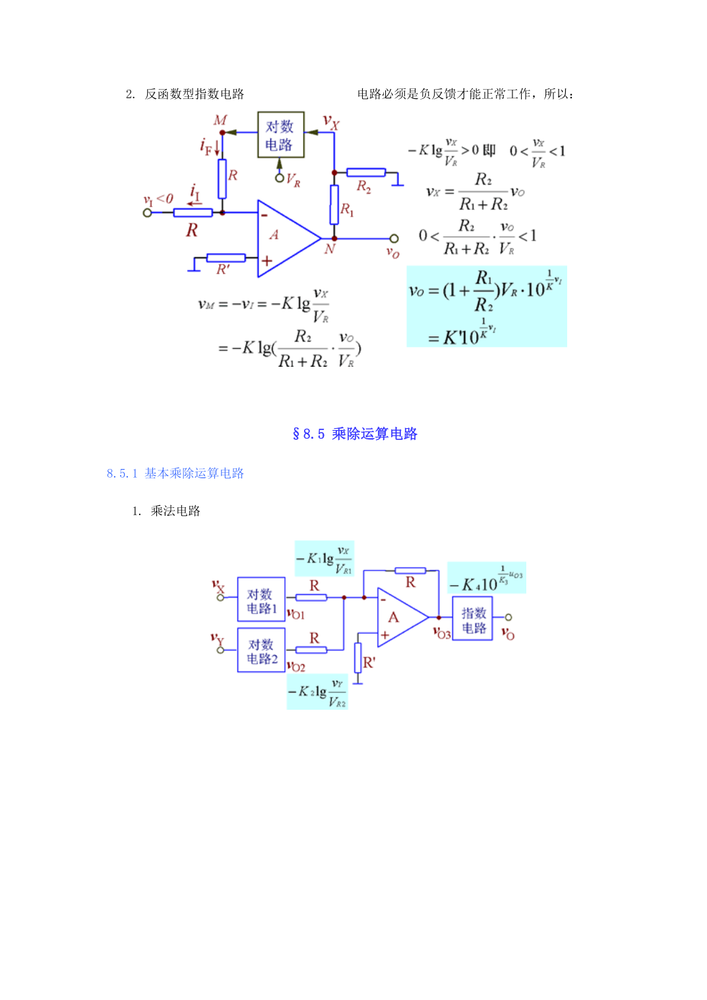

$\nu _ { I } > > V _ { T }$ 时 

$$
i _ {D} \approx I _ {s} e ^ {\frac {v _ {I}}{V _ {T}}} = i _ {R} = - \frac {v _ {O}}{R}
$$

2. 反函数型指数电路 

电路必须是负反馈才能正常工作，所以： 

[[硬件/原始备份/运放应用.pdf#page=14|原版PDF第14页整页回看（前文已展示）]]

§8.5 乘除运算电路

## 8.5.1 基本乘除运算电路

1. 乘法电路 

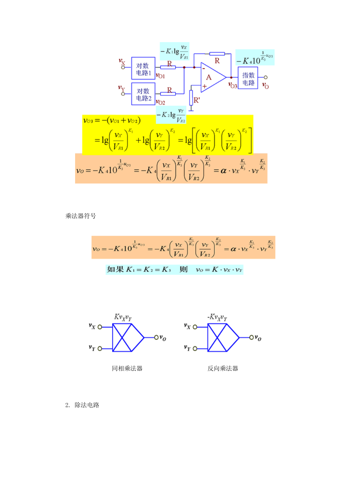

乘法器符号 

$$
\nu_ {O} = - K _ {4} 1 0 ^ {\frac {1}{K _ {3}} u _ {O 3}} = - K _ {4} \left(\frac {\nu_ {X}}{V _ {R 1}}\right) ^ {\frac {K _ {1}}{K _ {3}}} \left(\frac {\nu_ {Y}}{V _ {R 2}}\right) ^ {\frac {K _ {2}}{K _ {3}}} = \boldsymbol {\alpha} \cdot \nu_ {X} ^ {\frac {K _ {1}}{K _ {3}}} \cdot \nu_ {Y} ^ {\frac {K _ {2}}{K _ {3}}}
$$

如果 $K _ { 1 } = K _ { 2 } = K$ 则 $\nu _ { O } = K \cdot \nu _ { X } \cdot \nu _ { Y }$ 

[[硬件/原始备份/运放应用.pdf#page=15|原版PDF第15页整页回看（前文已展示）]]

同相乘法器

[[硬件/原始备份/运放应用.pdf#page=15|原版PDF第15页整页回看（前文已展示）]]

反向乘法器

2. 除法电路 

[[硬件/原始备份/运放应用.pdf#page=15|原版PDF第15页整页回看（前文已展示）]]

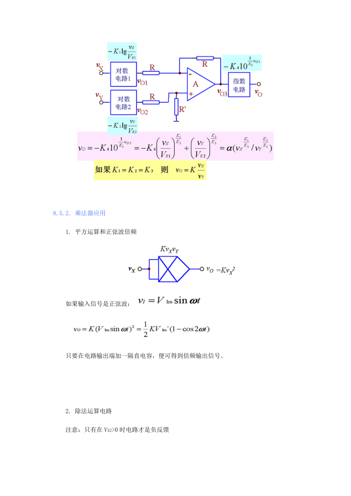

如果 $K _ { 1 } = K _ { 2 } = K _ { 3 }$ 则 $\displaystyle { \nu _ { \scriptscriptstyle O } = K \frac { \nu _ { \scriptscriptstyle X } } { \nu _ { \scriptscriptstyle Y } } }$ 

## 8.5.2. 乘法器应用

1. 平方运算和正弦波倍频 

[[硬件/原始备份/运放应用.pdf#page=16|原版PDF第16页整页回看（前文已展示）]]

如果输入信号是正弦波： $\nu _ { I } = V _ { \mathrm { \scriptsize ~ I m } } \sin \omega t$ 

$$
v _ {O} = K (V _ {\mathrm{lm}} \sin \omega t) ^ {2} = \frac {1}{2} K V _ {\mathrm{lm}} ^ {2} (1 - \cos 2 \omega t)
$$

只要在电路输出端加一隔直电容，便可得到倍频输出信号。 

## 2. 除法运算电路

注意：只有在VX2>0时电路才是负反馈 

[[硬件/原始备份/运放应用.pdf#page=16|原版PDF第16页整页回看（前文已展示）]]

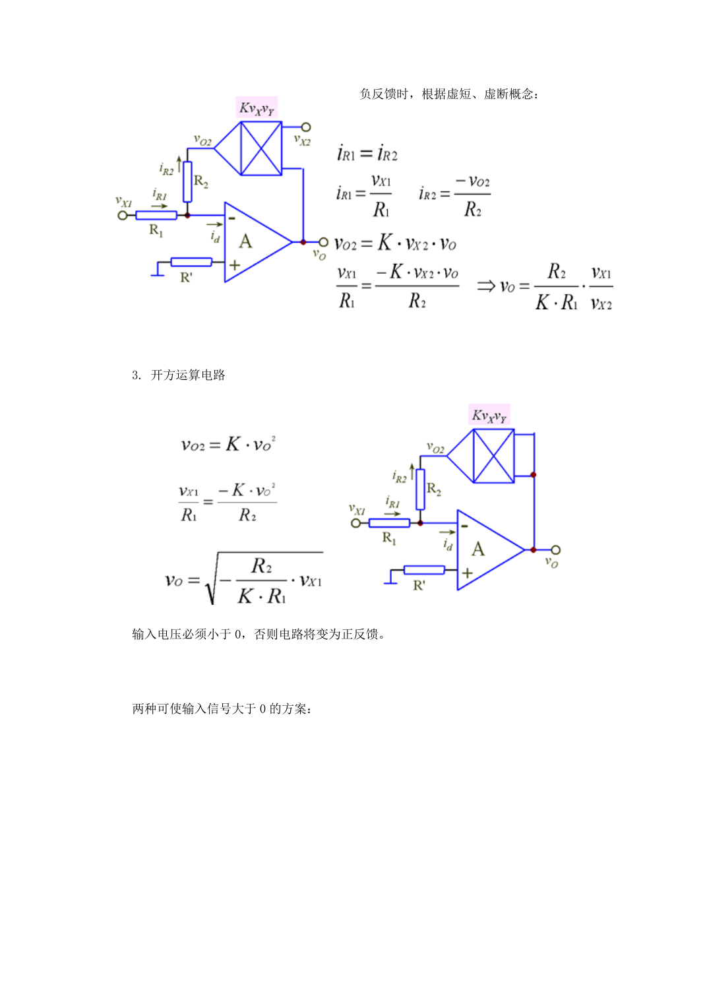

负反馈时，根据虚短、虚断概念： 

$$
\boldsymbol {i} _ {R 1} = \boldsymbol {i} _ {R 2}
$$

$$
i _ {R 1} = \frac {v _ {X 1}}{R _ {1}} \quad i _ {R 2} = \frac {- v _ {O 2}}{R _ {2}}
$$

$$
\nu_ {O 2} = K \cdot \nu_ {X 2} \cdot \nu_ {O}
$$

$$
\frac {v _ {X 1}}{R _ {1}} = \frac {- K \cdot v _ {X 2} \cdot v _ {O}}{R _ {2}} \Rightarrow v _ {O} = \frac {R _ {2}}{K \cdot R _ {1}} \cdot \frac {v _ {X 1}}{v _ {X 2}}
$$

3. 开方运算电路 

$$
v _ {O 2} = K \cdot v _ {O} ^ {2}
$$

$$
\frac {v _ {X 1}}{R _ {1}} = \frac {- K \cdot v _ {O} ^ {2}}{R _ {2}}
$$

$$
v _ {O} = \sqrt {- \frac {R _ {2}}{K \cdot R _ {1}} \cdot v _ {X 1}}
$$

[[硬件/原始备份/运放应用.pdf#page=17|原版PDF第17页整页回看（前文已展示）]]

输入电压必须小于0，否则电路将变为正反馈。 

两种可使输入信号大于 0的方案： 

[[硬件/原始备份/运放应用.pdf#page=17|原版PDF第17页整页回看（前文已展示）]]

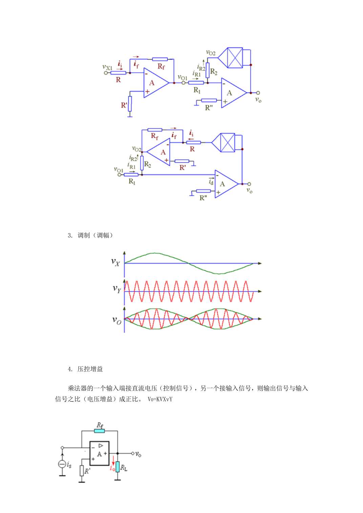

## 3. 调制（调幅）

[[硬件/原始备份/运放应用.pdf#page=18|原版PDF第18页整页回看（前文已展示）]]

## 4. 压控增益

乘法器的一个输入端接直流电压（控制信号），另一个接输入信号，则输出信号与输入 信号之比（电压增益）成正比。 V0=KVXvY 

[[硬件/原始备份/运放应用.pdf#page=18|原版PDF第18页整页回看（前文已展示）]]

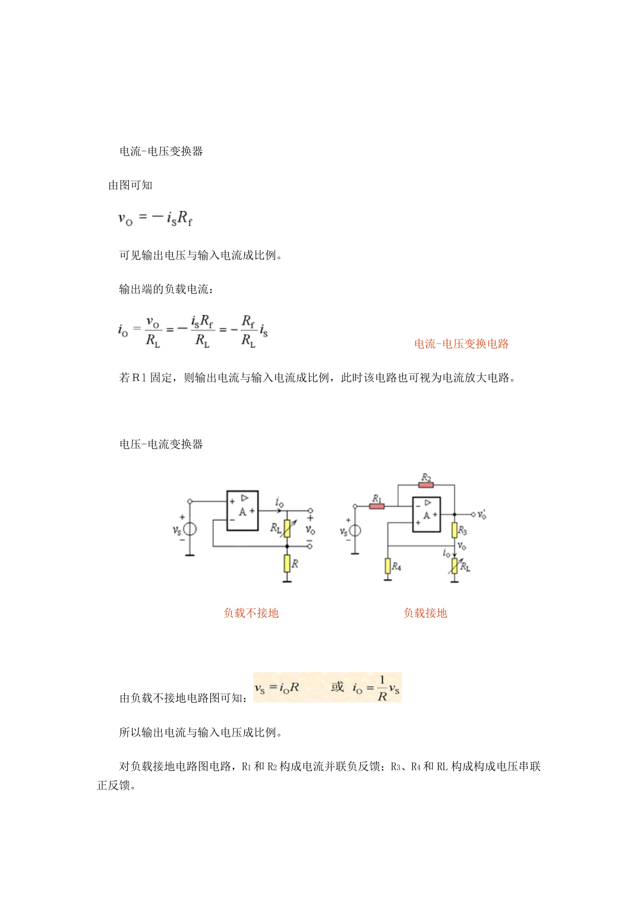

电流-电压变换器 

由图可知 

$$
v _ {\mathrm{O}} = - i _ {\mathrm{s}} R _ {\mathrm{f}}
$$

可见输出电压与输入电流成比例。 

输出端的负载电流： 

$$
i _ {\mathrm{O}} = \frac {v _ {\mathrm{O}}}{R _ {\mathrm{L}}} = - \frac {i _ {\mathrm{s}} R _ {\mathrm{f}}}{R _ {\mathrm{L}}} = - \frac {R _ {\mathrm{f}}}{R _ {\mathrm{L}}} i _ {\mathrm{s}}
$$

电流-电压变换电路 

若Rl固定，则输出电流与输入电流成比例，此时该电路也可视为电流放大电路。 

电压-电流变换器 

负载不接地

[[硬件/原始备份/运放应用.pdf#page=19|原版PDF第19页整页回看（前文已展示）]]

负载接地

$\nu _ { \mathrm { s } } = i _ { \mathrm { o } } R$ 或 $i _ { \mathrm { O } } = \frac { 1 } { R } \nu _ { \mathrm { s } }$ 由负载不接地电路图可知： 

所以输出电流与输入电压成比例。 

对负载接地电路图电路，R1和 R2构成电流并联负反馈；R3、R4和RL 构成构成电压串联 正反馈。 

$$
v _ {-} = v _ {\mathrm{S}} \frac {R _ {2}}{R _ {1} + R _ {2}} + v _ {\mathrm{O}} ^ {\prime} \frac {R _ {1}}{R _ {1} + R _ {2}}
$$

$$
v _ {+} = v _ {\mathrm{O}} = i _ {\mathrm{O}} R _ {\mathrm{L}} = v _ {\mathrm{O}} ^ {\prime} \frac {R _ {4} / / R _ {\mathrm{L}}}{R _ {3} + \left(R _ {4} / / R _ {\mathrm{L}}\right)}
$$

[[硬件/原始备份/运放应用.pdf#page=19|原版PDF第19页整页回看（前文已展示）]]

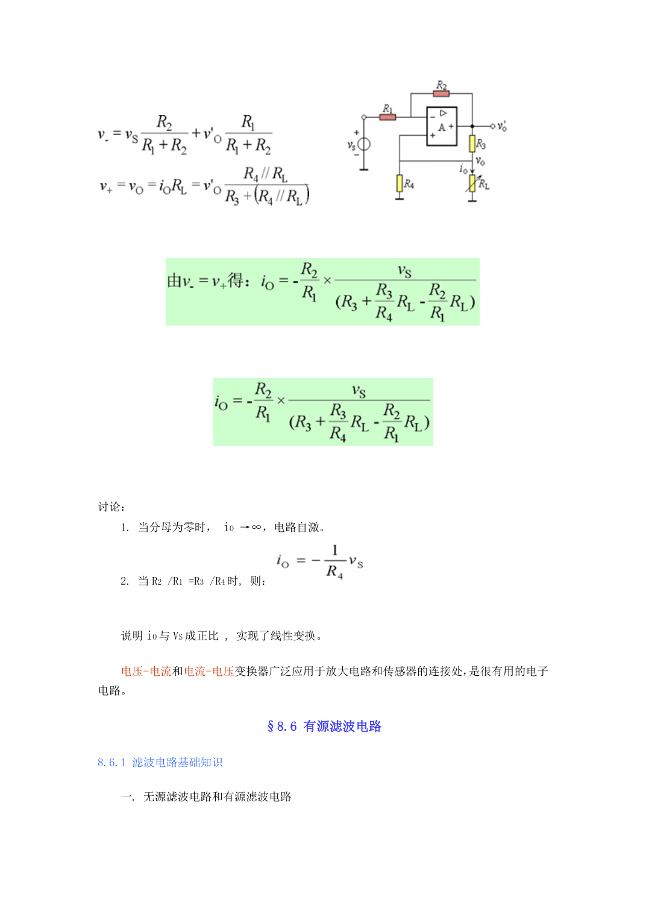

$$
\text { 由 } v _ {-} = v _ {+} \text { 得: } i _ {\mathrm{O}} = - \frac {R _ {2}}{R _ {1}} \times \frac {v _ {\mathrm{S}}}{(R _ {3} + \frac {R _ {3}}{R _ {4}} R _ {\mathrm{L}} - \frac {R _ {2}}{R _ {1}} R _ {\mathrm{L}})}
$$

$$
i _ {\mathrm{O}} = - \frac {R _ {2}}{R _ {1}} \times \frac {v _ {\mathrm{S}}}{(R _ {3} + \frac {R _ {3}}{R _ {4}} R _ {\mathrm{L}} - \frac {R _ {2}}{R _ {1}} R _ {\mathrm{L}})}
$$

讨论： 

1. 当分母为零时， iO →∞，电路自激。 

2. 当 R2 /R1 =R3 /R4 时, 则： 

$$
i _ {\mathrm{O}} = - \frac {1}{R _ {4}} v _ {\mathrm{s}}
$$

说明iO与VS成正比 , 实现了线性变换。 

电压-电流和电流-电压变换器广泛应用于放大电路和传感器的连接处，是很有用的电子 电路。 

## §8.6 有源滤波电路

## 8.6.1 滤波电路基础知识

## 一. 无源滤波电路和有源滤波电路

无源滤波电路: 由无源元件 ( R C L ) 组成 

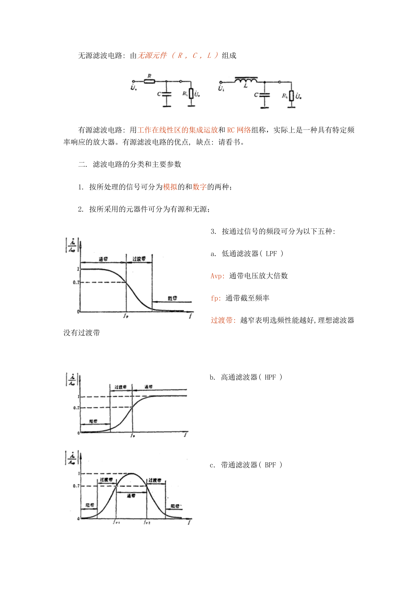

有源滤波电路: 用工作在线性区的集成运放和RC 网络组称，实际上是一种具有特定频 率响应的放大器。有源滤波电路的优点, 缺点: 请看书。 

二. 滤波电路的分类和主要参数 

1. 按所处理的信号可分为模拟的和数字的两种； 

2. 按所采用的元器件可分为有源和无源； 

[[硬件/原始备份/运放应用.pdf#page=21|原版PDF第21页整页回看（前文已展示）]]

没有过渡带

3. 按通过信号的频段可分为以下五种: 

a. 低通滤波器( LPF ) 

Avp: 通带电压放大倍数 

fp: 通带截至频率 

过渡带: 越窄表明选频性能越好,理想滤波器 

[[硬件/原始备份/运放应用.pdf#page=21|原版PDF第21页整页回看（前文已展示）]]

b. 高通滤波器( HPF ) 

[[硬件/原始备份/运放应用.pdf#page=21|原版PDF第21页整页回看（前文已展示）]]

c. 带通滤波器( BPF ) 

[[硬件/原始备份/运放应用.pdf#page=21|原版PDF第21页整页回看（前文已展示）]]

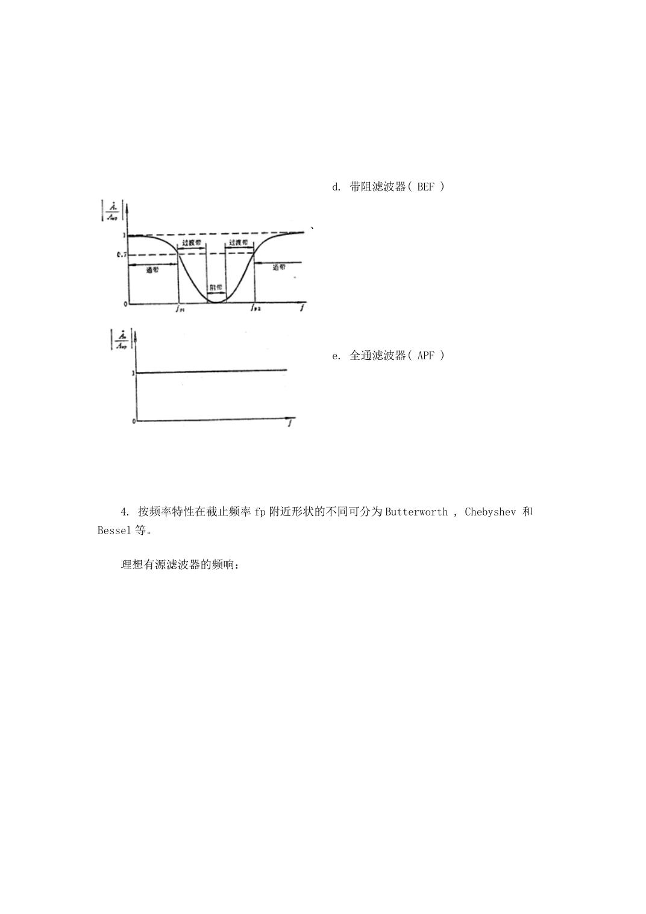

d. 带阻滤波器( BEF ) 

[[硬件/原始备份/运放应用.pdf#page=22|原版PDF第22页整页回看（前文已展示）]]

e. 全通滤波器( APF ) 

4. 按频率特性在截止频率 fp 附近形状的不同可分为 Butterworth , Chebyshev 和 Bessel 等。 

理想有源滤波器的频响： 

[[硬件/原始备份/运放应用.pdf#page=22|原版PDF第22页整页回看（前文已展示）]]

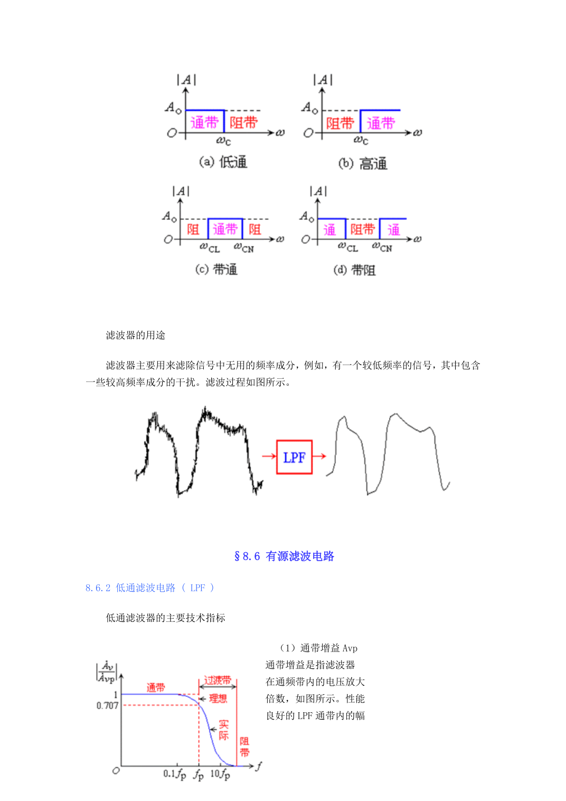

(a) 低通

[[硬件/原始备份/运放应用.pdf#page=22|原版PDF第22页整页回看（前文已展示）]]

[[硬件/原始备份/运放应用.pdf#page=23|原版PDF第23页整页回看（前文已展示）]]

(b) 高通

[[硬件/原始备份/运放应用.pdf#page=22|原版PDF第22页整页回看（前文已展示）]]

[[硬件/原始备份/运放应用.pdf#page=23|原版PDF第23页整页回看（前文已展示）]]

(c) 带通

[[硬件/原始备份/运放应用.pdf#page=22|原版PDF第22页整页回看（前文已展示）]]

[[硬件/原始备份/运放应用.pdf#page=23|原版PDF第23页整页回看（前文已展示）]]

(d) 带阻

滤波器的用途

滤波器主要用来滤除信号中无用的频率成分，例如，有一个较低频率的信号，其中包含 一些较高频率成分的干扰。滤波过程如图所示。 

[[硬件/原始备份/运放应用.pdf#page=23|原版PDF第23页整页回看（前文已展示）]]

§8.6 有源滤波电路

8.6.2 低通滤波电路 ( LPF )

低通滤波器的主要技术指标

[[硬件/原始备份/运放应用.pdf#page=23|原版PDF第23页整页回看（前文已展示）]]

（1）通带增益 Avp 通带增益是指滤波器 在通频带内的电压放大 倍数，如图所示。性能 良好的LPF通带内的幅 频特性曲线是平坦的， 

阻带内的电压放大倍数 

基本为零。 

（2）通带截止频率fp 

其定义与放大电路的上限截止频率相同。通带与阻带之间称为过渡带，过渡带越窄，说明滤 波器的选择性越好。 

## 8.6.2.1 一阶低通滤波电路 ( LPF )

## 一. 电路构成

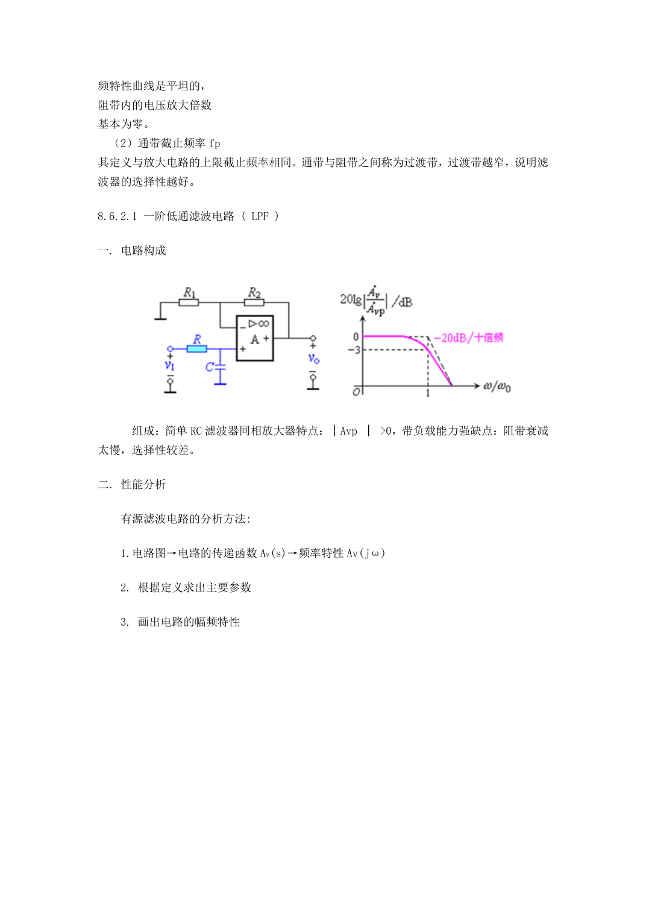

组成：简单RC滤波器同相放大器特点：│Avp │ >0，带负载能力强缺点：阻带衰减 太慢，选择性较差。 

## 二. 性能分析

有源滤波电路的分析方法: 

1.电路图→电路的传递函数 Av(s)→频率特性Av(jω) 

2. 根据定义求出主要参数 

3. 画出电路的幅频特性 

[[硬件/原始备份/运放应用.pdf#page=24|原版PDF第24页整页回看（前文已展示）]]

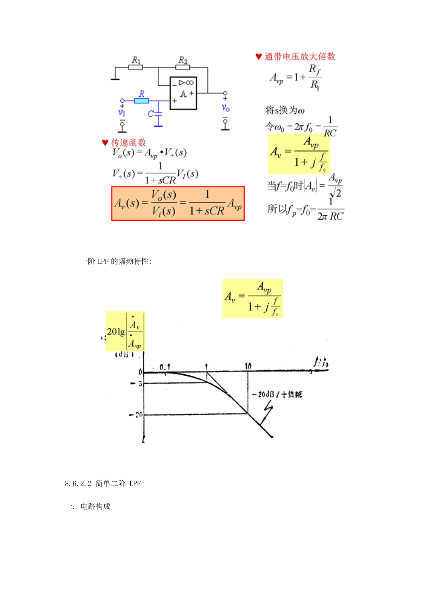

♥通带电压放大倍数 

$$
A _ {v p} = 1 + \frac {R _ {f}}{R _ {1}}
$$

将s换为ω 

♥传递函数 

$$
\text {令} \omega_ {0} = 2 \pi f _ {0} = \frac {1}{R C}
$$

$$
V _ {o} (s) = A _ {v p} \cdot V _ {+} (s)
$$

$$
V _ {+} (s) = \frac {1}{1 + s C R} V _ {I} (s)
$$

$$
A _ {v} = \frac {A _ {v p}}{1 + j \frac {f}{f _ {0}}}
$$

$$
A _ {v} (s) = \frac {V _ {o} (s)}{V _ {i} (s)} = \frac {1}{1 + s C R} A _ {v p}
$$

$$
\text {当} f = f _ {0} \text {时} \left| A _ {v} \right| = \frac {A _ {v p}}{\sqrt {2}}
$$

所以 $f _ { p } { = } f _ { 0 } { = } { \frac { 1 } { 2 \pi R C } }$ 

一阶LPF的幅频特性: 

[[硬件/原始备份/运放应用.pdf#page=25|原版PDF第25页整页回看（前文已展示）]]

8.6.2.2 简单二阶 LPF 

## 一. 电路构成

将s换为ω 

$$
\mathrm{令} \omega_ {0} = 2 \pi f _ {0} = \frac {1}{R C}
$$

$$
A _ {v} = \frac {A _ {v p}}{1 - \left(\frac {f}{f _ {0}}\right) ^ {2} + j 3 \frac {f}{f _ {0}}}
$$

[[硬件/原始备份/运放应用.pdf#page=25|原版PDF第25页整页回看（前文已展示）]]

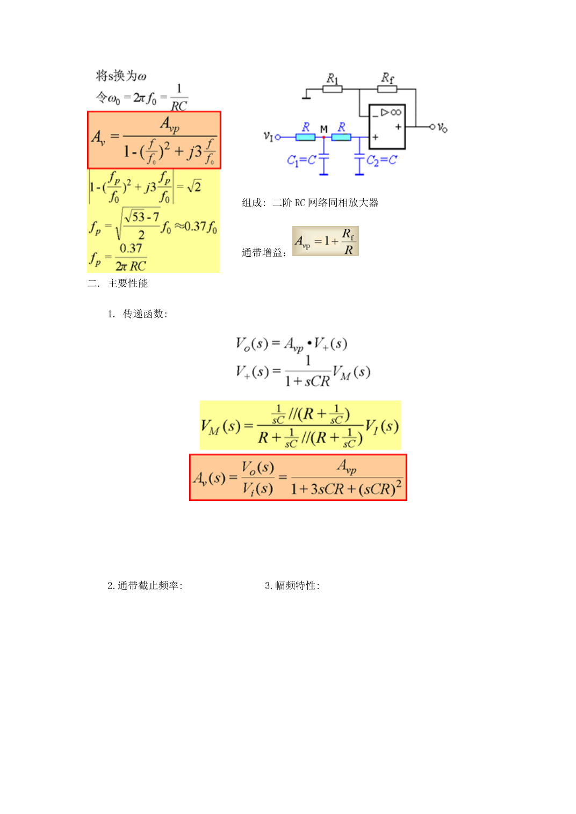

$$
\left| 1 - \left(\frac {f _ {p}}{f _ {0}}\right) ^ {2} + j 3 \frac {f _ {p}}{f _ {0}} \right| = \sqrt {2}
$$

$$
f _ {p} = \sqrt {\frac {\sqrt {5 3} - 7}{2}} f _ {0} \approx 0. 3 7 f _ {0}
$$

组成: 二阶 RC网络同相放大器 

$$
f _ {p} = \frac {0 . 3 7}{2 \pi R C}
$$

$$
A _ {\mathrm{vp}} = 1 + \frac {R _ {\mathrm{f}}}{R}
$$

通带增益： 

## 二. 主要性能

1. 传递函数: 

$$
V _ {o} (s) = A _ {v p} \bullet V _ {+} (s)
$$

$$
V _ {+} (s) = \frac {1}{1 + s C R} V _ {M} (s)
$$

$$
V _ {M} (s) = \frac {\frac {1}{s C} / / (R + \frac {1}{s C})}{R + \frac {1}{s C} / / (R + \frac {1}{s C})} V _ {I} (s)
$$

$$
A _ {v} (s) = \frac {V _ {o} (s)}{V _ {i} (s)} = \frac {A _ {v p}}{1 + 3 s C R + (s C R) ^ {2}}
$$

2.通带截止频率: 

3.幅频特性: 

[[硬件/原始备份/运放应用.pdf#page=26|原版PDF第26页整页回看（前文已展示）]]

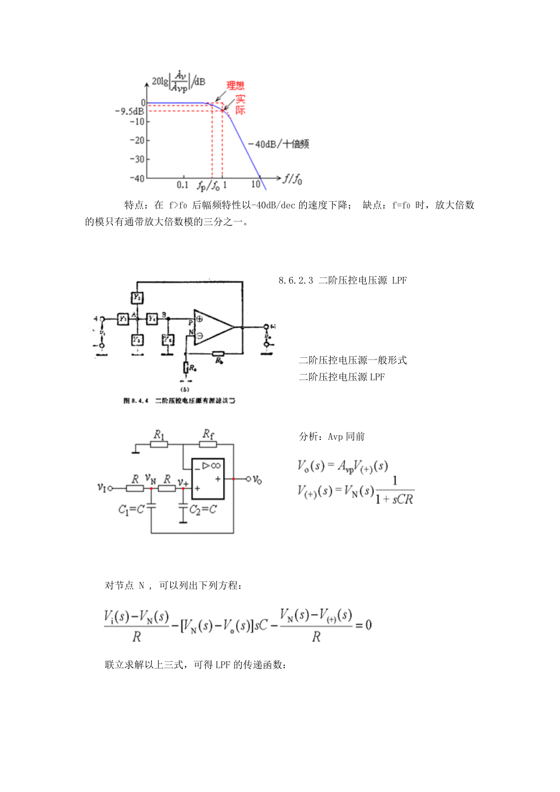

特点：在 f>f0 后幅频特性以-40dB/dec的速度下降； 缺点：f=f0 时，放大倍数 的模只有通带放大倍数模的三分之一。 

[[硬件/原始备份/运放应用.pdf#page=27|原版PDF第27页整页回看（前文已展示）]]

图8.4.4 二阶压控电压源有源滤波

8.6.2.3 二阶压控电压源 LPF 

二阶压控电压源一般形式 二阶压控电压源 LPF 

[[硬件/原始备份/运放应用.pdf#page=27|原版PDF第27页整页回看（前文已展示）]]

分析：Avp 同前 

$$
\begin{array}{l} V _ {\mathrm{o}} (s) = A _ {\mathrm{vp}} V _ {(+)} (s) \\ V _ {(+)} (s) = V _ {\mathrm{N}} (s) \frac {1}{1 + s C R} \end{array}
$$

对节点 N , 可以列出下列方程： 

$$
\frac {V _ {\mathrm{i}} (s) - V _ {\mathrm{N}} (s)}{R} - [ V _ {\mathrm{N}} (s) - V _ {\mathrm{o}} (s) ] s C - \frac {V _ {\mathrm{N}} (s) - V _ {(+)} (s)}{R} = 0
$$

联立求解以上三式，可得 LPF的传递函数： 

$$
A _ {v} (s) = \frac {V _ {\mathrm{o}} (s)}{V _ {\mathrm{i}} (s)} = \frac {A _ {v p}}{1 + (3 - A _ {v p}) s C R + (s C R) ^ {2}}
$$

上式表明，该滤波器的通带增益应小于3，才能保障电路稳定工作。 

频率特性: 

$$
\begin{array}{r l} & \text {将s换为} \omega \\ & \text {令} \omega_ {0} = 2 \pi f _ {0} = \frac {1}{R C} \end{array} \boxed {A _ {v} = \frac {A _ {v p}}{1 - (\frac {f}{f _ {0}}) ^ {2} + j (3 - A _ {v p}) \frac {f}{f _ {0}}}} \\ & \begin{array}{l} A _ {v} \Big | _ {f = f _ {0}} = \frac {A _ {v p}}{j (3 - A _ {v p})} \\ \text {令:} Q = \frac {1}{3 - A _ {v p}} \text {则:} A _ {v} \Big | _ {f = f _ {0}} = Q A _ {v p} \end{array}
$$

当 $\scriptstyle { \mathsf { Q } } = 0 . 7 0 7$ 时， $f _ { p } { = } f _ { 0 }$ 

当 $2 < A _ { \nu p } < 3$ 时， $Q > 1$ $A _ { \nu } \Big | f \big r = f _ { 0 } > A _ { \nu p }$ ,幅频特性在 f=f处将被抬高。 

当 $\mathrm { A v p } \geqslant 3$ 时， $\mathsf Q \mathsf { \Psi } = \mathsf { \infty }$ ，有源滤波器自激。由于将 接到输出端，等于在高频端给 LPF加 了一点正反馈，所以在高频端的放大倍数有所抬高，甚至可能引起自激。 

二阶压控电压源LPF的幅频特性： 

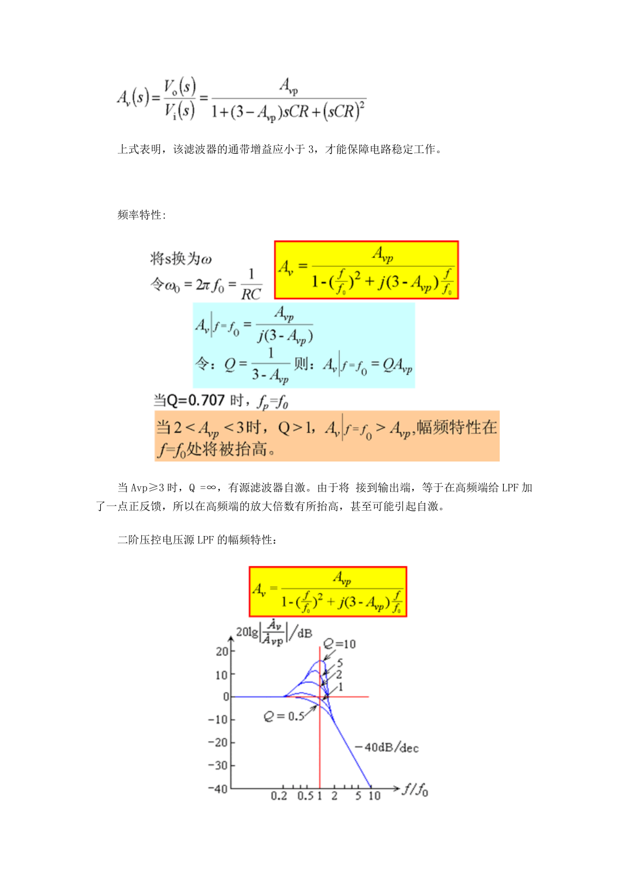

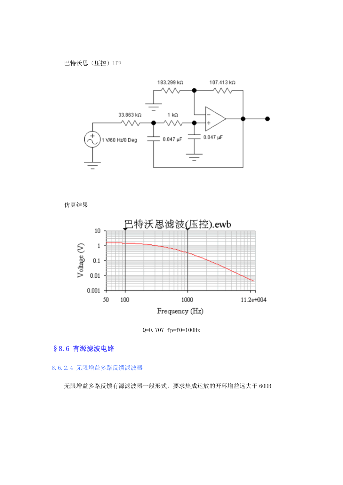

仿真结果 

[[硬件/原始备份/运放应用.pdf#page=29|原版PDF第29页整页回看（前文已展示）]]

## §8.6 有源滤波电路

## 8.6.2.4 无限增益多路反馈滤波器

无限增益多路反馈有源滤波器一般形式，要求集成运放的开环增益远大于60DB 

[[硬件/原始备份/运放应用.pdf#page=29|原版PDF第29页整页回看（前文已展示）]]

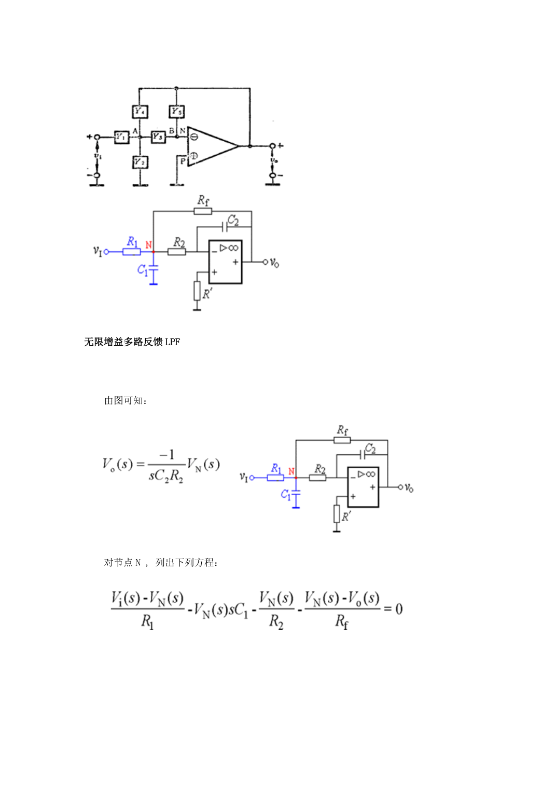

无限增益多路反馈LPF

由图可知： 

[[硬件/原始备份/运放应用.pdf#page=30|原版PDF第30页整页回看（前文已展示）]]

对节点N , 列出下列方程： 

$$
\frac {V _ {\mathrm{i}} (s) - V _ {\mathrm{N}} (s)}{R _ {1}} - V _ {\mathrm{N}} (s) s C _ {1} - \frac {V _ {\mathrm{N}} (s)}{R _ {2}} - \frac {V _ {\mathrm{N}} (s) - V _ {\mathrm{o}} (s)}{R _ {\mathrm{f}}} = 0
$$

$$
A _ {v} (s) = \frac {- R _ {\mathrm{f}} / R _ {1}}{1 + s C _ {2} R _ {2} R _ {\mathrm{f}} \left(\frac {1}{R _ {1}} + \frac {1}{R _ {2}} + \frac {1}{R _ {\mathrm{f}}}\right) + s ^ {2} C _ {1} C _ {2} R _ {2} R _ {\mathrm{f}}} A _ {v p} = - \frac {R _ {2}}{R _ {1}}
$$

通带电压放大倍数 

$$
\begin{array}{r l} A _ {v} = & \frac {A _ {v p}}{1 - (\frac {f}{f _ {o}}) ^ {2} + j \frac {1}{Q} \frac {f}{f _ {0}}} \\ Q = & (R _ {1} / / R _ {2} / / R _ {\mathrm{f}}) \sqrt {\frac {C _ {1}}{R _ {2} R _ {\mathrm{f}} C _ {2}}} \quad f _ {0} = \frac {1}{2 \pi \sqrt {C _ {1} C _ {2} R _ {2} R _ {\mathrm{f}}}} \end{array}
$$

频率响应为： 

巴特沃思（无限增益）LPF 

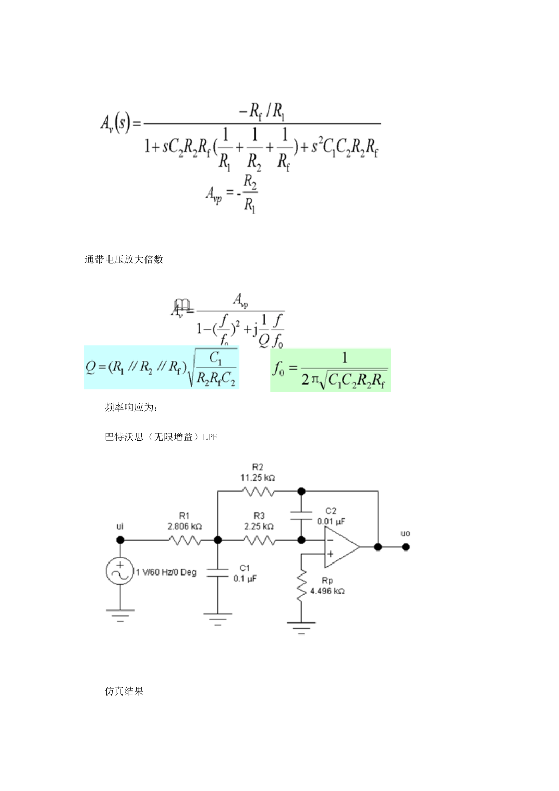

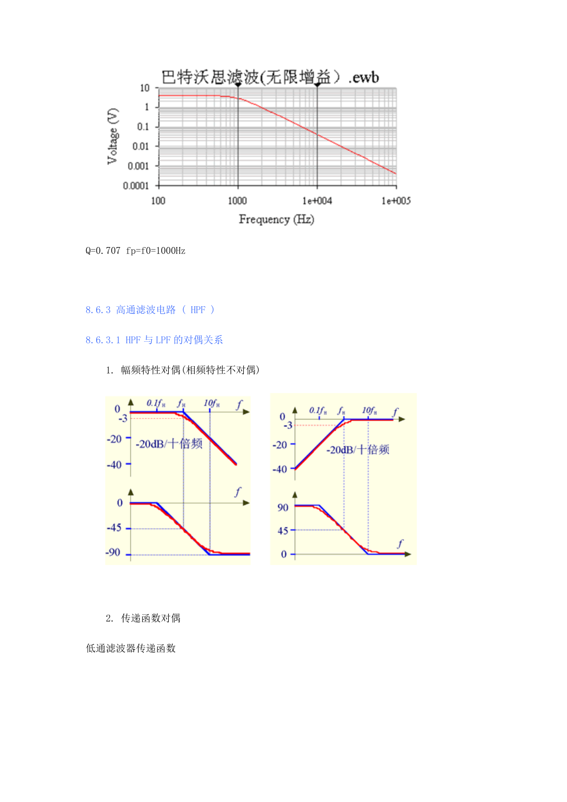

仿真结果 

[[硬件/原始备份/运放应用.pdf#page=31|原版PDF第31页整页回看（前文已展示）]]

[[硬件/原始备份/运放应用.pdf#page=32|原版PDF第32页整页回看（前文已展示）]]

Q=0.707 fp=f0=1000Hz

## 8.6.3 高通滤波电路 ( HPF )

8.6.3.1 HPF 与 LPF 的对偶关系 

1. 幅频特性对偶(相频特性不对偶) 

[[硬件/原始备份/运放应用.pdf#page=32|原版PDF第32页整页回看（前文已展示）]]

## 2. 传递函数对偶

低通滤波器传递函数 

[[硬件/原始备份/运放应用.pdf#page=32|原版PDF第32页整页回看（前文已展示）]]

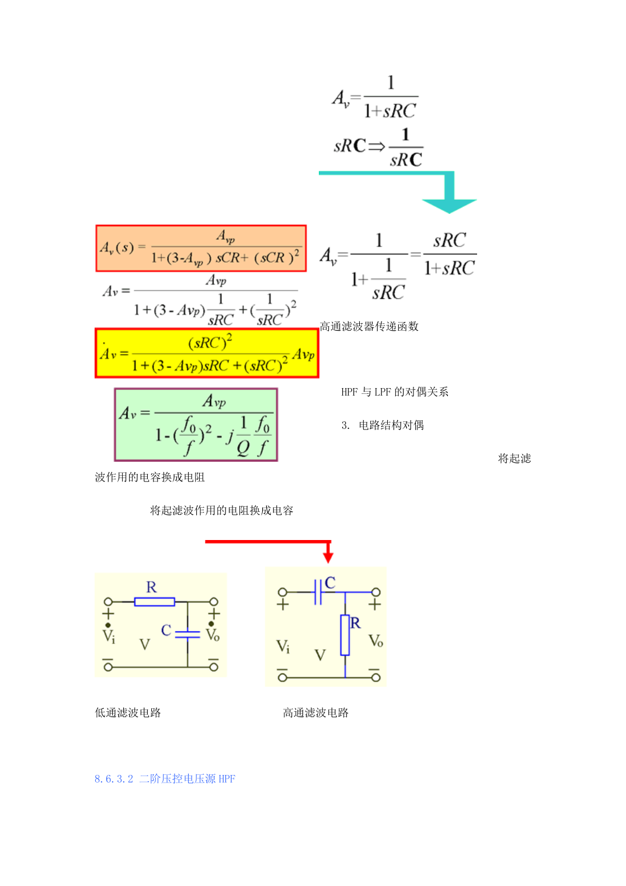

高通滤波器传递函数 

[[硬件/原始备份/运放应用.pdf#page=33|原版PDF第33页整页回看（前文已展示）]]

HPF 与 LPF 的对偶关系 

波作用的电容换成电阻 

3. 电路结构对偶 

将起滤 

将起滤波作用的电阻换成电容 

[[硬件/原始备份/运放应用.pdf#page=33|原版PDF第33页整页回看（前文已展示）]]

低通滤波电路

[[硬件/原始备份/运放应用.pdf#page=33|原版PDF第33页整页回看（前文已展示）]]

高通滤波电路

8.6.3.2 二阶压控电压源 HPF

[[硬件/原始备份/运放应用.pdf#page=33|原版PDF第33页整页回看（前文已展示）]]

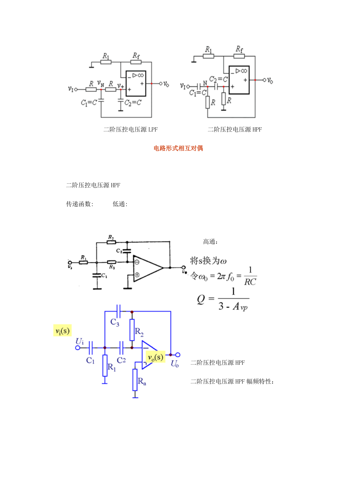

二阶压控电压源 LPF

[[硬件/原始备份/运放应用.pdf#page=34|原版PDF第34页整页回看（前文已展示）]]

二阶压控电压源HPF

电路形式相互对偶

二阶压控电压源HPF 

传递函数: 低通: 

[[硬件/原始备份/运放应用.pdf#page=34|原版PDF第34页整页回看（前文已展示）]]

二阶压控电压源 HPF幅频特性： 

[[硬件/原始备份/运放应用.pdf#page=34|原版PDF第34页整页回看（前文已展示）]]

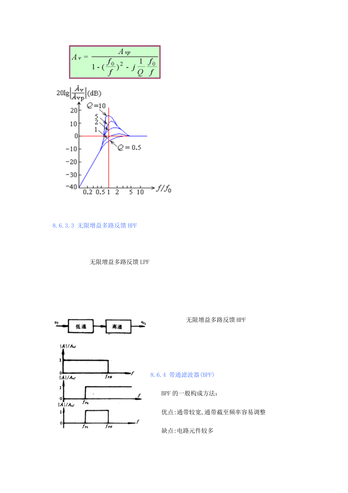

8.6.3.3 无限增益多路反馈 HPF

无限增益多路反馈 LPF

[[硬件/原始备份/运放应用.pdf#page=35|原版PDF第35页整页回看（前文已展示）]]

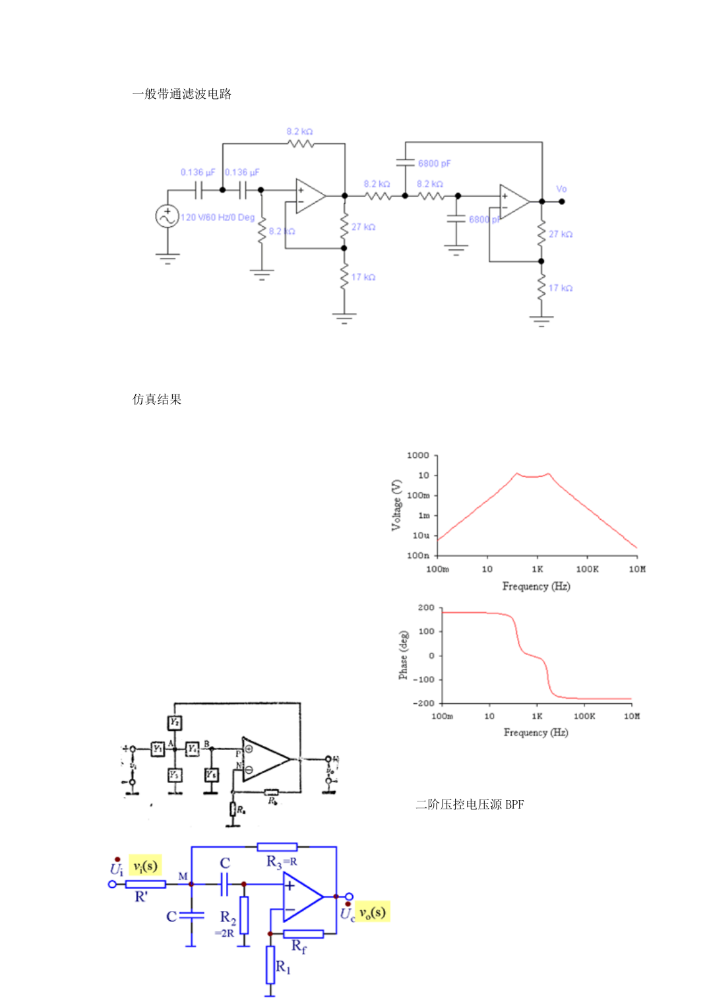

仿真结果

[[硬件/原始备份/运放应用.pdf#page=36|原版PDF第36页整页回看（前文已展示）]]

二阶压控电压源BPF

二阶压控电压源一般形式 

二阶压控电压源BPF 

传递函数: 

$$
\begin{array}{l} \left\{ \begin{array}{l} V _ {o} (s) = \left(1 + \frac {R _ {f}}{R _ {1}}\right) V _ {+} (s) \\ V _ {+} (s) = \frac {s C R _ {2}}{1 + s C R _ {2}} V _ {M} (s) \\ \frac {V _ {i} (s)}{R} - s C V _ {M} (s) - \frac {V _ {M} (s)}{\frac {1}{s C} + R _ {2}} - \frac {V _ {M} (s) - V _ {o} (s)}{R _ {3}} = 0 \end{array} \right. \\ A _ {v} (s) = \frac {s C R}{1 + (3 - A _ {v f}) s C R + (s C R) ^ {2}} \cdot A _ {v f} \quad A _ {v f} = 1 + \frac {R _ {f}}{R _ {1}} \end{array}
$$

$$
A _ {v} (s) = \frac {s C R}{1 + \left(3 - A _ {v f}\right) s C R + (s C R) ^ {2}} \cdot A _ {v f} \quad A _ {v f} = 1 + \frac {R _ {f}}{R _ {1}}
$$

s换成 $j \omega$ 且令： $\omega _ { 0 } = 2 \pi f _ { 0 } = \frac { 1 } { R C }$ 

$f _ { \boldsymbol { \theta } } ,$ 是滤波器的中心频率 

$$
\left\{ \begin{array}{l} A _ {v} = \frac {A _ {v p}}{1 + j \frac {1}{3 - A _ {v f}} \left(\frac {f}{f _ {0}} - \frac {f _ {0}}{f}\right)} \\ A _ {v p} = \frac {A _ {v f}}{3 - A _ {v f}} \quad \text {通带电压放大倍数} \end{array} \right.
$$

$$
\left| \frac {1}{3 - A _ {v f}} (\frac {f}{f _ {0}} - \frac {f _ {0}}{f}) \right| = 1   \left\{ \begin{array}{l} f _ {p 1} = \frac {f _ {0}}{2} \Big (\sqrt {(3 - A _ {v f}) ^ {2} + 4} - (3 - A _ {v f}) \Big) \\ f _ {p 2} = \frac {f _ {0}}{2} \Big (\sqrt {(3 - A _ {v f}) ^ {2} + 4} + (3 - A _ {v f}) \Big) \end{array} \right.
$$

截止频率: 

$$
\begin{array}{r l} B W & = f _ {p 2} - f _ {p 1} = (3 - A _ {v f}) f _ {0} \\ & = (2 - \frac {R _ {f}}{R _ {1}}) f _ {0} \end{array}
$$

RC选定后,改变R1和Rf即可改变频带宽度 

二阶压控电压源BPF仿真电路 

BEF的一般形式

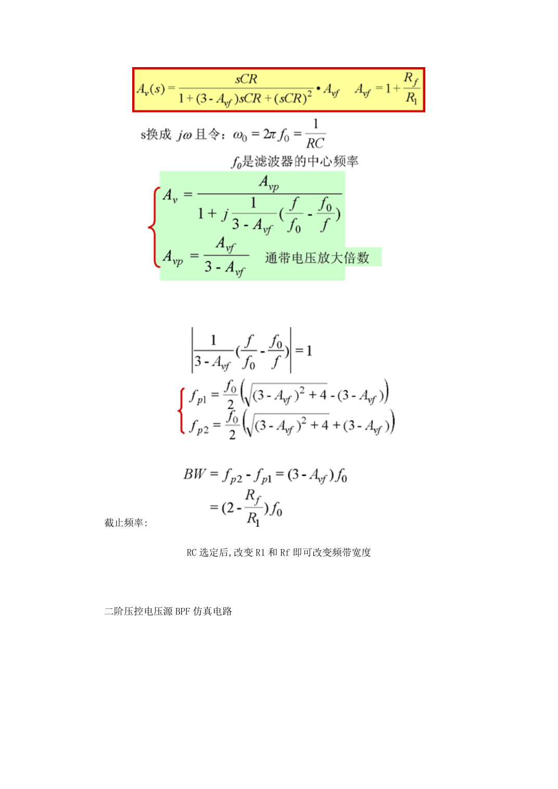

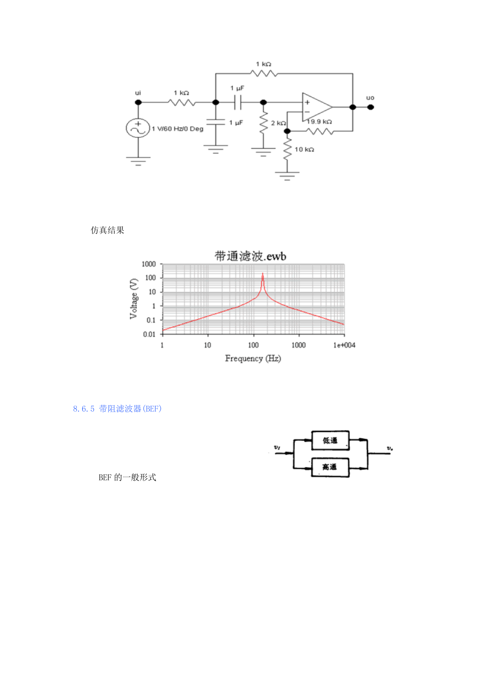

仿真结果

[[硬件/原始备份/运放应用.pdf#page=39|原版PDF第39页整页回看（前文已展示）]]

8.6.5 带阻滤波器(BEF)

[[硬件/原始备份/运放应用.pdf#page=39|原版PDF第39页整页回看（前文已展示）]]

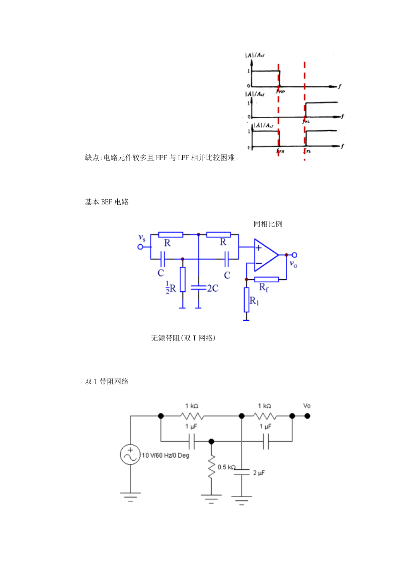

缺点:电路元件较多且 HPF与LPF相并比较困难。

基本 BEF 电路 

[[硬件/原始备份/运放应用.pdf#page=40|原版PDF第40页整页回看（前文已展示）]]

无源带阻(双T 网络)

双T带阻网络

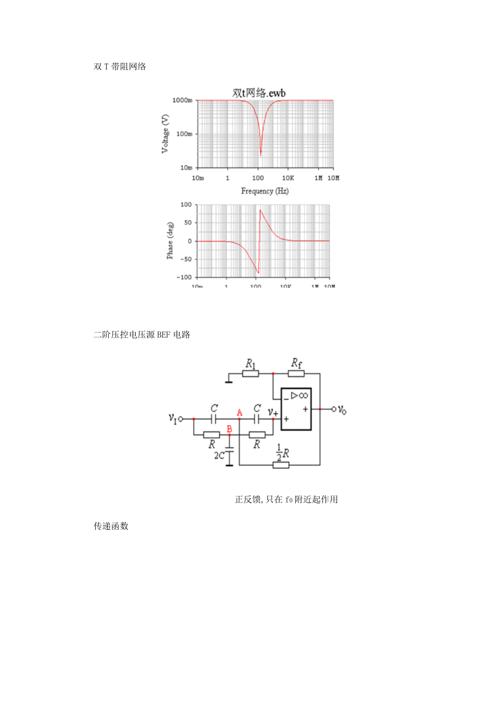

二阶压控电压源BEF电路

[[硬件/原始备份/运放应用.pdf#page=41|原版PDF第41页整页回看（前文已展示）]]

正反馈,只在 f0附近起作用

传递函数

[[硬件/原始备份/运放应用.pdf#page=41|原版PDF第41页整页回看（前文已展示）]]

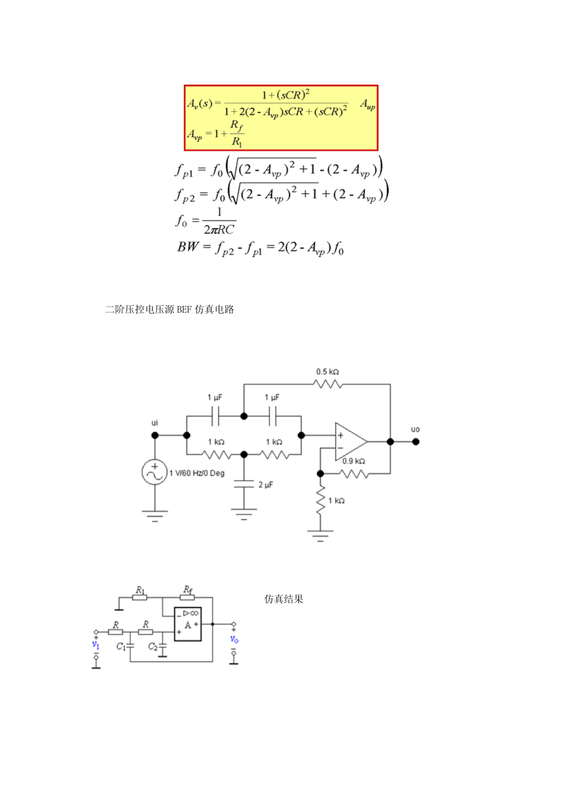

$$
\begin{array}{r l} & A _ {v} (s) = \frac {1 + (s C R) ^ {2}}{1 + 2 (2 - A _ {v p}) s C R + (s C R) ^ {2}} \quad A _ {u p} \\ & A _ {v p} = 1 + \frac {R _ {f}}{R _ {1}} \\ & f _ {p 1} = f _ {0} \left(\sqrt {(2 - A _ {v p}) ^ {2} + 1} - (2 - A _ {v p})\right) \\ & f _ {p 2} = f _ {0} \left(\sqrt {(2 - A _ {v p}) ^ {2} + 1} + (2 - A _ {v p})\right) \\ & f _ {0} = \frac {1}{2 \pi R C} \\ & B W = f _ {p 2} - f _ {p 1} = 2 (2 - A _ {v p}) f _ {0} \end{array}
$$

二阶压控电压源BEF仿真电路 

[[硬件/原始备份/运放应用.pdf#page=42|原版PDF第42页整页回看（前文已展示）]]

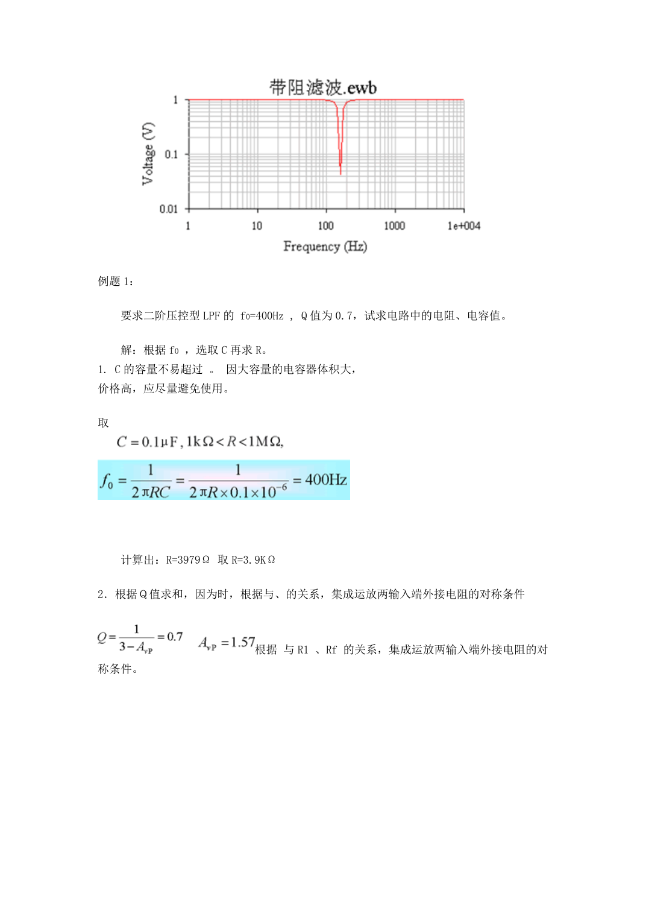

例题 1： 

要求二阶压控型LPF的 f0=400Hz , Q值为0.7，试求电路中的电阻、电容值。 

解：根据f0 ，选取 C再求R。 

1. C的容量不易超过 。 因大容量的电容器体积大， 价格高，应尽量避免使用。 

取 

$$
C = 0. 1 \mu \mathrm{F}, 1 \mathrm{k} \Omega <   R <   1 \mathrm{M} \Omega ,
$$

$$
f _ {0} = \frac {1}{2 \pi R C} = \frac {1}{2 \pi R \times 0 . 1 \times 1 0 ^ {- 6}} = 4 0 0 \mathrm{Hz}
$$

计算出：R=3979Ω 取 R=3.9KΩ 

2．根据Q值求和，因为时，根据与、的关系，集成运放两输入端外接电阻的对称条件 $\mathcal { Q } = \frac { 1 } { 3 - A _ { \mathrm { v P } } } = 0 . 7 \quad A _ { \mathrm { v P } } = 1 . 5 7 _ { \mathrm { \scriptsize / P } }$ 根据 与 R1 、Rf 的关系，集成运放两输入端外接电阻的对 称条件。 

$$
1 + \frac {R _ {\mathrm{f}}}{R _ {1}} = A _ {\nu \mathrm{P}} = 1. 5 7 \quad R _ {1} / / R _ {\mathrm{f}} = R + R = 2 R
$$

$$
R _ {\mathrm{l}} = 5. 5 1 \times R, R _ {\mathrm{f}} = 3. 1 4 \times R, R = 3. 9 \mathrm{k} \Omega
$$

$$
R _ {1} = 5. 5 1 \times R = 5. 5 1 \times 3. 9 \mathrm{k} \Omega = 2 1. 5 \mathrm{k} \Omega
$$

$$
R _ {\mathrm{f}} = 3. 1 4 \times R = 3. 1 4 \times 3. 9 \mathrm{k} \Omega = 1 2. 2 \mathrm{k} \Omega
$$

例题 1 仿真结果

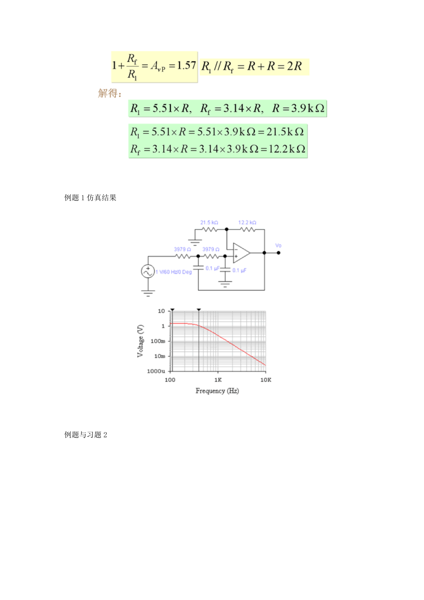

例题与习题2

[[硬件/原始备份/运放应用.pdf#page=44|原版PDF第44页整页回看（前文已展示）]]

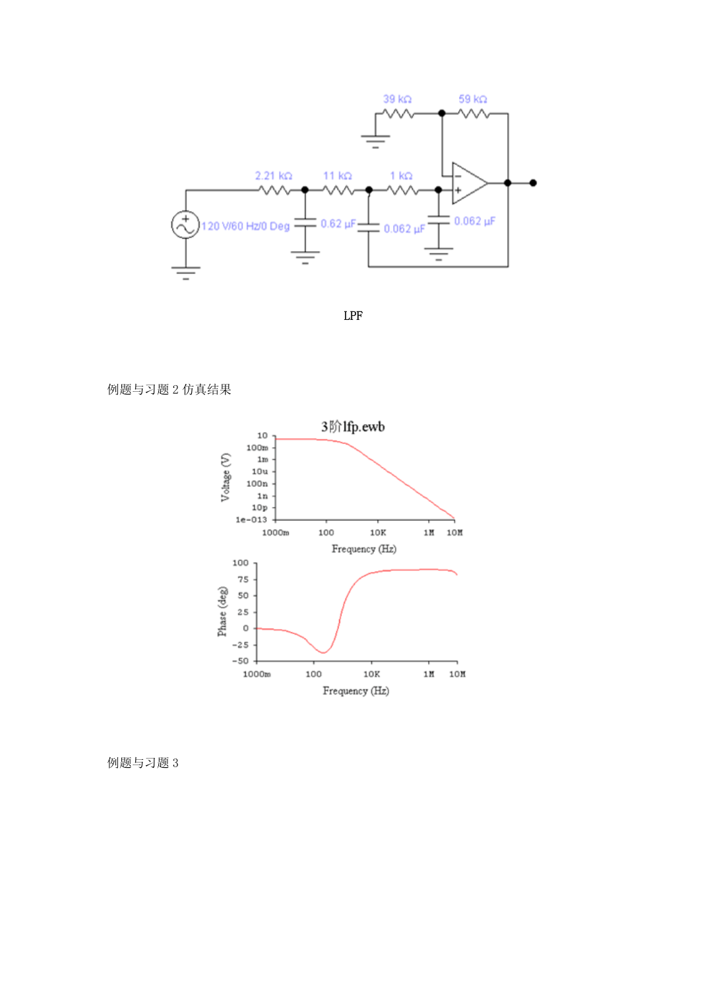

LPF

例题与习题2仿真结果

[[硬件/原始备份/运放应用.pdf#page=45|原版PDF第45页整页回看（前文已展示）]]

例题与习题3

[[硬件/原始备份/运放应用.pdf#page=45|原版PDF第45页整页回看（前文已展示）]]

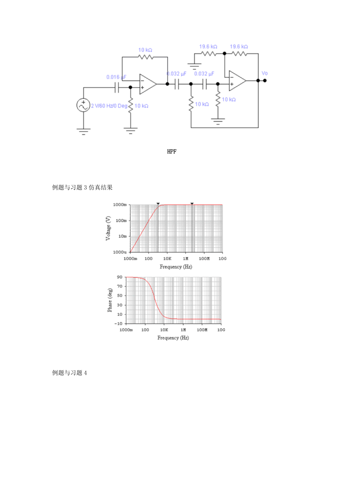

HPF

例题与习题3仿真结果

[[硬件/原始备份/运放应用.pdf#page=46|原版PDF第46页整页回看（前文已展示）]]

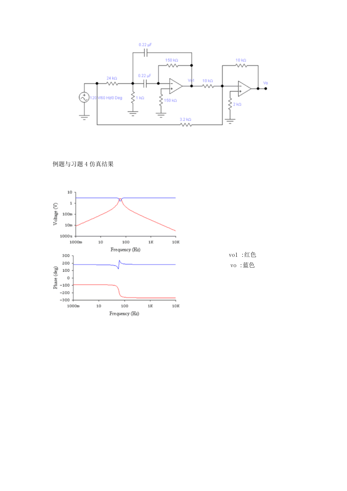

例题与习题4

[[硬件/原始备份/运放应用.pdf#page=47|原版PDF第47页整页回看（前文已展示）]]

例题与习题4仿真结果

[[硬件/原始备份/运放应用.pdf#page=47|原版PDF第47页整页回看（前文已展示）]]

vo1 :红色

vo :蓝色
