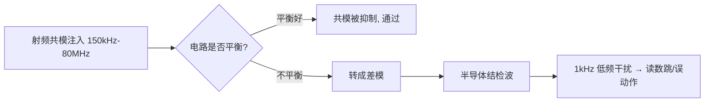

# EMC（分卷 03）

本分卷承接汇总稿 `硬件/原理/EMC.md`，事实来源沿用 frontmatter 中列出的原始资料。

## 验证清单
### EMC知识条目 7
dB 的本质：**把乘除变成加减的对数刻度**。为什么要它？因为 EMC 里的量级跨度太大——从 1μV 到 1V 就是 6 个数量级，用线性坐标画不出来；而且级联系统的增益/衰减是相乘关系，取对数后变成相加，心算方便。

🔬 **深入原理**

两套定义，务必分清：

- **功率量**：$\text{dB}=10\log_{10}\dfrac{P_2}{P_1}$
- **场量（电压/电流/场强）**：$\text{dB}=20\log_{10}\dfrac{V_2}{V_1}$

为什么场量用 20？因为 $P\propto V^2$，$10\log(V^2)=20\log V$。

**绝对单位**（带参考基准）：

| 单位 | 参考基准 | 公式 |
|---|---|---|
| dBμV | 1 μV | $20\log_{10}(V/1\mu V)$ |
| dBμV/m | 1 μV/m | $20\log_{10}(E/1\mu V/m)$ |
| dBm | 1 mW | $10\log_{10}(P/1mW)$ |
| dBμA | 1 μA | $20\log_{10}(I/1\mu A)$ |

**必背换算表**（场量）：

| 倍数 | dB | 倍数 | dB |
|---|---|---|---|
| ×2 | +6 | ×10 | +20 |
| ×4 | +12 | ×100 | +40 |
| ×√2 | +3 | ×1000 | +60 |
| ×0.5 | −6 | ×0.1 | −20 |

**dBm ↔ dBμV（50Ω 系统）**：

$$\text{dB}\mu V = \text{dBm} + 107$$

推导：0 dBm = 1mW，在 50Ω 上 $V=\sqrt{PR}=\sqrt{0.001\times50}=0.2236V=223600\mu V$，$20\log(223600)=107\text{ dB}\mu V$。

🛠 **设计实例/操作**

*例1：读懂测试报告。* 报告写"120MHz 处 QP = 42.5 dBμV/m，限值 30 dBμV/m，余量 −12.5dB"。
反推场强：$E=10^{42.5/20}=133\ \mu V/m$，限值 $10^{30/20}=31.6\ \mu V/m$。
超标 12.5dB ≈ 场强超了约 4.2 倍。要达标需**至少衰减 12.5dB，工程上按 18dB（留 6dB 余量）设计整改**。18dB ≈ 场强降到 1/8，对应"环路面积降到 1/8"或"共模电流降到 1/8"。

*例2：滤波器级联。* 一个 π 型滤波器 −25dB，加一个 CMC −15dB，理想级联 −40dB。但**实测往往只有 −30dB**，因为两级之间存在耦合、寄生参数、阻抗失配。所以别指望简单相加。

*例3：EMI 接收机的三种检波。* 峰值(Peak) ≥ 准峰值(QP) ≥ 平均值(AVG)。预扫用 Peak 快速定位（快但严格），终测按标准用 QP/AVG。若 Peak 就已经在限值以下，直接合格，不必再测 QP。

```
读图口诀
  余量 = 限值 − 实测   （正数=合格，负数=超标）
  −6dB  ≈ 幅度减半
  −20dB ≈ 幅度降到 1/10
  整改目标 = 超标量 + 6dB 余量
```

⚠️ **常见误区**

1. **功率用 20log、电压用 10log**——搞反是最常见的低级错误。
2. dB 与 dBμV 混用。dB 是相对量（无量纲），dBμV 是绝对量。"衰减了 20dBμV"这句话是错的，应说"衰减了 20dB"。
3. 认为"合格就行"。产线一致性、温度、老化都会漂，**必须留 6dB 余量**，关键频点建议 10dB。
4. 用 Peak 值超标就慌。Peak 是最严格的检波方式，QP 通常低几个 dB，AVG 更低。
5. dBm+107 这个换算只在 50Ω 系统成立，别套到高阻测量上。

📌 **要点速记**

- 功率 $10\log$，电压/场强/电流 $20\log$。
- ×2=+6dB，×10=+20dB，牢记这两条能心算大部分问题。
- 50Ω 下 dBμV = dBm + 107。
- 余量 = 限值 − 实测；整改目标 = 超标量 + 6dB。
- 检波严格度：Peak ≥ QP ≥ AVG。

+### EMC进阶知识条目 1
传导发射（Conducted Emission, CE）测的是：**你的设备通过电源线往电网里"倒灌"了多少噪声**。频段通常 150kHz～30MHz（CISPR 32/14/11 等）。

测试怎么做？被测设备（EUT）的电源线接到 **LISN（线路阻抗稳定网络，又叫人工电源网络 AMN）**，LISN 的作用有三：

1. 给 EUT 提供干净的市电（滤掉电网自身噪声）；
2. 在 150kHz～30MHz 内提供**标准化的 50Ω 阻抗**，保证不同实验室结果可比；
3. 把 EUT 产生的噪声耦合到 EMI 接收机（通过 0.1μF + 1kΩ 的取样支路）。

🔬 **深入原理**

CE 噪声同样分共模与差模：

- **差模噪声（DM）**：在 L 与 N 之间流动，主要来自开关电源输入电容的高频纹波电流（$di/dt$ 在输入回路）。频段偏低（150kHz～数 MHz）。
- **共模噪声（CM）**：L 和 N 同向流出，经由 **Y 电容/寄生电容 → 大地（PE）** 回来。主因是开关管漏极（高 $dv/dt$ 节点）对散热片/机壳的寄生电容 $C_p$。频段偏高（几 MHz～30MHz）。

共模位移电流：

$$i_{CM}=C_p\cdot\frac{dv}{dt}$$

举例：MOSFET 漏极到散热片 $C_p=30\text{pF}$，$dv/dt=10\text{kV}/\mu s=10^{10}\text{V/s}$，则 $i_{CM}=0.3\text{A}$ 峰值脉冲——这就是超标的元凶。

LISN 上两路（L、N）分别测得 $V_L$、$V_N$，可分离：

$$V_{CM}=\frac{V_L+V_N}{2},\qquad V_{DM}=\frac{V_L-V_N}{2}$$

有专门的 **CM/DM 分离器**可以直接测，整改效率高很多。

限值举例（CISPR 32 Class B，AC 电源端口）：

| 频段 | QP | AVG |
|---|---|---|
| 0.15～0.5 MHz | 66→56 dBμV（随 log 频率线性下降） | 56→46 dBμV |
| 0.5～5 MHz | 56 dBμV | 46 dBμV |
| 5～30 MHz | 60 dBμV | 50 dBμV |

🛠 **设计实例/操作**

*例1：判断是 CM 还是 DM。* 一个实用土办法：在 EUT 与 LISN 之间的电源线上**套一个大磁环（绕几圈）**。如果超标点明显下降 → 共模为主；几乎不变 → 差模为主。这一步能省掉一半的盲目整改。

*例2：测试布置的坑。* 桌面设备置于 0.8m 高木桌，距参考接地板 0.4m（垂直）/0.8m（水平）；多余电源线**折成 30～40cm 的 8 字捆扎**，不能盘成大圈（会变天线）。布置不规范导致的复测在实验室极常见。

```
传导测试拓扑
  电网 ──[LISN L]──┬── L ──▶ EUT
        [LISN N]──┼── N ──▶ EUT
                  │  PE ──▶ EUT外壳
                  └──▶ 50Ω ──▶ EMI 接收机
  参考接地板（金属地板）与 LISN 外壳、EUT PE 良好搭接
```

⚠️ **常见误区**

1. 认为 CE 是"电源工程师的事"。数字板的时钟噪声一样会通过 DC-DC、地耦合到输入端。
2. 一超标就狂加 X/Y 电容。Y 电容受**漏电流安规限制**（一般 ≤3.5mA，对应 220V/50Hz 时 Y 电容总量约 ≤4.7nF），加过头无法过安规。
3. 忽略 PE 线。二类设备（无 PE）的共模回路只能靠寄生电容，整改思路完全不同。
4. 用普通示波器在电源线上量"噪声"就下结论。示波器噪底、带宽、检波方式与 EMI 接收机完全不同。

📌 **要点速记**

- CE 频段 150kHz～30MHz，用 LISN 提供 50Ω 标准阻抗并取样。
- 低频段多为差模（输入回路 $di/dt$），高频段多为共模（$C_p \cdot dv/dt$）。
- $i_{CM}=C_p\,dv/dt$，减小 $dv/dt$ 或 $C_p$ 是治本。
- 磁环试探法可快速判别 CM/DM。
- Y 电容受安规漏电流限制，不能无限加。


---
### EMC进阶知识条目 2
传导超标的整改，本质是给噪声修一条"回家的近路"，同时在通往电网的路上设卡。核心工具是 **EMI 输入滤波器**。

一个典型 AC 输入 EMI 滤波器：

```
 L ──┬──[ X1 ]──┬──▮▮▮ CMC ▮▮▮──┬──[ X2 ]──┬──▶ 整流桥
     │          │   （共模扼流圈） │          │
    保险丝     压敏                          ├─[Y1]─┐
     │          │                            │      ├── PE
 N ──┴──────────┴──▮▮▮────────────┴─[Y2]─────┘
```

各元件分工：

| 元件 | 抑制对象 | 原理 |
|---|---|---|
| X 电容（L-N 之间） | 差模 | 给差模电流就近短路 |
| Y 电容（L/N 对 PE） | 共模 | 把共模电流引回 PE，缩小环路 |
| CMC 共模扼流圈 | 共模 | 对共模呈高阻（mH 级），对差模低阻 |
| 差模电感 / CMC 漏感 | 差模 | 串联高阻 |
| 磁珠 / 铁氧体 | 高频 | 等效为高频电阻，耗散能量 |

🔬 **深入原理**

滤波器是"阻抗失配"器件，插入损耗依赖源阻抗与负载阻抗：

$$IL(\text{dB})=20\log_{10}\left|\frac{V_{without}}{V_{with}}\right|$$

**阻抗失配原则**：噪声源阻抗低 → 用串联电感阻挡；噪声源阻抗高 → 用并联电容旁路。所以：
- 差模噪声源（输入电容回路）阻抗低 → 优先加差模电感/CMC 漏感。
- 共模噪声源阻抗高（寄生电容耦合） → Y 电容效果显著。

CMC 的共模阻抗：$Z_{CM}=j\omega L_{CM}$，典型 $L_{CM}$ 为 1～10mH，在 1MHz 时 $Z$ 达数 kΩ。但 CMC 有**自谐振频率 SRF**，超过 SRF 后寄生电容主导，阻抗反而下降——所以高频段常需再加一级小磁环或磁珠。

滤波器截止频率（LC 二阶）：

$$f_c=\frac{1}{2\pi\sqrt{LC}}$$

理论 −40dB/dec。设计时让 $f_c$ 比最低超标频点低 5～10 倍。

**衰减目标计算**：超标 12dB → 目标 18dB → 若单级 −40dB/dec，需要 $f_c$ 满足 $18=40\log(f/f_c)$，即 $f/f_c=10^{0.45}=2.8$，取 $f_c \le f_{超标}/3$。

🛠 **设计实例/操作**

*假设性整改算例：* 对0.5 MHz差模超标，可评估0.47 µF安规电容与1 mH差模电感的滤波网络，理想LC特征频率约7.34 kHz。此值不等于实际插入损耗；原笔记未给可复核的前后数据，不能把12–15 dB当作已证实收益。须检查源/负载阻抗、寄生、饱和与阻尼，并在相同测试条件下测量。

*例2：15MHz 超标（共模为主）。* 15MHz 已超过多数 CMC 的 SRF，加大 CMC 电感值往往无效甚至更差。正确做法：
- 在输出线上套**镍锌材质小磁环**（高频阻抗好）；
- 减小开关节点铜皮面积，降低 $C_p$；
- 变压器加**屏蔽层（法拉第屏蔽）**并接原边地；
- MOSFET 栅极电阻适当加大，减缓 $dv/dt$（代价是效率）。

*例3：布局是滤波器的一半。* 滤波器输入端与输出端走线**绝不能平行靠近**，否则高频直接空间耦合"跨过"滤波器，实测衰减腰斩。滤波器区域下方**不要铺连续地平面连到数字地**，应独立并单点搭接机壳。

⚠️ **常见误区**

1. **只换元件不改布局**。滤波器失效 80% 是布局问题：输入输出耦合、Y 电容回流路径长、地环路大。
2. Y 电容走线绕远。Y 电容到 PE 的路径必须**极短、宽**，否则等效电感抵消其作用。
3. 一味加大 CMC 电感。超过 SRF 后无效；应改用多级、不同材质（锰锌低频/镍锌高频）组合。
4. 忽略安规。X 电容需 X1/X2 等级 + 泄放电阻（断电后 1s 内降到 37%）；Y 电容需 Y1/Y2 等级。
5. 用陶瓷电容当 X 电容。X 电容必须是安规认证的薄膜电容。

📌 **要点速记**

- X 电容治差模，Y 电容+CMC 治共模。
- 阻抗失配原则：低阻源用串感，高阻源用并容。
- CMC 有 SRF，高频段需换材质或加磁环。
- 滤波器输入/输出走线必须隔离，Y 电容回 PE 路径要极短。
- 安规限制 Y 电容容量与漏电流，不能无限堆料。


---
### EMC进阶知识条目 3
CS（Conducted Susceptibility，传导抗扰度，IEC 61000-4-6）模拟的场景是：**在 150kHz～80MHz 频段，外界电磁场在线缆上感应出共模电压，顺着线缆灌进设备**。

为什么是这个频段？因为 80MHz 以下，波长（>3.75m）远大于普通设备尺寸，机壳不能有效接收电磁波，但**线缆长度接近 $\lambda/4$，成了高效接收天线**。80MHz 以上则改用辐射抗扰（RS，IEC 61000-4-3）直接照射。

测试等级：Level 1 = 1V、Level 2 = 3V、Level 3 = 10V（rms，未调制载波），实测时用 **1kHz 正弦、80% AM 调幅**，扫频步进 1%，每点驻留 ≥0.5s。

🔬 **深入原理**

注入方式三种：

| 方式 | 器件 | 特点 |
|---|---|---|
| CDN（耦合去耦网络） | CDN-M2/M3、AF、T2 等 | 首选，阻抗标准 150Ω |
| EM-Clamp（电磁钳） | 钳夹线缆 | 无法用 CDN 时（如屏蔽线） |
| 直接注入（BCI/直接耦合） | 100Ω 电阻注入 | 同轴/单线场合 |

**150Ω 共模阻抗**是这个标准的核心参数——它代表人体/线缆对地的典型共模阻抗。CDN 保证注入点看到 150Ω。

设备内部为什么会误动作？共模电压 $V_{CM}$ 通过**不平衡**转成差模干扰：

$$V_{DM}=V_{CM}\cdot\frac{\Delta Z}{Z}$$

$\Delta Z/Z$ 就是电路的不平衡度。差分接收电路（RS-485、以太网）平衡好，抗扰强；单端信号（UART、GPIO、模拟采样）平衡差，容易被击穿。

此外 80MHz 以下的干扰还会被半导体结**检波（rectification）**——PN 结的非线性把射频包络解调出来，变成 1kHz 的低频干扰，直接叠加到运放/ADC 输入，表现为读数跳动。这就是为什么调制是 80% AM 1kHz：**它专门检验解调敏感度**。

🛠 **设计实例/操作**

*例1：模拟采样口被干扰。* 4-20mA 输入在 20MHz 附近读数跳 ±5%。整改：
- 输入端加 **RC 低通**（如 100Ω + 1nF，$f_c=1.6\text{MHz}$）；
- 运放输入引脚就近加 10～100pF 到地（射频旁路）；
- 差分走线，增加共模抑制；
- 线缆入口加 CMC 或磁环。

*例2：I/O 口复位。* 长线 GPIO 在 5MHz 处触发复位。整改：GPIO 加 TVS + 串 100Ω + 1nF 对地；软件加去抖与看门狗；PCB 上把该信号的地回流路径缩短。



⚠️ **常见误区**

1. 只在软件上打补丁（滤波算法）。射频检波产生的是真实模拟量，软件无法完全消除。
2. 在信号线上加大电容却忽略上升沿要求，导致通信速率不达标。要按 $f_c$ 与信号带宽折中。
3. 认为屏蔽线一定好。屏蔽层若**只单端接地或接地阻抗高**，反而成为共模注入通道。高频应 360° 环接。
4. 忘记电源端口也要做 CS。DC 电源输入端同样需要 CMC + Y 电容。
5. 把 CS 与 EFT/Surge 混淆。CS 是持续射频，EFT 是脉冲群，Surge 是大能量单脉冲，防护器件完全不同。

📌 **要点速记**

- CS = IEC 61000-4-6，150kHz～80MHz，共模注入，150Ω 标准阻抗。
- 用 1kHz/80% AM 调制，专门考核半导体结的检波敏感度。
- 不平衡度决定共模→差模转换，平衡设计是根本。
- 端口整改套路：CMC/磁环 + RC 低通 + 就近射频旁路电容 + TVS。
- 屏蔽层需 360° 低阻接地才有效。


---

## 相关入口

- [[硬件/原理/EMC|分类稿汇总目录]]
- [[wiki/来源映射|Wiki 来源映射]]
- [[wiki/概览|Wiki 概览]]
