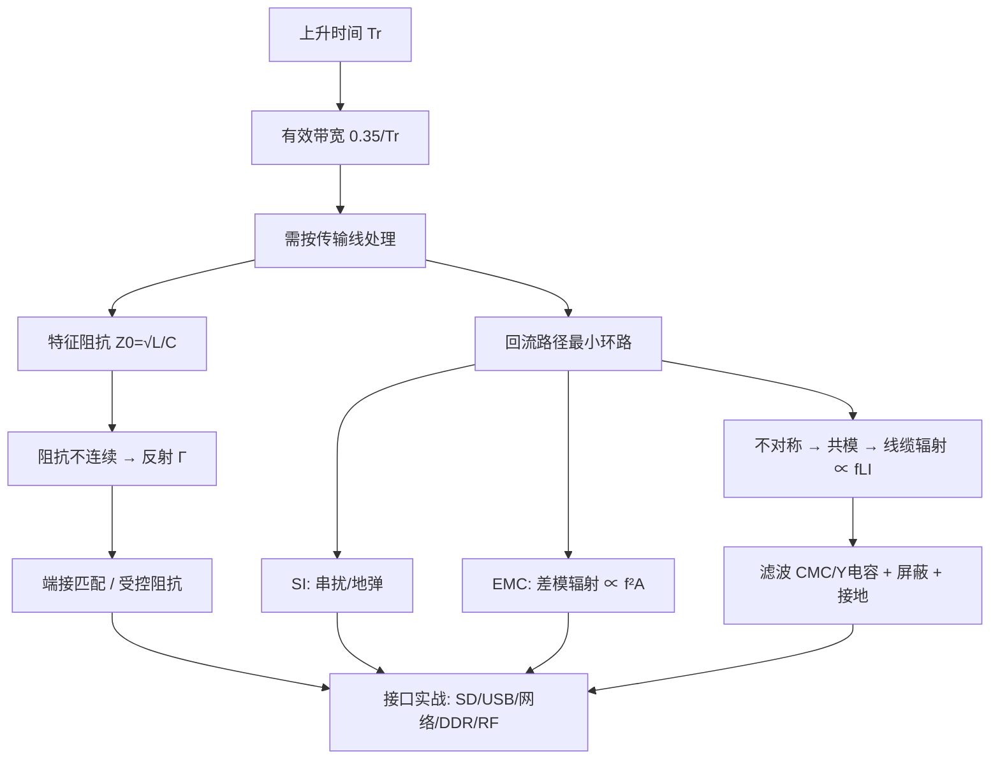

# PI（电源完整性）（分卷 04）

本分卷承接汇总稿 `硬件/原理/PI.md`，事实来源沿用 frontmatter 中列出的原始资料。

## 常见误区
### PI进阶知识条目 3
DDR 第三集：**等长实现与串扰控制**——真正动手画线的部分。

等长预算表（DDR3-1600 参考值，实际以芯片手册为准）：

| 项目 | 建议值 |
|---|---|
| DQ 相对 DQS 组内 | ±25 mil（严格 ±10 mil） |
| DQS± 对内 | ±5 mil |
| CK± 对内 | ±5 mil |
| 地址/命令相对 CK | ±50 mil（严格 ±25 mil） |
| CK 与 DQS 组间 | ±500 mil（宽松，有 leveling） |
| 同组内间距 | ≥ 3W |
| 不同组之间间距 | ≥ 4W |
| DQ 与地址组之间 | ≥ 4～5W 或隔地 |
| CK/DQS 与其它信号 | ≥ 5W，最好包地 |

🔬 **深入原理**

**串扰（Crosstalk）**。两条平行线之间通过互容 $C_m$ 与互感 $L_m$ 耦合，分为：

- **近端串扰 NEXT（后向）**：
$$K_b=\frac{1}{4}\left(\frac{C_m}{C_{11}}+\frac{L_m}{L_{11}}\right)$$
特点：与耦合长度无关（饱和后），持续时间 $2T_d$。

- **远端串扰 FEXT（前向）**：
$$V_{FEXT}=-\frac{1}{2}\left(\frac{C_m}{C_{11}}-\frac{L_m}{L_{11}}\right)\cdot T_d\cdot\frac{dV}{dt}$$
特点：**正比于耦合长度**，脉冲宽度等于 $T_r$。

**关键结论**：
- 在**带状线**（均匀介质）中，$C_m/C_{11}=L_m/L_{11}$，**FEXT ≈ 0**！这是内层走线的巨大优势。
- 在**微带线**（介质不均匀）中 FEXT 不为零，长距离并行时问题明显。
- 所以 **DDR 高速数据优先走内层带状线**。

**3W 规则**的来源：串扰随间距 $S$ 与高度 $H$ 的比值快速衰减，近似 $\propto \dfrac{1}{1+(S/H)^2}$。当 $S=3W$（且 $W\approx 2H$ 时 $S\approx 6H$），串扰可降到 <1%。**注意 3W 中的 W 是线宽，真正起作用的是 $S/H$ 比值**——薄介质（H 小）时，同样间距串扰更小。

**ISI（码间干扰）**：由损耗和反射造成，前一个码元的残留影响下一个。DDR3 距离短、速率相对低，ISI 主要来自阻抗不连续（过孔、颈缩）。

🛠 **设计实例/操作**

*例1：BGA 扇出（Fanout）策略。*

```
  BGA 焊盘阵列（0.8mm pitch）
   ● ● ● ● ●     扇出方式：
   ● ○ ○ ○ ●     - 外两圈：表层直接引出
   ● ○ ◎ ○ ●     - 内圈：Dog-bone 过孔换层
   ● ○ ○ ○ ●     - 过孔尽量对齐成"通道"，给回流留空间
   ● ● ● ● ●     - 每 2~3 个信号过孔配 1 个 GND 过孔
                  - 电源引脚用多过孔并联
```
0.8mm pitch 下，过孔盘 0.45mm、钻孔 0.2mm，两过孔之间可过 1 根 4mil 线（需 6/6 工艺）。这是决定层数的关键——过不去就得加层。

*例2：等长实操顺序。*
1. 先完成所有信号的**拓扑连接**（不管长度）；
2. 测量每组的最长线，定为目标值；
3. **从最短的开始补**，优先在**靠近失配处**的空白区绕；
4. DQS/CK 差分对**先对内等长再对外等长**；
5. 用"时延（delay）"模式而非"长度（length）"模式，让 EDA 自动考虑层速度差；
6. 最后加上封装 skew 补偿（若芯片厂提供 package delay 表）。

*例3：串扰控制实战。*
- CK± 与 DQS± 两侧各留 ≥5W 或加地线（地线两端必须打过孔，间距 <λ/20，否则地线本身变天线）；
- 相邻层信号**正交走线**（L1 横 / L3 竖），避免层间串扰；
- 若两层信号必须同向且相邻，中间必须夹一个完整平面。

⚠️ **常见误区**

1. 只看"总长度相等"，忽略走线层不同导致的速度差。
2. 蛇形绕线自身间距太小（<3W），自耦合让实际延时缩水 5～10%。
3. 用直角蛇形。虽然直角本身在 DDR 频段影响有限，但圆弧/45° 更稳妥，也便于 EDA 计算。
4. 包地线只包不打过孔。**没有过孔的地线是天线，比不包更糟**。
5. 忽略 BGA 区域内的短距离并行——BGA 扇出区往往是串扰最严重的地方，因为线间距被迫极小。
6. 在 DQ 组里插入其它信号（如 I2C、GPIO），造成异步串扰。

📌 **要点速记**

- DQ 对 DQS ±25mil，差分对内 ±5mil，地址对 CK ±50mil。
- 带状线 FEXT ≈ 0，DDR 数据优先走内层。
- 3W 规则本质是 $S/H$ 比值，薄介质更抗串扰。
- 用时延等长而非长度等长；就近补偿。
- 包地线必须两端 + 中间打过孔，否则适得其反。


---
### PI进阶知识条目 4
DDR 第四集：**电源完整性（PDN）、VREF/VTT 与验证方法**。很多"布线看起来完美但跑不稳"的板子，问题都在电源上。

DDR3 典型电源：

| 电源 | 电压 | 用途 | 要求 |
|---|---|---|---|
| VDD/VDDQ | 1.5V (DDR3) / 1.35V (DDR3L) / 1.2V (DDR4) | 核心与 IO | 纹波 <±3%，大电流 |
| VTT | VDDQ/2 = 0.75V | 地址线端接 | 可 source/sink，±3% |
| VREF (VREFDQ/VREFCA) | VDDQ/2 | 接收比较基准 | **纹波 <±1%**，极静 |
| VPP (DDR4) | 2.5V | 字线升压 | 小电流 |

🔬 **深入原理**

**为什么 VREF 要求这么严？** VREF 是接收器判决门限。DDR3 的输入摆幅可能只有 ±100mV，若 VREF 漂移 25mV，就吃掉了 25% 的电压裕量。所以：

$$\text{Noise Margin} = \frac{V_{swing}}{2} - V_{REF\_noise} - V_{ISI} - V_{xtalk} - V_{SSN}$$

VREF 设计要点：
- 用 **1% 精度电阻分压**（如 2×1kΩ），或用 VTT 芯片提供的 VREF 输出（更好，能跟踪 VDDQ）；
- **就近去耦**：分压点 100nF + 每个 VREF 引脚 100nF；
- 走线宽度 ≥ 15～20mil（降低阻抗）但不必很宽（电流极小，μA 级）；
- **VREF 走线必须远离 DQ/CK，且下方参考面完整**；
- 多颗粒时 VREF 用**星型分配**，每颗粒单独一段并各自去耦。

**SSN（同步开关噪声）**：16 位数据同时翻转时，瞬态电流巨大。

$$\Delta V=L_{eff}\cdot N\cdot\frac{di}{dt}$$

对策：VDDQ 去耦电容数量要足（经验：**每个 VDDQ 引脚配 1 个 100nF**，另加 2～4 个 10μF），且 VDDQ 与 GND 平面相邻、介质薄。

**PDN 目标阻抗**：DDR3 1.5V、允许 5% 纹波、瞬态电流 2A：

$$Z_{target}=\frac{1.5\times0.05}{2}=37.5\ \text{m}\Omega$$

需要在 DC～数百 MHz 内维持这个阻抗，靠"稳压器（<100kHz）+ 大电容（100k～1MHz）+ 陶瓷电容（1M～100MHz）+ 平面电容（>100MHz）"四级接力。

🛠 **设计实例/操作**

*例1：去耦布局。*
```
 SoC 侧            DDR 颗粒侧
 [10μF]×2         [10μF]×1
 [100nF]×N        [100nF]×N  （N = VDDQ 引脚数）
  ↑贴引脚，双过孔   ↑贴引脚，最好放在颗粒背面正下方
 VDDQ 平面：整块铺，避免细长条；与 GND 平面相邻，介质 ≤0.1mm
```

*例2：验证方法（层层递进）。*

1. **DRC/规则检查**：等长、间距、阻抗、过孔数。
2. **SI 仿真**：HyperLynx / SIwave / ADS，看眼图、过冲、串扰。DDR3-1600 眼高应 >150mV、眼宽 >0.4UI。
3. **硬件调试**：
   - 先降频跑（DDR3-800）确认基本功能；
   - 用 **memtester / stressapptest / Linux memtest** 长时间压测（≥8 小时）；
   - 高低温循环测试（−20℃～70℃），温度会改变时序；
   - 读取控制器的 **训练结果寄存器**（write leveling delay、read gate delay、DQ deskew 值），看各 bit 的窗口是否居中、是否有异常离群值——**离群的那一位往往就是布线有问题的那根线**。
4. **示波器实测**：用高带宽差分探头量 DQS/CK 眼图（注意探头本身会引入负载）。

*例3：常见故障对照。*

| 现象 | 可能原因 |
|---|---|
| 完全跑不起来 | 电源时序、复位、ZQ 电阻（240Ω 1%）、初始化配置 |
| 降频可以，高频不行 | 等长/串扰/阻抗/VREF 噪声 |
| 个别 bit 错误 | 该 bit 走线异常（跨分割、串扰、虚焊） |
| 高温不稳 | 时序裕量不足，温度使延时变化 |
| 偶发死机 | SSN、去耦不足、地弹 |

⚠️ **常见误区**

1. VREF 用普通 5% 电阻分压且不去耦。
2. VREF 与 VTT 共用走线或共用分压点（VTT 有大电流，会污染 VREF）。
3. 忘记 **ZQ 校准电阻 240Ω 1%**，或走线太长（应 <10mm，且接 GND）。
4. VDDQ 平面被走线切成细长条，等效电感大。
5. 去耦电容数量够但过孔共用/距离远。
6. 只做功能测试不做压力与高低温测试，量产后批量返修。

📌 **要点速记**

- VREF 纹波 <±1%，1% 电阻分压或用 VTT 芯片输出，星型分配 + 就近去耦。
- VTT 需可 source/sink，端接在链路最远端。
- 每个 VDDQ 引脚配 100nF，VDDQ 与 GND 平面相邻薄介质。
- ZQ 电阻 240Ω 1%，靠近颗粒接 GND。
- 验证：仿真 → 降频 → 压测 → 高低温 → 读训练寄存器定位坏 bit。


DDR 四集结束。接下来两集转向射频类接口：GNSS 与蓝牙/WiFi/4G，它们的核心矛盾从"时序"变成了"灵敏度与共存"。

---
### PI进阶知识条目 5
1. **信号怎么走**（阻抗、反射、匹配）——传输线理论；
2. **电流怎么回**（回流路径、地设计、共模/差模）——回路思维；
3. **能量怎么跑掉/进来**（EMC 发射与抗扰）——耦合与屏蔽。

而这三件事本质上都指向同一句话：**高速设计的核心不是"画线"，而是"管理电磁场与电流回路"**。

🔬 **深入原理：知识地图**



**贯穿全课的 5 个数字**：

| 数字 | 含义 |
|---|---|
| **6 mil/ps** | FR-4 内层传播速度（微带约 7） |
| **0.35 / Tr** | 有效带宽（拐点频率） |
| **±3H** | 80% 回流集中范围 |
| **1 nH/mm** | 普通走线/引线电感估算 |
| **λ/20** | 缝隙、缝合孔、地线过孔的间距上限 |

🛠 **设计实例/操作：完整设计流程与自检清单**

**阶段一：原理图/选型**
- [ ] 确认各接口速率、上升时间、阻抗规范（USB 90Ω、以太网/LVDS 100Ω、单端 50Ω、DDR 40/50Ω）
- [ ] 时钟源选型（是否需要 SSC）、串阻位置预留
- [ ] ESD/TVS 选型（结电容匹配速率）、CMC、滤波元件预留
- [ ] 电源架构：噪声敏感模块（GNSS/RF/ADC/PHY-AVDD）用 LDO 或加滤波
- [ ] 预留 π 型匹配、测试点（低速）、调试接口

**阶段二：叠层与阻抗**
- [ ] 每个信号层紧邻完整参考平面
- [ ] PWR 与 GND 平面相邻，介质尽量薄
- [ ] 找板厂确认叠层与 Dk/Df，算准线宽线距
- [ ] 高速差分优先内层带状线（FEXT≈0）

**阶段三：布局**
- [ ] 分区：接口区/数字区/模拟区/电源区/RF 区
- [ ] 接口靠板边集中，走线不回穿数字区
- [ ] 高速链路"一"字排开，不折返
- [ ] 去耦电容贴引脚，DC-DC 输入环路最小
- [ ] 晶振靠芯片、下方铺地
- [ ] 天线净空区、变压器隔离沟先划出

**阶段四：布线**
- [ ] 不跨分割；换层伴地孔（<100～200mil）
- [ ] 3W/4W/5W 间距规则按等级执行
- [ ] 差分：等长、等距、对称，就近补偿
- [ ] DDR：按组等长（时延模式），VTT 在最远端
- [ ] RF：短直无过孔、两侧缝合地孔
- [ ] 时钟包地且地线两端+中间打孔

**阶段五：EMC 加固**
- [ ] 板边缝合地过孔 ≤200mil，20H 规则
- [ ] 排针/连接器按 1:3 配地
- [ ] 屏蔽罩多点接地，缝隙 <λ/20
- [ ] 机壳地与信号地 1nF/2kV + 1MΩ 连接
- [ ] 长线 I/O 预留磁环/CMC 位置

**阶段六：验证**
- [ ] SI 仿真（眼图、串扰、过冲）
- [ ] PDN 阻抗仿真（$Z<Z_{target}$）
- [ ] 功能 + 压力 + 高低温测试
- [ ] EMC 预测试（近场探头 + 简易暗室）
- [ ] 留 6dB 余量再送正式认证

⚠️ **常见误区（全课总结）**

1. **用频率而非上升时间判断高速**——第一原则性错误。
2. **只画线不想回流**——所有 SI/EMC 问题的共同根源。
3. **等长绝对化**——该松的地方过度绕线，反而增加串扰。
4. **EMC 后置**——测试超标才整改，成本高十倍。
5. **迷信单一手段**——屏蔽罩/磁环/展频都不是万能药。
6. **不留余量**——刚好合格 = 量产必炸。
7. **不做定位就整改**——盲目试错，改好了也复现不了。

📌 **要点速记**

- 高速设计三主线：信号路径、回流路径、耦合路径。
- 五个关键数字：6mil/ps、0.35/Tr、±3H、1nH/mm、λ/20。
- 流程六阶段：选型 → 叠层 → 布局 → 布线 → EMC 加固 → 验证。
- 80% 的结果在布局阶段就已决定。
- 一切规则的目的都是：**让电流走最小的环路**。


---
### PI进阶知识条目 6
- **建立"传输线思维"**：判断是否高速看上升时间 $T_r$ 而非时钟频率，掌握 $L_{crit}\approx T_r v/6$ 与 $f_{knee}=0.35/T_r$。
- **吃透阻抗与反射**：$Z_0=\sqrt{L_0/C_0}$、$\Gamma=(Z_2-Z_1)/(Z_2+Z_1)$、弹跳图与振铃频率 $1/4T_d$，能定量估算过冲与定位问题线长。
- **掌握端接选型**：源端串阻（零功耗、点对点首选）、并联/戴维南、AC 端接、片内 ODT 的适用边界与参数计算。
- **确立"回流路径"世界观**：高频回流紧贴信号线（±3H 内 80%），不跨分割、换层伴地孔，这是 SI 与 EMC 的共同命门。
- **区分共模与差模**：理解共模辐射效率远高于差模，掌握不对称→模式转换的机理与 skew 控制要求。
- **建立完整 EMC 框架**：EMI（CE/RE）+ EMS（ESD/EFT/Surge/CS/RS/DIP）的标准、限值、测试布置与整改优先级。
- **熟练使用 dB 语言**：功率 10log / 场量 20log、dBμV=dBm+107、余量与整改目标（超标量 +6dB）的换算。
- **形成滤波与防护方法论**：阻抗失配原则、X/Y 电容与 CMC 分工、TVS 三级配合与能量退耦、ESD "1nH=30V" 的布局铁律。
- **掌握电源完整性基础**：$Z_{target}$ 计算、电容 SRF 与反谐振、去耦"位置优先于容值"、DC-DC 与 PDN 布局要点。
- **打通主流接口 Layout 实战**：SD 卡串阻与 ESD、USB 90Ω 与 AC 耦合、以太网 RGMII 延时与变压器隔离沟、DDR 分组等长与 VREF/VTT、GNSS 噪声隔离、无线天线净空与共存。
- **具备系统化排查能力**：从"记录频点 → 特征判断 → 近场定位 → 整改 → 复测 → 固化规范"的闭环流程。
- **形成可复用的自检清单**：从选型、叠层、布局、布线、EMC 加固到验证的六阶段 checklist，把经验沉淀为标准动作。

## 来源定位
- `原始备份/08_【Altium Academy】电源完整性...md`：PDN、去耦、自谐振、反谐振、平面和电源噪声。
- `原始备份/07_【EEVblog】电源设计...md`：稳压器输出、负载瞬态和电源测试。
- `原始备份/09_【Altium Academy】PCB 设计中的数学.md`：阻抗、寄生参数和计算基础。

## 相关入口

- [[硬件/原理/PI|分类稿汇总目录]]
- [[wiki/来源映射|Wiki 来源映射]]
- [[wiki/概览|Wiki 概览]]
