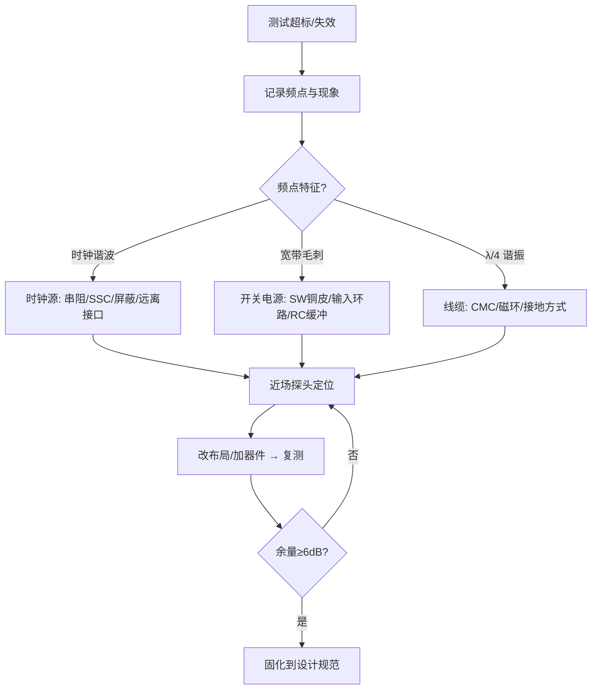

# SI（信号完整性）（分卷 04）

本分卷承接汇总稿 `硬件/原理/SI.md`，事实来源沿用 frontmatter 中列出的原始资料。

## 测试判读
### SI进阶知识条目 4
🔬 **深入原理：一张总表**

| 实验 | 频段/波形 | 主因 | 首选整改 | 备选 |
|---|---|---|---|---|
| CE 传导 | 150k～30MHz | 低频段差模、高频段共模 | X/Y 电容、CMC、减小 $dv/dt$ | 变压器屏蔽层、磁环、RC 缓冲 |
| RE 辐射 | 30M～1/6GHz | 线缆共模、缝隙泄漏、平面边缘 | 缩小环路、串阻、CMC/磁环 | 屏蔽罩、SSC、改叠层 |
| ESD | <1ns, 30A | 高频路径电感、接地不良 | TVS 靠连接器、地路径最短 | 结构泄放、导电泡棉、软件容错 |
| EFT | 5/50ns 突发 | 共模、地环路 | Y 电容、CMC、机壳多点搭接 | TVS、缩短复位/晶振路径 |
| Surge | 8/20μs, 数百A | 能量泄放不足 | GDT+MOV+TVS 三级 | 退耦电感/PTC、隔离变压器 |
| CS | 150k～80MHz | 电路不平衡、结检波 | 平衡设计、RC 低通、射频旁路 | CMC、屏蔽层 360° 接地 |
| RS | 80M～6GHz | 同 CS + 直接场耦合 | 屏蔽、滤波、缩小敏感环路 | 器件重选、软件滤波 |
| DIP | 电压跌落 | 储能不足 | 加大输入电容、掉电检测 | 宽输入范围电源 |

**通用排查流程：**



🛠 **设计实例/操作**

*例1：把 EMC 前移到设计阶段的 Checklist（板级）。*

1. 叠层：至少一个完整 GND 平面，高速层紧邻 GND，PWR/GND 相邻薄介质。
2. 分区：接口区 / 数字区 / 模拟区 / 电源区物理分开，接口区靠板边集中。
3. 回流：不跨分割，换层伴地孔，排针按 1:3 配地。
4. 时钟：最短、包地、串阻、远离板边与接口 ≥ 300mil。
5. 接口：TVS 靠连接器、CMC 在其后、走线不回穿数字区。
6. 电源：去耦贴引脚、DC-DC 输入环路最小、SW 铜皮最小。
7. 板边：缝合地过孔间距 ≤200mil，20H 规则。
8. 结构：屏蔽罩多点接地、缝隙 <λ/20、螺柱接地。

*例2：整改的"经济学"。* 同样 10dB 的改善：
- 改布线：0 元/台，但需要重新打样（一次性成本）
- 串阻 + 磁环：约 0.2 元/台 × 10 万台 = 2 万元
- 屏蔽罩：约 3 元/台 × 10 万台 = 30 万元

所以**设计阶段多花两天做 EMC 评审，可能省下几十万**。

⚠️ **常见误区**

1. "试错法"整改：随机加电容磁环，改好了也不知道为什么，量产一致性差。
2. 不做近场定位就动手。定位是整改效率的关键。
3. 只解决超标频点，不看整体余量趋势。
4. 整改方案不固化。同一个坑在下一个项目再踩一遍。
5. 忽视测试布置差异。同一台机器在不同实验室差 3～5dB 很正常。

📌 **要点速记**

- 每个实验都有典型主因与首选手段，先按表定位再动手。
- 排查顺序：记录频点 → 判断特征 → 近场定位 → 整改 → 复测。
- 板级 8 条 Checklist 能挡掉大部分问题。
- 整改成本随阶段推后指数上升，前移设计最划算。
- 留 6dB 余量，把有效方案固化为公司设计规范。


---
### SI进阶知识条目 5
"地"不是电位为零的理想节点，而是**回流电流的公共通道**。所有 SI 与 EMC 问题追到底，都能追到地上。

三个必须建立的观念：
1. 地平面上任意两点都有阻抗，高频下电感占主导 → 存在电位差。
2. 电流走的是**回路阻抗最小**的路径，你无法"命令"电流去哪，只能设计路径。
3. "分割地"是为了控制回流路径，**不是为了让噪声消失**；分割用错比不分割更糟。

🔬 **深入原理**

**地阻抗**：一段铜皮的电感约

$$L\approx 0.2\ell\left[\ln\frac{2\ell}{w+t}+0.5+0.2235\frac{w+t}{\ell}\right]\ (\text{nH},\ \text{mm})$$

粗略记忆：**一段普通走线约 1nH/mm**，宽平面可低到 0.1nH/mm 以下。所以平面永远优于走线。

**单点接地 vs 多点接地**：

| 方式 | 适用频率 | 原理 | 场景 |
|---|---|---|---|
| 单点接地 | < 1 MHz | 消除地环路，避免公共阻抗耦合 | 低频模拟、音频、精密测量 |
| 多点接地 | > 10 MHz | 缩短回流路径，降低电感 | 数字、高速、RF |
| 混合接地 | 宽频 | 电容实现"直流单点、高频多点" | 混合信号板、机壳地 |

判据：接地线长度 $< \lambda/20$ 时可视为单点，否则必须多点。

**分割（Split）的正确用法**：只有当**跨区信号极少且能被严格控制**时才分割。典型是 ADC/DAC：
- 模拟地与数字地在**ADC 芯片正下方单点连接**（现在更主流的做法是**不分割，用布局分区代替分割**）；
- 若分割，则跨越缝隙的信号必须为零，或在跨越处提供桥接。

现代主流观点（Henry Ott / Howard Johnson）：**优先"不分割 + 布局分区"**。理由：完整平面提供最低阻抗与最短回流；分割带来的缝隙一旦被信号跨越，代价远大于收益。

🛠 **设计实例/操作**

*例1：混合信号板布局分区（不分割地）。*

```
  ┌─────────────────────────────────────┐
  │  数字区        │  ADC  │   模拟区    │
  │  MCU/DDR/时钟  │ 芯片  │  运放/基准  │
  │                │       │             │
  │   ← 数字回流 →  │       │ ← 模拟回流 →│
  └─────────────────────────────────────┘
         整块完整 GND 平面（不分割）
   要点：数字信号绝不走到模拟区上方；
         ADC 数字侧串阻 + 数字电源单独 LC 滤波
```

*例2：机壳地 / 保护地 / 信号地。* 三者关系用"电容+电阻+磁珠"选择性连接：
- 高频短接（1nF/2kV 电容）→ 给 ESD/EFT 共模电流回路；
- 直流隔离或高阻（1MΩ）→ 避免地环路电流与安全问题；
- 接口连接器金属壳建议直接接机壳地，而非信号地。

*例3：过孔缝合（Stitching）。*
- 板边：间距 ≤ $\lambda_{min}/20$，工程取 100～200mil；
- 高速信号换层：紧邻（<100mil）伴 1～2 个 GND 过孔；
- 大面积铜皮：均匀铺缝合孔，防止形成谐振腔（腔模谐振频率 $f_{mn}=\frac{c}{2\sqrt{\varepsilon_r}}\sqrt{(m/a)^2+(n/b)^2}$）。

⚠️ **常见误区**

1. **为了"隔离"随手挖槽**，然后让信号横穿。这是 EMC 头号杀手。
2. 用"星形地"处理高速数字。高频下星形地的长引线电感巨大，完全失效。
3. 认为"地平面越多越好"。层数增加成本，关键是**每个信号层都紧邻一个完整参考面**。
4. 大面积铜皮不打缝合孔，形成腔体谐振，某些频点辐射突增。
5. 把 ADC 的 AGND/DGND 引脚理解为"必须接到两个不同的地"。数据手册里它们通常是芯片内部已分开、外部应接同一块地。

📌 **要点速记**

- 地是回流通道，平面阻抗远低于走线（约 1nH/mm vs <0.1nH/mm）。
- 单点接地 <1MHz，多点接地 >10MHz，混合用电容实现。
- 现代主流：**布局分区优于平面分割**；一定要分割就绝不让信号跨越。
- 换层伴地孔、板边缝合孔间距 ≤λ/20。
- 机壳地与信号地用 1nF+1MΩ 并联做混合连接。


---
### SI进阶知识条目 6
SD/TF 卡看起来简单，却是很多产品的"翻车重灾区"——插拔可靠性、ESD、时序、EMC 全都涉及。

接口模式与速率：

| 模式 | 时钟 | 位宽 | 带宽 | 电平 |
|---|---|---|---|---|
| Default Speed | 25 MHz | 4-bit | 12.5 MB/s | 3.3V |
| High Speed | 50 MHz | 4-bit | 25 MB/s | 3.3V |
| SDR50 / SDR104 | 100/208 MHz | 4-bit | 50/104 MB/s | **1.8V** |
| DDR50 | 50 MHz 双沿 | 4-bit | 50 MB/s | 3.3V/1.8V |

信号：CLK、CMD、DAT0～DAT3、VDD、VSS、CD（插入检测）、WP。SPI 模式下只用 CLK/CMD(MOSI)/DAT0(MISO)/DAT3(CS)。

🔬 **深入原理**

SD 是**源同步单端总线**，时序模型为：

$$t_{setup}=t_{CLK\_period}-t_{CLK\_delay}-t_{OD}-t_{DAT\_delay}$$

在 50MHz（20ns 周期）下，允许的 skew 很宽松（几 ns），所以**等长要求不严**（一般 CLK 与 DAT/CMD 长度差 <100～200mil 即可）。但到了 SDR104（208MHz，4.8ns 周期），等长要求收紧到 ±50mil 以内，且必须做阻抗控制（50Ω±10%）。

真正的难点其实在三处：
1. **CLK 的信号完整性**：CLK 边沿快、扇出到卡座（容性负载 ~10pF），容易过冲振铃。
2. **ESD**：卡槽是人手直接接触的开口，是 ESD 的首要入口。
3. **电源瞬态**：卡插入瞬间的浪涌电流会拉低 VDD。

🛠 **设计实例/操作**

*例1：标准的 SD 卡外围电路。*

```
 MCU ──[33Ω]──────────────── CLK ─┐
 MCU ──[33Ω]──┬── 10k↑VDD ── CMD ─┤
 MCU ──[33Ω]──┬── 10k↑VDD ── DAT0─┤  SD 卡座
 MCU ──[33Ω]──┬── 10k↑VDD ── DAT1─┤
 MCU ──[33Ω]──┬── 10k↑VDD ── DAT2─┤
 MCU ──[33Ω]──┬── 10k↑VDD ── DAT3─┘
              └── ESD 阵列（<5pF）就近卡座
 VDD ──[10μF ∥ 100nF ∥ 1nF]── 卡座 VDD（尽量靠近）
```

要点：
- **串阻 22～33Ω 靠 MCU 侧**（驱动端），抑制过冲；
- **上拉 10～100kΩ 在 CMD/DAT0～3**（DAT3 上拉在 SPI 模式下作 CS，需注意卡内部上拉冲突）；
- **ESD 阵列紧靠卡座**，选低电容型（SDR104 需 <3pF）；
- **VDD 去耦 10μF + 100nF 紧贴卡座**，应对插入浪涌；
- CD 引脚加去抖（RC + 软件双重）。

*例2：布线要点。*
- CLK 优先短、直、**两侧包地并打地孔**；
- CLK 与 DAT/CMD 间距 ≥ 3W（3 倍线宽），减小串扰；
- 卡座下方地平面**完整无缝**，不要走其它信号；
- 卡座金属外壳接**机壳地**（若有）或通过 1nF+1MΩ 接信号地；
- 高速模式（SDR104）需 50Ω 单端阻抗控制，CLK 与数据等长 ±50mil。

*例3：热插拔与可靠性。* 卡座固定脚要焊接牢固（机械应力）；VDD 供电路径线宽足够（>0.5mm，峰值电流可达 200mA+）；若支持热插拔，考虑加 load switch 做上电时序控制。

⚠️ **常见误区**

1. 串阻加在卡座侧。应加在 MCU（驱动）侧。
2. ESD 器件放在 MCU 附近。必须在卡座旁。
3. 用普通 TVS（几十 pF）保护 SDR104，眼图直接崩。
4. 忘记上拉电阻，导致 CMD/DAT 悬空，初始化失败或误识别。
5. CLK 走线绕大弯或跨分割，造成读写偶发错误（这类错误极难定位，常被误判为"卡不兼容"）。
6. 认为 SD 卡不用管阻抗。25/50MHz 可以宽松，但边沿仍是 1～2ns，走线超过 2～3cm 就该串阻。

📌 **要点速记**

- SD 是源同步单端总线；50MHz 以下等长宽松，SDR104 需严格控阻抗与等长。
- 串阻 22～33Ω 放驱动端；CMD/DAT 上拉 10～100k。
- ESD 阵列必须紧靠卡座，高速模式选 <3pF。
- 卡座 VDD 就近去耦 10μF+100nF 应对插入浪涌。
- CLK 包地、远离数据线 ≥3W、下方参考面完整。


---

## 相关入口

- [[硬件/原理/SI|分类稿汇总目录]]
- [[wiki/来源映射|Wiki 来源映射]]
- [[wiki/概览|Wiki 概览]]
