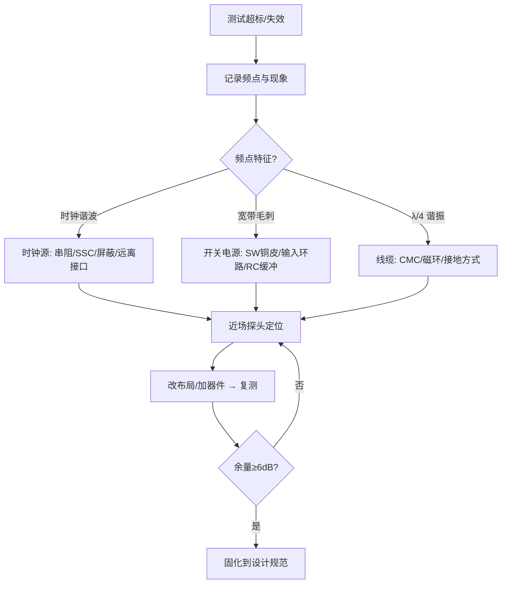

# 叠层与阻抗（分卷 01）

本分卷承接汇总稿 `硬件/原理/叠层与阻抗.md`，事实来源沿用 frontmatter 中列出的原始资料。

## 叠层设计原则
- 先定义高速信号层和连续参考平面，再安排电源层、普通信号层、机械、铜厚和成本约束。
- 关键高速层应靠近参考平面；层间距越小，场约束通常越强，阻抗和串扰更容易控制。
- 六层板不存在脱离板厂材料、板厚、接口和布线密度的唯一最佳叠层；叠层是电气与制造的共同约束。
- 相邻高速层应避免长距离平行，电源/地层要保证过流、回流和去耦连接。

## 阻抗变量
- 单端和差分阻抗受线宽、线距、铜厚、介质厚度、介电常数、铜粗糙度、阻焊和参考平面距离影响。
- 微带线场的一部分在空气中，带状线场主要在介质中；模型和有效介电常数不同，不能混用公式。
- 差分阻抗取决于两线耦合，线距变化会同时改变单线阻抗和耦合强度。
- 过孔 barrel、反焊盘、焊盘、stub 和背钻都会改变局部阻抗，并可能在高速频段形成谐振。

## 计算与公差
- EDA 阻抗计算必须输入板厂成品介质厚度、铜厚、介电常数和阻焊条件；默认材料只适合早期估算。
- 目标阻抗应给出标称值、允许公差、测试位置、参考平面和线宽线距规则。
- 线宽、蚀刻、压合和材料公差会叠加；阻抗规则应留出板厂可制造窗口，而不是只满足理论中心值。

## 制造闭环
`叠层表 -> 阻抗表 -> 线宽/线距和差分规则 -> 板厂确认 -> 首板阻抗测试 -> 规则回写`。

- 设计冻结前取得板厂正式 stackup；板厂更换材料或压合结构时必须重新计算。
- 首板测试 coupon、TDR 结果和批次信息应与设计版本绑定，异常时回溯材料和工艺而非盲改线宽。

## 工程检查
- [ ] 所有高速网络有明确参考平面和阻抗规则。
- [ ] 过孔换层、stub、连接器和封装不连续点进入链路预算。
- [ ] 叠层、阻抗、铜厚和板厚已由板厂确认。
- [ ] 阻抗测试点、coupon 和报告要求已写入生产资料。

## 走线与参考面组合
- 微带线适合外层易接触和调试的走线，但更易受阻焊、邻近铜皮和外部环境影响；带状线场约束更强，但过孔换层和损耗需要更多关注。
- 共面波导通过同层地铜调节阻抗，地铜间距、过孔栅栏和开窗都会改变结果；不能只沿用微带线宽。
- 差分对在不同层切换时要重新确认单端与差分阻抗，避免因为层间距变化导致对内不连续。

## 过孔工程
- 过孔电流能力由孔径、镀铜、数量和温升决定；高速过孔还要考虑反焊盘、参考过孔和 stub。
- 过孔旁的回流地过孔缩短高频回流路径，但会占用布线空间并影响阻抗，需按关键网络布置。
- 背钻深度、残桩长度和制造公差应在生产资料中明确，不能只在口头要求。

## 损耗与材料
- 高频损耗包含导体皮肤效应、铜粗糙度和介质损耗；长链路的材料选择不能只看介电常数。
- 介电常数随频率、树脂含量和批次变化，精密相位或高速差分项目应使用板厂给出的频率相关参数。
- 成品阻抗测试与设计仿真不一致时，先核对实际叠层和 coupon 结构，再调整规则。

+### 叠层与阻抗知识条目 1
低频时代我们说"阻抗"，脑子里想的是 $Z=U/I$，一个电阻、一个电容的容抗，都是"元件的属性"。但到了高速领域，信号在一根 PCB 走线上跑，这根线本身还没有接到负载，它也会呈现出一个阻抗——这就是**特征阻抗**（Characteristic Impedance，$Z_0$）。

打个比方：你在一条很长的水管里推一股水流，水流"感受"到的阻力，取决于管径、管壁材质，而不取决于管子尽头接了什么。信号在 PCB 上传播时也是一样：信号是电磁波，它沿着导体和参考平面之间的介质向前"爬"，每往前走一小段，都要给这一小段线充上电容、给这一小段回路建立磁场。信号"往前走一步要付出的代价"，就是特征阻抗。

关键认知：**特征阻抗是传输线的固有属性，与线长无关，与末端负载无关**。50Ω 的线不管切 1cm 还是 10cm，信号刚出发时看到的都是 50Ω。

🔬 **深入原理**

把传输线切成无数微元，每段有分布电感 $L_0$（单位长度电感）和分布电容 $C_0$（单位长度电容），无损条件下：

$$Z_0=\sqrt{\frac{L_0}{C_0}}$$

有损情况下完整式为：

$$Z_0=\sqrt{\frac{R_0+j\omega L_0}{G_0+j\omega C_0}}$$

高频时 $\omega L_0 \gg R_0$、$\omega C_0 \gg G_0$，退化回 $\sqrt{L_0/C_0}$，这就是为什么高速下 $Z_0$ 近似为纯实数、与频率无关。

信号传播速度：

$$v=\frac{1}{\sqrt{L_0C_0}}=\frac{c}{\sqrt{\varepsilon_r}}$$

FR-4 的 $\varepsilon_r\approx 4.2$，则 $v\approx 1.46\times10^8\ \text{m/s}$，约 **6 mil/ps**（记住这个数：166 ps/inch，或约 6.7 ps/mm）。这是后面等长计算的命根子。

微带线（表层走线，单参考面）常用近似式：

$$Z_0\approx\frac{87}{\sqrt{\varepsilon_r+1.41}}\ln\!\left(\frac{5.98H}{0.8W+T}\right)$$

带状线（内层，双参考面）：

$$Z_0\approx\frac{60}{\sqrt{\varepsilon_r}}\ln\!\left(\frac{4H}{0.67\pi(0.8W+T)}\right)$$

物理含义一句话：$H$（线到参考面距离）↑ → $Z_0$↑；$W$（线宽）↑ → $Z_0$↓；$\varepsilon_r$↑ → $Z_0$↓；$T$（铜厚）↑ → $Z_0$略↓。

🛠 **设计实例/操作**

*例1：四层板做 50Ω 单端。* 板厚 1.6mm，叠层 TOP/GND/PWR/BOTTOM，TOP 到 GND 的介质厚 0.1mm（约 3.94mil），1oz 铜（1.4mil）。用嘉立创/Polar SI9000 算，线宽约 6.5～7mil 得到 50Ω。若把介质改成 0.2mm，同样 50Ω 需要线宽约 13～14mil——所以**薄介质是高密度布线的前提**。

*例2：100Ω 差分。* 内层差分带状线，线宽 5mil、线距 5mil、上下各 4mil 介质，差分阻抗约 100Ω。注意差分阻抗 $Z_{diff}\approx 2Z_{odd}$，不是 $2Z_0$，因为耦合使奇模阻抗低于单端阻抗。

```
   微带线截面                     带状线截面
  ┌────W────┐                      ┌───GND───┐
  ▓▓▓▓▓▓▓▓▓▓  ← 信号线              ▒▒▒▒ H1
  ▒▒▒▒▒▒▒▒▒▒  H (介质 εr)          ┌──W──┐
  ████████████ ← GND 参考平面        ▓▓▓▓▓▓  ← 信号线
                                    ▒▒▒▒ H2
                                   └───GND───┘
```

⚠️ **常见误区**

1. 以为"阻抗是用万用表能量出来的"。万用表量的是直流电阻，$Z_0$ 要用 TDR（时域反射计）或按叠层计算，两者毫无关系。
3. 把 $\varepsilon_r$ 当常数 4.2 用到 GHz。FR-4 的 $\varepsilon_r$ 随频率下降（10GHz 时约 3.9～4.0），高频设计要用板厂给的 Dk/Df 表。
4. 只控制线宽却忘了参考平面完整。参考面一破，$H$ 等效变大、$Z_0$ 突变，算得再准也白搭。


📌 **要点速记**

- $Z_0=\sqrt{L_0/C_0}$，是传输线固有属性，与线长、负载无关。
- FR-4 上信号速度约 **6 mil/ps（166 ps/inch）**，是等长换算的基准。
- $H$↑ 阻抗↑，$W$↑ 阻抗↓，$\varepsilon_r$↑ 阻抗↓。
- 差分阻抗 ≈ 2×奇模阻抗，耦合越紧差分阻抗越低。
- 阻抗控制的前提是**连续的参考平面**。


---
### 叠层与阻抗知识条目 2
辐射发射（RE）测的是设备向空间辐射的电磁场强度，频段 30MHz～1GHz（有高频时钟的要测到 6GHz）。3m 法或 10m 法半电波暗室，天线在 1～4m 高度扫描，EUT 转台 360° 旋转，水平/垂直双极化，取最大值。

**最关键的认知**：在 30MHz～1GHz 频段，PCB 本身尺寸（10cm 量级）对应 $\lambda/4$ 约在 750MHz 才谐振，所以**1GHz 以下的辐射，主要天线是线缆和机壳缝隙，而不是 PCB 走线本身**。PCB 的作用是"驱动源"——它把共模电压加到了线缆上。

$$\text{PCB 共模噪声} \xrightarrow{\text{驱动}} \text{线缆(天线)} \xrightarrow{} \text{辐射超标}$$

🔬 **深入原理**

**两种辐射模型**：

差模（环路天线）：
$$E_{DM}=1.32\times10^{-14}\frac{f^2 A I_{DM}}{r}\ \text{V/m}$$

共模（单极子天线）：
$$E_{CM}=1.26\times10^{-6}\frac{f L I_{CM}}{r}\ \text{V/m}$$

**谐振长度**：线缆长度 $L=\lambda/4$ 时辐射效率最高。

$$f_{res}=\frac{c}{4L}\Rightarrow L=1\text{m}\to 75\text{MHz};\ L=0.5\text{m}\to150\text{MHz}$$

看到 75MHz、150MHz、300MHz 附近的宽峰，先怀疑线缆。

**缝隙泄漏**：屏蔽罩缝隙长度 $\ell$ 的屏蔽效能

$$SE(\text{dB})\approx 20\log_{10}\frac{\lambda}{2\ell}$$

$\ell=\lambda/2$ 时 SE=0，完全不屏蔽。所以设计规则：**最长缝隙 < $\lambda_{min}/20$**。1GHz（λ=300mm）→ 缝隙 <15mm；缝合过孔间距同理。

**PCB边缘辐射：** 电源/地平面对的边缘场可能参与辐射。20H内缩与地孔围栏只能作为特定结构的初始经验，不能保证EMC改善；需检查实际参考面、目标频率、回流与孔电感，并仿真/测量。固定100–200 mil或λ/20不是通用放行门限。

🛠 **设计实例/操作**

*例1：定位超标源。* 用近场探头（H 场环 + E 场棒）在板上扫，配合频谱仪：
- 时钟晶振周围强 → 晶振布局/屏蔽/串阻；
- DC-DC 开关节点强 → 缩小 SW 铜皮、加输入环路电容、加 RC 缓冲；
- 连接器处强 → 共模问题，加 CMC/磁环；
- 用手捏/拔线缆后读数大变 → 确认线缆是天线。

*例2：整改优先级（成本从低到高）。*
1. 改布局布线（缩小环路、完整参考面、换层伴地孔）——免费
2. 时钟串阻 22～33Ω、展频 SSC（±1% 可降 6～10dB）——几分钱
3. 接口加共模磁环/CMC——几毛钱
4. 加屏蔽罩/导电泡棉/铜箔——几元
5. 改叠层/改板——重新打样

*例3：SSC 展频。* 把 100MHz 时钟以 30kHz 三角波调制 ±0.5%，能量被摊到更宽频带，QP 读数可降 6～12dB。注意：**USB/以太网/DDR 有各自对 SSC 的容忍规范，不能乱开**（如 USB3 支持 −0.5% 下展）。

⚠️ **常见误区**

1. 只盯着 PCB 走线，忘了线缆才是主天线。
2. 屏蔽罩接地只焊四个角。应沿边多点焊接，间距 < $\lambda/20$。
3. 开孔散热用大方孔。应改成**多个小圆孔阵列**（同样开孔率，屏蔽效能高很多）。
4. 用展频掩盖问题。SSC 降的是"测量读数"，实际峰值能量还在，对邻近敏感电路照样干扰。
5. 忽略 1GHz 以上。有 DDR4/USB3/HDMI 的产品必须测到 3～6GHz，此时 PCB 走线本身就能辐射。

📌 **要点速记**

- 1GHz 以下辐射的主天线是线缆与缝隙，PCB 提供共模驱动源。
- 共模辐射 $\propto f L I_{CM}$，差模辐射 $\propto f^2 A I_{DM}$。
- $\lambda/4$ 谐振：1m 线 → 75MHz，重点排查。
- 缝隙/缝合孔间距 < $\lambda_{min}/20$；散热孔用小圆孔阵列。
- 整改按"布局→串阻/展频→磁环→屏蔽"的成本顺序推进。


---
### 叠层与阻抗知识条目 3
🔬 **深入原理：一张总表**

| 实验 | 频段/波形 | 主因 | 首选整改 | 备选 |
|---|---|---|---|---|
| CE 传导 | 150k～30MHz | 低频段差模、高频段共模 | X/Y 电容、CMC、减小 $dv/dt$ | 变压器屏蔽层、磁环、RC 缓冲 |
| RE 辐射 | 30M～1/6GHz | 线缆共模、缝隙泄漏、平面边缘 | 缩小环路、串阻、CMC/磁环 | 屏蔽罩、SSC、改叠层 |
| ESD | <1ns, 30A | 高频路径电感、接地不良 | TVS 靠连接器、地路径最短 | 结构泄放、导电泡棉、软件容错 |
| EFT | 5/50ns 突发 | 共模、地环路 | Y 电容、CMC、机壳多点搭接 | TVS、缩短复位/晶振路径 |
| Surge | 8/20μs, 数百A | 能量泄放不足 | GDT+MOV+TVS 三级 | 退耦电感/PTC、隔离变压器 |
| CS | 150k～80MHz | 电路不平衡、结检波 | 平衡设计、RC 低通、射频旁路 | CMC、屏蔽层 360° 接地 |
| RS | 80M～6GHz | 同 CS + 直接场耦合 | 屏蔽、滤波、缩小敏感环路 | 器件重选、软件滤波 |
| DIP | 电压跌落 | 储能不足 | 加大输入电容、掉电检测 | 宽输入范围电源 |

**通用排查流程：**



🛠 **设计实例/操作**

*例1：把 EMC 前移到设计阶段的 Checklist（板级）。*

1. 叠层：至少一个完整 GND 平面，高速层紧邻 GND，PWR/GND 相邻薄介质。
2. 分区：接口区 / 数字区 / 模拟区 / 电源区物理分开，接口区靠板边集中。
3. 回流：不跨分割，换层伴地孔，排针按 1:3 配地。
4. 时钟：最短、包地、串阻、远离板边与接口 ≥ 300mil。
5. 接口：TVS 靠连接器、CMC 在其后、走线不回穿数字区。
6. 电源：去耦贴引脚、DC-DC 输入环路最小、SW 铜皮最小。
7. 板边：缝合地过孔间距 ≤200mil，20H 规则。
8. 结构：屏蔽罩多点接地、缝隙 <λ/20、螺柱接地。

*例2：整改的"经济学"。* 同样 10dB 的改善：
- 改布线：0 元/台，但需要重新打样（一次性成本）
- 串阻 + 磁环：约 0.2 元/台 × 10 万台 = 2 万元
- 屏蔽罩：约 3 元/台 × 10 万台 = 30 万元

所以**设计阶段多花两天做 EMC 评审，可能省下几十万**。

⚠️ **常见误区**

1. "试错法"整改：随机加电容磁环，改好了也不知道为什么，量产一致性差。
2. 不做近场定位就动手。定位是整改效率的关键。
3. 只解决超标频点，不看整体余量趋势。
4. 整改方案不固化。同一个坑在下一个项目再踩一遍。
5. 忽视测试布置差异。同一台机器在不同实验室差 3～5dB 很正常。

📌 **要点速记**

- 每个实验都有典型主因与首选手段，先按表定位再动手。
- 排查顺序：记录频点 → 判断特征 → 近场定位 → 整改 → 复测。
- 板级 8 条 Checklist 能挡掉大部分问题。
- 整改成本随阶段推后指数上升，前移设计最划算。
- 留 6dB 余量，把有效方案固化为公司设计规范。


---

## 相关入口

- [[硬件/原理/叠层与阻抗|分类稿汇总目录]]
- [[wiki/来源映射|Wiki 来源映射]]
- [[wiki/概览|Wiki 概览]]
