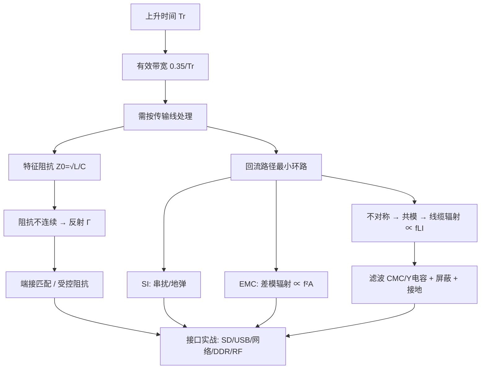

# 电源设计（分卷 03）

本分卷承接汇总稿 `硬件/原理/电源设计.md`，事实来源沿用 frontmatter 中列出的原始资料。

## 验证清单
### 电源设计知识条目 6
1. **信号怎么走**（阻抗、反射、匹配）——传输线理论；
2. **电流怎么回**（回流路径、地设计、共模/差模）——回路思维；
3. **能量怎么跑掉/进来**（EMC 发射与抗扰）——耦合与屏蔽。

而这三件事本质上都指向同一句话：**高速设计的核心不是"画线"，而是"管理电磁场与电流回路"**。

🔬 **深入原理：知识地图**



**贯穿全课的 5 个数字**：

| 数字 | 含义 |
|---|---|
| **6 mil/ps** | FR-4 内层传播速度（微带约 7） |
| **0.35 / Tr** | 有效带宽（拐点频率） |
| **±3H** | 80% 回流集中范围 |
| **1 nH/mm** | 普通走线/引线电感估算 |
| **λ/20** | 缝隙、缝合孔、地线过孔的间距上限 |

🛠 **设计实例/操作：完整设计流程与自检清单**

**阶段一：原理图/选型**
- [ ] 确认各接口速率、上升时间、阻抗规范（USB 90Ω、以太网/LVDS 100Ω、单端 50Ω、DDR 40/50Ω）
- [ ] 时钟源选型（是否需要 SSC）、串阻位置预留
- [ ] ESD/TVS 选型（结电容匹配速率）、CMC、滤波元件预留
- [ ] 电源架构：噪声敏感模块（GNSS/RF/ADC/PHY-AVDD）用 LDO 或加滤波
- [ ] 预留 π 型匹配、测试点（低速）、调试接口

**阶段二：叠层与阻抗**
- [ ] 每个信号层紧邻完整参考平面
- [ ] PWR 与 GND 平面相邻，介质尽量薄
- [ ] 找板厂确认叠层与 Dk/Df，算准线宽线距
- [ ] 高速差分优先内层带状线（FEXT≈0）

**阶段三：布局**
- [ ] 分区：接口区/数字区/模拟区/电源区/RF 区
- [ ] 接口靠板边集中，走线不回穿数字区
- [ ] 高速链路"一"字排开，不折返
- [ ] 去耦电容贴引脚，DC-DC 输入环路最小
- [ ] 晶振靠芯片、下方铺地
- [ ] 天线净空区、变压器隔离沟先划出

**阶段四：布线**
- [ ] 不跨分割；换层伴地孔（<100～200mil）
- [ ] 3W/4W/5W 间距规则按等级执行
- [ ] 差分：等长、等距、对称，就近补偿
- [ ] DDR：按组等长（时延模式），VTT 在最远端
- [ ] RF：短直无过孔、两侧缝合地孔
- [ ] 时钟包地且地线两端+中间打孔

**阶段五：EMC 加固**
- [ ] 板边缝合地过孔 ≤200mil，20H 规则
- [ ] 排针/连接器按 1:3 配地
- [ ] 屏蔽罩多点接地，缝隙 <λ/20
- [ ] 机壳地与信号地 1nF/2kV + 1MΩ 连接
- [ ] 长线 I/O 预留磁环/CMC 位置

**阶段六：验证**
- [ ] SI 仿真（眼图、串扰、过冲）
- [ ] PDN 阻抗仿真（$Z<Z_{target}$）
- [ ] 功能 + 压力 + 高低温测试
- [ ] EMC 预测试（近场探头 + 简易暗室）
- [ ] 留 6dB 余量再送正式认证

⚠️ **常见误区（全课总结）**

1. **用频率而非上升时间判断高速**——第一原则性错误。
2. **只画线不想回流**——所有 SI/EMC 问题的共同根源。
3. **等长绝对化**——该松的地方过度绕线，反而增加串扰。
4. **EMC 后置**——测试超标才整改，成本高十倍。
5. **迷信单一手段**——屏蔽罩/磁环/展频都不是万能药。
6. **不留余量**——刚好合格 = 量产必炸。
7. **不做定位就整改**——盲目试错，改好了也复现不了。

📌 **要点速记**

- 高速设计三主线：信号路径、回流路径、耦合路径。
- 五个关键数字：6mil/ps、0.35/Tr、±3H、1nH/mm、λ/20。
- 流程六阶段：选型 → 叠层 → 布局 → 布线 → EMC 加固 → 验证。
- 80% 的结果在布局阶段就已决定。
- 一切规则的目的都是：**让电流走最小的环路**。

+### 电源设计进阶知识条目 1
本项目的目标板是"逻辑派 FPGA-G1 开发板"——一块以 FPGA 为核心、外挂 DDR3 内存、带 HDMI 输出、带 MCU 协处理、带 TF 卡与各类排针外设、由多路 DC-DC/LDO 供电的开发板。这种板子有三个典型特征：**BGA 封装（引脚在芯片底下，出不来线）**、**DDR3 高速并行总线（几百 Mbps~1.6Gbps 每根线，要等长）**、**HDMI 高速差分（Gbps 级，要阻抗控制）**。这三条任意一条，都足以让双面板"做不出来"。

所谓"全链路"，指的是下面这条不可跳步的流水线：

```
原理图分析 → 电源树梳理 → 网表/器件导入 → 板框结构导入 → 环境与快捷键
   → 模块抓取/接口定位 → 模块化预布局 → 3D 结构校验
   → 层数分析与叠层设置 → 阻抗理解与计算 → 规则（线宽/间距/过孔/网络类/差分）
   → BGA 扇孔 → 分模块布线 → 电源连通性 → 布线优化 → 时序等长
   → 缝合地过孔 → DRC → 丝印/LOGO → 生产资料输出 → 下单
```
### 电源设计进阶知识条目 2
这一讲教你**怎么"读"一张开发板原理图**。很多人打开原理图只会看"这里连那里"，正确做法是先做**功能分块**，再做**信号流梳理**，最后落到**物理约束**。

逻辑派 FPGA-G1 的原理图通常按页组织，典型分页如下：

| 页面 | 模块 | 关键关注点 |
|---|---|---|
| P1 | 封面/框图 | 系统总览、模块间接口 |
| P2 | FPGA 核心（BANK0~BANK7） | 每个 BANK 的电平标准与 VCCIO |
| P3 | 配置电路（FLASH/JTAG） | 配置模式引脚、上下拉 |
| P4 | DDR3 | 数据/地址/控制分组、VREF、端接 |
| P5 | HDMI | TMDS 差分对、ESD、DDC |
| P6 | MCU | 晶振、下载口、与 FPGA 的通信 |
| P7 | 外设（TF、LED、按键、排针） | IO 归属哪个 BANK |
| P8 | 电源 | DC-DC / LDO / 上电时序 |

读图的正确顺序是：**先看电源 → 再看时钟 → 再看总线 → 最后看杂散 IO**。因为电源决定布局重心，时钟决定关键路径，总线决定等长分组。
### 电源设计进阶知识条目 3
这一讲做一件极其重要但常被跳过的事：**画出这块板的电源树（Power Tree）**。电源树就是"电从哪来 → 经过谁 → 到谁去 → 要多大电流"的一张图。它同时决定了三件事：DC-DC 模块放哪、电源平面怎么分割、铜皮/过孔要多粗。

一块 FPGA 开发板的典型电源树（数值为示例量级，实际以原理图与器件手册为准）：

```
DC 5V 输入 (Type-C / DC 座)
   |
   +-- DCDC1 --> 1.0V / 1.2V  VCCINT   (FPGA 内核, 电流最大, 1~3A)
   |
   +-- DCDC2 --> 1.5V         VCCIO_DDR + DDR3 VDD/VDDQ (0.5~1.5A)
   |                  |
   |                  +-- 分压/专用芯片 --> 0.75V VREF (小电流, mA 级)
   |
   +-- DCDC3 --> 3.3V         VCCIO(3.3V BANK) / MCU / HDMI 5V逻辑周边 (1~2A)
   |                  |
   |                  +-- LDO --> 2.5V / 1.8V  VCCAUX 等 (低噪声小电流)
   |
   +-- 直通 --> HDMI +5V (给 HDMI 连接器 5V 供电, 需限流/ESD)
```
### 电源设计进阶知识条目 4
**BANK 朝向决定一切。** 假设 FPGA 的 BANK 分布如下（示意）：

```
            BANK 0 (顶边)
      ┌──────────────────────┐
BANK7 │                      │ BANK 1
(左)  │      FPGA  BGA       │  (右)
BANK6 │                      │ BANK 2
      └──────────────────────┘
            BANK 3/4 (底边)
```

如果 DDR3 分配在 BANK 1/2（右侧），HDMI 在 BANK 0（顶边），那么 DDR3 就该放在芯片右侧、HDMI 放在顶部。若结构上 HDMI 必须在右边，就把 FPGA **旋转 90°**，而不是让走线绕半圈。**旋转芯片是零成本的，绕线是有代价的。**

**FPGA 去耦网络的分层思想（PDN 三段式）：**

| 频段 | 电容 | 位置 |
|---|---|---|
| DC~100kHz | 稳压器本身 | DC-DC 输出 |
| 100kHz~1MHz | 100µF/47µF 钽电容/固态电容 | 电源入口附近 |
| 1MHz~50MHz | 10µF/4.7µF 0603/0805 MLCC | BGA 外围一圈 |
| 50MHz~500MHz | 100nF 0402 MLCC | **BGA 背面正对电源球** |
| >500MHz | 平面电容（L4-L5 间距薄） | 靠叠层保证 |

目标是让 PDN 阻抗在关注频段内低于目标阻抗：

$$Z_{target}=\frac{V_{dd}\times \text{ripple}\%}{I_{max}}$$

例：$V_{dd}=1.0\mathrm{V}$，允许纹波 5%，$I_{max}=2\mathrm{A}$，则 $Z_{target}=\dfrac{1.0\times0.05}{2}=25\ \mathrm{m}\Omega$。
### 电源设计进阶知识条目 5
**核心概念：热回路（Hot Loop）。** Buck 中电流路径分两个相位：

```
上管导通 (相位1):  Vin → Cin → 上管 → L → Cout → GND → Cin
下管导通 (相位2):  L → Cout → GND → 下管 → L

两相位电流之"差"= 高频交流环流, 只流经:
      Cin → 上管 → 下管 → GND → Cin      <== 这就是热回路
```

**只有热回路是高 di/dt 的**，它的面积决定了辐射和 SW 振铃。所以第一优先级永远是：**Cin 紧贴芯片 VIN 和 GND 引脚，环路面积最小（目标 <5mm²）。**

环路电感产生的尖峰电压：

$$V_{spike}=L_{loop}\cdot\frac{di}{dt}$$

若 $L_{loop}=5\ \mathrm{nH}$，$di/dt=2\ \mathrm{A/ns}$，则 $V_{spike}=10\ \mathrm{V}$——足以让 5V 输入的芯片看到 15V 尖峰而损坏。

**SW 节点：铜皮面积要"够用即可，越小越好"。** SW 是 dv/dt 最高的节点（几 V/ns），面积大就是天线。但又要能过电流，所以取折中：宽度按电流够用（如 2A 取 40~60mil 或一小块铜），长度尽量短，**不要为了散热把 SW 铺一大片**。

**反馈（FB）走线**：FB 是高阻抗节点，最怕干扰。规则：
- FB 走细线（6~10mil），从 **Cout 正极就近取样**（真正的负载点），不要从电感出口取；
- FB 走线远离 SW 和电感，必要时在下方铺地隔离；
- 分压电阻靠近芯片 FB 引脚。
### 电源设计进阶知识条目 6
**例1：Buck 标准布局（ASCII）**

```
        VIN 进来
          │
      ┌───┴───┐ Cin(0402/0603 x2, 紧贴!)
      │  ▓▓▓  │
   ┌──┴───────┴──┐
   │   DCDC IC   │── SW ──[ 电感 L ]──┬── VOUT
   │  VIN    SW  │   短且窄            │
   │  GND    FB  │◄──细线取样───────┤
   └──┬──────────┘                    │
      │                          ┌────┴────┐
     GND 大面积铺铜 + 多过孔      │  Cout   │
                                 └────┬────┘
                                     GND
```

顺序口诀：**Cin 最先摆 → 芯片 → 电感 → Cout → FB 分压 → 其他。**

**例2：热设计与隔离。**
- 芯片散热焊盘下方打 **4~9 个过孔（0.3mm）**，把热导到内层地平面；
- 三路 DC-DC 之间保持 5mm 以上间距，电感之间尽量**错开轴向**，减少磁耦合；
- 电源区与 HDMI/DDR3 区之间，用**一整片地铜 + 缝合过孔**隔开；
- 输入端加 π 型滤波（磁珠 + 电容）抑制传导 EMI。
### 电源设计进阶知识条目 7
🔬 深入原理
- 载流能力：外层 1oz 铜、1mm 线宽约可载 1A；内层因散热差需更宽。`电流→铜宽`经验：温升 10℃ 时 $W(mil)\approx I(A)\times 20$（粗略）。
- 压降：$V_{drop}=I\times R_{trace}$，$R=\rho L/(W\times T)$。长距离细电源走线会掉压，必须用铺铜（polygon）或加宽。
- 为什么重要：FPGA 核心 1.0V 瞬时电流大，若通道电阻大，核压跌落触发欠压保护。

🛠 设计实例/操作
1. 例：DCDC 输出 3.3V，先铺一块 3.3V 铜皮覆盖 FPGA/MCU 的 3.3V BANK，再用过孔"树状"分到各引脚；用 `Highlight` 验证每个 3.3V 引脚都被铜皮覆盖。
2. 例：1.0V 核心电源用 L3/L4 两层同时铺铜并打多过孔并联，降低平面电阻与电感。

⚠️ 常见误区
- 以为"一个过孔就够了"——单过孔载流有限（约 1A@10mil 孔），大电流需多个并联。
- 电源铺铜被信号过孔"打穿"成孤岛，实际没连通。

📌 要点速记
- 先画电源树：源→负载一目了然。
- 大电流用铺铜+多过孔，勿用细线。
- 核压（1.0V）走线最短最宽。
- 铺铜后务必高亮验证全连通。
- 电源过孔要足够多，降低 R/L。


---
### 电源设计进阶知识条目 8
以"**MCU + DDR3 + 一路 USB 的小主控板,从 4 层升级到 6 层**"为例,走完整流程。

**步骤 1 · 建库(原理图符号 + 封装)**
先准备好器件的原理图 Symbol 和 PCB Footprint(封装)。DDR 用 BGA、USB 用连接器、MCU 用 QFP/LQFP。封装的焊盘尺寸、间距必须与器件 datasheet 一致,这是后面能扇出(fan-out)的前提。

**步骤 2 · 布局(Placement)**
- 先放接口(USB、电源座)在板边;
- MCU 居中,DDR 紧挨 MCU(缩短地址/数据线);
- 电源模块(DC-DC/LDO)靠边,远离敏感模拟区;
- 去耦电容紧贴每个芯片的电源引脚。

**步骤 3 · 叠层设置(Layer Stack Manager)**
在 EDA 工具里配置 6 层:Top / GND / Sig / PWR / GND / Bottom,并填入各层介质厚度与 $\varepsilon_r$,让工具能按公式算阻抗。

**步骤 4 · 布线(Routing)**
- 高速差分(USB D+/D−)走表层微带线,90Ω 差分阻抗,紧邻 GND 平面;
- DDR 数据线走内层带状线,50Ω 单端;
- 电源通过过孔连到 PWR 平面,再扇出给芯片。

**步骤 5 · 等长(Length / Timing Matching)**
DDR 的"同一组数据线(DQ0~DQ7 + DQS)"长度要一致,保证同时到达。工具可做蛇形绕线(Trombone/Serpentine)把短的补长。

**步骤 6 · DRC(设计规则检查)**
检查线宽、间距、短路、开路、阻抗规则、差分对、丝印重叠等是否违规。

**步骤 7 · 生产资料输出**
导出 Gerber(各层光绘)、NC Drill(钻孔)、IPC-356 网表、钢网层、BOM、装配图,连同叠层说明一起发给工厂。

**第二个小例子(一句话带过):** 一块"HDMI + 千兆 PHY"板,重点在于 HDMI 的四对差分(100Ω)与 PHY 的 MDI 差分都要有专属、不被打断的参考平面,否则眼图会闭合——这正是 6 层板多出来的地平面派上用场的地方。
### 电源设计进阶知识条目 9
🔬 深入原理：多集电极管每个集电极电流 $I_{Ck}\propto A_k$（集电区面积），且 $\sum I_{Ck}=I_E-\ldots$。若集电极面积比 $A_2:A_1=n:1$，则 $I_{C2}=n I_{C1}$，比例由光刻决定，精度高且温度共漂。MOS 电流镜：两管 $W/L$ 相同、栅极共接并二极管连接参考管，则饱和区 $I_D=\frac{1}{2}\mu C_{ox}\frac{W}{L}(V_{GS}-V_{TH})^2$，得 $I_{OUT}/I_{REF}=(W/L)_{OUT}/(W/L)_{REF}$，比例靠宽长比设定，比 BJT 更灵活、无基极电流误差。JFET 则靠固定 $V_{GS}=0$ 或加源极电阻得到 $I_D=I_{DSS}$ 或更小恒流。

🛠 设计实例/计算：MOS 镜像参考 $I_{REF}=100\,\mu\text{A}$，参考管 $(W/L)_1=10$，希望 $I_{OUT}=300\,\mu\text{A}$，则需 $(W/L)_2=(W/L)_1\times 3=30$。若用 BJT 多集电极，面积比 3:1 即得 3 倍电流。JFET 取 $V_{GS}=0$，$I_D=I_{DSS}=2\,\text{mA}$ 即可作 2 mA 恒流源。

⚠️ 常见误区：①以为多集电极比例可任意调节——只能取版图设计的离散比例。②MOS 镜像忽略沟道长度调制（$\lambda$ 不为 0）会高估恒流性，长沟道/加 cascode 可改善。③把 JFET 当 MOS 用，忘 JFET 是耗尽型、栅源常可负偏。

📌 要点速记：
- 多集电极 BJT：电流比 = 集电区面积比，温度一致；
- MOS 电流镜比例 = $(W/L)$ 比，无基极电流误差；
- JFET 可凭 $I_{DSS}$ 直接作恒流源；
- CMOS 工艺中 FET 电流源是主流。

## 相关入口

- [[硬件/原理/电源设计|分类稿汇总目录]]
- [[wiki/来源映射|Wiki 来源映射]]
- [[wiki/概览|Wiki 概览]]
